<!-- AUTO-GENERATED from 'project1 documentation รายงานฉบับขอสอบ (Final report).docx' (docx last modified 2026-11-08 23:28) · converted 2026-11-10 20:13 -->
<!-- Do not hand-edit: this file is the single source of truth (SRS / project documentation) for AI agents working in the SchoolDark repo. Edit the Word file instead. -->
<!-- Source rule: every .docx in materials/ai-bro/doc/ is a project file; convert the NEWEST one (sort by last modified, skip ~$ lock files). -->
<!-- Regenerate with: python materials/ai-bro/tools/convert_docx_to_md.py "materials/ai-bro/doc/<newest>.docx" materials/ai-bro/final-report.md materials/ai-bro/images -->

## Table of Contents

- [บทคัดย่อ](#บทคัดย่อ)
- [กิตติกรรมประกาศ](#กิตติกรรมประกาศ)
- [สารบัญ](#สารบัญ)
- [สารบัญรูป](#สารบัญรูป)
- [สารบัญตาราง](#สารบัญตาราง)
- [บทที่ 1 บทนำ](#บทที่-1-บทนำ)
  - [1.1 ความเป็นมาและความสำคัญ](#11-ความเป็นมาและความสำคัญ)
  - [1.2 วัตถุประสงค์](#12-วัตถุประสงค์)
  - [ขอบเขตของโครงงาน](#ขอบเขตของโครงงาน)
    - [1.3.1 การแบ่งขอบเขตความรับผิดชอบของแต่ละกลุ่มงาน](#131-การแบ่งขอบเขตความรับผิดชอบของแต่ละกลุ่มงาน)
    - [1.3.2 ขอบเขตความรับผิดชอบของคณะผู้จัดทำ](#132-ขอบเขตความรับผิดชอบของคณะผู้จัดทำ)
  - [1.4 ประโยชน์ที่คาดว่าจะได้รับ](#14-ประโยชน์ที่คาดว่าจะได้รับ)
- [บทที่ 2 ทฤษฎีและเทคโนโลยีที่เกี่ยวข้อง](#บทที่-2-ทฤษฎีและเทคโนโลยีที่เกี่ยวข้อง)
  - [2.1 แนวคิดและทฤษฎีที่เกี่ยวข้อง](#21-แนวคิดและทฤษฎีที่เกี่ยวข้อง)
    - [2.1.1 วงจรการพัฒนาซอฟต์แวร์ (Software Development Life Cycle: SDLC)](#211-วงจรการพัฒนาซอฟต์แวร์-software-development-life-cycle-sdlc)
    - [2.1.2 วงจรการพัฒนาซอฟต์แวร์แบบ AI-native (AI-native SDLC)](#212-วงจรการพัฒนาซอฟต์แวร์แบบ-ai-native-ai-native-sdlc)
    - [2.1.3 หลักการออกแบบที่ยึดผู้ใช้งานเป็นศูนย์กลาง (User-Centered Design)](#213-หลักการออกแบบที่ยึดผู้ใช้งานเป็นศูนย์กลาง-user-centered-design)
    - [2.1.4 แบบจำลองความสัมพันธ์ระหว่างข้อมูล (Entity-Relationship Model)](#214-แบบจำลองความสัมพันธ์ระหว่างข้อมูล-entity-relationship-model)
    - [2.1.5 ทฤษฎีการออกแบบฐานข้อมูล (Database Normalization)](#215-ทฤษฎีการออกแบบฐานข้อมูล-database-normalization)
    - [2.1.6 การดำเนินการพื้นฐานกับข้อมูล (CRUD Operations)](#216-การดำเนินการพื้นฐานกับข้อมูล-crud-operations)
    - [2.1.7 สถาปัตยกรรมแบบ RESTful API](#217-สถาปัตยกรรมแบบ-restful-api)
    - [2.1.8 สถาปัตยกรรมแบบไมโครเซอร์วิส (Microservices Architecture)](#218-สถาปัตยกรรมแบบไมโครเซอร์วิส-microservices-architecture)
    - [2.1.9 การจัดการตัวตนและสิทธิ์การเข้าถึง (Identity and Access Management: IAM)](#219-การจัดการตัวตนและสิทธิ์การเข้าถึง-identity-and-access-management-iam)
    - [2.1.10 การควบคุมการเข้าถึงข้อมูลตามบทบาท (Role-Based Access Control)](#2110-การควบคุมการเข้าถึงข้อมูลตามบทบาท-role-based-access-control)
    - [2.1.11 การนำเข้าและส่งออกข้อมูล (Data Import / Export)](#2111-การนำเข้าและส่งออกข้อมูล-data-import-export)
  - [2.2 เทคโนโลยีที่ใช้ในการพัฒนาระบบ](#22-เทคโนโลยีที่ใช้ในการพัฒนาระบบ)
    - [2.2.1 React](#221-react)
    - [2.2.2 Next.js](#222-nextjs)
    - [2.2.3 FastAPI](#223-fastapi)
    - [2.2.4 PostgreSQL](#224-postgresql)
    - [2.2.5 MinIO](#225-minio)
    - [2.2.6 ที่เก็บข้อมูลฝั่งเบราว์เซอร์ (Web Storage / LocalStorage)](#226-ที่เก็บข้อมูลฝั่งเบราว์เซอร์-web-storage-localstorage)
    - [2.2.7 Docker](#227-docker)
    - [2.2.8 API Gateway และ NGINX](#228-api-gateway-และ-nginx)
    - [2.2.9 Redis และ Celery](#229-redis-และ-celery)
    - [2.2.10 HTTPS](#2210-https)
  - [2.3 ระบบที่เกี่ยวข้อง](#23-ระบบที่เกี่ยวข้อง)
    - [2.3.1 SchoolBright](#231-schoolbright)
    - [2.3.2 DMC (Data Management Center)](#232-dmc-data-management-center)
    - [2.3.3 Fedena](#233-fedena)
    - [2.3.4 เปรียบเทียบระบบที่เกี่ยวข้องกับระบบที่พัฒนา](#234-เปรียบเทียบระบบที่เกี่ยวข้องกับระบบที่พัฒนา)
- [บทที่ 3 การวิเคราะห์และออกแบบระบบ](#บทที่-3-การวิเคราะห์และออกแบบระบบ)
  - [3.1 ปัญหาของกระบวนการเดิม](#31-ปัญหาของกระบวนการเดิม)
  - [3.2 การวิเคราะห์ความต้องการของระบบ](#32-การวิเคราะห์ความต้องการของระบบ)
    - [3.2.1 ผู้ใช้งานระบบและสิทธิ์การเข้าถึง](#321-ผู้ใช้งานระบบและสิทธิ์การเข้าถึง)
    - [3.2.2 ความต้องการเชิงฟังก์ชัน (Functional Requirements)](#322-ความต้องการเชิงฟังก์ชัน-functional-requirements)
    - [3.2.3 ความต้องการที่ไม่เป็นฟังก์ชัน (Non-functional Requirements)](#323-ความต้องการที่ไม่เป็นฟังก์ชัน-non-functional-requirements)
  - [3.3 การออกแบบระบบ](#33-การออกแบบระบบ)
    - [3.3.1 ภาพรวมระบบ](#331-ภาพรวมระบบ)
    - [3.3.2 รายละเอียดสถาปัตยกรรมของผู้จัดทำ (Service B)](#332-รายละเอียดสถาปัตยกรรมของผู้จัดทำ-service-b)
    - [3.3.3 Use Case Diagram ของระบบ](#333-use-case-diagram-ของระบบ)
    - [3.3.4 รายละเอียด Use Case โดยสังเขป](#334-รายละเอียด-use-case-โดยสังเขป)
  - [3.4 การออกแบบฐานข้อมูล](#34-การออกแบบฐานข้อมูล)
    - [3.4.1 กลุ่มตารางงานรับสมัครนักเรียน](#341-กลุ่มตารางงานรับสมัครนักเรียน)
    - [3.4.2 กลุ่มตารางงานทะเบียนนักเรียนและการตั้งค่าทะเบียน](#342-กลุ่มตารางงานทะเบียนนักเรียนและการตั้งค่าทะเบียน)
    - [3.4.3 กลุ่มตารางการตั้งค่าโรงเรียนและตารางที่เกี่ยวข้อง](#343-กลุ่มตารางการตั้งค่าโรงเรียนและตารางที่เกี่ยวข้อง)
    - [3.4.4 กลุ่มตารางงานบุคลากร](#344-กลุ่มตารางงานบุคลากร)
    - [3.4.5 กลุ่มตารางการตั้งค่างานบุคลากร](#345-กลุ่มตารางการตั้งค่างานบุคลากร)
    - [3.4.6 Data Dictionary](#346-data-dictionary)
  - [3.5 การใช้ AI ในการพัฒนา](#35-การใช้-ai-ในการพัฒนา)
    - [3.5.1 เครื่องมือและโมเดลที่ใช้](#351-เครื่องมือและโมเดลที่ใช้)
    - [3.5.2 การเขียน Prompt](#352-การเขียน-prompt)
- [บทที่ 4 ผลการดำเนินการ](#บทที่-4-ผลการดำเนินการ)
  - [4.1 ภาพรวมระบบต้นแบบ](#41-ภาพรวมระบบต้นแบบ)
  - [4.2 งานรับสมัครนักเรียนออนไลน์](#42-งานรับสมัครนักเรียนออนไลน์)
    - [4.2.1 หน้าสมัครเรียนออนไลน์](#421-หน้าสมัครเรียนออนไลน์)
    - [4.2.2 หน้าตรวจสอบสถานะการสมัคร](#422-หน้าตรวจสอบสถานะการสมัคร)
    - [4.2.3 หน้าบริหารจัดการผู้สมัคร](#423-หน้าบริหารจัดการผู้สมัคร)
    - [4.2.4 หน้าประวัติและข้อมูลผู้สมัคร](#424-หน้าประวัติและข้อมูลผู้สมัคร)
    - [4.2.5 หน้าส่งอีเมลแจ้งเตือน](#425-หน้าส่งอีเมลแจ้งเตือน)
    - [4.2.6 หน้าพิมพ์ใบสมัคร](#426-หน้าพิมพ์ใบสมัคร)
  - [4.3 งานทะเบียนนักเรียน](#43-งานทะเบียนนักเรียน)
    - [4.3.1 หน้าข้อมูลนักเรียนทั้งโรงเรียน](#431-หน้าข้อมูลนักเรียนทั้งโรงเรียน)
    - [4.3.2 หน้าต่างเพิ่มนักเรียน](#432-หน้าต่างเพิ่มนักเรียน)
    - [4.3.3 การจัดการนักเรียนหลายคนพร้อมกัน](#433-การจัดการนักเรียนหลายคนพร้อมกัน)
    - [4.3.4 การเลื่อนชั้นและบันทึกสำเร็จการศึกษา](#434-การเลื่อนชั้นและบันทึกสำเร็จการศึกษา)
    - [4.3.5 หน้าต่างบันทึกย้ายออกและลาออก](#435-หน้าต่างบันทึกย้ายออกและลาออก)
    - [4.3.6 หน้าต่างส่งออกข้อมูล](#436-หน้าต่างส่งออกข้อมูล)
    - [4.3.7 หน้ารายงานสถิตินักเรียน](#437-หน้ารายงานสถิตินักเรียน)
    - [4.3.8 การออกเอกสาร ปพ.1 และ ปพ.2](#438-การออกเอกสาร-ปพ1-และ-ปพ2)
  - [4.4 งานบุคลากร](#44-งานบุคลากร)
    - [4.4.1 หน้ารายชื่อบุคลากร](#441-หน้ารายชื่อบุคลากร)
    - [4.4.2 หน้าเพิ่มข้อมูลบุคลากร](#442-หน้าเพิ่มข้อมูลบุคลากร)
    - [4.4.3 หน้าพิมพ์แฟ้มประวัติบุคลากร](#443-หน้าพิมพ์แฟ้มประวัติบุคลากร)
  - [4.5 การตั้งค่าระบบ](#45-การตั้งค่าระบบ)
    - [4.5.1 หน้าตั้งค่าข้อมูลโรงเรียน](#451-หน้าตั้งค่าข้อมูลโรงเรียน)
    - [4.5.2 หน้าตั้งค่างานบุคลากร](#452-หน้าตั้งค่างานบุคลากร)
    - [4.5.3 หน้าตั้งค่างานรับสมัครนักเรียน](#453-หน้าตั้งค่างานรับสมัครนักเรียน)
    - [4.5.4 หน้าตั้งค่าคอลัมน์ตารางข้อมูลนักเรียน](#454-หน้าตั้งค่าคอลัมน์ตารางข้อมูลนักเรียน)
  - [4.6 สรุปผลการดำเนินงาน](#46-สรุปผลการดำเนินงาน)
- [บทที่ 5 บทสรุป](#บทที่-5-บทสรุป)
  - [5.1 สรุปผลการปฏิบัติงาน](#51-สรุปผลการปฏิบัติงาน)
  - [5.2 ปัญหาอุปสรรคและข้อเสนอแนะ](#52-ปัญหาอุปสรรคและข้อเสนอแนะ)
    - [5.2.1 ปัญหาและข้อจำกัดของแพลตฟอร์มการพัฒนา](#521-ปัญหาและข้อจำกัดของแพลตฟอร์มการพัฒนา)
    - [5.2.2 วิธีการแก้ไขปัญหา](#522-วิธีการแก้ไขปัญหา)
  - [5.3 ข้อเสนอแนะสำหรับการพัฒนาต่อยอด](#53-ข้อเสนอแนะสำหรับการพัฒนาต่อยอด)
- [บรรณานุกรม](#บรรณานุกรม)
- [ภาคผนวก ก Use Case Description](#ภาคผนวก-ก-use-case-description)
- [ภาคผนวก ข Swimlane Diagram](#ภาคผนวก-ข-swimlane-diagram)
- [ประวัติผู้เขียน](#ประวัติผู้เขียน)

การพัฒนาระบบบริหารจัดการข้อมูลหลักและงานทะเบียนโรงเรียน

**DEVELOPMENT OF MASTER DATA AND REGISTRATION MANAGEMENT SYSTEM FOR SCHOOLS**

**โดย**

**นางสาวอินทิรา ธนัพประภัศร์**

**INDIRA THANABPRAPHAS**

**นางสาวปนัสยา บุญประกอบ**

**PANATSAYA BOONPRAKOB**

**ปริญญานิพนธ์นี้เป็นส่วนหนึ่งของการศึกษาตามหลักสูตรวิทยาศาสตร์บัณฑิต**

**สาขาวิชาเทคโนโลยีสารสนเทศ**

**คณะเทคโนโลยีสารสนเทศ**

**สถาบันเทคโนโลยีพระจอมเกล้าเจ้าคุณทหารลาดกระบัง**

**ภาคการศึกษาที่ 1 ปีการศึกษา 2569**

*การพัฒนาระบบบริหารจัดการข้อมูลหลักและงานทะเบียนโรงเรียน*

**DEVELOPMENT OF MASTER DATA AND REGISTRATION MANAGEMENT SYSTEM FOR SCHOOLS**

**โดย**

**นางสาวอินทิรา ธนัพประภัศร์**

**INDIRA THANABPRAPHAS**

**นางสาวปนัสยา บุญประกอบ**

**PANATSAYA BOONPRAKOB**

**อาจารย์ที่ปรึกษา**

**ดร.ศิรสิทธิ์ โล่ห์ชนะจิต**

**ปริญญานิพนธ์นี้เป็นส่วนหนึ่งของการศึกษาตามหลักสูตรวิทยาศาสตร์บัณฑิต**

**สาขาวิชาเทคโนโลยีสารสนเทศ**

**คณะเทคโนโลยีสารสนเทศ**

**สถาบันเทคโนโลยีพระจอมเกล้าเจ้าคุณทหารลาดกระบัง**

**ภาคการศึกษาที่ 1 ปีการศึกษา 2569**

**DEVELOPMENT OF MASTER DATA AND REGISTRATION MANAGEMENT SYSTEM FOR SCHOOLS**

**INDIRA THANABPRAPHAS**

**PANATSAYA BOONPRAKOB**

**A PROJECT SUBMITTED IN PARTIAL FULFILLMENT**

**OF THE REQUIREMENT FOR THE DEGREE OF**

**BACHELOR OF SCIENCE PROGRAM IN INFORMATION TECNOLOGY**

**SCHOOL OF INFORMATION TECNOLOGY**

**KING MONGKUT’S INSTITUTE OF TECHNOLOGY LADKRABANG**

**1/2026**

**COPYRIGHT 2026**

**SCHOOL OF INFORMATION TECHNOLOGY**

**KING MONGKUT’S INSTITUTE OF TECHNOLOGY LADKRABANG**

**ใบรับรองปริญญานิพนธ์ ประจำปีการศึกษา 2569**

**คณะเทคโนโลยีสารสนเทศ**

**สถาบันเทคโนโลยีพระจอมเกล้าเจ้าคุณทหารลาดกระบัง**

**เรื่อง	การพัฒนาระบบบริหารจัดการข้อมูลหลักและงานทะเบียนโรงเรียน**

**DEVELOPMENT OF MASTER DATA AND REGISTRATION MANAGEMENT SYSTEM FOR SCHOOLS**

**ผู้จัดทำ**

**1.  นางสาวอินทิรา ธนัพประภัศร์ รหัสนักศึกษา 66070228**

**2.  นางสาวปนัสยา บุญประกอบ รหัสนักศึกษา 66070286**

**.......................................................**

**อาจารย์ที่ปรึกษา**

**ดร.ศิรสิทธิ์ โล่ห์ชนะจิต**

**ใบรับรองโครงงาน (PROJECT)**

**เรื่อง**

*การพัฒนาระบบบริหารจัดการข้อมูลหลักและงานทะเบียนโรงเรียน*

**DEVELOPMENT OF MASTER DATA AND REGISTRATION MANAGEMENT SYSTEM FOR SCHOOLS**

**นางสาวอินทิรา ธนัพประภัศร์ รหัสประจำตัว 66070228**

**นางสาวปนัสยา บุญประกอบ รหัสประจำตัว 66070286**

**ขอรับรองว่ารายงานฉบับนี้ ข้าพเจ้าไม่ได้คัดลอกมาจากที่ใด**

**รายงานฉบับนี้ได้รับการตรวจสอบและอนุมัติให้เป็นส่วนหนึ่งของ**

**การศึกษาวิชาโครงงาน หลักสูตรวิทยาศาสตรบัณฑิต (เทคโนโลยีสารสนเทศ)**

**ภาคเรียนที่ 1 ปีการศึกษา 2569**

....….....….....…..…...……….……...……….

(นางสาวอินทิรา ธนัพประภัศร์)

....….....….....…..…...……….……...……….

(นางสาวปนัสยา บุญประกอบ)

*หัวข้อโครงงาน 		การพัฒนาระบบบริหารจัดการข้อมูลหลักและงานทะเบียนโรงเรียน*

**นักศึกษา** 		อินทิรา ธนัพประภัศร์	รหัสประจำตัว 66070228

ปนัสยา บุญประกอบ 	รหัสประจำตัว 66070286

**ปริญญา** 		วิทยาศาสตรบัณฑิต

**สาขาวิชา** 		เทคโนโลยีสารสนเทศ

**ปีการศึกษา** 		2569

**อาจารย์ที่ปรึกษา** 	ดร.ศิรสิทธิ์ โล่ห์ชนะจิต

# บทคัดย่อ

โครงงานนี้มีวัตถุประสงค์เพื่อพัฒนาระบบบริหารจัดการข้อมูลหลักและงานทะเบียนโรงเรียน เนื่องจากโรงเรียนหลายแห่งยังบันทึกข้อมูลนักเรียนและบุคลากรกระจัดกระจาย ทำให้ข้อมูลไม่สอดคล้องกัน ส่วนระบบสำเร็จรูปที่มีจำหน่ายมักมีราคาสูง และผู้ใช้ต้องสลับหน้าจอหลายครั้งเพื่อทำงานเรื่องเดียว ในการพัฒนาแบ่งออกเป็น 3 กลุ่มงานที่จะรวมเป็นระบบเดียว ได้แก่ กลุ่มงานวิชาการและงานบริหารทั่วไป กลุ่มงานทะเบียนนักเรียนและบริหารบุคลากร และกลุ่มงานกิจการนักเรียนและสนับสนุนผู้เรียน โดยคณะผู้จัดทำรับผิดชอบกลุ่มงานทะเบียนนักเรียนและบริหารบุคลากร

รายงานฉบับนี้เริ่มจากการวิเคราะห์ปัญหาและความต้องการของโรงเรียนกลุ่มเป้าหมาย ซึ่งอาจารย์ที่ปรึกษาเป็นผู้รวบรวมและส่งต่อให้คณะผู้จัดทำ ทฤษฎีและเทคโนโลยีที่เกี่ยวข้อง และระบบที่มีอยู่ ได้แก่ SchoolBright DMC และ Fedena จากนั้นกล่าวถึงการออกแบบระบบ ทั้งสถาปัตยกรรม Use Case และฐานข้อมูล ผลการดำเนินงานในภาคการศึกษานี้ คือ ฐานข้อมูลของระบบ และระบบต้นแบบหน้าจอที่แสดงลำดับการทำงานของงานทะเบียนนักเรียน งานรับสมัครนักเรียน และข้อมูลบุคลากร โดยกำหนดสิทธิ์การใช้งานตามบทบาทของผู้ใช้ ส่วนสุดท้ายสรุปความก้าวหน้าและแผนในภาคการศึกษาถัดไป ได้แก่ การออกแบบหน้าจอตามธีมร่วมของ 3 กลุ่มงาน การวางโครงสร้างพื้นฐานสำหรับสภาพแวดล้อมทดสอบ การพัฒนาระบบให้ใช้งานได้จริง การทดสอบระบบ และการรวมระบบเข้ากับกลุ่มงานอื่น

**Project Title** 	DEVELOPMENT OF MASTER DATA AND REGISTRATION 				MANAGEMENT SYSTEM FOR SCHOOLS

**Student** 		Miss Indira Thanabpraphas 	Student ID 66070228

Miss Panatsaya Boonprakob 	Student ID 66070286

**Degree**			Bachelor of Science

**Program**		Information Technology

**Academic Year**	2026

**Advisor** 	Dr. Sirasit Lochanachit

**ABSTRACT**

This project aims to develop a master data and registration management system for schools. Many schools still record student and personnel data in scattered places, which makes the data inconsistent, while commercial systems are often expensive and require users to switch between several screens to complete a single task. The development is divided into three working groups that will be combined into a single system: academic affairs and general administration, student registration and personnel management, and student affairs and learner support. The authors are responsible for the student registration and personnel management group.

This report begins with an analysis of the problems and requirements of the target schools, which were gathered by the project advisor and passed on to the authors, the related theories and technologies, and existing systems, namely SchoolBright, DMC, and Fedena. It then describes the system design, covering the architecture, use cases, and database. The results of this semester are the system database and a user interface prototype that shows the workflow of student registration, student admission, and personnel records, with access controlled by user role. The final part summarizes the progress and the plan for the next semester, which includes designing the screens with a theme shared by the three working groups, setting up the infrastructure for a test environment, developing a working system, testing the system, and integrating it with the other working groups.

# กิตติกรรมประกาศ

ปริญญานิพนธ์ฉบับนี้สำเร็จลุล่วงได้ด้วยความช่วยเหลือจาก ดร.ศิรสิทธิ์ โล่ห์ชนะจิต อาจารย์ที่ปรึกษาโครงงาน ที่ให้คำแนะนำ ตรวจสอบ และชี้แนะแนวทางแก้ไขข้อบกพร่องตลอดการดำเนินโครงงาน

ขอขอบพระคุณคณาจารย์คณะเทคโนโลยีสารสนเทศ สถาบันเทคโนโลยีพระจอมเกล้าเจ้าคุณทหารลาดกระบัง ที่ได้ถ่ายทอดความรู้ซึ่งเป็นพื้นฐานสำคัญในการพัฒนาระบบนี้ ขอขอบคุณบุคลากรของโรงเรียนกลุ่มเป้าหมายที่ให้ข้อมูลความต้องการและสะท้อนปัญหาจากการทำงานจริง และขอขอบคุณสมาชิกกลุ่มงานอื่นของโครงงานที่ร่วมวางสถาปัตยกรรมของระบบ

สุดท้ายนี้ ขอขอบพระคุณครอบครัวที่ให้กำลังใจและสนับสนุนคณะผู้จัดทำมาโดยตลอด

อินทิรา ธนัพประภัศร์

ปนัสยา บุญประกอบ

# สารบัญ

# สารบัญรูป

# สารบัญตาราง

# บทที่ 1 บทนำ

## 1.1 ความเป็นมาและความสำคัญ

ในปัจจุบัน โรงเรียนในประเทศไทยต้องประสบปัญหาการจัดการข้อมูลนักเรียนที่ยุ่งยาก ไม่มีประสิทธิภาพ หลายโรงเรียนยังใช้แรงงานคนในการบันทึกเป็นไฟล์ spreadsheet ซึ่งทำให้ข้อมูลไม่มีความสอดคล้องกัน อีกทั้งยังไม่รวมศูนย์ ทั้งนี้ โรงเรียนยังต้องจัดการทั้งงานทะเบียนนักเรียน การรับสมัครนักเรียนใหม่ และการจัดการข้อมูลบุคลากร ซึ่งเป็นภาระงานประจำที่โรงเรียนต้องดำเนินการต่อเนื่องตลอดปีการศึกษา โรงเรียนหลายแห่งจึงเลือกใช้ระบบบริหารจัดการโรงเรียนสำเร็จรูปที่มีจำหน่ายอยู่ในท้องตลาดเพื่อรองรับงานเหล่านี้ ซึ่งครอบคลุมการทำงานตั้งแต่การจัดการข้อมูลนักเรียนและผู้ปกครอง การรับสมัครนักเรียนออนไลน์ ไปจนถึงระบบเช็กชื่อและการลา

อย่างไรก็ตาม ระบบที่จำหน่ายตามท้องตลาดนั้นให้ประสบการณ์ผู้ใช้งานที่ไม่สอดคล้องกับพฤติกรรมการใช้งานของผู้ใช้ในปัจจุบัน อีกทั้งยังมีราคาแพง ซึ่งไม่สอดคล้องกับประสบการณ์ที่ได้รับ

เมื่อศึกษาระบบบริหารจัดการโรงเรียนที่มีใช้งานอยู่ในปัจจุบัน ร่วมกับความต้องการเบื้องต้นของโรงเรียนกลุ่มเป้าหมายที่อาจารย์ที่ปรึกษาได้รวบรวมและส่งต่อให้คณะผู้จัดทำ พบว่าผู้ใช้ต้องใช้เวลานานในการค้นหาและจัดการข้อมูลที่กระจายอยู่คนละหน้าจอ ส่งผลต่อประสิทธิภาพการทำงานประจำวัน โดยเฉพาะช่วงที่มีปริมาณงานสูง เช่น ช่วงรับสมัครนักเรียนใหม่หรือช่วงต้นภาคเรียนที่มีการปรับสถานะนักเรียนและบุคลากรจำนวนมาก

ด้วยเหตุนี้ จึงเกิดเป็นโครงงานพัฒนาระบบบริหารจัดการข้อมูลหลักและงานทะเบียนโรงเรียน (Master Data and Registration Management System) (ในที่นี้ จะเรียกว่า ระบบบริหารโรงเรียน) ที่มุ่งเน้นการยกระดับประสบการณ์ผู้ใช้งานให้ทันสมัยและใช้งานง่ายขึ้น โดยออกแบบหน้าจอให้รวมศูนย์การทำงานและสอดคล้องกับพฤติกรรมผู้ใช้งานจริงมากกว่าระบบที่มีใช้งานอยู่ในปัจจุบัน

## 1.2 วัตถุประสงค์

- เพื่อพัฒนาระบบบริหารโรงเรียน ในส่วนของงานทะเบียนนักเรียนและการรับสมัครนักเรียนออนไลน์ ให้รวมศูนย์การทำงานไว้ในหน้าจอเดียว ลดขั้นตอนการสลับหน้าจอที่ซ้ำซ้อนจากระบบเดิม
- เพื่อพัฒนาระบบบริหารจัดการข้อมูลบุคลากร ให้รองรับการทำงานของฝ่ายบุคคลได้ครบวงจร
- เพื่อออกแบบส่วนต่อประสานกับผู้ใช้งาน (User Interface) ของระบบบริหารโรงเรียน ให้ใช้งานง่ายและสอดคล้องกับพฤติกรรมผู้ใช้งานจริง มากกว่าการยึดโครงสร้างหน้าจอตามฟังก์ชันย่อยแบบระบบเดิม
- เพื่อวางโครงสร้างข้อมูลพื้นฐานของโรงเรียนและสถาปัตยกรรมระบบ รวมถึงการตั้งค่าสิทธิ์ผู้ใช้งานตามบทบาท ให้พร้อมต่อยอดเชื่อมต่อกับฐานข้อมูลส่วนกลางในระยะถัดไป
## ขอบเขตของโครงงาน

### 1.3.1 การแบ่งขอบเขตความรับผิดชอบของแต่ละกลุ่มงาน

โครงงานนี้แบ่งขอบเขตความรับผิดชอบตามภารกิจออกเป็น 3 กลุ่มงานหลัก (ในรายงานฉบับนี้จะเรียกว่า Team A, Team B และ Team C) โดยมีรายละเอียดดังนี้

- **กลุ่มงานวิชาการและงานบริหารทั่วไป (Team A)** รับผิดชอบการพัฒนาระบบในส่วนงานวิชาการ การจัดการเรียนการสอน และงานบริหารทั่วไปของสถานศึกษา
- **กลุ่มงานทะเบียนนักเรียนและบริหารบุคลากร (Team B กลุ่มของคณะผู้จัดทำ)** รับผิดชอบการพัฒนาระบบบริหารข้อมูลนักเรียน งานทะเบียน งานรับสมัครนักเรียนออนไลน์ งานบุคลากร และการตั้งค่าระบบบริหารโรงเรียน
- **กลุ่มงานกิจการนักเรียนและสนับสนุนผู้เรียน (Team C)** รับผิดชอบการพัฒนาระบบงานกิจการนักเรียนในส่วนการบันทึกคะแนนความประพฤติ ระบบบันทึกการเยี่ยมบ้าน และงานสนับสนุนผู้เรียนอื่น ๆ ซึ่งแยกส่วนการทำงานออกจาก Team B
ทั้งนี้ เมื่อการพัฒนาทั้ง 3 กลุ่มงานเสร็จสิ้นลง จะนำระบบทั้งหมดมารวมเข้าด้วยกันให้เป็นระบบเดียวที่ใช้สถาปัตยกรรมร่วมกัน

### 1.3.2 ขอบเขตความรับผิดชอบของคณะผู้จัดทำ

ขอบเขตการดำเนินงานของ Team B ครอบคลุมระบบงานทั้งหมด 4 กลุ่มระบบ ได้แก่ งานทะเบียนนักเรียน งานรับสมัครนักเรียนออนไลน์ งานบุคลากร และการตั้งค่าระบบ โดยรายงานฉบับนี้อธิบายรายละเอียดการออกแบบของทั้ง 4 กลุ่มระบบไว้ในบทที่ 3

สำหรับขอบเขตงานทั้ง 4 กลุ่มระบบของ Team B มีรายละเอียดโดยสังเขป ดังนี้

- **1.3.2.1 งานทะเบียนนักเรียน** โดยมีรายละเอียดดังนี้
- หน้าข้อมูลนักเรียนและศิษย์เก่าที่รวมข้อมูลนักเรียน ผู้ปกครอง และประเภทนักเรียนไว้ในที่เดียว รองรับการค้นหา กรอง เรียงลำดับ และแบ่งหน้า
- การเพิ่มข้อมูลนักเรียนใหม่ที่ไม่ได้มาจากการมอบตัวในระบบ เช่น นักเรียนย้ายเข้า รวมถึงการนำเข้าข้อมูลนักเรียนและศิษย์เก่าจากไฟล์
- การแก้ไขข้อมูลนักเรียนรายบุคคล โดยครูประจำชั้นแก้ไขได้เฉพาะนักเรียนในห้องของตนเอง
- การย้ายห้องเรียน เลื่อนชั้น และบันทึกการสำเร็จการศึกษาของนักเรียน
- การบันทึกนักเรียนลาออกหรือย้ายออก และปรับสถานะนักเรียนในระบบ
- การส่งออกรายชื่อนักเรียน รายงานและสถิตินักเรียน ได้แก่ สถิติจำนวนนักเรียนรายชั้น รายงานนักเรียนจำหน่ายออก และรายงานนักเรียนเข้าใหม่
- การส่งออกเอกสาร ปพ.1 และ ปพ.2 ของนักเรียน
- **งานรับสมัครนักเรียนออนไลน์** โดยมีรายละเอียดดังนี้
- การจัดการข้อมูลผู้สมัคร ได้แก่ การค้นหา เพิ่ม แก้ไข และลบข้อมูลผู้สมัคร
- การพิจารณาเอกสารที่ผู้สมัครอัปโหลด โดยระบุผลตรวจผ่านหรือไม่ผ่านของแต่ละเอกสาร
- หน้าการรับสมัครที่แบ่งตามสถานะของผู้สมัคร ตั้งแต่รับสมัครและคัดเลือก ประกาศผลสอบ ไปจนถึงรายงานตัวและมอบตัว โดยปรับสถานะได้ทั้งรายบุคคลและแบบกลุ่ม พร้อมบันทึกคะแนนสอบ
- หน้าสมัครเรียนออนไลน์และหน้าตรวจสอบสถานะสำหรับฝั่งผู้สมัคร/ผู้ปกครอง
- การส่งอีเมลแจ้งผลการพิจารณาหรือเอกสารที่ต้องส่งเพิ่มเติมไปยังผู้สมัครตามเทมเพลตที่ตั้งไว้
- การพิมพ์ใบสมัครรายบุคคลหรือเป็นชุดตามเงื่อนไข
- หน้าสมัครเรียนออนไลน์สำหรับผู้สมัคร รองรับการอัปโหลดเอกสาร การยืนยันตัวตนด้วย OTP และออกรหัสใบสมัครสำหรับติดตามสถานะ
- **งานบุคลากร** โดยมีรายละเอียดดังนี้
- หน้าข้อมูลบุคลากรและอาจารย์สำหรับค้นหาและดูรายชื่อและรายละเอียดรายบุคคล
- การเพิ่ม แก้ไข และลบข้อมูลบุคลากร การนำเข้าข้อมูลบุคลากรจากไฟล์ภายนอก
- การพิมพ์แฟ้มประวัติประจำตัวบุคลากรตามแบบฟอร์มที่กำหนด
- **การตั้งค่าระบบ** โดยมีรายละเอียดดังนี้
- การตั้งค่าข้อมูลพื้นฐานของโรงเรียน ได้แก่ ชื่อ รหัส ที่ตั้ง ข้อมูลติดต่อ ช่วงชั้น ระดับชั้น ปีการศึกษา และภาคเรียนที่เปิดใช้งาน
- การตั้งค่างานบุคลากร ได้แก่ ประเภทบุคลากร ตำแหน่งงาน และแผนก
- การตั้งค่างานทะเบียนนักเรียน ได้แก่ รูปแบบการออกรหัสนักเรียนอัตโนมัติ และคอลัมน์ที่ใช้แสดงในตารางรายการทะเบียน
- การตั้งค่างานรับสมัครนักเรียน ได้แก่ โครงสร้างฟอร์มสมัคร รายการเอกสารที่ต้องแนบ แผนการเรียนที่เปิดรับ รอบรับสมัคร และการจัดห้องสอบ
## 1.4 ประโยชน์ที่คาดว่าจะได้รับ

- ฝ่ายทะเบียนจัดการงานทะเบียนนักเรียนและการรับสมัครได้ในระบบเดียว ลดการสลับหน้าจอ
- ฝ่ายบุคคลจัดการข้อมูลบุคลากรได้ครบในระบบเดียว ลดงานเอกสารที่ทำด้วยมือ
- ทุกงานในระบบใช้ข้อมูลพื้นฐานของโรงเรียนชุดเดียวกันจากการตั้งค่าส่วนกลาง
- ผู้ใช้งานใช้ระบบได้ง่ายขึ้นจากหน้าจอที่ออกแบบตามพฤติกรรมการใช้งานจริง
# บทที่ 2 ทฤษฎีและเทคโนโลยีที่เกี่ยวข้อง

## 2.1 แนวคิดและทฤษฎีที่เกี่ยวข้อง

### 2.1.1 วงจรการพัฒนาซอฟต์แวร์ (Software Development Life Cycle: SDLC)

วงจรการพัฒนาซอฟต์แวร์ (SDLC) คือลำดับขั้นตอนการสร้างซอฟต์แวร์ ตั้งแต่เริ่มคิดจนถึงดูแลหลังใช้งานจริง [26] SDLC แบบดั้งเดิมแบ่งออกเป็น 6 ขั้นตอน ดังนี้

-	การวางแผน (Plan) คือการเก็บความต้องการและกำหนดเป้าหมายของงาน

-	การออกแบบ (Design) คือการเขียนข้อกำหนดของระบบและออกแบบหน้าจอ

-	การพัฒนา (Build) คือการเขียนโค้ดตามแบบที่ออกไว้

-	การทดสอบ (Test) คือการตรวจว่าระบบทำงานถูกต้องตามข้อกำหนด

-	การนำขึ้นใช้งานจริง (Deploy) คือการตรวจโค้ดและนำระบบขึ้นให้ผู้ใช้ใช้งาน

-	การดูแลรักษา (Maintain) คือการเฝ้าดูระบบหลังใช้งานจริงและแก้ไขข้อผิดพลาด

ใน SDLC แบบดั้งเดิม แต่ละขั้นตอนมีผู้รับผิดชอบคนละกลุ่ม และส่งต่องานกันผ่านเอกสาร ใบงาน และการลงนามอนุมัติ งานจึงไหลไปทางเดียวตั้งแต่ขั้นแรกจนถึงขั้นสุดท้าย [27]

### 2.1.2 วงจรการพัฒนาซอฟต์แวร์แบบ AI-native (AI-native SDLC)

AI-native SDLC คือวงจรการพัฒนาซอฟต์แวร์ที่นำ AI มาช่วยในทุกขั้นตอน ไม่ใช่เฉพาะขั้นเขียนโค้ด [27] เมื่อ AI ทำให้การเขียนโค้ดเร็วขึ้นมาก ขั้นตอนที่ช้าจึงย้ายไปอยู่ที่การวางแผน การตรวจโค้ด และการนำขึ้นใช้งานจริง ซึ่งยังต้องรอคนทำ แนวคิดนี้ยังเปลี่ยนการทำงานจากทางเดียวเป็นวงรอบ โดยปัญหาที่พบหลังใช้งานจริงจะถูกส่งกลับไปเป็นงานใหม่ของขั้นวางแผน

ทั้งนี้ แนวคิดในหัวข้อนี้อ้างอิงจากคู่มือของบริษัท Anthropic ซึ่งเป็นผู้พัฒนา Claude Code [27] จึงเป็นแนวปฏิบัติจากผู้ผลิตเครื่องมือ ยังไม่ใช่งานวิจัยที่ผ่านการตรวจสอบทางวิชาการ

#### 2.1.2.1 การส่งต่องานระหว่างขั้นตอนด้วยไฟล์เอกสาร

หลักสำคัญของ AI-native SDLC คือทุกขั้นตอนต้องจบด้วยไฟล์เอกสารที่บันทึกลงระบบจัดการเวอร์ชัน (Version Control) เช่น Git และขั้นตอนถัดไปต้องเริ่มจากการอ่านไฟล์นั้น [27] ไฟล์หลักมีดังนี้

- intent.md คือไฟล์บอกปัญหา ผลลัพธ์ที่ต้องการ ผู้ใช้ที่ได้รับผลกระทบ และข้อจำกัดของงาน เป็นผลลัพธ์ของขั้นวางแผน
- spec.md คือไฟล์ข้อกำหนดของระบบที่ AI เขียนจาก intent.md และมีคนตรวจอนุมัติ เป็นผลลัพธ์ของขั้นออกแบบ
- plan.md คือแผนการเขียนโค้ดที่ AI เสนอและนักพัฒนาอนุมัติแล้ว เป็นจุดเริ่มของขั้นพัฒนา
- Pull Request (PR) คือชุดโค้ดที่แก้ไข พร้อมชุดทดสอบและผลการตรวจโค้ด ใช้ในขั้นนำขึ้นใช้งานจริง
ไฟล์ทั้งหมดนี้ต่อกันเป็นหลักฐานย้อนหลัง (Audit Trail) ที่บอกได้ว่าใครขออะไร AI ทำอะไรออกมา และใครเป็นผู้อนุมัติ

#### 2.1.2.2 เครื่องมือควบคุมการทำงานของ AI

เพื่อให้ AI ทำงานตรงตามมาตรฐานของทีม AI-native SDLC ใช้เครื่องมือหลักดังต่อไปนี้ โดยในที่นี้อธิบายตามเครื่องมือ Claude Code [27], [28]

- CLAUDE.md คือไฟล์บันทึกความรู้และกฎของโปรเจกต์ที่ AI อ่านทุกครั้งก่อนเริ่มงาน
- Skills คือคู่มือการทำงานเฉพาะเรื่องที่ AI เรียกใช้เมื่อทำงานเรื่องนั้น เช่น คู่มือการออกแบบหน้าจอ ใช้กับงานที่ต้องทำแบบเดียวกันทุกครั้ง
- Hooks คือคำสั่งที่ระบบรันให้อัตโนมัติเมื่อ AI ทำงานถึงจุดที่กำหนด เช่น ตรวจโค้ดทุกครั้งที่ AI แก้ไฟล์ หรือห้าม AI แก้ไฟล์สำคัญ
- Plan Mode คือโหมดที่ AI ต้องเสนอแผนงานให้คนอนุมัติก่อนจึงจะแก้ไขไฟล์ได้ ตามหลักที่ว่าห้ามเขียนโค้ดโดยไม่มีแผนที่ได้รับอนุมัติ
- Subagents คือ AI ผู้ช่วยย่อยที่แยกทำงานเฉพาะด้าน เช่น ตรวจงานหรือเขียนเอกสาร และเปิดทำงานพร้อมกันได้หลายงาน
เครื่องมือเหล่านี้แบ่งได้เป็น 2 แบบ คือ แบบแนะนำ ได้แก่ CLAUDE.md และ Skills ซึ่ง AI ควรทำตามแต่ไม่ได้ถูกบังคับ และแบบบังคับ ได้แก่ Hooks ซึ่งระบบรันเองทุกครั้งและ AI ข้ามไม่ได้ จึงควรใช้ Hooks กับกฎที่ห้ามพลาด เช่น การตรวจความปลอดภัย

#### 2.1.2.3 บทบาทของคนใน AI-native SDLC

ใน AI-native SDLC คนต้องเปลี่ยนวิธีทำงานจากการลงมือทำเองทุกขั้นตอน มาเป็นรับผิดชอบทุกการตัดสินใจที่ต้องใช้วิจารณญาณ [27] ดังนี้

- เจ้าของงาน (Product Owner) ตรวจและอนุมัติ intent.md และ spec.md แต่ไม่ต้องเขียนเอง
- นักพัฒนา ตรวจและอนุมัติ plan.md ก่อน AI ลงมือเขียนโค้ด และตรวจผลงานหลัง AI ทำเสร็จ
- หัวหน้าทีมหรือผู้ออกแบบสถาปัตยกรรม อนุมัติงานที่มีความเสี่ยงสูง
วิธีนี้ทำให้คนใช้เวลาตรวจสิ่งที่ AI ทำไว้หรือแจ้งเตือนไว้ แทนการเริ่มทำแต่ละขั้นตอนเองตั้งแต่ต้น

### 2.1.3 หลักการออกแบบที่ยึดผู้ใช้งานเป็นศูนย์กลาง (User-Centered Design)

การออกแบบที่ยึดผู้ใช้งานเป็นศูนย์กลาง (User-Centered Design) คือแนวทางการออกแบบระบบที่เริ่มจากการทำความเข้าใจผู้ใช้งาน งานที่ผู้ใช้ต้องทำ และสภาพการใช้งานจริง แล้วนำแบบที่ได้กลับไปให้ผู้ใช้ทดลองและปรับแก้ซ้ำจนใช้งานได้ดี [24] ในการตรวจว่าหน้าจอใช้งานง่ายหรือไม่ นิยมใช้หลักการประเมินของ Nielsen [25] โดยมีข้อที่นำมาใช้ในโครงงาน ดังนี้

- แสดงสถานะของระบบให้ผู้ใช้เห็นเสมอ (Visibility of System Status) คือการบอกผู้ใช้ว่าระบบกำลังทำอะไรอยู่ เช่น แสดงข้อความเมื่อบันทึกข้อมูลสำเร็จ
- ใช้คำและลำดับงานแบบเดียวกับงานจริง (Match Between System and the Real World) คือการใช้คำและขั้นตอนที่ผู้ใช้คุ้นเคย แทนศัพท์ทางเทคนิค
- ความสม่ำเสมอ (Consistency and Standards) คือการทำให้ปุ่ม ตาราง และตัวกรองในทุกหน้าจอมีหน้าตาและวิธีใช้แบบเดียวกัน
- ป้องกันความผิดพลาด (Error Prevention) คือการออกแบบให้ผู้ใช้ทำผิดได้ยาก เช่น ถามยืนยันก่อนลบข้อมูล
ให้ผู้ใช้เลือกแทนการจำ (Recognition Rather Than Recall) คือการแสดงข้อมูลและตัวเลือกที่ต้องใช้ไว้บนหน้าจอ ผู้ใช้จึงไม่ต้องจำข้อมูลจากหน้าก่อนหน้า

### 2.1.4 แบบจำลองความสัมพันธ์ระหว่างข้อมูล (Entity-Relationship Model)

แบบจำลองความสัมพันธ์ระหว่างข้อมูล หรือ ER Model คือเครื่องมือที่ใช้ออกแบบฐานข้อมูลในระดับแนวคิด เพื่อแสดงโครงสร้างของข้อมูลและความสัมพันธ์ระหว่างกลุ่มข้อมูล เสนอโดย Chen [17] ER Model ประกอบด้วยองค์ประกอบหลัก ดังนี้

- เอนทิตี (Entity) คือสิ่งที่สนใจจัดเก็บข้อมูล เช่น นักเรียน (Student), ผู้สมัคร (Applicant), บุคลากร (Staff), ห้องเรียน (Classroom)
- แอตทริบิวต์ (Attribute) คือคุณสมบัติของเอนทิตี เช่น รหัสนักเรียน ชื่อ-สกุล ระดับชั้น
- ความสัมพันธ์ (Relationship) คือความเกี่ยวข้องกันระหว่างเอนทิตี เช่น นักเรียน "หนึ่งคน" สังกัดห้องเรียน "หนึ่งห้อง" ในแต่ละปีการศึกษา
### 2.1.5 ทฤษฎีการออกแบบฐานข้อมูล (Database Normalization)

การนอร์มัลไลเซชัน (Normalization) คือกระบวนการออกแบบโครงสร้างฐานข้อมูลเพื่อลดความซ้ำซ้อนของข้อมูล (Data Redundancy) และป้องกันความผิดปกติที่อาจเกิดขึ้นเมื่อเพิ่ม แก้ไข หรือลบข้อมูล [16] แนวคิดนี้มีลำดับขั้นที่เป็นมาตรฐาน ดังนี้

- รูปแบบบรรทัดฐานระดับที่ 1 (1NF) คือข้อกำหนดให้ทุกฟิลด์ในตารางเก็บค่าเพียงค่าเดียว ไม่มีการเก็บค่าซ้ำในคอลัมน์เดียวกัน
- รูปแบบบรรทัดฐานระดับที่ 2 (2NF) คือข้อกำหนดต่อจาก 1NF ที่ให้คอลัมน์ที่ไม่ใช่คีย์หลักต้องขึ้นอยู่กับคีย์หลักทั้งหมด
รูปแบบบรรทัดฐานระดับที่ 3 (3NF) คือข้อกำหนดต่อจาก 2NF ที่ให้คอลัมน์ที่ไม่ใช่คีย์หลักต้องไม่ขึ้นอยู่กับคอลัมน์ที่ไม่ใช่คีย์หลักด้วยกันเอง

### 2.1.6 การดำเนินการพื้นฐานกับข้อมูล (CRUD Operations)

CRUD คือคำย่อของการดำเนินการพื้นฐาน 4 อย่างที่ระบบต้องรองรับต่อข้อมูลที่จัดเก็บไว้ [18] ได้แก่

- Create (สร้าง) คือการเพิ่มข้อมูลใหม่เข้าสู่ระบบ
- Read (อ่าน) คือการเรียกดูข้อมูลที่มีอยู่
- Update (แก้ไข) คือการปรับปรุงข้อมูลเดิมให้เป็นปัจจุบัน
- Delete (ลบ) คือการนำข้อมูลออกจากระบบ
### 2.1.7 สถาปัตยกรรมแบบ RESTful API

RESTful API คือรูปแบบการออกแบบสถาปัตยกรรมสำหรับการสื่อสารระหว่างระบบผ่านเครือข่าย โดยยึดหลักการ Representational State Transfer (REST) ที่เสนอโดย Fielding [6] RESTful API มีหลักการสำคัญ ดังนี้

- ทรัพยากร (Resource) คือสิ่งที่ระบบให้บริการ เช่น ข้อมูลนักเรียนหรือข้อมูลใบลา ซึ่งอ้างอิงผ่านที่อยู่ (URI) เฉพาะ
- วิธีการมาตรฐาน (Standard Methods) คือการใช้ HTTP Method ที่มีความหมายตายตัว เช่น GET สำหรับอ่านข้อมูล, POST สำหรับสร้างข้อมูลใหม่, PUT/PATCH สำหรับแก้ไข และ DELETE สำหรับลบ
### 2.1.8 สถาปัตยกรรมแบบไมโครเซอร์วิส (Microservices Architecture)

สถาปัตยกรรมแบบไมโครเซอร์วิส (Microservices Architecture) คือการแบ่งระบบใหญ่ออกเป็นบริการย่อย (Service) หลายตัว แต่ละตัวทำงานเฉพาะเรื่อง พัฒนาและนำขึ้นใช้งานแยกกันได้ และสื่อสารกันผ่าน API [7] สถาปัตยกรรมนี้มีหลักการสำคัญ ดังนี้

- แบ่งบริการตามงาน (Organized around Business Capabilities) คือการแยกบริการตามหน้าที่งาน เช่น งานวิชาการ งานทะเบียน และงานแนะแนว
- แต่ละบริการดูแลข้อมูลของตัวเอง (Decentralized Data Management) คือบริการหนึ่งจะไม่เข้าไปแก้ข้อมูลของบริการอื่นโดยตรง แต่ต้องขอผ่าน API
- นำขึ้นใช้งานแยกกันได้ (Independent Deployment) คือการแก้ไขบริการหนึ่งไม่ต้องหยุดหรือนำบริการอื่นขึ้นใหม่
สถาปัตยกรรมแบบไมโครเซอร์วิสมักถูกเปรียบเทียบกับสถาปัตยกรรมแบบรวมศูนย์ (Monolithic Architecture) ซึ่งรวมทุกส่วนของระบบไว้ในโปรแกรมเดียว แบบรวมศูนย์พัฒนาได้ง่ายในช่วงแรก แต่เมื่อระบบใหญ่ขึ้น การแก้ไขเพียงส่วนเล็ก ๆ ต้องสร้างและนำทั้งระบบขึ้นใช้งานใหม่ และการขยายระบบต้องขยายทั้งโปรแกรมแม้ต้องการเพิ่มกำลังเพียงบางส่วน แบบไมโครเซอร์วิสแก้ปัญหานี้ด้วยการแยกบริการ แต่ต้องแลกกับความซับซ้อนที่เพิ่มขึ้น เช่น ต้องจัดการการสื่อสารระหว่างบริการผ่านเครือข่าย และต้องดูแลบริการหลายตัวพร้อมกัน [7]

### 2.1.9 การจัดการตัวตนและสิทธิ์การเข้าถึง (Identity and Access Management: IAM)

การจัดการตัวตนและสิทธิ์การเข้าถึง (IAM) คือกลไกที่ใช้ตรวจว่าผู้ใช้เป็นใคร และมีสิทธิ์ทำอะไรได้บ้างในระบบ [13] IAM ประกอบด้วย 2 ส่วนหลัก ดังนี้

- การยืนยันตัวตน (Authentication) คือการตรวจว่าผู้ใช้เป็นคนที่อ้างจริง เช่น ตรวจชื่อผู้ใช้และรหัสผ่าน
- การกำหนดสิทธิ์ (Authorization) คือการตรวจว่าผู้ใช้ที่ยืนยันตัวตนแล้วทำรายการนั้นได้หรือไม่ ซึ่งโครงงานนี้ใช้รูปแบบตามบทบาท [19]
ระบบที่มีหลายเซอร์วิสนิยมใช้โทเคน JWT (JSON Web Token) ซึ่งเป็นข้อมูลผู้ใช้ที่เซอร์วิสผู้ออกโทเคนเซ็นรับรองไว้ การเซ็นที่นิยมคือแบบ RS256 ซึ่งผู้ออกโทเคนใช้กุญแจส่วนตัว (Private Key) สร้างลายเซ็น และแจกกุญแจสาธารณะ (Public Key) ให้เซอร์วิสอื่นใช้ตรวจลายเซ็น แต่ใช้สร้างลายเซ็นไม่ได้ เซอร์วิสที่ได้รับโทเคนจึงตรวจลายเซ็นได้เองโดยไม่ต้องถามผู้ออกโทเคน หากข้อมูลในโทเคนถูกแก้ไขแม้เพียงตัวอักษรเดียว ลายเซ็นจะไม่ตรงและโทเคนจะถูกปฏิเสธทันที [14] แต่ JWT ยกเลิกก่อนหมดอายุไม่ได้ จึงนิยมใช้โทเคน 2 ชนิดคู่กัน ดังนี้

- โทเคนเข้าถึง (Access Token) แนบไปกับทุกคำขอ มีอายุสั้นประมาณ 5–15 นาที เพื่อลดความเสียหายเมื่อโทเคนหลุดหรือผู้ใช้ถูกถอดสิทธิ์
- โทเคนต่ออายุ (Refresh Token) ใช้ขอโทเคนเข้าถึงใหม่ มีอายุประมาณ 7–30 วัน และต้องส่งไปตรวจที่ผู้ออกโทเคนทุกครั้ง จึงยกเลิกได้ทันที
### 2.1.10 การควบคุมการเข้าถึงข้อมูลตามบทบาท (Role-Based Access Control)

Role-Based Access Control หรือ RBAC คือกลไกความปลอดภัยทางสารสนเทศที่กำหนดสิทธิ์การเข้าถึงข้อมูลตามบทบาทหน้าที่ของผู้ใช้งาน แทนการกำหนดสิทธิ์เป็นรายบุคคล [19]

### 2.1.11 การนำเข้าและส่งออกข้อมูล (Data Import / Export)

การนำเข้าข้อมูล (Data Import) คือกระบวนการอ่านข้อมูลจากไฟล์ภายนอกเข้าสู่ระบบ ส่วนการส่งออกข้อมูล (Data Export) คือกระบวนการแปลงข้อมูลในระบบให้อยู่ในรูปแบบไฟล์ที่นำไปใช้งานต่อได้ เช่น Excel หรือ PDF [21][22][23]

## 2.2 เทคโนโลยีที่ใช้ในการพัฒนาระบบ

### 2.2.1 React

React คือไลบรารีภาษา JavaScript สำหรับสร้างส่วนต่อประสานกับผู้ใช้งาน (User Interface) ที่พัฒนาโดย Meta โดยยึดแนวคิดการแบ่งหน้าจอออกเป็นส่วนประกอบย่อยที่นำกลับมาใช้ซ้ำได้ [1] React ประกอบด้วยแนวคิดหลักที่นำมาประยุกต์ใช้ในการพัฒนาระบบ ดังนี้

- คอมโพเนนต์ (Component) คือหน่วยย่อยของหน้าจอที่ประกอบด้วยโครงสร้างและตรรกะการแสดงผลของตัวเอง สามารถนำไปประกอบกันเป็นหน้าจอที่ซับซ้อนขึ้นได้
- พร็อพส์ (Props) คือค่าที่ส่งผ่านจากคอมโพเนนต์แม่ไปยังคอมโพเนนต์ลูก เพื่อควบคุมข้อมูลที่แสดงผล
- สเตท (State) คือข้อมูลภายในคอมโพเนนต์ที่เปลี่ยนแปลงได้ และเมื่อเปลี่ยนแปลงแล้วจะทำให้หน้าจอแสดงผลใหม่โดยอัตโนมัติ
### 2.2.2 Next.js

Next.js คือเฟรมเวิร์ก (Framework) ที่พัฒนาต่อยอดจาก React สำหรับสร้างเว็บแอปพลิเคชันระดับโปรดักชัน โดยบริษัท Vercel [2] Next.js มีองค์ประกอบสำคัญที่นำมาประยุกต์ใช้ในการพัฒนาระบบ ดังนี้

- การกำหนดเส้นทางแบบอิงโครงสร้างไฟล์ (File-based Routing) คือระบบที่กำหนดเส้นทางของหน้าเว็บตามโครงสร้างโฟลเดอร์และไฟล์ในโปรเจกต์โดยอัตโนมัติ โดยไม่ต้องตั้งค่าเส้นทางแยกต่างหาก
- การแสดงผลฝั่งเซิร์ฟเวอร์ (Server-Side Rendering) คือการประมวลผลหน้าเว็บที่ฝั่งเซิร์ฟเวอร์ก่อนส่งกลับมาแสดงผลที่เบราว์เซอร์ ช่วยให้หน้าเว็บโหลดได้เร็วขึ้น
### 2.2.3 FastAPI

FastAPI คือเฟรมเวิร์กสำหรับสร้างเว็บ API ด้วยภาษา Python ที่เน้นความเร็วในการประมวลผลและการพัฒนา โดยอาศัยการกำหนดชนิดข้อมูล (Type Hints) มาตรฐานของ Python [3] FastAPI มีองค์ประกอบสำคัญ ดังนี้

- Path Operation คือฟังก์ชันที่ผูกกับเส้นทาง (Endpoint) และวิธีการเรียก (HTTP Method) หนึ่ง ๆ เช่น GET หรือ POST
- Pydantic Model คือรูปแบบการกำหนดโครงสร้างและตรวจสอบความถูกต้องของข้อมูลที่รับส่งผ่าน API โดยอัตโนมัติ
- เอกสาร API แบบอัตโนมัติ (Automatic Interactive Documentation) คือความสามารถในการสร้างหน้าเอกสารทดสอบ API ให้โดยอัตโนมัติจากโค้ดที่เขียน
### 2.2.4 PostgreSQL

PostgreSQL คือระบบจัดการฐานข้อมูลเชิงสัมพันธ์แบบโอเพนซอร์ส (Open Source Relational Database) ที่มีความน่าเชื่อถือสูงและรองรับคุณสมบัติการทำธุรกรรมแบบ ACID [4] PostgreSQL มีองค์ประกอบที่เกี่ยวข้องกับการออกแบบระบบ ดังนี้

- ตาราง (Table) คือโครงสร้างจัดเก็บข้อมูลแบบแถวและคอลัมน์
- ธุรกรรม (Transaction) คือกลุ่มการดำเนินการกับข้อมูลที่ต้องสำเร็จหรือล้มเหลวพร้อมกันทั้งหมด เพื่อรักษาความถูกต้องของข้อมูล
- คุณสมบัติ ACID คือหลัก 4 ข้อที่ทำให้ข้อมูลถูกต้องเสมอ ได้แก่ งานต้องสำเร็จทั้งชุดหรือไม่เกิดขึ้นเลย (Atomicity) ข้อมูลต้องถูกต้องตามกฎที่ตั้งไว้ (Consistency) งานที่ทำพร้อมกันต้องไม่รบกวนกัน (Isolation) และข้อมูลที่บันทึกแล้วต้องไม่หายแม้ระบบขัดข้อง (Durability)
- ดัชนี (Index) คือโครงสร้างเสริมที่ช่วยให้การค้นหาข้อมูลในตารางทำได้รวดเร็วขึ้น
- สคีมา (Schema) คือการแบ่งตารางภายในฐานข้อมูลเดียวออกเป็นกลุ่ม แต่ละกลุ่มกำหนดเจ้าของและสิทธิ์การเข้าถึงแยกกันได้
### 2.2.5 MinIO

MinIO คือระบบจัดเก็บข้อมูลแบบอ็อบเจกต์ (Object Storage) ประสิทธิภาพสูงที่รองรับมาตรฐาน API เดียวกับ Amazon S3 [5] MinIO มีองค์ประกอบสำคัญ ดังนี้

- บักเก็ต (Bucket) คือพื้นที่จัดเก็บระดับบนสุดที่ใช้แยกกลุ่มไฟล์ตามประเภทการใช้งาน
- อ็อบเจกต์ (Object) คือไฟล์ที่จัดเก็บภายในบักเก็ต เช่น ไฟล์รูปภาพหรือเอกสาร
### 2.2.6 ที่เก็บข้อมูลฝั่งเบราว์เซอร์ (Web Storage / LocalStorage)

LocalStorage คือส่วนหนึ่งของ Web Storage API ที่เปิดให้เว็บแอปพลิเคชันจัดเก็บข้อมูลแบบคู่คีย์-ค่า (Key-Value) ไว้ในเบราว์เซอร์ของผู้ใช้งานโดยไม่มีวันหมดอายุ [20]

### 2.2.7 Docker

Docker คือแพลตฟอร์มสำหรับสร้างและรันคอนเทนเนอร์ (Container) ซึ่งเป็นการรวมโปรแกรมกับทุกอย่างที่โปรแกรมต้องใช้ไว้ในกล่องเดียว [10] Docker มีองค์ประกอบสำคัญ ดังนี้

- อิมเมจ (Image) คือแม่แบบที่รวมโค้ดของโปรแกรม ไลบรารี และการตั้งค่าที่จำเป็นไว้ด้วยกัน โดยสร้างจากไฟล์ Dockerfile
- คอนเทนเนอร์ (Container) คือโปรแกรมที่กำลังทำงานจากอิมเมจ แต่ละคอนเทนเนอร์แยกจากกัน และทำงานเหมือนกันทุกเครื่อง ไม่ว่าจะเป็นเครื่องของนักพัฒนาหรือเครื่องเซิร์ฟเวอร์
แนวคิดของคอนเทนเนอร์เปรียบได้กับตู้คอนเทนเนอร์ขนส่งสินค้า ที่บรรจุสินค้าทุกอย่างไว้ครบในตู้เดียว และนำไปวางบนเรือ รถบรรทุก หรือท่าเรือใดก็ได้โดยไม่ต้องจัดของใหม่ Docker จึงช่วยแก้ปัญหาที่พบบ่อยในการพัฒนาซอฟต์แวร์ คือโปรแกรมที่ทำงานได้บนเครื่องหนึ่งกลับทำงานไม่ได้บนอีกเครื่องหนึ่ง เนื่องจากแต่ละเครื่องติดตั้งซอฟต์แวร์หรือไลบรารีคนละรุ่นกัน [10]

### 2.2.8 API Gateway และ NGINX

API Gateway คือจุดรับคำขอจุดเดียวที่อยู่หน้าเซอร์วิสทั้งหมด ทำหน้าที่รับคำขอจากผู้ใช้แล้วส่งต่อไปยังเซอร์วิสที่ถูกต้อง ผู้ใช้จึงไม่ต้องรู้ว่าแต่ละเซอร์วิสอยู่ที่ไหน [8] ในโครงงานนี้ใช้ NGINX ซึ่งเป็นเว็บเซิร์ฟเวอร์แบบโอเพนซอร์สที่ทำงานได้เร็ว เป็น API Gateway [9] โดยมีหน้าที่หลัก ดังนี้

- พร็อกซีย้อนกลับ (Reverse Proxy) คือการรับคำขอจากผู้ใช้แทนเซอร์วิสด้านหลัง แล้วส่งต่อให้เซอร์วิสนั้นทำงาน ช่วยซ่อนที่อยู่จริงของเซอร์วิสจากภายนอก
- การกำหนดเส้นทาง (Routing) คือการดูจากที่อยู่ของคำขอ (URL) ว่าต้องส่งไปที่เซอร์วิสใด
### 2.2.9 Redis และ Celery

การประมวลผลเบื้องหลัง (Background Processing) คือการแยกงานที่ใช้เวลานานออกไปทำต่างหาก ผู้ใช้จึงไม่ต้องรอจนหน้าจอค้าง โครงงานนี้ใช้เครื่องมือ 2 ตัวทำงานร่วมกัน ดังนี้

- Redis คือฐานข้อมูลที่เก็บข้อมูลไว้ในหน่วยความจำ (In-Memory Database) จึงอ่านและเขียนได้เร็วมาก [11] ในโครงงานนี้ใช้ Redis เป็นคิวงาน (Task Queue) สำหรับพักงานที่รอประมวลผล
- Celery คือเครื่องมือภาษา Python สำหรับจัดการคิวงาน โดยดึงงานจากคิวมาทำในเบื้องหลังทีละงาน [12]
### 2.2.10 HTTPS

HTTPS คือการรับส่งข้อมูลบนเว็บที่เข้ารหัสด้วย TLS (Transport Layer Security) ทำให้คนภายนอกอ่านหรือแก้ไขข้อมูลระหว่างทางไม่ได้ [15]

ความแตกต่างระหว่าง HTTP กับ HTTPS คือ HTTP ส่งข้อมูลเป็นข้อความธรรมดา ผู้ที่ดักจับข้อมูลระหว่างทาง เช่น ผู้ที่ใช้เครือข่าย Wi-Fi สาธารณะเดียวกัน จึงอ่านรหัสผ่านหรือข้อมูลส่วนตัวได้ ส่วน HTTPS เข้ารหัสข้อมูลก่อนส่ง และตรวจสอบว่าเว็บไซต์ปลายทางเป็นเว็บไซต์จริงด้วยใบรับรองดิจิทัล (Digital Certificate) [34] ผู้ใช้สังเกตได้จากที่อยู่เว็บที่ขึ้นต้นด้วย https://

## 2.3 ระบบที่เกี่ยวข้อง

ก่อนออกแบบระบบ ผู้จัดทำได้ศึกษาระบบที่เกี่ยวข้องกับงานทะเบียนนักเรียน งานรับสมัครนักเรียน และงานข้อมูลบุคลากร ซึ่งเป็นขอบเขตของระบบที่พัฒนา จำนวน 3 ระบบ ได้แก่ SchoolBright ซึ่งเป็นระบบบริหารสถานศึกษาเชิงพาณิชย์ของไทย ระบบ DMC ของสำนักงานคณะกรรมการการศึกษาขั้นพื้นฐาน (สพฐ.) ซึ่งโรงเรียนในสังกัดใช้รายงานข้อมูลนักเรียนรายบุคคล และ Fedena ซึ่งเป็นระบบบริหารสถานศึกษาจากต่างประเทศที่เปิดเผยซอร์สโค้ดส่วนหลัก ข้อมูลในหัวข้อนี้รวบรวมจากเว็บไซต์ของผู้พัฒนาและคู่มือการใช้งานที่เผยแพร่ ณ ปี พ.ศ. 2569

### 2.3.1 SchoolBright

SchoolBright (สคูล ไบร์ท) เป็นระบบบริหารสถานศึกษาที่พัฒนาโดยบริษัท จับจ่าย คอร์ปอเรชั่น จำกัด ให้บริการทั้งผ่านเว็บไซต์และแอปพลิเคชันบนมือถือระบบ Android และ iOS โดยแยกช่องทางเข้าใช้งานของครูและโรงเรียนออกจากช่องทางของนักเรียนและผู้ปกครอง [33]

ด้านการรับสมัครนักเรียน ผู้ปกครองสมัครเรียนผ่านแบบฟอร์มออนไลน์ที่โรงเรียนปรับแต่งได้ และอัปโหลดเอกสารประกอบการสมัครได้ เจ้าหน้าที่ติดตามสถานะใบสมัครทั้งหมดผ่านแดชบอร์ด ตรวจสอบและอนุมัติใบสมัครได้ทันที และระบบรองรับการชำระเงินออนไลน์ [34] ด้านงานทะเบียน ระบบจัดเก็บข้อมูลนักเรียนและผู้ปกครอง รองรับการย้ายห้อง การเลื่อนชั้น การเรียงเลขที่ และการจัดเก็บและนำเข้าข้อมูลศิษย์เก่า และดูสถิติจำนวนนักเรียนในแต่ละปีได้ [33] รวมถึงออกเอกสาร ปพ.1 ปพ.2 และ ปพ. อื่น ๆ จากข้อมูลที่บันทึกไว้ในระบบได้ทันที [33], [35]

ด้านบุคลากร ระบบจัดเก็บข้อมูลบุคลากร ประวัติการอบรม และใบประกอบวิชาชีพ นอกจากนี้ SchoolBright ยังมีงานอื่นที่อยู่นอกขอบเขตของระบบที่พัฒนา เช่น การเช็กชื่อด้วยกล้องสแกนใบหน้า ระบบลา และระบบรับส่งนักเรียน [33]

จุดเด่นของ SchoolBright คือรวมงานหลายฝ่ายไว้ในระบบเดียว และมีแอปพลิเคชันสำหรับผู้ปกครอง ส่วนข้อจำกัดที่พบจากเอกสารที่เผยแพร่ คือ ไม่พบข้อมูลการส่งอีเมลถึงผู้สมัคร การส่งออกใบสมัคร การจัดการนักเรียนลาออก การพิมพ์แฟ้มประวัติบุคลากร และการจำกัดสิทธิ์ให้ครูประจำชั้นแก้ไขข้อมูลเฉพาะห้องของตน นอกจากนี้ ระบบเป็นซอฟต์แวร์เชิงพาณิชย์ที่คิดราคาตามขนาดโรงเรียนและฟังก์ชันที่เลือก โดยไม่เปิดเผยราคา [34] ทั้งนี้ข้อมูลทั้งหมดมาจากเว็บไซต์ของบริษัท

### 2.3.2 DMC (Data Management Center)

DMC (Data Management Center) หรือระบบจัดเก็บข้อมูลนักเรียนรายบุคคล เป็นระบบของ สพฐ. ที่พัฒนาโดยสำนักนโยบายและแผนการศึกษาขั้นพื้นฐาน มีวัตถุประสงค์หลักเพื่อเก็บข้อมูลนักเรียนรายบุคคลและข้อมูลพื้นฐานของโรงเรียน สำหรับใช้ขอรับเงินอุดหนุนรายหัวและใช้วางแผนการศึกษา โรงเรียนต้องยืนยันข้อมูลตามรอบที่กำหนด ได้แก่ วันที่ 10 มิถุนายน วันที่ 10 พฤศจิกายน และวันที่ 30 เมษายนของปีถัดไป [36]

DMC ใช้งานผ่านเว็บเบราว์เซอร์ เจ้าหน้าที่ข้อมูลของโรงเรียนเป็นผู้บันทึกและแก้ไขข้อมูล และผู้อำนวยการโรงเรียนเป็นผู้รับรองข้อมูล โดยเข้าสู่ระบบด้วยการสแกน QR Code ผ่านแอปพลิเคชัน ThaiD [36], [37] ระบบมีเมนูสำหรับเพิ่มนักเรียน ย้ายนักเรียนเข้าและออกระหว่างโรงเรียน จำหน่ายนักเรียนที่ออกกลางคัน จัดห้องเรียน แก้ไขข้อมูลนักเรียนและครอบครัว และออกรายงานจำนวนนักเรียนระดับโรงเรียน [36]

จุดเด่นของ DMC คือเป็นฐานข้อมูลนักเรียนส่วนกลางของ สพฐ. ที่เชื่อมข้อมูลนักเรียนข้ามโรงเรียน การรับนักเรียนย้ายเข้าจากโรงเรียนอื่นในสังกัดจึงทำได้โดยค้นจากเลขประจำตัวประชาชน ส่วนข้อจำกัด คือ ระบบเปิดให้บันทึกและยืนยันข้อมูลเฉพาะช่วงเวลาที่กำหนด [36] และมีหน้าที่หลักเพื่อรายงานข้อมูลต่อหน่วยงานต้นสังกัด โดยสำนักงานเขตพื้นที่การศึกษามัธยมศึกษานครปฐมระบุว่า DMC ไม่ใช่ระบบทะเบียนนักเรียน [37] และไม่พบงานรับสมัครนักเรียน ข้อมูลศิษย์เก่า งานบุคลากร และการออกเอกสาร ปพ. ในคู่มือ โรงเรียนจึงยังต้องมีระบบทะเบียนของตนเองสำหรับงานประจำวัน แล้วนำข้อมูลไปบันทึกใน DMC อีกครั้ง

### 2.3.3 Fedena

Fedena เป็นระบบบริหารสถานศึกษาแบบเว็บแอปพลิเคชันที่พัฒนาโดยบริษัท Foradian Technologies ประเทศอินเดีย [38] ส่วนหลักของระบบเปิดเผยซอร์สโค้ดภายใต้สัญญาอนุญาต Apache License 2.0 และพัฒนาด้วย Ruby on Rails [38], [39] และมีแอปพลิเคชันบน Android และ iOS สำหรับผู้ดูแลระบบ ครู ผู้ปกครอง และนักเรียน [40]

ด้านการรับสมัครและงานทะเบียน โรงเรียนปรับแต่งแบบฟอร์มรับสมัคร ตรวจเอกสาร และติดตามสถานะผู้สมัครได้จากที่เดียว [41] จากนั้นนำผู้สมัครเข้าสู่ชั้นเรียน (Batch) ระบบเก็บข้อมูลนักเรียนตั้งแต่ประวัติสุขภาพจนถึงผลงานกิจกรรม เก็บข้อมูลผู้ปกครอง และสร้างรายงานแบบกราฟและรายงานที่กำหนดเองได้ [38] นอกจากนี้ยังออกใบรับรองการย้ายโรงเรียน มีโมดูลศิษย์เก่า และมีเครื่องมือนำเข้าข้อมูลจากระบบเดิม [38], [41], [42]

ด้านบุคลากร ระบบจัดเก็บข้อมูลบุคลากรไว้ในที่เดียว ออกบัตรประจำตัว และจัดการเงินเดือน [41], [42] และแยกการเข้าสู่ระบบของครูและบุคลากรสายสนับสนุนออกจากกัน [38]

จุดเด่นของ Fedena คือครอบคลุมงานหลายฝ่าย ปรับแต่งได้เพราะเปิดเผยซอร์สโค้ด และรองรับหลายภาษา [38] ส่วนข้อจำกัด คือ ระบบออกแบบสำหรับสถานศึกษาทั่วโลก จึงไม่พบการรองรับงานทะเบียนตามระเบียบของไทยในเอกสารที่เผยแพร่ เช่น เอกสาร ปพ. และการส่งข้อมูลเข้า DMC และไม่พบข้อมูลการส่งอีเมลถึงผู้สมัคร การส่งออกใบสมัคร และการพิมพ์แฟ้มประวัติบุคลากร นอกจากนี้ แพ็กเกจรายปีมีราคาเริ่มต้นที่ 999 ดอลลาร์ [42]

### 2.3.4 เปรียบเทียบระบบที่เกี่ยวข้องกับระบบที่พัฒนา

*ตารางที่ 2.3 เปรียบเทียบความสามารถของทั้งสามระบบกับระบบที่พัฒนา โดยใช้หัวข้อตามความสามารถของระบบที่พัฒนาในงานทะเบียนนักเรียน งานรับสมัครนักเรียน และข้อมูลบุคลากร ช่องที่ระบุว่า “ไม่พบข้อมูล” หมายถึงไม่พบในเอกสารที่ผู้พัฒนาเผยแพร่ และ “บางส่วน” หมายถึงเอกสารกล่าวถึงเพียงบางส่วนของความสามารถนั้น*

***ตารางที่ 2.1** ตารางเปรียบเทียบระบบที่เกี่ยวข้องกับระบบที่พัฒนา*

| ความสามารถ | SchoolBright | DMC | Fedena | ระบบที่พัฒนา |
| --- | --- | --- | --- | --- |
| จัดการข้อมูลนักเรียนและผู้ปกครอง | มี | มี | มี | มี |
| จัดการข้อมูลศิษย์เก่า | มี | ไม่พบข้อมูล | มี | มี |
| ย้ายห้องเรียนและเลื่อนชั้นนักเรียน | มี | มี | บางส่วน | มี |
| จัดการนักเรียนลาออกหรือจำหน่าย | ไม่พบข้อมูล | มี | บางส่วน | มี |
| จำกัดให้ครูประจำชั้นแก้ไขข้อมูลเฉพาะห้องของตน | ไม่พบข้อมูล | ไม่พบข้อมูล | ไม่พบข้อมูล | มี |
| ส่งออกรายชื่อ รายงาน และสถิตินักเรียน | มี | มี | มี | มี |
| ออกเอกสาร ปพ.1 และ ปพ.2 | มี | ไม่พบข้อมูล | ไม่พบข้อมูล | มี |
| รับสมัครออนไลน์และจัดการสถานะผู้สมัคร | มี | ไม่พบข้อมูล | มี | มี |
| พิจารณาเอกสารผู้สมัคร | มี | ไม่พบข้อมูล | มี | มี |
| ส่งอีเมลถึงผู้สมัคร | ไม่พบข้อมูล | ไม่พบข้อมูล | ไม่พบข้อมูล | มี |
| ส่งออกใบสมัคร | ไม่พบข้อมูล | ไม่พบข้อมูล | ไม่พบข้อมูล | มี |
| ปรับแต่งแบบฟอร์มรับสมัคร | มี | ไม่พบข้อมูล | มี | มี |
| จัดการข้อมูลบุคลากร | มี | ไม่พบข้อมูล | มี | มี |
| พิมพ์แฟ้มประวัติบุคลากร | ไม่พบข้อมูล | ไม่พบข้อมูล | ไม่พบข้อมูล | มี |

เมื่อพิจารณาภาพรวม SchoolBright และ Fedena ครอบคลุมงานหลายฝ่าย แต่ไม่พบข้อมูลบางงานที่ระบบที่พัฒนารองรับ เช่น การส่งอีเมลถึงผู้สมัคร การส่งออกใบสมัคร การพิมพ์แฟ้มประวัติบุคลากร และการจำกัดสิทธิ์ให้ครูประจำชั้นแก้ไขข้อมูลนักเรียนได้เฉพาะห้องของตน อีกทั้ง Fedena ไม่ได้ออกแบบมาสำหรับงานทะเบียนตามระเบียบของไทย ส่วน DMC เป็นฐานข้อมูลส่วนกลางที่ใช้รายงานข้อมูลนักเรียนต่อ สพฐ. แต่ไม่ใช่ระบบทะเบียนสำหรับงานประจำวันของโรงเรียน ระบบที่พัฒนาจึงรวมงานทะเบียนนักเรียน งานรับสมัครนักเรียน และข้อมูลบุคลากรไว้ในระบบเดียว รวมถึงกำหนดสิทธิ์การใช้งานตามบทบาทของผู้ใช้ ออกแบบหน้าจอให้รวมศูนย์การทำงานตามพฤติกรรมผู้ใช้งานจริง และออกแบบข้อมูลหลัก เช่น ข้อมูลนักเรียน บุคลากร และห้องเรียน ให้กลุ่มงานอื่นใช้ร่วมกันได้เมื่อรวมระบบ

# บทที่ 3 การวิเคราะห์และออกแบบระบบ

เนื่องจากขอบเขตความรับผิดชอบของคณะผู้จัดทำครอบคลุมหลายระบบ ดังนั้นในรายงานฉบับนี้จะเน้นการนำเสนอรายละเอียดเฉพาะระบบทะเบียนนักเรียนและระบบรับสมัครนักเรียนออนไลน์เป็นหลัก

## 3.1 ปัญหาของกระบวนการเดิม

จากการศึกษาระบบบริหารจัดการโรงเรียนที่มีใช้งานอยู่ในปัจจุบัน ร่วมกับความต้องการที่รวบรวมได้จากโรงเรียนกลุ่มเป้าหมาย พบว่ากระบวนการทำงานเดิมในขอบเขตที่รับผิดชอบเป็นดังนี้

- หน้าจอกระจัดกระจายเกินความจำเป็น เกิดจากระบบเดิมแบ่งหน้าจอตามหัวข้อย่อยของข้อมูลแทนที่จะแบ่งตามลักษณะงานที่ผู้ใช้ต้องทำจริง ทั้งที่หลายหน้ามีรูปแบบการทำงานและโครงสร้างเนื้อหาที่คล้ายกัน ทำให้ผู้ใช้ต้องสลับหน้าจอบ่อยครั้งเพื่อทำงานที่เกี่ยวข้องกัน
- ขาดการรวมศูนย์ข้อมูลที่เกี่ยวข้องกัน เกิดจากข้อมูลนักเรียนคนเดียวกันถูกเข้าถึงผ่านหลายหน้าจอแยกกัน (ข้อมูลพื้นฐาน ประวัติ ทะเบียน รายงาน) ทำให้การค้นหาและแก้ไขข้อมูลของนักเรียนคนหนึ่งต้องเปิดหลายหน้าจอ
- ระบบบัตรขออนุญาตและระบบลาแยกจากกัน ทั้งที่เป็นกระบวนการติดตามการเคลื่อนไหวของนักเรียนที่เกี่ยวข้องกัน ทำให้ผู้ใช้งานฝ่ายกิจการนักเรียนต้องดูข้อมูลจากสองระบบเพื่อประกอบการตัดสินใจ
## 3.2 การวิเคราะห์ความต้องการของระบบ

### 3.2.1 ผู้ใช้งานระบบและสิทธิ์การเข้าถึง

จากการศึกษากระบวนการทำงานเดิมและขอบเขตของโครงงาน ผู้จัดทำได้แบ่งผู้ใช้งานระบบตามหลักการกำหนดสิทธิ์ตามบทบาท (Role-Based Access Control) ออกเป็น 4 บทบาทโดยสังเขป และมีรายละเอียดการเข้าถึงงานระบบ 5 ส่วนด้วยกัน ดังนี้

| 0Bสิทธิ์การเข้าถึงระบบ | 1BActor Name | 2Bรายละเอียดโดยสังเขปของระบบ |
| --- | --- | --- |
| 3Bงานทะเบียนนักเรียน 4Bและการตั้งค่างานทะเบียนนักเรียน | 5Bเจ้าหน้าที่ฝ่ายทะเบียน | 6Bจัดการข้อมูลนักเรียน งานทะเบียน และจัดทำรายงานในส่วนของนักเรียน |
| 7Bงานรับสมัครนักเรียน 8Bและการตั้งค่างานรับสมัครนักเรียน | 9Bเจ้าหน้าที่ฝ่ายทะเบียน | 10Bจัดการการรับสมัครนักเรียนออนไลน์ |
| 11Bงานรับสมัครนักเรียน  12B(เฉพาะส่วนสมัครเรียน) | 13Bผู้สมัครเรียน |  |
| 14Bงานบุคคล 15Bและการตั้งค่างานฝ่ายบุคคล | 16Bเจ้าหน้าที่บุคคล | 17Bจัดการข้อมูลบุคลากรและจัดทำรายงานบุคลากร |
| 18Bการตั้งค่าระบบ | 19Bผู้ดูแลระบบ |  |

ทั้งนี้ทั้งนั้น รายละเอียดของบทบาทผู้ใช้โดยละเอียดจะอยู่ในบทที่ 3

### 3.2.2 ความต้องการเชิงฟังก์ชัน (Functional Requirements)

#### งานทะเบียนนักเรียน

- ผู้ใช้สามารถค้นหา กรอง เรียงลำดับ และแบ่งหน้ารายชื่อนักเรียนได้จากหน้าข้อมูลนักเรียนหน้าเดียว
- ผู้ใช้สามารถเพิ่ม ดูและแก้ไขข้อมูลนักเรียนและข้อมูลผู้ปกครองได้
- ผู้ใช้สามารถทำรายการทะเบียน (ปพ.1 ปพ.2 เลื่อนชั้น ย้ายห้อง ย้ายออก/ลาออก) กับนักเรียนหลายคนพร้อมกัน
- ระบบสามารถแสดงผลการทำรายการให้ตรวจสอบก่อนยืนยันทุกครั้ง
- ผู้ใช้สามารถนำเข้าและส่งออกข้อมูลนักเรียนและศิษย์เก่า
- ผู้ใช้สามารถเรียกดูรายงานและสถิตินักเรียน ได้แก่ รายชื่อนักเรียน สถิตินักเรียน รายงานการลา และรายงานนักเรียนใหม่
#### งานรับสมัครนักเรียนออนไลน์

- ผู้ใช้สามารถจัดการรายชื่อผู้สมัครแยกตามสถานะ 3 สถานะได้ (รับสมัครและคัดเลือก ประกาศผลสอบ รายงานตัวและมอบตัว)
- ผู้สมัครสามารถสมัครเรียนออนไลน์และตรวจสอบสถานะการสมัครได้ด้วยตนเอง
- ระบบสามารถส่งอีเมลแจ้งผลและสถานะการสมัครไปยังผู้สมัครได้
- ผู้ใช้สามารถตั้งค่าฟิลด์ฟอร์มรับสมัคร ระดับรับสมัคร เอกสารระเบียบการ แผนหลักสูตร และห้องสอบ
#### งานฝ่ายบุคคล

- ผู้ใช้สามารถดู เพิ่ม แก้ไข ลบข้อมูลบุคลากรได้
- ผู้ใช้สามารถพิมพ์แฟ้มประวัติประจำตัวบุคลากรได้
#### การตั้งค่าระบบ

- ผู้ใช้สามารถตั้งค่าชื่อโรงเรียน เวลาเข้าออกโรงเรียน ปฏิทินโรงเรียน ปีการศึกษา แผนการเรียน และรายละเอียดอื่น ๆ ของโรงเรียนได้
- ผู้ใช้สามารถตั้งค่าวันเวลาเข้าออก สิทธิ์ผู้ใช้งาน ประเภทบุคลากร ตำแหน่ง แผนก/กลุ่มสาระของบุคลากรได้
- ผู้ใช้สามารถตั้งค่าลำดับฟิล์ดการรับสมัคร ตั้งค่าฟอร์มรับสมัคร ตั้งค่าแผนการเรียนที่รับสมัครได้
### 3.2.3 ความต้องการที่ไม่เป็นฟังก์ชัน (Non-functional Requirements)

- ส่วนติดต่อผู้ใช้งานต้องรวมงานที่เกี่ยวข้องกันไว้ในหน้าจอเดียว เพื่อลดการสลับหน้าจอ
- ทุกการทำรายการที่กระทบข้อมูลหลายรายการพร้อมกันต้องมีขั้นตอนตรวจสอบก่อนยืนยัน เพื่อลดความผิดพลาด
- ระบบต้องแยกสิทธิ์การเข้าถึงข้อมูลตามบทบาทของผู้ใช้งาน
- ระบบต้องใช้งานผ่านเว็บเบราว์เซอร์ได้โดยไม่ต้องติดตั้งโปรแกรมเพิ่ม
- สถาปัตยกรรมต้องแยกชั้นการทำงานออกจากกันอย่างชัดเจน เพื่อให้ต่อยอดเชื่อมต่อฐานข้อมูลส่วนกลางในระยะถัดไปได้
## 3.3 การออกแบบระบบ

### 3.3.1 ภาพรวมระบบ

ผู้จัดทำได้ออกแบบสถาปัตยกรรมของระบบบริหารโรงเรียนในส่วนที่รับผิดชอบ โดยแบ่งเป็น 5 ชั้นการทำงาน ดังนี้

- **ชั้นส่วนติดต่อผู้ใช้งาน (Frontend / Unified Web Portal)** พัฒนาด้วย Next.js ทำหน้าที่แสดงผลหน้าจอระบบส่วนกลางและรับส่ง HTTP Requests
- **ชั้นตัวกลางรับ Request (Reverse Proxy)** ใช้ Nginx ทำหน้าที่รับ Request ทั้งหมดจากหน้าเว็บ แล้วส่งต่อไปยัง Service A, B หรือ C ตาม Path ของ Request
- **ชั้นส่วนประมวลผล (Backend Services)** พัฒนาด้วย FastAPI แยกตามทีมรับผิดชอบ ได้แก่ Service A (ระบบวิชาการ), Service B (ระบบงานทะเบียน) และ Service C (ระบบงานแนะแนว)
- **ชั้นฐานข้อมูล (Database)** ใช้ PostgreSQL แยก Schema สำหรับแต่ละระบบ เพื่อป้องกันกรณีที่หากระบบใดระบบหนึ่งล่ม ระบบอื่นจะไม่ล่มตามไปด้วย
- **ชั้นจัดเก็บไฟล์และประมวลผลเบื้องหลัง** ใช้ MinIO สำหรับจัดเก็บไฟล์แนบ/รูปภาพ และใช้ Redis & Celery สำหรับประมวลผลงานเบื้องหลัง
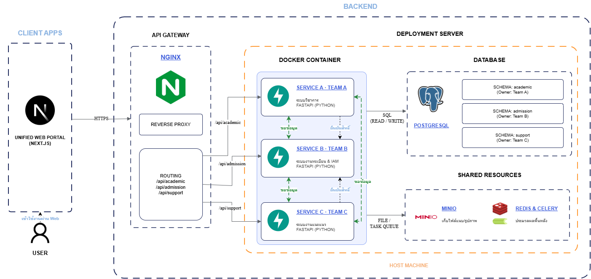 

*รูปที่ 1 Overview System Architecture ของทั้ง 3 กลุ่ม*

### 3.3.2 รายละเอียดสถาปัตยกรรมของผู้จัดทำ (Service B)

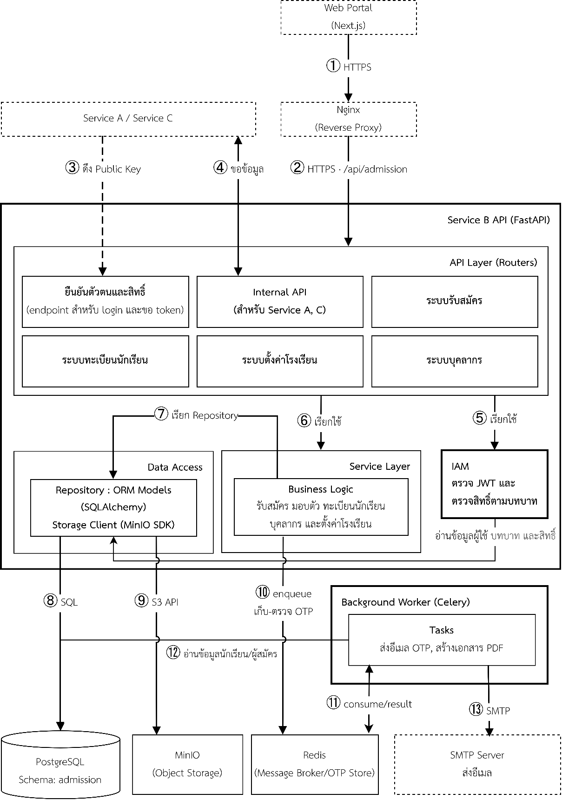 

*รูปที่ 2 Service System Architecture*

Service B คือส่วนที่คณะผู้จัดทำรับผิดชอบ ประกอบด้วย 2 Container ที่ใช้โค้ดชุดเดียวกัน ได้แก่ Service B API ซึ่งรับ Request จากผู้ใช้และจากระบบอื่น และ Background Worker ซึ่งแยกงานที่ใช้เวลานานออกไปทำเบื้องหลัง เพื่อไม่ให้ API ทำงานช้าลง

#### ส่วนประกอบของ Service B

- **API Layer (Routers)** เป็นทางเข้าของ Request ทั้งหมด แบ่งตามกลุ่มงาน ได้แก่ ยืนยันตัวตนและสิทธิ์ (เข้าสู่ระบบและขอ Token) Internal API (สำหรับ Service A และ C) ระบบรับสมัคร ระบบทะเบียนนักเรียน ระบบตั้งค่าโรงเรียน และระบบบุคลากร
- **IAM ตรวจ Token (JWT) และตรวจสิทธิ์ตามบทบาทของผู้ใช้ก่อนให้ทำงาน** โดยอ่านข้อมูลผู้ใช้ บทบาท และสิทธิ์จากฐานข้อมูลเฉพาะตอนเข้าสู่ระบบเพื่อออก Token หลังจากนั้นตรวจจากลายเซ็นของ Token ได้ทันที Service B ลงลายเซ็น Token ด้วย Private Key ที่มีเพียง Service B ถืออยู่ ส่วน Service A และ Service C ใช้ Public Key ของ Service B ตรวจ Token ได้เอง จึงไม่ต้องส่ง Request มาตรวจที่ Service B ทุกครั้ง ช่วยป้องกันไม่ให้ Service B เป็นคอขวด และผู้ใช้เข้าสู่ระบบครั้งเดียวก็ใช้งานได้ทุกระบบย่อย
- **Service Layer (Business Logic)** เก็บกฎการทำงานของระบบ เช่น การเปลี่ยนสถานะผู้สมัคร การมอบตัว และการออกรหัสนักเรียน
- **Data Access** เป็นส่วนที่ติดต่อที่เก็บข้อมูลต่าง ๆ โดย Repository และ ORM Models (SQLAlchemy) ใช้ติดต่อ PostgreSQL ส่วน Storage Client (MinIO SDK) ใช้ติดต่อ MinIO
- **Background Worker (Celery)** ทำงานที่ใช้เวลานาน ได้แก่ ส่งอีเมล OTP และสร้างเอกสาร PDF
- **ที่เก็บข้อมูล** ได้แก่ PostgreSQL เก็บข้อมูลแบบตาราง MinIO เก็บไฟล์ เช่น เอกสารแนบและรูปภาพ และ Redis ใช้เป็นคิวงานของ Worker และเก็บรหัส OTP แบบมีเวลาหมดอายุ
#### ลำดับการทำงาน

**กรณีที่ 1** ผู้ใช้เรียกใช้งานผ่านหน้าเว็บ

- ① ผู้ใช้กดใช้งานบน Web Portal ซึ่งส่ง Request แบบ HTTPS ไปที่ Nginx
- ② Nginx ดู Path ของ Request แล้วส่งต่อไปยัง Router ที่ตรงกันใน API Layer
- ⑤ API Layer เรียก IAM เพื่อตรวจว่าผู้ใช้เป็นใครและมีสิทธิ์ทำรายการนี้หรือไม่
- ⑥ เมื่อผ่านการตรวจสิทธิ์ API Layer เรียก Business Logic ใน Service Layer ให้ทำงาน
- ⑦ Business Logic ไม่ติดต่อฐานข้อมูลเอง แต่เรียกผ่าน Data Access
- ⑧ Data Access อ่านหรือบันทึกข้อมูลแบบตาราง เช่น รายชื่อ สถานะ และคะแนน ใน PostgreSQL ด้วย SQL
- ⑨ ถ้าเป็นไฟล์ เช่น เอกสารแนบหรือรูปภาพ Data Access จะเก็บหรือดึงไฟล์จาก MinIO ผ่าน S3 API
**กรณีที่ 2 งานที่ใช้เวลานาน**

- ⑩ Business Logic ส่งงาน เช่น ส่งอีเมล OTP หรือสร้าง PDF เข้าคิวใน Redis แล้วตอบผู้ใช้ทันทีโดยไม่ต้องรอให้งานเสร็จ ในขั้นนี้ Business Logic ยังใช้ Redis เก็บและตรวจรหัส OTP ด้วย
- ⑪ Worker ดึงงานจากคิวใน Redis มาทำ และเก็บผลลัพธ์กลับไว้ใน Redis ให้ API ดึงไปส่งต่อให้ผู้ใช้
- ⑫ กรณีสร้าง PDF Worker อ่านข้อมูลนักเรียนหรือผู้สมัครจาก PostgreSQL มาใช้สร้างเอกสาร
- ⑬ กรณีส่งอีเมล Worker ส่งอีเมลผ่าน SMTP Server ไปยังผู้รับ
**กรณีที่ 3 ระบบอื่นขอใช้ข้อมูล**

- ③ Service A หรือ Service C ดึง Public Key จาก Service B แล้วเก็บไว้ใช้ตรวจ Token ของผู้ใช้ได้เอง โดยไม่ต้องถาม Service B ทุกครั้ง
- ④ หากต้องใช้ข้อมูลหลัก เช่น ข้อมูลนักเรียนหรือผลการรับสมัคร Service A หรือ Service C จะขอข้อมูลผ่าน Internal API ซึ่งเปิดให้เฉพาะระบบภายในเรียกใช้เท่านั้น
### 3.3.3 Use Case Diagram ของระบบ

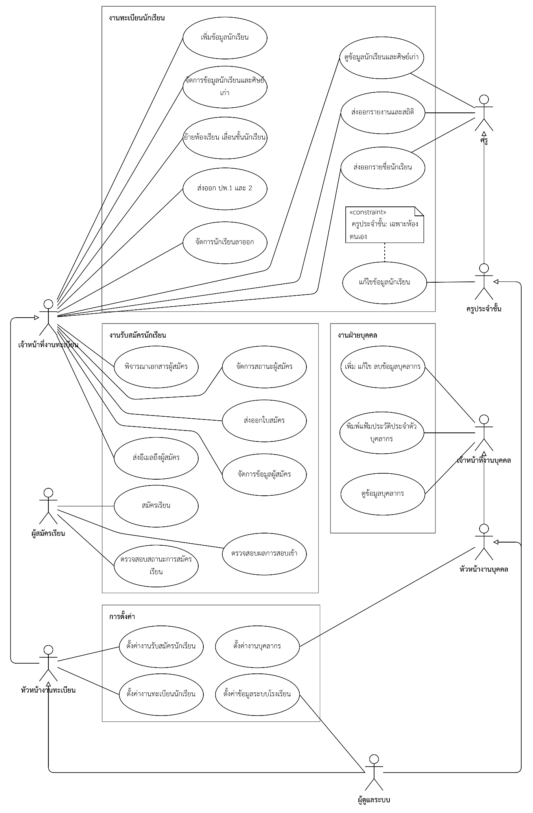 3.3.3	Use Case Diagram ของระบบ

ผู้ใช้งานระบบถูกจัดเป็นลำดับชั้นแบบ generalization โดย actor ลูกสืบทอด use case ทั้งหมดของ actor แม่ จึงไม่ต้องเขียนเส้นซ้ำ เช่น หัวหน้างานทะเบียนทำได้ทุกอย่างที่เจ้าหน้าที่งานทะเบียนทำได้ และครูประจำชั้นทำได้ทุกอย่างที่ครูทำได้ บุคลากรทุกประเภทสืบทอดความสามารถด้านการลาของตนเองจากบุคลากร ส่วนผู้ดูแลระบบสืบทอดจากหัวหน้างานต่าง ๆ เพื่อแสดงว่ามีสิทธิ์ครอบคลุมทุกงาน ผู้ปกครองและผู้สมัครเรียนเป็นบุคคลภายนอก จึงไม่อยู่ในลำดับชั้นนี้

 

*รูปที่ 4 Use Case Actor Hierarchy*

### 3.3.4 รายละเอียด Use Case โดยสังเขป

เนื่องจาก Use Case ของรายงานของโครงงานนี้มีจำนวนมาก ผู้จัดทำจึงนำ Use Case Description ทั้งหมดไปที่ โดยมีรายละเอียด ดังนี้

| Use Case ID | Use Case Name | Actor | Description |
| --- | --- | --- | --- |
| UC-ADM-01 | จัดการข้อมูลผู้สมัคร | เจ้าหน้าที่งานทะเบียน | เจ้าหน้าที่งานทะเบียนค้นหา เพิ่ม แก้ไข และลบข้อมูลผู้สมัครเรียน เพื่อใช้ในกระบวนการรับสมัครนักเรียน |
| UC-ADM-02 | พิจารณาเอกสารผู้สมัคร | เจ้าหน้าที่งานทะเบียน | เจ้าหน้าที่ตรวจเอกสารที่ผู้สมัคร อัปโหลดและระบุผลตรวจว่า เอกสารผ่านหรือไม่ผ่านเพื่อประกอบการพิจารณา |
| UC-ADM-03 | จัดการสถานะผู้สมัคร | เจ้าหน้าที่งานทะเบียน | เจ้าหน้าที่เปลี่ยนสถานะของผู้สมัคร ตั้งแต่สถานะการชำระค่าสมัคร จนไปถึงสถานะการมอบตัว |
| UC-ADM-04 | ส่งอีเมลถึงผู้สมัคร | เจ้าหน้าที่งานทะเบียน | เจ้าหน้าที่เลือกผู้สมัครแล้วส่งอีเมลเป็น เทมเพลตที่ตั้งไว้ เช่น แจ้งผลการสอบหรือแจ้งส่งเอกสารเพิ่มเติม |
| UC-ADM-05 | ส่งออกใบสมัคร | เจ้าหน้าที่งานทะเบียน | เจ้าหน้าที่พิมพ์หรือส่งออกใบสมัครรายบุคคลหรือชุดตามเงื่อนไข เพื่อจัดเก็บหรือใช้ดำเนินการต่อ |
| UC-ADM-06 | สมัครเรียน | ผู้สมัครเรียน | ผู้สมัครกรอกฟอร์มออนไลน์ อัปโหลดเอกสารที่กำหนด และยืนยันตัวตนด้วย OTP เพื่อยื่นใบสมัครเข้ารอบ ที่เปิดรับอยู่ |
| UC-ADM-07 | ตรวจสอบสถานะการสมัครเรียน | ผู้สมัครเรียน | ผู้สมัครตรวจสอบสถานการณ์สมัครเรียน ว่าสำเร็จ ไม่สำเร็จ หรือมีอะไรที่ต้องแก้ไขหรือไม่ |
| UC-ADM-08 | ตรวจสอบผลการสอบเข้า | ผู้สมัครเรียน | ผู้สมัครตรวจสอบผลการสอบเข้า |
| UC-REG-01 | จัดการข้อมูลนักเรียนและศิษย์เก่า | เจ้าหน้าที่งานทะเบียน | เจ้าหน้าที่ค้นหา เพิ่ม แก้ไข และลบข้อมูลนักเรียนปัจจุบันและศิษย์เก่า ให้เป็นแหล่งข้อมูลทะเบียนกลางของโรงเรียน |
| UC-REG-02 | เพิ่มข้อมูลนักเรียน | เจ้าหน้าที่งานทะเบียน | เจ้าหน้าที่เพิ่มข้อมูลนักเรียนใหม่เข้า ระบบสำหรับนักเรียนย้ายเข้าโดยที่ไม่มีรายชื่อในระบบรับสมัคร |
| UC-REG-03 | แก้ไขข้อมูลนักเรียน | ครูประจำชั้น | ครูประจำชั้นแก้ไขข้อมูลนักเรียนในห้องตนเองเพื่อให้ข้อมูลทะเบียนเป็นปัจจุบัน (ข้อกำหนด: เฉพาะห้องตนเอง) |
| UC-REG-04 | ย้ายห้องเรียน เลื่อนชั้นนักเรียน | เจ้าหน้าที่งานทะเบียน | เจ้าหน้าที่ย้ายนักเรียนไปอยู่ห้องเรียนอื่น และเลื่อนชั้นหรือย้ายห้องเรียน |
| UC-REG-05 | จัดการนักเรียนลาออก | เจ้าหน้าที่งานทะเบียน | เจ้าหน้าที่บันทึกการลาออกหรือย้ายออกด้วยการปรับสถานะของนักเรียน |
| UC-REG-06 | ดูข้อมูลนักเรียนและ ศิษย์เก่า | - ครู - เจ้าหน้าที่ งานทะเบียน | ครูและเจ้าหน้าที่ค้นดูข้อมูลนักเรียนและศิษย์เก่าโดยไม่แก้ไข |
| UC-REG-07 | ส่งออกรายชื่อนักเรียน | - ครู - เจ้าหน้าที่ งานทะเบียน | ครูและเจ้าหน้าที่เลือกส่งออกรายชื่อนักเรียนเป็นไฟล์เพื่อนำไปใช้งานต่อตามเงื่อนไขที่ต้องการ |
| UC-REG-08 | ส่งออกรายงานและสถิติ | - ครู - เจ้าหน้าที่ งานทะเบียน | ครูและเจ้าหน้าที่ส่งออกรายงานและ สถิติ เช่น จำนวนนักเรียนรายชั้น ตามเงื่อนไขที่เลือก |
| UC-REG-09 | ส่งออก ปพ.1 และ 2 | เจ้าหน้าที่งานทะเบียน | เจ้าหน้าที่ส่งออกเอกสาร ปพ.1 และ ปพ.2 ของนักเรียนจากข้อมูลในทะเบียน |
| UC-SET-01 | ตั้งค่าข้อมูลระบบโรงเรียน | ผู้ดูแลระบบ | ผู้ดูแลระบบจัดการข้อมูลพื้นฐานของโรงเรียน เช่น ชื่อโรงเรียน ที่อยู่โรงเรียน ปีการศึกษาที่เปิดใช้งาน เวลาเข้าออกโรงเรียนและรายละเอียดอื่น ๆ |
| UC-SET-02 | ตั้งค่างานบุคลากร | - ผู้ดูแลระบบ - หัวหน้างาน บุคคล | ผู้ดูแลระบบและหัวหน้างานบุคคล กำหนดค่าตั้งต้นของงานฝ่ายบุคคล เช่น ประเภทบุคลากร ตำแหน่ง และแผนก |
| UC-SET-03 | ตั้งค่างานทะเบียนนักเรียน | หัวหน้างาน ทะเบียน | หัวหน้างานทะเบียนกำหนดเงื่อนไขของ งานทะเบียน เช่น รูปแบบรหัสนักเรียนและ คอลัมน์ที่ใช้แสดงในตาราง |
| UC-SET-04 | ตั้งค่างานรับสมัครนักเรียน | หัวหน้างาน ทะเบียน | หัวหน้างานทะเบียนกำหนดค่าตั้งต้นของงานรับสมัคร เช่น ฟอร์มสมัคร เอกสาร และแผนการเรียนที่เปิดรับ |
| UC-STF-01 | ดูข้อมูลบุคลากร | เจ้าหน้าที่งานบุคคล | เจ้าหน้าที่งานบุคคลค้นหาและดูข้อมูลบุคลากรในโรงเรียน |
| UC-STF-02 | เพิ่ม แก้ไข ลบข้อมูลบุคลากร | เจ้าหน้าที่งานบุคคล | เจ้าหน้าที่งานบุคคลนำเข้า เพิ่ม แก้ไข และลบข้อมูลบุคลากร |
| UC-STF-03 | พิมพ์แฟ้มประวัติประจำตัวบุคลากร | เจ้าหน้าที่งานบุคคล | เจ้าหน้าที่งานบุคคลพิมพ์แฟ้มประวัติ ประจำตัวบุคลากรได้ โดยเอกสารทำหน้าที่เสมือน Resume |

*ตารางที่ 1 Use Case โดยสังเขป*

## 3.4 การออกแบบฐานข้อมูล

เนื่องจากระบบมีขนาดใหญ่ ผู้จัดทำจึงแบ่งกลุ่มของตารางฐานข้อมูล ดังนี้

- กลุ่มตารางงานรับสมัครนักเรียน
- กลุ่มตารางงานทะเบียนนักเรียนและการตั้งค่าทะเบียน
- กลุ่มตารางการตั้งค่าโรงเรียนและตารางที่เกี่ยวข้อง
- กลุ่มตารางงานบุคลากร
- กลุ่มตารางการตั้งค่างานบุคลากร
ทั้งนี้ทั้งนั้น ผู้จัดทำได้มีการวาดแผนภาพ Chen’s Notation ในรูปแบบ Hierarchy อยู่ภายใต้หัวข้อ Hierarchical Chen’s ER Diagram โดยจะใช้สัญลักษณ์ ดังนี้

 

*รูปที่ 5 สัญลักษณ์ Chen’s Notation สำหรับหัวข้อ Hierarchical Chen’s ER Diagram*

### 3.4.1 กลุ่มตารางงานรับสมัครนักเรียน

หมวดนี้เก็บทุกอย่างตั้งแต่โรงเรียนเปิดรอบรับสมัครจนถึงผลของใบสมัครแต่ละใบ ใช้ให้เจ้าหน้าที่จัดการรอบและแผนที่เปิดรับ ใช้ให้ผู้สมัครกรอกข้อมูล และใช้ติดตามว่าใบสมัครแต่ละใบอยู่ในสถานะใด ตั้งแต่ยื่น ตรวจเอกสาร ไปจนถึงผลการคัดเลือก

#### Hierarchical Chen’s ER Diagram

ผู้จัดทำกำหนดให้ตารางหลักไว้ด้านบนและตารางย่อยไว้ด้านล่าง โดยภาพรวมของกลุ่มตารางงานรับสมัครนักเรียนมีดังนี้

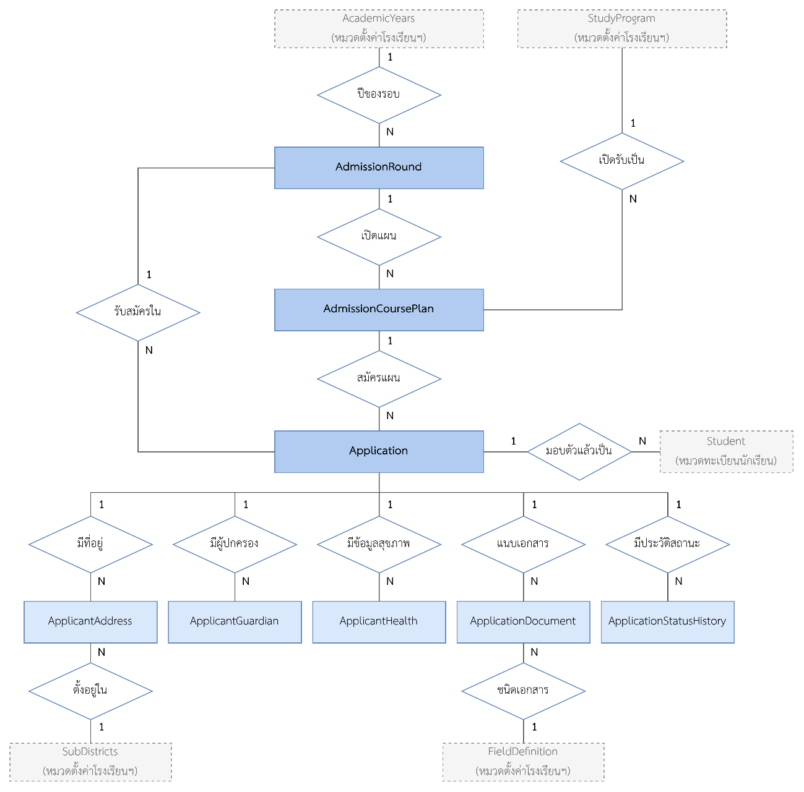 

*รูปที่ 6 Hierarchical Chen’s ER Diagram ของ กลุ่มตารางงานรับสมัครนักเรียน*

#### ตารางในหมวดนี้

ผู้จัดกำหนดให้ชื่อตารางหลักถูกเขียนด้วยตัวหนา รายละเอียดตารางโดยสังเขปของกลุ่มตารางงานรับสมัครนักเรียน มีดังนี้

| ชื่อตาราง | รายละเอียดตาราง |
| --- | --- |
| AdmissionRound | รอบรับสมัครของปีการศึกษา ปีหนึ่งมีได้หลายรอบ และเก็บกำหนดการทั้ง 6 วันของรอบ |
| AdmissionCoursePlan | แผนการเรียนที่เปิดรับในแต่ละรอบ เก็บจำนวนที่รับ ระเบียบ และค่าสมัคร |
| Application | ใบสมัครแต่ละใบ เป็น log ข้อมูล ณ วันยื่น ติดตามสถานะ |
| ApplicantAddress | เป็นตารางย่อยของใบสมัคร เก็บข้อมูลที่อยู่ผู้สมัคร ตามทะเบียนบ้านและปัจจุบัน |
| ApplicantGuardian | เป็นตารางย่อยของใบสมัคร เก็บข้อมูลบิดา มารดา ผู้ปกครองของผู้สมัคร และช่องทางติดต่อ |
| ApplicantHealth | เป็นตารางย่อยของใบสมัคร เก็บข้อมูลสุขภาพของผู้สมัคร 1 แถวต่อใบสมัคร |
| ApplicationDocument | เป็นตารางย่อยของใบสมัคร เก็บข้อมูลเอกสารแนบใบสมัครและผลตรวจของเจ้าหน้าที่ |
| ApplicationStatusHistory | เป็นตารางย่อยของใบสมัคร เก็บข้อมูลประวัติการเปลี่ยนสถานะของใบสมัคร ใช้ย้อนกลับรายการ |

*ตารางที่ 2 ตารางอธิบายงกลุ่มตารางงานรับสมัครนักเรียนโดยสังเขป*

#### ตารางจากหมวดอื่นที่เกี่ยวข้อง

ในรูปจะปรากฏเป็นกล่องเทา มีรายละเอียดดังนี้

| ชื่อตาราง | หมวดเจ้าของ | เกี่ยวข้องกับหมวดนี้อย่างไร |
| --- | --- | --- |
| Student | ทะเบียนนักเรียน | Student ชี้มาที่ Application ผ่าน fromApplicationID เพื่อบอกว่านักเรียนคัดลอกข้อมูลจากใบสมัครใบไหน |
| StudyProgram | ตั้งค่าโรงเรียนและตารางอ้างอิงกลาง | AdmissionCoursePlan ชี้ไปที่ StudyProgram ผ่าน studyProgramID เพื่อบอกว่าแผนที่เปิดรับคือแผนการเรียนใด |
| SubDistricts | ตั้งค่าโรงเรียนและตารางอ้างอิงกลาง | ApplicantAddress ชี้ไปที่ SubDistricts ผ่าน subDistrictID เพื่อบอกตำบลของที่อยู่ผู้สมัคร |
| AcademicYears | ตั้งค่าโรงเรียนและตารางอ้างอิงกลาง | AdmissionRound ชี้ไปที่ AcademicYears ผ่าน academicYearID เพื่อบอกว่ารอบนี้อยู่ในปีการศึกษาใด |
| FieldDefinition | ตั้งค่าโรงเรียนและตารางอ้างอิงกลาง | ApplicationDocument ชี้ไปที่ FieldDefinition ผ่าน fieldID เพื่อบอกชนิดของเอกสารแต่ละไฟล์ |

*ตารางที่ 3 ตารางจากหมวดงานอื่นที่เกี่ยวข้องกับกลุ่มตารางงานรับสมัครนักเรียน*

#### Full ER-Diagram

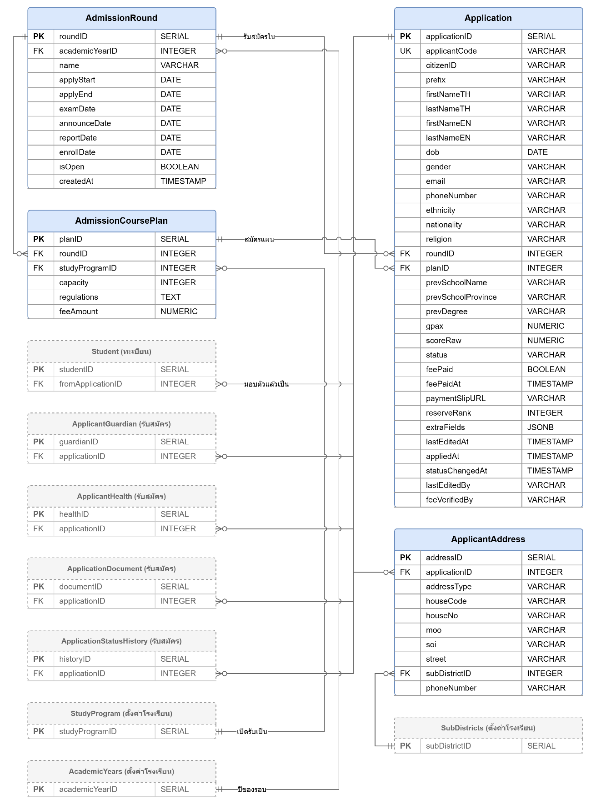 

*รูปที่ 7 ER-Diagram ของกลุ่มตารางงานรับสมัครนักเรียน ส่วนที่ 1*

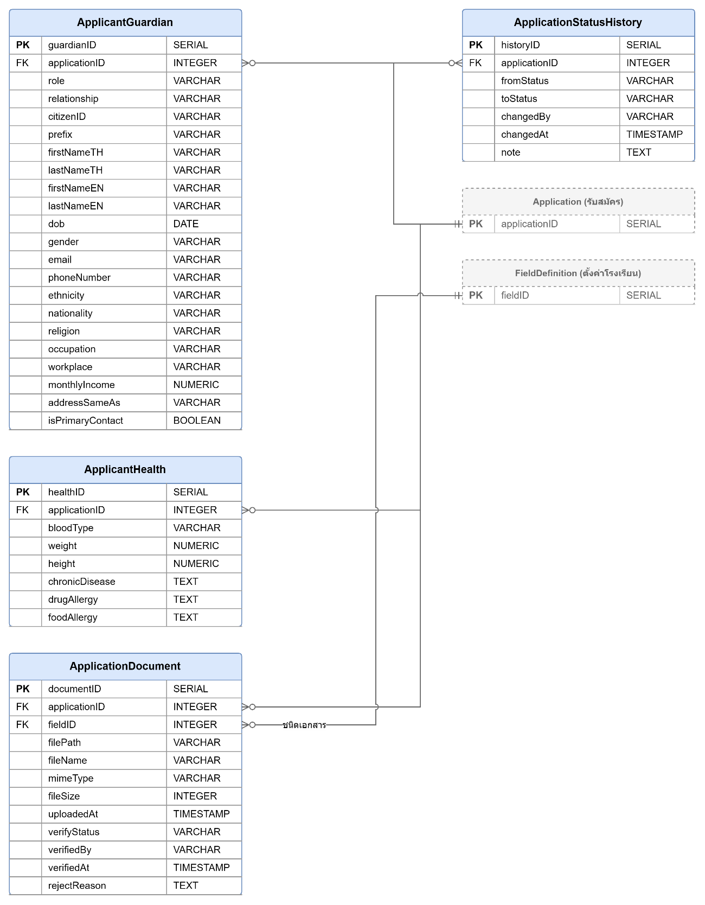 

*รูปที่ 8 ER-Diagram ของกลุ่มตารางงานรับสมัครนักเรียน ส่วนที่ 2*

### 3.4.2 กลุ่มตารางงานทะเบียนนักเรียนและการตั้งค่าทะเบียน

หมวดนี้เก็บข้อมูลของคนที่มอบตัวแล้ว ได้แก่ ข้อมูลตัวบุคคล สถานะการเป็นนักเรียน ห้องเรียนที่อยู่ในแต่ละปี และครูประจำชั้นของห้อง ใช้ให้เจ้าหน้าที่ทะเบียนจัดห้อง เลื่อนชั้น และบันทึกการจำหน่ายออก

#### Hierarchical Chen’s ER Diagram

ผู้จัดทำกำหนดให้ตารางหลักไว้ด้านบนและตารางย่อยไว้ด้านล่าง โดยภาพรวมของกลุ่มตารางงานทะเบียนนักเรียนและการตั้งค่าทะเบียนมีดังนี้

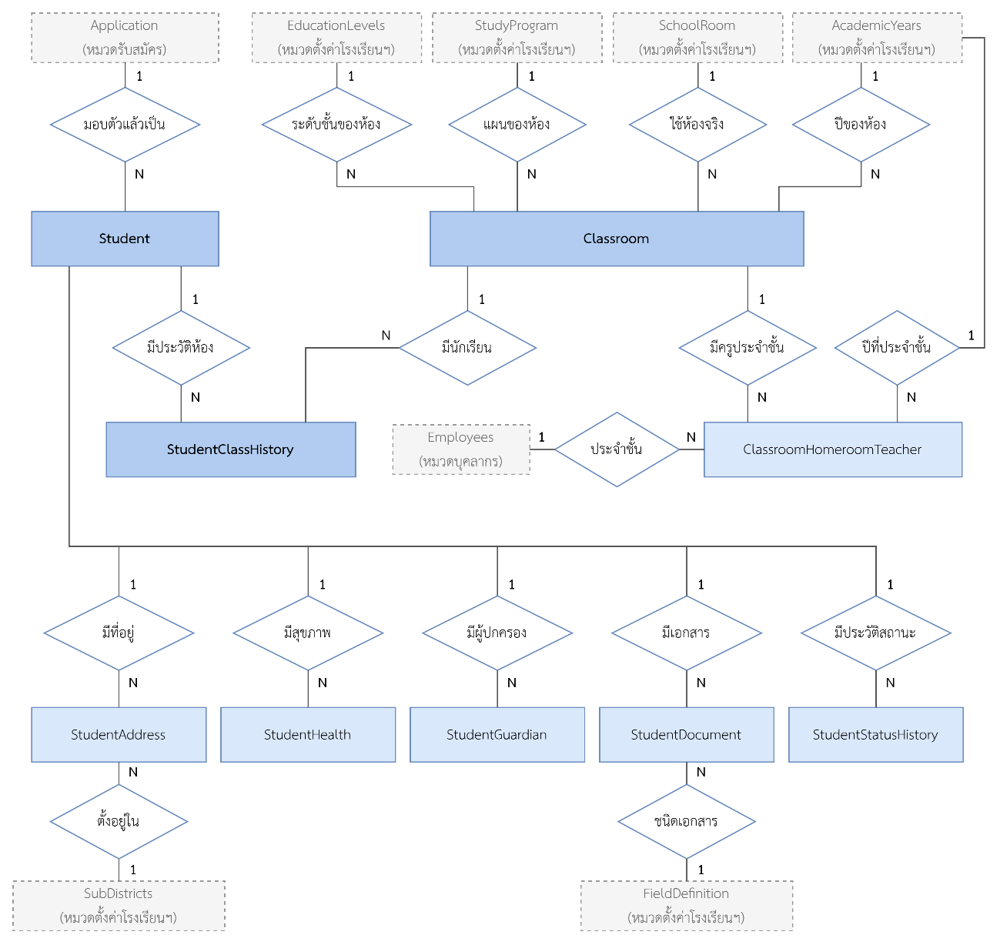 

*รูปที่ 9 ภาพรวมของกลุ่มตารางงานทะเบียนนักเรียนและการตั้งค่าทะเบียน*

#### ตารางในหมวดนี้

ผู้จัดกำหนดให้ชื่อตารางหลักถูกเขียนด้วยตัวหนา รายละเอียดตารางโดยสังเขปของกลุ่มตารางงานทะเบียนนักเรียนและการตั้งค่าทะเบียน มีดังนี้

| ชื่อตาราง | รายละเอียดตาราง |
| --- | --- |
| Student | นักเรียนที่มอบตัวแล้ว เก็บข้อมูลตัวบุคคล สถานะ และการจำหน่ายออก |
| StudentAddress | เป็นตารางย่อยของนักเรียน เก็บข้อมูลที่อยู่ของนักเรียน ตามทะเบียนบ้านและปัจจุบัน |
| StudentHealth | เป็นตารางย่อยของนักเรียน เก็บข้อมูลสุขภาพของนักเรียน 1 แถวต่อนักเรียน |
| StudentGuardian | เป็นตารางย่อยของนักเรียน เก็บข้อมูลบิดา มารดา ผู้ปกครองของนักเรียน และช่องทางติดต่อ |
| StudentDocument | เป็นตารางย่อยของนักเรียน เก็บข้อมูลเอกสารของนักเรียนและผลตรวจของเจ้าหน้าที่ |
| StudentStatusHistory | เป็นตารางย่อยของนักเรียน เก็บข้อมูลประวัติการเปลี่ยนสถานะของนักเรียน ใช้ย้อนกลับรายการ |
| StudentClassHistory | ประวัติห้องของนักเรียน เก็บวันเริ่ม วันสิ้นสุด และเลขที่ |
| Classroom | ห้องเรียนต่อปีการศึกษา ระดับชั้น และเลขห้อง |
| ClassroomHomeroomTeacher | เป็นตารางคั่นเชื่อมห้องเรียนกับบุคลากร เก็บข้อมูลครูประจำชั้นของห้อง ห้องหนึ่งมีได้หลายคน ครูหนึ่งคนประจำ 1 ห้องต่อปี |

*ตารางที่ 4 ตารางอธิบายกลุ่มตารางงาน*

#### ตารางจากหมวดอื่นที่เกี่ยวข้อง

ในรูปจะปรากฏเป็นกล่องเทา มีรายละเอียดดังนี้

| ชื่อตาราง | หมวดเจ้าของ | เกี่ยวข้องกับหมวดนี้อย่างไร |
| --- | --- | --- |
| Application | รับสมัคร | Student ชี้มาที่ Application ผ่าน fromApplicationID เพื่อบอกว่านักเรียนคัดลอกข้อมูลจากใบสมัครใบไหน |
| AcademicYears | ตั้งค่าโรงเรียนและตารางอ้างอิงกลาง | Classroom และ ClassroomHomeroomTeacher ชี้ไปที่ AcademicYears ผ่าน academicYearID เพื่อบอกปีของห้องเรียนและปีที่ครูประจำชั้น |
| EducationLevels | ตั้งค่าโรงเรียนและตารางอ้างอิงกลาง | Classroom ชี้มาที่ EducationLevels เพื่อบอกระดับชั้นของห้องเรียน |
| StudyProgram | ตั้งค่าโรงเรียนและตารางอ้างอิงกลาง | Classroom ชี้มาที่ StudyProgram ผ่าน studyProgramID เพื่อบอกแผนการเรียนของห้องเรียน |
| SchoolRoom | ตั้งค่าโรงเรียนและตารางอ้างอิงกลาง | Classroom ชี้มาที่ SchoolRoom เพื่อบอกห้องจริงของอาคาร (ไม่บังคับกรอก) |
| SubDistricts | ตั้งค่าโรงเรียนและตารางอ้างอิงกลาง | StudentAddress ชี้มาที่ SubDistricts ผ่าน subDistrictID เพื่อบอกตำบลของที่อยู่นักเรียน |
| FieldDefinition | ตั้งค่าโรงเรียนและตารางอ้างอิงกลาง | StudentDocument ชี้มาที่ FieldDefinition ผ่าน fieldID เพื่อบอกชนิดของเอกสารแต่ละไฟล์ |
| Employees | บุคลากร | ClassroomHomeroomTeacher ชี้มาที่ Employees ผ่าน employeeID เพื่อเลือกบุคลากรเป็นครูประจำชั้น |

*ตารางที่ 5 ตารางจากหมวดงานอื่นที่เกี่ยวข้อง*

#### Full ER-Diagram

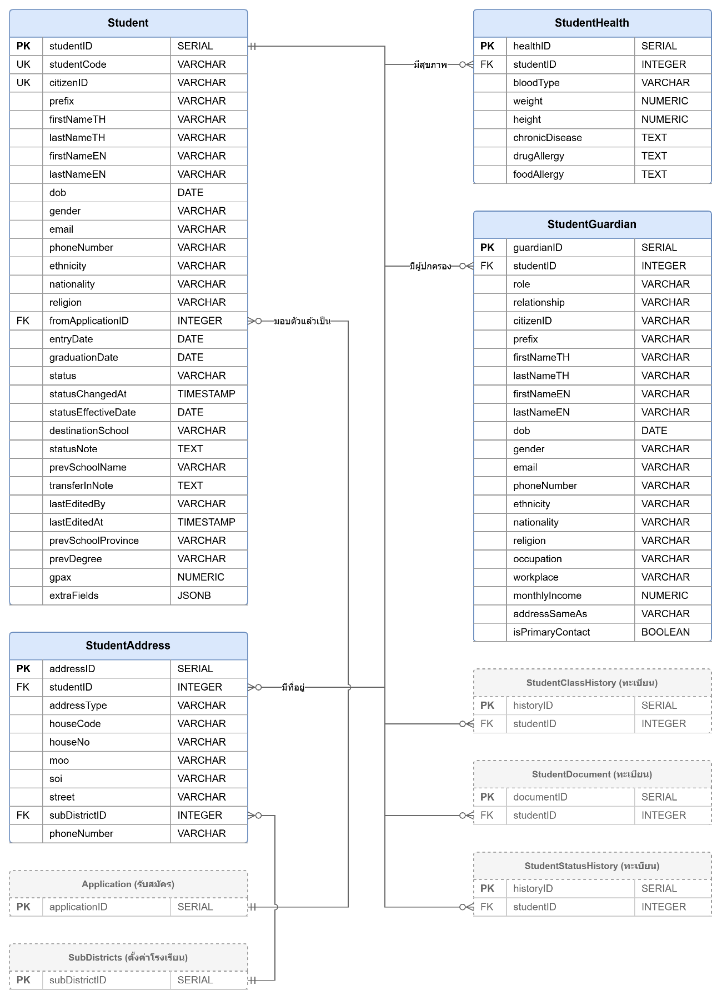 

*รูปที่ 10 ER-Diagram ของกลุ่มตารางงานทะเบียนนักเรียน*

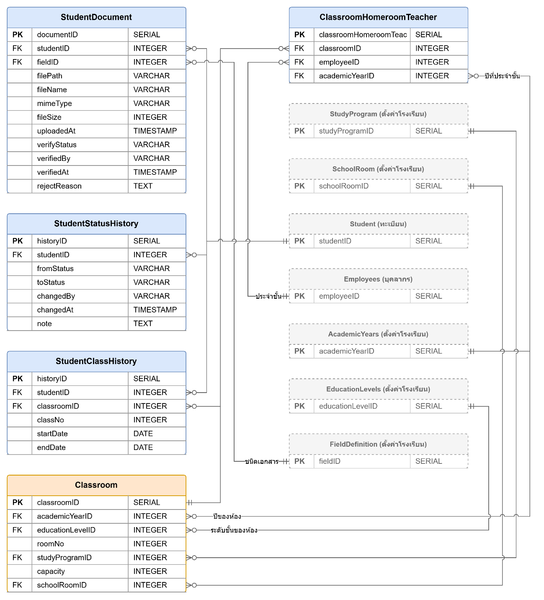 

*รูปที่ 11 ER-Diagram ของกลุ่มตารางงานการตั้งค่าทะเบียน*

### 3.4.3 กลุ่มตารางการตั้งค่าโรงเรียนและตารางที่เกี่ยวข้อง

หมวดนี้เก็บค่าตั้งต้นที่ทุกหมวดอื่นต้องใช้ร่วมกัน ได้แก่ ข้อมูลโรงเรียน ปีการศึกษาและภาคเรียน ระดับชั้น แผนการเรียน อาคารและห้องจริง ตารางที่อยู่ของประเทศไทย รวมถึงค่าตั้งค่าของระบบ ใช้ให้เจ้าหน้าที่ตั้งค่าครั้งเดียวแล้วให้ทั้งฝั่งรับสมัครและทะเบียนนักเรียนอ้างถึง โดยไม่ต้องเก็บซ้ำ ระบบนี้ทำสำหรับโรงเรียนเดียว จึงไม่มีรหัสโรงเรียนในตารางอื่น

#### Hierarchical Chen’s ER Diagram

ผู้จัดทำกำหนดให้ตารางหลักไว้ด้านบนและตารางย่อยไว้ด้านล่าง โดยภาพรวมของกลุ่มตารางการตั้งค่าโรงเรียนและตารางที่เกี่ยวข้อมีดังนี้

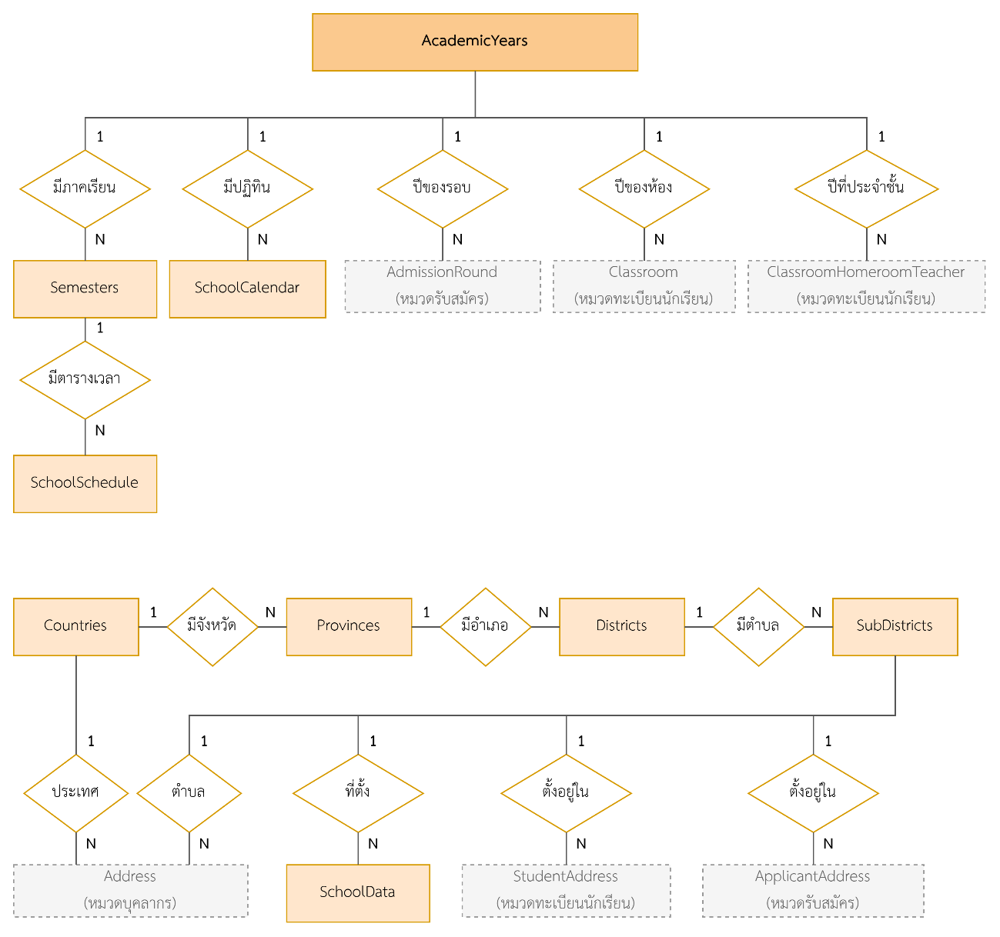 

*รูปที่ 12 ภาพรวมของกลุ่มตารางการตั้งค่าโรงเรียน*

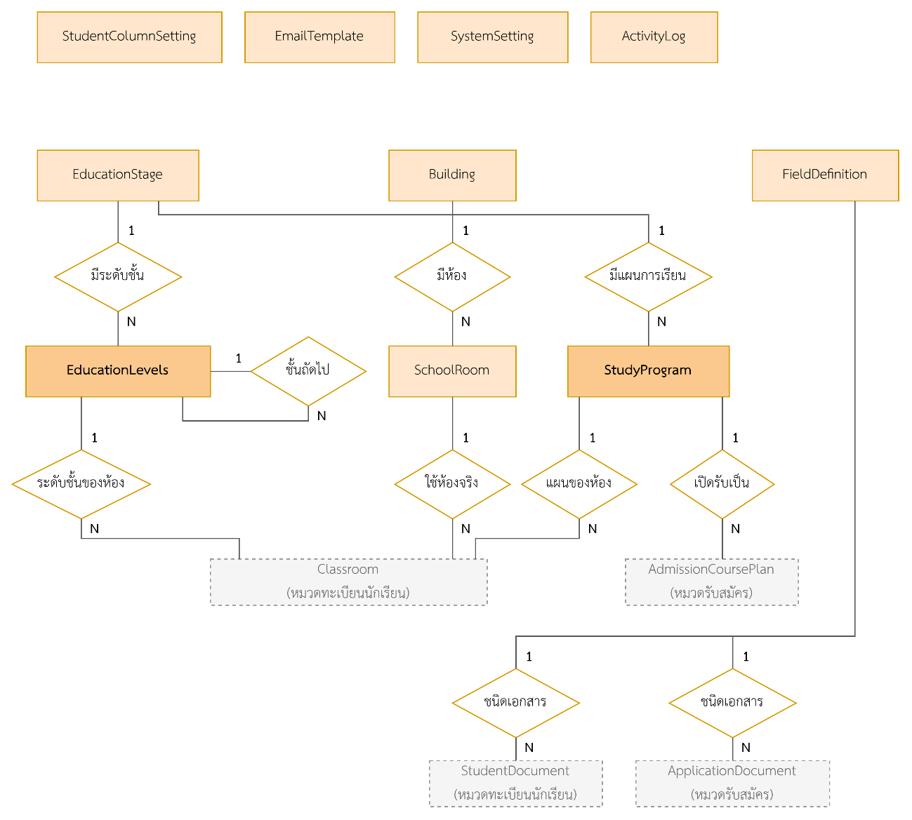 

*รูปที่ 13 ภาพรวมของกลุ่มตารางการตั้งค่าโรงเรียน*

#### ตารางในหมวดนี้

ผู้จัดกำหนดให้ชื่อตารางหลักถูกเขียนด้วยตัวหนา รายละเอียดตารางโดยสังเขปของกลุ่มตารางการตั้งค่าโรงเรียนและตารางที่เกี่ยวข้อง มีดังนี้

| ชื่อตาราง | รายละเอียดตาราง |
| --- | --- |
| SchoolData | ข้อมูลโรงเรียน โรงเรียนเดียว มีแถวเดียว |
| Countries | ประเทศ ข้อมูลอ้างอิงสำหรับที่อยู่ |
| Provinces | จังหวัด ข้อมูลอ้างอิงสำหรับที่อยู่ |
| Districts | อำเภอ/เขต ข้อมูลอ้างอิงสำหรับที่อยู่ |
| SubDistricts | ตำบล/แขวง ใช้หาอำเภอ จังหวัด และรหัสไปรษณีย์ |
| AcademicYears | ปีการศึกษา ใช้ร่วมสองฝั่ง มีปีที่ใช้งานอยู่ปีเดียว |
| Semesters | ภาคเรียนของปีการศึกษา ภาคที่ 1 และ 2 ห้ามซ้ำในปีเดียวกัน |
| SchoolSchedule | เวลาเรียนรายภาคเรียน (เข้า-เลิก สาย ขาด กลับก่อน) เก็บย้อนหลังได้ |
| SchoolCalendar | ปฏิทินโรงเรียน เหตุการณ์ในปีการศึกษา |
| EducationStage | ช่วงชั้น เช่น มัธยมต้น มัธยมปลาย ใช้ร่วมระดับชั้นและแผนการเรียน |
| EducationLevels | ระดับชั้นแถวละชั้น ใช้ร่วมสองฝั่ง เลื่อนชั้นผ่านระดับชั้นถัดไป |
| StudyProgram | แผนการเรียนที่โรงเรียนเปิดสอน แถวเดียวถาวร |
| Building | อาคารของโรงเรียน ห้องกายภาพชี้มาที่อาคาร |
| SchoolRoom | ห้องกายภาพ เก็บชื่อ อาคาร ชั้น ความจุ และสเปกห้องสอบ |
| FieldDefinition | ตั้งค่าช่องในฟอร์ม (เปิด/ปิด บังคับกรอก ชื่อที่แสดง ลำดับ) ไม่ใช่ข้อมูลผู้สมัคร |
| StudentColumnSetting | ตั้งว่าหน้ารายชื่อนักเรียนโชว์คอลัมน์ไหน |
| EmailTemplate | แบบร่างอีเมลสำเร็จรูปสำหรับแจ้งผลผู้ปกครอง |
| SystemSetting | ค่าตั้งค่าระบบ เช่น รูปแบบรหัสนักเรียน |
| ActivityLog | ประวัติการทำรายการของเจ้าหน้าที่ |

*ตารางที่ 6 ตารางอธิบายกลุ่มตารางงาน*

#### ตารางจากหมวดอื่นที่เกี่ยวข้อง

ในรูปจะปรากฏเป็นกล่องเทา มีรายละเอียดดังนี้

| ชื่อตาราง | หมวดเจ้าของ | เกี่ยวข้องกับหมวดนี้อย่างไร |
| --- | --- | --- |
| Address | บุคลากร | Address ชี้มาที่ SubDistricts และ Countries ผ่าน subDistrictID และ countryID เพื่อบอกตำบลและประเทศของที่อยู่บุคลากร |
| StudentAddress | ทะเบียนนักเรียน | StudentAddress ชี้มาที่ SubDistricts ผ่าน subDistrictID เพื่อบอกตำบลของที่อยู่นักเรียน |
| StudentDocument | ทะเบียนนักเรียน | StudentDocument ชี้มาที่ FieldDefinition ผ่าน fieldID เพื่อบอกชนิดเอกสาร |
| Classroom | ทะเบียนนักเรียน | Classroom ชี้มาที่ AcademicYears, EducationLevels, StudyProgram และ SchoolRoom เพื่อบอกปี ระดับชั้น แผนการเรียน และห้องจริงของห้องเรียน |
| ClassroomHomeroomTeacher | ทะเบียนนักเรียน | ClassroomHomeroomTeacher ชี้มาที่ AcademicYears ผ่าน academicYearID เพื่อบอกปีที่ครูประจำชั้น |

*ตารางที่ 7 ตารางจากหมวดงานอื่นที่เกี่ยวข้อง*

#### Full ER-Diagram

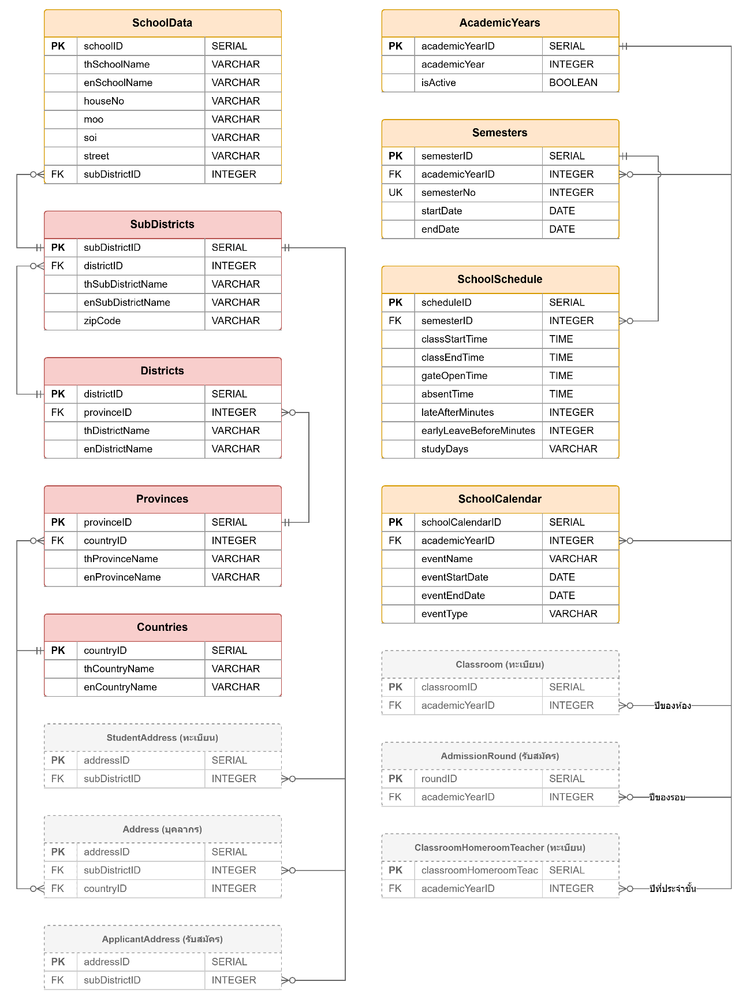 

*รูปที่ 14 กลุ่มตารางการตั้งค่าโรงเรียน*

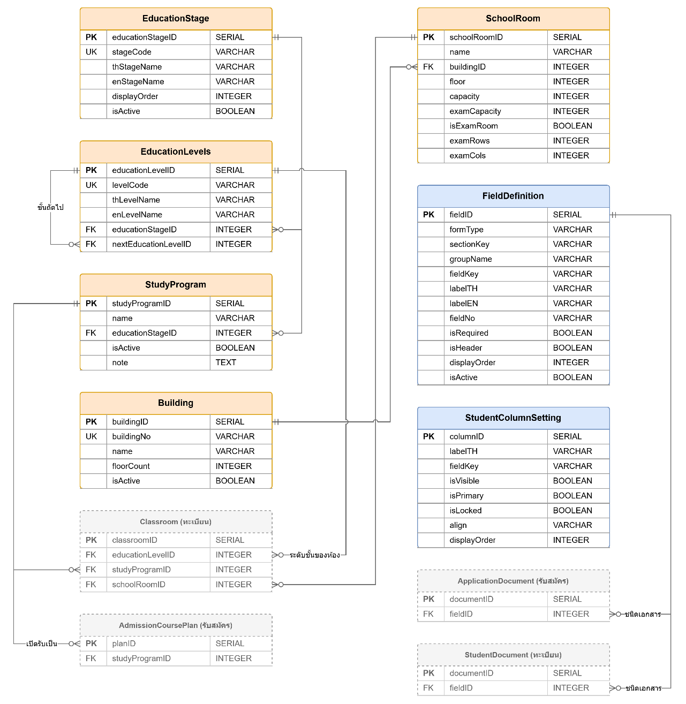 

*รูปที่ 15 กลุ่มตารางการตั้งค่าโรงเรียน*

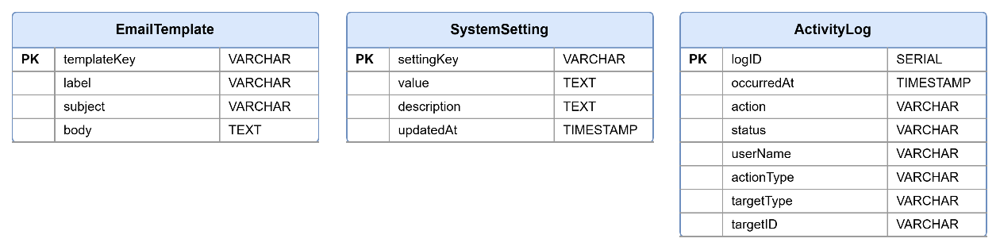 

*รูปที่ 16 กลุ่มตารางการตั้งค่าโรงเรียน*

### 3.4.4 กลุ่มตารางงานบุคลากร

หมวดนี้เก็บข้อมูลของบุคลากรและครู ใช้ให้ฝ่ายบุคคลบันทึกประวัติรายคน และเป็นต้นทางข้อมูลครูให้ฝั่งทะเบียนนักเรียนเลือกเป็นครูประจำชั้น โครงสร้างหมวดนี้มาจากฝั่งบุคลากร (Service B) ซึ่งยังไม่ได้ยืนยันกับเจ้าของข้อมูล รายละเอียดต่อไปนี้จึงอธิบายเท่าที่เห็นจากตารางเท่านั้น

#### Hierarchical Chen’s ER Diagram

ผู้จัดทำกำหนดให้ตารางหลักไว้ด้านบนและตารางย่อยไว้ด้านล่าง โดยภาพรวมของกลุ่มตารางงานบุคลากรมีดังนี้

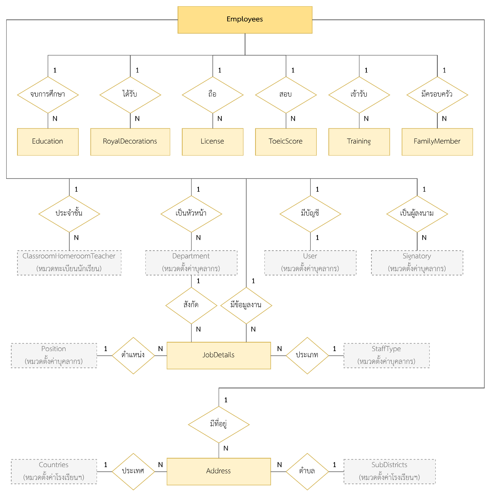 

*รูปที่ 17 ภาพรวมของกลุ่มตารางงานบุคลากร*

#### ตารางในหมวดนี้

ผู้จัดกำหนดให้ชื่อตารางหลักถูกเขียนด้วยตัวหนา รายละเอียดตารางโดยสังเขปของกลุ่มตารางงานบุคลากร มีดังนี้

| ชื่อตาราง | รายละเอียดตาราง |
| --- | --- |
| Employees | ข้อมูลหลักของบุคลากรและครู เป็นตารางแม่ของตารางบุคลากรทุกตาราง |
| Education | เป็นตารางย่อยของบุคลากร เก็บข้อมูลประวัติการศึกษา 1 คนมีได้หลายแถว |
| RoyalDecorations | เป็นตารางย่อยของบุคลากร เก็บข้อมูลเครื่องราชอิสริยาภรณ์ที่บุคลากรได้รับ |
| License | เป็นตารางย่อยของบุคลากร เก็บข้อมูลใบอนุญาตหรือใบประกอบวิชาชีพของบุคลากร |
| ToeicScore | เป็นตารางย่อยของบุคลากร เก็บข้อมูลผลสอบ TOEIC ของบุคลากร |
| JobDetails | เป็นตารางย่อยของบุคลากร เก็บข้อมูลการทำงานและตำแหน่งของบุคลากร |
| Training | เป็นตารางย่อยของบุคลากร เก็บข้อมูลประวัติการอบรมและศึกษาดูงานของบุคลากร |
| FamilyMember | เป็นตารางย่อยของบุคลากร เก็บข้อมูลสมาชิกครอบครัวของบุคลากร |
| Address | เป็นตารางย่อยของบุคลากร เก็บข้อมูลที่อยู่ 1 คนมีได้หลายที่อยู่ แยกประเภท |

*ตารางที่ 8 ตารางอธิบายกลุ่มตารางงาน*

#### ตารางจากหมวดอื่นที่เกี่ยวข้อง

ในรูปจะปรากฏเป็นกล่องเทา มีรายละเอียดดังนี้

| ชื่อตาราง | หมวดเจ้าของ | เกี่ยวข้องกับหมวดนี้อย่างไร |
| --- | --- | --- |
| ClassroomHomeroomTeacher | ทะเบียนนักเรียน | ClassroomHomeroomTeacher ชี้มาที่ Employees ผ่าน employeeID เพื่อเลือกบุคลากรเป็นครูประจำชั้น |
| Department | ตั้งค่าบุคลากร | Department ชี้มาที่ Employees ผ่าน headEmployeeID เพื่อบอกหัวหน้าแผนก (ว่างได้) และ JobDetails ชี้ไปที่ Department ผ่าน departmentID |
| User | ตั้งค่าบุคลากร | User ชี้มาที่ Employees ผ่าน employeeID โดยบุคลากร 1 คนมีบัญชีได้ 1 บัญชี |
| Signatory | ตั้งค่าบุคลากร | Signatory ชี้มาที่ Employees ผ่าน employeeID เพื่อบอกว่าผู้ลงนามเป็นบุคลากรคนไหน (ว่างได้ ถ้าเป็นบุคคลภายนอก) |
| StaffType | ตั้งค่าบุคลากร | JobDetails ชี้ไปที่ StaffType ผ่าน staffTypeID เพื่อบอกประเภทบุคลากร |
| Position | ตั้งค่าบุคลากร | JobDetails ชี้ไปที่ Position ผ่าน positionID เพื่อบอกตำแหน่ง |
| SubDistricts | ตั้งค่าโรงเรียนและตารางอ้างอิงกลาง | Address ชี้ไปที่ SubDistricts ผ่าน subDistrictID เพื่อบอกตำบลของที่อยู่บุคลากร |
| Countries | ตั้งค่าโรงเรียนและตารางอ้างอิงกลาง | Address ชี้ไปที่ Countries ผ่าน countryID เพื่อบอกประเทศของที่อยู่บุคลากร |

*ตารางที่ 9 ตารางจากหมวดงานอื่นที่เกี่ยวข้อง*

#### Full ER-Diagram

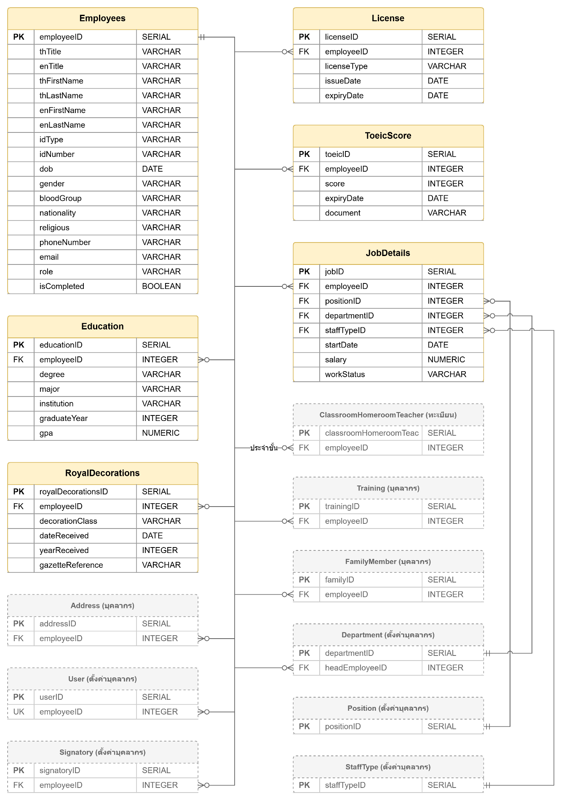 

*รูปที่ 18 กลุ่มตารางงานบุคลากร*

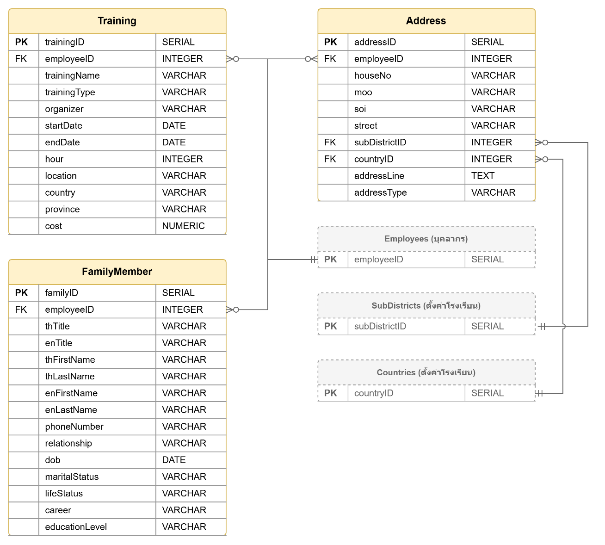 

*รูปที่ 19 กลุ่มตารางงานบุคลากร*

### 3.4.5 กลุ่มตารางการตั้งค่างานบุคลากร

หมวดนี้เก็บค่าตั้งต้นที่ใช้จัดการบุคลากร ได้แก่ ประเภทบุคลากร ตำแหน่ง แผนก เวลาทำงาน กะพิเศษ บัญชีผู้ใช้และสิทธิ์ และผู้ลงนามในเอกสาร ใช้ให้ผู้ดูแลระบบตั้งค่าในหน้าตั้งค่าบุคลากร

#### Hierarchical Chen’s ER Diagram

ผู้จัดทำกำหนดให้ตารางหลักไว้ด้านบนและตารางย่อยไว้ด้านล่าง โดยภาพรวมของกลุ่มตารางการตั้งค่างานบุคลากรมีดังนี้

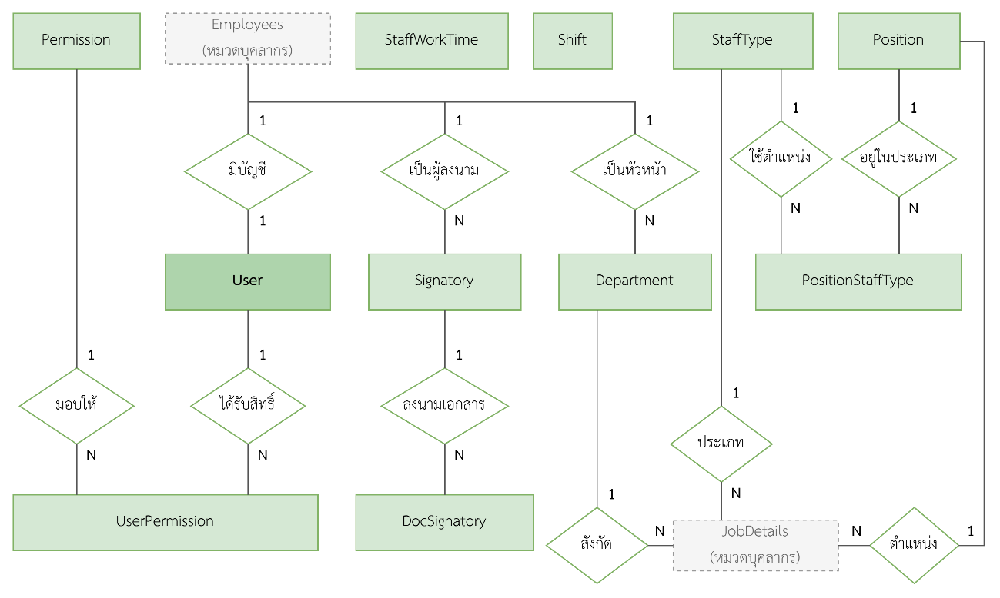 

*รูปที่ 20 ภาพรวมของกลุ่มตารางการตั้งค่างานบุคลากร*

#### ตารางในหมวดนี้

ผู้จัดกำหนดให้ชื่อตารางหลักถูกเขียนด้วยตัวหนา รายละเอียดตารางโดยสังเขปของกลุ่มตารางการตั้งค่างานบุคลากร มีดังนี้

| ชื่อตาราง | รายละเอียดตาราง |
| --- | --- |
| StaffType | ประเภทบุคลากร เช่น ข้าราชการครู ครูอัตราจ้าง ผู้บริหาร เจ้าหน้าที่ |
| Position | ตำแหน่ง เช่น ครูผู้ช่วย ครูชำนาญการ ผู้อำนวยการ |
| PositionStaffType | เป็นตารางคั่น ให้ตำแหน่งหนึ่งอยู่ได้หลายประเภทบุคลากร |
| Department | แผนกหรือกลุ่มสาระการเรียนรู้ มีหัวหน้าได้ (ไม่บังคับ) |
| StaffWorkTime | เวลาทำงานปกติของบุคลากร ทั้งโรงเรียนมีแถวเดียว |
| Shift | กะพิเศษ เช่น เวรรถโรงเรียน เวรกลางคืน |
| User | บัญชีผู้ใช้งานระบบ บุคลากร 1 คนมีได้ 1 บัญชี |
| Permission | สิทธิ์การใช้งานแต่ละอย่าง (6 รายการ) |
| UserPermission | เป็นตารางคั่น เก็บสิทธิ์รายบุคคลของผู้ใช้ 1 แถวต่อการให้สิทธิ์ 1 อย่าง |
| Signatory | ผู้ลงนามในเอกสาร ผูกกับบุคลากรได้ (ว่าง = บุคคลภายนอก) |
| DocSignatory | เอกสารชนิดไหนให้ใครลงนามได้ หนึ่งชนิดมีได้หลายคน |

*ตารางที่ 10 ตารางอธิบายกลุ่มตารางงาน*

#### ตารางจากหมวดอื่นที่เกี่ยวข้อง

ในรูปจะปรากฏเป็นกล่องเทา มีรายละเอียดดังนี้

| ชื่อตาราง | หมวดเจ้าของ | เกี่ยวข้องกับหมวดนี้อย่างไร |
| --- | --- | --- |
| JobDetails | บุคลากร | JobDetails ชี้ไปที่ StaffType, Position และ Department ผ่าน staffTypeID, positionID และ departmentID เพื่อบอกประเภท ตำแหน่ง และแผนกของบุคลากร |
| Employees | บุคลากร | Department, User และ Signatory ชี้มาที่ Employees ผ่าน headEmployeeID, employeeID และ employeeID ตามลำดับ |

*ตารางที่ 11 ตารางจากหมวดงานอื่นที่เกี่ยวข้อง*

#### Full ER-Diagram

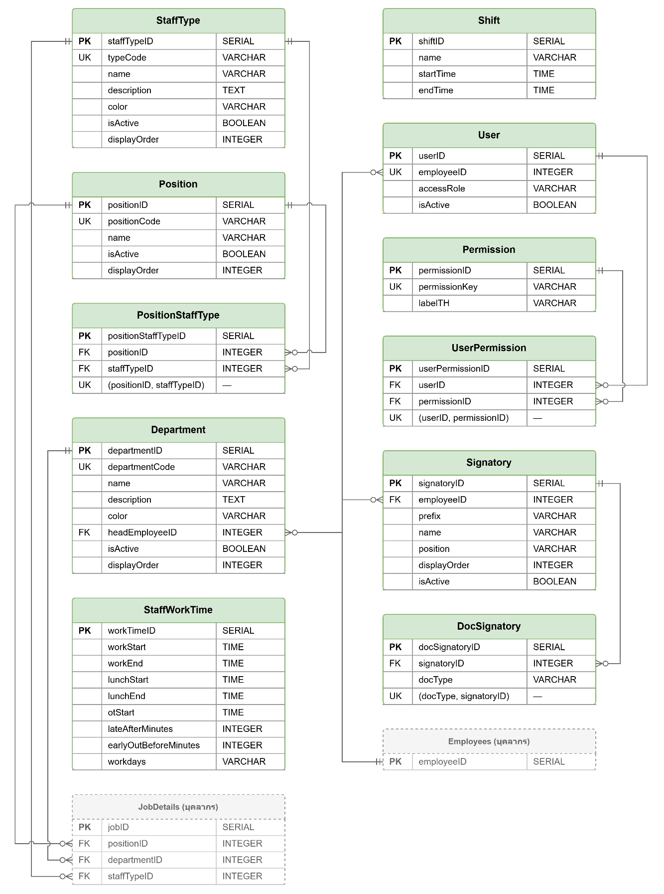 

*รูปที่ 21 กลุ่มตารางการตั้งค่างานบุคลากร*

### 3.4.6 Data Dictionary

พจนานุกรมข้อมูลนี้แจกแจงรายละเอียดคอลัมน์ของตารางฐานข้อมูลทั้ง 56 ตารางในระบบ โดยเรียงลำดับตามกลุ่มตารางเดียวกับในหัวข้อการออกแบบฐานข้อมูล ได้แก่

*ตารางที่ ก.1 ถึง ก.8 เป็นกลุ่มตารางงานรับสมัครนักเรียน*

*ตารางที่ ก.9 ถึง ก.17 เป็นกลุ่มตารางงานทะเบียนนักเรียนและการตั้งค่าทะเบียน*

*ตารางที่ ก.18 ถึง ก.36 เป็นกลุ่มตารางการตั้งค่าโรงเรียนและตารางที่เกี่ยวข้อ*

*ตารางที่ ก.37 ถึง ก.45 เป็นกลุ่มตารางงานบุคลากร*

*ตารางที่ ก.46 ถึง ก.56 เป็นกลุ่มตารางการตั้งค่างานบุคลากร*

**ตาราง AdmissionRound**

| Column Name | Key | Type | Description |
| --- | --- | --- | --- |
| roundID | PK | SERIAL | รหัสรอบรับสมัคร |
| academicYearID | FK | INTEGER | ปีการศึกษา |
| name |  | VARCHAR | ชื่อรอบ |
| applyStart |  | DATE | วันเปิดรับสมัคร |
| applyEnd |  | DATE | วันปิดรับสมัคร |
| examDate |  | DATE | วันสอบ |
| announceDate |  | DATE | วันประกาศผล |
| reportDate |  | DATE | วันรายงานตัว |
| enrollDate |  | DATE | วันมอบตัว |
| isOpen |  | BOOLEAN | เปิดรับอยู่ไหม |
| createdAt |  | TIMESTAMP | วันที่สร้าง |

*ตารางที่ 12 AdmissionRound*

**ตาราง AdmissionCoursePlan**

| Column Name | Key | Type | Description |
| --- | --- | --- | --- |
| planID | PK | SERIAL | รหัสแผนการเรียน |
| roundID | FK | INTEGER | อยู่ในรอบรับสมัครไหน |
| studyProgramID | FK | INTEGER | แผนการเรียนไหน |
| capacity |  | INTEGER | จำนวนที่รับ |
| regulations |  | TEXT | ระเบียบการรับสมัคร |
| feeAmount |  | NUMERIC | ค่าสมัคร |

**ตาราง Application**

| Column Name | Key | Type | Description |
| --- | --- | --- | --- |
| applicationID | PK | SERIAL | รหัสใบสมัคร |
| applicantCode | UK | VARCHAR | รหัสผู้สมัคร |
| citizenID |  | VARCHAR | รหัสบัตรประชาชน |
| prefix |  | VARCHAR | คำนำหน้า |
| firstNameTH |  | VARCHAR | ชื่อ |
| lastNameTH |  | VARCHAR | นามสกุล |
| firstNameEN |  | VARCHAR | ชื่อ (อังกฤษ) |
| lastNameEN |  | VARCHAR | นามสกุล (อังกฤษ) |
| dob |  | DATE | วันเกิด |
| gender |  | VARCHAR | เพศ |
| email |  | VARCHAR | อีเมลผู้สมัคร |
| phoneNumber |  | VARCHAR | เบอร์ผู้สมัคร |
| ethnicity |  | VARCHAR | เชื้อชาติ |
| nationality |  | VARCHAR | สัญชาติ |
| religion |  | VARCHAR | ศาสนา |
| roundID | FK | INTEGER | สมัครในรอบไหน |
| planID | FK | INTEGER | สมัครแผนไหน |
| prevSchoolName |  | VARCHAR | โรงเรียนเดิม |
| prevSchoolProvince |  | VARCHAR | จังหวัดโรงเรียนเดิม |
| prevDegree |  | VARCHAR | วุฒิที่จบ |
| gpax |  | NUMERIC | เกรดเฉลี่ยสะสม |
| scoreRaw |  | NUMERIC | คะแนนสอบดิบ |
| status |  | VARCHAR | สถานะการสมัคร |
| feePaid |  | BOOLEAN | จ่ายค่าสมัครแล้ว |
| feePaidAt |  | TIMESTAMP | เวลาที่จ่าย |
| paymentSlipURL |  | VARCHAR | สลิปชำระเงิน |
| reserveRank |  | INTEGER | ลำดับตัวสำรอง |
| extraFields |  | JSONB | ช่องเพิ่มเติม (JSON) |
| lastEditedAt |  | TIMESTAMP | เวลาแก้ล่าสุด |
| appliedAt |  | TIMESTAMP | เวลาที่ยื่นสมัคร |
| statusChangedAt |  | TIMESTAMP | เวลาเปลี่ยนสถานะ |
| lastEditedBy |  | VARCHAR | ผู้แก้ล่าสุด |
| feeVerifiedBy |  | VARCHAR | ผู้ตรวจสลิป |

**ตาราง ApplicantAddress**

| Column Name | Key | Type | Description |
| --- | --- | --- | --- |
| addressID | PK | SERIAL | รหัสที่อยู่ |
| applicationID | FK | INTEGER | เป็นของใบสมัครใบไหน |
| addressType |  | VARCHAR | ตามทะเบียน/ปัจจุบัน |
| houseCode |  | VARCHAR | รหัสทะเบียนบ้าน |
| houseNo |  | VARCHAR | บ้านเลขที่ |
| moo |  | VARCHAR | หมู่ |
| soi |  | VARCHAR | ซอย |
| street |  | VARCHAR | ถนน |
| subDistrictID | FK | INTEGER | ตำบล/แขวง (อำเภอ จังหวัด รหัสไปรษณีย์ ดูจาก SubDistricts) |
| phoneNumber |  | VARCHAR | เบอร์โทรของที่อยู่นี้ |

**ตาราง ApplicantGuardian**

| Column Name | Key | Type | Description |
| --- | --- | --- | --- |
| guardianID | PK | SERIAL | รหัสผู้ปกครอง |
| applicationID | FK | INTEGER | เป็นของใบสมัครใบไหน |
| role |  | VARCHAR | บิดา/มารดา/ผู้ปกครอง |
| relationship |  | VARCHAR | ความสัมพันธ์ |
| citizenID |  | VARCHAR | เลขบัตรประชาชน |
| prefix |  | VARCHAR | คำนำหน้า |
| firstNameTH |  | VARCHAR | ชื่อ |
| lastNameTH |  | VARCHAR | นามสกุล |
| firstNameEN |  | VARCHAR | ชื่อ (อังกฤษ) |
| lastNameEN |  | VARCHAR | นามสกุล (อังกฤษ) |
| dob |  | DATE | วันเกิด |
| gender |  | VARCHAR | เพศ |
| email |  | VARCHAR | อีเมล |
| phoneNumber |  | VARCHAR | เบอร์โทร |
| ethnicity |  | VARCHAR | เชื้อชาติ |
| nationality |  | VARCHAR | สัญชาติ |
| religion |  | VARCHAR | ศาสนา |
| occupation |  | VARCHAR | อาชีพ |
| workplace |  | VARCHAR | สถานที่ทำงาน |
| monthlyIncome |  | NUMERIC | รายได้ต่อเดือน |
| addressSameAs |  | VARCHAR | ที่อยู่เดียวกับใคร |
| isPrimaryContact |  | BOOLEAN | ผู้ติดต่อหลัก |

**ตาราง ApplicantHealth**

| Column Name | Key | Type | Description |
| --- | --- | --- | --- |
| healthID | PK | SERIAL | รหัสข้อมูลสุขภาพ |
| applicationID | FK | INTEGER | เป็นของใบสมัครใบไหน |
| bloodType |  | VARCHAR | หมู่เลือด |
| weight |  | NUMERIC | น้ำหนัก (กก.) |
| height |  | NUMERIC | ส่วนสูง (ซม.) |
| chronicDisease |  | TEXT | โรคประจำตัว |
| drugAllergy |  | TEXT | แพ้ยา |
| foodAllergy |  | TEXT | แพ้อาหาร |

**ตาราง ApplicationDocument**

| Column Name | Key | Type | Description |
| --- | --- | --- | --- |
| documentID | PK | SERIAL | รหัสเอกสาร |
| applicationID | FK | INTEGER | เป็นของใบสมัครใบไหน |
| fieldID | FK | INTEGER | ชนิดเอกสาร (FieldDefinition) |
| filePath |  | VARCHAR | ที่เก็บไฟล์ |
| fileName |  | VARCHAR | ชื่อไฟล์ |
| mimeType |  | VARCHAR | ชนิดไฟล์ |
| fileSize |  | INTEGER | ขนาดไฟล์ |
| uploadedAt |  | TIMESTAMP | เวลาที่อัปโหลด |
| verifyStatus |  | VARCHAR | ผลตรวจเอกสาร |
| verifiedBy |  | VARCHAR | ผู้ตรวจ |
| verifiedAt |  | TIMESTAMP | เวลาที่ตรวจ |
| rejectReason |  | TEXT | เหตุผลที่ไม่ผ่าน |

**ตาราง ApplicationStatusHistory**

| Column Name | Key | Type | Description |
| --- | --- | --- | --- |
| historyID | PK | SERIAL | รหัสประวัติ |
| applicationID | FK | INTEGER | เป็นของใบสมัครใบไหน |
| fromStatus |  | VARCHAR | สถานะเดิม |
| toStatus |  | VARCHAR | สถานะใหม่ |
| changedBy |  | VARCHAR | ผู้เปลี่ยน |
| changedAt |  | TIMESTAMP | เวลาที่เปลี่ยน |
| note |  | TEXT | หมายเหตุ |

**ตาราง Student**

| Column Name | Key | Type | Description |
| --- | --- | --- | --- |
| studentID | PK | SERIAL | รหัสภายในระบบ |
| studentCode | UK | VARCHAR | รหัสนักเรียน |
| citizenID | UK | VARCHAR | เลขบัตรประชาชน |
| prefix |  | VARCHAR | คำนำหน้า |
| firstNameTH |  | VARCHAR | ชื่อ |
| lastNameTH |  | VARCHAR | นามสกุล |
| firstNameEN |  | VARCHAR | ชื่อ (อังกฤษ) |
| lastNameEN |  | VARCHAR | นามสกุล (อังกฤษ) |
| dob |  | DATE | วันเกิด |
| gender |  | VARCHAR | เพศ |
| email |  | VARCHAR | อีเมล |
| phoneNumber |  | VARCHAR | เบอร์โทร |
| ethnicity |  | VARCHAR | เชื้อชาติ |
| nationality |  | VARCHAR | สัญชาติ |
| religion |  | VARCHAR | ศาสนา |
| fromApplicationID | FK | INTEGER | มาจากใบสมัครใบไหน |
| entryDate |  | DATE | วันที่เข้าเรียน |
| graduationDate |  | DATE | วันที่จบการศึกษา |
| status |  | VARCHAR | สถานะนักเรียน |
| statusChangedAt |  | TIMESTAMP | เวลาเปลี่ยนสถานะ |
| statusEffectiveDate |  | DATE | วันที่สถานะมีผล |
| destinationSchool |  | VARCHAR | สถานศึกษาปลายทาง |
| statusNote |  | TEXT | เหตุผลจำหน่ายออก |
| prevSchoolName |  | VARCHAR | สถานศึกษาเดิม |
| transferInNote |  | TEXT | หมายเหตุรับย้าย |
| lastEditedBy |  | VARCHAR | ผู้แก้ล่าสุด |
| lastEditedAt |  | TIMESTAMP | เวลาแก้ล่าสุด |
| prevSchoolProvince |  | VARCHAR | จังหวัดโรงเรียนเดิม |
| prevDegree |  | VARCHAR | วุฒิที่จบ |
| gpax |  | NUMERIC | เกรดเฉลี่ยสะสม |
| extraFields |  | JSONB | ช่องเพิ่มเติม (JSON) |

**ตาราง** **StudentAddress**

| Column Name | Key | Type | Description |
| --- | --- | --- | --- |
| addressID | PK | SERIAL | รหัสที่อยู่ |
| studentID | FK | INTEGER | เป็นของนักเรียนคนไหน |
| addressType |  | VARCHAR | ตามทะเบียน/ปัจจุบัน |
| houseCode |  | VARCHAR | รหัสทะเบียนบ้าน |
| houseNo |  | VARCHAR | บ้านเลขที่ |
| moo |  | VARCHAR | หมู่ |
| soi |  | VARCHAR | ซอย |
| street |  | VARCHAR | ถนน |
| subDistrictID | FK | INTEGER | ตำบล/แขวง (อำเภอ จังหวัด รหัสไปรษณีย์ ดูจาก SubDistricts) |
| phoneNumber |  | VARCHAR | เบอร์โทรของที่อยู่นี้ |

**ตาราง** **StudentHealth**

| Column Name | Key | Type | Description |
| --- | --- | --- | --- |
| healthID | PK | SERIAL | รหัสข้อมูลสุขภาพ |
| studentID | FK | INTEGER | เป็นของนักเรียนคนไหน |
| bloodType |  | VARCHAR | หมู่เลือด |
| weight |  | NUMERIC | น้ำหนัก (กก.) |
| height |  | NUMERIC | ส่วนสูง (ซม.) |
| chronicDisease |  | TEXT | โรคประจำตัว |
| drugAllergy |  | TEXT | แพ้ยา |
| foodAllergy |  | TEXT | แพ้อาหาร |

**ตาราง** **StudentGuardian**

| Column Name | Key | Type | Description |
| --- | --- | --- | --- |
| guardianID | PK | SERIAL | รหัสผู้ปกครอง |
| studentID | FK | INTEGER | เป็นของนักเรียนคนไหน |
| role |  | VARCHAR | บิดา/มารดา/ผู้ปกครอง |
| relationship |  | VARCHAR | ความสัมพันธ์ |
| citizenID |  | VARCHAR | เลขบัตรประชาชน |
| prefix |  | VARCHAR | คำนำหน้า |
| firstNameTH |  | VARCHAR | ชื่อ |
| lastNameTH |  | VARCHAR | นามสกุล |
| firstNameEN |  | VARCHAR | ชื่อ (อังกฤษ) |
| lastNameEN |  | VARCHAR | นามสกุล (อังกฤษ) |
| dob |  | DATE | วันเกิด |
| gender |  | VARCHAR | เพศ |
| email |  | VARCHAR | อีเมล |
| phoneNumber |  | VARCHAR | เบอร์โทร |
| ethnicity |  | VARCHAR | เชื้อชาติ |
| nationality |  | VARCHAR | สัญชาติ |
| religion |  | VARCHAR | ศาสนา |
| occupation |  | VARCHAR | อาชีพ |
| workplace |  | VARCHAR | สถานที่ทำงาน |
| monthlyIncome |  | NUMERIC | รายได้ต่อเดือน |
| addressSameAs |  | VARCHAR | ที่อยู่เดียวกับใคร |
| isPrimaryContact |  | BOOLEAN | ผู้ติดต่อหลัก |

**ตาราง** **StudentDocument**

| Column Name | Key | Type | Description |
| --- | --- | --- | --- |
| documentID | PK | SERIAL | รหัสเอกสาร |
| studentID | FK | INTEGER | เป็นของนักเรียนคนไหน |
| fieldID | FK | INTEGER | ชนิดเอกสาร (FieldDefinition) |
| filePath |  | VARCHAR | ที่เก็บไฟล์ |
| fileName |  | VARCHAR | ชื่อไฟล์ |
| mimeType |  | VARCHAR | ชนิดไฟล์ |
| fileSize |  | INTEGER | ขนาดไฟล์ |
| uploadedAt |  | TIMESTAMP | เวลาที่อัปโหลด |
| verifyStatus |  | VARCHAR | ผลตรวจเอกสาร |
| verifiedBy |  | VARCHAR | ผู้ตรวจ |
| verifiedAt |  | TIMESTAMP | เวลาที่ตรวจ |
| rejectReason |  | TEXT | เหตุผลที่ไม่ผ่าน |

**ตาราง** **StudentStatusHistory**

| Column Name | Key | Type | Description |
| --- | --- | --- | --- |
| historyID | PK | SERIAL | รหัสประวัติ |
| studentID | FK | INTEGER | เป็นของนักเรียนคนไหน |
| fromStatus |  | VARCHAR | สถานะเดิม |
| toStatus |  | VARCHAR | สถานะใหม่ |
| changedBy |  | VARCHAR | ผู้เปลี่ยน |
| changedAt |  | TIMESTAMP | เวลาที่เปลี่ยน |
| note |  | TEXT | หมายเหตุ |

**ตาราง** **StudentClassHistory**

| Column Name | Key | Type | Description |
| --- | --- | --- | --- |
| historyID | PK | SERIAL | รหัสประวัติห้อง |
| studentID | FK | INTEGER | นักเรียนคนไหน |
| classroomID | FK | INTEGER | อยู่ห้องเรียนไหน |
| classNo |  | INTEGER | เลขที่ในห้อง |
| startDate |  | DATE | เริ่มอยู่ห้องนี้ |
| endDate |  | DATE | ออกจากห้องนี้ |

**ตาราง** **Classroom**

| Column Name | Key | Type | Description |
| --- | --- | --- | --- |
| classroomID | PK | SERIAL | รหัสห้องเรียน |
| academicYearID | FK | INTEGER | ปีการศึกษา |
| educationLevelID | FK | INTEGER | ระดับชั้น |
| roomNo |  | INTEGER | เลขห้อง |
| studyProgramID | FK | INTEGER | แผนการเรียนของห้อง |
| capacity |  | INTEGER | ความจุห้อง |
| schoolRoomID | FK | INTEGER | ใช้ห้องกายภาพไหน |

**ตาราง** **ClassroomHomeroomTeacher**

| Column Name | Key | Type | Description |
| --- | --- | --- | --- |
| classroomHomeroomTeacherID | PK | SERIAL | รหัสรายการ |
| classroomID | FK | INTEGER | ห้องเรียนไหน |
| employeeID | FK | INTEGER | ครูคนไหน |
| academicYearID | FK | INTEGER | ปีการศึกษา |

**ตาราง  SchoolData**

| Column Name | Key | Type | Description |
| --- | --- | --- | --- |
| schoolID | PK | SERIAL | รหัสโรงเรียน |
| thSchoolName |  | VARCHAR | ชื่อโรงเรียน (ไทย) |
| enSchoolName |  | VARCHAR | ชื่อโรงเรียน (อังกฤษ) |
| houseNo |  | VARCHAR | บ้านเลขที่ |
| moo |  | VARCHAR | หมู่ที่ |
| soi |  | VARCHAR | ซอย |
| street |  | VARCHAR | ถนน |
| subDistrictID | FK | INTEGER | ตำบล/แขวง |

**ตาราง EducationStage**

| Column Name | Key | Type | Description |
| --- | --- | --- | --- |
| educationStageID | PK | SERIAL | รหัสช่วงชั้น |
| stageCode | UK | VARCHAR | รหัสย่อ เช่น LOWER_SECONDARY |
| thStageName |  | VARCHAR | ชื่อไทย เช่น มัธยมต้น |
| enStageName |  | VARCHAR | ชื่ออังกฤษ |
| displayOrder |  | INTEGER | ลำดับแสดง |
| isActive |  | BOOLEAN | เปิดรับช่วงชั้นนี้ไหม |

**ตาราง EducationLevels**

| Column Name | Key | Type | Description |
| --- | --- | --- | --- |
| educationLevelID | PK | SERIAL | รหัสระดับชั้น |
| levelCode | UK | VARCHAR | รหัสย่อ |
| thLevelName |  | VARCHAR | ชื่อไทย เช่น ม.1 |
| enLevelName |  | VARCHAR | ชื่ออังกฤษ |
| educationStageID | FK | INTEGER | ช่วงชั้นของระดับนี้ |
| nextEducationLevelID | FK | INTEGER | ชั้นถัดไป ว่าง=จบ |

**ตาราง AcademicYears**

| Column Name | Key | Type | Description |
| --- | --- | --- | --- |
| academicYearID | PK | SERIAL | รหัสปี |
| academicYear |  | INTEGER | ปี พ.ศ. |
| isActive |  | BOOLEAN | ใช้งานอยู่ |

**ตาราง Semesters**

| Column Name | Key | Type | Description |
| --- | --- | --- | --- |
| semesterID | PK | SERIAL | รหัสภาคเรียน |
| academicYearID | FK | INTEGER | ปีการศึกษา |
| semesterNo | UK | INTEGER | ภาคที่ (1, 2) |
| startDate |  | DATE | วันเปิดภาค |
| endDate |  | DATE | วันปิดภาค |

**ตาราง SchoolSchedule**

| Column Name | Key | Type | Description |
| --- | --- | --- | --- |
| scheduleID | PK | SERIAL | รหัสชุดเวลาเรียน |
| semesterID | FK | INTEGER | ภาคเรียน |
| classStartTime |  | TIME | เวลาเริ่มเรียน |
| classEndTime |  | TIME | เวลาเลิกเรียน |
| gateOpenTime |  | TIME | เวลาเปิดประตู |
| absentTime |  | TIME | เวลานับขาด |
| lateAfterMinutes |  | INTEGER | สายหลังกี่นาที |
| earlyLeaveBeforeMinutes |  | INTEGER | กลับก่อนกี่นาที |
| studyDays |  | VARCHAR | วันที่มีเรียน |

**ตาราง SchoolCalendar**

| Column Name | Key | Type | Description |
| --- | --- | --- | --- |
| schoolCalendarID | PK | SERIAL | รหัสเหตุการณ์ |
| academicYearID | FK | INTEGER | ปีการศึกษา (เก็บไว้ เพราะงานช่วงปิดภาคไม่อยู่ในภาคเรียนไหน) |
| eventName |  | VARCHAR | ชื่อเหตุการณ์ |
| eventStartDate |  | DATE | วันเริ่ม |
| eventEndDate |  | DATE | วันสิ้นสุด |
| eventType |  | VARCHAR | สอบ/กิจกรรม/วันหยุด |

**ตาราง** **StudyProgram**

| Column Name | Key | Type | Description |
| --- | --- | --- | --- |
| studyProgramID | PK | SERIAL | รหัสแผนการเรียน |
| name |  | VARCHAR | ชื่อแผนการเรียน |
| educationStageID | FK | INTEGER | ช่วงชั้นของแผน |
| isActive |  | BOOLEAN | เปิดใช้ไหม |
| note |  | TEXT | หมายเหตุ |

**ตาราง SchoolRoom**

| Column Name | Key | Type | Description |
| --- | --- | --- | --- |
| schoolRoomID | PK | SERIAL | รหัสห้อง |
| name |  | VARCHAR | ชื่อห้อง |
| buildingID | FK | INTEGER | อยู่อาคารไหน |
| floor |  | INTEGER | ชั้น |
| capacity |  | INTEGER | ความจุที่นั่ง |
| examCapacity |  | INTEGER | ที่นั่งสอบ |
| isExamRoom |  | BOOLEAN | ใช้จัดสอบได้ไหม |
| examRows |  | INTEGER | แถวที่นั่งสอบ |
| examCols |  | INTEGER | คอลัมน์ที่นั่งสอบ |

**ตาราง  Building**

| Column Name | Key | Type | Description |
| --- | --- | --- | --- |
| buildingID | PK | SERIAL | รหัสอาคาร |
| buildingNo | UK | VARCHAR | เลขอาคาร |
| name |  | VARCHAR | ชื่ออาคาร |
| floorCount |  | INTEGER | จำนวนชั้น |
| isActive |  | BOOLEAN | ใช้งานอยู่ไหม |

**ตาราง Countries**

| Column Name | Key | Type | Description |
| --- | --- | --- | --- |
| countryID | PK | SERIAL | รหัสประเทศ |
| thCountryName |  | VARCHAR | ชื่อประเทศ (ไทย) |
| enCountryName |  | VARCHAR | ชื่อประเทศ (อังกฤษ) |

**ตาราง Provinces**

| Column Name | Key | Type | Description |
| --- | --- | --- | --- |
| provinceID | PK | SERIAL | รหัสจังหวัด |
| countryID | FK | INTEGER | ประเทศที่สังกัด |
| thProvinceName |  | VARCHAR | ชื่อ (ไทย) |
| enProvinceName |  | VARCHAR | ชื่อ (อังกฤษ) |

**ตาราง Districts**

| Column Name | Key | Type | Description |
| --- | --- | --- | --- |
| districtID | PK | SERIAL | รหัสอำเภอ/เขต |
| provinceID | FK | INTEGER | จังหวัดที่สังกัด |
| thDistrictName |  | VARCHAR | ชื่อ (ไทย) |
| enDistrictName |  | VARCHAR | ชื่อ (อังกฤษ) |

**ตาราง  SubDistricts**

| Column Name | Key | Type | Description |
| --- | --- | --- | --- |
| subDistrictID | PK | SERIAL | รหัสตำบล/แขวง |
| districtID | FK | INTEGER | อำเภอที่สังกัด |
| thSubDistrictName |  | VARCHAR | ชื่อ (ไทย) |
| enSubDistrictName |  | VARCHAR | ชื่อ (อังกฤษ) |
| zipCode |  | VARCHAR | รหัสไปรษณีย์ |

**ตาราง FieldDefinition**

| Column Name | Key | Type | Description |
| --- | --- | --- | --- |
| fieldID | PK | SERIAL | รหัสช่องข้อมูล |
| formType |  | VARCHAR | ฟอร์มสมัคร/นักเรียน |
| sectionKey |  | VARCHAR | หมวดข้อมูล |
| groupName |  | VARCHAR | กลุ่มย่อย |
| fieldKey |  | VARCHAR | รหัสช่อง |
| labelTH |  | VARCHAR | ชื่อช่อง (ไทย) |
| labelEN |  | VARCHAR | ชื่อช่อง (อังกฤษ) |
| fieldNo |  | VARCHAR | เลขกำกับช่อง |
| isRequired |  | BOOLEAN | บังคับกรอกไหม |
| isHeader |  | BOOLEAN | เป็นหัวข้อกลุ่ม |
| displayOrder |  | INTEGER | ลำดับแสดง |
| isActive |  | BOOLEAN | เปิดใช้ไหม |

**ตาราง StudentColumnSetting**

| Column Name | Key | Type | Description |
| --- | --- | --- | --- |
| columnID | PK | SERIAL | รหัสคอลัมน์ |
| labelTH |  | VARCHAR | ชื่อที่แสดง |
| fieldKey |  | VARCHAR | ฟิลด์ที่ดึงมาแสดง |
| isVisible |  | BOOLEAN | แสดงหรือซ่อน |
| isPrimary |  | BOOLEAN | คอลัมน์หลัก |
| isLocked |  | BOOLEAN | คอลัมน์ระบบ ลบไม่ได้ |
| align |  | VARCHAR | การจัดชิด |
| displayOrder |  | INTEGER | ลำดับแสดง |

**ตาราง EmailTemplate**

| Column Name | Key | Type | Description |
| --- | --- | --- | --- |
| templateKey | PK | VARCHAR | รหัสแบบร่าง |
| label |  | VARCHAR | ชื่อแบบร่าง |
| subject |  | VARCHAR | หัวเรื่องอีเมล |
| body |  | TEXT | เนื้อหาอีเมล |

**ตาราง SystemSetting**

| Column Name | Key | Type | Description |
| --- | --- | --- | --- |
| settingKey | PK | VARCHAR | ชื่อค่าตั้งค่า |
| value |  | TEXT | ค่าที่ตั้งไว้ |
| description |  | TEXT | คำอธิบาย |
| updatedAt |  | TIMESTAMP | แก้ไขล่าสุด |

**ตาราง ActivityLog**

| Column Name | Key | Type | Description |
| --- | --- | --- | --- |
| logID | PK | SERIAL | รหัสรายการ |
| occurredAt |  | TIMESTAMP | เวลาที่ทำ |
| action |  | VARCHAR | สิ่งที่ทำ |
| status |  | VARCHAR | ผลรายการ |
| userName |  | VARCHAR | ผู้ทำรายการ |
| actionType |  | VARCHAR | ชนิดรายการ |
| targetType |  | VARCHAR | เป้าหมายชนิดไหน |
| targetID |  | VARCHAR | เป้าหมายตัวไหน |

**ตาราง** **Employees**

| Column Name | Key | Type | Description |
| --- | --- | --- | --- |
| employeeID | PK | SERIAL | รหัสบุคลากร |
| thTitle |  | VARCHAR | คำนำหน้าชื่อ (ไทย) |
| enTitle |  | VARCHAR | คำนำหน้า (อังกฤษ) |
| thFirstName |  | VARCHAR | ชื่อ (ไทย) |
| thLastName |  | VARCHAR | นามสกุล (ไทย) |
| enFirstName |  | VARCHAR | ชื่อ (อังกฤษ) |
| enLastName |  | VARCHAR | นามสกุล (อังกฤษ) |
| idType |  | VARCHAR | ประเภทบัตร/พาสปอร์ต |
| idNumber |  | VARCHAR | เลขบัตร/เลขพาสปอร์ต |
| dob |  | DATE | วันเกิด |
| gender |  | VARCHAR | เพศ: ชาย / หญิง |
| bloodGroup |  | VARCHAR | หมู่เลือด |
| nationality |  | VARCHAR | สัญชาติ |
| religious |  | VARCHAR | ศาสนา |
| phoneNumber |  | VARCHAR | เบอร์โทรศัพท์ |
| email |  | VARCHAR | อีเมล |
| role |  | VARCHAR | บทบาท: บุคลากร / ครู |
| isCompleted |  | BOOLEAN | ข้อมูลที่กรอกมาครบไหม |

**ตาราง** **Education**

| Column Name | Key | Type | Description |
| --- | --- | --- | --- |
| educationID | PK | SERIAL | รหัสประวัติการศึกษา |
| employeeID | FK | INTEGER | บุคลากร |
| degree |  | VARCHAR | ระดับวุฒิการศึกษา |
| major |  | VARCHAR | สาขาวิชา/วิชาเอก |
| institution |  | VARCHAR | สถานศึกษา |
| graduateYear |  | INTEGER | ปีที่สำเร็จการศึกษา |
| gpa |  | NUMERIC | เกรดเฉลี่ยสะสม |

**ตาราง** **RoyalDecorations**

| Column Name | Key | Type | Description |
| --- | --- | --- | --- |
| royalDecorationsID | PK | SERIAL | รหัสรายการ |
| employeeID | FK | INTEGER | บุคลากรผู้ได้รับ |
| decorationClass |  | VARCHAR | ชั้นเครื่องราชฯ |
| dateReceived |  | DATE | วันที่ได้รับ |
| yearReceived |  | INTEGER | ปีที่ได้รับ |
| gazetteReference |  | VARCHAR | อ้างอิงราชกิจจาฯ |

**ตารา**ง **License**

| Column Name | Key | Type | Description |
| --- | --- | --- | --- |
| licenseID | PK | SERIAL | รหัสใบอนุญาต |
| employeeID | FK | INTEGER | บุคลากรผู้ถือ |
| licenseType |  | VARCHAR | ประเภทใบอนุญาต |
| issueDate |  | DATE | วันที่ออก |
| expiryDate |  | DATE | วันที่หมดอายุ |

**ตาราง** **ToeicScore**

| Column Name | Key | Type | Description |
| --- | --- | --- | --- |
| toeicID | PK | SERIAL | รหัสผลสอบ |
| employeeID | FK | INTEGER | บุคลากรผู้สอบ |
| score |  | INTEGER | คะแนนสอบ |
| expiryDate |  | DATE | วันที่คะแนนหมดอายุ |
| document |  | VARCHAR | ไฟล์หลักฐานผลสอบ |

**ตาราง JobDetails**

| Column Name | Key | Type | Description |
| --- | --- | --- | --- |
| jobID | PK | SERIAL | รหัสข้อมูลทำงาน |
| employeeID | FK | INTEGER | บุคลากร |
| positionID | FK | INTEGER | ตำแหน่ง |
| departmentID | FK | INTEGER | แผนก/กลุ่มสาระ |
| staffTypeID | FK | INTEGER | ประเภทบุคลากร |
| startDate |  | DATE | วันเริ่มงาน |
| salary |  | NUMERIC | เงินเดือน |
| workStatus |  | VARCHAR | ทำงานอยู่/ออกแล้ว |

**ตาราง** **Training**

| Column Name | Key | Type | Description |
| --- | --- | --- | --- |
| trainingID | PK | SERIAL | รหัสการอบรม |
| employeeID | FK | INTEGER | บุคลากรผู้เข้าอบรม |
| trainingName |  | VARCHAR | ชื่อหลักสูตร/โครงการ |
| trainingType |  | VARCHAR | ประเภทการอบรม |
| organizer |  | VARCHAR | หน่วยงานผู้จัด |
| startDate |  | DATE | วันที่เริ่ม |
| endDate |  | DATE | วันที่สิ้นสุด |
| hour |  | INTEGER | จำนวนชั่วโมง |
| location |  | VARCHAR | สถานที่จัด |
| country |  | VARCHAR | ประเทศที่จัด |
| province |  | VARCHAR | จังหวัดที่จัด |
| cost |  | NUMERIC | ค่าใช้จ่าย |

**ตาราง** **FamilyMember**

| Column Name | Key | Type | Description |
| --- | --- | --- | --- |
| familyID | PK | SERIAL | รหัสสมาชิกครอบครัว |
| employeeID | FK | INTEGER | บุคลากรเจ้าของ |
| thTitle |  | VARCHAR | คำนำหน้าชื่อ (ไทย) |
| enTitle |  | VARCHAR | คำนำหน้า (อังกฤษ) |
| thFirstName |  | VARCHAR | ชื่อ (ไทย) |
| thLastName |  | VARCHAR | นามสกุล (ไทย) |
| enFirstName |  | VARCHAR | ชื่อ (อังกฤษ) |
| enLastName |  | VARCHAR | นามสกุล (อังกฤษ) |
| phoneNumber |  | VARCHAR | เบอร์โทรศัพท์ |
| relationship |  | VARCHAR | ความสัมพันธ์ |
| dob |  | DATE | วันเกิด |
| maritalStatus |  | VARCHAR | สถานภาพสมรส |
| lifeStatus |  | VARCHAR | สถานะการมีชีวิต |
| career |  | VARCHAR | อาชีพ |
| educationLevel |  | VARCHAR | วุฒิ (ข้อความ) |

**ตาราง Address**

| Column Name | Key | Type | Description |
| --- | --- | --- | --- |
| addressID | PK | SERIAL | รหัสที่อยู่ |
| employeeID | FK | INTEGER | บุคลากรเจ้าของ |
| houseNo |  | VARCHAR | บ้านเลขที่ |
| moo |  | VARCHAR | หมู่ที่ |
| soi |  | VARCHAR | ซอย |
| street |  | VARCHAR | ถนน |
| subDistrictID | FK | INTEGER | ตำบล (ว่างได้) |
| countryID | FK | INTEGER | ประเทศของที่อยู่ |
| addressLine |  | TEXT | ที่อยู่ต่างประเทศ |
| addressType |  | VARCHAR | ทะเบียนบ้าน/ปัจจุบัน |

**ตาราง** **StaffType (บุคลากร)**

| Column Name | Key | Type | Description |
| --- | --- | --- | --- |
| staffTypeID | PK | SERIAL | รหัสประเภทบุคลากร |
| typeCode | UK | VARCHAR | รหัสย่อ เช่น GOV HIRE MGT |
| name |  | VARCHAR | ชื่อประเภท |
| description |  | TEXT | คำอธิบาย |
| color |  | VARCHAR | สีที่ใช้แสดง |
| isActive |  | BOOLEAN | เปิดใช้ไหม |
| displayOrder |  | INTEGER | ลำดับแสดง |

**ตาราง Position**

| Column Name | Key | Type | Description |
| --- | --- | --- | --- |
| positionID | PK | SERIAL | รหัสตำแหน่ง |
| positionCode | UK | VARCHAR | รหัสย่อ เช่น T0 T1 DIR |
| name |  | VARCHAR | ชื่อตำแหน่ง |
| isActive |  | BOOLEAN | เปิดใช้ไหม |
| displayOrder |  | INTEGER | ลำดับแสดง |

**ตาราง PositionStaffType**

| Column Name | Key | Type | Description |
| --- | --- | --- | --- |
| positionStaffTypeID | PK | SERIAL | รหัสรายการ |
| positionID | FK | INTEGER | ตำแหน่งไหน |
| staffTypeID | FK | INTEGER | ประเภทบุคลากรไหน |
| (positionID, staffTypeID) | UK | — | คู่นี้ซ้ำไม่ได้ |

**ตาราง Department**

| Column Name | Key | Type | Description |
| --- | --- | --- | --- |
| departmentID | PK | SERIAL | รหัสแผนก |
| departmentCode | UK | VARCHAR | รหัสย่อ เช่น TH MATH SCI |
| name |  | VARCHAR | ชื่อแผนก/กลุ่มสาระ |
| description |  | TEXT | คำอธิบาย |
| color |  | VARCHAR | สีที่ใช้แสดง |
| headEmployeeID | FK | INTEGER | หัวหน้าแผนก (ว่างได้) |
| isActive |  | BOOLEAN | เปิดใช้ไหม |
| displayOrder |  | INTEGER | ลำดับแสดง |

**ตาราง StaffWorkTime**

| Column Name | Key | Type | Description |
| --- | --- | --- | --- |
| workTimeID | PK | SERIAL | รหัสตั้งค่า |
| workStart |  | TIME | เวลาเข้างาน |
| workEnd |  | TIME | เวลาเลิกงาน |
| lunchStart |  | TIME | เริ่มพักเที่ยง |
| lunchEnd |  | TIME | สิ้นสุดพักเที่ยง |
| otStart |  | TIME | เริ่มนับโอที |
| lateAfterMinutes |  | INTEGER | สายหลังกี่นาที |
| earlyOutBeforeMinutes |  | INTEGER | กลับก่อนกี่นาที |
| workdays |  | VARCHAR | วันทำงาน เช่น mon,tue,wed,thu,fri |

**ตาราง Shift**

| Column Name | Key | Type | Description |
| --- | --- | --- | --- |
| shiftID | PK | SERIAL | รหัสกะ |
| name |  | VARCHAR | ชื่อกะ |
| startTime |  | TIME | เวลาเริ่ม |
| endTime |  | TIME | เวลาสิ้นสุด |

ตาราง **User**

| Column Name | Key | Type | Description |
| --- | --- | --- | --- |
| userID | PK | SERIAL | รหัสผู้ใช้ |
| employeeID | UK | INTEGER | เป็นบัญชีของบุคลากรคนไหน |
| accessRole |  | VARCHAR | ผู้อำนวยการ/รองผู้อำนวยการ/ผู้ดูแลระบบ/ครู |
| isActive |  | BOOLEAN | ใช้งานอยู่ไหม |

ตาราง **Permission**

| Column Name | Key | Type | Description |
| --- | --- | --- | --- |
| permissionID | PK | SERIAL | รหัสสิทธิ์ |
| permissionKey | UK | VARCHAR | view_dashboard / edit_settings ฯลฯ |
| labelTH |  | VARCHAR | ชื่อสิทธิ์ที่แสดง |

**ตาราง** **UserPermission**

| Column Name | Key | Type | Description |
| --- | --- | --- | --- |
| userPermissionID | PK | SERIAL | รหัสรายการ |
| userID | FK | INTEGER | ผู้ใช้คนไหน |
| permissionID | FK | INTEGER | ได้สิทธิ์ไหน |
| (userID, permissionID) | UK | — | คู่นี้ซ้ำไม่ได้ |

**ตาราง** **Signatory**

| Column Name | Key | Type | Description |
| --- | --- | --- | --- |
| signatoryID | PK | SERIAL | รหัสผู้ลงนาม |
| employeeID | FK | INTEGER | เป็นบุคลากรคนไหน (ว่างได้) |
| prefix |  | VARCHAR | คำนำหน้าที่พิมพ์ |
| name |  | VARCHAR | ชื่อที่พิมพ์ |
| position |  | VARCHAR | ตำแหน่งที่พิมพ์ |
| displayOrder |  | INTEGER | ลำดับ |
| isActive |  | BOOLEAN | ใช้งานอยู่ไหม |

**ตาราง** **DocSignatory**

| Column Name | Key | Type | Description |
| --- | --- | --- | --- |
| docSignatoryID | PK | SERIAL | รหัสรายการ |
| signatoryID | FK | INTEGER | ผู้ลงนามคนไหน |
| docType |  | VARCHAR | ชนิดเอกสาร |
| (docType, signatoryID) | UK | — | คู่นี้ซ้ำไม่ได้ |

## 3.5 การใช้ AI ในการพัฒนา

โครงงานนี้ใช้ AI ช่วยในขั้นวิเคราะห์และออกแบบระบบ ตามแนวคิด AI-native SDLC ในหัวข้อ 2.1.2 [27] คณะผู้จัดทำเป็นผู้ตัดสินใจและตรวจผลงานทุกขั้นตอน ส่วน AI ร่างเอกสาร ซักถามเพื่อทวนแบบ และแก้ไขงานตามที่ได้รับมอบหมาย

### 3.5.1 เครื่องมือและโมเดลที่ใช้

คณะผู้จัดทำใช้ Claude Code เป็นเครื่องมือหลัก [28] และใช้โมเดล Claude Opus เพราะงานของโครงงานต้องอ่านเอกสารหลายไฟล์พร้อมกัน เช่น Use Case ฐานข้อมูล และเล่มรายงาน และต้องคิดหลายขั้น เช่น การออกแบบสถานะของใบสมัครและสถานะของนักเรียน นอกจากนี้ Claude Code ยังอ่านและแก้ไขไฟล์ในโครงงานได้โดยตรง และรองรับ Skill กับ Memory ตารางที่ 3.1 สรุปเครื่องมือที่ใช้

| เครื่องมือ | ใช้ทำอะไร |
| --- | --- |
| Claude Code กับโมเดล Claude Opus | วิเคราะห์ความต้องการ ออกแบบระบบ เขียนเอกสาร สร้างระบบต้นแบบหน้าจอ และแก้ไขเล่มรายงาน |
| Skill grill-with-docs | ซักถามทวนแบบการออกแบบทีละประเด็นจนได้ข้อสรุป และสร้างบันทึกการตัดสินใจด้านการออกแบบกับอภิธานศัพท์ (Glossary) ระหว่างการซักถาม |
| ไฟล์ Markdown (.md) | วางแผนลำดับการทำงาน (Flow) ของระบบและของงาน เช่น ขอบเขตและระบบย่อย ผู้ใช้ ปัญหาของระบบเดิม และแผนงานของเล่ม เก็บในโครงงานให้ AI อ่านก่อนเริ่มงานทุกครั้ง |
| Memory ของ Claude Code | เก็บข้อตกลงที่ใช้ข้ามรอบการทำงาน เช่น ขอบเขตที่ตัดสินแล้ว และรูปแบบการเขียน |
| สคริปต์ที่ AI เขียน | สร้างรูปใน draw.io แก้ไขไฟล์ Word และส่งออก PDF เพื่อตรวจการจัดหน้า |

*ตารางที่ 13 เครื่องมือที่ใช้ในการพัฒนาด้วย AI*

### 3.5.2 การเขียน Prompt

Prompt ที่ใช้แบ่งเป็น 3 ส่วน ได้แก่ เป้าหมาย เนื้อหา และข้อจำกัด ดังตารางที่ 3.2 การแยกข้อจำกัดออกมาให้ชัดเจนช่วยให้ AI ไม่แก้งานเกินขอบเขตที่ต้องการ

| ส่วนของ Prompt | ความหมาย | ตัวอย่าง |
| --- | --- | --- |
| เป้าหมาย | สิ่งที่ต้องการให้ AI ทำและผลลัพธ์ที่ต้องได้ | ตรวจการจัดหน้าของเล่มหลังเพิ่มบทที่ 4 |
| เนื้อหา | ข้อมูลและไฟล์ที่ AI ต้องใช้ประกอบ | ไฟล์เล่มรายงาน และแผนงานใน report-plan.md |
| ข้อจำกัด | กฎที่ AI ต้องทำตาม และสิ่งที่ห้ามทำ | จุดที่แก้ต้องเป็นตัวอักษรสีแดง ห้ามลบ section break และใช้รูปแบบตามคู่มือของคณะ |

*ตารางที่ 14 โครงสร้างของ Prompt*

# บทที่ 4 ผลการดำเนินการ

## 4.1 ภาพรวมระบบต้นแบบ

ในภาคการศึกษานี้ คณะผู้จัดทำได้พัฒนาระบบต้นแบบหน้าจอ (Prototype) ด้วย HTML และ CSS ของระบบบริหารโรงเรียนในส่วนที่รับผิดชอบ ครอบคลุม 4 กลุ่มระบบ ได้แก่ งานรับสมัครนักเรียนออนไลน์ งานทะเบียนนักเรียน งานบุคลากร และการตั้งค่าระบบ โดยออกแบบหลังจากศึกษาลำดับการทำงาน (Flow) ของระบบเดิมที่โรงเรียนใช้งานอยู่ ร่วมกับความต้องการที่วิเคราะห์ไว้ในบทที่ 3 โดยระบบต้นแบบนี้ใช้สำหรับตรวจสอบและปรับลำดับการทำงานให้ดีขึ้นก่อนเริ่มพัฒนาระบบจริง

การออกแบบระบบต้นแบบยึดแนวทาง 3 ข้อ ซึ่งมาจากปัญหาของกระบวนการเดิมในหัวข้อ 3.1 และความต้องการที่ไม่เป็นฟังก์ชันในหัวข้อ 3.2.3 ดังนี้

- รวมงานที่เกี่ยวข้องกันไว้ในหน้าจอเดียว โดยแบ่งหน้าจอตามลักษณะงานของผู้ใช้ แทนการแบ่งตามหัวข้อย่อยของข้อมูลแบบระบบเดิม
- รองรับการทำรายการกับข้อมูลหลายรายการพร้อมกัน และแสดงผลให้ตรวจสอบก่อนยืนยันทุกครั้ง
- แสดงเมนูและการทำงานตามบทบาทของผู้ใช้งาน
ทั้งนี้ ระบบต้นแบบยังใช้ข้อมูลจำลองและยังไม่ได้เชื่อมต่อกับระบบหลังบ้าน รายละเอียดหน้าจอของแต่ละกลุ่มระบบมีดังนี้

## 4.2 งานรับสมัครนักเรียนออนไลน์

งานรับสมัครแบ่งออกเป็น 2 ฝั่ง คือ ฝั่งผู้สมัครซึ่งสมัครเรียนและติดตามสถานะได้ด้วยตนเอง และฝั่งเจ้าหน้าที่งานทะเบียนซึ่งบริหารจัดการผู้สมัครตั้งแต่รับสมัครจนถึงมอบตัว

### 4.2.1 หน้าสมัครเรียนออนไลน์

หน้าสมัครเรียนออนไลน์ (รูปที่ 4.1) รองรับ UC-ADM-06 ผู้สมัครกรอกข้อมูลทีละขั้นตอนรวม 6 ขั้น ได้แก่ ข้อมูลส่วนตัว ข้อมูลที่อยู่ ครอบครัว การศึกษาเดิม ข้อมูลสุขภาพ และอัปโหลดไฟล์ ในขั้นแรกผู้สมัครเลือกระดับชั้นที่ต้องการสมัครและแผนการเรียนได้ 2 อันดับ ช่องที่มีเครื่องหมาย * เป็นข้อมูลที่ต้องกรอก การแบ่งฟอร์มเป็นขั้นตอนช่วยให้ผู้สมัครกรอกข้อมูลจำนวนมากได้โดยไม่สับสน

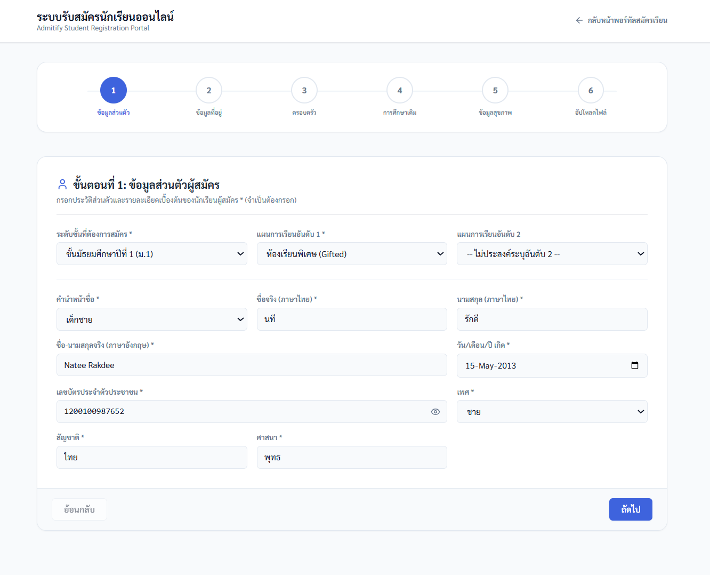 

*รูปที่ 22 หน้าสมัครเรียนออนไลน์*

### 4.2.2 หน้าตรวจสอบสถานะการสมัคร

หลังส่งใบสมัคร ผู้สมัครใช้รหัสใบสมัครหรือเลขบัตรประชาชน 13 หลัก ค้นหาสถานะของตนเองได้จากหน้าตรวจสอบสถานะ (รูปที่ 4.2) หน้านี้แสดงสถานะการคัดเลือก 4 ขั้น ได้แก่ ส่งใบสมัครแล้ว ชำระเงินค่าสอบ ประกาศผลสอบ และมอบตัวเสร็จสมบูรณ์ เมื่อมอบตัวเสร็จ ระบบแสดงรหัสนักเรียนใหม่ ห้องเรียนที่จัดสรร และแผนการเรียน พร้อมให้พิมพ์หลักฐานมอบตัว ผู้สมัครจึงติดตามผลได้เองโดยไม่ต้องติดต่อโรงเรียน

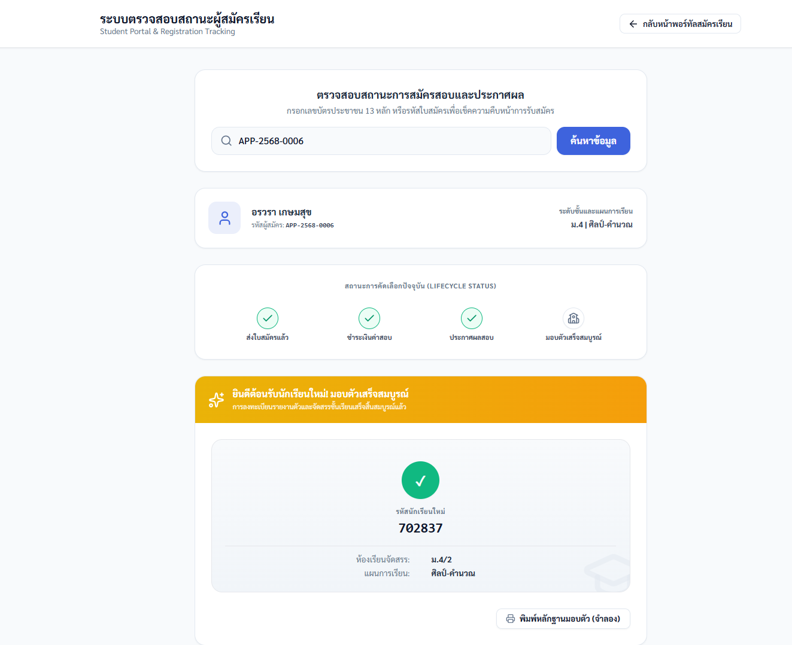 

*รูปที่ 23 หน้าตรวจสอบสถานะการสมัครสอบและประกาศผล*

### 4.2.3 หน้าบริหารจัดการผู้สมัคร

หน้าบริหารจัดการผู้สมัคร (รูปที่ 4.3 ถึง 4.5) รองรับ UC-ADM-01 UC-ADM-02 และ UC-ADM-03 เจ้าหน้าที่งานทะเบียนดูรายชื่อผู้สมัครแยกตาม 3 เฟส ได้แก่ รับสมัครและคัดเลือก ประกาศผลสอบ และรายงานตัวและมอบตัว โดยเลือกเฟสจากแถบด้านบน ภายในหน้าเดียวกันสามารถค้นหาด้วยชื่อหรือรหัสผู้สมัคร กรองตามระดับชั้นและแผนการเรียน ดูสถานะเอกสาร ห้องสอบและที่นั่ง และเปลี่ยนสถานะผู้สมัครได้จากคอลัมน์เปลี่ยนสถานะ ทั้งแบบรายคนและแบบเลือกหลายคนพร้อมกัน ส่วนปุ่มด้านบนใช้ลงทะเบียนผู้สมัครใหม่ ส่งอีเมลแจ้งเตือน และพิมพ์ใบสมัครของผู้สมัครที่เลือกไว้

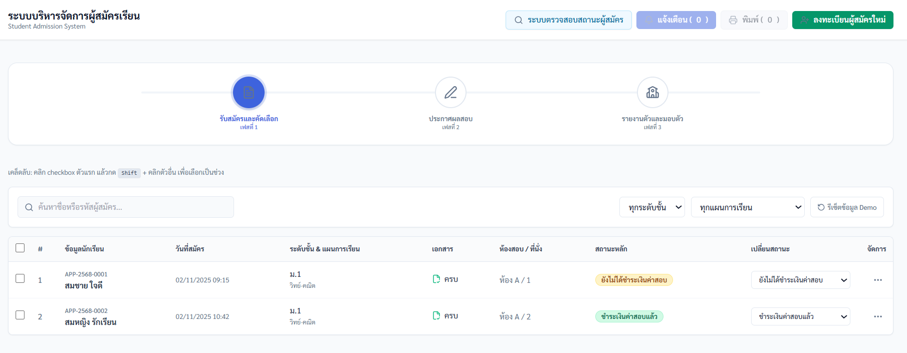 

*รูปที่ 24 หน้าบริหารจัดการผู้สมัคร เฟสรับสมัครและคัดเลือก*

ในเฟสประกาศผลสอบ (รูปที่ 4.4) ระบบแสดงคะแนนสอบและผลการคัดเลือก เช่น สอบผ่าน หรือสำรองพร้อมลำดับที่ ส่วนในเฟสรายงานตัวและมอบตัว (รูปที่ 4.5) เมื่อเปลี่ยนสถานะเป็น “กำลังศึกษา / มอบตัวเสร็จสิ้น” ผู้สมัครจะได้รับรหัสนักเรียนและห้องเรียน แล้วเข้าสู่ทะเบียนนักเรียนตามที่ออกแบบไว้ใน UC-ADM-03

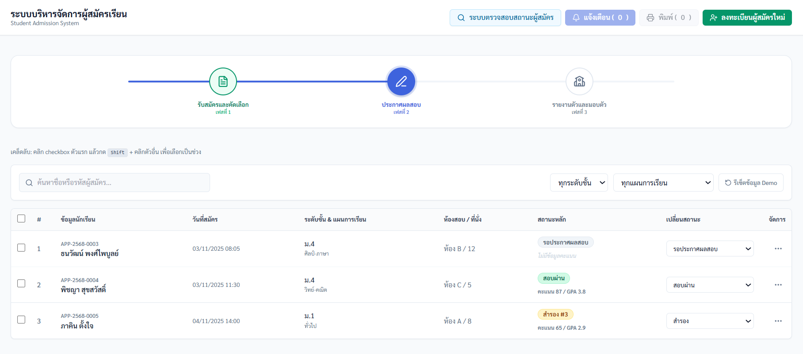 

*รูปที่ 25 หน้าบริหารจัดการผู้สมัคร เฟสรายงานตัวและมอบตัว*

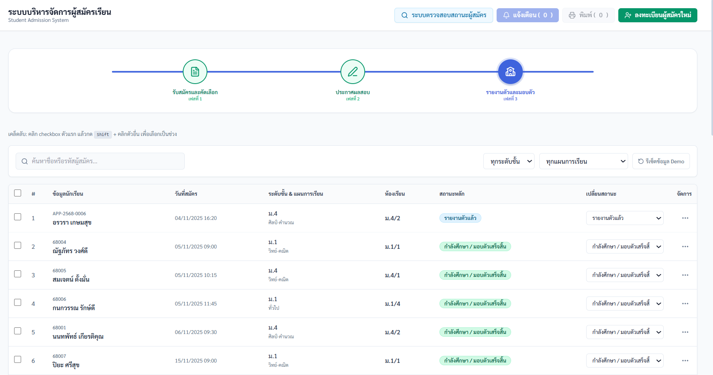 

*รูปที่ 26 หน้าบริหารจัดการผู้สมัคร เฟสรายงานตัวและมอบตัว*

### 4.2.4 หน้าประวัติและข้อมูลผู้สมัคร

เมื่อเลือกผู้สมัครหนึ่งคน ระบบแสดงหน้าประวัติที่รวมข้อมูลทั้งหมดของผู้สมัครคนนั้นไว้ในหน้าเดียว (รูปที่ 4.6) ส่วนบนแสดงชื่อ สถานะ รหัสใบสมัคร และรหัสนักเรียนใหม่ พร้อมปุ่มแก้ไขข้อมูล พิมพ์เอกสาร และส่งอีเมลแจ้งเตือน ถัดมาเป็นขั้นตอนกระบวนการคัดเลือก 6 ขั้น ตั้งแต่สมัครออนไลน์จนถึงมอบตัวและจัดชั้นเรียน ส่วนล่างแบ่งข้อมูลเป็นหมวด ได้แก่ ประวัตินักเรียนและที่อยู่ ข้อมูลครอบครัวผู้ปกครอง ประวัติการศึกษาและสุขภาพ ผลการเรียน และหลักฐานใบสมัคร หน้านี้แก้ปัญหาข้อมูลของคนเดียวกันกระจายอยู่หลายหน้าจอในระบบเดิม

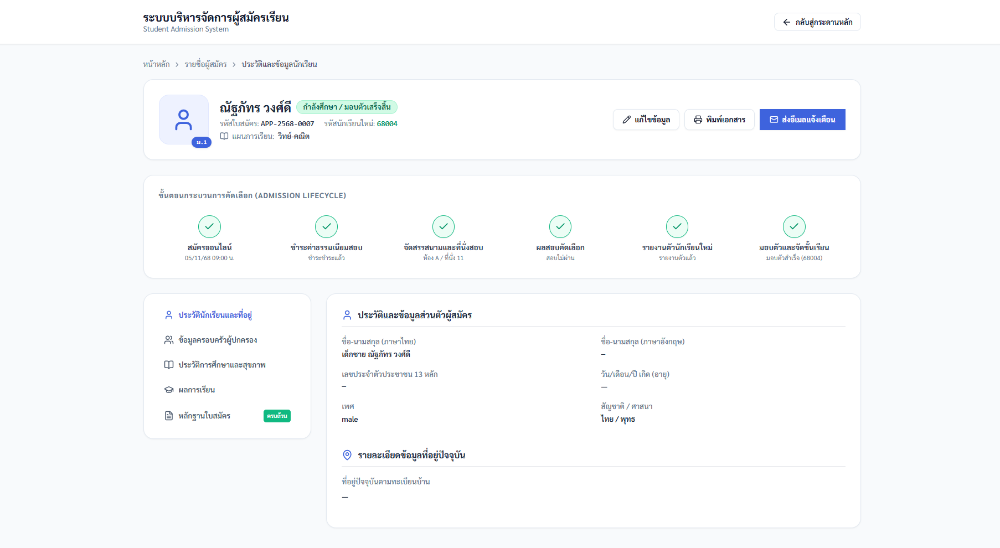 

*รูปที่ 27 หน้าประวัติและข้อมูลผู้สมัคร*

### 4.2.5 หน้าส่งอีเมลแจ้งเตือน

หน้าส่งอีเมลแจ้งเตือน (รูปที่ 4.7) รองรับ UC-ADM-04 เจ้าหน้าที่เลือกเทมเพลตอีเมลหรือเขียนเนื้อหาเอง และใช้แท็กแทนข้อมูล เช่น [ชื่อนักเรียน] [แผนการเรียน] [คะแนนรวม] และ [ห้องเรียน] ซึ่งระบบจะแทนด้วยข้อมูลจริงของผู้รับแต่ละคน และแนบไฟล์เพิ่มเติมได้ ด้านขวาแสดงรายชื่อผู้ปกครองที่จะได้รับอีเมล พร้อมข้อความเตือนเรื่องการคุ้มครองข้อมูลส่วนบุคคล (PDPA) เมื่อส่งอีเมลแบบกลุ่ม

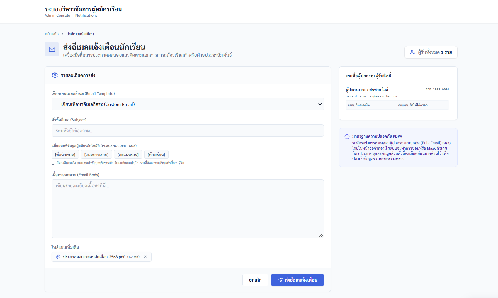 

*รูปที่ 28 หน้าส่งอีเมลแจ้งเตือน*

### 4.2.6 หน้าพิมพ์ใบสมัคร

หน้าพิมพ์ใบสมัคร (รูปที่ 4.8) รองรับ UC-ADM-05 ระบบแสดงตัวอย่างเอกสารก่อนพิมพ์ ประกอบด้วยข้อมูลผู้สมัคร ระดับชั้น แผนการเรียน ห้องสอบ และผลตรวจเอกสารประกอบการสมัครแต่ละรายการพร้อมชื่อผู้ตรวจ เจ้าหน้าที่สั่งพิมพ์หรือดาวน์โหลดเป็นไฟล์ภาพได้ และพิมพ์ใบสมัครของผู้สมัครที่เลือกไว้หลายคนพร้อมกันได้

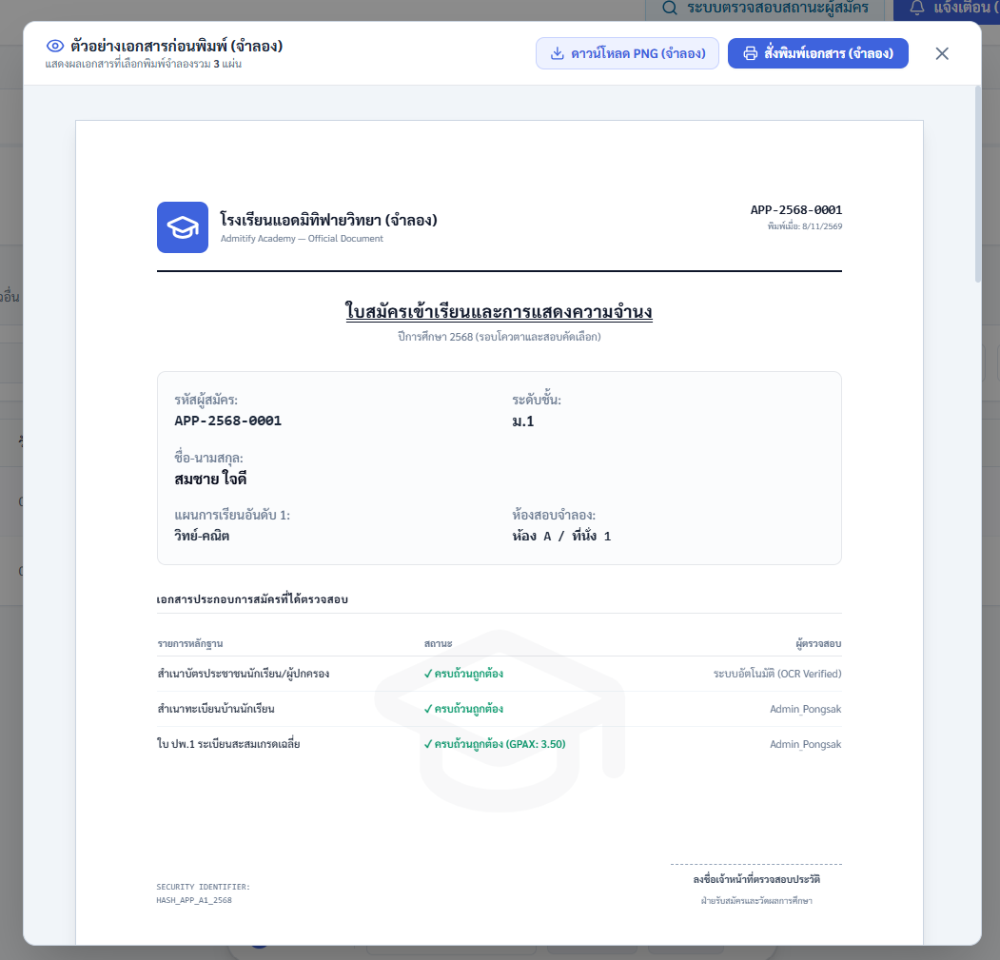 

*รูปที่ 29 หน้าตัวอย่างใบสมัครก่อนพิมพ์*

## 4.3 งานทะเบียนนักเรียน

### 4.3.1 หน้าข้อมูลนักเรียนทั้งโรงเรียน

หน้าข้อมูลนักเรียนทั้งโรงเรียน (รูปที่ 4.9) รองรับ UC-REG-01 และ UC-REG-06 รวมการค้นหาและจัดการข้อมูลนักเรียนไว้ในหน้าเดียว ผู้ใช้ค้นหาด้วยชื่อ รหัสนักเรียน รหัสผู้สมัคร หรือเลขบัตรประชาชน และกรองด้วยการกดปุ่มครั้งเดียว ตามปีการศึกษาและภาคเรียน ระดับชั้น ห้องเรียน แผนการเรียน และสถานะ เช่น กำลังศึกษา สำเร็จการศึกษา ลาออก และย้ายโรงเรียน โดยแสดงจำนวนนักเรียนของแต่ละสถานะ ข้อมูลศิษย์เก่าจึงค้นได้จากหน้าเดียวกันด้วยการเลือกสถานะสำเร็จการศึกษา เหนือตารางมีปุ่มเพิ่มนักเรียน นำเข้า/ส่งออก จัดการทะเบียน และรายงาน/สถิติ ส่วนแต่ละแถวมีปุ่มแก้ไข ดูข้อมูล และลบ

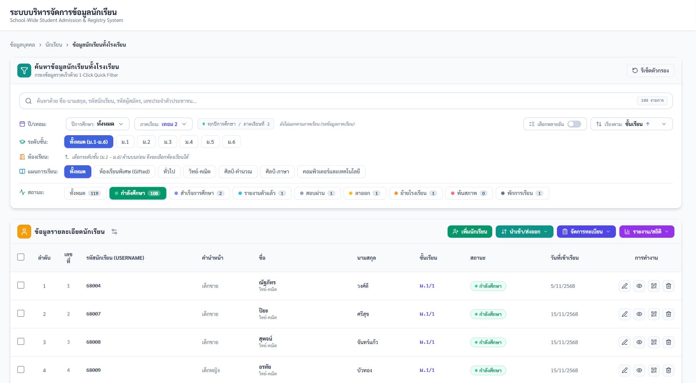 

*รูปที่ 30 หน้าข้อมูลนักเรียนทั้งโรงเรียน*

**

### 4.3.2 หน้าต่างเพิ่มนักเรียน

หน้าต่างเพิ่มนักเรียน (รูปที่ 4.10) รองรับ UC-REG-02 ใช้เพิ่มนักเรียนเข้าทะเบียนโดยตรงโดยไม่ผ่านระบบรับสมัคร ผู้ใช้เลือกได้ว่าเป็นนักเรียนใหม่หรือย้ายเข้าจากสถานศึกษาอื่น แล้วกรอกคำนำหน้า ชื่อ นามสกุล ระดับชั้น ห้องเรียน แผนการเรียน และอีเมลผู้ปกครอง โดยรายการห้องเรียนแสดงจำนวนนักเรียนปัจจุบันของแต่ละห้องเพื่อช่วยเลือกห้อง

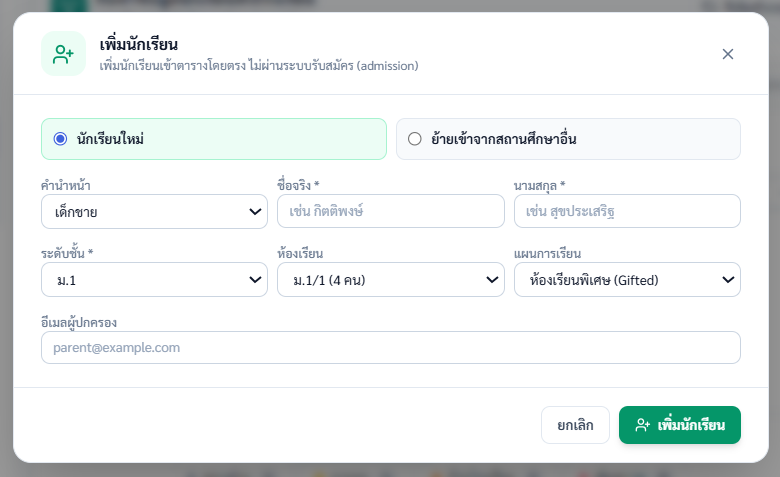 

*รูปที่ 31 หน้าต่างเพิ่มนักเรียน*

**

### 4.3.3 การจัดการนักเรียนหลายคนพร้อมกัน

เมื่อเลือกนักเรียนอย่างน้อย 1 คน ระบบแสดงแถบคำสั่งด้านล่างพร้อมจำนวนที่เลือก (รูปที่ 4.11) ได้แก่ เลื่อนชั้น/จบการศึกษา ย้ายห้องเรียน ย้ายออก/ลาออก ออกเอกสาร และส่งออก ซึ่งรองรับ UC-REG-04 UC-REG-05 UC-REG-07 และ UC-REG-09 ผู้ใช้จึงทำรายการทะเบียนกับนักเรียนหลายคนได้จากหน้าข้อมูลนักเรียนโดยตรง ไม่ต้องเปิดหน้าจอแยกตามประเภทรายการเหมือนระบบเดิม

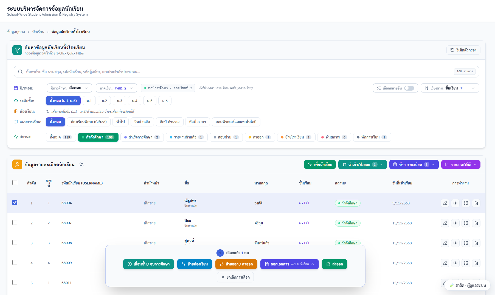 

*รูปที่ 32 แถบคำสั่งเมื่อเลือกนักเรียน*

**

### 4.3.4 การเลื่อนชั้นและบันทึกสำเร็จการศึกษา

หน้าต่างเลื่อนชั้นและบันทึกสำเร็จการศึกษา (รูปที่ 4.12) รองรับ UC-REG-04 ออกแบบแบบ Bulk-First คือระบบกำหนดให้นักเรียนทุกคนเลื่อนชั้นเป็นค่าเริ่มต้น และให้ผู้ใช้กดยกเว้นเฉพาะนักเรียนที่ไม่ผ่านเกณฑ์ เช่น ติด 0 ร หรือ มผ ด้านซ้ายสรุปจำนวนผู้เลื่อนชั้นและผู้ถูกยกเว้น แยกตามระดับชั้น เช่น ม.1 → ม.2 หรือจบ ม.3 ส่วนรายชื่อด้านขวาแสดงห้องเดิมและชั้นปลายทาง หรือสถานะสำเร็จการศึกษา ระบบจะบันทึกลงฐานข้อมูลหลังผู้ใช้กดยืนยันเท่านั้น วิธีนี้ลดจำนวนครั้งที่ต้องคลิก เพราะนักเรียนส่วนใหญ่เลื่อนชั้นตามปกติ

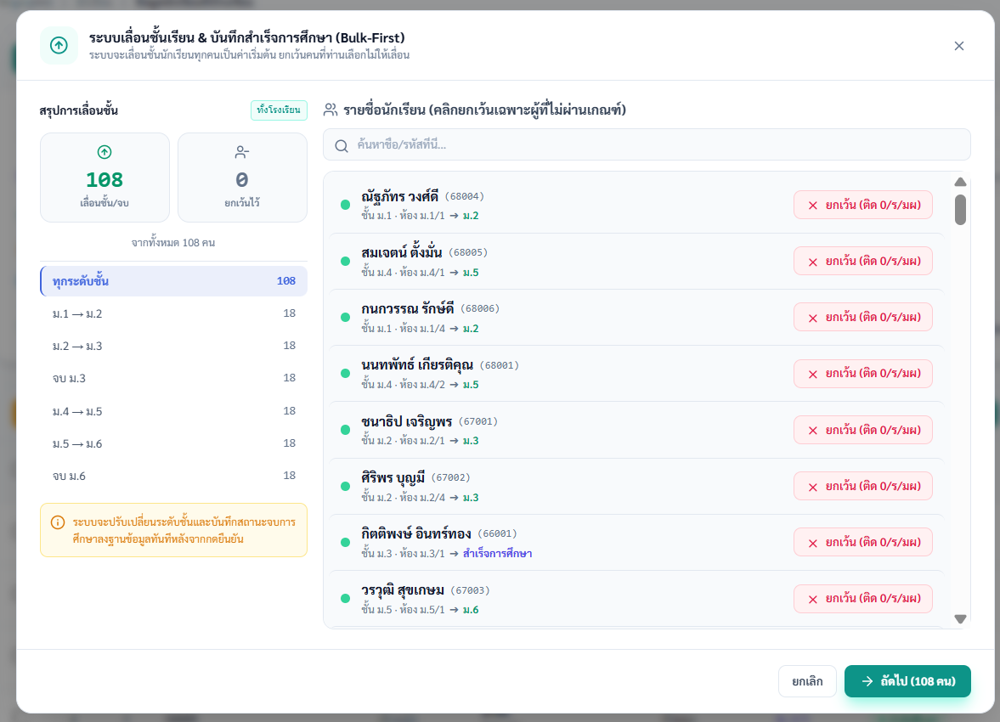 

*รูปที่ 33 หน้าต่างเลื่อนชั้นและบันทึกสำเร็จการศึกษา*

**

### 4.3.5 หน้าต่างบันทึกย้ายออกและลาออก

หน้าต่างบันทึกย้ายออก/ลาออก (รูปที่ 4.13) รองรับ UC-REG-05 แสดงรายชื่อนักเรียนที่เลือกไว้จากตาราง ผู้ใช้เลือกประเภทรายการหรือสถานะใหม่ เช่น ย้ายออกไปสถานศึกษาอื่น ระบุวันที่มีผล โรงเรียนหรือสถานศึกษาปลายทาง และเหตุผล แล้วกดบันทึกการเปลี่ยนแปลงพร้อมกันทุกคนที่เลือก

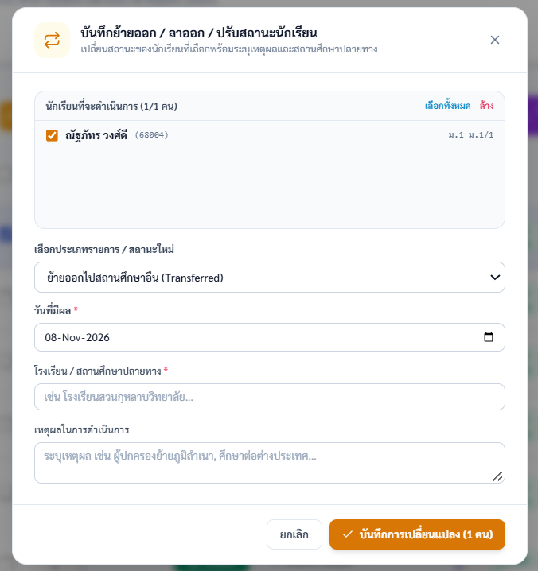 

*รูปที่ 34 หน้าต่างบันทึกย้ายออกและลาออก*

**

### 4.3.6 หน้าต่างส่งออกข้อมูล

หน้าต่างส่งออกข้อมูล (รูปที่ 4.14) รองรับ UC-REG-07 แบ่งการเลือกเป็น 3 ส่วน ได้แก่ ประเภทข้อมูล เช่น ข้อมูลนักเรียนตามตาราง รายชื่อนักเรียนแยกตามห้อง รายงานลาออก และรายงานนักเรียนใหม่ ขอบเขต ได้แก่ เลือกห้องเรียนเอง ตามตัวกรองปัจจุบัน หรือเฉพาะที่เลือก และรูปแบบไฟล์ PDF, Excel หรือ CSV ผู้ใช้เลือกคอลัมน์ที่ต้องการแสดง และดูตัวอย่างไฟล์ทางด้านขวาก่อนกดส่งออก

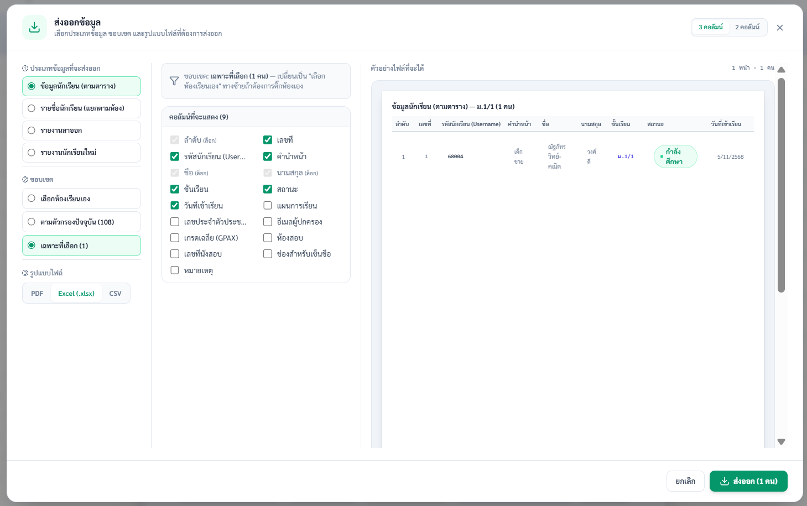 

*รูปที่ 35 หน้าต่างส่งออกข้อมูล*

**

### 4.3.7 หน้ารายงานสถิตินักเรียน

หน้ารายงานสถิติ (รูปที่ 4.15) รองรับ UC-REG-08 แสดงจำนวนนักเรียนแยกตามระดับชั้น เพศ และสถานะ ได้แก่ กำลังศึกษา จบการศึกษา และอื่น ๆ พร้อมยอดรวม และแสดงจำนวนนักเรียนที่กำลังศึกษาแยกตามห้องเรียน ด้านล่างมีรายงานอื่น ๆ เช่น รายงานสรุปสถานะ และปุ่มพิมพ์รายงาน

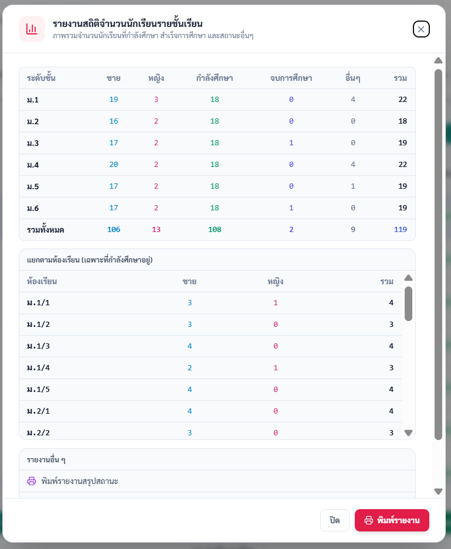 

*รูปที่ 36 หน้ารายงานสถิติจำนวนนักเรียนรายชั้นเรียน*

**

### 4.3.8 การออกเอกสาร ปพ.1 และ ปพ.2

การออกเอกสาร ปพ.1 และ ปพ.2 รองรับ UC-REG-09 สำหรับ ปพ.1 (ระเบียนแสดงผลการเรียน) ผู้ใช้เลือกกลุ่มนักเรียนเป้าหมายและภาษาของเอกสาร คือ ภาษาไทย หรือภาษาอังกฤษ (Official Transcript) (รูปที่ 4.16) จากนั้นระบบแสดงตัวอย่างเอกสารให้ตรวจสอบก่อนยืนยันสร้างเอกสาร (รูปที่ 4.17) ส่วนผลการเรียนรายวิชาจะดึงจากระบบของกลุ่มงานอื่นเมื่อรวมระบบ

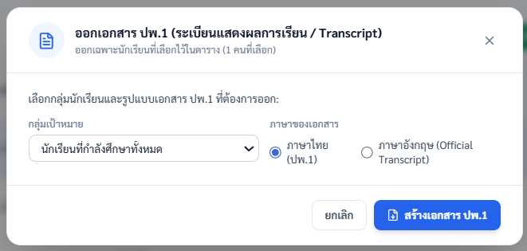 

*รูปที่ 37 หน้าต่างเลือกกลุ่มนักเรียนและภาษาของเอกสาร ปพ.1*

**

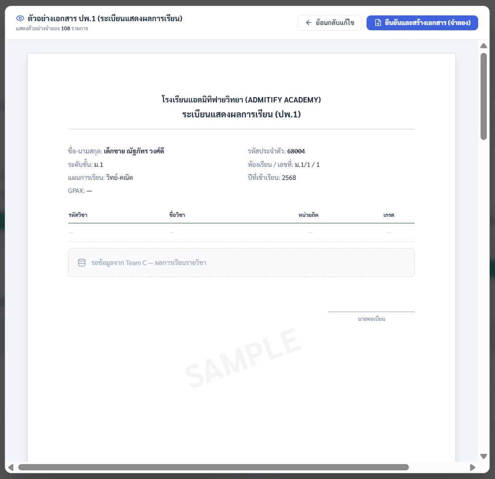 

*รูปที่ 38 หน้าตัวอย่างเอกสาร ปพ.1 ก่อนยืนยัน*

สำหรับ ปพ.2 (ใบประกาศนียบัตรสำเร็จการศึกษา) (รูปที่ 4.18) ผู้ใช้เลือกกลุ่มเป้าหมายและรายชื่อนักเรียนที่จะออกเอกสาร หากมีนักเรียนที่สถานะยังเป็น “กำลังศึกษา” ระบบแสดงคำเตือนและป้ายยังไม่จบที่รายชื่อนั้น เพื่อให้ตรวจสอบกับฝ่ายทะเบียนก่อนออกใบประกาศและพิมพ์

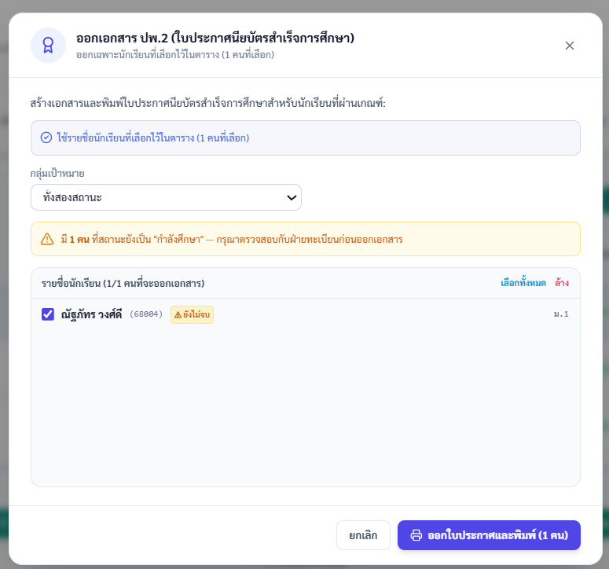 

*รูปที่ 39 หน้าต่างออกเอกสาร ปพ.2*

**

## 4.4 งานบุคลากร

### 4.4.1 หน้ารายชื่อบุคลากร

หน้ารายชื่อบุคลากร (รูปที่ 4.19) รองรับ UC-STF-01 และ UC-STF-02 ส่วนบนสรุปจำนวนบุคลากรทั้งหมด จำนวนที่รอตรวจสอบหรือเอกสารไม่ครบ และจำนวนที่ข้อมูลครบถ้วน ตารางแสดงรหัสบุคลากร ชื่อ ตำแหน่งงานและกลุ่มสาระ เบอร์โทรศัพท์ และสถานะความครบถ้วนของข้อมูล ผู้ใช้ค้นหา กรองตามสถานะ เพิ่มบุคลากรรายบุคคล หรือนำเข้าข้อมูลจากไฟล์ Excel ได้ และแต่ละแถวมีปุ่มแก้ไข พิมพ์ และลบ

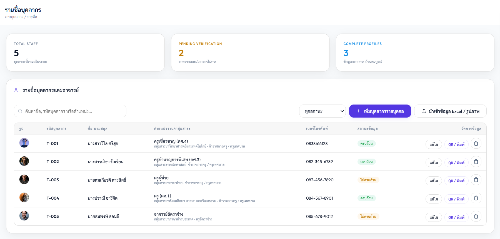 

*รูปที่ 40 หน้ารายชื่อบุคลากร*

**

### 4.4.2 หน้าเพิ่มข้อมูลบุคลากร

หน้าเพิ่มข้อมูลบุคลากร (รูปที่ 4.20) รองรับ UC-STF-02 แบ่งการกรอกเป็น 3 ขั้น ได้แก่ ข้อมูลพื้นฐาน การศึกษาและอบรม และตำแหน่งและใบประกอบวิชาชีพ ในขั้นข้อมูลพื้นฐานแบ่งย่อยเป็นแท็บ ได้แก่ ประวัติส่วนตัว ที่อยู่ตามทะเบียนบ้าน ที่อยู่ติดต่อได้ และข้อมูลครอบครัว โดยช่องที่มีเครื่องหมาย * เป็นข้อมูลที่ต้องกรอก

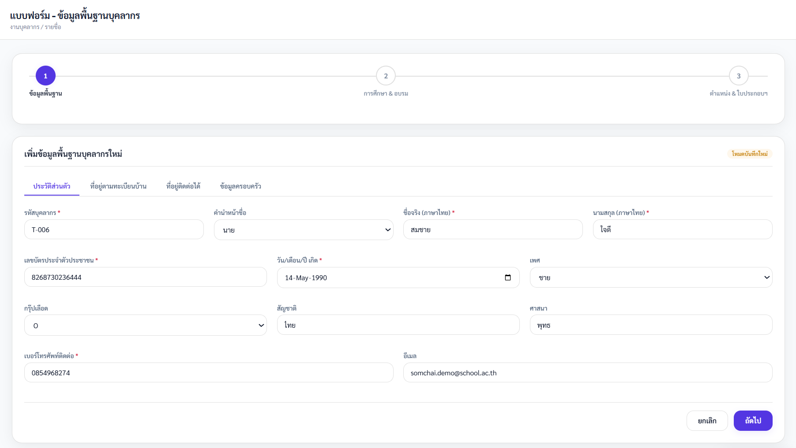 

*รูปที่ 41 หน้าเพิ่มข้อมูลบุคลากร*

**

### 4.4.3 หน้าพิมพ์แฟ้มประวัติบุคลากร

หน้าพิมพ์แฟ้มประวัติบุคลากร (รูปที่ 4.21) รองรับ UC-STF-03 ผู้ใช้เลือกบุคลากรแล้วดูตัวอย่างแฟ้มประวัติขนาด A4 ก่อนพิมพ์ ประกอบด้วยประวัติส่วนบุคคลและประวัติการศึกษา พร้อมรูปถ่ายและ QR Code จากนั้นสั่งพิมพ์รายคน พิมพ์ทั้งหมด หรือส่งออกเป็นไฟล์ PNG

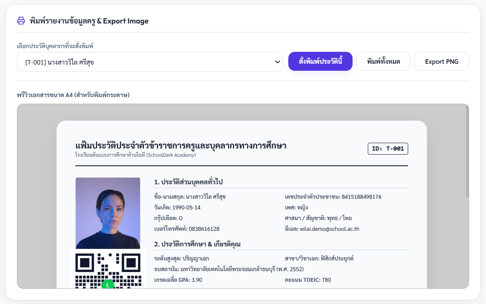 

*รูปที่ 42 หน้าพิมพ์แฟ้มประวัติบุคลากร*

**

## 4.5 การตั้งค่าระบบ

### 4.5.1 หน้าตั้งค่าข้อมูลโรงเรียน

หน้าตั้งค่าข้อมูลโรงเรียน (รูปที่ 4.22) รองรับ UC-SET-01 แบ่งเป็นแท็บ ได้แก่ ข้อมูลโรงเรียน ข้อมูลห้องเรียน ปฏิทินโรงเรียน ปีการศึกษา ระดับการศึกษา สาขางาน-สาขาวิชา ครูประจำชั้น และเวลาเข้า-เลิกเรียน แท็บแรกใช้แก้ไขชื่อโรงเรียนภาษาไทยและภาษาอังกฤษ รหัสโรงเรียน เบอร์โทรศัพท์ ที่อยู่ และปีการศึกษาปัจจุบันพร้อมวันเปิดและปิดภาคเรียน

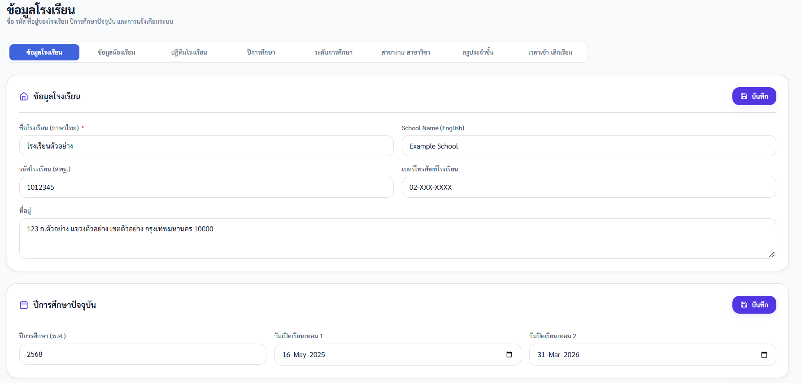 

*รูปที่ 43 หน้าตั้งค่าข้อมูลโรงเรียน*

**

### 4.5.2 หน้าตั้งค่างานบุคลากร

หน้าตั้งค่างานบุคลากร (รูปที่ 4.23) รองรับ UC-SET-02 แบ่งเป็นแท็บ ได้แก่ วันเวลาเข้าออก สิทธิ์ผู้ใช้งาน ผู้ลงนามเอกสาร ประเภทบุคลากร ตำแหน่ง และแผนก/กลุ่มสาระ รูปที่ 4.23 แสดงแท็บวันเวลาเข้าออก ซึ่งกำหนดเวลาเข้างาน เวลาเลิกงาน เวลาพักกลางวัน เกณฑ์มาสายและกลับก่อน เวลาเริ่มนับ OT และวันทำงานประจำสัปดาห์

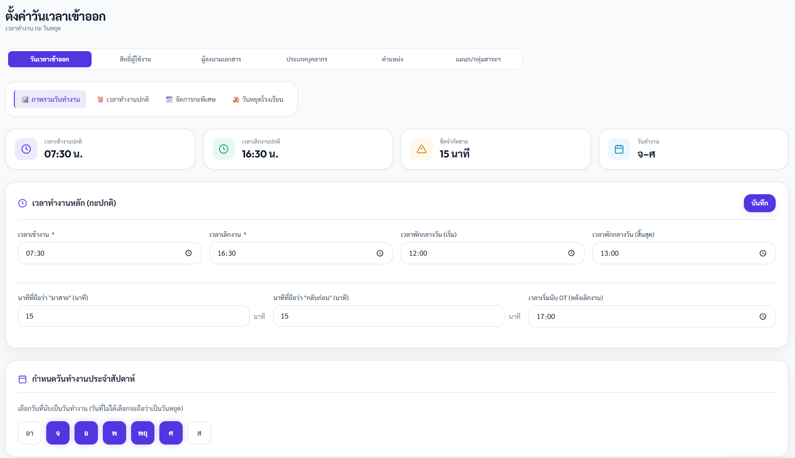 

*รูปที่ 44 หน้าตั้งค่างานบุคลากร*

**

### 4.5.3 หน้าตั้งค่างานรับสมัครนักเรียน

หน้าตั้งค่างานรับสมัคร (รูปที่ 4.24) รองรับ UC-SET-04 แบ่งเป็นแท็บ ได้แก่ ตั้งค่าฟิลด์รับสมัคร ตั้งค่าแผนหลักสูตร ตั้งค่าห้องสอบ และตั้งค่าคอลัมน์นักเรียน แท็บตั้งค่าฟิลด์รับสมัครแบ่งตามหมวดของฟอร์ม เช่น ประวัติส่วนตัว ที่อยู่ ข้อมูลบิดา มารดา และผู้ปกครอง ข้อมูลการศึกษา ข้อมูลสุขภาพ และหลักฐานการสมัคร ผู้ใช้กำหนดได้ว่าฟิลด์ใดจำเป็นต้องระบุ ซึ่งมีผลกับฟอร์มสมัครเรียนในรูปที่ 4.1

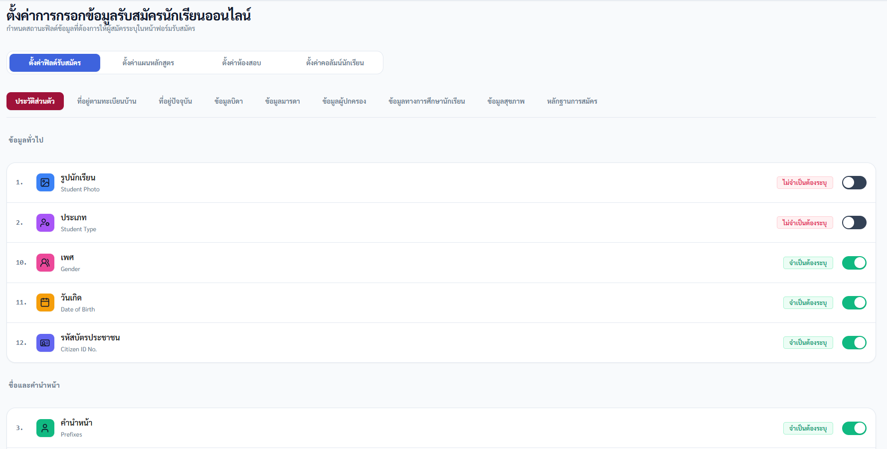 

*รูปที่ 45 หน้าตั้งค่าฟิลด์รับสมัครนักเรียน*

**

### 4.5.4 หน้าตั้งค่าคอลัมน์ตารางข้อมูลนักเรียน

แท็บตั้งค่าคอลัมน์นักเรียน (รูปที่ 4.25) รองรับ UC-SET-03 ใช้กำหนดคอลัมน์ที่แสดงในตารางข้อมูลนักเรียนของรูปที่ 4.9 ผู้ใช้เปิดหรือปิดการแสดงคอลัมน์ สลับลำดับ ตั้งคอลัมน์หลัก แก้ไขคอลัมน์ เพิ่มคอลัมน์ใหม่ และคืนค่าเริ่มต้นได้

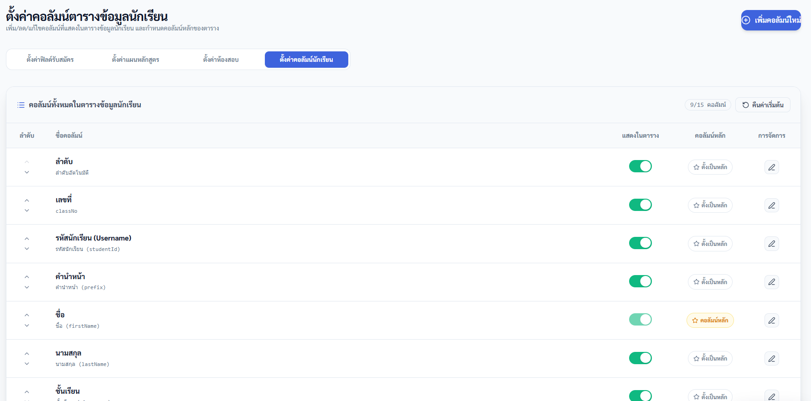 

*รูปที่ 46 หน้าตั้งค่าคอลัมน์ตารางข้อมูลนักเรียน*

## 4.6 สรุปผลการดำเนินงาน

ระบบต้นแบบครอบคลุม Use Case หลักของทั้ง 4 กลุ่มระบบในบทที่ 3 และแสดงลำดับการทำงานได้ครบ ตั้งแต่การสมัครเรียน การคัดเลือก และการมอบตัว ไปจนถึงการบริหารข้อมูลนักเรียน ข้อมูลบุคลากร และการตั้งค่าระบบ โดยแก้ปัญหาของกระบวนการเดิมในหัวข้อ 3.1 ดังนี้

- ปัญหาหน้าจอกระจัดกระจาย แก้ด้วยหน้าบริหารจัดการผู้สมัครแบบ 3 เฟส และหน้าข้อมูลนักเรียนที่รวมการค้นหา การกรอง และการทำรายการทะเบียนไว้ในหน้าเดียว
- ปัญหาข้อมูลที่เกี่ยวข้องกันไม่รวมศูนย์ แก้ด้วยหน้าประวัติผู้สมัครที่รวมข้อมูลทุกหมวดและขั้นตอนการคัดเลือกไว้ในหน้าเดียว
อย่างไรก็ตาม ระบบต้นแบบยังใช้ข้อมูลจำลองและยังไม่ได้ทดสอบกับผู้ใช้งานจริง ขั้นตอนถัดไปคือการออกแบบหน้าจอตามธีมร่วมของ 3 กลุ่มงาน และพัฒนาระบบให้ใช้งานได้จริง

# บทที่ 5 บทสรุป

## 5.1 สรุปผลการปฏิบัติงาน

ในภาคการศึกษานี้ คณะผู้จัดทำได้ดำเนินงานวิเคราะห์ความต้องการ ออกแบบสถาปัตยกรรมระบบ Use Case และฐานข้อมูล และพัฒนาระบบต้นแบบหน้าจอที่แสดงลำดับการทำงานของระบบ รายละเอียดมีดังนี้

#### งานที่ดำเนินการแล้ว

- วิเคราะห์ความต้องการและออกแบบระบบ ได้แก่ สถาปัตยกรรมระบบและ Use Case จำนวน 24 รายการ
- ออกแบบฐานข้อมูลของงานรับสมัครนักเรียน งานทะเบียนนักเรียน งานบุคลากร และการตั้งค่าระบบ
- พัฒนาระบบต้นแบบหน้าจอที่แสดงลำดับการทำงานของทั้ง 4 กลุ่มระบบ
#### งานที่เหลือ

- ออกแบบหน้าจอใหม่ตามธีมที่กำหนดร่วมกันระหว่าง 3 กลุ่มงาน
- เตรียมเซิร์ฟเวอร์และติดตั้งระบบบนสภาพแวดล้อม เพื่อใช้ทดสอบระบบก่อนนำไปใช้งานจริง
- พัฒนาหน้าบ้านและหลังบ้านให้ใช้งานได้จริงแทนข้อมูลจำลองในระบบต้นแบบ
- ทดสอบระบบและรวมระบบเข้ากับกลุ่มงานอื่น
#### แผนการดำเนินงานในภาคการศึกษาถัดไป

แผนการดำเนินงานตั้งแต่เดือนธันวาคม 2569 ถึงเดือนมีนาคม 2570 แสดงดังตารางที่ 5.1

*ตารางที่ 5.1 แผนการดำเนินงานภาคการศึกษาถัดไป*

| งาน | ธ.ค. 69 | ม.ค. 70 | ก.พ. 70 | มี.ค. 70 |
| --- | --- | --- | --- | --- |
| ออกแบบหน้าจอตามธีมร่วมของ 3 กลุ่มงาน |  |  |  |  |
| วางโครงสร้างพื้นฐานสำหรับสภาพแวดล้อมทดสอบ |  |  |  |  |
| พัฒนาระบบหลังบ้าน (FastAPI, IAM, API) |  |  |  |  |
| พัฒนาระบบหน้าบ้าน (Next.js) |  |  |  |  |
| รวมระบบกับกลุ่มงานอื่นผ่าน Internal API |  |  |  |  |
| ทดสอบระบบและแก้ไขข้อผิดพลาด |  |  |  |  |
| จัดทำเอกสารและคู่มือการใช้งาน |  |  |  |  |

#### แนวทางการรวมระบบกับกลุ่มงานอื่น

ระบบของทั้ง 3 กลุ่มงานจะรวมเป็นระบบเดียวตามสถาปัตยกรรมในหัวข้อ 3.3.1 โดยผู้ใช้เข้าใช้งานผ่าน Web Portal เดียวกันซึ่งใช้ธีมร่วมกัน และ Nginx ทำหน้าที่ Reverse Proxy ส่ง Request ไปยัง Service A, B หรือ C ตาม Path ส่วนแต่ละ Service มี Schema ฐานข้อมูลของตนเอง จึงพัฒนาและดูแลแยกกันได้

Service B ของคณะผู้จัดทำเป็นผู้ให้บริการยืนยันตัวตนและสิทธิ์ (IAM) แก่ทั้งระบบ Service A และ Service C จะตรวจสอบสิทธิ์ของผู้ใช้ผ่าน Service B และขอข้อมูลหลัก เช่น ข้อมูลนักเรียน ห้องเรียน และบุคลากร ผ่าน Internal API ขณะเดียวกัน Service B จะรับข้อมูลที่กลุ่มงานอื่นรับผิดชอบ เช่น ผลการเรียนรายวิชาสำหรับออกเอกสาร ปพ.1 การรวมระบบจะทดสอบการเรียกใช้ API ข้ามระบบบนสภาพแวดล้อมทดสอบก่อนนำไปใช้งานจริง

## 5.2 ปัญหาอุปสรรคและข้อเสนอแนะ

ปัญหาและอุปสรรคที่พบในภาคการศึกษานี้ และแนวทางแก้ไข มีดังนี้

### 5.2.1 ปัญหาและข้อจำกัดของแพลตฟอร์มการพัฒนา

- ไม่ได้รวบรวมความต้องการจากผู้ใช้งานจริงโดยตรง ความต้องการของโรงเรียนกลุ่มเป้าหมายได้รับผ่านอาจารย์ที่ปรึกษา คณะผู้จัดทำจึงไม่ได้สอบถามครูหรือเจ้าหน้าที่ของโรงเรียนโดยตรง ทำให้อาจตีความลำดับการทำงานจริงคลาดเคลื่อน และระบบต้นแบบยังไม่ได้ทดสอบกับผู้ใช้งานจริง
- ความต้องการของทั้ง 3 กลุ่มงานไม่ชัดเจนในช่วงแรก เพราะได้มาจากหน้าจอของระบบเดิมเป็นหลัก ทำให้ Use Case Description และฐานข้อมูลที่ออกแบบไว้ในรอบแรกต้องทบทวนใหม่
- การประสานงานระหว่าง 3 กลุ่มงาน ธีมของหน้าจอ โครงสร้างข้อมูล และ API ที่ใช้ร่วมกันต้องตกลงร่วมกับ Team A และ Team C งานบางส่วน เช่น การออกแบบหน้าจอตามธีมร่วม จึงต้องรอข้อตกลงก่อนดำเนินการต่อได้
- การพึ่งพาข้อมูลจากกลุ่มงานอื่น บางหน้าจอต้องใช้ข้อมูลที่กลุ่มงานอื่นรับผิดชอบ เช่น เอกสาร ปพ.1 ต้องใช้ผลการเรียนรายวิชา ระบบต้นแบบจึงยังแสดงข้อมูลส่วนนี้ไม่ได้
### 5.2.2 วิธีการแก้ไขปัญหา

- เปลี่ยนวิธีการทำงาน โดยใช้ Skill grill-with-docs ซักถามทวนความต้องการ และจัดทำความต้องการเชิงฟังก์ชันและไม่เป็นฟังก์ชันใหม่ก่อนออกแบบ Use Case ฐานข้อมูล และหน้าจอ ตามรายละเอียดในหัวข้อ 3.5.1
- วางแผนนำระบบต้นแบบไปทดสอบความสามารถในการใช้งานกับกลุ่มผู้ใช้งานตัวอย่าง เพื่อนำข้อเสนอแนะมาปรับปรุงก่อนพัฒนาจริง
- แยกระบบของแต่ละกลุ่มงานเป็น Service และ Schema ฐานข้อมูลของตนเอง เพื่อให้แต่ละกลุ่มพัฒนาได้อิสระ และกำหนดข้อตกลงเรื่องธีมและ Internal API ร่วมกันตั้งแต่ต้นภาคการศึกษาถัดไป
- ออกแบบหน้าจอให้รองรับข้อมูลที่ยังไม่พร้อม โดยแสดงสถานะรอข้อมูลจากกลุ่มงานอื่น และกำหนดรูปแบบข้อมูลที่ต้องรับผ่าน Internal API ไว้ล่วงหน้า เพื่อให้เชื่อมต่อได้ทันทีเมื่อรวมระบบ
## 5.3 ข้อเสนอแนะสำหรับการพัฒนาต่อยอด

- ทดสอบความสามารถในการใช้งานกับผู้ใช้จริง และวัดผลเทียบกับระบบเดิม เช่น เวลาและจำนวนขั้นตอนที่ใช้ทำงานหลัก
- ทดสอบประสิทธิภาพของระบบเมื่อมีผู้ใช้งานพร้อมกันจำนวนมาก โดยเฉพาะช่วงรับสมัครนักเรียนและประกาศผลสอบ
- พัฒนาให้รองรับการใช้งานหลายโรงเรียนในระบบเดียว เชื่อมต่อหรือส่งออกข้อมูลในรูปแบบที่ใช้กับระบบภายนอกได้ เช่น ระบบ DMC ของ สพฐ. เพื่อลดการกรอกข้อมูลซ้ำ
# บรรณานุกรม

[1] React. "React." [Online]. Available:  2026.

[2] Vercel. "Next.js Docs." [Online]. Available:  2026.

[3] FastAPI. "FastAPI." [Online]. Available: https://fastapi.tiangolo.com/ 2026.

[4] PostgreSQL Global Development Group. "PostgreSQL: Documentation."

[Online]. Available: https://www.postgresql.org/docs/ 2026.

[5] MinIO. "MinIO Quickstart Guide." [Online]. Available:

https://github.com/minio/minio 2026.

[6] R. T. Fielding. "Architectural Styles and the Design of Network-based

Software Architectures." Ph.D. dissertation, Dept. of Information and

Computer Science, University of California, Irvine, CA, USA. 2000.

[7] J. Lewis and M. Fowler. "Microservices." martinfowler.com. [Online]. Available:

https://martinfowler.com/articles/microservices.html Mar. 2014.

[8] C. Richardson. "Pattern: API Gateway / Backends for Frontends." microservices.io.

[Online]. Available: https://microservices.io/patterns/apigateway.html n.d.

[9] F5, Inc. "NGINX Reverse Proxy." NGINX Documentation. [Online]. Available:

https://docs.nginx.com/nginx/admin-guide/web-server/reverse-proxy/ 2026.

[10] Docker, Inc. "What is a Container?" [Online]. Available:

https://www.docker.com/resources/what-container/ 2025.

[11] Redis Ltd. "Redis Docs." [Online]. Available: https://redis.io/docs/latest/ 2026.

[12] A. Solem and contributors. "Celery – Distributed Task Queue." [Online]. Available:

https://docs.celeryq.dev/en/stable/ n.d.

[13] National Institute of Standards and Technology. "NIST SP 800-63 Digital Identity

Guidelines." [Online]. Available: https://pages.nist.gov/800-63-3/

[14] M. Jones, J. Bradley and N. Sakimura. "JSON Web Token (JWT)." RFC 7519.

[Online]. Available: https://www.rfc-editor.org/rfc/rfc7519 May 2015.

[15] R. Fielding, M. Nottingham and J. Reschke. "HTTP Semantics." RFC 9110. [Online].

Available: https://www.rfc-editor.org/rfc/rfc9110 Jun. 2022.

[16] T. Connolly and C. Begg. Database Systems: A Practical Approach to Design,

Implementation, and Management. 6th ed. Harlow, England: Pearson

Education. 2014.

[17] P. P. Chen. "The Entity-Relationship Model—Toward a Unified View of Data."

ACM Trans. Database Syst., vol. 1, no. 1. Mar. 1976. pp. 9–36.

[18] MDN Web Docs. "CRUD." [Online]. Available: https://developer.mozilla.org/en-

US/docs/Glossary/CRUD 2025.

[19] D. F. Ferraiolo and D. R. Kuhn. "Role-Based Access Controls." in Proc.

15th Nat. Comput. Security Conf., Baltimore, MD, USA. Oct. 1992.

pp. 554–563.

[20] MDN Web Docs. "Window: localStorage property." [Online]. Available:

https://developer.mozilla.org/en-US/docs/Web/API/Window/localStorage

2026.

[21] Microsoft. "Import and Export Data from SQL Server and Azure SQL Database."

[Online]. Available: https://learn.microsoft.com/en-us/sql/relational-

databases/import-export/overview-import-export?view=sql-server-ver17

2026.

[22] Microsoft. "Import data from Excel and export data to CSV." [Online]. Available:

https://learn.microsoft.com/en-us/power-apps/maker/data-platform/data-

platform-import-export 2026.

[23] Y. Shafranovich. "Common Format and MIME Type for Comma-Separated Values

(CSV) Files (RFC 4180)." [Online]. Available: https://www.rfc-

editor.org/rfc/rfc4180.html 2026.

[24] ISO 9241-210:2019. Ergonomics of Human-System Interaction — Part 210:

Human-Centred Design for Interactive Systems. Geneva, Switzerland:

International Organization for Standardization. 2019.

[25] J. Nielsen. "10 Usability Heuristics for User Interface Design." Nielsen Norman

Group. [Online]. Available: https://www.nngroup.com/articles/ten-usability-

heuristics/ 1994.

[26] I. Sommerville. Software Engineering. 10th ed. Boston, MA, USA: Pearson. 2016.

[27] L. Claxton. "The AI-native SDLC playbook." Anthropic. [Online]. Available:

https://claude.com/resources/articles/the-ai-native-sdlc-playbook Aug. 2026.

[28] Anthropic. "Claude Code overview." [Online]. Available:

https://code.claude.com/docs/en/overview 2026.

[29] S. Peng, E. Kalliamvakou, P. Cihon and M. Demirer. "The Impact of AI on

Developer Productivity: Evidence from GitHub Copilot." arXiv:2302.06590. Feb.

2023.

[30] MDN Web Docs. "Client-Server overview." [Online]. Available: https://developer.mozilla.org/en-US/docs/Learn_web_development/Extensions/Server-side/First_steps/Client-Server_overview 2026.

[31] T. Berners-Lee, R. Fielding and L. Masinter. "Uniform Resource Identifier (URI): Generic Syntax." RFC 3986. [Online]. Available: https://www.rfc-editor.org/rfc/rfc3986 Jan. 2005.

[32] E. Rescorla. "The Transport Layer Security (TLS) Protocol Version 1.3." RFC 8446. [Online]. Available: https://www.rfc-editor.org/rfc/rfc8446 Aug. 2018.

[33] บริษัท จับจ่าย คอร์ปอเรชั่น จำกัด. "ผลิตภัณฑ์ School Bright." [Online]. Available: https://www.schoolbright.co/en/product 2026.

[34] บริษัท จับจ่าย คอร์ปอเรชั่น จำกัด. "ระบบรับสมัครนักเรียนออนไลน์ School Bright ทำงานอย่างไร." [Online]. Available: https://www.schoolbright.co/en/post/how-does-the-school-bright-online-student-registration-system-work May 2026.

[35] บริษัท จับจ่าย คอร์ปอเรชั่น จำกัด. "ระบบทะเบียนนักเรียนและงานเอกสาร ปพ. ออกเอกสารได้ในคลิกเดียว." [Online]. Available: https://www.schoolbright.co/en/post/student-registration-system-with-one-click-pp-document-generation Sep. 2026.

[36] สำนักนโยบายและแผนการศึกษาขั้นพื้นฐาน สำนักงานคณะกรรมการการศึกษาขั้นพื้นฐาน. "แนวทางการบริหารระบบจัดเก็บข้อมูลนักเรียนรายบุคคล (Data Management Center: DMC) ปีการศึกษา 2568." [Online]. Available: https://www.rayong2.go.th/wp-content/uploads/2025/06/DMC_School_68.pdf 2025.

[37] สำนักงานเขตพื้นที่การศึกษามัธยมศึกษานครปฐม. "DMC Data Management Center." [Online]. Available: https://www.mathayom-npt.go.th/dmc-datamanagement-center/ 2026.

[38] Foradian Technologies. "101 Reasons to Choose Fedena." [Online]. Available: https://fedena.com/101-reasons 2026.

[39] Project Fedena. "fedena." GitHub. [Online]. Available: https://github.com/projectfedena/fedena n.d.

[40] Foradian Technologies. "Fedena Mobile App." [Online]. Available: https://fedena.com/mobile_app 2026.

[41] Foradian Technologies. "Fedena: School Management Software." [Online]. Available: https://fedena.com/ 2026.

[42] Foradian Technologies. "Pricing and Plans." [Online]. Available: https://fedena.com/pricing-and-plans 2026.

# ภาคผนวก ก Use Case Description

***ตารางที่ ก.1 UC-ADM-01 จัดการข้อมูลผู้สมัคร***

| Use Case Name | จัดการข้อมูลผู้สมัคร | ID: UC-ADM-01 |
| --- | --- | --- |
| Brief Description | เจ้าหน้าที่งานทะเบียนสามารถค้นหา เรียกดูรายละเอียด เพิ่ม แก้ไข และลบข้อมูลผู้สมัครเรียนที่ยื่นเข้ามาในระบบ เพื่อใช้ในกระบวนการรับสมัครนักเรียน | เจ้าหน้าที่งานทะเบียนสามารถค้นหา เรียกดูรายละเอียด เพิ่ม แก้ไข และลบข้อมูลผู้สมัครเรียนที่ยื่นเข้ามาในระบบ เพื่อใช้ในกระบวนการรับสมัครนักเรียน |
| Actor(s) | เจ้าหน้าที่งานทะเบียน (Primary) | เจ้าหน้าที่งานทะเบียน (Primary) |
| Stakeholders | ผู้สมัคร, ผู้ปกครอง, นายทะเบียน | ผู้สมัคร, ผู้ปกครอง, นายทะเบียน |
| Pre-Conditions | 1. เจ้าหน้าที่งานทะเบียนเข้าสู่ระบบแล้ว 2. มีรอบรับสมัครที่เปิดใช้งานอยู่ และมีข้อมูลผู้สมัครอยู่ในระบบอย่างน้อย 1 ราย | 1. เจ้าหน้าที่งานทะเบียนเข้าสู่ระบบแล้ว 2. มีรอบรับสมัครที่เปิดใช้งานอยู่ และมีข้อมูลผู้สมัครอยู่ในระบบอย่างน้อย 1 ราย |
| Post-Conditions | 1. ข้อมูลผู้สมัครที่ค้นหาแสดงผลถูกต้องตรงตามเงื่อนไขที่ระบุ 2. ข้อมูลที่แก้ไขถูกบันทึกพร้อมประวัติผู้แก้ไขและเวลาที่แก้ไข 3. ข้อมูลที่ถูกลบจะไม่ปรากฏในระบบอีกต่อไป และไม่สามารถกู้คืนได้ | 1. ข้อมูลผู้สมัครที่ค้นหาแสดงผลถูกต้องตรงตามเงื่อนไขที่ระบุ 2. ข้อมูลที่แก้ไขถูกบันทึกพร้อมประวัติผู้แก้ไขและเวลาที่แก้ไข 3. ข้อมูลที่ถูกลบจะไม่ปรากฏในระบบอีกต่อไป และไม่สามารถกู้คืนได้ |
| Basic Flow of Events | 1. เจ้าหน้าที่งานทะเบียนเข้าสู่หน้ารายการผู้สมัคร 2. ระบบแสดงรายการผู้สมัคร แยกตามขั้นตอนของกระบวนการรับสมัครนักเรียน 3. เจ้าหน้าที่งานทะเบียนค้นหาหรือกรองรายการตามชื่อ รหัสผู้สมัคร ระดับชั้น หรือแผนการเรียน 4. เจ้าหน้าที่งานทะเบียนเลือกผู้สมัครที่ต้องการดูรายละเอียด 5. ระบบแสดงประวัติและความคืบหน้าของผู้สมัครรายนั้น 6. เจ้าหน้าที่งานทะเบียนเลือกแก้ไขข้อมูล และระบุข้อมูลที่ต้องการปรับปรุง 7. ระบบตรวจสอบความถูกต้องของข้อมูล บันทึกการเปลี่ยนแปลง พร้อมบันทึกผู้แก้ไขและเวลาที่แก้ไข | 1. เจ้าหน้าที่งานทะเบียนเข้าสู่หน้ารายการผู้สมัคร 2. ระบบแสดงรายการผู้สมัคร แยกตามขั้นตอนของกระบวนการรับสมัครนักเรียน 3. เจ้าหน้าที่งานทะเบียนค้นหาหรือกรองรายการตามชื่อ รหัสผู้สมัคร ระดับชั้น หรือแผนการเรียน 4. เจ้าหน้าที่งานทะเบียนเลือกผู้สมัครที่ต้องการดูรายละเอียด 5. ระบบแสดงประวัติและความคืบหน้าของผู้สมัครรายนั้น 6. เจ้าหน้าที่งานทะเบียนเลือกแก้ไขข้อมูล และระบุข้อมูลที่ต้องการปรับปรุง 7. ระบบตรวจสอบความถูกต้องของข้อมูล บันทึกการเปลี่ยนแปลง พร้อมบันทึกผู้แก้ไขและเวลาที่แก้ไข |
| Alternate/Exception Flows | Alt Flow 6a ลบข้อมูลผู้สมัคร 1. เจ้าหน้าที่งานทะเบียนเลือกลบข้อมูลผู้สมัครแทนการแก้ไข 2. ระบบแสดงข้อความยืนยันการลบข้อมูล และแจ้งเตือนว่าไม่สามารถกู้คืนได้ 3. เจ้าหน้าที่งานทะเบียนยืนยันการลบข้อมูล 4. ระบบลบข้อมูลออกจากระบบพร้อมบันทึกประวัติการดำเนินการ  Exception 3a ไม่พบข้อมูลตามเงื่อนไข ระบบแจ้งว่าไม่พบผู้สมัครที่ตรงกับเงื่อนไขการค้นหา และแนะนำให้ปรับเงื่อนไขใหม่  Exception 7a ข้อมูลที่จำเป็นไม่ครบถ้วน ระบบแจ้งเตือนว่ายังกรอกข้อมูลบังคับไม่ครบถ้วน และจะไม่บันทึกข้อมูลจนกว่าจะได้รับการแก้ไขให้ถูกต้อง | Alt Flow 6a ลบข้อมูลผู้สมัคร 1. เจ้าหน้าที่งานทะเบียนเลือกลบข้อมูลผู้สมัครแทนการแก้ไข 2. ระบบแสดงข้อความยืนยันการลบข้อมูล และแจ้งเตือนว่าไม่สามารถกู้คืนได้ 3. เจ้าหน้าที่งานทะเบียนยืนยันการลบข้อมูล 4. ระบบลบข้อมูลออกจากระบบพร้อมบันทึกประวัติการดำเนินการ  Exception 3a ไม่พบข้อมูลตามเงื่อนไข ระบบแจ้งว่าไม่พบผู้สมัครที่ตรงกับเงื่อนไขการค้นหา และแนะนำให้ปรับเงื่อนไขใหม่  Exception 7a ข้อมูลที่จำเป็นไม่ครบถ้วน ระบบแจ้งเตือนว่ายังกรอกข้อมูลบังคับไม่ครบถ้วน และจะไม่บันทึกข้อมูลจนกว่าจะได้รับการแก้ไขให้ถูกต้อง |

***ตารางที่ ก.2 UC-ADM-02 พิจารณาเอกสารผู้สมัคร***

| Use Case Name | พิจารณาเอกสารผู้สมัคร | ID: UC-ADM-02 |
| --- | --- | --- |
| Brief Description | เจ้าหน้าที่ทะเบียนตรวจสอบความครบถ้วน และความถูกต้องของเอกสารหลักฐานที่ผู้สมัครแนบมา พร้อมบันทึกผลการพิจารณาเพื่อใช้เป็นเงื่อนไขในการอนุมัติสิทธิ์เข้าสอบ และแจ้งเตือนผู้ปกครอง | เจ้าหน้าที่ทะเบียนตรวจสอบความครบถ้วน และความถูกต้องของเอกสารหลักฐานที่ผู้สมัครแนบมา พร้อมบันทึกผลการพิจารณาเพื่อใช้เป็นเงื่อนไขในการอนุมัติสิทธิ์เข้าสอบ และแจ้งเตือนผู้ปกครอง |
| Actor(s) | ผู้ดูแลระบบ, เจ้าหน้าที่ทะเบียน (Primary) | ผู้ดูแลระบบ, เจ้าหน้าที่ทะเบียน (Primary) |
| Stakeholders | ผู้สมัคร, ผู้ปกครอง, นายทะเบียน | ผู้สมัคร, ผู้ปกครอง, นายทะเบียน |
| Pre-Conditions | 1. เจ้าหน้าที่ทะเบียนเข้าสู่ระบบแล้ว 2. มีรายการผู้สมัครที่แนบเอกสารหลักฐานเรียบร้อยแล้วในระบบ 3. มีการกำหนดรายการเอกสารที่ต้องใช้ไว้ล่วงหน้า | 1. เจ้าหน้าที่ทะเบียนเข้าสู่ระบบแล้ว 2. มีรายการผู้สมัครที่แนบเอกสารหลักฐานเรียบร้อยแล้วในระบบ 3. มีการกำหนดรายการเอกสารที่ต้องใช้ไว้ล่วงหน้า |
| Post-Conditions | 1. ผลการพิจารณาเอกสารของผู้สมัคร (ครบถ้วนหรือไม่ครบถ้วน) ถูกบันทึกลงสู่ระบบ 2. สถานะเอกสารในหน้ารายการผู้สมัครและ หน้ารายละเอียดผู้สมัครได้รับการอัปเดตให้สอดคล้องกันทันที 3. ผู้สมัครที่เอกสารไม่ครบถูกรวมเป็นกลุ่มเป้าหมายสำหรับการแจ้งเตือน | 1. ผลการพิจารณาเอกสารของผู้สมัคร (ครบถ้วนหรือไม่ครบถ้วน) ถูกบันทึกลงสู่ระบบ 2. สถานะเอกสารในหน้ารายการผู้สมัครและ หน้ารายละเอียดผู้สมัครได้รับการอัปเดตให้สอดคล้องกันทันที 3. ผู้สมัครที่เอกสารไม่ครบถูกรวมเป็นกลุ่มเป้าหมายสำหรับการแจ้งเตือน |
| Basic Flow of Events | 1. เจ้าหน้าที่ทะเบียนเปิดรายการผู้สมัครในขั้นตอนแรก ของกระบวนการคัดเลือก 2. ระบบแสดงสถานะความครบถ้วนของเอกสารของผู้สมัครแต่ละราย 3. เจ้าหน้าที่ทะเบียนเลือกดูเอกสารที่แนบมาของผู้สมัครรายหนึ่ง 4. ระบบแสดงรายการเอกสารที่ผู้สมัครแนบไว้พร้อมสถานะการอัปโหลดของแต่ละรายการ 5. เจ้าหน้าที่ทะเบียนตรวจสอบเอกสารแต่ละรายการ 6. เจ้าหน้าที่ทะเบียนบันทึกผลการพิจารณาว่าเอกสารครบถ้วนหรือไม่ พร้อมระบุรายการที่ขาด 7. ระบบบันทึกผล และปรับสถานะเอกสารที่แสดงในรายการผู้สมัครและรายละเอียดผู้สมัคร | 1. เจ้าหน้าที่ทะเบียนเปิดรายการผู้สมัครในขั้นตอนแรก ของกระบวนการคัดเลือก 2. ระบบแสดงสถานะความครบถ้วนของเอกสารของผู้สมัครแต่ละราย 3. เจ้าหน้าที่ทะเบียนเลือกดูเอกสารที่แนบมาของผู้สมัครรายหนึ่ง 4. ระบบแสดงรายการเอกสารที่ผู้สมัครแนบไว้พร้อมสถานะการอัปโหลดของแต่ละรายการ 5. เจ้าหน้าที่ทะเบียนตรวจสอบเอกสารแต่ละรายการ 6. เจ้าหน้าที่ทะเบียนบันทึกผลการพิจารณาว่าเอกสารครบถ้วนหรือไม่ พร้อมระบุรายการที่ขาด 7. ระบบบันทึกผล และปรับสถานะเอกสารที่แสดงในรายการผู้สมัครและรายละเอียดผู้สมัคร |
| Alternate/Exception Flows | Alt Flow 6a พิจารณาเอกสารหลายรายพร้อมกัน 1. เจ้าหน้าที่ทะเบียนเลือกผู้สมัครหลายรายพร้อมกัน 2. เจ้าหน้าที่ทะเบียนบันทึกผลการพิจารณาเอกสารให้กับกลุ่มผู้สมัครที่เลือก 3. ระบบบันทึกผลและปรับสถานะเอกสารของผู้สมัครทุกรายในกลุ่ม Alt Flow 7a แจ้งผู้ปกครองให้ส่งเอกสารเพิ่ม 1. หลังบันทึกผลว่าเอกสารไม่ครบถ้วน เจ้าหน้าที่ทะเบียนเลือกกลุ่มผู้สมัครดังกล่าว 2. เจ้าหน้าที่ทะเบียนส่งอีเมลแจ้งเตือนการส่งเอกสารเพิ่มเติมไปยังผู้ปกครอง Exception 3a ไม่พบข้อมูลผู้สมัคร 1. ระบบแจ้งว่าไม่พบผู้สมัครรายนั้น และไม่แสดงรายการเอกสาร | Alt Flow 6a พิจารณาเอกสารหลายรายพร้อมกัน 1. เจ้าหน้าที่ทะเบียนเลือกผู้สมัครหลายรายพร้อมกัน 2. เจ้าหน้าที่ทะเบียนบันทึกผลการพิจารณาเอกสารให้กับกลุ่มผู้สมัครที่เลือก 3. ระบบบันทึกผลและปรับสถานะเอกสารของผู้สมัครทุกรายในกลุ่ม Alt Flow 7a แจ้งผู้ปกครองให้ส่งเอกสารเพิ่ม 1. หลังบันทึกผลว่าเอกสารไม่ครบถ้วน เจ้าหน้าที่ทะเบียนเลือกกลุ่มผู้สมัครดังกล่าว 2. เจ้าหน้าที่ทะเบียนส่งอีเมลแจ้งเตือนการส่งเอกสารเพิ่มเติมไปยังผู้ปกครอง Exception 3a ไม่พบข้อมูลผู้สมัคร 1. ระบบแจ้งว่าไม่พบผู้สมัครรายนั้น และไม่แสดงรายการเอกสาร |

***ตารางที่ ก.3 UC-ADM-03 จัดการสถานะผู้สมัคร***

| Use Case Name | จัดการสถานะผู้สมัคร | ID: UC-ADM-03 |
| --- | --- | --- |
| Brief Description | เจ้าหน้าที่ทะเบียนปรับสถานะของผู้สมัครให้สอดคล้องกับความคืบหน้าในกระบวนการคัดเลือก ทั้งแบบรายบุคคลและแบบกลุ่ม พร้อมบันทึกคะแนนสอบ โดยมีการยืนยันก่อนดำเนินการทุกครั้งและรองรับการย้อนกลับรายการ | เจ้าหน้าที่ทะเบียนปรับสถานะของผู้สมัครให้สอดคล้องกับความคืบหน้าในกระบวนการคัดเลือก ทั้งแบบรายบุคคลและแบบกลุ่ม พร้อมบันทึกคะแนนสอบ โดยมีการยืนยันก่อนดำเนินการทุกครั้งและรองรับการย้อนกลับรายการ |
| Actor(s) | ผู้ดูแลระบบ, เจ้าหน้าที่ทะเบียน (Primary) | ผู้ดูแลระบบ, เจ้าหน้าที่ทะเบียน (Primary) |
| Stakeholders | ผู้สมัคร, ผู้ปกครอง, คณะกรรมการรับนักเรียน, ฝ่ายวิชาการ, ฝ่ายการเงิน, ผู้อำนวยการโรงเรียน | ผู้สมัคร, ผู้ปกครอง, คณะกรรมการรับนักเรียน, ฝ่ายวิชาการ, ฝ่ายการเงิน, ผู้อำนวยการโรงเรียน |
| Pre-Conditions | 1. เจ้าหน้าที่ทะเบียนเข้าสู่ระบบด้วยสิทธิ์ที่เหมาะสม 2. มีผู้สมัครที่จะเปลี่ยนสถานะอยู่ในระบบ 3. คณะกรรมการรับนักเรียนอนุมัติผลการคัดเลือกเรียบร้อยแล้ว (กรณีประกาศผลสอบ) | 1. เจ้าหน้าที่ทะเบียนเข้าสู่ระบบด้วยสิทธิ์ที่เหมาะสม 2. มีผู้สมัครที่จะเปลี่ยนสถานะอยู่ในระบบ 3. คณะกรรมการรับนักเรียนอนุมัติผลการคัดเลือกเรียบร้อยแล้ว (กรณีประกาศผลสอบ) |
| Post-Conditions | 1. ผู้สมัครมีสถานะใหม่ตามที่กำหนด และถูกจัดกลุ่มตามขั้นตอนที่ตรงกับสถานะนั้นโดยอัตโนมัติ 2. เมื่อสถานะเปลี่ยนเป็น "กำลังศึกษา" หรือ "มอบตัวเสร็จสิ้น" ระบบจะออกรหัสนักเรียนให้อัตโนมัติตาม BR-02 และปรับเปลี่ยนสถานะผู้สมัครเข้าสู่ทะเบียนนักเรียน 3. คะแนนสอบที่บันทึกปรากฏในรายละเอียดของผู้สมัครทันที 4. เจ้าหน้าที่ทะเบียนสามารถย้อนกลับการเปลี่ยนสถานะได้ทันทีหลังทำรายการ ทั้งแบบรายบุคคลและแบบกลุ่ม | 1. ผู้สมัครมีสถานะใหม่ตามที่กำหนด และถูกจัดกลุ่มตามขั้นตอนที่ตรงกับสถานะนั้นโดยอัตโนมัติ 2. เมื่อสถานะเปลี่ยนเป็น "กำลังศึกษา" หรือ "มอบตัวเสร็จสิ้น" ระบบจะออกรหัสนักเรียนให้อัตโนมัติตาม BR-02 และปรับเปลี่ยนสถานะผู้สมัครเข้าสู่ทะเบียนนักเรียน 3. คะแนนสอบที่บันทึกปรากฏในรายละเอียดของผู้สมัครทันที 4. เจ้าหน้าที่ทะเบียนสามารถย้อนกลับการเปลี่ยนสถานะได้ทันทีหลังทำรายการ ทั้งแบบรายบุคคลและแบบกลุ่ม |
| Basic Flow of Events | 1. เจ้าหน้าที่ทะเบียนเลือกกลุ่มผู้สมัครตามขั้นตอนของกระบวนการคัดเลือกที่ต้องการดำเนินการ 2. ระบบแสดงรายการผู้สมัครในขั้นตอนนั้น 3. เจ้าหน้าที่ทะเบียนเลือกผู้สมัครหนึ่งรายหรือหลายรายที่ต้องการปรับสถานะ 4. เจ้าหน้าที่ทะเบียนระบุสถานะใหม่ที่ต้องการเปลี่ยน 5. ระบบแสดงรายละเอียดการเปลี่ยนแปลงให้ตรวจสอบก่อนยืนยัน รวมถึงแจ้งหากผู้สมัครจะถูกย้ายไปยังขั้นตอนอื่น 6. เจ้าหน้าที่ทะเบียนยืนยันการเปลี่ยนสถานะ 7. ระบบบันทึกสถานะใหม่ของผู้สมัครทุกรายที่เลือก แจ้งผลการดำเนินการ และแสดงตัวเลือกสำหรับการย้อนกลับรายการ | 1. เจ้าหน้าที่ทะเบียนเลือกกลุ่มผู้สมัครตามขั้นตอนของกระบวนการคัดเลือกที่ต้องการดำเนินการ 2. ระบบแสดงรายการผู้สมัครในขั้นตอนนั้น 3. เจ้าหน้าที่ทะเบียนเลือกผู้สมัครหนึ่งรายหรือหลายรายที่ต้องการปรับสถานะ 4. เจ้าหน้าที่ทะเบียนระบุสถานะใหม่ที่ต้องการเปลี่ยน 5. ระบบแสดงรายละเอียดการเปลี่ยนแปลงให้ตรวจสอบก่อนยืนยัน รวมถึงแจ้งหากผู้สมัครจะถูกย้ายไปยังขั้นตอนอื่น 6. เจ้าหน้าที่ทะเบียนยืนยันการเปลี่ยนสถานะ 7. ระบบบันทึกสถานะใหม่ของผู้สมัครทุกรายที่เลือก แจ้งผลการดำเนินการ และแสดงตัวเลือกสำหรับการย้อนกลับรายการ |
| Alternate/Exception Flows | Alt Flow 7a ย้อนกลับการเปลี่ยนสถานะ 1. เจ้าหน้าที่ทะเบียนเลือกย้อนกลับรายการภายในระยะเวลาที่กำหนด 2. ระบบคืนค่าสถานะเดิมให้กับผู้สมัครทุกรายในชุดรายการนั้น Alt Flow B บันทึกคะแนนสอบ 1. เจ้าหน้าที่ทะเบียนเลือกกรอกหรือแก้ไขคะแนนสอบของผู้สมัคร 2. เจ้าหน้าที่ทะเบียนระบุคะแนนดิบและคะแนนเฉลี่ยสะสม 3. ระบบบันทึกคะแนนโดยไม่เปลี่ยนสถานะของผู้สมัคร 4. เจ้าหน้าที่ทะเบียนดำเนินการปรับสถานะแยกต่างหากตามผลการสอบ Exception 6a ยกเลิกก่อนยืนยัน 1. เจ้าหน้าที่ทะเบียนยกเลิกรายการก่อนยืนยัน 2. ระบบจะไม่ทำการเปลี่ยนแปลงสถานะใด ๆ Exception B1a กรอกคะแนนไม่ครบถ้วน 1. ระบบแจ้งเตือนว่ายังกรอกคะแนนไม่ครบถ้วน และจะไม่บันทึกข้อมูลจนกว่าจะระบุครบทุกช่อง | Alt Flow 7a ย้อนกลับการเปลี่ยนสถานะ 1. เจ้าหน้าที่ทะเบียนเลือกย้อนกลับรายการภายในระยะเวลาที่กำหนด 2. ระบบคืนค่าสถานะเดิมให้กับผู้สมัครทุกรายในชุดรายการนั้น Alt Flow B บันทึกคะแนนสอบ 1. เจ้าหน้าที่ทะเบียนเลือกกรอกหรือแก้ไขคะแนนสอบของผู้สมัคร 2. เจ้าหน้าที่ทะเบียนระบุคะแนนดิบและคะแนนเฉลี่ยสะสม 3. ระบบบันทึกคะแนนโดยไม่เปลี่ยนสถานะของผู้สมัคร 4. เจ้าหน้าที่ทะเบียนดำเนินการปรับสถานะแยกต่างหากตามผลการสอบ Exception 6a ยกเลิกก่อนยืนยัน 1. เจ้าหน้าที่ทะเบียนยกเลิกรายการก่อนยืนยัน 2. ระบบจะไม่ทำการเปลี่ยนแปลงสถานะใด ๆ Exception B1a กรอกคะแนนไม่ครบถ้วน 1. ระบบแจ้งเตือนว่ายังกรอกคะแนนไม่ครบถ้วน และจะไม่บันทึกข้อมูลจนกว่าจะระบุครบทุกช่อง |

***ตารางที่ ก.4 UC-ADM-04 ส่งอีเมลถึงผู้สมัคร***

| Use Case Name | ส่งอีเมลถึงผู้สมัคร | ID: UC-ADM-04 |
| --- | --- | --- |
| Brief Description | เจ้าหน้าที่ทะเบียนจัดทำและส่งอีเมลแจ้งเตือนหรือประกาศผลไปยังผู้ปกครองของผู้สมัครที่เลือกไว้ โดยสามารถเลือกใช้แบบร่างเนื้อหาสำเร็จรูป แทรกตัวแปรข้อมูลนักเรียน แนบไฟล์เอกสาร และตรวจสอบรายชื่อผู้รับก่อนส่ง | เจ้าหน้าที่ทะเบียนจัดทำและส่งอีเมลแจ้งเตือนหรือประกาศผลไปยังผู้ปกครองของผู้สมัครที่เลือกไว้ โดยสามารถเลือกใช้แบบร่างเนื้อหาสำเร็จรูป แทรกตัวแปรข้อมูลนักเรียน แนบไฟล์เอกสาร และตรวจสอบรายชื่อผู้รับก่อนส่ง |
| Actor(s) | ผู้ดูแลระบบ, เจ้าหน้าที่ทะเบียน (Primary) · ระบบอีเมล (Secondary) · ผู้ปกครอง (Secondary — ผู้รับปลายทาง) | ผู้ดูแลระบบ, เจ้าหน้าที่ทะเบียน (Primary) · ระบบอีเมล (Secondary) · ผู้ปกครอง (Secondary — ผู้รับปลายทาง) |
| Stakeholders | ผู้สมัคร, ผู้ปกครอง, คณะกรรมการรับนักเรียน, ผู้อำนวยการโรงเรียน | ผู้สมัคร, ผู้ปกครอง, คณะกรรมการรับนักเรียน, ผู้อำนวยการโรงเรียน |
| Pre-Conditions | 1. เจ้าหน้าที่ทะเบียนเข้าสู่ระบบด้วยสิทธิ์ที่เหมาะสม 2. มีรายชื่อผู้รับอย่างน้อย 1 รายที่ระบุข้อมูลอีเมลผู้ปกครองไว้ในระบบ | 1. เจ้าหน้าที่ทะเบียนเข้าสู่ระบบด้วยสิทธิ์ที่เหมาะสม 2. มีรายชื่อผู้รับอย่างน้อย 1 รายที่ระบุข้อมูลอีเมลผู้ปกครองไว้ในระบบ |
| Post-Conditions | 1. ระบบจัดส่งอีเมลไปยังผู้ปกครองของผู้สมัครตามรายชื่อผู้รับที่กำหนด 2. ตัวแปรข้อมูลนักเรียนในเนื้อหาถูกแทนที่ด้วยข้อมูลจริงของผู้รับแต่ละราย 3. ระบบบันทึกประวัติการจัดส่งอีเมล พร้อมข้อมูลจำนวนผู้รับและเนื้อหาข้อความที่ใช้ | 1. ระบบจัดส่งอีเมลไปยังผู้ปกครองของผู้สมัครตามรายชื่อผู้รับที่กำหนด 2. ตัวแปรข้อมูลนักเรียนในเนื้อหาถูกแทนที่ด้วยข้อมูลจริงของผู้รับแต่ละราย 3. ระบบบันทึกประวัติการจัดส่งอีเมล พร้อมข้อมูลจำนวนผู้รับและเนื้อหาข้อความที่ใช้ |
| Basic Flow of Events | 1. เจ้าหน้าที่ทะเบียนเลือกผู้สมัครที่ต้องการแจ้งผล 2. ระบบเปิดหน้าแต่งอีเมลพร้อมรายชื่อผู้รับที่เลือกไว้ 3. ระบบแสดงจำนวนผู้รับพร้อมข้อมูลประกอบของแต่ละราย เช่น แผนการเรียนและคะแนนสอบ 4. เจ้าหน้าที่ทะเบียนเลือกแบบร่างเนื้อหาสำเร็จรูปที่ตรงกับวัตถุประสงค์ เช่น แจ้งผลสอบผ่าน แจ้งผลสอบไม่ผ่าน แจ้งเอกสารไม่ครบถ้วน หรือแจ้งชำระค่าธรรมเนียมสมัคร 5. ระบบดึงข้อมูลหัวข้อและเนื้อหาตามแบบร่างที่เลือก โดยเจ้าหน้าที่ทะเบียนสามารถปรับแก้เพิ่มเติมและแทรกตัวแปรข้อมูลนักเรียนได้ เช่น ชื่อ-สกุล แผนการเรียน คะแนน และห้องเรียน 6. เจ้าหน้าที่ทะเบียนตรวจสอบรายชื่อผู้รับและเนื้อหาแล้วยืนยันการส่ง 7. ระบบตรวจสอบความถูกต้อง ส่งอีเมลไปยังผู้ปกครองทุกรายผ่านระบบอีเมล บันทึกประวัติการส่ง และแสดงแจ้งเตือนผลการดำเนินงานสำเร็จ | 1. เจ้าหน้าที่ทะเบียนเลือกผู้สมัครที่ต้องการแจ้งผล 2. ระบบเปิดหน้าแต่งอีเมลพร้อมรายชื่อผู้รับที่เลือกไว้ 3. ระบบแสดงจำนวนผู้รับพร้อมข้อมูลประกอบของแต่ละราย เช่น แผนการเรียนและคะแนนสอบ 4. เจ้าหน้าที่ทะเบียนเลือกแบบร่างเนื้อหาสำเร็จรูปที่ตรงกับวัตถุประสงค์ เช่น แจ้งผลสอบผ่าน แจ้งผลสอบไม่ผ่าน แจ้งเอกสารไม่ครบถ้วน หรือแจ้งชำระค่าธรรมเนียมสมัคร 5. ระบบดึงข้อมูลหัวข้อและเนื้อหาตามแบบร่างที่เลือก โดยเจ้าหน้าที่ทะเบียนสามารถปรับแก้เพิ่มเติมและแทรกตัวแปรข้อมูลนักเรียนได้ เช่น ชื่อ-สกุล แผนการเรียน คะแนน และห้องเรียน 6. เจ้าหน้าที่ทะเบียนตรวจสอบรายชื่อผู้รับและเนื้อหาแล้วยืนยันการส่ง 7. ระบบตรวจสอบความถูกต้อง ส่งอีเมลไปยังผู้ปกครองทุกรายผ่านระบบอีเมล บันทึกประวัติการส่ง และแสดงแจ้งเตือนผลการดำเนินงานสำเร็จ |
| Alternate/Exception Flows | Alt Flow 1a ส่งอีเมลรายบุคคล 1. เจ้าหน้าที่ทะเบียนเลือกส่งอีเมลแจ้งผลแก่ผู้สมัครรายเดียวจากหน้ารายรายละเอียดผู้สมัคร 2. ระบบเปิดหน้าจัดทำอีเมลที่มีรายชื่อผู้รับเพียงรายเดียว Alt Flow 4a เขียนเนื้อหาอิสระ 1. เจ้าหน้าที่ทะเบียนเลือกเขียนเนื้อหาเองแทนการใช้เนื้อหาสำเร็จรูป 2. ระบบเปิดให้ระบุหัวข้อและเนื้อหาใหม่ทั้งหมด Exception 2a ไม่พบรายชื่อผู้รับ 1. ระบบแจ้งเตือนว่าไม่พบข้อมูลผู้รับปลายทาง 2. ระบบแนะนำให้กลับไปเลือกผู้สมัครที่ต้องการแจ้งเตือนก่อน Exception 6a ข้อมูลที่จำเป็นไม่ครบถ้วน 1. ระบบแจ้งเตือนว่ายังไม่ได้ระบุหัวข้อหรือเนื้อหาอีเมล และจะไม่ดำเนินการส่งจนกว่าจะกรอกข้อมูลครบถ้วน | Alt Flow 1a ส่งอีเมลรายบุคคล 1. เจ้าหน้าที่ทะเบียนเลือกส่งอีเมลแจ้งผลแก่ผู้สมัครรายเดียวจากหน้ารายรายละเอียดผู้สมัคร 2. ระบบเปิดหน้าจัดทำอีเมลที่มีรายชื่อผู้รับเพียงรายเดียว Alt Flow 4a เขียนเนื้อหาอิสระ 1. เจ้าหน้าที่ทะเบียนเลือกเขียนเนื้อหาเองแทนการใช้เนื้อหาสำเร็จรูป 2. ระบบเปิดให้ระบุหัวข้อและเนื้อหาใหม่ทั้งหมด Exception 2a ไม่พบรายชื่อผู้รับ 1. ระบบแจ้งเตือนว่าไม่พบข้อมูลผู้รับปลายทาง 2. ระบบแนะนำให้กลับไปเลือกผู้สมัครที่ต้องการแจ้งเตือนก่อน Exception 6a ข้อมูลที่จำเป็นไม่ครบถ้วน 1. ระบบแจ้งเตือนว่ายังไม่ได้ระบุหัวข้อหรือเนื้อหาอีเมล และจะไม่ดำเนินการส่งจนกว่าจะกรอกข้อมูลครบถ้วน |

***ตารางที่ ก.5 UC-ADM-05 ส่งออกใบสมัคร***

| Use Case Name | ส่งออกใบสมัคร | ID: UC-ADM-05 |
| --- | --- | --- |
| Brief Description | เจ้าหน้าที่ทะเบียนสร้างและส่งออกเอกสารของผู้สมัคร ได้แก่ ใบสมัครและใบแสดงความจำนง ใบแจ้งยอดชำระเงินและหลักฐานการชำระค่าธรรมเนียมสอบ รวมถึงใบรายงานตัวมอบตัวและข้อมูลห้องเรียน โดยมีขั้นตอนแสดงตัวอย่างเอกสารให้ตรวจสอบก่อนดำเนินการจริง | เจ้าหน้าที่ทะเบียนสร้างและส่งออกเอกสารของผู้สมัคร ได้แก่ ใบสมัครและใบแสดงความจำนง ใบแจ้งยอดชำระเงินและหลักฐานการชำระค่าธรรมเนียมสอบ รวมถึงใบรายงานตัวมอบตัวและข้อมูลห้องเรียน โดยมีขั้นตอนแสดงตัวอย่างเอกสารให้ตรวจสอบก่อนดำเนินการจริง |
| Actor(s) | ผู้ดูแลระบบ, เจ้าหน้าที่ทะเบียน (Primary) · ระบบพิมพ์เอกสาร (Secondary) | ผู้ดูแลระบบ, เจ้าหน้าที่ทะเบียน (Primary) · ระบบพิมพ์เอกสาร (Secondary) |
| Stakeholders | ผู้สมัคร, ผู้ปกครอง, คณะกรรมการรับนักเรียน, ฝ่ายการเงิน, นายทะเบียน | ผู้สมัคร, ผู้ปกครอง, คณะกรรมการรับนักเรียน, ฝ่ายการเงิน, นายทะเบียน |
| Pre-Conditions | 1. เจ้าหน้าที่ทะเบียนเข้าสู่ระบบด้วยสิทธิ์ที่เหมาะสม 2. มีรายชื่อผู้สมัครที่ต้องการออกเอกสารอย่างน้อย 1 รายในระบบ | 1. เจ้าหน้าที่ทะเบียนเข้าสู่ระบบด้วยสิทธิ์ที่เหมาะสม 2. มีรายชื่อผู้สมัครที่ต้องการออกเอกสารอย่างน้อย 1 รายในระบบ |
| Post-Conditions | 1. ระบบสร้างเอกสารตามชนิดที่เลือกให้ผู้สมัครทุกรายในขอบเขตที่กำหนด 2. เจ้าหน้าที่ทะเบียนได้รับไฟล์เอกสารที่สร้างขึ้น หรือระบบส่งคำสั่งพิมพ์ไปยังเครื่องพิมพ์เรียบร้อยแล้ว 3. ระบบบันทึกประวัติการออกเอกสาร | 1. ระบบสร้างเอกสารตามชนิดที่เลือกให้ผู้สมัครทุกรายในขอบเขตที่กำหนด 2. เจ้าหน้าที่ทะเบียนได้รับไฟล์เอกสารที่สร้างขึ้น หรือระบบส่งคำสั่งพิมพ์ไปยังเครื่องพิมพ์เรียบร้อยแล้ว 3. ระบบบันทึกประวัติการออกเอกสาร |
| Basic Flow of Events | 1. เจ้าหน้าที่ทะเบียนเลือกผู้สมัครรายบุคคลหรือกลุ่มผู้สมัครที่ต้องการสร้างเอกสาร 2. เจ้าหน้าที่ทะเบียนเลือกชนิดเอกสารที่ต้องการส่งออก (ใบสมัคร/ใบแจ้งยอด/ใบมอบตัว) 3. ระบบสร้างตัวอย่างเอกสารพร้อมดึงข้อมูลผู้สมัครมาแสดงผลเพื่อตรวจสอบความถูกต้อง 4. เจ้าหน้าที่ทะเบียนตรวจสอบความถูกต้องของข้อมูลแล้วยืนยันการส่งออกเอกสาร 5. ระบบประมวลผลสร้างไฟล์เอกสาร (PDF) หรือส่งคำสั่งพิมพ์ไปยังเครื่องพิมพ์ พร้อมบันทึกประวัติการออกเอกสาร | 1. เจ้าหน้าที่ทะเบียนเลือกผู้สมัครรายบุคคลหรือกลุ่มผู้สมัครที่ต้องการสร้างเอกสาร 2. เจ้าหน้าที่ทะเบียนเลือกชนิดเอกสารที่ต้องการส่งออก (ใบสมัคร/ใบแจ้งยอด/ใบมอบตัว) 3. ระบบสร้างตัวอย่างเอกสารพร้อมดึงข้อมูลผู้สมัครมาแสดงผลเพื่อตรวจสอบความถูกต้อง 4. เจ้าหน้าที่ทะเบียนตรวจสอบความถูกต้องของข้อมูลแล้วยืนยันการส่งออกเอกสาร 5. ระบบประมวลผลสร้างไฟล์เอกสาร (PDF) หรือส่งคำสั่งพิมพ์ไปยังเครื่องพิมพ์ พร้อมบันทึกประวัติการออกเอกสาร |
| Alternate/Exception Flows | Alt Flow 1a ส่งออกเอกสารเป็นกลุ่ม 1. เจ้าหน้าที่ทะเบียนเลือกผู้สมัครพร้อมกันหลายราย 2. ระบบสร้างไฟล์เอกสารรวมเป็นชุดเดียวกันสำหรับการพิมพ์หรือดาวน์โหลดในครั้งเดียว Exception 3a ข้อมูลไม่ครบถ้วนสำหรับออกเอกสาร 1. ระบบแจ้งเตือนรายการข้อมูลหรือเอกสารแนบที่ยังไม่สมบูรณ์ 2. ระบบปฏิเสธการออกเอกสารจนกว่าข้อมูลจะได้รับการแก้ไข | Alt Flow 1a ส่งออกเอกสารเป็นกลุ่ม 1. เจ้าหน้าที่ทะเบียนเลือกผู้สมัครพร้อมกันหลายราย 2. ระบบสร้างไฟล์เอกสารรวมเป็นชุดเดียวกันสำหรับการพิมพ์หรือดาวน์โหลดในครั้งเดียว Exception 3a ข้อมูลไม่ครบถ้วนสำหรับออกเอกสาร 1. ระบบแจ้งเตือนรายการข้อมูลหรือเอกสารแนบที่ยังไม่สมบูรณ์ 2. ระบบปฏิเสธการออกเอกสารจนกว่าข้อมูลจะได้รับการแก้ไข |

***ตารางที่ ก.6 UC-ADM-06 สมัครเรียน***

| Use Case Name | สมัครเรียน | ID: UC-ADM-06 |
| --- | --- | --- |
| Brief Description | ผู้สมัครเรียนกรอกแบบฟอร์มสมัครออนไลน์ (ข้อมูลส่วนตัว ที่อยู่ ครอบครัวและผู้ติดต่อหลัก การศึกษาเดิม ข้อมูลสุขภาพ) อัปโหลดเอกสารที่กำหนด และยืนยันตัวตนด้วย OTP เพื่อยื่นใบสมัครเข้ารอบรับสมัครที่เปิดรับอยู่ | ผู้สมัครเรียนกรอกแบบฟอร์มสมัครออนไลน์ (ข้อมูลส่วนตัว ที่อยู่ ครอบครัวและผู้ติดต่อหลัก การศึกษาเดิม ข้อมูลสุขภาพ) อัปโหลดเอกสารที่กำหนด และยืนยันตัวตนด้วย OTP เพื่อยื่นใบสมัครเข้ารอบรับสมัครที่เปิดรับอยู่ |
| Actor(s) | ผู้สมัครเรียน (Primary) | ผู้สมัครเรียน (Primary) |
| Stakeholders | ผู้ปกครอง, เจ้าหน้าที่งานทะเบียน, คณะกรรมการรับนักเรียน | ผู้ปกครอง, เจ้าหน้าที่งานทะเบียน, คณะกรรมการรับนักเรียน |
| Pre-Conditions | 1. ระบบมีรอบรับสมัครที่เปิดรับใบสมัครตามช่วงวันที่กำหนด (ตั้งค่าใน UC-SET-04) 2. รอบรับสมัครมีแผนที่เปิดรับอย่างน้อย 1 แผน และฟอร์มสมัครรวมถึงเอกสารที่กำหนดได้รับการตั้งค่าไว้แล้ว | 1. ระบบมีรอบรับสมัครที่เปิดรับใบสมัครตามช่วงวันที่กำหนด (ตั้งค่าใน UC-SET-04) 2. รอบรับสมัครมีแผนที่เปิดรับอย่างน้อย 1 แผน และฟอร์มสมัครรวมถึงเอกสารที่กำหนดได้รับการตั้งค่าไว้แล้ว |
| Post-Conditions | 1. ข้อมูลใบสมัครถูกบันทึกตามที่กรอก ณ วันที่ยื่น และไม่ถูกแก้ไขย้อนหลังเมื่อผู้สมัครคนเดิมสมัครรอบอื่น (ใบสมัครเป็นบันทึกของ ณ ตอนยื่น) 2. ผู้สมัครได้รับรหัสใบสมัครเพื่อใช้ตรวจสอบสถานะและติดตามความคืบหน้าต่อไป 3. ใบสมัครปรากฏในรายการผู้สมัครของรอบนั้นสำหรับเจ้าหน้าที่งานทะเบียนจัดการต่อ | 1. ข้อมูลใบสมัครถูกบันทึกตามที่กรอก ณ วันที่ยื่น และไม่ถูกแก้ไขย้อนหลังเมื่อผู้สมัครคนเดิมสมัครรอบอื่น (ใบสมัครเป็นบันทึกของ ณ ตอนยื่น) 2. ผู้สมัครได้รับรหัสใบสมัครเพื่อใช้ตรวจสอบสถานะและติดตามความคืบหน้าต่อไป 3. ใบสมัครปรากฏในรายการผู้สมัครของรอบนั้นสำหรับเจ้าหน้าที่งานทะเบียนจัดการต่อ |
| Basic Flow of Events | 1. ผู้สมัครเปิดหน้าพอร์ทัลสมัครเรียนของรอบที่เปิดรับ 2. ระบบแสดงแบบฟอร์มแยกเป็นขั้นตอน ได้แก่ ข้อมูลส่วนตัว ที่อยู่ ครอบครัวและผู้ติดต่อหลัก การศึกษาเดิม ข้อมูลสุขภาพ และเอกสารแนบ 3. ผู้สมัครกรอกข้อมูลทีละขั้น โดยระบุระดับชั้นและแผนการเรียนที่ต้องการ และระบุอีเมลของผู้ติดต่อหลัก 4. ผู้สมัครอัปโหลดเอกสารที่กำหนด (เช่น บัตรประชาชน ทะเบียนบ้าน ปพ.1 และรูปถ่าย) 5. ระบบตรวจสอบความครบถ้วนและความถูกต้องของข้อมูลแต่ละขั้น เช่น เลขบัตรประชาชน 13 หลัก 6. ผู้สมัครยืนยันตัวตนด้วยรหัส OTP ที่ระบบส่งไปยังอีเมลผู้ติดต่อหลัก 7. ผู้สมัครยืนยันการส่งใบสมัคร 8. ระบบบันทึกใบสมัคร แสดงรหัสผู้สมัครและสรุปการกรอกข้อมูล พร้อมแจ้งความสำเร็จ | 1. ผู้สมัครเปิดหน้าพอร์ทัลสมัครเรียนของรอบที่เปิดรับ 2. ระบบแสดงแบบฟอร์มแยกเป็นขั้นตอน ได้แก่ ข้อมูลส่วนตัว ที่อยู่ ครอบครัวและผู้ติดต่อหลัก การศึกษาเดิม ข้อมูลสุขภาพ และเอกสารแนบ 3. ผู้สมัครกรอกข้อมูลทีละขั้น โดยระบุระดับชั้นและแผนการเรียนที่ต้องการ และระบุอีเมลของผู้ติดต่อหลัก 4. ผู้สมัครอัปโหลดเอกสารที่กำหนด (เช่น บัตรประชาชน ทะเบียนบ้าน ปพ.1 และรูปถ่าย) 5. ระบบตรวจสอบความครบถ้วนและความถูกต้องของข้อมูลแต่ละขั้น เช่น เลขบัตรประชาชน 13 หลัก 6. ผู้สมัครยืนยันตัวตนด้วยรหัส OTP ที่ระบบส่งไปยังอีเมลผู้ติดต่อหลัก 7. ผู้สมัครยืนยันการส่งใบสมัคร 8. ระบบบันทึกใบสมัคร แสดงรหัสผู้สมัครและสรุปการกรอกข้อมูล พร้อมแจ้งความสำเร็จ |
| Alternate/Exception Flows | Alt Flow 3a สมัครซ้ำ (สมัครรอบใหม่) 1. ผู้สมัครคนเดิมยืนยันตัวด้วยเลขบัตรประชาชนและรหัส OTP ที่ส่งไปยังอีเมลผู้ติดต่อหลัก 2. ระบบดึงข้อมูลจากใบสมัครล่าสุดมาเติมฟอร์มให้โดยอัตโนมัติ 3. ผู้สมัครปรับข้อมูลที่เปลี่ยนแปลงแล้วยื่น โดยใบใหม่เป็นใบแยกจากใบเดิม Exception 5a เอกสารแนบไม่ครบถ้วน ระบบแจ้งรายการเอกสารที่ยังไม่อัปโหลด และจะไม่นำส่งใบสมัครจนกว่าจะได้รับการอัปโหลดครบถ้วน Exception 6a OTP ไม่ถูกต้องหรือหมดอายุ ระบบแจ้งเตือนและให้ขอรหัสใหม่ได้ โดยจะไม่ยื่นใบสมัครจนกว่าผู้สมัครจะยืนยันตัวตนสำเร็จ | Alt Flow 3a สมัครซ้ำ (สมัครรอบใหม่) 1. ผู้สมัครคนเดิมยืนยันตัวด้วยเลขบัตรประชาชนและรหัส OTP ที่ส่งไปยังอีเมลผู้ติดต่อหลัก 2. ระบบดึงข้อมูลจากใบสมัครล่าสุดมาเติมฟอร์มให้โดยอัตโนมัติ 3. ผู้สมัครปรับข้อมูลที่เปลี่ยนแปลงแล้วยื่น โดยใบใหม่เป็นใบแยกจากใบเดิม Exception 5a เอกสารแนบไม่ครบถ้วน ระบบแจ้งรายการเอกสารที่ยังไม่อัปโหลด และจะไม่นำส่งใบสมัครจนกว่าจะได้รับการอัปโหลดครบถ้วน Exception 6a OTP ไม่ถูกต้องหรือหมดอายุ ระบบแจ้งเตือนและให้ขอรหัสใหม่ได้ โดยจะไม่ยื่นใบสมัครจนกว่าผู้สมัครจะยืนยันตัวตนสำเร็จ |

***ตารางที่ ก.7 UC-ADM-07 ตรวจสอบสถานะการสมัครเรียน***

| Use Case Name | ตรวจสอบสถานะการสมัครเรียน | ID: UC-ADM-07 |
| --- | --- | --- |
| Brief Description | ผู้สมัครเรียนตรวจสอบสถานะล่าสุดของใบสมัครที่ตนยื่นไว้ทุกใบ ว่าสำเร็จ ไม่สำเร็จ หรือมีอะไรที่ต้องแก้ไขหรือไม่ พร้อมอ่านความคิดเห็นของเจ้าหน้าที่กรณีมีข้อมูลที่ต้องแก้ไข เพื่อทราบว่าต้องดำเนินการต่ออย่างไรโดยไม่ต้องติดต่องานทะเบียนโดยตรง | ผู้สมัครเรียนตรวจสอบสถานะล่าสุดของใบสมัครที่ตนยื่นไว้ทุกใบ ว่าสำเร็จ ไม่สำเร็จ หรือมีอะไรที่ต้องแก้ไขหรือไม่ พร้อมอ่านความคิดเห็นของเจ้าหน้าที่กรณีมีข้อมูลที่ต้องแก้ไข เพื่อทราบว่าต้องดำเนินการต่ออย่างไรโดยไม่ต้องติดต่องานทะเบียนโดยตรง |
| Actor(s) | ผู้สมัครเรียน (Primary) | ผู้สมัครเรียน (Primary) |
| Stakeholders | ผู้ปกครอง, เจ้าหน้าที่งานทะเบียน | ผู้ปกครอง, เจ้าหน้าที่งานทะเบียน |
| Pre-Conditions | 1. ผู้สมัครยื่นใบสมัครสำเร็จและได้รหัสใบสมัครแล้ว (UC-ADM-06) 2. อีเมลผู้ติดต่อหลักที่ระบุไว้ในใบสมัครใช้งานได้จริงและรับรหัส OTP ได้ | 1. ผู้สมัครยื่นใบสมัครสำเร็จและได้รหัสใบสมัครแล้ว (UC-ADM-06) 2. อีเมลผู้ติดต่อหลักที่ระบุไว้ในใบสมัครใช้งานได้จริงและรับรหัส OTP ได้ |
| Post-Conditions | 1. ระบบแสดงสถานะล่าสุดของใบสมัครตรงตามที่เจ้าหน้าที่บันทึกไว้ในประวัติการเปลี่ยนสถานะของใบสมัคร 2. การตรวจสอบไม่เปลี่ยนแปลงข้อมูลในใบสมัครใด ๆ (ใบสมัครคงเป็นบันทึก ณ วันที่ยื่น) 3. กรณีมีข้อมูลที่ต้องแก้ไข ผู้สมัครทราบรายการที่ต้องแก้ไขจากความคิดเห็นของเจ้าหน้าที่และดำเนินการต่อได้ | 1. ระบบแสดงสถานะล่าสุดของใบสมัครตรงตามที่เจ้าหน้าที่บันทึกไว้ในประวัติการเปลี่ยนสถานะของใบสมัคร 2. การตรวจสอบไม่เปลี่ยนแปลงข้อมูลในใบสมัครใด ๆ (ใบสมัครคงเป็นบันทึก ณ วันที่ยื่น) 3. กรณีมีข้อมูลที่ต้องแก้ไข ผู้สมัครทราบรายการที่ต้องแก้ไขจากความคิดเห็นของเจ้าหน้าที่และดำเนินการต่อได้ |
| Basic Flow of Events | 1. ผู้สมัครเปิดหน้าตรวจสอบสถานะการสมัครเรียน 2. ระบบให้ยืนยันตัวตนด้วยเลขบัตรประชาชนและรหัส OTP ที่ส่งไปยังอีเมลผู้ติดต่อหลัก 3. ระบบแสดงรายการใบสมัครทั้งหมดที่ผูกกับผู้สมัครรายนี้ พร้อมสถานะปัจจุบันของแต่ละใบ 4. ผู้สมัครเลือกดูรายละเอียดของใบสมัครใบที่ต้องการ 5. ระบบแสดงสถานะล่าสุด ประวัติการเปลี่ยนสถานะพร้อมวันเวลาแต่ละขั้น และความคิดเห็นของเจ้าหน้าที่ (ถ้ามี) 6. กรณีเอกสารไม่ครบถ้วน ระบบแสดงรายการเอกสารที่ต้องแนบเพิ่ม พร้อมความคิดเห็นจากการตรวจเอกสาร (UC-ADM-02) 7. ผู้สมัครตรวจสอบข้อมูลครบถ้วนแล้วออกจากหน้าจอ หรือเข้าสู่การตรวจสอบผลการสอบเข้า (UC-ADM-08) | 1. ผู้สมัครเปิดหน้าตรวจสอบสถานะการสมัครเรียน 2. ระบบให้ยืนยันตัวตนด้วยเลขบัตรประชาชนและรหัส OTP ที่ส่งไปยังอีเมลผู้ติดต่อหลัก 3. ระบบแสดงรายการใบสมัครทั้งหมดที่ผูกกับผู้สมัครรายนี้ พร้อมสถานะปัจจุบันของแต่ละใบ 4. ผู้สมัครเลือกดูรายละเอียดของใบสมัครใบที่ต้องการ 5. ระบบแสดงสถานะล่าสุด ประวัติการเปลี่ยนสถานะพร้อมวันเวลาแต่ละขั้น และความคิดเห็นของเจ้าหน้าที่ (ถ้ามี) 6. กรณีเอกสารไม่ครบถ้วน ระบบแสดงรายการเอกสารที่ต้องแนบเพิ่ม พร้อมความคิดเห็นจากการตรวจเอกสาร (UC-ADM-02) 7. ผู้สมัครตรวจสอบข้อมูลครบถ้วนแล้วออกจากหน้าจอ หรือเข้าสู่การตรวจสอบผลการสอบเข้า (UC-ADM-08) |
| Alternate/Exception Flows | Alt Flow 2a ยืนยันตัวตนซ้ำในช่วงเวลาเดียวกัน 1. กรณีผู้สมัครยืนยันตัวตนด้วยรหัส OTP สำเร็จแล้วภายในช่วงเวลาที่กำหนด ระบบจะไม่ขอรหัสใหม่ 2. ระบบแสดงรายการใบสมัครต่อทันที Exception 2a OTP ไม่ถูกต้องหรือหมดอายุ ระบบแจ้งเตือนและให้ขอรหัสใหม่ได้ โปรดทราบว่าระบบจะไม่แสดงข้อมูลใบสมัครจนกว่ายืนยันตัวตนสำเร็จ (รูปแบบเดียวกับ UC-ADM-06) Exception 2b ไม่พบใบสมัครที่ผูกกับข้อมูลที่กรอก ระบบแจ้งว่าไม่พบใบสมัครที่ตรงกับข้อมูลยืนยันตัวตน พร้อมแนะนำให้ตรวจสอบข้อมูลอีกครั้งหรือติดต่องานทะเบียน | Alt Flow 2a ยืนยันตัวตนซ้ำในช่วงเวลาเดียวกัน 1. กรณีผู้สมัครยืนยันตัวตนด้วยรหัส OTP สำเร็จแล้วภายในช่วงเวลาที่กำหนด ระบบจะไม่ขอรหัสใหม่ 2. ระบบแสดงรายการใบสมัครต่อทันที Exception 2a OTP ไม่ถูกต้องหรือหมดอายุ ระบบแจ้งเตือนและให้ขอรหัสใหม่ได้ โปรดทราบว่าระบบจะไม่แสดงข้อมูลใบสมัครจนกว่ายืนยันตัวตนสำเร็จ (รูปแบบเดียวกับ UC-ADM-06) Exception 2b ไม่พบใบสมัครที่ผูกกับข้อมูลที่กรอก ระบบแจ้งว่าไม่พบใบสมัครที่ตรงกับข้อมูลยืนยันตัวตน พร้อมแนะนำให้ตรวจสอบข้อมูลอีกครั้งหรือติดต่องานทะเบียน |

***ตารางที่ ก.8 UC-ADM-08 ตรวจสอบผลการสอบเข้า***

| Use Case Name | ตรวจสอบผลการสอบเข้า | ID: UC-ADM-08 |
| --- | --- | --- |
| Brief Description | ผู้สมัครเรียนตรวจสอบผลการคัดเลือก (ผ่าน สำรอง หรือไม่ผ่าน) ของรอบที่ตนสมัคร หลังวันประกาศผลของรอบนั้นถึงแล้ว พร้อมได้รับข้อแนะนำเตรียมมอบตัวในกรณีผ่านการคัดเลือก | ผู้สมัครเรียนตรวจสอบผลการคัดเลือก (ผ่าน สำรอง หรือไม่ผ่าน) ของรอบที่ตนสมัคร หลังวันประกาศผลของรอบนั้นถึงแล้ว พร้อมได้รับข้อแนะนำเตรียมมอบตัวในกรณีผ่านการคัดเลือก |
| Actor(s) | ผู้สมัครเรียน (Primary) | ผู้สมัครเรียน (Primary) |
| Stakeholders | ผู้ปกครอง, เจ้าหน้าที่งานทะเบียน, คณะกรรมการรับนักเรียน | ผู้ปกครอง, เจ้าหน้าที่งานทะเบียน, คณะกรรมการรับนักเรียน |
| Pre-Conditions | 1. ถึงวันประกาศผลการคัดเลือกของรอบที่ผู้สมัครสมัครแล้ว (กำหนดใน UC-SET-04) 2. ผลการคัดเลือกของใบสมัครถูกบันทึกโดยเจ้าหน้าที่โรงเรียนเรียบร้อยแล้ว | 1. ถึงวันประกาศผลการคัดเลือกของรอบที่ผู้สมัครสมัครแล้ว (กำหนดใน UC-SET-04) 2. ผลการคัดเลือกของใบสมัครถูกบันทึกโดยเจ้าหน้าที่โรงเรียนเรียบร้อยแล้ว |
| Post-Conditions | 1. ระบบแสดงผลการคัดเลือกตรงตามที่บันทึกไว้ และการตรวจสอบไม่เปลี่ยนแปลงข้อมูลในระบบ 2. ผู้ที่ผ่านการคัดเลือกทราบวันเวลาและเอกสารที่ต้องเตรียมเพื่อการมอบตัว ซึ่งเจ้าหน้าที่จะดำเนินการมอบตัวต่อใน UC-REG-01 | 1. ระบบแสดงผลการคัดเลือกตรงตามที่บันทึกไว้ และการตรวจสอบไม่เปลี่ยนแปลงข้อมูลในระบบ 2. ผู้ที่ผ่านการคัดเลือกทราบวันเวลาและเอกสารที่ต้องเตรียมเพื่อการมอบตัว ซึ่งเจ้าหน้าที่จะดำเนินการมอบตัวต่อใน UC-REG-01 |
| Basic Flow of Events | 1. ผู้สมัครเปิดหน้าตรวจสอบผลการสอบเข้า 2. ระบบให้ยืนยันตัวตนด้วยเลขบัตรประชาชนและรหัส OTP ที่ส่งไปยังอีเมลผู้ติดต่อหลัก (เช่นเดียวกับ UC-ADM-07) 3. ระบบแสดงใบสมัครทั้งหมดที่ผูกกับผู้สมัครเฉพาะรอบที่ประกาศผลแล้ว 4. ผู้สมัครเลือกดูผลของใบสมัครใบที่ต้องการ 5. ระบบแสดงผลการคัดเลือก (ผ่าน สำรอง หรือไม่ผ่าน) พร้อมระดับชั้นและแผนการเรียนที่สมัคร 6. กรณีผ่านการคัดเลือก ระบบแสดงวันเวลาและสถานที่มอบตัว พร้อมเอกสารที่ต้องนำมา 7. กรณีได้ผลสำรอง ระบบแสดงลำดับสำรองและแจ้งว่าจะได้รับการติดต่อกลับหากมีที่ว่าง 8. กรณีไม่ผ่าน ระบบแนะนำรอบรับสมัครอื่นที่ยังเปิดรับอยู่ (ถ้ามี) | 1. ผู้สมัครเปิดหน้าตรวจสอบผลการสอบเข้า 2. ระบบให้ยืนยันตัวตนด้วยเลขบัตรประชาชนและรหัส OTP ที่ส่งไปยังอีเมลผู้ติดต่อหลัก (เช่นเดียวกับ UC-ADM-07) 3. ระบบแสดงใบสมัครทั้งหมดที่ผูกกับผู้สมัครเฉพาะรอบที่ประกาศผลแล้ว 4. ผู้สมัครเลือกดูผลของใบสมัครใบที่ต้องการ 5. ระบบแสดงผลการคัดเลือก (ผ่าน สำรอง หรือไม่ผ่าน) พร้อมระดับชั้นและแผนการเรียนที่สมัคร 6. กรณีผ่านการคัดเลือก ระบบแสดงวันเวลาและสถานที่มอบตัว พร้อมเอกสารที่ต้องนำมา 7. กรณีได้ผลสำรอง ระบบแสดงลำดับสำรองและแจ้งว่าจะได้รับการติดต่อกลับหากมีที่ว่าง 8. กรณีไม่ผ่าน ระบบแนะนำรอบรับสมัครอื่นที่ยังเปิดรับอยู่ (ถ้ามี) |
| Alternate/Exception Flows | Alt Flow 3a รอบที่สมัครยังไม่ถึงวันประกาศผล 1. ระบบแสดงสถานะของใบสมัครดังกล่าวเป็น “รอประกาศผล” พร้อมวันประกาศผลของรอบนั้น 2. ผู้สมัครสามารถกลับมาตรวจสอบอีกครั้งเมื่อถึงวันประกาศผล Exception 2a OTP ไม่ถูกต้องหรือหมดอายุ ระบบแจ้งเตือนและให้ขอรหัสใหม่ได้ โดยระบบจะไม่แสดงผลจนกว่ายืนยันตัวตนสำเร็จ Exception 6a ผู้สมัครพบว่าผลไม่ถูกต้อง ระบบแสดงช่องทางติดต่องานทะเบียนเพื่อยื่นขอพิจารณาตรวจสอบผลอีกครั้ง (ดำเนินการนอกระบบออนไลน์) | Alt Flow 3a รอบที่สมัครยังไม่ถึงวันประกาศผล 1. ระบบแสดงสถานะของใบสมัครดังกล่าวเป็น “รอประกาศผล” พร้อมวันประกาศผลของรอบนั้น 2. ผู้สมัครสามารถกลับมาตรวจสอบอีกครั้งเมื่อถึงวันประกาศผล Exception 2a OTP ไม่ถูกต้องหรือหมดอายุ ระบบแจ้งเตือนและให้ขอรหัสใหม่ได้ โดยระบบจะไม่แสดงผลจนกว่ายืนยันตัวตนสำเร็จ Exception 6a ผู้สมัครพบว่าผลไม่ถูกต้อง ระบบแสดงช่องทางติดต่องานทะเบียนเพื่อยื่นขอพิจารณาตรวจสอบผลอีกครั้ง (ดำเนินการนอกระบบออนไลน์) |

***ตารางที่ ก.7 UC-REG-01 จัดการข้อมูลนักเรียนและศิษย์เก่า***

| Use Case Name | จัดการข้อมูลนักเรียนและศิษย์เก่า | ID: UC-REG-01 |
| --- | --- | --- |
| Brief Description | บันทึกข้อมูลนักเรียนเข้าสู่ระบบทะเบียนโดยตรงโดยไม่ผ่านกระบวนการรับสมัคร รองรับทั้งการเพิ่มรายบุคคลและการนำเข้าเป็นกลุ่มจากไฟล์ ซึ่งสามารถระบุได้ทั้งนักเรียนปัจจุบันและศิษย์เก่าในไฟล์เดียวกัน รวมถึงรองรับการลบรายการข้อมูลที่ไม่ถูกต้องออกจากระบบ | บันทึกข้อมูลนักเรียนเข้าสู่ระบบทะเบียนโดยตรงโดยไม่ผ่านกระบวนการรับสมัคร รองรับทั้งการเพิ่มรายบุคคลและการนำเข้าเป็นกลุ่มจากไฟล์ ซึ่งสามารถระบุได้ทั้งนักเรียนปัจจุบันและศิษย์เก่าในไฟล์เดียวกัน รวมถึงรองรับการลบรายการข้อมูลที่ไม่ถูกต้องออกจากระบบ |
| Actor(s) | ผู้ดูแลระบบ, ฝ่ายทะเบียน (Primary) | ผู้ดูแลระบบ, ฝ่ายทะเบียน (Primary) |
| Stakeholders | นักเรียน, ผู้ปกครอง, ฝ่ายวิชาการ, ผู้อำนวยการโรงเรียน, หน่วยงานต้นสังกัด | นักเรียน, ผู้ปกครอง, ฝ่ายวิชาการ, ผู้อำนวยการโรงเรียน, หน่วยงานต้นสังกัด |
| Pre-Conditions | 1. ฝ่ายทะเบียนเข้าสู่ระบบด้วยสิทธิ์ที่เหมาะสม 2. ระบบมีข้อมูลโครงสร้างห้องเรียนของโรงเรียนครบถ้วนตาม BR-11 และมีแผนการเรียนอย่างน้อย 1 แผน 3. กรณีนำเข้าข้อมูลเป็นกลุ่ม เจ้าหน้าที่ทะเบียนต้องเตรียมไฟล์ข้อมูลที่มีโครงสร้างตรงตามรูปแบบที่ระบบกำหนด | 1. ฝ่ายทะเบียนเข้าสู่ระบบด้วยสิทธิ์ที่เหมาะสม 2. ระบบมีข้อมูลโครงสร้างห้องเรียนของโรงเรียนครบถ้วนตาม BR-11 และมีแผนการเรียนอย่างน้อย 1 แผน 3. กรณีนำเข้าข้อมูลเป็นกลุ่ม เจ้าหน้าที่ทะเบียนต้องเตรียมไฟล์ข้อมูลที่มีโครงสร้างตรงตามรูปแบบที่ระบบกำหนด |
| Post-Conditions | 1. นักเรียนใหม่ถูกบันทึกลงทะเบียนนักเรียน พร้อมรหัสใบสมัครและรหัสนักเรียนที่สร้างขึ้นให้อัตโนมัติตาม BR-01 และ BR-02 2. นักเรียนที่บันทึกผ่าน Use Case นี้มีสถานะตั้งต้นเป็น "กำลังศึกษา" ทันที โดยไม่ต้องผ่านขั้นตอนรับสมัคร 3. ข้อมูลที่นำเข้าด้วยประเภทศิษย์เก่าจะได้รับสถานะ "สำเร็จการศึกษา" 4. การดำเนินการทั้งหมดถูกบันทึกลงประวัติการใช้งาน พร้อมระบุชื่อผู้ทำรายการและวันเวลา 5. รายการทะเบียนและสถิติจำนวนนักเรียนต่อห้องเรียนได้รับการอัปเดตให้ตรงกับข้อมูลล่าสุดทันที | 1. นักเรียนใหม่ถูกบันทึกลงทะเบียนนักเรียน พร้อมรหัสใบสมัครและรหัสนักเรียนที่สร้างขึ้นให้อัตโนมัติตาม BR-01 และ BR-02 2. นักเรียนที่บันทึกผ่าน Use Case นี้มีสถานะตั้งต้นเป็น "กำลังศึกษา" ทันที โดยไม่ต้องผ่านขั้นตอนรับสมัคร 3. ข้อมูลที่นำเข้าด้วยประเภทศิษย์เก่าจะได้รับสถานะ "สำเร็จการศึกษา" 4. การดำเนินการทั้งหมดถูกบันทึกลงประวัติการใช้งาน พร้อมระบุชื่อผู้ทำรายการและวันเวลา 5. รายการทะเบียนและสถิติจำนวนนักเรียนต่อห้องเรียนได้รับการอัปเดตให้ตรงกับข้อมูลล่าสุดทันที |
| Basic Flow of Events | 1. ฝ่ายทะเบียนเข้าสู่รายการทะเบียนนักเรียน 2. ฝ่ายทะเบียนเลือกเพิ่มนักเรียนใหม่ 3. ฝ่ายทะเบียนระบุประเภทนักเรียน ระหว่างนักเรียนใหม่กับนักเรียนที่ย้ายมาจากสถานศึกษาอื่น 4. ฝ่ายทะเบียนระบุข้อมูลประวัติพื้นฐาน ระดับชั้น ห้องเรียน และแผนการเรียนของนักเรียน 5. ระบบตรวจสอบความถูกต้องของข้อมูลที่จำเป็น และแสดงสรุปข้อมูลให้ตรวจสอบก่อนยืนยัน 6. ฝ่ายทะเบียนยืนยันการเพิ่มนักเรียน 7. ระบบบันทึกข้อมูลนักเรียนลงทะเบียน ออกรหัสใบสมัครและรหัสนักเรียนให้อัตโนมัติ กำหนดสถานะเป็น "กำลังศึกษา" บันทึกประวัติการทำรายการ และแจ้งผลการบันทึกสำเร็จ | 1. ฝ่ายทะเบียนเข้าสู่รายการทะเบียนนักเรียน 2. ฝ่ายทะเบียนเลือกเพิ่มนักเรียนใหม่ 3. ฝ่ายทะเบียนระบุประเภทนักเรียน ระหว่างนักเรียนใหม่กับนักเรียนที่ย้ายมาจากสถานศึกษาอื่น 4. ฝ่ายทะเบียนระบุข้อมูลประวัติพื้นฐาน ระดับชั้น ห้องเรียน และแผนการเรียนของนักเรียน 5. ระบบตรวจสอบความถูกต้องของข้อมูลที่จำเป็น และแสดงสรุปข้อมูลให้ตรวจสอบก่อนยืนยัน 6. ฝ่ายทะเบียนยืนยันการเพิ่มนักเรียน 7. ระบบบันทึกข้อมูลนักเรียนลงทะเบียน ออกรหัสใบสมัครและรหัสนักเรียนให้อัตโนมัติ กำหนดสถานะเป็น "กำลังศึกษา" บันทึกประวัติการทำรายการ และแจ้งผลการบันทึกสำเร็จ |
| Alternate/Exception Flows | Alt Flow 3a นำเข้าข้อมูลเป็นชุดจากไฟล์ 1. ฝ่ายทะเบียนเลือกนำเข้าข้อมูลนักเรียนจากไฟล์ที่มีโครงสร้างตรงตามที่กำหนด (ระบุได้ว่าเป็นนักเรียนปัจจุบันหรือศิษย์เก่า) 2. ระบบมีไฟล์แบบร่างให้ดาวน์โหลดเพื่อใช้อ้างอิง 3. เมื่อเลือกไฟล์แล้ว ระบบจะตรวจสอบความถูกต้อง 4. ระบบบันทึกข้อมูลแต่ละรายการ และแจ้งผลการนำเข้าสำเร็จ Alt Flow 6a ลบข้อมูลนักเรียน 1. ฝ่ายทะเบียนเลือกลบข้อมูลนักเรียนออกจากระบบ 2. ระบบแสดงข้อความแจ้งเตือนว่าการลบจะยกเลิกสถานะนักเรียนอย่างถาวรและไม่สามารถกู้คืนได้ 3. ฝ่ายทะเบียนยืนยันการลบข้อมูล 4. ระบบลบข้อมูล บันทึกประวัติการทำรายการ และแจ้งผลสำเร็จ Exception 5a ข้อมูลที่จำเป็นไม่ครบถ้วน 1. ระบบแจ้งเตือนว่ายังไม่ได้ระบุชื่อและนามสกุลของนักเรียน และจะไม่บันทึกข้อมูลจนกว่าจะกรอกครบถ้วน Exception A3a ไฟล์นำเข้าผิดรูปแบบหรือมีข้อมูลไม่ถูกต้อง 1. ระบบยกเลิกกระบวนการนำเข้า 2. ระบบแสดงรายการข้อผิดพลาดที่พบ และจะไม่บันทึกข้อมูลใด ๆ ลงระบบจนกว่าไฟล์จะได้รับการแก้ไขให้ถูกต้อง | Alt Flow 3a นำเข้าข้อมูลเป็นชุดจากไฟล์ 1. ฝ่ายทะเบียนเลือกนำเข้าข้อมูลนักเรียนจากไฟล์ที่มีโครงสร้างตรงตามที่กำหนด (ระบุได้ว่าเป็นนักเรียนปัจจุบันหรือศิษย์เก่า) 2. ระบบมีไฟล์แบบร่างให้ดาวน์โหลดเพื่อใช้อ้างอิง 3. เมื่อเลือกไฟล์แล้ว ระบบจะตรวจสอบความถูกต้อง 4. ระบบบันทึกข้อมูลแต่ละรายการ และแจ้งผลการนำเข้าสำเร็จ Alt Flow 6a ลบข้อมูลนักเรียน 1. ฝ่ายทะเบียนเลือกลบข้อมูลนักเรียนออกจากระบบ 2. ระบบแสดงข้อความแจ้งเตือนว่าการลบจะยกเลิกสถานะนักเรียนอย่างถาวรและไม่สามารถกู้คืนได้ 3. ฝ่ายทะเบียนยืนยันการลบข้อมูล 4. ระบบลบข้อมูล บันทึกประวัติการทำรายการ และแจ้งผลสำเร็จ Exception 5a ข้อมูลที่จำเป็นไม่ครบถ้วน 1. ระบบแจ้งเตือนว่ายังไม่ได้ระบุชื่อและนามสกุลของนักเรียน และจะไม่บันทึกข้อมูลจนกว่าจะกรอกครบถ้วน Exception A3a ไฟล์นำเข้าผิดรูปแบบหรือมีข้อมูลไม่ถูกต้อง 1. ระบบยกเลิกกระบวนการนำเข้า 2. ระบบแสดงรายการข้อผิดพลาดที่พบ และจะไม่บันทึกข้อมูลใด ๆ ลงระบบจนกว่าไฟล์จะได้รับการแก้ไขให้ถูกต้อง |

***ตารางที่ ก.8 UC-REG-02 เพิ่มข้อมูลนักเรียน***

| Use Case Name | เพิ่มข้อมูลนักเรียน | ID: UC-REG-02 |
| --- | --- | --- |
| Brief Description | เจ้าหน้าที่งานทะเบียนเพิ่มข้อมูลนักเรียนใหม่เข้าทะเบียนโดยตรง สำหรับนักเรียนที่ย้ายเข้าจากสถานศึกษาอื่นหรือผู้ที่ไม่ได้มาจากการมอบตัวผ่านระบบรับสมัคร | เจ้าหน้าที่งานทะเบียนเพิ่มข้อมูลนักเรียนใหม่เข้าทะเบียนโดยตรง สำหรับนักเรียนที่ย้ายเข้าจากสถานศึกษาอื่นหรือผู้ที่ไม่ได้มาจากการมอบตัวผ่านระบบรับสมัคร |
| Actor(s) | เจ้าหน้าที่งานทะเบียน (Primary) | เจ้าหน้าที่งานทะเบียน (Primary) |
| Stakeholders | นักเรียน, ผู้ปกครอง, ครูประจำชั้น, นายทะเบียน | นักเรียน, ผู้ปกครอง, ครูประจำชั้น, นายทะเบียน |
| Pre-Conditions | 1. เจ้าหน้าที่งานทะเบียนเข้าสู่ระบบด้วยสิทธิ์ที่เหมาะสม 2. มีช่วงชั้นและระดับชั้น ห้องเรียน และแผนการเรียนตั้งค่าไว้ในระบบอย่างน้อยหนึ่งรายการ | 1. เจ้าหน้าที่งานทะเบียนเข้าสู่ระบบด้วยสิทธิ์ที่เหมาะสม 2. มีช่วงชั้นและระดับชั้น ห้องเรียน และแผนการเรียนตั้งค่าไว้ในระบบอย่างน้อยหนึ่งรายการ |
| Post-Conditions | 1. แถวนักเรียนใหม่ถูกบันทึกลงทะเบียนนักเรียน พร้อมรหัสนักเรียนที่ออกให้อัตโนมัติ 2. นักเรียนมีสถานะเริ่มต้นเป็น "กำลังศึกษา" และระบบเปิดประวัติห้องแรกให้นักเรียนตามห้องที่ระบุ 3. รายการทะเบียนและจำนวนนักเรียนต่อห้องเรียนได้รับการอัปเดตทันที พร้อมบันทึกผู้ทำรายการและวันเวลา | 1. แถวนักเรียนใหม่ถูกบันทึกลงทะเบียนนักเรียน พร้อมรหัสนักเรียนที่ออกให้อัตโนมัติ 2. นักเรียนมีสถานะเริ่มต้นเป็น "กำลังศึกษา" และระบบเปิดประวัติห้องแรกให้นักเรียนตามห้องที่ระบุ 3. รายการทะเบียนและจำนวนนักเรียนต่อห้องเรียนได้รับการอัปเดตทันที พร้อมบันทึกผู้ทำรายการและวันเวลา |
| Basic Flow of Events | 1. เจ้าหน้าที่งานทะเบียนเข้าสู่รายการทะเบียนนักเรียน 2. เจ้าหน้าที่งานทะเบียนเลือกเพิ่มนักเรียนใหม่ 3. เจ้าหน้าที่งานทะเบียนระบุที่มาของนักเรียน (ย้ายเข้าจากสถานศึกษาอื่น หรือไม่ได้มาจากการมอบตัวในระบบ) 4. เจ้าหน้าที่งานทะเบียนกรอกข้อมูลประวัติส่วนบุคคล ระดับชั้น ห้องเรียน และแผนการเรียน 5. ระบบตรวจสอบข้อมูลที่จำเป็น เช่น เลขบัตรประชาชนไม่ซ้ำกับทะเบียน และแสดงสรุปข้อมูลให้ตรวจสอบก่อนยืนยัน 6. เจ้าหน้าที่งานทะเบียนยืนยันการบันทึก 7. ระบบบันทึกนักเรียน ออกรหัสนักเรียน สร้างสถานะและประวัติห้องเรียน แล้วแจ้งผลการบันทึกสำเร็จ | 1. เจ้าหน้าที่งานทะเบียนเข้าสู่รายการทะเบียนนักเรียน 2. เจ้าหน้าที่งานทะเบียนเลือกเพิ่มนักเรียนใหม่ 3. เจ้าหน้าที่งานทะเบียนระบุที่มาของนักเรียน (ย้ายเข้าจากสถานศึกษาอื่น หรือไม่ได้มาจากการมอบตัวในระบบ) 4. เจ้าหน้าที่งานทะเบียนกรอกข้อมูลประวัติส่วนบุคคล ระดับชั้น ห้องเรียน และแผนการเรียน 5. ระบบตรวจสอบข้อมูลที่จำเป็น เช่น เลขบัตรประชาชนไม่ซ้ำกับทะเบียน และแสดงสรุปข้อมูลให้ตรวจสอบก่อนยืนยัน 6. เจ้าหน้าที่งานทะเบียนยืนยันการบันทึก 7. ระบบบันทึกนักเรียน ออกรหัสนักเรียน สร้างสถานะและประวัติห้องเรียน แล้วแจ้งผลการบันทึกสำเร็จ |
| Alternate/Exception Flows | Alt Flow 5a บันทึกนักเรียนเดิมที่สมัครต่อ 1. หากระบบตรวจพบเลขบัตรประชาชนซ้ำกับนักเรียนในทะเบียน ระบบจะเสนอผูกกับแถวนักเรียนเดิมแทนการสร้างนักเรียนใหม่ 2. ระบบบันทึกข้อมูลปัจจุบันและปรับระดับชั้นหรือห้องเรียน โดยใช้แถวนักเรียนเดิม Exception 5a ข้อมูลที่จำเป็นไม่ครบถ้วน ระบบแจ้งเตือนช่องข้อมูลที่ยังไม่ได้กรอก และจะไม่บันทึกจนกว่าจะกรอกครบถ้วน Exception 5b เลขบัตรประชาชนซ้ำ ระบบแจ้งเตือนว่าเลขบัตรประชาชนนี้มีการบันทึกอยู่แล้ว และให้ตรวจสอบหรือใช้กระบวนการนักเรียนเดิมแทน | Alt Flow 5a บันทึกนักเรียนเดิมที่สมัครต่อ 1. หากระบบตรวจพบเลขบัตรประชาชนซ้ำกับนักเรียนในทะเบียน ระบบจะเสนอผูกกับแถวนักเรียนเดิมแทนการสร้างนักเรียนใหม่ 2. ระบบบันทึกข้อมูลปัจจุบันและปรับระดับชั้นหรือห้องเรียน โดยใช้แถวนักเรียนเดิม Exception 5a ข้อมูลที่จำเป็นไม่ครบถ้วน ระบบแจ้งเตือนช่องข้อมูลที่ยังไม่ได้กรอก และจะไม่บันทึกจนกว่าจะกรอกครบถ้วน Exception 5b เลขบัตรประชาชนซ้ำ ระบบแจ้งเตือนว่าเลขบัตรประชาชนนี้มีการบันทึกอยู่แล้ว และให้ตรวจสอบหรือใช้กระบวนการนักเรียนเดิมแทน |

***ตารางที่ ก.9 UC-REG-03 แก้ไขข้อมูลนักเรียน***

| Use Case Name | แก้ไขข้อมูลนักเรียน | ID: UC-REG-03 |
| --- | --- | --- |
| Brief Description | ปรับปรุงข้อมูลประวัติส่วนบุคคล ข้อมูลการติดต่อและผู้ปกครอง รวมถึงแผนการศึกษาของนักเรียนรายบุคคล โดยระบบจะบันทึกประวัติว่าใครเป็นผู้ปรับปรุงข้อมูลล่าสุดและดำเนินการเมื่อใด | ปรับปรุงข้อมูลประวัติส่วนบุคคล ข้อมูลการติดต่อและผู้ปกครอง รวมถึงแผนการศึกษาของนักเรียนรายบุคคล โดยระบบจะบันทึกประวัติว่าใครเป็นผู้ปรับปรุงข้อมูลล่าสุดและดำเนินการเมื่อใด |
| Actor(s) | ผู้ดูแลระบบ, ฝ่ายทะเบียน, ครูประจำชั้น (Primary) | ผู้ดูแลระบบ, ฝ่ายทะเบียน, ครูประจำชั้น (Primary) |
| Stakeholders | นักเรียน, ผู้ปกครอง, ครูที่ปรึกษา, นายทะเบียน | นักเรียน, ผู้ปกครอง, ครูที่ปรึกษา, นายทะเบียน |
| Pre-Conditions | 1. ผู้ใช้เข้าสู่ระบบในบทบาทผู้ดูแลระบบ ฝ่ายทะเบียน หรือครูประจำชั้น 1. ผู้ใช้เข้าสู่ระบบในบทบาทผู้ดูแลระบบ ฝ่ายทะเบียน หรือครูประจำชั้น 2. นักเรียนที่จะแก้ไขมีอยู่จริงในระบบ 3. ครูประจำชั้นแก้ไขได้เฉพาะนักเรียนในห้องที่ตนรับผิดชอบ | 1. ผู้ใช้เข้าสู่ระบบในบทบาทผู้ดูแลระบบ ฝ่ายทะเบียน หรือครูประจำชั้น 1. ผู้ใช้เข้าสู่ระบบในบทบาทผู้ดูแลระบบ ฝ่ายทะเบียน หรือครูประจำชั้น 2. นักเรียนที่จะแก้ไขมีอยู่จริงในระบบ 3. ครูประจำชั้นแก้ไขได้เฉพาะนักเรียนในห้องที่ตนรับผิดชอบ |
| Post-Conditions | 1. ข้อมูลประวัตินักเรียนได้รับการปรับปรุงแก้ไขตามที่ระบุ 2. ระบบบันทึกชื่อผู้แก้ไขล่าสุดพร้อมวันเวลาที่ทำรายการไว้ในประวัตินักเรียน 3. ข้อมูลที่แก้ไขจะได้รับการอัปเดตในหน้ารายการทะเบียน หน้ารายละเอียดนักเรียน และเอกสารที่จะส่งออกในอนาคตทันที | 1. ข้อมูลประวัตินักเรียนได้รับการปรับปรุงแก้ไขตามที่ระบุ 2. ระบบบันทึกชื่อผู้แก้ไขล่าสุดพร้อมวันเวลาที่ทำรายการไว้ในประวัตินักเรียน 3. ข้อมูลที่แก้ไขจะได้รับการอัปเดตในหน้ารายการทะเบียน หน้ารายละเอียดนักเรียน และเอกสารที่จะส่งออกในอนาคตทันที |
| Basic Flow of Events | 1. ผู้ใช้เลือกแก้ไขข้อมูลของนักเรียนที่ต้องการ 2. ระบบแสดงข้อมูลเดิมของนักเรียน โดยจัดกลุ่มเป็น ข้อมูลส่วนบุคคล ข้อมูลการติดต่อและผู้ปกครอง และแผนการศึกษา 3. ระบบแสดงข้อมูลสถานะแบบอ่านอย่างเดียว ประกอบด้วย รหัสประจำตัว วันเข้าเรียน ห้องเรียนปัจจุบัน ความครบถ้วนของเอกสาร และชื่อผู้แก้ไขล่าสุด 4. ผู้ใช้ปรับปรุงข้อมูลที่ต้องการแก้ไข 5. ผู้ใช้ยืนยันการบันทึก 6. ระบบตรวจสอบความถูกต้องของข้อมูลที่จำเป็น บันทึกการเปลี่ยนแปลง พร้อมประทับชื่อผู้แก้ไขและวันเวลาที่ทำรายการ แล้วแจ้งผลการบันทึกสำเร็จ | 1. ผู้ใช้เลือกแก้ไขข้อมูลของนักเรียนที่ต้องการ 2. ระบบแสดงข้อมูลเดิมของนักเรียน โดยจัดกลุ่มเป็น ข้อมูลส่วนบุคคล ข้อมูลการติดต่อและผู้ปกครอง และแผนการศึกษา 3. ระบบแสดงข้อมูลสถานะแบบอ่านอย่างเดียว ประกอบด้วย รหัสประจำตัว วันเข้าเรียน ห้องเรียนปัจจุบัน ความครบถ้วนของเอกสาร และชื่อผู้แก้ไขล่าสุด 4. ผู้ใช้ปรับปรุงข้อมูลที่ต้องการแก้ไข 5. ผู้ใช้ยืนยันการบันทึก 6. ระบบตรวจสอบความถูกต้องของข้อมูลที่จำเป็น บันทึกการเปลี่ยนแปลง พร้อมประทับชื่อผู้แก้ไขและวันเวลาที่ทำรายการ แล้วแจ้งผลการบันทึกสำเร็จ |
| Alternate/Exception Flows | Alt Flow 3a เปิดดูเลขบัตรประจำตัวประชาชน 1. ผู้ใช้เลือกเปิดดูเลขประจำตัวประชาชนที่ปิดบังไว้ตาม BR-13 2. ระบบแสดงเลขเต็มชั่วคราวและกลับไปปิดบังเช่นเดิมเมื่อออกจากช่องข้อมูลนั้น Alt Flow 5a ยกเลิกการแก้ไข 1. ผู้ใช้ยกเลิกรายการก่อนบันทึก 2. ระบบจะยกเลิกการเปลี่ยนแปลงทั้งหมดและกลับสู่หน้ารายการทะเบียนโดยไม่บันทึกข้อมูลใด ๆ Exception 6a ข้อมูลที่จำเป็นไม่ครบถ้วน 1. ระบบแจ้งเตือนว่ายังกรอกข้อมูลบังคับ (ได้แก่ ชื่อ นามสกุล และอีเมลผู้ปกครอง) ไม่ครบถ้วน โดยจะคงหน้าแก้ไขไว้พร้อมข้อมูลที่กรอกไว้เดิม Exception 1a ไม่พบข้อมูลนักเรียน 1. ระบบแจ้งเตือนว่าไม่พบข้อมูลนักเรียนในระบบ และจะไม่แสดงแบบฟอร์มแก้ไข | Alt Flow 3a เปิดดูเลขบัตรประจำตัวประชาชน 1. ผู้ใช้เลือกเปิดดูเลขประจำตัวประชาชนที่ปิดบังไว้ตาม BR-13 2. ระบบแสดงเลขเต็มชั่วคราวและกลับไปปิดบังเช่นเดิมเมื่อออกจากช่องข้อมูลนั้น Alt Flow 5a ยกเลิกการแก้ไข 1. ผู้ใช้ยกเลิกรายการก่อนบันทึก 2. ระบบจะยกเลิกการเปลี่ยนแปลงทั้งหมดและกลับสู่หน้ารายการทะเบียนโดยไม่บันทึกข้อมูลใด ๆ Exception 6a ข้อมูลที่จำเป็นไม่ครบถ้วน 1. ระบบแจ้งเตือนว่ายังกรอกข้อมูลบังคับ (ได้แก่ ชื่อ นามสกุล และอีเมลผู้ปกครอง) ไม่ครบถ้วน โดยจะคงหน้าแก้ไขไว้พร้อมข้อมูลที่กรอกไว้เดิม Exception 1a ไม่พบข้อมูลนักเรียน 1. ระบบแจ้งเตือนว่าไม่พบข้อมูลนักเรียนในระบบ และจะไม่แสดงแบบฟอร์มแก้ไข |

***ตารางที่ ก.10 UC-REG-04 ย้ายห้องเรียน เลื่อนชั้นนักเรียน***

| Use Case Name | ย้ายห้องเรียน เลื่อนชั้นนักเรียน | ID: UC-REG-04 |
| --- | --- | --- |
| Brief Description | ปรับเปลี่ยนโครงสร้างชั้นเรียนของนักเรียน 2 รูปแบบ ได้แก่ การย้ายห้องเรียนภายในระดับชั้นเดียวกันและการเลื่อนระดับชั้นขึ้น 1 ปีการศึกษา พร้อมบันทึกการสำเร็จการศึกษาสำหรับนักเรียนชั้นปีสุดท้าย โดยมีขั้นตอนตรวจสอบข้อมูลสรุปและการยกเว้นรายบุคคลก่อนบันทึกจริง | ปรับเปลี่ยนโครงสร้างชั้นเรียนของนักเรียน 2 รูปแบบ ได้แก่ การย้ายห้องเรียนภายในระดับชั้นเดียวกันและการเลื่อนระดับชั้นขึ้น 1 ปีการศึกษา พร้อมบันทึกการสำเร็จการศึกษาสำหรับนักเรียนชั้นปีสุดท้าย โดยมีขั้นตอนตรวจสอบข้อมูลสรุปและการยกเว้นรายบุคคลก่อนบันทึกจริง |
| Actor(s) | ผู้ดูแลระบบ, ฝ่ายทะเบียน (Primary) | ผู้ดูแลระบบ, ฝ่ายทะเบียน (Primary) |
| Stakeholders | นักเรียน, ผู้ปกครอง, ครูประจำชั้น, ฝ่ายวิชาการ, ผู้อำนวยการโรงเรียน | นักเรียน, ผู้ปกครอง, ครูประจำชั้น, ฝ่ายวิชาการ, ผู้อำนวยการโรงเรียน |
| Pre-Conditions | 1. ฝ่ายทะเบียนเข้าสู่ระบบด้วยสิทธิ์ที่เหมาะสม 2. มีนักเรียนสถานะกำลังศึกษาอยู่ในขอบเขตที่เลือกอย่างน้อย 1 คน 3. กรณีย้ายห้องเรียน รายชื่อนักเรียนที่เลือกจะต้องอยู่ในระดับชั้นเดียวกันทั้งหมดตาม BR-05 4. กรณีเลื่อนชั้น ผลการเรียนปลายปีการศึกษาต้องได้รับการอนุมัติจากฝ่ายวิชาการเรียบร้อยแล้ว | 1. ฝ่ายทะเบียนเข้าสู่ระบบด้วยสิทธิ์ที่เหมาะสม 2. มีนักเรียนสถานะกำลังศึกษาอยู่ในขอบเขตที่เลือกอย่างน้อย 1 คน 3. กรณีย้ายห้องเรียน รายชื่อนักเรียนที่เลือกจะต้องอยู่ในระดับชั้นเดียวกันทั้งหมดตาม BR-05 4. กรณีเลื่อนชั้น ผลการเรียนปลายปีการศึกษาต้องได้รับการอนุมัติจากฝ่ายวิชาการเรียบร้อยแล้ว |
| Post-Conditions | 1. นักเรียนที่ได้รับการย้ายห้องจะเข้าสู่ห้องเรียนใหม่ตามที่ระบุ และนับรวมในยอดจำนวนนักเรียนของห้องปลายทางทันที 2. นักเรียนที่เลื่อนชั้นจะได้รับการปรับระดับชั้นสูงขึ้น 1 ระดับ โดยคงหมายเลขห้องเรียนเดิมในระดับชั้นใหม่ 3. นักเรียนชั้นปีสุดท้ายของแต่ละช่วงชั้นที่ผ่านเกณฑ์ จะได้รับการปรับสถานะเป็น "สำเร็จการศึกษา" ตาม BR-07 และเข้าสู่สถานะศิษย์เก่า 4. นักเรียนที่ถูกระบุยกเว้นจะยังคงระดับชั้น ห้องเรียน และสถานะเดิมไว้ 5. ระบบบันทึกประวัติการทำรายการ พร้อมสรุปจำนวนนักเรียนที่ได้รับการเลื่อนชั้น สำเร็จการศึกษา และถูกยกเว้น | 1. นักเรียนที่ได้รับการย้ายห้องจะเข้าสู่ห้องเรียนใหม่ตามที่ระบุ และนับรวมในยอดจำนวนนักเรียนของห้องปลายทางทันที 2. นักเรียนที่เลื่อนชั้นจะได้รับการปรับระดับชั้นสูงขึ้น 1 ระดับ โดยคงหมายเลขห้องเรียนเดิมในระดับชั้นใหม่ 3. นักเรียนชั้นปีสุดท้ายของแต่ละช่วงชั้นที่ผ่านเกณฑ์ จะได้รับการปรับสถานะเป็น "สำเร็จการศึกษา" ตาม BR-07 และเข้าสู่สถานะศิษย์เก่า 4. นักเรียนที่ถูกระบุยกเว้นจะยังคงระดับชั้น ห้องเรียน และสถานะเดิมไว้ 5. ระบบบันทึกประวัติการทำรายการ พร้อมสรุปจำนวนนักเรียนที่ได้รับการเลื่อนชั้น สำเร็จการศึกษา และถูกยกเว้น |
| Basic Flow of Events | 1. ฝ่ายทะเบียนเลือกคำสั่งเลื่อนชั้นเรียนและบันทึกการสำเร็จการศึกษา 2. ระบบดึงรายชื่อนักเรียนที่มีสถานะ "กำลังศึกษา" ทั้งหมดมาเป็นรายการตั้งต้น โดยกำหนดให้เลื่อนชั้นโดยปริยายตาม BR-06 3. ฝ่ายทะเบียนตรวจสอบรายชื่อและยกเว้นเฉพาะนักเรียนที่ไม่ผ่านเกณฑ์ 4. ระบบแสดงสรุปจำนวนนักเรียนที่จะได้รับการเลื่อนชั้น สำเร็จการศึกษา และถูกยกเว้นให้ตรวจสอบ 5. ฝ่ายทะเบียนยืนยันการดำเนินการ 6. ระบบปรับระดับชั้นและห้องเรียนของผู้เลื่อนชั้น เปลี่ยนสถานะผู้สำเร็จการศึกษาเป็น "สำเร็จการศึกษา" บันทึกประวัติการทำรายการ และแจ้งผลสำเร็จ | 1. ฝ่ายทะเบียนเลือกคำสั่งเลื่อนชั้นเรียนและบันทึกการสำเร็จการศึกษา 2. ระบบดึงรายชื่อนักเรียนที่มีสถานะ "กำลังศึกษา" ทั้งหมดมาเป็นรายการตั้งต้น โดยกำหนดให้เลื่อนชั้นโดยปริยายตาม BR-06 3. ฝ่ายทะเบียนตรวจสอบรายชื่อและยกเว้นเฉพาะนักเรียนที่ไม่ผ่านเกณฑ์ 4. ระบบแสดงสรุปจำนวนนักเรียนที่จะได้รับการเลื่อนชั้น สำเร็จการศึกษา และถูกยกเว้นให้ตรวจสอบ 5. ฝ่ายทะเบียนยืนยันการดำเนินการ 6. ระบบปรับระดับชั้นและห้องเรียนของผู้เลื่อนชั้น เปลี่ยนสถานะผู้สำเร็จการศึกษาเป็น "สำเร็จการศึกษา" บันทึกประวัติการทำรายการ และแจ้งผลสำเร็จ |
| Alternate/Exception Flows | Alt Flow 1a เลื่อนชั้นเฉพาะนักเรียนที่เลือก 1. ฝ่ายทะเบียนเลือกเฉพาะนักเรียนบางส่วนจากหน้ารายการทะเบียน 2. ฝ่ายทะเบียนดำเนินการสั่งเลื่อนชั้นเฉพาะกลุ่มที่เลือกไว้ Alt Flow B ย้ายห้องเรียนภายในระดับชั้นเดียวกัน 1. ฝ่ายทะเบียนเลือกย้ายห้องเรียนแบบยกทั้งห้องหรือเฉพาะนักเรียนที่เลือก 2. ฝ่ายทะเบียนระบุห้องเรียนปลายทางในระดับชั้นเดียวกัน 3. ระบบแสดงสรุปการเปลี่ยนแปลงให้ตรวจสอบก่อนยืนยัน 4. ระบบบันทึกห้องเรียนใหม่ให้กับนักเรียน Exception 5a ไม่มีรายชื่อที่ต้องดำเนินการ 1. หากฝ่ายทะเบียนระบุยกเว้นนักเรียนทั้งหมด ระบบจะแจ้งเตือนว่าไม่มีรายชื่อที่ต้องเลื่อนชั้นและจะไม่ดำเนินการต่อ Exception B1a เลือกนักเรียนข้ามระดับชั้น 1. หากมีการเลือกนักเรียนจากหลายระดับชั้นพร้อมกันในการย้ายห้อง ระบบจะปฏิเสธการทำรายการ 2. ระบบแจ้งว่าเมนูนี้ใช้สำหรับการสลับห้องภายในระดับชั้นเดียวกันเท่านั้น และแนะนำให้ใช้เมนูเลื่อนชั้นเรียนหากต้องการเปลี่ยนระดับชั้น | Alt Flow 1a เลื่อนชั้นเฉพาะนักเรียนที่เลือก 1. ฝ่ายทะเบียนเลือกเฉพาะนักเรียนบางส่วนจากหน้ารายการทะเบียน 2. ฝ่ายทะเบียนดำเนินการสั่งเลื่อนชั้นเฉพาะกลุ่มที่เลือกไว้ Alt Flow B ย้ายห้องเรียนภายในระดับชั้นเดียวกัน 1. ฝ่ายทะเบียนเลือกย้ายห้องเรียนแบบยกทั้งห้องหรือเฉพาะนักเรียนที่เลือก 2. ฝ่ายทะเบียนระบุห้องเรียนปลายทางในระดับชั้นเดียวกัน 3. ระบบแสดงสรุปการเปลี่ยนแปลงให้ตรวจสอบก่อนยืนยัน 4. ระบบบันทึกห้องเรียนใหม่ให้กับนักเรียน Exception 5a ไม่มีรายชื่อที่ต้องดำเนินการ 1. หากฝ่ายทะเบียนระบุยกเว้นนักเรียนทั้งหมด ระบบจะแจ้งเตือนว่าไม่มีรายชื่อที่ต้องเลื่อนชั้นและจะไม่ดำเนินการต่อ Exception B1a เลือกนักเรียนข้ามระดับชั้น 1. หากมีการเลือกนักเรียนจากหลายระดับชั้นพร้อมกันในการย้ายห้อง ระบบจะปฏิเสธการทำรายการ 2. ระบบแจ้งว่าเมนูนี้ใช้สำหรับการสลับห้องภายในระดับชั้นเดียวกันเท่านั้น และแนะนำให้ใช้เมนูเลื่อนชั้นเรียนหากต้องการเปลี่ยนระดับชั้น |

***ตารางที่ ก.11 UC-REG-05 จัดการนักเรียนลาออก***

| Use Case Name | จัดการนักเรียนลาออก | ID: UC-REG-05 |
| --- | --- | --- |
| Brief Description | ปรับเปลี่ยนสถานะของนักเรียนที่จำหน่ายออกจากทะเบียนนักเรียนปัจจุบันออกเป็น 4 ประเภท ได้แก่ ย้ายสถานศึกษา ลาออก พักการเรียน หรือพ้นสภาพการเป็นนักเรียน พร้อมระบุข้อมูลสถานศึกษาปลายทางและเหตุผล โดยมีขั้นตอนตรวจสอบข้อมูลก่อนบันทึกจริง | ปรับเปลี่ยนสถานะของนักเรียนที่จำหน่ายออกจากทะเบียนนักเรียนปัจจุบันออกเป็น 4 ประเภท ได้แก่ ย้ายสถานศึกษา ลาออก พักการเรียน หรือพ้นสภาพการเป็นนักเรียน พร้อมระบุข้อมูลสถานศึกษาปลายทางและเหตุผล โดยมีขั้นตอนตรวจสอบข้อมูลก่อนบันทึกจริง |
| Actor(s) | ผู้ดูแลระบบ, ฝ่ายทะเบียน (Primary) | ผู้ดูแลระบบ, ฝ่ายทะเบียน (Primary) |
| Stakeholders | นักเรียน, ผู้ปกครอง, ครูประจำชั้น, นายทะเบียน, โรงเรียนปลายทาง, หน่วยงานต้นสังกัด | นักเรียน, ผู้ปกครอง, ครูประจำชั้น, นายทะเบียน, โรงเรียนปลายทาง, หน่วยงานต้นสังกัด |
| Pre-Conditions | 1. ฝ่ายทะเบียนเข้าสู่ระบบด้วยสิทธิ์ที่เหมาะสม 2. ฝ่ายทะเบียนต้องเลือกนักเรียนจากหน้ารายการทะเบียนอย่างน้อย 1 คน 3. คำร้องขอหรือคำสั่งอนุมัติที่เกี่ยวข้องได้รับการอนุมัติจากผู้มีอำนาจเรียบร้อยแล้ว | 1. ฝ่ายทะเบียนเข้าสู่ระบบด้วยสิทธิ์ที่เหมาะสม 2. ฝ่ายทะเบียนต้องเลือกนักเรียนจากหน้ารายการทะเบียนอย่างน้อย 1 คน 3. คำร้องขอหรือคำสั่งอนุมัติที่เกี่ยวข้องได้รับการอนุมัติจากผู้มีอำนาจเรียบร้อยแล้ว |
| Post-Conditions | 1. นักเรียนที่เลือกได้รับการปรับเปลี่ยนสถานะใหม่ตรงตามประเภทที่ระบุ 2. ระบบบันทึกเหตุผลการพ้นสภาพ สถานศึกษาปลายทาง และวันที่มีผลบังคับใช้ไว้ในประวัติของนักเรียนแต่ละคน 3. นักเรียนที่เปลี่ยนสถานะแล้วจะถูกนำออกจากมุมมองนักเรียนกำลังศึกษา ยอดจำนวนนักเรียนในห้องเรียนลดลงตามจริง และไม่อยู่ในเกณฑ์การเลื่อนชั้นเรียน 4. ระบบบันทึกประวัติการทำรายการ พร้อมสรุปจำนวนนักเรียนและสถานะปลายทาง | 1. นักเรียนที่เลือกได้รับการปรับเปลี่ยนสถานะใหม่ตรงตามประเภทที่ระบุ 2. ระบบบันทึกเหตุผลการพ้นสภาพ สถานศึกษาปลายทาง และวันที่มีผลบังคับใช้ไว้ในประวัติของนักเรียนแต่ละคน 3. นักเรียนที่เปลี่ยนสถานะแล้วจะถูกนำออกจากมุมมองนักเรียนกำลังศึกษา ยอดจำนวนนักเรียนในห้องเรียนลดลงตามจริง และไม่อยู่ในเกณฑ์การเลื่อนชั้นเรียน 4. ระบบบันทึกประวัติการทำรายการ พร้อมสรุปจำนวนนักเรียนและสถานะปลายทาง |
| Basic Flow of Events | 1. ฝ่ายทะเบียนเลือกนักเรียนที่ต้องการปรับสถานะจากรายการทะเบียน 2. ระบบแสดงคำสั่งที่สามารถดำเนินการได้ พร้อมระบุจำนวนนักเรียนที่เลือกไว้ 3. ฝ่ายทะเบียนเลือกคำสั่งบันทึกการย้ายออก ลาออก หรือปรับสถานะการพ้นสภาพ 4. ระบบแสดงรายชื่อนักเรียนที่จะดำเนินการ โดยฝ่ายทะเบียนสามารถปรับลดรายชื่อก่อนบันทึกได้ 5. ฝ่ายทะเบียนระบุประเภทการจำหน่ายออก (ย้ายไปสถานศึกษาอื่น ลาออก พักการเรียน หรือพ้นสภาพ) พร้อมระบุสถานศึกษาปลายทางและเหตุผลประกอบ 6. ระบบแสดงสรุปข้อมูลการเปลี่ยนแปลงทั้งหมดให้ตรวจสอบก่อนยืนยัน 7. ฝ่ายทะเบียนยืนยันการดำเนินการ 8. ระบบบันทึกสถานะใหม่ เหตุผล สถานศึกษาปลายทาง และวันที่มีผล พร้อมบันทึกประวัติการทำรายการ และแสดงแจ้งเตือนผลสำเร็จ | 1. ฝ่ายทะเบียนเลือกนักเรียนที่ต้องการปรับสถานะจากรายการทะเบียน 2. ระบบแสดงคำสั่งที่สามารถดำเนินการได้ พร้อมระบุจำนวนนักเรียนที่เลือกไว้ 3. ฝ่ายทะเบียนเลือกคำสั่งบันทึกการย้ายออก ลาออก หรือปรับสถานะการพ้นสภาพ 4. ระบบแสดงรายชื่อนักเรียนที่จะดำเนินการ โดยฝ่ายทะเบียนสามารถปรับลดรายชื่อก่อนบันทึกได้ 5. ฝ่ายทะเบียนระบุประเภทการจำหน่ายออก (ย้ายไปสถานศึกษาอื่น ลาออก พักการเรียน หรือพ้นสภาพ) พร้อมระบุสถานศึกษาปลายทางและเหตุผลประกอบ 6. ระบบแสดงสรุปข้อมูลการเปลี่ยนแปลงทั้งหมดให้ตรวจสอบก่อนยืนยัน 7. ฝ่ายทะเบียนยืนยันการดำเนินการ 8. ระบบบันทึกสถานะใหม่ เหตุผล สถานศึกษาปลายทาง และวันที่มีผล พร้อมบันทึกประวัติการทำรายการ และแสดงแจ้งเตือนผลสำเร็จ |
| Alternate/Exception Flows | Alt Flow 5a ตัดบางคนออกจากรายการ 1. ฝ่ายทะเบียนนำรายชื่อนักเรียนบางคนออกจากรายการที่จะดำเนินการก่อนยืนยัน 2. ระบบจะปรับคำนวณยอดจำนวนที่จะดำเนินการให้ตรงตามรายการที่เหลือ Exception 1a ยังไม่ได้เลือกนักเรียน 1. ระบบแจ้งเตือนว่าต้องเลือกนักเรียนอย่างน้อย 1 คนก่อนจึงจะสามารถทำรายการได้ Exception 7a ไม่มีนักเรียนเหลือในรายการ 1. หากฝ่ายทะเบียนลบรายชื่อนักเรียนออกจากรายการจนหมด ระบบจะแจ้งเตือนว่าไม่มีนักเรียนที่จะดำเนินการและจะไม่บันทึกข้อมูลใด ๆ | Alt Flow 5a ตัดบางคนออกจากรายการ 1. ฝ่ายทะเบียนนำรายชื่อนักเรียนบางคนออกจากรายการที่จะดำเนินการก่อนยืนยัน 2. ระบบจะปรับคำนวณยอดจำนวนที่จะดำเนินการให้ตรงตามรายการที่เหลือ Exception 1a ยังไม่ได้เลือกนักเรียน 1. ระบบแจ้งเตือนว่าต้องเลือกนักเรียนอย่างน้อย 1 คนก่อนจึงจะสามารถทำรายการได้ Exception 7a ไม่มีนักเรียนเหลือในรายการ 1. หากฝ่ายทะเบียนลบรายชื่อนักเรียนออกจากรายการจนหมด ระบบจะแจ้งเตือนว่าไม่มีนักเรียนที่จะดำเนินการและจะไม่บันทึกข้อมูลใด ๆ |

***ตารางที่ ก.12 UC-REG-06 ดูข้อมูลนักเรียนและศิษย์เก่า***

| Use Case Name | ดูข้อมูลนักเรียนและศิษย์เก่า | ID: UC-REG-06 |
| --- | --- | --- |
| Brief Description | ค้นหา กรอง เรียงลำดับ และเรียกดูรายชื่อนักเรียนทั้งโรงเรียนได้ภายในหน้าเดียว ซึ่งครอบคลุมทั้งนักเรียนปัจจุบันและศิษย์เก่า พร้อมรองรับการเรียกดูรายละเอียดเชิงลึกรายบุคคล | ค้นหา กรอง เรียงลำดับ และเรียกดูรายชื่อนักเรียนทั้งโรงเรียนได้ภายในหน้าเดียว ซึ่งครอบคลุมทั้งนักเรียนปัจจุบันและศิษย์เก่า พร้อมรองรับการเรียกดูรายละเอียดเชิงลึกรายบุคคล |
| Actor(s) | ผู้ดูแลระบบ, ฝ่ายทะเบียน, ครู, ครูประจำชั้น (Primary) | ผู้ดูแลระบบ, ฝ่ายทะเบียน, ครู, ครูประจำชั้น (Primary) |
| Stakeholders | นักเรียน, ผู้ปกครอง, ครูที่ปรึกษา, ฝ่ายวิชาการ | นักเรียน, ผู้ปกครอง, ครูที่ปรึกษา, ฝ่ายวิชาการ |
| Pre-Conditions | 1. ผู้ใช้เข้าสู่ระบบในบทบาทที่มีสิทธิ์ดูข้อมูลนักเรียน 2. ระบบมีข้อมูลนักเรียนในทะเบียนอย่างน้อย 1 รายการ 3. ครูประจำชั้นจะเห็นเฉพาะข้อมูลนักเรียนในห้องที่ตนรับผิดชอบ ส่วนครูทั่วไป ฝ่ายทะเบียน และผู้ดูแลระบบจะสามารถเข้าถึงข้อมูลได้ทั้งโรงเรียน | 1. ผู้ใช้เข้าสู่ระบบในบทบาทที่มีสิทธิ์ดูข้อมูลนักเรียน 2. ระบบมีข้อมูลนักเรียนในทะเบียนอย่างน้อย 1 รายการ 3. ครูประจำชั้นจะเห็นเฉพาะข้อมูลนักเรียนในห้องที่ตนรับผิดชอบ ส่วนครูทั่วไป ฝ่ายทะเบียน และผู้ดูแลระบบจะสามารถเข้าถึงข้อมูลได้ทั้งโรงเรียน |
| Post-Conditions | 1. ระบบแสดงรายชื่อนักเรียนที่ตรงตามเงื่อนไขพร้อมระบุจำนวนผลลัพธ์ทั้งหมด 2. เงื่อนไขการค้นหา การเรียงลำดับ และจำนวนรายการต่อหน้าที่ตั้งไว้ล่าสุดจะถูกบันทึกเพื่อใช้ในการใช้งานครั้งถัดไป 3. ไม่มีการเปลี่ยนแปลงข้อมูลนักเรียนในระบบ เนื่องจากเป็นกระบวนการเรียกดูข้อมูลเท่านั้น | 1. ระบบแสดงรายชื่อนักเรียนที่ตรงตามเงื่อนไขพร้อมระบุจำนวนผลลัพธ์ทั้งหมด 2. เงื่อนไขการค้นหา การเรียงลำดับ และจำนวนรายการต่อหน้าที่ตั้งไว้ล่าสุดจะถูกบันทึกเพื่อใช้ในการใช้งานครั้งถัดไป 3. ไม่มีการเปลี่ยนแปลงข้อมูลนักเรียนในระบบ เนื่องจากเป็นกระบวนการเรียกดูข้อมูลเท่านั้น |
| Basic Flow of Events | 1. ผู้ใช้เข้าสู่หน้ารายการทะเบียนนักเรียน 2. ระบบแสดงรายการนักเรียนที่มีสถานะ "กำลังศึกษา" เป็นค่าเริ่มต้น พร้อมตั้งค่าตัวกรองตามการใช้งานล่าสุด 3. ผู้ใช้ระบุเงื่อนไขการค้นหาตามคำค้น ปีการศึกษาและภาคเรียน ระดับชั้น ห้องเรียน แผนการเรียน หรือสถานะของนักเรียน 4. ระบบกรองรายชื่อตามเงื่อนไขที่กำหนด โดยอ้างอิงข้อมูลห้องเรียนจริงของนักเรียนตาม BR-12 5. ผู้ใช้เลือกลำดับการเรียงข้อมูลตามที่ต้องการ 6. ระบบแสดงผลการค้นหา พร้อมระบุจำนวนรายการทั้งหมดและการแบ่งหน้า 7. ผู้ใช้เลือกนักเรียนรายหนึ่งเพื่อดูรายละเอียด 8. ระบบแสดงประวัติส่วนตัว ความคืบหน้าในกระบวนการคัดเลือก และข้อมูลอื่น ๆ ของนักเรียนรายนั้นโดยจัดแบ่งเป็นหมวดหมู่ | 1. ผู้ใช้เข้าสู่หน้ารายการทะเบียนนักเรียน 2. ระบบแสดงรายการนักเรียนที่มีสถานะ "กำลังศึกษา" เป็นค่าเริ่มต้น พร้อมตั้งค่าตัวกรองตามการใช้งานล่าสุด 3. ผู้ใช้ระบุเงื่อนไขการค้นหาตามคำค้น ปีการศึกษาและภาคเรียน ระดับชั้น ห้องเรียน แผนการเรียน หรือสถานะของนักเรียน 4. ระบบกรองรายชื่อตามเงื่อนไขที่กำหนด โดยอ้างอิงข้อมูลห้องเรียนจริงของนักเรียนตาม BR-12 5. ผู้ใช้เลือกลำดับการเรียงข้อมูลตามที่ต้องการ 6. ระบบแสดงผลการค้นหา พร้อมระบุจำนวนรายการทั้งหมดและการแบ่งหน้า 7. ผู้ใช้เลือกนักเรียนรายหนึ่งเพื่อดูรายละเอียด 8. ระบบแสดงประวัติส่วนตัว ความคืบหน้าในกระบวนการคัดเลือก และข้อมูลอื่น ๆ ของนักเรียนรายนั้นโดยจัดแบ่งเป็นหมวดหมู่ |
| Alternate/Exception Flows | Alt Flow 4a ดูรายชื่อศิษย์เก่า 1. ผู้ใช้เลือกกรองข้อมูลด้วยสถานะ "สำเร็จการศึกษา" 2. ระบบแสดงเฉพาะรายชื่อศิษย์เก่าพร้อมสรุปจำนวนรวม Alt Flow 6a เจาะดูเฉพาะห้องเรียน 1. ผู้ใช้เลือกดูเฉพาะระดับชั้นหรือห้องเรียนใดห้องเรียนหนึ่ง 2. ระบบปรับรูปแบบการเรียงลำดับเป็นตามเลขที่ในห้องให้อัตโนมัติ 3. ระบบจะคืนค่าการเรียงลำดับเดิมเมื่อกลับมาเลือกดูภาพรวมทั้งโรงเรียน Alt Flow 3a ล้างเงื่อนไขทั้งหมด 1. ผู้ใช้เลือกล้างตัวกรองทั้งหมด 2. ระบบคืนค่าเงื่อนไขการค้นหาทั้งหมดกลับเป็นค่าเริ่มต้น Exception 6a ไม่พบข้อมูลตามเงื่อนไข 1. ระบบแสดงข้อความแจ้งว่าไม่พบข้อมูลนักเรียนที่ตรงตามเงื่อนไข พร้อมแสดงปุ่มสำหรับล้างตัวกรองทั้งหมด | Alt Flow 4a ดูรายชื่อศิษย์เก่า 1. ผู้ใช้เลือกกรองข้อมูลด้วยสถานะ "สำเร็จการศึกษา" 2. ระบบแสดงเฉพาะรายชื่อศิษย์เก่าพร้อมสรุปจำนวนรวม Alt Flow 6a เจาะดูเฉพาะห้องเรียน 1. ผู้ใช้เลือกดูเฉพาะระดับชั้นหรือห้องเรียนใดห้องเรียนหนึ่ง 2. ระบบปรับรูปแบบการเรียงลำดับเป็นตามเลขที่ในห้องให้อัตโนมัติ 3. ระบบจะคืนค่าการเรียงลำดับเดิมเมื่อกลับมาเลือกดูภาพรวมทั้งโรงเรียน Alt Flow 3a ล้างเงื่อนไขทั้งหมด 1. ผู้ใช้เลือกล้างตัวกรองทั้งหมด 2. ระบบคืนค่าเงื่อนไขการค้นหาทั้งหมดกลับเป็นค่าเริ่มต้น Exception 6a ไม่พบข้อมูลตามเงื่อนไข 1. ระบบแสดงข้อความแจ้งว่าไม่พบข้อมูลนักเรียนที่ตรงตามเงื่อนไข พร้อมแสดงปุ่มสำหรับล้างตัวกรองทั้งหมด |

***ตารางที่ ก.13 UC-REG-07 ส่งออกรายชื่อนักเรียน***

| Use Case Name | ส่งออกรายชื่อนักเรียน | ID: UC-REG-07 |
| --- | --- | --- |
| Brief Description | ส่งออกรายชื่อนักเรียนเป็นไฟล์ผ่านขั้นตอนเดียว โดยเลือกปรับตั้งค่าได้ทั้งประเภทข้อมูล ขอบเขตที่จะส่งออก คอลัมน์ที่ต้องการแสดง และรูปแบบไฟล์ รวมถึงรองรับการพิมพ์บัตรประจำตัวนักเรียนและการส่งข้อมูลไปยังระบบของหน่วยงานต้นสังกัด | ส่งออกรายชื่อนักเรียนเป็นไฟล์ผ่านขั้นตอนเดียว โดยเลือกปรับตั้งค่าได้ทั้งประเภทข้อมูล ขอบเขตที่จะส่งออก คอลัมน์ที่ต้องการแสดง และรูปแบบไฟล์ รวมถึงรองรับการพิมพ์บัตรประจำตัวนักเรียนและการส่งข้อมูลไปยังระบบของหน่วยงานต้นสังกัด |
| Actor(s) | ผู้ดูแลระบบ, ฝ่ายทะเบียน, ครู (Primary) · ระบบพิมพ์เอกสาร, ระบบ REGIS สช. (Secondary) | ผู้ดูแลระบบ, ฝ่ายทะเบียน, ครู (Primary) · ระบบพิมพ์เอกสาร, ระบบ REGIS สช. (Secondary) |
| Stakeholders | ครูประจำชั้น, ฝ่ายวิชาการ, ผู้อำนวยการโรงเรียน, หน่วยงานต้นสังกัด | ครูประจำชั้น, ฝ่ายวิชาการ, ผู้อำนวยการโรงเรียน, หน่วยงานต้นสังกัด |
| Pre-Conditions | 1. ผู้ใช้เข้าสู่ระบบในบทบาทที่มีสิทธิ์เข้าถึงข้อมูลนักเรียน 2. มีข้อมูลนักเรียนตรงตามขอบเขตที่เลือกอย่างน้อย 1 รายในระบบ 3. ต้องเลือกคอลัมน์ที่จะแสดงผลอย่างน้อย 1 คอลัมน์ | 1. ผู้ใช้เข้าสู่ระบบในบทบาทที่มีสิทธิ์เข้าถึงข้อมูลนักเรียน 2. มีข้อมูลนักเรียนตรงตามขอบเขตที่เลือกอย่างน้อย 1 รายในระบบ 3. ต้องเลือกคอลัมน์ที่จะแสดงผลอย่างน้อย 1 คอลัมน์ |
| Post-Conditions | 1. ระบบสร้างไฟล์ตามรูปแบบและเงื่อนไขที่กำหนด พร้อมส่งไฟล์ให้ผู้ใช้ดาวน์โหลด 2. เนื้อหาในไฟล์ตรงตามขอบเขต คอลัมน์ และการเรียงลำดับที่ตรวจสอบในขั้นตอนแสดงตัวอย่าง 3. ระบบบันทึกประวัติการส่งออกข้อมูล พร้อมระบุประเภทข้อมูล ขอบเขต และรูปแบบไฟล์ 4. ไม่มีการเปลี่ยนแปลงข้อมูลนักเรียนในระบบ | 1. ระบบสร้างไฟล์ตามรูปแบบและเงื่อนไขที่กำหนด พร้อมส่งไฟล์ให้ผู้ใช้ดาวน์โหลด 2. เนื้อหาในไฟล์ตรงตามขอบเขต คอลัมน์ และการเรียงลำดับที่ตรวจสอบในขั้นตอนแสดงตัวอย่าง 3. ระบบบันทึกประวัติการส่งออกข้อมูล พร้อมระบุประเภทข้อมูล ขอบเขต และรูปแบบไฟล์ 4. ไม่มีการเปลี่ยนแปลงข้อมูลนักเรียนในระบบ |
| Basic Flow of Events | 1. ผู้ใช้กรองรายชื่อนักเรียนในหน้ารายการทะเบียนให้ได้กลุ่มเป้าหมายที่ต้องการ 2. ผู้ใช้เลือกคำสั่งส่งออกข้อมูล 3. เจ้าหน้าที่ระบุประเภทข้อมูล ขอบเขตของนักเรียน คอลัมน์ที่ต้องการแสดง และรูปแบบไฟล์ที่จะส่งออก 4. ระบบแสดงตัวอย่างข้อมูลจริงตามที่กำหนดไว้ให้ตรวจสอบก่อนยืนยัน 5. ผู้ใช้ยืนยันการส่งออก 6. ระบบสร้างไฟล์ตามเงื่อนไขที่กำหนด ส่งไฟล์ให้ผู้ใช้ดาวน์โหลด บันทึกประวัติการส่งออก และแจ้งผลสำเร็จ | 1. ผู้ใช้กรองรายชื่อนักเรียนในหน้ารายการทะเบียนให้ได้กลุ่มเป้าหมายที่ต้องการ 2. ผู้ใช้เลือกคำสั่งส่งออกข้อมูล 3. เจ้าหน้าที่ระบุประเภทข้อมูล ขอบเขตของนักเรียน คอลัมน์ที่ต้องการแสดง และรูปแบบไฟล์ที่จะส่งออก 4. ระบบแสดงตัวอย่างข้อมูลจริงตามที่กำหนดไว้ให้ตรวจสอบก่อนยืนยัน 5. ผู้ใช้ยืนยันการส่งออก 6. ระบบสร้างไฟล์ตามเงื่อนไขที่กำหนด ส่งไฟล์ให้ผู้ใช้ดาวน์โหลด บันทึกประวัติการส่งออก และแจ้งผลสำเร็จ |
| Alternate/Exception Flows | Alt Flow B พิมพ์บัตรประจำตัวนักเรียน 1. ผู้ใช้เลือกพิมพ์บัตรประจำตัวนักเรียนของกลุ่มที่กำหนด 2. ระบบจะแสดงตัวอย่างบัตรให้ตรวจสอบก่อนส่งคำสั่งพิมพ์ไปยังระบบพิมพ์เอกสาร Alt Flow C ส่งข้อมูลไปยังหน่วยงานต้นสังกัด 1. ผู้ใช้เลือกส่งข้อมูลนักเรียนไปยังระบบของหน่วยงานต้นสังกัด 2. ผู้ใช้เลือกได้ระหว่างการเชื่อมต่อส่งข้อมูลโดยตรง หรือการส่งออกเป็นไฟล์ตามรูปแบบที่หน่วยงานกำหนด Exception 3a เงื่อนไขไม่ครบถ้วน 1. ระบบแจ้งเตือนว่ายังไม่ได้เลือกขอบเขตข้อมูลหรือคอลัมน์ที่จะแสดง และจะไม่ดำเนินการต่อจนกว่าจะระบุครบถ้วน Exception 3b ไม่มีนักเรียนตรงตามเงื่อนไข 1. ระบบแจ้งเตือนว่าไม่พบข้อมูลนักเรียนที่ตรงตามเงื่อนไขในการส่งออกข้อมูล | Alt Flow B พิมพ์บัตรประจำตัวนักเรียน 1. ผู้ใช้เลือกพิมพ์บัตรประจำตัวนักเรียนของกลุ่มที่กำหนด 2. ระบบจะแสดงตัวอย่างบัตรให้ตรวจสอบก่อนส่งคำสั่งพิมพ์ไปยังระบบพิมพ์เอกสาร Alt Flow C ส่งข้อมูลไปยังหน่วยงานต้นสังกัด 1. ผู้ใช้เลือกส่งข้อมูลนักเรียนไปยังระบบของหน่วยงานต้นสังกัด 2. ผู้ใช้เลือกได้ระหว่างการเชื่อมต่อส่งข้อมูลโดยตรง หรือการส่งออกเป็นไฟล์ตามรูปแบบที่หน่วยงานกำหนด Exception 3a เงื่อนไขไม่ครบถ้วน 1. ระบบแจ้งเตือนว่ายังไม่ได้เลือกขอบเขตข้อมูลหรือคอลัมน์ที่จะแสดง และจะไม่ดำเนินการต่อจนกว่าจะระบุครบถ้วน Exception 3b ไม่มีนักเรียนตรงตามเงื่อนไข 1. ระบบแจ้งเตือนว่าไม่พบข้อมูลนักเรียนที่ตรงตามเงื่อนไขในการส่งออกข้อมูล |

***ตารางที่ ก.14 UC-REG-08 ส่งออกรายงานและสถิติ***

| Use Case Name | ส่งออกรายงานและสถิติ | ID: UC-REG-08 |
| --- | --- | --- |
| Brief Description | แสดงภาพรวมสถิติจำนวนนักเรียนแยกตามระดับชั้นและสถานะ พร้อมสั่งพิมพ์รายงานสรุป ตลอดจนส่งออกรายงานเฉพาะเรื่อง ได้แก่ รายงานนักเรียนจำหน่ายออกและรายงานนักเรียนเข้าใหม่ ตามปีการศึกษาและภาคเรียนที่เลือก | แสดงภาพรวมสถิติจำนวนนักเรียนแยกตามระดับชั้นและสถานะ พร้อมสั่งพิมพ์รายงานสรุป ตลอดจนส่งออกรายงานเฉพาะเรื่อง ได้แก่ รายงานนักเรียนจำหน่ายออกและรายงานนักเรียนเข้าใหม่ ตามปีการศึกษาและภาคเรียนที่เลือก |
| Actor(s) | ผู้ดูแลระบบ, ฝ่ายทะเบียน, ครู (Primary) · ระบบพิมพ์เอกสาร (Secondary) | ผู้ดูแลระบบ, ฝ่ายทะเบียน, ครู (Primary) · ระบบพิมพ์เอกสาร (Secondary) |
| Stakeholders | ผู้อำนวยการโรงเรียน, ฝ่ายวิชาการ, นายทะเบียน, หน่วยงานต้นสังกัด | ผู้อำนวยการโรงเรียน, ฝ่ายวิชาการ, นายทะเบียน, หน่วยงานต้นสังกัด |
| Pre-Conditions | 1. ผู้ใช้เข้าสู่ระบบในบทบาทที่มีสิทธิ์ดูข้อมูลนักเรียน 2. มีข้อมูลทะเบียนนักเรียนอยู่ในระบบ 3. กรณีรายงานเฉพาะเรื่อง ต้องมีข้อมูลนักเรียนตรงตามเงื่อนไขปีการศึกษาและภาคเรียนที่เลือกอย่างน้อย 1 คน | 1. ผู้ใช้เข้าสู่ระบบในบทบาทที่มีสิทธิ์ดูข้อมูลนักเรียน 2. มีข้อมูลทะเบียนนักเรียนอยู่ในระบบ 3. กรณีรายงานเฉพาะเรื่อง ต้องมีข้อมูลนักเรียนตรงตามเงื่อนไขปีการศึกษาและภาคเรียนที่เลือกอย่างน้อย 1 คน |
| Post-Conditions | 1. ระบบแสดงตารางสถิติจำนวนนักเรียนจำแนกตามระดับชั้นและสถานะ พร้อมสรุปยอดรวม 2. ระบบสร้างไฟล์รายงานตามรูปแบบที่เลือก และส่งไฟล์ให้ผู้ใช้ดาวน์โหลดหรือสั่งพิมพ์ 3. ระบบบันทึกประวัติการออกรายงานสถิติ 4. ไม่มีการเปลี่ยนแปลงข้อมูลนักเรียนในระบบ | 1. ระบบแสดงตารางสถิติจำนวนนักเรียนจำแนกตามระดับชั้นและสถานะ พร้อมสรุปยอดรวม 2. ระบบสร้างไฟล์รายงานตามรูปแบบที่เลือก และส่งไฟล์ให้ผู้ใช้ดาวน์โหลดหรือสั่งพิมพ์ 3. ระบบบันทึกประวัติการออกรายงานสถิติ 4. ไม่มีการเปลี่ยนแปลงข้อมูลนักเรียนในระบบ |
| Basic Flow of Events | 1. ผู้ใช้เลือกดูรายงานสถิตินักเรียนรายชั้นเรียน 2. ระบบประมวลผลคำนวณจากฐานข้อมูลนักเรียนและแสดงตารางสถิติแยกตามระดับชั้นและสถานะ 3. ผู้ใช้เลือกพิมพ์รายงานสรุป 4. ระบบแสดงตัวอย่างรายงานให้ตรวจสอบก่อนยืนยัน 5. ผู้ใช้ยืนยันการพิมพ์ 6. ระบบสร้างรายงาน ส่งคำสั่งพิมพ์ไปยังระบบพิมพ์เอกสาร บันทึกประวัติการทำรายการ และแจ้งผลสำเร็จ | 1. ผู้ใช้เลือกดูรายงานสถิตินักเรียนรายชั้นเรียน 2. ระบบประมวลผลคำนวณจากฐานข้อมูลนักเรียนและแสดงตารางสถิติแยกตามระดับชั้นและสถานะ 3. ผู้ใช้เลือกพิมพ์รายงานสรุป 4. ระบบแสดงตัวอย่างรายงานให้ตรวจสอบก่อนยืนยัน 5. ผู้ใช้ยืนยันการพิมพ์ 6. ระบบสร้างรายงาน ส่งคำสั่งพิมพ์ไปยังระบบพิมพ์เอกสาร บันทึกประวัติการทำรายการ และแจ้งผลสำเร็จ |
| Alternate/Exception Flows | Alt Flow 3a ส่งออกรายงานลาออกหรือรายงานนักเรียนใหม่ 1. ผู้ใช้เลือกส่งออกรายงานเฉพาะเรื่องแทนการพิมพ์รายงานสรุปภาพรวม 2. ผู้ใช้ระบุปีการศึกษาและภาคเรียนที่ต้องการ 3. ระบบจะคัดกรองข้อมูลตามช่วงเวลาดังกล่าวแล้วแสดงตัวอย่างก่อนส่งออกเป็นไฟล์ Exception 3a ไม่พบข้อมูลในช่วงเวลาที่เลือก 1. ระบบแจ้งเตือนว่าไม่พบข้อมูลนักเรียนที่ตรงกับเงื่อนไขปีการศึกษาและภาคเรียนที่ระบุ โดยเปิดให้ผู้ใช้ปรับเปลี่ยนช่วงเวลาได้ทันที | Alt Flow 3a ส่งออกรายงานลาออกหรือรายงานนักเรียนใหม่ 1. ผู้ใช้เลือกส่งออกรายงานเฉพาะเรื่องแทนการพิมพ์รายงานสรุปภาพรวม 2. ผู้ใช้ระบุปีการศึกษาและภาคเรียนที่ต้องการ 3. ระบบจะคัดกรองข้อมูลตามช่วงเวลาดังกล่าวแล้วแสดงตัวอย่างก่อนส่งออกเป็นไฟล์ Exception 3a ไม่พบข้อมูลในช่วงเวลาที่เลือก 1. ระบบแจ้งเตือนว่าไม่พบข้อมูลนักเรียนที่ตรงกับเงื่อนไขปีการศึกษาและภาคเรียนที่ระบุ โดยเปิดให้ผู้ใช้ปรับเปลี่ยนช่วงเวลาได้ทันที |

***ตารางที่ ก.15 UC-REG-09 ส่งออก ปพ.1 และ ปพ.2***

| Use Case Name | ส่งออก ปพ.1 และ ปพ.2 | ID: UC-REG-09 |
| --- | --- | --- |
| Brief Description | การออกเอกสารสำคัญทางการศึกษา 2 ประเภท ได้แก่ ปพ.2 (ใบประกาศนียบัตรสำเร็จการศึกษา) และ ปพ.1 (ระเบียนแสดงผลการเรียน) โดยสามารถเลือกกลุ่มเป้าหมายตามสถานะและระดับชั้น ปรับเพิ่มลดรายชื่อนักเรียนรายบุคคล และตรวจสอบตัวอย่างเอกสารก่อนสั่งพิมพ์ | การออกเอกสารสำคัญทางการศึกษา 2 ประเภท ได้แก่ ปพ.2 (ใบประกาศนียบัตรสำเร็จการศึกษา) และ ปพ.1 (ระเบียนแสดงผลการเรียน) โดยสามารถเลือกกลุ่มเป้าหมายตามสถานะและระดับชั้น ปรับเพิ่มลดรายชื่อนักเรียนรายบุคคล และตรวจสอบตัวอย่างเอกสารก่อนสั่งพิมพ์ |
| Actor(s) | ผู้ดูแลระบบ, ฝ่ายทะเบียน (Primary) · ระบบพิมพ์เอกสาร (Secondary) | ผู้ดูแลระบบ, ฝ่ายทะเบียน (Primary) · ระบบพิมพ์เอกสาร (Secondary) |
| Stakeholders | นักเรียน, ศิษย์เก่า, ผู้ปกครอง, นายทะเบียน, ผู้อำนวยการโรงเรียน, สถาบันการศึกษาปลายทาง | นักเรียน, ศิษย์เก่า, ผู้ปกครอง, นายทะเบียน, ผู้อำนวยการโรงเรียน, สถาบันการศึกษาปลายทาง |
| Pre-Conditions | 1. ฝ่ายทะเบียนเข้าสู่ระบบด้วยสิทธิ์ที่เหมาะสม 2. มีรายชื่อนักเรียนตรงตามกลุ่มเป้าหมายและระดับชั้นที่เลือกอย่างน้อย 1 คน 3. ผลการเรียนของนักเรียนได้รับการอนุมัติจากฝ่ายวิชาการเรียบร้อยแล้ว และมีการตั้งค่าข้อมูลผู้ลงนามในเอกสารไว้แล้ว | 1. ฝ่ายทะเบียนเข้าสู่ระบบด้วยสิทธิ์ที่เหมาะสม 2. มีรายชื่อนักเรียนตรงตามกลุ่มเป้าหมายและระดับชั้นที่เลือกอย่างน้อย 1 คน 3. ผลการเรียนของนักเรียนได้รับการอนุมัติจากฝ่ายวิชาการเรียบร้อยแล้ว และมีการตั้งค่าข้อมูลผู้ลงนามในเอกสารไว้แล้ว |
| Post-Conditions | 1. ระบบสร้างเอกสาร ปพ.1 หรือ ปพ.2 ของนักเรียนแต่ละคนตามรูปแบบและภาษาที่กำหนด 2. ระบบบันทึกประวัติการออกเอกสาร พร้อมข้อมูลจำนวนฉบับและกลุ่มเป้าหมาย 3. การออกเอกสารจะไม่มีผลเปลี่ยนแปลงสถานะของนักเรียน โดยการบันทึกการสำเร็จการศึกษาเป็นหน้าที่ของ UC-REG-04 | 1. ระบบสร้างเอกสาร ปพ.1 หรือ ปพ.2 ของนักเรียนแต่ละคนตามรูปแบบและภาษาที่กำหนด 2. ระบบบันทึกประวัติการออกเอกสาร พร้อมข้อมูลจำนวนฉบับและกลุ่มเป้าหมาย 3. การออกเอกสารจะไม่มีผลเปลี่ยนแปลงสถานะของนักเรียน โดยการบันทึกการสำเร็จการศึกษาเป็นหน้าที่ของ UC-REG-04 |
| Basic Flow of Events | 1. ฝ่ายทะเบียนเลือกออกเอกสาร ปพ.2 ใบประกาศนียบัตร 2. ฝ่ายทะเบียนระบุกลุ่มเป้าหมายและระดับชั้นของนักเรียนที่จะออกเอกสาร 3. ระบบแสดงรายชื่อนักเรียนที่ตรงตามเงื่อนไข พร้อมแสดงข้อความแจ้งเตือนหากมีนักเรียนรายใดยังไม่อยู่ในสถานะสำเร็จการศึกษา 4. ฝ่ายทะเบียนปรับรายชื่อทีละคนได้ตามต้องการ 5. ระบบแสดงตัวอย่างเอกสารให้ตรวจสอบก่อนยืนยัน 6. ฝ่ายทะเบียนยืนยันและสั่งพิมพ์ 7. ระบบสร้างเอกสารทั้งชุด บันทึกประวัติการออกเอกสารพร้อมระบุกลุ่มเป้าหมายและจำนวนฉบับ แล้วแจ้งผลสำเร็จ | 1. ฝ่ายทะเบียนเลือกออกเอกสาร ปพ.2 ใบประกาศนียบัตร 2. ฝ่ายทะเบียนระบุกลุ่มเป้าหมายและระดับชั้นของนักเรียนที่จะออกเอกสาร 3. ระบบแสดงรายชื่อนักเรียนที่ตรงตามเงื่อนไข พร้อมแสดงข้อความแจ้งเตือนหากมีนักเรียนรายใดยังไม่อยู่ในสถานะสำเร็จการศึกษา 4. ฝ่ายทะเบียนปรับรายชื่อทีละคนได้ตามต้องการ 5. ระบบแสดงตัวอย่างเอกสารให้ตรวจสอบก่อนยืนยัน 6. ฝ่ายทะเบียนยืนยันและสั่งพิมพ์ 7. ระบบสร้างเอกสารทั้งชุด บันทึกประวัติการออกเอกสารพร้อมระบุกลุ่มเป้าหมายและจำนวนฉบับ แล้วแจ้งผลสำเร็จ |
| Alternate/Exception Flows | Alt Flow 1a ออกเอกสารเฉพาะนักเรียนที่เลือก 1. ฝ่ายทะเบียนเลือกรายชื่อนักเรียนจากหน้ารายการทะเบียนก่อน 2. ฝ่ายทะเบียนสั่งออกเอกสาร ปพ.2 เฉพาะรายชื่อที่เลือกไว้โดยไม่ต้องระบุระดับชั้นซ้ำ Alt Flow B ออกเอกสาร ปพ.1 ระเบียนแสดงผลการเรียน 1. ฝ่ายทะเบียนเลือกออกเอกสาร ปพ.1 แทน 2. ฝ่ายทะเบียนระบุกลุ่มเป้าหมายและตัวเลือกภาษาเอกสาร (ภาษาไทยหรือภาษาอังกฤษ) 3. ระบบแสดงตัวอย่างเอกสารตามภาษาที่เลือกก่อนยืนยันสร้างเอกสาร Exception 3a ไม่มีนักเรียนตรงตามเงื่อนไข 1. ระบบแจ้งเตือนว่าไม่พบข้อมูลนักเรียนที่ตรงตามกลุ่มเป้าหมายและระดับชั้นที่เลือก และจะไม่ให้ดำเนินการต่อจนกว่าจะปรับเงื่อนไข | Alt Flow 1a ออกเอกสารเฉพาะนักเรียนที่เลือก 1. ฝ่ายทะเบียนเลือกรายชื่อนักเรียนจากหน้ารายการทะเบียนก่อน 2. ฝ่ายทะเบียนสั่งออกเอกสาร ปพ.2 เฉพาะรายชื่อที่เลือกไว้โดยไม่ต้องระบุระดับชั้นซ้ำ Alt Flow B ออกเอกสาร ปพ.1 ระเบียนแสดงผลการเรียน 1. ฝ่ายทะเบียนเลือกออกเอกสาร ปพ.1 แทน 2. ฝ่ายทะเบียนระบุกลุ่มเป้าหมายและตัวเลือกภาษาเอกสาร (ภาษาไทยหรือภาษาอังกฤษ) 3. ระบบแสดงตัวอย่างเอกสารตามภาษาที่เลือกก่อนยืนยันสร้างเอกสาร Exception 3a ไม่มีนักเรียนตรงตามเงื่อนไข 1. ระบบแจ้งเตือนว่าไม่พบข้อมูลนักเรียนที่ตรงตามกลุ่มเป้าหมายและระดับชั้นที่เลือก และจะไม่ให้ดำเนินการต่อจนกว่าจะปรับเงื่อนไข |

***ตารางที่ ก.16 UC-SET-01 ตั้งค่าข้อมูลระบบโรงเรียน***

| Use Case Name | ตั้งค่าข้อมูลระบบโรงเรียน | ID: UC-SET-01 |
| --- | --- | --- |
| Brief Description | ผู้ดูแลระบบจัดการข้อมูลพื้นฐานของโรงเรียน ได้แก่ ชื่อ รหัส ที่ตั้ง ข้อมูลติดต่อ ตลอดจนโครงสร้างช่วงชั้น ระดับชั้น ปีการศึกษาและภาคเรียนที่เปิดใช้งาน เพื่อให้ทุกงานของระบบอ้างอิงข้อมูลชุดเดียวกัน | ผู้ดูแลระบบจัดการข้อมูลพื้นฐานของโรงเรียน ได้แก่ ชื่อ รหัส ที่ตั้ง ข้อมูลติดต่อ ตลอดจนโครงสร้างช่วงชั้น ระดับชั้น ปีการศึกษาและภาคเรียนที่เปิดใช้งาน เพื่อให้ทุกงานของระบบอ้างอิงข้อมูลชุดเดียวกัน |
| Actor(s) | ผู้ดูแลระบบ (Primary) | ผู้ดูแลระบบ (Primary) |
| Stakeholders | เจ้าหน้าที่งานทะเบียน, เจ้าหน้าที่งานบุคคล, ครูประจำชั้น, ผู้อำนวยการโรงเรียน | เจ้าหน้าที่งานทะเบียน, เจ้าหน้าที่งานบุคคล, ครูประจำชั้น, ผู้อำนวยการโรงเรียน |
| Pre-Conditions | 1. ผู้ดูแลระบบเข้าสู่ระบบด้วยสิทธิ์ที่เหมาะสม 2. ระบบมีค่าตั้งต้นของข้อมูลโรงเรียนและโครงสร้างช่วงชั้น/ระดับชั้นให้แก้ไขได้ตั้งแต่เริ่มใช้งาน | 1. ผู้ดูแลระบบเข้าสู่ระบบด้วยสิทธิ์ที่เหมาะสม 2. ระบบมีค่าตั้งต้นของข้อมูลโรงเรียนและโครงสร้างช่วงชั้น/ระดับชั้นให้แก้ไขได้ตั้งแต่เริ่มใช้งาน |
| Post-Conditions | 1. ข้อมูลโรงเรียนที่บันทึกแสดงผลตรงกันในเอกสารและหน้าจอทุกส่วนที่อ้างอิงข้อมูลโรงเรียน 2. ช่วงชั้น ระดับชั้น ปีการศึกษาและภาคเรียนที่ปรับปรุงมีผลต่อทุกงานของระบบทันที 3. การดำเนินการถูกบันทึกลงประวัติการใช้งาน พร้อมระบุผู้แก้ไขและวันเวลา | 1. ข้อมูลโรงเรียนที่บันทึกแสดงผลตรงกันในเอกสารและหน้าจอทุกส่วนที่อ้างอิงข้อมูลโรงเรียน 2. ช่วงชั้น ระดับชั้น ปีการศึกษาและภาคเรียนที่ปรับปรุงมีผลต่อทุกงานของระบบทันที 3. การดำเนินการถูกบันทึกลงประวัติการใช้งาน พร้อมระบุผู้แก้ไขและวันเวลา |
| Basic Flow of Events | 1. ผู้ดูแลระบบเปิดหน้าตั้งค่าข้อมูลโรงเรียน 2. ระบบแสดงค่าปัจจุบันของข้อมูลโรงเรียน รายการช่วงชั้นกับระดับชั้นภายใต้ช่วงชั้นนั้น รวมถึงปีการศึกษากับภาคเรียนที่ใช้งานอยู่ 3. ผู้ดูแลระบบแก้ไขชื่อ รหัส ที่ตั้ง และข้อมูลติดต่อของโรงเรียน 4. ผู้ดูแลระบบเลือกช่วงชั้นและระดับชั้นที่เปิดใช้งาน กำหนดระดับชั้นถัดไปของแต่ละระดับชั้น และปีการศึกษากับภาคเรียนที่ใช้งาน 5. ระบบตรวจสอบข้อมูลจำเป็นและความซ้ำของรายการ 6. ผู้ดูแลระบบยืนยันการบันทึก 7. ระบบบันทึกข้อมูล แจ้งผลสำเร็จ และทำให้ทุกงานอ้างอิงค่าที่บันทึกล่าสุด | 1. ผู้ดูแลระบบเปิดหน้าตั้งค่าข้อมูลโรงเรียน 2. ระบบแสดงค่าปัจจุบันของข้อมูลโรงเรียน รายการช่วงชั้นกับระดับชั้นภายใต้ช่วงชั้นนั้น รวมถึงปีการศึกษากับภาคเรียนที่ใช้งานอยู่ 3. ผู้ดูแลระบบแก้ไขชื่อ รหัส ที่ตั้ง และข้อมูลติดต่อของโรงเรียน 4. ผู้ดูแลระบบเลือกช่วงชั้นและระดับชั้นที่เปิดใช้งาน กำหนดระดับชั้นถัดไปของแต่ละระดับชั้น และปีการศึกษากับภาคเรียนที่ใช้งาน 5. ระบบตรวจสอบข้อมูลจำเป็นและความซ้ำของรายการ 6. ผู้ดูแลระบบยืนยันการบันทึก 7. ระบบบันทึกข้อมูล แจ้งผลสำเร็จ และทำให้ทุกงานอ้างอิงค่าที่บันทึกล่าสุด |
| Alternate/Exception Flows | Alt Flow 4a เพิ่มระดับชั้นใหม่ 1. ผู้ดูแลระบบเลือกช่วงชั้นและเพิ่มระดับชั้นใหม่ภายใต้ช่วงชั้นนั้น 2. ผู้ดูแลระบบระบุชื่อระดับชั้นและระดับชั้นถัดไปของการเลื่อนชั้น แล้วบันทึก Exception 5a ข้อมูลที่จำเป็นไม่ครบถ้วนหรือซ้ำ 1. ระบบแจ้งเตือนช่องที่ยังไม่กรอกหรือชื่อระดับชั้นที่ซ้ำ และจะไม่บันทึกจนกว่าจะแก้ไขให้ครบถ้วน | Alt Flow 4a เพิ่มระดับชั้นใหม่ 1. ผู้ดูแลระบบเลือกช่วงชั้นและเพิ่มระดับชั้นใหม่ภายใต้ช่วงชั้นนั้น 2. ผู้ดูแลระบบระบุชื่อระดับชั้นและระดับชั้นถัดไปของการเลื่อนชั้น แล้วบันทึก Exception 5a ข้อมูลที่จำเป็นไม่ครบถ้วนหรือซ้ำ 1. ระบบแจ้งเตือนช่องที่ยังไม่กรอกหรือชื่อระดับชั้นที่ซ้ำ และจะไม่บันทึกจนกว่าจะแก้ไขให้ครบถ้วน |

***ตารางที่ ก.17 UC-SET-02 ตั้งค่างานบุคลากร***

| Use Case Name | ตั้งค่างานบุคลากร | ID: UC-SET-02 |
| --- | --- | --- |
| Brief Description | ผู้ดูแลระบบและหัวหน้างานบุคคลกำหนดค่าตั้งต้นของงานบุคลากร เช่น ประเภทบุคลากร ตำแหน่งงาน และแผนก เพื่อให้การเพิ่มและจัดการข้อมูลบุคลากรใน UC-STF-02 ใช้รายการที่กำหนดไว้ชุดเดียวกัน | ผู้ดูแลระบบและหัวหน้างานบุคคลกำหนดค่าตั้งต้นของงานบุคลากร เช่น ประเภทบุคลากร ตำแหน่งงาน และแผนก เพื่อให้การเพิ่มและจัดการข้อมูลบุคลากรใน UC-STF-02 ใช้รายการที่กำหนดไว้ชุดเดียวกัน |
| Actor(s) | ผู้ดูแลระบบ, หัวหน้างานบุคคล (Primary) | ผู้ดูแลระบบ, หัวหน้างานบุคคล (Primary) |
| Stakeholders | เจ้าหน้าที่งานบุคคล, บุคลากรในโรงเรียน, ผู้บริหารโรงเรียน | เจ้าหน้าที่งานบุคคล, บุคลากรในโรงเรียน, ผู้บริหารโรงเรียน |
| Pre-Conditions | 1. ผู้ใช้เข้าสู่ระบบด้วยสิทธิ์ที่เหมาะสม 2. ระบบมีรายการชื่อตั้งต้นพร้อมแก้ไขและรองรับการเพิ่มรายการใหม่ในทุกหมวด | 1. ผู้ใช้เข้าสู่ระบบด้วยสิทธิ์ที่เหมาะสม 2. ระบบมีรายการชื่อตั้งต้นพร้อมแก้ไขและรองรับการเพิ่มรายการใหม่ในทุกหมวด |
| Post-Conditions | 1. รายการที่กำหนดถูกบันทึกแยกตามหมวด ประเภทบุคลากร ตำแหน่งงาน และแผนก 2. หมวดรายการล่าสุดถูกใช้ทันทีในฟอร์มข้อมูลบุคลากรของงานบุคลากร 3. การดำเนินการถูกบันทึกลงประวัติการใช้งาน พร้อมระบุผู้แก้ไขและวันเวลา | 1. รายการที่กำหนดถูกบันทึกแยกตามหมวด ประเภทบุคลากร ตำแหน่งงาน และแผนก 2. หมวดรายการล่าสุดถูกใช้ทันทีในฟอร์มข้อมูลบุคลากรของงานบุคลากร 3. การดำเนินการถูกบันทึกลงประวัติการใช้งาน พร้อมระบุผู้แก้ไขและวันเวลา |
| Basic Flow of Events | 1. ผู้ใช้เปิดหน้าตั้งค่างานบุคลากร 2. ระบบแสดงตัวตั้งค่าเป็นหมวดข้อมูลพื้นฐานของงานบุคลากร ได้แก่ ประเภทบุคลากร ตำแหน่งงาน และแผนก 3. ผู้ใช้เพิ่ม แก้ไข หรือลบชื่อรายการในหมวดที่ต้องการ โดยระบุชื่อรายการ 4. ระบบตรวจสอบว่าชื่อรายการไม่ซ้ำในหมวดเดียวกัน 5. ผู้ใช้ยืนยันการบันทึก 6. ระบบบันทึกรายการและแจ้งผลสำเร็จ | 1. ผู้ใช้เปิดหน้าตั้งค่างานบุคลากร 2. ระบบแสดงตัวตั้งค่าเป็นหมวดข้อมูลพื้นฐานของงานบุคลากร ได้แก่ ประเภทบุคลากร ตำแหน่งงาน และแผนก 3. ผู้ใช้เพิ่ม แก้ไข หรือลบชื่อรายการในหมวดที่ต้องการ โดยระบุชื่อรายการ 4. ระบบตรวจสอบว่าชื่อรายการไม่ซ้ำในหมวดเดียวกัน 5. ผู้ใช้ยืนยันการบันทึก 6. ระบบบันทึกรายการและแจ้งผลสำเร็จ |
| Alternate/Exception Flows | Alt Flow 3a ลบรายการที่ยังมีการใช้อยู่ 1. ผู้ใช้ลบรายการที่ถูกใช้อยู่กับข้อมูลบุคลากร 2. ระบบแจ้งเตือนว่ามีการใช้อยู่และเสนอให้ปิดการใช้งานรายการแทนการลบ Exception 4a ชื่อรายการซ้ำ 1. ระบบแจ้งเตือนว่ามีชื่อรายการนี้อยู่แล้วในหมวดเดียวกัน และจะไม่บันทึกรายการซ้ำ | Alt Flow 3a ลบรายการที่ยังมีการใช้อยู่ 1. ผู้ใช้ลบรายการที่ถูกใช้อยู่กับข้อมูลบุคลากร 2. ระบบแจ้งเตือนว่ามีการใช้อยู่และเสนอให้ปิดการใช้งานรายการแทนการลบ Exception 4a ชื่อรายการซ้ำ 1. ระบบแจ้งเตือนว่ามีชื่อรายการนี้อยู่แล้วในหมวดเดียวกัน และจะไม่บันทึกรายการซ้ำ |

***ตารางที่ ก.18 UC-SET-03 ตั้งค่างานทะเบียนนักเรียน***

| Use Case Name | ตั้งค่างานทะเบียนนักเรียน | ID: UC-SET-03 |
| --- | --- | --- |
| Brief Description | หัวหน้างานทะเบียนกำหนดเงื่อนไขเริ่มต้นของงานทะเบียนนักเรียน เช่น รูปแบบการออกรหัสนักเรียนอัตโนมัติ และคอลัมน์ที่ใช้แสดงในตารางรายการทะเบียน เพื่อให้ทุกงานทะเบียนทำงานตามเงื่อนไขชุดเดียวกัน | หัวหน้างานทะเบียนกำหนดเงื่อนไขเริ่มต้นของงานทะเบียนนักเรียน เช่น รูปแบบการออกรหัสนักเรียนอัตโนมัติ และคอลัมน์ที่ใช้แสดงในตารางรายการทะเบียน เพื่อให้ทุกงานทะเบียนทำงานตามเงื่อนไขชุดเดียวกัน |
| Actor(s) | หัวหน้างานทะเบียน (Primary) | หัวหน้างานทะเบียน (Primary) |
| Stakeholders | เจ้าหน้าที่งานทะเบียน, ครูประจำชั้น, ฝ่ายวิชาการ, ผู้อำนวยการโรงเรียน | เจ้าหน้าที่งานทะเบียน, ครูประจำชั้น, ฝ่ายวิชาการ, ผู้อำนวยการโรงเรียน |
| Pre-Conditions | 1. หัวหน้างานทะเบียนเข้าสู่ระบบด้วยสิทธิ์ที่เหมาะสม 2. มีโครงสร้างช่วงชั้นและระดับชั้นตั้งค่าไว้แล้วใน UC-SET-01 และระบบมีค่าตั้งต้นของรูปแบบรหัสนักเรียนและคอลัมน์ตารางให้แก้ไขได้ | 1. หัวหน้างานทะเบียนเข้าสู่ระบบด้วยสิทธิ์ที่เหมาะสม 2. มีโครงสร้างช่วงชั้นและระดับชั้นตั้งค่าไว้แล้วใน UC-SET-01 และระบบมีค่าตั้งต้นของรูปแบบรหัสนักเรียนและคอลัมน์ตารางให้แก้ไขได้ |
| Post-Conditions | 1. รหัสนักเรียนที่ออกใหม่อ้างอิงรูปแบบที่กำหนดตาม BR-02 โดยไม่กระทบรหัสนักเรียนที่มีอยู่แล้ว 2. ตารางรายการทะเบียนแสดงคอลัมน์ที่เลือกไว้และคงการตั้งค่าล่าสุดไว้ให้ผู้ใช้งานครั้งถัดไป 3. การดำเนินการถูกบันทึกลงประวัติการใช้งาน พร้อมระบุผู้แก้ไขและวันเวลา | 1. รหัสนักเรียนที่ออกใหม่อ้างอิงรูปแบบที่กำหนดตาม BR-02 โดยไม่กระทบรหัสนักเรียนที่มีอยู่แล้ว 2. ตารางรายการทะเบียนแสดงคอลัมน์ที่เลือกไว้และคงการตั้งค่าล่าสุดไว้ให้ผู้ใช้งานครั้งถัดไป 3. การดำเนินการถูกบันทึกลงประวัติการใช้งาน พร้อมระบุผู้แก้ไขและวันเวลา |
| Basic Flow of Events | 1. หัวหน้างานทะเบียนเปิดหน้าตั้งค่างานทะเบียนนักเรียน 2. ระบบแสดงค่าปัจจุบันของรูปแบบรหัสนักเรียนและรายการคอลัมน์ที่ใช้แสดงในตารางรายการทะเบียน 3. หัวหน้างานทะเบียนระบุรูปแบบการออกรหัสนักเรียน เช่น ชุดตัวหนังสือและลำดับการนับ 4. หัวหน้างานทะเบียนเลือกคอลัมน์ที่ต้องการแสดงในตารางรายการทะเบียน 5. ระบบตรวจสอบความถูกต้องของรูปแบบรหัสและแสดงตัวอย่างลักษณะรหัสที่จะออกตามรูปแบบนั้น 6. หัวหน้างานทะเบียนแก้ไขรูปแบบรหัสนักเรียนที่ต้องการปรับและออกคำสั่งที่จะออก 7. หัวหน้างานทะเบียนยืนยันการบันทึก 8. ระบบบันทึกค่าตั้งค่าและให้ทุกงานทะเบียนอ้างอิงค่าใหม่ทันที | 1. หัวหน้างานทะเบียนเปิดหน้าตั้งค่างานทะเบียนนักเรียน 2. ระบบแสดงค่าปัจจุบันของรูปแบบรหัสนักเรียนและรายการคอลัมน์ที่ใช้แสดงในตารางรายการทะเบียน 3. หัวหน้างานทะเบียนระบุรูปแบบการออกรหัสนักเรียน เช่น ชุดตัวหนังสือและลำดับการนับ 4. หัวหน้างานทะเบียนเลือกคอลัมน์ที่ต้องการแสดงในตารางรายการทะเบียน 5. ระบบตรวจสอบความถูกต้องของรูปแบบรหัสและแสดงตัวอย่างลักษณะรหัสที่จะออกตามรูปแบบนั้น 6. หัวหน้างานทะเบียนแก้ไขรูปแบบรหัสนักเรียนที่ต้องการปรับและออกคำสั่งที่จะออก 7. หัวหน้างานทะเบียนยืนยันการบันทึก 8. ระบบบันทึกค่าตั้งค่าและให้ทุกงานทะเบียนอ้างอิงค่าใหม่ทันที |
| Alternate/Exception Flows | Alt Flow 4a ตรวจสอบตัวอย่างการออกรหัส 1. ระบบแสดงตัวอย่างรหัสนักเรียนที่จะออกรหัสตามรูปแบบที่กำหนดก่อนการบันทึก Exception 5a รูปแบบรหัสไม่ถูกต้อง 1. ระบบแจ้งเตือนว่ารูปแบบรหัสไม่ถูกต้อง และจะไม่บันทึกค่าใหม่จนกว่าจะแก้ไขให้ถูกต้อง Exception 4a ยังไม่เลือกคอลัมน์ที่แสดง 1. ระบบแจ้งเตือนว่าต้องเลือกคอลัมน์ที่จะแสดงอย่างน้อย 1 คอลัมน์ | Alt Flow 4a ตรวจสอบตัวอย่างการออกรหัส 1. ระบบแสดงตัวอย่างรหัสนักเรียนที่จะออกรหัสตามรูปแบบที่กำหนดก่อนการบันทึก Exception 5a รูปแบบรหัสไม่ถูกต้อง 1. ระบบแจ้งเตือนว่ารูปแบบรหัสไม่ถูกต้อง และจะไม่บันทึกค่าใหม่จนกว่าจะแก้ไขให้ถูกต้อง Exception 4a ยังไม่เลือกคอลัมน์ที่แสดง 1. ระบบแจ้งเตือนว่าต้องเลือกคอลัมน์ที่จะแสดงอย่างน้อย 1 คอลัมน์ |

***ตารางที่ ก.19 UC-SET-04 ตั้งค่างานรับสมัครนักเรียน***

| Use Case Name | ตั้งค่างานรับสมัครนักเรียน | ID: UC-SET-04 |
| --- | --- | --- |
| Brief Description | หัวหน้างานทะเบียนกำหนดค่าตั้งต้นของงานรับสมัคร ทั้งโครงสร้างฟอร์มสมัคร รายการเอกสารที่ต้องแนบ แผนการเรียนที่เปิดรับ รอบรับสมัคร ตลอดจนการจัดห้องสอบ เพื่อให้การสมัครออนไลน์ใน UC-ADM-06 และกระบวนการคัดเลือกใช้ข้อมูลชุดเดียวกัน | หัวหน้างานทะเบียนกำหนดค่าตั้งต้นของงานรับสมัคร ทั้งโครงสร้างฟอร์มสมัคร รายการเอกสารที่ต้องแนบ แผนการเรียนที่เปิดรับ รอบรับสมัคร ตลอดจนการจัดห้องสอบ เพื่อให้การสมัครออนไลน์ใน UC-ADM-06 และกระบวนการคัดเลือกใช้ข้อมูลชุดเดียวกัน |
| Actor(s) | หัวหน้างานทะเบียน (Primary) | หัวหน้างานทะเบียน (Primary) |
| Stakeholders | ผู้สมัครเรียน, ผู้ปกครอง, เจ้าหน้าที่งานทะเบียน, คณะกรรมการรับนักเรียน | ผู้สมัครเรียน, ผู้ปกครอง, เจ้าหน้าที่งานทะเบียน, คณะกรรมการรับนักเรียน |
| Pre-Conditions | 1. หัวหน้างานทะเบียนเข้าสู่ระบบด้วยสิทธิ์ที่เหมาะสม 2. มีช่วงชั้น ระดับชั้น และแผนการเรียนที่เปิดสอนตั้งค่าไว้แล้วอย่างน้อยหนึ่งรายการ | 1. หัวหน้างานทะเบียนเข้าสู่ระบบด้วยสิทธิ์ที่เหมาะสม 2. มีช่วงชั้น ระดับชั้น และแผนการเรียนที่เปิดสอนตั้งค่าไว้แล้วอย่างน้อยหนึ่งรายการ |
| Post-Conditions | 1. ฟอร์มสมัครออนไลน์แสดงฟิลด์และเอกสารตามที่กำหนด และบังคับกรอกเฉพาะฟิลด์ที่ระบุว่าจำเป็น 2. ผู้สมัครเลือกได้เฉพาะแผนการเรียนที่เปิดรับในรอบนั้น 3. ระบบเปิดรับใบสมัครได้เฉพาะในรอบรับสมัครที่อยู่ในช่วงวันที่ที่กำหนด 4. การดำเนินการถูกบันทึกลงประวัติการใช้งาน พร้อมระบุผู้แก้ไขและวันเวลา | 1. ฟอร์มสมัครออนไลน์แสดงฟิลด์และเอกสารตามที่กำหนด และบังคับกรอกเฉพาะฟิลด์ที่ระบุว่าจำเป็น 2. ผู้สมัครเลือกได้เฉพาะแผนการเรียนที่เปิดรับในรอบนั้น 3. ระบบเปิดรับใบสมัครได้เฉพาะในรอบรับสมัครที่อยู่ในช่วงวันที่ที่กำหนด 4. การดำเนินการถูกบันทึกลงประวัติการใช้งาน พร้อมระบุผู้แก้ไขและวันเวลา |
| Basic Flow of Events | 1. หัวหน้างานทะเบียนเปิดหน้าตั้งค่างานรับสมัครนักเรียน 2. ระบบแสดงหมวดตั้งค่า ได้แก่ ฟอร์มสมัคร เอกสารที่กำหนด แผนที่เปิดรับ รอบรับสมัคร และห้องสอบ 3. หัวหน้างานทะเบียนกำหนดรายการฟิลด์ในฟอร์มสมัครของแต่ละหมวด (ประวัติส่วนตัว ที่อยู่ ครอบครัวและผู้ติดต่อหลัก การศึกษาเดิม ข้อมูลสุขภาพ) พร้อมกำหนดความจำเป็นของแต่ละฟิลด์ 4. หัวหน้างานทะเบียนกำหนดรายการเอกสารที่ผู้สมัครต้องอัปโหลด 5. หัวหน้างานทะเบียนเลือกแผนการเรียนที่เปิดรับพร้อมจำนวนที่รับ ระเบียบการ และกำหนดการของแผนนั้น 6. หัวหน้างานทะเบียนระบุรอบรับสมัครของปีการศึกษา ช่วงวันเปิดรับ–ปิดรับ และเปิดใช้งานรอบ 7. หัวหน้างานทะเบียนเลือกห้องกายภาพของโรงเรียนที่จะเปิดใช้เป็นห้องสอบในรอบนั้น พร้อมกำหนดความจุที่ใช้ 8. ระบบตรวจสอบความครบถ้วนของฟิลด์บังคับ ช่วงวันของรอบ และแผนที่เปิดรับอย่างน้อยหนึ่งแผน 9. หัวหน้างานทะเบียนยืนยันการบันทึก 10. ระบบบันทึกค่าตั้งค่าและแจ้งผลสำเร็จ | 1. หัวหน้างานทะเบียนเปิดหน้าตั้งค่างานรับสมัครนักเรียน 2. ระบบแสดงหมวดตั้งค่า ได้แก่ ฟอร์มสมัคร เอกสารที่กำหนด แผนที่เปิดรับ รอบรับสมัคร และห้องสอบ 3. หัวหน้างานทะเบียนกำหนดรายการฟิลด์ในฟอร์มสมัครของแต่ละหมวด (ประวัติส่วนตัว ที่อยู่ ครอบครัวและผู้ติดต่อหลัก การศึกษาเดิม ข้อมูลสุขภาพ) พร้อมกำหนดความจำเป็นของแต่ละฟิลด์ 4. หัวหน้างานทะเบียนกำหนดรายการเอกสารที่ผู้สมัครต้องอัปโหลด 5. หัวหน้างานทะเบียนเลือกแผนการเรียนที่เปิดรับพร้อมจำนวนที่รับ ระเบียบการ และกำหนดการของแผนนั้น 6. หัวหน้างานทะเบียนระบุรอบรับสมัครของปีการศึกษา ช่วงวันเปิดรับ–ปิดรับ และเปิดใช้งานรอบ 7. หัวหน้างานทะเบียนเลือกห้องกายภาพของโรงเรียนที่จะเปิดใช้เป็นห้องสอบในรอบนั้น พร้อมกำหนดความจุที่ใช้ 8. ระบบตรวจสอบความครบถ้วนของฟิลด์บังคับ ช่วงวันของรอบ และแผนที่เปิดรับอย่างน้อยหนึ่งแผน 9. หัวหน้างานทะเบียนยืนยันการบันทึก 10. ระบบบันทึกค่าตั้งค่าและแจ้งผลสำเร็จ |
| Alternate/Exception Flows | Alt Flow 8a ปิดรับสมัครก่อนกำหนด 1. หัวหน้างานทะเบียนปิดรอบรับสมัครก่อนวันสิ้นสุดที่ตั้งไว้ 2. ระบบปิดใบสมัครของรอบนั้นและคงข้อมูลเดิมไว้ให้เจ้าหน้าที่งานทะเบียนจัดการต่อ Exception 8a ข้อมูลที่จำเป็นไม่ครบถ้วนหรือไม่ถูกต้อง 1. ระบบแจ้งเตือนช่วงวันของรอบที่ผิด, หรือรอบที่ยังไม่มีแผนที่เปิดรับ และจะไม่บันทึกจนกว่าจะแก้ไขให้ถูกต้อง | Alt Flow 8a ปิดรับสมัครก่อนกำหนด 1. หัวหน้างานทะเบียนปิดรอบรับสมัครก่อนวันสิ้นสุดที่ตั้งไว้ 2. ระบบปิดใบสมัครของรอบนั้นและคงข้อมูลเดิมไว้ให้เจ้าหน้าที่งานทะเบียนจัดการต่อ Exception 8a ข้อมูลที่จำเป็นไม่ครบถ้วนหรือไม่ถูกต้อง 1. ระบบแจ้งเตือนช่วงวันของรอบที่ผิด, หรือรอบที่ยังไม่มีแผนที่เปิดรับ และจะไม่บันทึกจนกว่าจะแก้ไขให้ถูกต้อง |

***ตารางที่ ก.20 UC-STF-01 ดูข้อมูลบุคลากร***

| Use Case Name | ดูข้อมูลบุคลากร | ID: UC-STF-01 |
| --- | --- | --- |
| Brief Description | ผู้ใช้ค้นหาและดูข้อมูลบุคลากรในโรงเรียน ทั้งรายชื่อและรายละเอียดรายบุคคล | ผู้ใช้ค้นหาและดูข้อมูลบุคลากรในโรงเรียน ทั้งรายชื่อและรายละเอียดรายบุคคล |
| Actor(s) | เจ้าหน้าที่บุคคล (Primary), ผู้ดูแลระบบ | เจ้าหน้าที่บุคคล (Primary), ผู้ดูแลระบบ |
| Stakeholders | บุคลากรในโรงเรียน, ผู้บริหารโรงเรียน | บุคลากรในโรงเรียน, ผู้บริหารโรงเรียน |
| Pre-Conditions | 1. ผู้ใช้เข้าสู่ระบบด้วยสิทธิ์ที่เหมาะสม 2. มีข้อมูลบุคลากรในระบบ | 1. ผู้ใช้เข้าสู่ระบบด้วยสิทธิ์ที่เหมาะสม 2. มีข้อมูลบุคลากรในระบบ |
| Post-Conditions | 1. ระบบแสดงข้อมูลบุคลากรที่ผู้ใช้เลือก | 1. ระบบแสดงข้อมูลบุคลากรที่ผู้ใช้เลือก |
| Basic Flow of Events | 1. ผู้ใช้เปิดเมนูข้อมูลบุคลากร 2. ระบบแสดงรายชื่อบุคลากรทั้งหมด 3. ผู้ใช้ค้นหาหรือกรองตามชื่อ ประเภทบุคลากร หรือแผนก 4. ผู้ใช้เลือกบุคลากรที่ต้องการ 5. ระบบแสดงรายละเอียด เช่น ประวัติส่วนตัว การศึกษา ตำแหน่งงาน | 1. ผู้ใช้เปิดเมนูข้อมูลบุคลากร 2. ระบบแสดงรายชื่อบุคลากรทั้งหมด 3. ผู้ใช้ค้นหาหรือกรองตามชื่อ ประเภทบุคลากร หรือแผนก 4. ผู้ใช้เลือกบุคลากรที่ต้องการ 5. ระบบแสดงรายละเอียด เช่น ประวัติส่วนตัว การศึกษา ตำแหน่งงาน |
| Alternate/Exception Flows | Exception 3a ไม่พบข้อมูล 1. ระบบแจ้งว่าไม่พบบุคลากรตามเงื่อนไขที่ค้นหา | Exception 3a ไม่พบข้อมูล 1. ระบบแจ้งว่าไม่พบบุคลากรตามเงื่อนไขที่ค้นหา |

***ตารางที่ ก.21 UC-STF-02 เพิ่ม แก้ไข ลบข้อมูลบุคลากร***

| Use Case Name | เพิ่ม แก้ไข ลบข้อมูลบุคลากร | ID: UC-STF-02 |
| --- | --- | --- |
| Brief Description | ผู้ใช้จัดการข้อมูลบุคลากร ได้แก่ เพิ่มบุคลากรใหม่ แก้ไขข้อมูลเดิม และลบบุคลากรที่ไม่อยู่แล้ว | ผู้ใช้จัดการข้อมูลบุคลากร ได้แก่ เพิ่มบุคลากรใหม่ แก้ไขข้อมูลเดิม และลบบุคลากรที่ไม่อยู่แล้ว |
| Actor(s) | เจ้าหน้าที่บุคคล (Primary), ผู้ดูแลระบบ | เจ้าหน้าที่บุคคล (Primary), ผู้ดูแลระบบ |
| Stakeholders | บุคลากรในโรงเรียน, ผู้บริหารโรงเรียน | บุคลากรในโรงเรียน, ผู้บริหารโรงเรียน |
| Pre-Conditions | 1. ผู้ใช้เข้าสู่ระบบด้วยสิทธิ์ที่เหมาะสม 2. มีการตั้งค่าประเภทบุคลากร ตำแหน่งงาน และแผนกไว้แล้ว | 1. ผู้ใช้เข้าสู่ระบบด้วยสิทธิ์ที่เหมาะสม 2. มีการตั้งค่าประเภทบุคลากร ตำแหน่งงาน และแผนกไว้แล้ว |
| Post-Conditions | 1. ข้อมูลบุคลากรถูกบันทึก แก้ไข หรือลบออกจากระบบ | 1. ข้อมูลบุคลากรถูกบันทึก แก้ไข หรือลบออกจากระบบ |
| Basic Flow of Events | 1. ผู้ใช้เปิดเมนูข้อมูลบุคลากร แล้วกดเพิ่มบุคลากร 2. ระบบแสดงฟอร์มข้อมูลบุคลากร 3. ผู้ใช้กรอกข้อมูลพื้นฐาน การศึกษา และตำแหน่งงาน 4. ผู้ใช้กดบันทึก 5. ระบบตรวจสอบข้อมูลและบันทึกลงระบบ | 1. ผู้ใช้เปิดเมนูข้อมูลบุคลากร แล้วกดเพิ่มบุคลากร 2. ระบบแสดงฟอร์มข้อมูลบุคลากร 3. ผู้ใช้กรอกข้อมูลพื้นฐาน การศึกษา และตำแหน่งงาน 4. ผู้ใช้กดบันทึก 5. ระบบตรวจสอบข้อมูลและบันทึกลงระบบ |
| Alternate/Exception Flows | Alt Flow 1a แก้ไขข้อมูล 1. ผู้ใช้เลือกบุคลากร แล้วกดแก้ไข 2. ผู้ใช้แก้ไขข้อมูลแล้วกดบันทึก Alt Flow 1b ลบข้อมูล 1. ผู้ใช้เลือกบุคลากร แล้วกดลบ 2. ระบบให้ยืนยันก่อนลบ แล้วลบข้อมูล Alt Flow 1c นำเข้าจาก Excel 1. ผู้ใช้อัปโหลดไฟล์ Excel 2. ระบบแสดงตัวอย่างข้อมูล ผู้ใช้ยืนยันแล้วระบบบันทึก Exception 5a ข้อมูลไม่ครบหรือซ้ำ 1. ระบบแจ้งช่องที่ผิด และยังไม่บันทึก | Alt Flow 1a แก้ไขข้อมูล 1. ผู้ใช้เลือกบุคลากร แล้วกดแก้ไข 2. ผู้ใช้แก้ไขข้อมูลแล้วกดบันทึก Alt Flow 1b ลบข้อมูล 1. ผู้ใช้เลือกบุคลากร แล้วกดลบ 2. ระบบให้ยืนยันก่อนลบ แล้วลบข้อมูล Alt Flow 1c นำเข้าจาก Excel 1. ผู้ใช้อัปโหลดไฟล์ Excel 2. ระบบแสดงตัวอย่างข้อมูล ผู้ใช้ยืนยันแล้วระบบบันทึก Exception 5a ข้อมูลไม่ครบหรือซ้ำ 1. ระบบแจ้งช่องที่ผิด และยังไม่บันทึก |

***ตารางที่ ก.22 UC-STF-03 พิมพ์แฟ้มประวัติประจำตัวบุคลากร***

| Use Case Name | พิมพ์แฟ้มประวัติประจำตัวบุคลากร | ID: UC-STF-03 |
| --- | --- | --- |
| Brief Description | ผู้ใช้พิมพ์แฟ้มประวัติประจำตัวข้าราชการครูและบุคลากรทางการศึกษาตามแบบฟอร์มทางราชการ | ผู้ใช้พิมพ์แฟ้มประวัติประจำตัวข้าราชการครูและบุคลากรทางการศึกษาตามแบบฟอร์มทางราชการ |
| Actor(s) | เจ้าหน้าที่บุคคล (Primary), ผู้ดูแลระบบ | เจ้าหน้าที่บุคคล (Primary), ผู้ดูแลระบบ |
| Stakeholders | บุคลากรเจ้าของแฟ้ม, ผู้บริหารโรงเรียน, สำนักงานเขตพื้นที่การศึกษา | บุคลากรเจ้าของแฟ้ม, ผู้บริหารโรงเรียน, สำนักงานเขตพื้นที่การศึกษา |
| Pre-Conditions | 1. ผู้ใช้เข้าสู่ระบบด้วยสิทธิ์ที่เหมาะสม 2. บุคลากรคนนั้นมีข้อมูลในระบบ 3. มีการตั้งค่าผู้ลงนามในเอกสารไว้แล้ว | 1. ผู้ใช้เข้าสู่ระบบด้วยสิทธิ์ที่เหมาะสม 2. บุคลากรคนนั้นมีข้อมูลในระบบ 3. มีการตั้งค่าผู้ลงนามในเอกสารไว้แล้ว |
| Post-Conditions | 1. ได้เอกสารแฟ้มประวัติฯ ที่พร้อมพิมพ์หรือบันทึกเป็น PDF | 1. ได้เอกสารแฟ้มประวัติฯ ที่พร้อมพิมพ์หรือบันทึกเป็น PDF |
| Basic Flow of Events | 1. ผู้ใช้ค้นหาและเลือกบุคลากร 2. ผู้ใช้กดพิมพ์แฟ้มประวัติประจำตัว 3. ระบบดึงข้อมูลบุคลากรจัดลงแบบฟอร์มพร้อมชื่อผู้ลงนาม 4. ระบบแสดงตัวอย่างก่อนพิมพ์ 5. ผู้ใช้กดพิมพ์หรือบันทึกเป็น PDF | 1. ผู้ใช้ค้นหาและเลือกบุคลากร 2. ผู้ใช้กดพิมพ์แฟ้มประวัติประจำตัว 3. ระบบดึงข้อมูลบุคลากรจัดลงแบบฟอร์มพร้อมชื่อผู้ลงนาม 4. ระบบแสดงตัวอย่างก่อนพิมพ์ 5. ผู้ใช้กดพิมพ์หรือบันทึกเป็น PDF |
| Alternate/Exception Flows | Exception 3a ข้อมูลไม่ครบ 1. ระบบแจ้งหัวข้อที่ยังไม่มีข้อมูล ผู้ใช้เลือกพิมพ์ต่อหรือกลับไปแก้ไขข้อมูลก่อน | Exception 3a ข้อมูลไม่ครบ 1. ระบบแจ้งหัวข้อที่ยังไม่มีข้อมูล ผู้ใช้เลือกพิมพ์ต่อหรือกลับไปแก้ไขข้อมูลก่อน |

# ภาคผนวก ข Swimlane Diagram

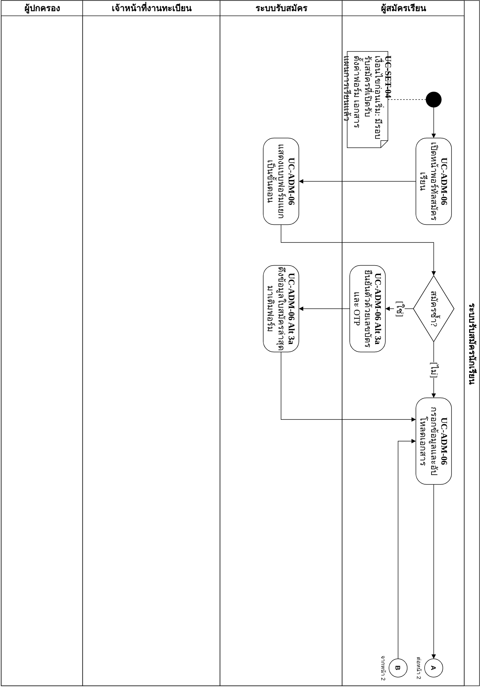 

*รูปที่ ข.1 Swimlane Diagram งานรับสมัครนักเรียน (หน้า 1/5)*

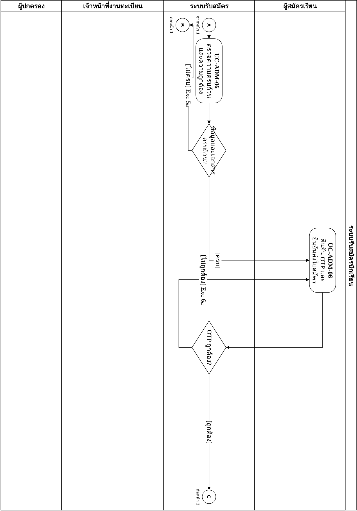 

*รูปที่ ข.2 Swimlane Diagram งานรับสมัครนักเรียน (หน้า 2/5)*

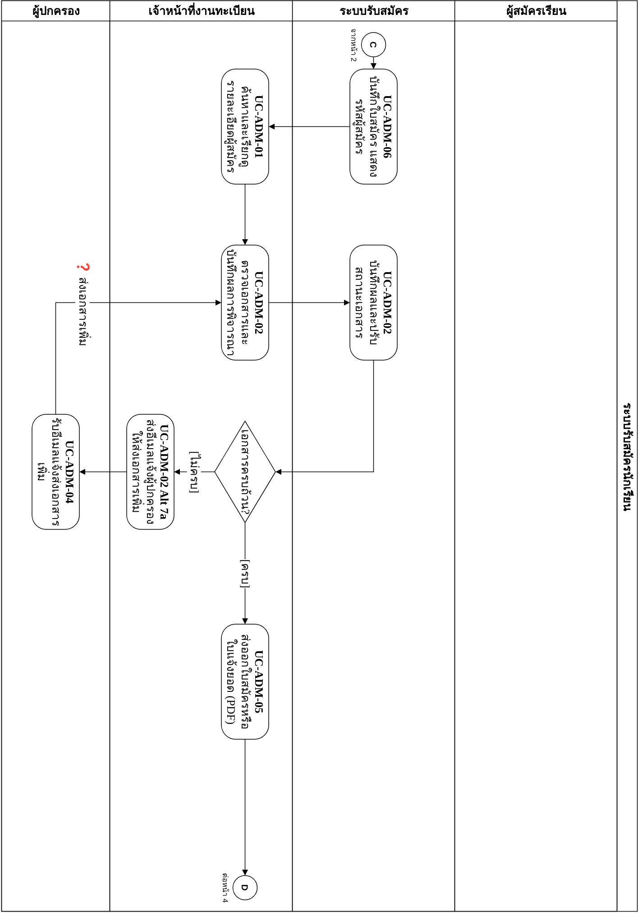 

*รูปที่ ข.3 Swimlane Diagram งานรับสมัครนักเรียน (หน้า 3/5)*

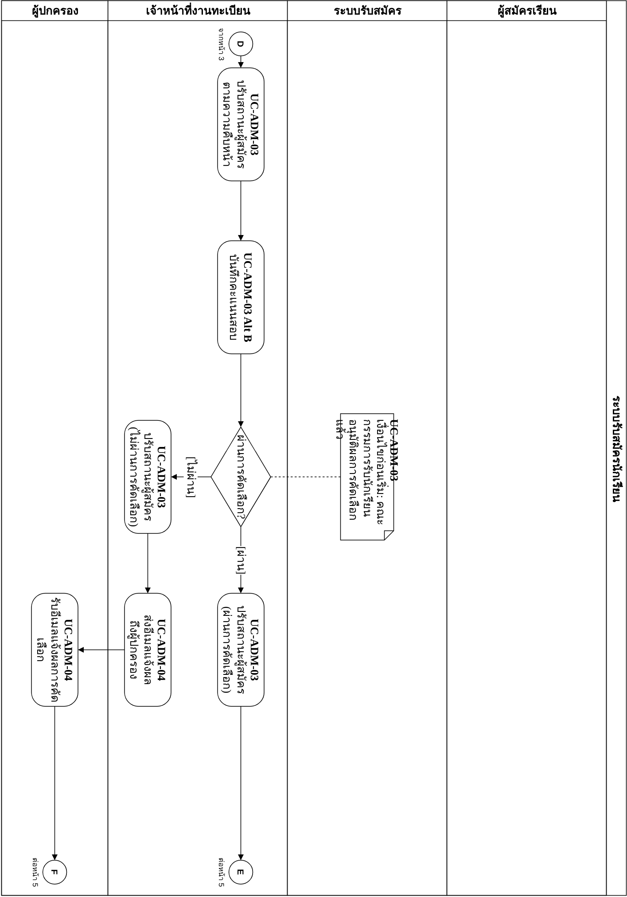 

*รูปที่ ข.4 Swimlane Diagram งานรับสมัครนักเรียน (หน้า 4/5)*

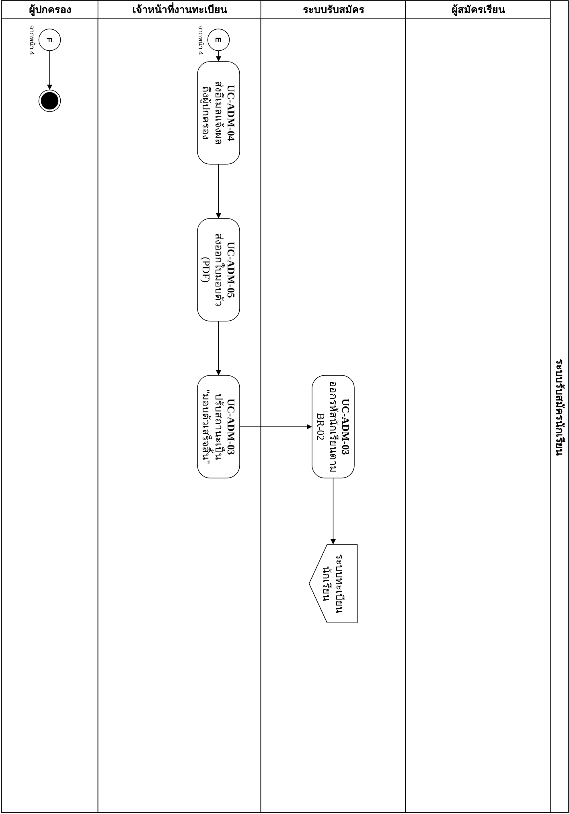 

*รูปที่ ข.5 Swimlane Diagram งานรับสมัครนักเรียน (หน้า 5/5)*

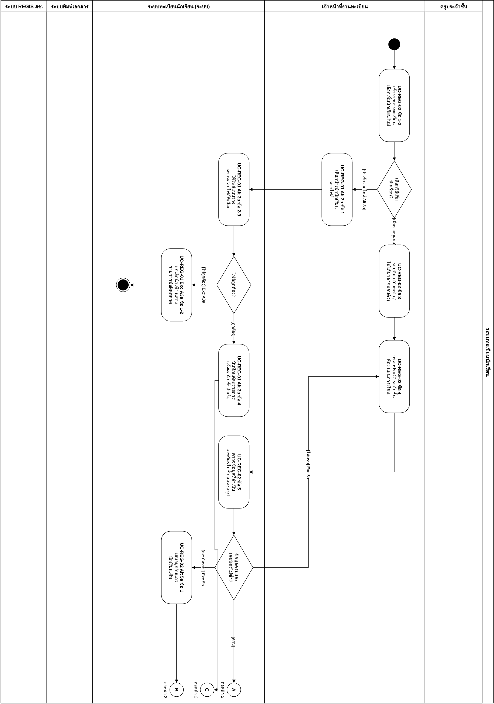 

*รูปที่ ข.6 Swimlane Diagram งานทะเบียนนักเรียน (หน้า 1/13)*

 

*รูปที่ ข.7 Swimlane Diagram งานทะเบียนนักเรียน (หน้า 2/13)*

 

*รูปที่ ข.8 Swimlane Diagram งานทะเบียนนักเรียน (หน้า 3/13)*

 

*รูปที่ ข.9 Swimlane Diagram งานทะเบียนนักเรียน (หน้า 4/13)*

 

*รูปที่ ข.10 Swimlane Diagram งานทะเบียนนักเรียน (หน้า 5/13)*

 

*รูปที่ ข.11 Swimlane Diagram งานทะเบียนนักเรียน (หน้า 6/13)*

 

*รูปที่ ข.12 Swimlane Diagram งานทะเบียนนักเรียน (หน้า 7/13)*

 

*รูปที่ ข.13 Swimlane Diagram งานทะเบียนนักเรียน (หน้า 8/13)*

 

*รูปที่ ข.14 Swimlane Diagram งานทะเบียนนักเรียน (หน้า 9/13)*

 

*รูปที่ ข.15 Swimlane Diagram งานทะเบียนนักเรียน (หน้า 10/13)*

 

*รูปที่ ข.16 Swimlane Diagram งานทะเบียนนักเรียน (หน้า 11/13)*

 

*รูปที่ ข.17 Swimlane Diagram งานทะเบียนนักเรียน (หน้า 12/13)*

 

*รูปที่ ข.18 Swimlane Diagram งานทะเบียนนักเรียน (หน้า 13/13)*

 

*รูปที่ ข.19 Swimlane Diagram การตั้งค่าระบบ (หน้า 1/9)*

 

*รูปที่ ข.20 Swimlane Diagram การตั้งค่าระบบ (หน้า 2/9)*

 

*รูปที่ ข.21 Swimlane Diagram การตั้งค่าระบบ (หน้า 3/9)*

 

*รูปที่ ข.22 Swimlane Diagram การตั้งค่าระบบ (หน้า 4/9)*

 

*รูปที่ ข.23 Swimlane Diagram การตั้งค่าระบบ (หน้า 5/9)*

 

*รูปที่ ข.24 Swimlane Diagram การตั้งค่าระบบ (หน้า 6/9)*

 

*รูปที่ ข.25 Swimlane Diagram การตั้งค่าระบบ (หน้า 7/9)*

 

*รูปที่ ข.26 Swimlane Diagram การตั้งค่าระบบ (หน้า 8/9)*

 

*รูปที่ ข.27 Swimlane Diagram การตั้งค่าระบบ (หน้า 9/9)*

 

*รูปที่ ข.28 Swimlane Diagram งานบุคลากร (หน้า 1/9)*

 

*รูปที่ ข.29 Swimlane Diagram งานบุคลากร (หน้า 2/9)*

 

*รูปที่ ข.30 Swimlane Diagram งานบุคลากร (หน้า 3/9)*

 

*รูปที่ ข.31 Swimlane Diagram งานบุคลากร (หน้า 4/9)*

 

*รูปที่ ข.32 Swimlane Diagram งานบุคลากร (หน้า 5/9)*

 

*รูปที่ ข.33 Swimlane Diagram งานบุคลากร (หน้า 6/9)*

 

*รูปที่ ข.34 Swimlane Diagram งานบุคลากร (หน้า 7/9)*

 

*รูปที่ ข.35 Swimlane Diagram งานบุคลากร (หน้า 8/9)*

 

*รูปที่ ข.36 Swimlane Diagram งานบุคลากร (หน้า 9/9)*

# ประวัติผู้เขียน

 **ชื่อ – นามสกุล**	นางสาวอินทิรา ธนัพประภัศร์

**รหัสนักศึกษา**	66070228

**วัน เดือน ปี เกิด**	7 มีนาคม พ.ศ.2548

**ภูมิลำเนา**	เชียงราย

**ประวัติการศึกษา**	วิทยาลัยอาชีวศึกษาเชียงราย

**E-mail**	66070228@kmitl.ac.th

**เบอร์โทรศัพท์**	063 676 3747

**สาขาที่จบ**	เทคโนโลยีสารสนเทศ

**รุ่นที่**	21

**ปีการศึกษาที่จบ**	2569

 **ชื่อ – นามสกุล**	นางสาวปนัสยา บุญประกอบ

**รหัสนักศึกษา**	66070286

**วัน เดือน ปี เกิด**	15 กันยายน พ.ศ.2547

**ภูมิลำเนา** สมุทรปราการ

**ประวัติการศึกษา**	โรงเรียนราชวินิตบางแก้ว

**E-mail**	66070286@kmitl.ac.th

**เบอร์โทรศัพท์**	085 145 7447

**สาขาที่จบ**	เทคโนโลยีสารสนเทศ

**รุ่นที่**	21

**ปีการศึกษาที่จบ**	2569
