<!-- AUTO-GENERATED from 'team-a-final-proj1.docx' (docx last modified 2026-11-14 16:30) · converted 2026-11-14 16:47 -->
<!-- AUTO-GENERATED from 'team-a-final-proj1.docx' (Word) -->
<!-- Reference material from another team (Team A) - for AI cross-team scope awareness, not the SSOT. Team B SSOT is materials/ai-bro/final-report.md -->

## Table of Contents

- [บทนำ](#บทนำ)
  - [ที่มาและความสำคัญ](#ที่มาและความสำคัญ)
  - [วัตถุประสงค์](#วัตถุประสงค์)
  - [ขอบเขตของโครงงาน](#ขอบเขตของโครงงาน)
    - [ขอบเขตผู้ใช้งาน](#ขอบเขตผู้ใช้งาน)
    - [ขอบเขตของระบบ](#ขอบเขตของระบบ)
    - [ขอบเขตอื่น ๆ](#ขอบเขตอื่น-ๆ)
    - [ขอบเขตที่ไม่รวมในโครงงาน](#ขอบเขตที่ไม่รวมในโครงงาน)
  - [วิธีการดำเนินงาน](#วิธีการดำเนินงาน)
    - [ขั้นตอนการดำเนินงาน](#ขั้นตอนการดำเนินงาน)
  - [ประโยชน์ที่คาดว่าจะได้รับ](#ประโยชน์ที่คาดว่าจะได้รับ)
- [การทบทวนวรรณกรรมที่เกี่ยวข้อง](#การทบทวนวรรณกรรมที่เกี่ยวข้อง)
  - [แนวคิดและทฤษฎีที่เกี่ยวข้อง](#แนวคิดและทฤษฎีที่เกี่ยวข้อง)
    - [แนวคิดเกี่ยวกับการจัดตารางสอน](#แนวคิดเกี่ยวกับการจัดตารางสอน)
    - [แนวคิดเกี่ยวกับการจัดเวลาเรียน](#แนวคิดเกี่ยวกับการจัดเวลาเรียน)
    - [แนวคิดเกี่ยวกับการบันทึกคะแนน](#แนวคิดเกี่ยวกับการบันทึกคะแนน)
    - [แนวคิดเรื่องโครงสร้างหลักสูตรและแผนการเรียน](#แนวคิดเรื่องโครงสร้างหลักสูตรและแผนการเรียน)
    - [แนวคิดการพัฒนาซอฟต์แวร์ด้วย AI (AI-native SDLC)](#แนวคิดการพัฒนาซอฟต์แวร์ด้วย-ai-ai-native-sdlc)
  - [เทคโนโลยีที่ใช้ในการพัฒนาระบบ](#เทคโนโลยีที่ใช้ในการพัฒนาระบบ)
    - [สถาปัตยกรรมแบบ Microservice และ RESTful API](#สถาปัตยกรรมแบบ-microservice-และ-restful-api)
    - [Frontend: React](#frontend-react)
    - [Frontend Framework: Next.js](#frontend-framework-nextjs)
    - [Backend: FastAPI](#backend-fastapi)
    - [ORM: SQLAlchemy](#orm-sqlalchemy)
    - [PostgreSQL (Database)](#postgresql-database)
    - [การออกแบบฐานข้อมูลและ Normalization](#การออกแบบฐานข้อมูลและ-normalization)
    - [Task Queue และ Caching: Redis และ Celery](#task-queue-และ-caching-redis-และ-celery)
    - [Containerization: Docker](#containerization-docker)
    - [API Gateway: Nginx](#api-gateway-nginx)
  - [ระบบที่เกี่ยวข้อง](#ระบบที่เกี่ยวข้อง)
    - [SchoolBright](#schoolbright)
    - [SGS (Secondary School Grading System)](#sgs-secondary-school-grading-system)
    - [aSc TimeTables](#asc-timetables)
    - [เปรียบเทียบระบบที่เกี่ยวข้องกับระบบที่พัฒนา](#เปรียบเทียบระบบที่เกี่ยวข้องกับระบบที่พัฒนา)
- [วิธีการดำเนินการวิจัย](#วิธีการดำเนินการวิจัย)
  - [วิเคราะห์ความต้องการ](#วิเคราะห์ความต้องการ)
    - [ผู้ใช้งานของระบบ](#ผู้ใช้งานของระบบ)
    - [ปัญหาของระบบที่เกี่ยวข้อง](#ปัญหาของระบบที่เกี่ยวข้อง)
    - [Functional Requirements](#functional-requirements)
    - [Non-functional Requirements](#non-functional-requirements)
  - [ภาพรวมของระบบ](#ภาพรวมของระบบ)
    - [ระบบย่อยและขอบเขตการทำงาน](#ระบบย่อยและขอบเขตการทำงาน)
    - [System Architecture](#system-architecture)
    - [การเชื่อมโยงข้อมูลระหว่างระบบย่อย](#การเชื่อมโยงข้อมูลระหว่างระบบย่อย)
  - [การออกแบบระบบ](#การออกแบบระบบ)
    - [Use-case diagram](#use-case-diagram)
    - [สรุป Use case](#สรุป-use-case)
    - [Activity Diagram](#activity-diagram)
    - [State Diagram](#state-diagram)
  - [การออกแบบฐานข้อมูล](#การออกแบบฐานข้อมูล)
    - [Entity Relationship Diagram](#entity-relationship-diagram)
    - [Data Dictionary](#data-dictionary)
  - [การออกแบบการประมวลผลและกฎทางธุรกิจ](#การออกแบบการประมวลผลและกฎทางธุรกิจ)
    - [การจัดตารางสอนอัตโนมัติ](#การจัดตารางสอนอัตโนมัติ)
    - [การตรวจสอบการชนกัน](#การตรวจสอบการชนกัน)
    - [การคำนวณผลการเรียน](#การคำนวณผลการเรียน)
  - [การใช้ AI ในการพัฒนา](#การใช้-ai-ในการพัฒนา)
    - [เครื่องมือและโมเดลที่ใช้](#เครื่องมือและโมเดลที่ใช้)
    - [การเขียน prompt](#การเขียน-prompt)
- [ระบบต้นแบบ](#ระบบต้นแบบ)
  - [โครงสร้างหน้าจอและเมนูตามบทบาท](#โครงสร้างหน้าจอและเมนูตามบทบาท)
  - [หน้าจอของครูฝ่ายวิชาการ](#หน้าจอของครูฝ่ายวิชาการ)
    - [หลักสูตร](#หลักสูตร)
    - [ตารางเรียน](#ตารางเรียน)
    - [รายงานวิชาการ](#รายงานวิชาการ)
    - [ผลการเรียน](#ผลการเรียน)
  - [หน้าจอของครูผู้สอน](#หน้าจอของครูผู้สอน)
    - [งานของฉัน](#งานของฉัน)
    - [บันทึกคะแนน](#บันทึกคะแนน)
    - [เช็คชื่อ](#เช็คชื่อ)
  - [สรุป](#สรุป)
- [วิเคราะห์และสรุปผล](#วิเคราะห์และสรุปผล)
  - [ภาพรวมทั้งโครงงาน](#ภาพรวมทั้งโครงงาน)
  - [สรุปผลการดำเนินงานภาคเรียนที่ 1](#สรุปผลการดำเนินงานภาคเรียนที่-1)
    - [สิ่งที่ทำ](#สิ่งที่ทำ)
    - [ปัญหาและอุปสรรค](#ปัญหาและอุปสรรค)
    - [งานที่ยังไม่เสร็จในภาคเรียนที่ 1](#งานที่ยังไม่เสร็จในภาคเรียนที่-1)
  - [แผนการดำเนินงานภาคเรียนที่ 2](#แผนการดำเนินงานภาคเรียนที่-2)
    - [แผนการพัฒนา](#แผนการพัฒนา)
    - [แผนการทดสอบ](#แผนการทดสอบ)
    - [ตารางแผนการดำเนินงาน](#ตารางแผนการดำเนินงาน)
    - [ความเสี่ยงและแผนรองรับ](#ความเสี่ยงและแผนรองรับ)

ระบบบริหารจัดการงานวิชาการภายในโรงเรียน

**DEVELOPMENT OF ACADEMIC MANAGEMENT SYSTEM FOR SCHOOLS**

**โดย**

**ปณวัฒน์   ธรรมเจริญ**

**PANAVAT   THAMCHAROEN**

**อิสรีย์   แม้นถาวรสิริ**

**ITSAREE   MANTHAWORNSIRI**

**ปริญญานิพนธ์นี้เป็นส่วนหนึ่งของการศึกษาตามหลักสูตรวิทยาศาสตรบัณฑิต**

**สาขาวิชาเทคโนโลยีสารสนเทศ**

**คณะเทคโนโลยีสารสนเทศ**

**สถาบันเทคโนโลยีพระจอมเกล้าเจ้าคุณทหารลาดกระบัง**

**ภาคเรียนที่ 1 ปีการศึกษา 2569**

*ระบบบริหารจัดการงานวิชาการภายในโรงเรียน*

**DEVELOPMENT OF ACADEMIC MANAGEMENT SYSTEM FOR SCHOOLS**

**โดย**

**ปณวัฒน์   ธรรมเจริญ**

**อิสรีย์   แม้นถาวรสิริ**

**อาจารย์ที่ปรึกษา**

**ดร.ศิรสิทธิ์  โล่ห์ชนะจิต**

**ปริญญานิพนธ์นี้เป็นส่วนหนึ่งของการศึกษาตามหลักสูตรวิทยาศาสตรบัณฑิต**

**สาขาวิชาเทคโนโลยีสารสนเทศ**

**คณะเทคโนโลยีสารสนเทศ**

**สถาบันเทคโนโลยีพระจอมเกล้าเจ้าคุณทหารลาดกระบัง**

**ภาคเรียนที่ 1 ปีการศึกษา 2569**

**DEVELOPMENT OF ACADEMIC MANAGEMENT SYSTEM FOR SCHOOLS**

**PANAVAT   THAMCHAROEN**

**ITSAREE   MANTHAWORNSIRI**

**A PROJECT SUBMITTED IN PARTIAL FULFILLMENT**

**OF THE REQUIREMENT FOR THE DEGREE OF**

**BACHELOR OF SCIENCE PROGRAM IN INFORMATION TECHNOLOGY**

**SCHOOL OF INFORMATION TECHNOLOGY**

**KING MONGKUT’S INSTITUTE OF TECHNOLOGY LADKRABANG**

**1/2026**

**COPYRIGHT 2026**

**SCHOOL OF INFORMATION TECHNOLOGY**

**KING MONGKUT’S INSTITUTE OF TECHNOLOGY LADKRABANG**

**ใบรับรองปริญญานิพนธ์ ประจำปีการศึกษา 2569**

**คณะเทคโนโลยีสารสนเทศ**

**สถาบันเทคโนโลยีพระจอมเกล้าเจ้าคุณทหารลาดกระบัง**

**เรื่อง	ระบบบริหารจัดการงานวิชาการภายในโรงเรียน**

**DEVELOPMENT OF ACADEMIC MANAGEMENT SYSTEM FOR SCHOOLS**

**ผู้จัดทำ**

**1.	นายปณวัฒน์  ธรรมเจริญ	รหัสนักศึกษา  66070113**

**2.	นางสาวอิสรีย์  แม้นถาวรสิริ	รหัสนักศึกษา  66070323**

**..............................................................	อาจารย์ที่ปรึกษา**

**(ดร.ศิรสิทธิ์  โล่ห์ชนะจิต)**

**ใบรับรองโครงงาน (PROJECT)**

**เรื่อง**

*ระบบบริหารจัดการงานวิชาการภายในโรงเรียน*

**DEVELOPMENT OF ACADEMIC MANAGEMENT SYSTEM FOR SCHOOLS**

**นายปณวัฒน์  ธรรมเจริญ	รหัสประจำตัว  66070113**

**นางสาวอิสรีย์  แม้นถาวรสิริ	รหัสประจำตัว  66070323**

ขอรับรองว่ารายงานฉบับนี้ ข้าพเจ้าไม่ได้คัดลอกมาจากที่ใด

รายงานฉบับนี้ได้รับการตรวจสอบและอนุมัติให้เป็นส่วนหนึ่งของ

การศึกษาวิชาโครงงาน หลักสูตรวิทยาศาสตรบัณฑิต (เทคโนโลยีสารสนเทศ)

ภาคเรียนที่ 1 ปีการศึกษา 2569

..............................................

(นายปณวัฒน์  ธรรมเจริญ)

..............................................

(นางสาวอิสรีย์  แม้นถาวรสิริ)

*หัวข้อโครงงาน	ระบบบริหารจัดการงานวิชาการภายในโรงเรียน*

**นักศึกษา**	นายปณวัฒน์ ธรรมเจริญ

นางสาวอิสรีย์ แม้นถาวรสิริ

**ปริญญา**	วิทยาศาสตรบัณฑิต

**สาขาวิชา**	เทคโนโลยีสารสนเทศ

**ปีการศึกษา** 2569

**อาจารย์ที่ปรึกษา**	ดร.ศิรสิทธิ์ โล่ห์ชนะจิต

บทคัดย่อ

งานวิชาการเป็นงานหลักของโรงเรียนที่ต้องทำเป็นประจำ ครอบคลุมทั้งการจัดการหลักสูตร การจัดตารางสอน การเช็คชื่อ การบันทึกคะแนน และการตัดสินผลการเรียน โรงเรียนหลายแห่งยังทำงานเหล่านี้ด้วยตนเองโดยใช้ไฟล์ Excel หรือใช้หลายระบบแยกกัน ข้อมูลหลักสูตร ตารางสอน และคะแนนจึงไม่เชื่อมโยงกัน การจัดตารางสอนต้องตรวจการชนกันของครูและห้องเรียนด้วยตนเอง การรวมคะแนนเพื่อตัดสินผลการเรียนต้องทำซ้ำหลายขั้นตอน ช่วงสิ้นภาคเรียนจึงใช้เวลานานและเกิดข้อผิดพลาดได้ง่าย

โครงงานนี้ศึกษาและออกแบบระบบบริหารจัดการงานวิชาการภายในโรงเรียน ผู้ใช้ระบบ ได้แก่ ครูผู้สอนและครูฝ่ายวิชาการ ระบบรวมงานหลักสูตร ตารางสอน การเช็คชื่อ การบันทึกคะแนน และรายงานวิชาการไว้ในระบบเดียว ทำงานร่วมกับระบบงานทะเบียนและ IAM (Service B) ที่พัฒนาโดยอีกทีมหนึ่ง ผู้จัดทำศึกษาระบบที่โรงเรียนใช้อยู่ ได้แก่ SchoolBright ระบบ SGS และโปรแกรม aSc TimeTables แล้วนำข้อจำกัดที่พบมากำหนดความต้องการของระบบ ระบบที่ออกแบบรองรับการจัดตารางสอนทั้งแบบจัดเองและแบบอัตโนมัติ ตรวจการชนกันทุกครั้งที่แก้ไข นำเข้าคะแนนจากไฟล์ และคำนวณผลการเรียนอัตโนมัติ งานที่ใช้เวลานานทำเป็นงานเบื้องหลังด้วย Celery และ Redis

ผลของโครงงานในภาคเรียนนี้ คือ แบบการออกแบบระบบ ซึ่งประกอบด้วย use case, Activity Diagram, State Diagram และฐานข้อมูล PostgreSQL 58 ตาราง และระบบต้นแบบหน้าจอที่แสดงการทำงานของครูทั้ง 2 บทบาท ระบบต้นแบบนี้ใช้เป็นข้อกำหนดในการพัฒนาและทดสอบระบบจริงในภาคเรียนถัดไป

**Project Title**		DEVELOPMENT OF ACADEMIC MANAGEMENT SYSTEM FOR SCHOOLS

**Student**		Mr. Panavat Thamcharoen		Student ID	66070113

Miss Itsaree Manthawornsiri		Student ID	66070323

**Degree** Bachelor of Science

**Program** 	Information Technology

**Academic Year**		2026

**Advisor**		Dr. Sirasit Lochanachit

**ABSTRACT**

Academic work is a core task of every school. It covers curriculum management, timetabling, attendance, score recording and grading. Many schools still do this work with Excel files or with several separate systems, so curriculum, timetable and score data are not connected. Timetables have to be checked by hand for teacher and room conflicts, and turning scores into final grades takes many repeated steps. The end of each semester takes a long time, and errors are common.

This project studies and designs an academic management system for schools, for subject teachers and academic staff. The system brings curriculum, timetabling, attendance, score recording and academic reports into one place, and it works together with the Registration and IAM System (Service B) developed by another team. Three systems used in schools were reviewed: SchoolBright, the SGS system and aSc TimeTables. Their limitations were turned into the system requirements. The designed system supports manual and automatic timetabling, checks for conflicts on every change, imports scores from files and calculates grades automatically. Long-running jobs run in the background with Celery and Redis.

The outcome of this semester is the system design, consisting of use cases, activity diagrams, state diagrams and a PostgreSQL database of 58 tables, together with a screen prototype that shows the work of both user roles. The prototype will serve as the specification for developing and testing the real system in the next semester.

**กิตติกรรมประกาศ**

ปริญญานิพนธ์ฉบับนี้สำเร็จลุล่วงได้ด้วยความกรุณาจาก ดร.ศิรสิทธิ์ โล่ห์ชนะจิต อาจารย์ที่ปรึกษาโครงงาน ที่ได้ให้คำแนะนำ ตรวจทาน และแก้ไขข้อบกพร่องตลอดการจัดทำ ตลอดจนให้การสนับสนุนในการจัดเตรียมและอำนวยความสะดวกด้านอุปกรณ์ เครื่องมือ และทรัพยากรต่าง ๆ ที่จำเป็นต่อการดำเนินโครงงาน ส่งผลให้ผู้จัดทำสามารถดำเนินงานจนสำเร็จลุล่วงไปได้ด้วยดี
ผู้จัดทำขอขอบพระคุณเป็นอย่างสูง

ขอขอบคุณทีมผู้พัฒนาระบบงานทะเบียนและ IAM (Service B) ที่ร่วมกำหนดการเชื่อมต่อระหว่างระบบทั้งสอง และขอขอบพระคุณคณาจารย์คณะเทคโนโลยีสารสนเทศ สถาบันเทคโนโลยีพระจอมเกล้าเจ้าคุณทหารลาดกระบัง ที่ได้ประสิทธิ์ประสาทความรู้ซึ่งเป็นพื้นฐานของโครงงานนี้

ขอขอบคุณเพื่อน ๆ นักศึกษาคณะเทคโนโลยีสารสนเทศ ที่ช่วยแลกเปลี่ยนความคิดเห็น ให้คำแนะนำ และเป็นกำลังใจตลอดการทำโครงงาน

สุดท้ายนี้ ขอขอบคุณครอบครัวที่ให้การสนับสนุนและเป็นกำลังใจตลอดมา

นายปณวัฒน์ ธรรมเจริญ

นางสาวอิสรีย์ แม้นถาวรสิริ

สารบัญ

**หน้า**

**สารบัญตาราง**

**ตาราง	หน้า**

**สารบัญรูป**

**รูป	หน้า**

**สารบัญรูป (ต่อ)**

**รูป	หน้า**

**สารบัญรูป (ต่อ)**

**รูป	หน้า**

**สารบัญรูป (ต่อ)**

**รูป	หน้า**

**สารบัญรูป (ต่อ)**

**รูป	หน้า**

**คำนิยามศัพท์**

คำย่อที่ใช้ในรายงานฉบับนี้ มีความหมายดังนี้

| คำย่อ | ความหมาย |
| --- | --- |
| ACID | Atomicity, Consistency, Isolation, Durability คุณสมบัติของ transaction ในฐานข้อมูล |
| ADR | Architecture Decision Record บันทึกการตัดสินใจด้านการออกแบบ |
| AI | Artificial Intelligence ปัญญาประดิษฐ์ |
| API | Application Programming Interface ช่องทางที่ระบบใช้เรียกข้อมูลหรือบริการจากระบบอื่น |
| CSV | Comma-Separated Values ไฟล์ข้อความที่คั่นข้อมูลด้วยเครื่องหมายจุลภาค |
| ER | Entity Relationship แผนภาพความสัมพันธ์ระหว่างข้อมูล |
| FK | Foreign Key คีย์นอก ฟิลด์ที่อ้างถึงคีย์หลักของตารางอื่น |
| GPA | Grade Point Average ผลการเรียนเฉลี่ย |
| IAM | Identity and Access Management การยืนยันตัวตนและการจัดการสิทธิ์การเข้าถึง |
| ORM | Object-Relational Mapping เครื่องมือแปลงข้อมูลระหว่างโปรแกรมกับฐานข้อมูล |
| PK | Primary Key คีย์หลัก ฟิลด์ที่ใช้ระบุแถวของตาราง |
| SDLC | Software Development Life Cycle วงจรการพัฒนาซอฟต์แวร์ |
| SGS | Secondary School Grading System ระบบวัดผลและประเมินผลของ สพฐ. |
| UAT | User Acceptance Test การทดสอบการยอมรับของผู้ใช้ |
| UC | Use Case กรณีการใช้งานของระบบ |
| UK | Unique Key ฟิลด์ที่ค่าห้ามซ้ำกัน |
| UX/UI | User Experience / User Interface ประสบการณ์ผู้ใช้และส่วนติดต่อผู้ใช้ |
| ปพ. | เอกสารหลักฐานการศึกษาตามแบบของกระทรวงศึกษาธิการ |
| ผ / มผ | ผ่าน / ไม่ผ่าน ผลการประเมินกิจกรรมพัฒนาผู้เรียน |
| มส | ไม่มีสิทธิ์สอบ เนื่องจากมีเวลาเรียนไม่ถึงร้อยละ 80 |
| ร | รอการตัดสิน ผลการเรียนที่ยังตัดสินไม่ได้ |
| สพฐ. | สำนักงานคณะกรรมการการศึกษาขั้นพื้นฐาน |

# บทนำ

## ที่มาและความสำคัญ

งานวิชาการของโรงเรียนหลายแห่งยังพึ่งการกรอกข้อมูลด้วยมือเป็นหลัก บางโรงเรียนมีระบบช่วยงานแล้ว เช่น ระบบวิชาการ ระบบบันทึกผลการเรียน หรือโปรแกรมจัดตารางสอน แต่ระบบเหล่านี้ยังปรับใช้ได้ไม่ครอบคลุม และข้อมูลของแต่ละระบบยังไม่เชื่อมกัน

การจัดตารางสอนเป็นงานที่ซับซ้อนที่สุด ผู้จัดต้องดูหลายเงื่อนไขพร้อมกัน เช่น เวลาว่างของครู ห้องเรียน ตารางเรียนของนักเรียน และจำนวนคาบของแต่ละรายวิชาในหลักสูตร ระบบเดิมรองรับเงื่อนไขเหล่านี้ได้ไม่ดี ฝ่ายวิชาการจึงต้องจัดตารางสอนใน Excel และตรวจความถูกต้องเอง

ปัญหาอื่นที่พบในระบบเดิม มีดังนี้

- ข้อมูลไม่เชื่อมโยงกัน ข้อมูลนักเรียน คะแนน และตารางสอนเก็บแยกกันหลายไฟล์ เช่น ไฟล์รายชื่อนักเรียน ไฟล์คะแนน และไฟล์ตารางสอน เมื่อนำมารวมกันจึงเกิดข้อมูลซ้ำและข้อมูลไม่ตรงกัน
- การประมวลผลล่าช้า การรวมคะแนนและการตัดสินผลการเรียนยังทำด้วยมือหรือกึ่งอัตโนมัติ ช่วงสิ้นภาคเรียนจึงใช้เวลานานและมีงานค้างสะสม
- การนำเข้าข้อมูลทำได้ยาก ระบบเดิมนำเข้าข้อมูลจากไฟล์ได้น้อยหรือมีขั้นตอนยุ่งยาก ครูจึงต้องกรอกข้อมูลเดิมซ้ำหลายครั้ง
โครงงานนี้พัฒนาระบบบริหารจัดการงานวิชาการที่รวมข้อมูลไว้ในระบบเดียว โครงงานทำร่วมกับอีกทีมหนึ่งที่รับผิดชอบระบบงานทะเบียนและ IAM (Service B) ได้แก่ การยืนยันตัวตน สิทธิ์การเข้าถึง และข้อมูลหลักของโรงเรียน ส่วนโครงงานนี้รับผิดชอบระบบงานวิชาการ ได้แก่ หลักสูตร ตารางสอน การเช็คชื่อ การบันทึกคะแนน รายงานและการส่งออกเอกสาร ทั้งสองระบบเชื่อมต่อและทำงานร่วมกันผ่าน API

## วัตถุประสงค์

- เพื่อพัฒนาระบบจัดการหลักสูตรและรายวิชาที่เก็บแผนการเรียน รายวิชา และครูผู้สอนไว้ที่เดียว ให้ระบบจัดตารางสอนและระบบบันทึกคะแนนดึงข้อมูลไปใช้ต่อได้โดยไม่ต้องกรอกซ้ำ
- เพื่อพัฒนาระบบจัดตารางสอนที่เก็บตารางสอนไว้ที่เดียว จัดตารางอัตโนมัติตามเงื่อนไขของครู ห้อง และหลักสูตร โดยประมวลผลเป็นงานเบื้องหลัง และตรวจการชนกันให้อัตโนมัติ เพื่อลดเวลาในการจัดและปรับแก้ตารางสอน
- เพื่อพัฒนาระบบเช็คชื่อรายคาบที่สรุปเวลาเรียนของนักเรียน และแจ้งรายชื่อนักเรียนที่ไม่มีสิทธิ์สอบ (มส) ได้อัตโนมัติ
- เพื่อพัฒนาระบบบันทึกคะแนนที่รองรับการกรอกและนำเข้าคะแนนจำนวนมาก คำนวณผลการเรียนอัตโนมัติ และมีขั้นตอนส่ง ตรวจ และอนุมัติผลการเรียนระหว่างครูผู้สอนกับฝ่ายวิชาการ
- เพื่อพัฒนาระบบออกรายงานที่สรุปผลการเรียน เวลาเรียน และนักเรียนที่ต้องติดตาม และส่งออกเป็นไฟล์ Excel หรือ PDF ได้
## ขอบเขตของโครงงาน

### ขอบเขตผู้ใช้งาน

- ครูผู้สอน
- ดูตารางสอนของตนเองที่ครูฝ่ายวิชาการจัดไว้ ยื่นคำร้องขอเปลี่ยนการจัดตารางสอน และกรอกเวลาไม่ว่าง
- บันทึกและแก้ไขคะแนนนักเรียนในรายวิชาที่ตนสอน เช่น คะแนนเก็บ คะแนนกลางภาค และคะแนนปลายภาค เช็คชื่อนักเรียนรายคาบ ประเมินคุณลักษณะอันพึงประสงค์และการอ่าน คิดวิเคราะห์ และเขียน และบันทึกผลกิจกรรมชุมนุม
- ส่งผลการเรียนให้ฝ่ายวิชาการตรวจ ขอปลดล็อกผลการเรียนเมื่อต้องแก้ไขหลังส่ง และบันทึกผลการสอบซ่อม
- กำหนดองค์ประกอบคะแนนและตัวชี้วัดของรายวิชา
- ดูโครงสร้างรายวิชาและหลักสูตรที่ตนเองเกี่ยวข้อง
- ดูผลการเรียนและส่งออกเอกสาร
- ครูผู้สอนที่เป็นครูประจำชั้นดูการเข้าเรียนของห้องประจำชั้น และครูที่ปรึกษาชุมนุมบันทึกผลกิจกรรมชุมนุม
- ครูฝ่ายวิชาการ
- สร้าง แก้ไข และลบตารางสอนของทุกห้องเรียนในแต่ละภาคเรียน
- จัดการข้อมูลรายวิชาทั้งหมด
- จัดการหลักสูตรและโครงสร้างหลักสูตร
- บันทึกและเผยแพร่ตารางสอน
- พิจารณาคำร้องขอเปลี่ยนการจัดตารางสอน และเวลาไม่ว่างของครู
- ตรวจสอบผลการเรียน ตรวจและอนุมัติหรือตีกลับผลการเรียนที่ครูผู้สอนส่ง และพิจารณาคำขอปลดล็อกผลการเรียน
- จัดการชุมนุมและกิจกรรม
- ดูรายงานสรุปผลการเรียน และส่งออกข้อมูลเป็นไฟล์ Excel หรือ PDF
### ขอบเขตของระบบ

- ระบบจัดการหลักสูตร รองรับการกำหนดหลักสูตรและแผนการเรียน เช่น แผนการเรียนวิทยาศาสตร์–คณิตศาสตร์ และแผนการเรียนศิลป์ และกำหนดรายวิชาพื้นฐานและรายวิชาเพิ่มเติมของแต่ละแผน
- ระบบจัดตารางสอนสร้าง แก้ไข และจัดการตารางสอนของทุกห้องเรียนในแต่ละภาคเรียน จัดได้ 3 วิธี ได้แก่ จัดด้วยตนเอง จัดอัตโนมัติแบบกำหนดเงื่อนไข และจัดอัตโนมัติ ตรวจการชนกันของครูและห้องทุกครั้งที่แก้ไข เผยแพร่ตารางสอนรายห้องเรียนและรายครู และรองรับคำร้องขอเปลี่ยนการจัดตารางสอนกับเวลาไม่ว่างของครู
- ระบบเช็คชื่อ เช็คชื่อนักเรียนรายคาบตามตารางสอน (มา สาย ลา ขาด) แก้ไขการเช็คชื่อที่บันทึกแล้ว สรุปเวลาเรียน ตรวจนักเรียนที่มีเวลาเรียนไม่ถึงร้อยละ 80 (มส) และบันทึกการปลด มส
- ระบบบันทึกคะแนน รองรับการบันทึกคะแนนของนักเรียน ในแต่ละรายวิชา เช่น คะแนนเก็บ คะแนนสอบกลางภาค คะแนนสอบปลายภาค รวมถึงผลประเมินคุณลักษณะอันพึงประสงค์ การอ่าน คิดวิเคราะห์ และเขียน และผลกิจกรรมชุมนุม (ผ/มผ)
- ระบบออกรายงาน รองรับรายงานผลการเรียน รายงานคะแนนเฉลี่ย รายงานการเข้าเรียน และรายงานนักเรียนที่ไม่ผ่านเกณฑ์หรือมีสิทธิ์สอบซ่อม
### ขอบเขตอื่น ๆ

- ระบบใช้งานผ่านเว็บเบราว์เซอร์
- ใช้ PostgreSQL เป็นระบบจัดการฐานข้อมูล
- ประมวลผลงานที่ใช้เวลานานเป็นงานเบื้องหลัง และแจ้งสถานะเมื่อเสร็จ
- มีระบบ Task Queue สำหรับจัดการงานเบื้องหลัง
- ยืนยันตัวตนผู้ใช้งานผ่านระบบงานทะเบียนและ IAM (Service B) ของอีกทีม ทาง API Gateway
### ขอบเขตที่ไม่รวมในโครงงาน

- การจัดการบัญชีผู้ใช้และสิทธิ์การเข้าถึง ซึ่งอยู่ในระบบงานทะเบียนและ IAM (Service B) ของอีกทีม
- ระบบแจ้งลาของนักเรียนโดยครูประจำชั้น
- ระบบบริหารจัดการงานบุคลากร
- ระบบจัดการความประพฤติ
## วิธีการดำเนินงาน

### ขั้นตอนการดำเนินงาน

- **การวิเคราะห์ความต้องการ**
- ศึกษาการทำงานของครูผู้สอนและครูฝ่ายวิชาการ และศึกษาระบบที่โรงเรียนใช้อยู่ เพื่อกำหนดปัญหา ขอบเขต และความต้องการของระบบ
- **การออกแบบระบบ**
- ออกแบบสถาปัตยกรรม use case Activity Diagram State Diagram ฐานข้อมูล และขั้นตอนการประมวลผลหลัก ของระบบย่อย 5 ระบบ ได้แก่
- ระบบจัดการหลักสูตร
- ระบบจัดตารางสอน
- ระบบเช็คชื่อ
- ระบบบันทึกคะแนน
- ระบบออกรายงาน
- **การพัฒนาระบบต้นแบบ**
- พัฒนาระบบต้นแบบหน้าจอด้วย HTML และ JavaScript ตามการออกแบบ เพื่อแสดงการทำงานของระบบย่อยทั้ง 5 ระบบ
- **การสรุปผลและนำเสนอ**
- สรุปผลการศึกษาและการออกแบบ นำเสนอการทำงานของระบบต้นแบบ และวางแผนการพัฒนาและการทดสอบในภาคเรียนถัดไป ภาคเรียนที่ 1 ครอบคลุมการศึกษา การออกแบบ และระบบต้นแบบหน้าจอ ส่วนการพัฒนาและการทดสอบระบบจริงทำในภาคเรียนที่ 2
## ประโยชน์ที่คาดว่าจะได้รับ

- ลดเวลาในการทำงาน ครูบันทึก แก้ไข และประมวลผลข้อมูลได้ในระบบเดียว ไม่ต้องสลับใช้หลายเครื่องมือ
- ลดข้อผิดพลาดจากการทำงานด้วยมือ เช่น การกรอกข้อมูลซ้ำ และการคำนวณคะแนนเอง ระบบคำนวณผลการเรียนและเกรดเฉลี่ยให้อัตโนมัติ
- ลดงานซ้ำซ้อน ข้อมูลรายวิชา ตารางสอน และคะแนนกรอกครั้งเดียว เก็บในฐานข้อมูลกลาง และนำไปใช้ต่อได้ทุกส่วนของระบบ
- ครูผู้สอนและครูฝ่ายวิชาการทำงานได้เร็วขึ้น เช่น การค้นหาข้อมูล การแก้ไขคะแนน และการจัดตารางสอน
- ระบบออกแบบให้รองรับข้อมูลจำนวนมากและผู้ใช้หลายคนพร้อมกัน โดยแยกงานที่ใช้เวลานานไปประมวลผลเบื้องหลังด้วย Task Queue
# การทบทวนวรรณกรรมที่เกี่ยวข้อง

## แนวคิดและทฤษฎีที่เกี่ยวข้อง

### แนวคิดเกี่ยวกับการจัดตารางสอน

#### Timetabling Problem Theory

Timetabling Problem คือปัญหาการจัดสรรทรัพยากรลงในช่วงเวลาให้ครบตามเงื่อนไขที่กำหนด การจัดตารางสอนของโรงเรียนเป็นปัญหาประเภทนี้ ทรัพยากรที่ต้องจัด ได้แก่ ครูผู้สอน ห้องเรียน กลุ่มนักเรียน และจำนวนคาบของแต่ละรายวิชา เงื่อนไขของปัญหาแบ่งเป็น 2 ประเภท ดังนี้

- Hard Constraints คือเงื่อนไขที่ต้องทำตามทุกข้อ ถ้าละเมิดจะใช้ตารางนั้นไม่ได้ เช่น ครูหนึ่งคนสอนสองห้องในเวลาเดียวกันไม่ได้
- Soft Constraints คือเงื่อนไขที่ควรทำตามแต่ไม่บังคับ ใช้วัดคุณภาพของตาราง เช่น ไม่จัดวิชาเดียวกันติดกันเกิน 3 คาบ
### แนวคิดเกี่ยวกับการจัดเวลาเรียน

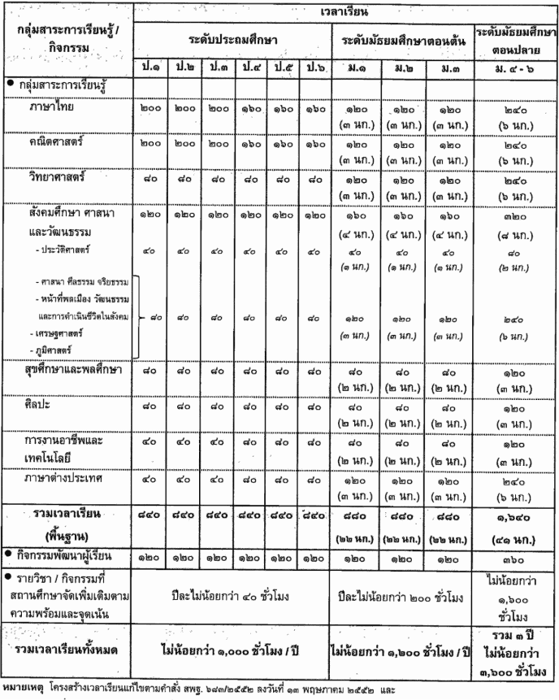 

***รูปที่** 2.1 ภาพการจัดเวลาเรียน*

การจัดเวลาเรียนคือการนำจำนวนชั่วโมงและหน่วยกิตตลอดหลักสูตรมากระจายลงในวันและคาบเรียน ให้ผู้เรียนได้เวลาเรียนครบตามโครงสร้างหลักสูตร หลักสูตรแกนกลางกำหนดรูปแบบการจัดเวลาเรียนตามระดับการศึกษา ดังรูปที่ 2.1 และตารางที่ 2.1 [1]

***ตารางที่** 2.1 ตารางการจัดเวลาเรียน*

| ระดับ | รูปแบบการจัดเวลา | เกณฑ์เวลาเรียน |
| --- | --- | --- |
| ประถมศึกษา | จัดเป็นรายปี | เวลาเรียนวันละไม่เกิน 5 ชั่วโมง |
| มัธยมศึกษาตอนต้น | จัดเป็นรายภาคเรียน | เวลาเรียนวันละไม่เกิน 6 ชั่วโมง |

***ตารางที่ 2.1 (ต่อ)** ตารางการจัดเวลาเรียน*

| ระดับ | รูปแบบการจัดเวลา | เกณฑ์เวลาเรียน |
| --- | --- | --- |
| มัธยมศึกษาตอนปลาย | จัดเป็นรายภาคเรียน | เวลาเรียนวันละไม่น้อยกว่า 6 ชั่วโมง |

### แนวคิดเกี่ยวกับการบันทึกคะแนน

#### การให้ระดับผลการเรียนและคะแนน

- ระดับประถมศึกษา
- สถานศึกษาเลือกรูปแบบการให้ผลการเรียนรายวิชาได้หลายแบบ เช่น ระบบตัวเลข ระบบตัวอักษร ระบบร้อยละ หรือระบบที่ใช้คำสำคัญสะท้อนระดับคุณภาพ [2]
- ระดับมัธยมศึกษา
- การตัดสินผลการเรียนรายวิชาระดับมัธยมศึกษาใช้ตัวเลขแสดงระดับผลการเรียน 8 ระดับ ดังตารางที่ 2.2
***ตารางที่** 2.2 ตารางการตัดสินผลการเรียนรายวิชา*

| ระดับผลการเรียน | ความหมายโดยทั่วไป |
| --- | --- |
| 4 | ผลการเรียนดีเยี่ยม |
| 3.5 | ผลการเรียนดีมาก |
| 3 | ผลการเรียนดี |
| 2.5 | ผลการเรียนค่อนข้างดี |
| 2 | ผลการเรียนน่าพอใจ |
| 1.5 | ผลการเรียนพอใช้ |
| 1 | ผ่านเกณฑ์ขั้นต่ำ |
| 0 | ต่ำกว่าเกณฑ์ขั้นต่ำ |

แนวปฏิบัติการวัดและประเมินผลการเรียนรู้ให้ตารางช่วงคะแนนของแต่ละระดับผลการเรียนเป็นแนวทาง และสถานศึกษากำหนดเกณฑ์การตัดสินผลการเรียนในระเบียบการวัดผลของตนเอง

### แนวคิดเรื่องโครงสร้างหลักสูตรและแผนการเรียน

#### หลักสูตรแกนกลางการศึกษาขั้นพื้นฐาน พุทธศักราช 2551 (ฉบับปรับปรุง พ.ศ. 2560)

หลักสูตรแกนกลางการศึกษาขั้นพื้นฐาน พุทธศักราช 2551 เป็นกรอบการจัดการศึกษาขั้นพื้นฐาน มีเป้าหมายให้ผู้เรียนมีความรู้ ทักษะ สมรรถนะสำคัญ และคุณลักษณะอันพึงประสงค์สำหรับการดำรงชีวิต การศึกษาต่อ และการประกอบอาชีพ หลักสูตรกำหนดมาตรฐานการเรียนรู้และตัวชี้วัดเป็นเป้าหมายของการจัดการเรียนรู้และการวัดผล สถานศึกษานำกรอบนี้ไปพัฒนาเป็นหลักสูตรสถานศึกษาให้เหมาะกับชุมชนและผู้เรียนของตนเอง

#### โครงสร้างหลักสูตร

หลักสูตรแกนกลางฉบับปรับปรุง พ.ศ. 2560 แบ่งสาระการเรียนรู้เป็น 8 กลุ่มสาระ ได้แก่ ภาษาไทย คณิตศาสตร์ วิทยาศาสตร์ สังคมศึกษา ศาสนา และวัฒนธรรม สุขศึกษาและพลศึกษา ศิลปะ การงานอาชีพและเทคโนโลยี และภาษาต่างประเทศ [3] หลักสูตรยังกำหนดกิจกรรมพัฒนาผู้เรียน 3 ลักษณะ ได้แก่ กิจกรรมแนะแนว กิจกรรมนักเรียน และกิจกรรมเพื่อสังคมและสาธารณประโยชน์

#### การจัดหมวดหมู่รายวิชา

รายวิชาในหลักสูตรแบ่งเป็น 2 ประเภท ดังนี้

- รายวิชาพื้นฐาน คือรายวิชาที่สถานศึกษาต้องจัดตามที่หลักสูตรแกนกลางกำหนด
- รายวิชาเพิ่มเติม คือรายวิชาที่สถานศึกษาจัดเพิ่มตามความเหมาะสมของผู้เรียน และต้องเป็นไปตามเกณฑ์การจบหลักสูตร
ระบบจัดการหลักสูตรจึงต้องเก็บข้อมูลสำคัญ ได้แก่ ชื่อหลักสูตร ระดับการศึกษา ปีที่เริ่มใช้ กลุ่มสาระการเรียนรู้ รหัสและชื่อรายวิชา ประเภทรายวิชา ระดับชั้นที่เปิดสอน จำนวนชั่วโมงเรียน จำนวนหน่วยกิต ตัวชี้วัด หน่วยกิตขั้นต่ำตามเกณฑ์การจบหลักสูตร และสถานะการใช้งานของหลักสูตรและรายวิชา

### แนวคิดการพัฒนาซอฟต์แวร์ด้วย AI (AI-native SDLC)

AI-native SDLC คือวงจรการพัฒนาซอฟต์แวร์ที่ปรับให้ AI แบบ agent ทำงานในทุกขั้นตอน โดยมนุษย์ยังเป็นผู้ตัดสินใจและรับผิดชอบผลงาน วงจรแบ่งเป็น 6 ขั้นตอน ดังนี้ [4]

- Plan ผู้เสนองานเขียนเป้าหมายของงานร่วมกับ AI เป็นเอกสาร intent.md แล้วให้เจ้าของผลิตภัณฑ์ตรวจและแก้ไข
- Design AI แปลงเป้าหมายเป็นข้อกำหนด spec.md โดยใช้ skill ที่เก็บแนวปฏิบัติของทีม
- Build นักพัฒนาให้ AI วางแผนการแก้ไขเป็น plan.md และตรวจแผนก่อนเขียนโค้ด ความรู้ของทีมเก็บในไฟล์ CLAUDE.md และ skill
- Test AI ตรวจงานของตนเองด้วยการทดสอบ การ build หรือภาพหน้าจอ ก่อนส่งให้มนุษย์ตรวจ
- Deploy AI ตรวจโค้ดตามนโยบายของทีม แต่การนำขึ้นระบบจริงต้องได้รับอนุมัติจากมนุษย์
- Maintain ระบบติดตามเรียก AI มาวิเคราะห์ปัญหา แล้วเขียนผลเป็น intent.md ใหม่ เพื่อเข้าสู่วงจรอีกรอบ
## เทคโนโลยีที่ใช้ในการพัฒนาระบบ

### สถาปัตยกรรมแบบ Microservice และ RESTful API

ระบบใช้สถาปัตยกรรมแบบ Microservice ซึ่งแบ่งระบบออกเป็นบริการย่อยหลายบริการ แต่ละบริการทำงานแยกกัน ดูแลข้อมูลของตนเอง และติดตั้งหรือปรับขนาดได้อิสระ [5] ระบบงานวิชาการ (Service A) ทำงานร่วมกับระบบงานทะเบียนและ IAM (Service B) ของอีกทีมผ่าน API Gateway ที่เป็นจุดรับคำขอเดียว ทั้งสองระบบสื่อสารกันด้วย RESTful API ตามแนวคิด REST ซึ่งระบุทรัพยากรด้วย URI และเรียกใช้ผ่าน method มาตรฐานของ HTTP [6] การเชื่อมต่อข้ามทีมจึงใช้รูปแบบเดียวกัน

### Frontend: React

ใช้ React เป็นไลบรารีหลักในการพัฒนาส่วนติดต่อผู้ใช้ React แบ่งหน้าจอเป็น component ที่นำกลับมาใช้ซ้ำได้ [7] เหมาะกับหน้าจอที่ซับซ้อนและโต้ตอบกับผู้ใช้มาก เช่น หน้าจัดตารางสอนแบบลากและวาง และหน้ากรอกคะแนนจำนวนมาก React ปรับปรุงเฉพาะส่วนของหน้าจอที่ข้อมูลเปลี่ยน จึงแสดงข้อมูลจำนวนมากได้รวดเร็ว

### Frontend Framework: Next.js

ใช้ Next.js เป็นเฟรมเวิร์กสำหรับสร้าง Unified Web Portal ซึ่งเป็นหน้าเว็บรวมของทุกระบบในโรงเรียน Next.js พัฒนาต่อจาก React มีระบบกำหนดเส้นทางของหน้าเว็บตามโครงสร้างไฟล์ และรองรับการเรนเดอร์หน้าเว็บฝั่งเซิร์ฟเวอร์และการสร้างหน้าเว็บล่วงหน้า [8] หน้าเว็บจึงแสดงผลได้เร็ว Next.js แบ่งโค้ดตามหน้าให้อัตโนมัติ ผู้ใช้จึงโหลดเฉพาะส่วนที่ใช้ เหมาะกับระบบที่มีหลายหน้าจอสำหรับผู้ใช้หลายบทบาท

### Backend: FastAPI

ใช้ FastAPI เป็นเฟรมเวิร์กหลักในการพัฒนา Backend FastAPI เป็นเว็บเฟรมเวิร์กภาษา Python สำหรับสร้าง API ทำงานได้เร็ว ตรวจสอบความถูกต้องของข้อมูลด้วย Pydantic และสร้างเอกสาร API ตามมาตรฐาน OpenAPI ให้อัตโนมัติ [9] เอกสาร API นี้ช่วยให้ทีมระบบงานวิชาการ (Service A) และทีมระบบงานทะเบียนและ IAM (Service B) ตกลงรูปแบบการเชื่อมต่อกันได้ง่าย

### ORM: SQLAlchemy

ใช้ SQLAlchemy เป็น Object-Relational Mapping (ORM) สำหรับเขียนคำสั่งกับ PostgreSQL ด้วยภาษา Python แทนการเขียน SQL โดยตรง [10] SQLAlchemy ทำงานร่วมกับ FastAPI ได้ดี และรองรับการ query แบบ asynchronous ผ่าน driver เช่น asyncpg การเปลี่ยนโครงสร้างตาราง เช่น ตารางรายวิชา ตารางคะแนน และตารางสอน ใช้เครื่องมือ database migration ที่ใช้คู่กับ SQLAlchemy การแก้ไขโครงสร้างจึงทำเป็นขั้นตอนและตรวจย้อนหลังได้

### PostgreSQL (Database)

ใช้ PostgreSQL เป็นระบบจัดการฐานข้อมูลหลัก PostgreSQL เป็นฐานข้อมูลเชิงสัมพันธ์ที่รองรับความสัมพันธ์ซับซ้อน เช่น ความสัมพันธ์ระหว่างนักเรียน รายวิชา คะแนน และตารางสอน และรองรับ transaction แบบ ACID [11] ข้อมูลคะแนนและผลการเรียนจึงถูกต้องแม้มีผู้ใช้แก้ไขพร้อมกัน ระบบของแต่ละทีมใช้ฐานข้อมูล PostgreSQL ร่วมกัน แต่แยก schema ของตนเอง ระบบงานวิชาการใช้ schema academic

### การออกแบบฐานข้อมูลและ Normalization

Normalization คือการจัดโครงสร้างตารางในฐานข้อมูลเชิงสัมพันธ์ เพื่อลดข้อมูลซ้ำซ้อน และป้องกันความผิดปกติเมื่อเพิ่ม แก้ไข หรือลบข้อมูล ซึ่งเรียกว่า Anomaly แนวคิดนี้มาจากแบบจำลองข้อมูลเชิงสัมพันธ์ของ E. F. Codd [12] Normalization แบ่งเป็นระดับ เรียกว่า Normal Form แต่ละระดับมีเงื่อนไขเพิ่มจากระดับก่อนหน้า ระดับที่ใช้ทั่วไปมี 3 ระดับ ดังนี้

- First Normal Form (1NF) คือทุกฟิลด์เก็บค่าเดียว ไม่มีกลุ่มข้อมูลซ้ำในแถวเดียวกัน และทุกตารางมี Primary Key
- Second Normal Form (2NF) คือผ่าน 1NF และทุกฟิลด์ที่ไม่ใช่คีย์ขึ้นกับ Primary Key ทั้งชุด ไม่ขึ้นกับคีย์เพียงบางส่วน
- Third Normal Form (3NF) คือผ่าน 2NF และฟิลด์ที่ไม่ใช่คีย์ไม่ขึ้นกับฟิลด์อื่นที่ไม่ใช่คีย์
### Task Queue และ Caching: Redis และ Celery

ระบบใช้ Redis เป็น message broker เก็บคิวงานเบื้องหลังให้ Celery [13] ส่วน Celery Worker รับงานจากคิวไปประมวลผลแบบ asynchronous [14] เช่น การจัดตารางสอนอัตโนมัติ และการคำนวณผลการเรียนจำนวนมาก

### Containerization: Docker

ระบบใช้ Docker บรรจุแต่ละส่วน ได้แก่ ระบบงานวิชาการ (Service A) Redis และ Celery Worker ไว้ใน container แยกกัน [15] แต่ละส่วนติดตั้งและปรับขนาดได้อิสระ ไม่มีปัญหา dependency ชนกันระหว่างบริการ และสภาพแวดล้อมขณะพัฒนาเหมือนกับขณะใช้งานจริง

### API Gateway: Nginx

ใช้ Nginx เป็น API Gateway ซึ่งเป็นจุดรับคำขอเดียวจาก Unified Web Portal แล้วส่งต่อไปยังบริการปลายทางตามเส้นทางของคำขอ [16] คำขอด้านการยืนยันตัวตนและสิทธิ์ไปที่ระบบงานทะเบียนและ IAM (Service B) คำขอด้านงานวิชาการไปที่ระบบงานวิชาการ (Service A) และคำขอด้านงานแนะแนวไปที่ระบบงานแนะแนว (Service C)

## ระบบที่เกี่ยวข้อง

ผู้จัดทำได้ศึกษาระบบที่โรงเรียนในประเทศไทยใช้งานหรือเกี่ยวข้องกับขอบเขตของโครงงาน จำนวน 3 ระบบ ได้แก่ SchoolBright ระบบ SGS และโปรแกรม aSc TimeTables

### SchoolBright

SchoolBright (สคูล ไบร์ท) เป็นซอฟต์แวร์บริหารสถานศึกษาที่พัฒนาโดยบริษัท จับจ่าย คอร์ปอเรชั่น จำกัด และได้รับการขึ้นทะเบียนในบัญชีนวัตกรรมไทย [17] ให้บริการทั้งผ่านเว็บไซต์และแอปพลิเคชันบนมือถือ โดยมีผู้ใช้งานทั้งโรงเรียน ครู นักเรียน และผู้ปกครอง [18]

ด้านหลักสูตร ระบบรองรับการจัดการหลักสูตรและแผนการสอน และเชื่อมโครงสร้างรายวิชาเข้ากับการบันทึกคะแนน [19] ด้านตารางสอน โรงเรียนเพิ่มและแก้ไขข้อมูลตารางสอนได้ทันที และนักเรียนดูครูผู้สอน ห้องเรียน และเวลาเรียนผ่านแอปพลิเคชันได้ [20]

ด้านคะแนนและผลการเรียน ครูบันทึกคะแนนโดยโรงเรียนกำหนดเกณฑ์ได้เอง ระบบนำคะแนนไปคำนวณเกรดเฉลี่ยให้อัตโนมัติ เมื่อปิดการบันทึกแล้วครูต้องขอให้หัวหน้าฝ่ายวิชาการปลดล็อกก่อนแก้ไข และระบบเก็บประวัติการแก้ไขไว้ [21] ระบบออกเอกสาร ปพ.1 ปพ.5 ปพ.6 ปพ.7 และ Transcript ได้

จุดเด่นของ SchoolBright คือรวมงานหลายด้านไว้ในระบบเดียว มีแอปพลิเคชันสำหรับนักเรียนและผู้ปกครอง และออกเอกสาร ปพ. ได้ ส่วนข้อจำกัด คือ ไม่พบข้อมูลการจัดตารางสอนอัตโนมัติตามเงื่อนไข การตรวจสอบการชนกันของครูและห้องเรียน การกำหนดสัดส่วนคะแนน และการนำเข้าคะแนนจากไฟล์

### SGS (Secondary School Grading System)

SGS เป็นระบบวัดผลและประเมินผลที่ สพฐ. จัดให้โรงเรียนมัธยมศึกษาใช้งานผ่านเว็บไซต์ ครูเข้าสู่ระบบด้วยเลขประจำตัวประชาชนและวันเกิด [22] และใช้งานได้ทั้งบนคอมพิวเตอร์ แท็บเล็ต และสมาร์ทโฟนผ่านเว็บเบราว์เซอร์ โดยไม่มีแอปพลิเคชันเฉพาะ [23]

ด้านหลักสูตร งานทะเบียนกำหนดหน่วยกิตของรายวิชาพื้นฐานและรายวิชาเพิ่มเติม จำนวนชั่วโมงกิจกรรม และเกณฑ์การจบหลักสูตร เพิ่มรายวิชาพร้อมระดับชั้นและหน่วยกิต และจัดรายวิชาให้กลุ่มผู้เรียนกับครูผู้สอนได้ ด้านคะแนน ครูเลือกรายวิชาและห้องเรียนแล้วกรอกคะแนนเก็บและคะแนนสอบแยกช่องกัน โดยฝ่ายวิชาการเป็นผู้เปิดให้กรอกคะแนนแต่ละช่วง เมื่อกรอกครบ ครูต้องสั่งประมวลผลเกรดรายวิชาเองก่อนที่นักเรียนจะดูเกรดและเกรดเฉลี่ยได้ ระบบยังบันทึกคุณลักษณะอันพึงประสงค์ การอ่าน คิดวิเคราะห์ และเขียน และเวลาเรียน และออกรายงาน ปพ.1 ปพ.5 ปพ.6 ปพ.7

จุดเด่นของ SGS คือเป็นระบบมาตรฐานของ สพฐ. ที่ครอบคลุมงานหลักสูตร การลงทะเบียน คะแนน และเอกสาร ปพ. ตามรูปแบบทางราชการ ส่วนข้อจำกัด คือ ไม่มีการจัดตารางสอน

### aSc TimeTables

aSc TimeTables เป็นโปรแกรมจัดตารางสอนสำหรับโรงเรียน ทำงานบนระบบปฏิบัติการ Windows และ Mac และเชื่อมต่อกับแพลตฟอร์ม EduPage [24], [25] ผู้ใช้กรอกข้อมูลรายวิชา ครู ห้องเรียน และเงื่อนไขต่าง ๆ แล้วโปรแกรมจะค้นหาตารางที่เป็นไปได้และสร้างตารางสอนให้อัตโนมัติ ผู้ใช้กำหนดความสำคัญของแต่ละเงื่อนไขได้ และเลือกได้ว่าจะยอมให้ละเมิดเงื่อนไขบางข้อเพื่อให้จัดตารางได้ครบ หรือยอมรับเฉพาะตารางที่ตรงทุกเงื่อนไข [26]

หลังสร้างตาราง โปรแกรมแสดงตำแหน่งที่มีปัญหา ให้ผู้ใช้ลากย้ายคาบเรียนเพื่อแก้ไข และป้องกันไม่ให้สองชั้นเรียนใช้ห้องเดียวกันในเวลาเดียวกัน ผลลัพธ์แสดงเป็นตารางรายครูและรายห้องเรียน ส่งออกเป็น Excel หรือ HTML

จุดเด่นของ aSc TimeTables คือการจัดตารางสอนอัตโนมัติที่กำหนดเงื่อนไขได้ละเอียด ส่วนข้อจำกัด คือ ทำได้เฉพาะงานตารางสอน ไม่มีการบันทึกคะแนน ผลการเรียน หรือโครงสร้างหลักสูตรตามหลักสูตรแกนกลางของไทย

### เปรียบเทียบระบบที่เกี่ยวข้องกับระบบที่พัฒนา

*ตารางที่ 2.3 เปรียบเทียบความสามารถของทั้งสามระบบกับระบบที่พัฒนา ช่องที่ระบุว่า “ไม่พบข้อมูล” หมายถึงไม่พบในเอกสารที่ผู้พัฒนาระบบนั้นเผยแพร่*

***ตารางที่** 2**.**3 ตารางเปรียบเทียบระบบที่เกี่ยวข้องกับระบบที่พัฒนา*

| ความสามารถ | SchoolBright | SGS | aSc TimeTables | ระบบที่พัฒนา |
| --- | --- | --- | --- | --- |
| จัดการหลักสูตรและโครงสร้างหลักสูตร | มี | มี | ไม่มี | มี |
| สร้างและแก้ไขตารางสอน | มี | ไม่มี | มี | มี |
| จัดตารางสอนอัตโนมัติตามเงื่อนไข | ไม่พบข้อมูล | ไม่มี | มี | มี |
| ตรวจสอบการชนกันของครูและห้องเรียน | ไม่พบข้อมูล | ไม่มี | มี | มี |
| กำหนดโครงสร้างและสัดส่วนคะแนน | บางส่วน | บางส่วน | ไม่มี | มี |
| บันทึกคะแนน | มี | มี | ไม่มี | มี |
| นำเข้าคะแนนจากไฟล์ | ไม่พบข้อมูล | ไม่พบข้อมูล | ไม่มี | มี |
| คำนวณเกรดและเกรดเฉลี่ยอัตโนมัติ | มี | บางส่วน | ไม่มี | มี |
| เช็คชื่อและเวลาเรียน | มี | บางส่วน | ไม่มี | มี |
| ประเมินคุณลักษณะอันพึงประสงค์ และการอ่าน คิดวิเคราะห์ และเขียน | ไม่พบข้อมูล | มี | ไม่มี | มี |
| รายงานผลการเรียน | มี | มี | ไม่มี | มี |
| ใช้งานบนมือถือ | มี (แอปพลิเคชัน) | บางส่วน (เว็บ) | มี | บางส่วน (เว็บ) |

เมื่อนับจำนวนความสามารถในตารางที่ 2.3 SchoolBright รองรับมากที่สุด คือ 7 จาก 12 ข้อ และรวมงานหลักสูตร ตารางสอน คะแนน เช็คชื่อ และรายงานไว้ในระบบเดียวเหมือนระบบที่พัฒนา ผู้จัดทำจึงใช้ SchoolBright เป็นระบบเปรียบเทียบหลัก

# วิธีการดำเนินการวิจัย

## วิเคราะห์ความต้องการ

### ผู้ใช้งานของระบบ

ระบบมีผู้ใช้งาน 2 บทบาท ได้แก่ ครูฝ่ายวิชาการ และครูผู้สอน ครูประจำชั้นและครูที่ปรึกษาชุมนุมเป็นหน้าที่เพิ่มของครูผู้สอน ผู้จัดทำสร้าง Persona หรือผู้ใช้สมมติ 2 คน เพื่อแทนผู้ใช้แต่ละบทบาท Persona สร้างจากการวิเคราะห์ระบบเดิมของโรงเรียน

#### อ.สุนิสา ปัญญาดี หัวหน้างานวิชาการ

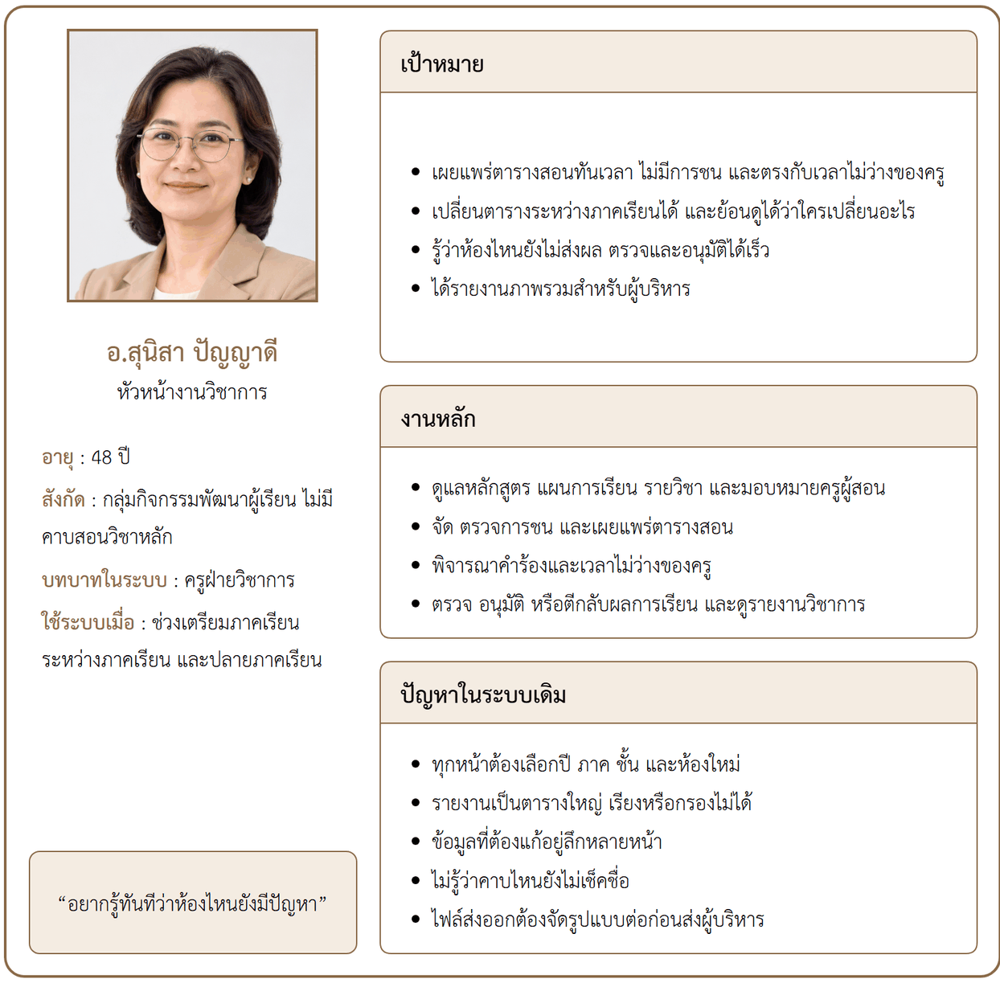 

***รูปที่** 3.1 Persona ของครูฝ่ายวิชาการ อ.สุนิสา ปัญญาดี*

รูปที่ 3.1 แสดง Persona ของครูฝ่ายวิชาการ อ.สุนิสาดูแลข้อมูลกลางของงานวิชาการ และใช้ระบบมากในช่วงเตรียมภาคเรียนและปลายภาคเรียน ปัญหาของ อ.สุนิสาส่วนใหญ่เป็นเรื่องการหาข้อมูลช้า และการติดตามงานของหลายห้องพร้อมกัน ความต้องการที่มาจาก Persona นี้ ได้แก่ การตรวจสอบการชนของตารางสอน การพิจารณาคำร้องขอเปลี่ยนการจัดตารางสอน การตรวจและอนุมัติผลการเรียน และรายงานสรุปผลการเรียน

#### ครูสมศรี ใจดี ครูผู้สอนและกรรมการฝ่ายวิชาการ

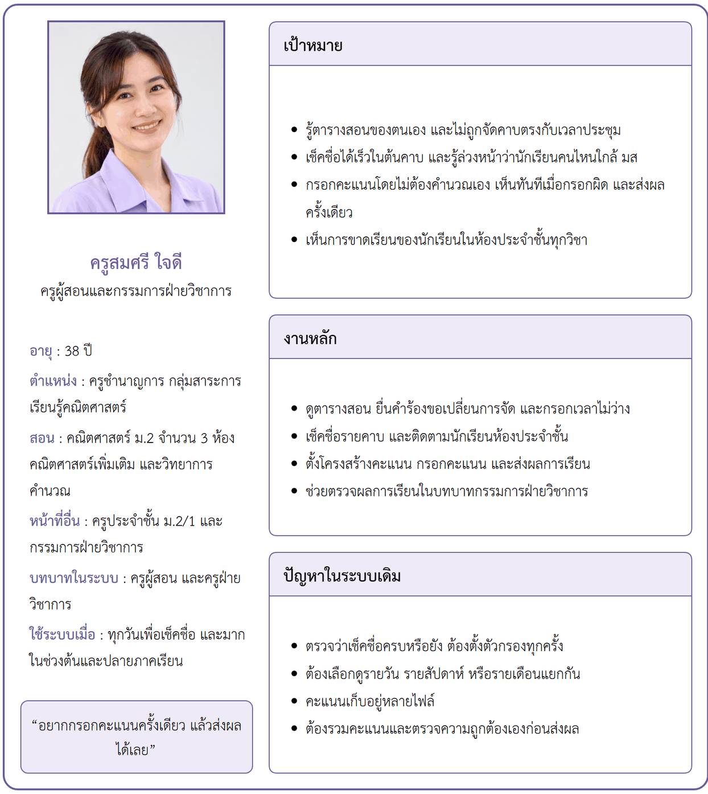 

***รูปที่** 3.2 Persona ของครูผู้สอน ครูสมศรี ใจดี*

รูปที่ 3.2 แสดง Persona ของครูผู้สอน ครูสมศรีใช้ระบบทุกวันเพื่อเช็คชื่อ และมีหลายหน้าที่ในคนเดียว คือ ครูผู้สอน ครูประจำชั้น และกรรมการฝ่ายวิชาการ ระบบจึงต้องให้ผู้ใช้หนึ่งคนสลับบทบาทได้ ปัญหาของครูสมศรีเป็นงานประจำวันที่ต้องทำซ้ำ ความต้องการที่มาจาก Persona นี้ ได้แก่ การดูตารางสอนรายบุคคล การคำนวณคะแนนรวมและเกรดอัตโนมัติ การนำเข้าคะแนนจากไฟล์ และการเช็คชื่อรายคาบ

### ปัญหาของระบบที่เกี่ยวข้อง

จากการศึกษาระบบที่เกี่ยวข้องในบทที่ 2 พบปัญหา 4 ด้าน ดังนี้

1. การจัดตารางสอน SchoolBright ไม่พบข้อมูลการจัดตารางสอนอัตโนมัติและการตรวจสอบครูหรือห้องเรียนที่ซ้อนกัน ส่วน SGS ไม่มีการจัดตารางสอน โรงเรียนจึงต้องจัดตารางใน Excel และตรวจสอบด้วยตนเอง

2. ข้อมูลอยู่หลายระบบ aSc TimeTables จัดตารางสอนได้ แต่ไม่มีงานหลักสูตรและคะแนน โรงเรียนต้องใช้หลายระบบ และข้อมูลรายวิชาและครูไม่เชื่อมกัน

3. การกำหนดและบันทึกคะแนน SchoolBright และ SGS ไม่พบการกำหนดสัดส่วนคะแนน และไม่พบการนำเข้าคะแนนจากไฟล์ SGS ต้องใช้โปรแกรมเสริมภายนอก

4. การคำนวณผลการเรียน SGS ให้ครูสั่งประมวลผลเกรดเอง

### Functional Requirements

- ระบบต้องรองรับการสร้าง แก้ไข และลบกลุ่มสาระการเรียนรู้
- ครูผู้สอนต้องสามารถดูโครงสร้างรายวิชาและหลักสูตรที่ตนเองเกี่ยวข้องได้
- ระบบต้องรองรับการสร้าง แก้ไข และลบตารางสอนในแต่ละภาคเรียน
- ระบบต้องแสดงตารางสอนในมุมมองครูผู้สอนรายบุคคลได้
- ระบบต้องตรวจสอบและแจ้งเตือนเมื่อเกิดการชนกันของตาราง เช่น ครูหรือห้องเรียนซ้ำกันในเวลาเดียวกัน
- ระบบต้องรองรับการกำหนดองค์ประกอบคะแนนของรายวิชา เช่น คะแนนเก็บ กลางภาค ปลายภาค พร้อมกำหนดสัดส่วนน้ำหนักคะแนน
- ระบบต้องคำนวณคะแนนรวมและเกรดของนักเรียนโดยอัตโนมัติตามสูตรที่กำหนด
- ระบบต้องรองรับการนำเข้าคะแนนจำนวนมากผ่านไฟล์ Excel หรือ CSV
- ระบบต้องสร้างรายงานสรุปผลการเรียนของนักเรียนรายบุคคลและรายห้องได้
- ระบบต้องรองรับการส่งออกในรูปแบบ Excel และ PDF
- ระบบต้องรองรับการส่งผลการเรียนของครูผู้สอน การตรวจ อนุมัติ หรือตีกลับโดยครูฝ่ายวิชาการ และการขอปลดล็อกผลการเรียนที่ส่งแล้ว
- ระบบต้องรองรับการบันทึกผลการสอบซ่อม และจำกัดระดับผลการเรียนหลังสอบซ่อมตามเกณฑ์ที่กำหนด
- ระบบต้องรองรับการยื่นและพิจารณาคำร้องขอเปลี่ยนการจัดตารางสอน และการกรอกเวลาไม่ว่างของครูเพื่อใช้เป็นเงื่อนไขในการจัดตาราง
- ระบบต้องรองรับการเช็คชื่อนักเรียนรายคาบ รวมถึงการเช็คชื่อย้อนหลังและการแก้ไขพร้อมเหตุผล คำนวณเวลาเรียน แสดงรายชื่อนักเรียนที่ไม่มีสิทธิ์สอบ (มส) และบันทึกการปลด มส ที่ผู้บริหารอนุมัติ โดยไม่นับวันหยุดของโรงเรียน
- ระบบต้องรองรับการประเมินคุณลักษณะอันพึงประสงค์ และการอ่าน คิดวิเคราะห์ และเขียน ของนักเรียนในแต่ละรายวิชา
- ระบบต้องรองรับการจัดการชุมนุม สมาชิก และการบันทึกผลกิจกรรม ผ/มผ
- ระบบต้องรองรับการกำหนดตัวชี้วัดของรายวิชา และเชื่อมโยงตัวชี้วัดกับองค์ประกอบคะแนน
*ตารางที่ 3.1 แสดงปัญหาที่พบในระบบที่เกี่ยวข้อง แนวทางแก้ไขของระบบที่พัฒนา และข้อของ Functional Requirements ที่รองรับแนวทางนั้น*

***ตารางที่** 3**.**1 ตารางปัญหาของระบบที่เกี่ยวข้องและแนวทางแก้ไขของระบบที่พัฒนา*

| ปัญหาที่พบในระบบที่เกี่ยวข้อง | แนวทางแก้ไขของระบบที่พัฒนา | Functional Requirements (ข้อ) |
| --- | --- | --- |
| SchoolBright ไม่พบข้อมูลการจัดตารางสอนอัตโนมัติ และ SGS ไม่มีการจัดตารางสอน โรงเรียนจึงต้องจัดตารางใน Excel และตรวจสอบด้วยตนเอง | จัดตารางสอนได้ 3 วิธี ได้แก่ จัดด้วยตนเอง จัดอัตโนมัติแบบกำหนดเงื่อนไข และจัดอัตโนมัติด้วยเงื่อนไขมาตรฐาน | 3 |
| ไม่พบการตรวจสอบการชนกันของครูและห้องเรียนใน SchoolBright และ SGS | ตรวจสอบการชนกันของครู ห้องเรียน และกลุ่มการสอนทุกครั้งที่วางหรือแก้ไขคาบเรียน | 5 |
| aSc TimeTables จัดตารางได้แต่ไม่มีงานคะแนนและหลักสูตร โรงเรียนจึงต้องใช้หลายระบบและข้อมูลไม่เชื่อมโยงกัน | รวมงานหลักสูตร ตารางสอน และคะแนนไว้ในระบบเดียว โดยใช้ข้อมูลรายวิชาและครูชุดเดียวกัน | 1, 2, 3, 6 |
| ไม่พบการกำหนดสัดส่วนคะแนนใน SchoolBright และ SGS | กำหนดองค์ประกอบคะแนน คะแนนเต็ม สัดส่วน และตัวชี้วัดของรายวิชา | 6, 17 |
| ไม่พบการนำเข้าคะแนนจากไฟล์ใน SchoolBright และ SGS โดย SGS ต้องใช้โปรแกรมเสริมภายนอก | นำเข้าคะแนนจากไฟล์ Excel หรือ CSV | 8 |

***ตารางที่ 3.1 (ต่อ)** ตารางปัญหาของระบบที่เกี่ยวข้องและแนวทางแก้ไขของระบบที่พัฒนา*

| ปัญหาที่พบในระบบที่เกี่ยวข้อง | แนวทางแก้ไขของระบบที่พัฒนา | Functional Requirements (ข้อ) |
| --- | --- | --- |
| SGS ให้ครูสั่งประมวลผลเกรดเอง | คำนวณคะแนนรวมและระดับผลการเรียนอัตโนมัติเมื่อบันทึกคะแนนครบ และกำหนดสถานะผ่านหรือไม่ผ่าน | 7 |

### Non-functional Requirements

- ระบบต้องรองรับการใช้งานพร้อมกันของผู้ใช้งานหลายคน โดยไม่เกิด Data Conflict
- ระบบต้องตรวจ Token ที่ออกโดยระบบงานทะเบียนและ IAM (Service B) และจำกัดสิทธิ์ตามบทบาทของผู้ใช้
- ระบบต้องตรวจสอบความครบถ้วนและรูปแบบของข้อมูลก่อนบันทึก
- ระบบต้องรองรับการใช้งานในหลายอุปกรณ์ที่แตกต่างกันโดยไม่เกิดปัญหา
- ระบบควรป้องกันการสูญหายของข้อมูลระหว่างการบันทึก
## ภาพรวมของระบบ

### ระบบย่อยและขอบเขตการทำงาน

ระบบงานวิชาการแบ่งเป็น 5 ระบบย่อย เรียงตามลำดับการใช้งานในหนึ่งภาคเรียน แต่ละระบบย่อยมีผู้ใช้และขอบเขตการทำงานดังนี้

#### ระบบจัดการหลักสูตร

**ผู้ใช้ :** ครูฝ่ายวิชาการเป็นผู้จัดการข้อมูล ครูผู้สอนดูข้อมูลได้

1. ครูฝ่ายวิชาการเพิ่ม แก้ไข และลบกลุ่มสาระการเรียนรู้และรายวิชา กำหนดหน่วยกิต จำนวนชั่วโมง โครงสร้างคะแนนตั้งต้น เกณฑ์ผ่าน และตัวชี้วัดของรายวิชา

2. ครูฝ่ายวิชาการสร้างหลักสูตรและแผนการเรียนของแต่ละระดับชั้น เพิ่มรายวิชาเข้าแผนการเรียน และประกาศใช้หลักสูตร

3. ครูฝ่ายวิชาการมอบหมายครูผู้สอนของแต่ละรายวิชาในแต่ละห้อง และกำหนดครูร่วมสอนได้

#### ระบบจัดตารางสอน

**ผู้ใช้ :** ครูฝ่ายวิชาการ และครูผู้สอน

1. ครูฝ่ายวิชาการสร้างตารางสอนฉบับร่างหรือคัดลอกจากฉบับเดิม กำหนดโครงสร้างเวลาของแต่ละช่วงชั้น และกิจกรรมที่ล็อกเวลา เช่น โฮมรูม และชุมนุม

2. ครูฝ่ายวิชาการจัดตารางสอนได้ 3 วิธี ได้แก่ จัดด้วยตนเองแบบลากและวาง จัดอัตโนมัติแบบกำหนดเงื่อนไข และจัดอัตโนมัติ

3. ระบบตรวจการชนกันของครู ห้องเรียน และห้องเฉพาะทาง รวมถึงเวลาไม่ว่างของครูและห้องที่ไม่พร้อมใช้

4. ครูฝ่ายวิชาการบันทึกและเผยแพร่ตารางสอน ฉบับที่เผยแพร่แล้วแก้ไขไม่ได้ ต้องสร้างฉบับใหม่

5. ครูผู้สอนดูตารางสอนของตนเอง ตารางเรียนรายห้อง และตารางการใช้ห้องจากฉบับที่เผยแพร่

6. ครูผู้สอนยื่นคำร้องขอเปลี่ยนการจัดตารางสอน ครูฝ่ายวิชาการพิจารณาอนุมัติ อนุมัติพร้อมแก้ไข หรือไม่อนุมัติ

7. ครูผู้สอนกรอกเวลาไม่ว่างประจำสัปดาห์ได้จนถึงวันปิดรับ และครูฝ่ายวิชาการพิจารณาเวลาไม่ว่าง

#### ระบบเช็คชื่อ

**ผู้ใช้ : ครูผู้สอน รวมถึงครูผู้สอนที่เป็นครูประจำชั้น**

1. ครูผู้สอนเช็คชื่อนักเรียนรายคาบเป็น มา สาย ลา หรือขาด และดูคาบที่ยังไม่ได้เช็ค คาบในวันหยุดของโรงเรียนไม่ต้องเช็คชื่อ

2. ระบบคำนวณร้อยละเวลาเรียน แสดงกลุ่มเสี่ยงและผู้ไม่มีสิทธิ์สอบ (มส) และรองรับการปลด มส

3. ครูประจำชั้นดูการเข้าเรียนของห้องตนเองทุกวิชา แต่แก้สถานะที่ครูผู้สอนเช็คไว้ไม่ได้

#### ระบบบันทึกคะแนน

**ผู้ใช้ :** ครูผู้สอน ครูที่ปรึกษาชุมนุม และครูฝ่ายวิชาการ

1. ครูผู้สอนกำหนดโครงสร้างคะแนนของห้องที่สอน โดยคัดลอกจากโครงสร้างตั้งต้นของรายวิชา คะแนนรวมต้องได้ร้อยละ 100 และผูกกับตัวชี้วัด

2. ครูผู้สอนบันทึกคะแนน และประเมินคุณลักษณะอันพึงประสงค์และการอ่าน คิดวิเคราะห์ และเขียน

3. ระบบคำนวณผลการเรียนและตรวจสถานะผ่านหรือไม่ผ่าน รวมถึง 0 ร และ มส

4. ครูผู้สอนส่งผลการเรียน ครูฝ่ายวิชาการดูสถานะการส่งผลของทั้งโรงเรียน ตรวจแบบอ่านอย่างเดียว ปักหมุดข้อสังเกต แล้วอนุมัติหรือตีกลับ

5. ครูผู้สอนขอปลดล็อกผลการเรียนที่ส่งหรืออนุมัติแล้ว และครูฝ่ายวิชาการเป็นผู้พิจารณา

6. ครูผู้สอนบันทึกผลสอบซ่อมของนักเรียนที่ได้ระดับ 0 ได้ไม่เกิน 2 ครั้ง

7. ครูฝ่ายวิชาการเปิดชุมนุมและกำหนดครูที่ปรึกษา ครูที่ปรึกษาจัดสมาชิก บันทึกผลผ่านหรือไม่ผ่าน และส่งผลให้ครูฝ่ายวิชาการอนุมัติ

#### ระบบออกรายงาน

**ผู้ใช้ :** ครูฝ่ายวิชาการ และครูผู้สอน

1. ครูฝ่ายวิชาการดูภาพรวมความคืบหน้างานวิชาการและนักเรียนที่ต้องติดตาม

2. ครูฝ่ายวิชาการดูรายงานผลการเรียน คะแนนรายวิชา คะแนนเฉลี่ยรายปี นักเรียนที่ต้องปรับปรุง ผลการสอบซ่อม ระเบียนสะสม เกรดเฉลี่ยสะสม และหน่วยกิตสะสม และกรองตามปีการศึกษา ภาคเรียน ระดับชั้น ห้อง และรายวิชาได้

3. ครูผู้สอนดูรายงานการเข้าเรียนและผู้ไม่มีสิทธิ์สอบของห้องที่ตนสอน

4. ครูผู้สอนและครูฝ่ายวิชาการดูข้อมูลหลักสูตรและรายวิชา

### System Architecture

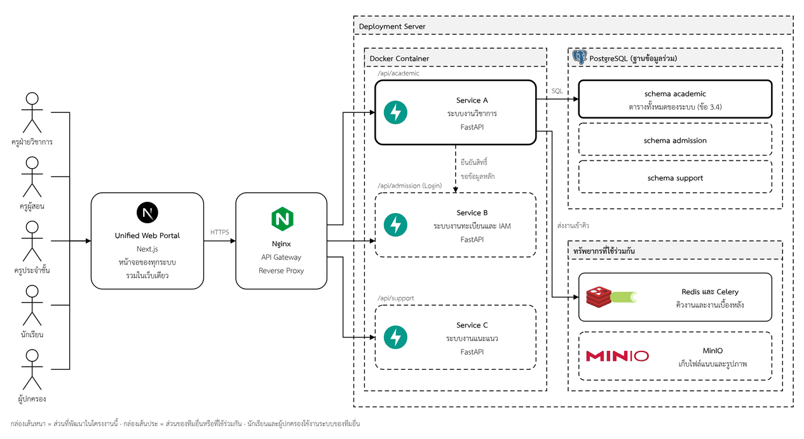 

***รูปที่** 3.3 ภาพรวมสถาปัตยกรรมของระบบในโรงเรียน*

ระบบออกแบบเป็นสถาปัตยกรรมแบบ Microservice ร่วมกับระบบของทีมอื่นในโรงเรียน ดังรูปที่ 3.3 ผู้ใช้ทุกกลุ่ม ได้แก่ ครูฝ่ายวิชาการ ครูผู้สอน ครูประจำชั้น นักเรียน และผู้ปกครอง ใช้งานผ่าน Unified Web Portal ซึ่งพัฒนาด้วย Next.js และรวมหน้าจอของทุกระบบไว้ในเว็บเดียว คำขอทั้งหมดผ่าน Nginx ซึ่งทำหน้าที่เป็น API Gateway แล้วส่งต่อตามเส้นทาง ได้แก่ /api/academic ไปยังระบบงานวิชาการ (Service A) ซึ่งเป็นระบบที่ออกแบบในโครงงานนี้ /api/admission ไปยังระบบงานทะเบียนและ IAM (Service B) ซึ่งรวมถึงการเข้าสู่ระบบ และ /api/support ไปยังระบบงานแนะแนว (Service C) ทั้งสามระบบพัฒนาด้วย FastAPI และทำงานใน Docker container

ระบบงานวิชาการเรียกใช้ระบบงานทะเบียนและ IAM เพื่อยืนยันสิทธิ์ของผู้ใช้และขอข้อมูลหลัก PostgreSQL ร่วมกันโดยแยก schema ตามระบบ ตารางทั้งหมดของระบบงานวิชาการซึ่งอธิบายในข้อ 3.4 อยู่ใน schema academic และใช้ Redis กับ Celery ซึ่งเป็นทรัพยากรที่ใช้ร่วมกันสำหรับงานเบื้องหลัง ส่วน MinIO สำหรับเก็บไฟล์แนบเป็นทรัพยากรที่ระบบนี้ไม่ได้ใช้

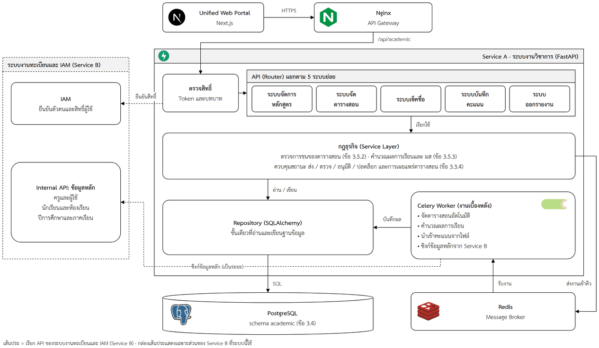 

***รูปที่** 3.4 โครงสร้างภายในระบบงานวิชาการ (Service A)*

รูปที่ 3.4 แสดงโครงสร้างภายในของระบบงานวิชาการ คำขอที่ส่งมาจาก Nginx ผ่านการตรวจสิทธิ์ก่อน โดยตรวจ Token และบทบาทของผู้ใช้ จากนั้นส่งไปยัง API ของระบบย่อยทั้ง 5 ระบบ ได้แก่ ระบบจัดการหลักสูตร ระบบจัดตารางสอน ระบบเช็คชื่อ ระบบบันทึกคะแนน และระบบออกรายงาน ทุกระบบย่อยเรียกใช้ชั้นกฎร่วมกัน ซึ่งรวมการตรวจการชนของตารางสอน การคำนวณผลการเรียน และการควบคุมสถานะของข้อมูล และเขียนฐานข้อมูลผ่าน Repository ที่ติดต่อกับ PostgreSQL งานที่ใช้เวลานานส่งเข้าคิวใน Redis แล้วให้ Celery Worker ประมวลผลเบื้องหลัง ได้แก่ การจัดตารางสอนอัตโนมัติ การคำนวณผลการเรียน การนำเข้าคะแนนจากไฟล์ สถาปัตยกรรมในรูปที่ 3.3 และรูปที่ 3.4 เป็นสถาปัตยกรรมเป้าหมายของระบบ

### การเชื่อมโยงข้อมูลระหว่างระบบย่อย

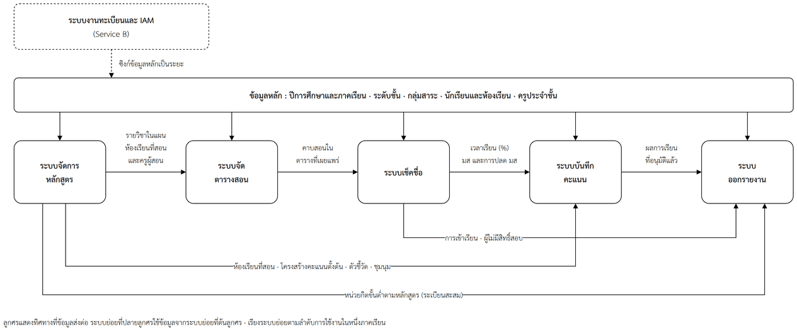 

***รูปที่** 3.5 การเชื่อมโยงข้อมูลระหว่างระบบย่อย*

ระบบย่อยทั้ง 5 ระบบส่งข้อมูลต่อกันตามลำดับการใช้งานในหนึ่งภาคเรียน ข้อมูลหลัก ได้แก่ ปีการศึกษาและภาคเรียน ระดับชั้น กลุ่มสาระ นักเรียนและห้องเรียน และครูประจำชั้น ใช้ร่วมกันทุกระบบย่อย ระบบจัดการหลักสูตรกำหนดรายวิชาในแผนการเรียน ห้องเรียนที่สอน และครูผู้สอน ซึ่งระบบจัดตารางสอนนำไปจัดเป็นคาบสอน เมื่อเผยแพร่ตารางแล้ว ระบบเช็คชื่อใช้คาบสอนในตารางที่เผยแพร่เป็นคาบที่ต้องเช็คชื่อ เวลาเรียนและผล มส จากการเช็คชื่อ ส่งต่อให้ระบบบันทึกคะแนนใช้ตัดสินผลการเรียน และผลการเรียนที่ฝ่ายวิชาการอนุมัติแล้วส่งต่อให้ระบบออกรายงาน

## การออกแบบระบบ

### Use-case diagram

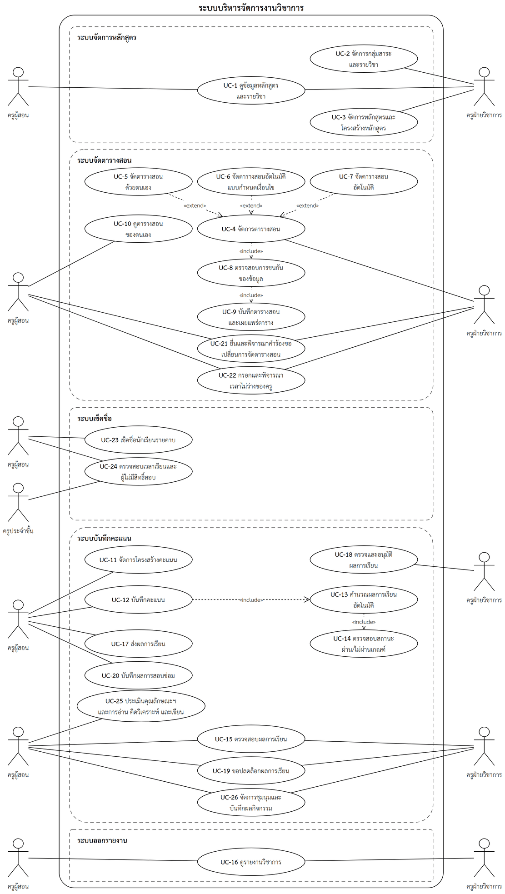 

***รูปที่** 3.6 ภาพ Use-case diagram*

### สรุป Use case

*ตารางที่ 3.2 สรุป use case ทั้ง 26 รายการของระบบ ตามรูปที่ 3.6 โดยระบุผู้ใช้งาน คำอธิบายโดยย่อ ส่วนรายละเอียดของแต่ละ use case แสดงไว้ในภาคผนวก ก ตารางที่ ก.1 ถึงตารางที่ ก.26 การส่งออกข้อมูลเป็นไฟล์ Excel หรือ PDF ตามข้อ 3.1.3 เป็นปุ่มในหน้ารายงานและหน้าข้อมูลที่ไม่มีขั้นตอนอื่น*

***ตารางที่** 3**.**2 ตารางสรุป Use case ของระบบ*

| ID | ชื่อ use case | Actor | คำอธิบายโดยย่อ | รูปที่ |
| --- | --- | --- | --- | --- |
| UC-1 | ดูข้อมูลหลักสูตรและรายวิชา | ครูผู้สอน, ครูฝ่ายวิชาการ | แสดงหลักสูตรและรายวิชาตามปีการศึกษาและระดับชั้นที่เลือก | 3.30 |
| UC-2 | จัดการกลุ่มสาระและรายวิชา | ครูฝ่ายวิชาการ | เพิ่ม แก้ไข และลบกลุ่มสาระและรายวิชา พร้อมกำหนดโครงสร้างคะแนนตั้งต้นและตัวชี้วัด | 3.8 |
| UC-3 | จัดการหลักสูตรและโครงสร้างหลักสูตร | ครูฝ่ายวิชาการ | สร้างและแก้ไขหลักสูตร และเพิ่มรายวิชาเข้าโครงสร้างหลักสูตร | 3.9–3.11 |
| UC-4 | จัดการตารางสอน | ครูฝ่ายวิชาการ | สร้างหรือแก้ไขตารางสอนของภาคเรียน โดยเลือกวิธีจัดตารางได้ 3 วิธี | 3.13 |
| UC-5 | จัดตารางสอนด้วยตนเอง | ครูฝ่ายวิชาการ | วางรายวิชา ครูผู้สอน และห้องเรียนลงในช่องเวลาด้วยตนเอง | 3.14 |
| UC-6 | จัดตารางสอนอัตโนมัติแบบกำหนดเงื่อนไข | ครูฝ่ายวิชาการ | กำหนด Hard Constraint และ Soft Constraint แล้วให้ระบบจัดตาราง | 3.14 |
| UC-7 | จัดตารางสอนอัตโนมัติ | ครูฝ่ายวิชาการ | ให้ระบบจัดตารางจากข้อมูลที่มีและเงื่อนไขมาตรฐาน | 3.14 |
| UC-8 | ตรวจสอบการชนกันของข้อมูล | ระบบ | ตรวจครู ห้องเรียน และกลุ่มการสอนที่ซ้อนกันในคาบเดียวกัน | 3.15 |
| UC-9 | บันทึกตารางสอนและเผยแพร่ตาราง | ครูฝ่ายวิชาการ | บันทึกตารางเป็นฉบับร่าง ตรวจ 3 มุมมอง แล้วเผยแพร่ | 3.16 |
| UC-10 | ดูตารางสอนของตนเอง | ครูผู้สอน | ดูตารางสอนของตนเองตามปีการศึกษาและภาคเรียน | 3.16 |

***ตารางที่ 3.2 (ต่อ)** ตารางสรุป Use case ของระบบ*

| ID | ชื่อ use case | Actor | คำอธิบายโดยย่อ | รูปที่ |
| --- | --- | --- | --- | --- |
| UC-11 | จัดการโครงสร้างคะแนน | ครูผู้สอน | กำหนดองค์ประกอบ คะแนนเต็ม สัดส่วน และตัวชี้วัดของรายวิชา | 3.22 |
| UC-12 | บันทึกคะแนน | ครูผู้สอน | กรอก แก้ไข หรือนำเข้าคะแนนของนักเรียนตามโครงสร้างคะแนน | 3.23 |
| UC-13 | คำนวณผลการเรียนอัตโนมัติ | ระบบ | คำนวณคะแนนรวมและระดับผลการเรียนตามสัดส่วนและเกณฑ์ | 3.24 |
| UC-14 | ตรวจสอบสถานะผ่าน/ไม่ผ่านเกณฑ์ | ระบบ | กำหนดสถานะผ่าน ไม่ผ่าน หรือมีสิทธิ์สอบซ่อม | 3.24 |
| UC-15 | ตรวจสอบผลการเรียน | ครูผู้สอน, ครูฝ่ายวิชาการ | ดูคะแนนรวม เกรด GPA และสถานะผลการเรียนของนักเรียน | 3.24 |
| UC-16 | ดูรายงานวิชาการ | ครูฝ่ายวิชาการ, ครูผู้สอน | ดูรายงานผลการเรียนและรายงานอื่นตามเงื่อนไขที่เลือก | 3.29 |
| UC-17 | ส่งผลการเรียน | ครูผู้สอน | ตรวจรายการก่อนส่ง แล้วส่งผลการเรียนให้ฝ่ายวิชาการตรวจ | 3.25 |
| UC-18 | ตรวจและอนุมัติผลการเรียน | ครูฝ่ายวิชาการ | ตรวจผลการเรียนที่ส่งมา ปักหมุดข้อสังเกต แล้วอนุมัติหรือตีกลับ | 3.25 |
| UC-19 | ขอปลดล็อกผลการเรียน | ครูผู้สอน, ครูฝ่ายวิชาการ | ยื่นและพิจารณาคำขอปลดล็อกผลการเรียนที่ส่งแล้ว | 3.27 |
| UC-20 | บันทึกผลการสอบซ่อม | ครูผู้สอน | บันทึกคะแนนสอบซ่อมได้ไม่เกิน 2 ครั้ง และตัดสินผลหลังสอบซ่อม | 3.26 |
| UC-21 | ยื่นและพิจารณาคำร้องขอเปลี่ยนการจัดตารางสอน | ครูผู้สอน, ครูฝ่ายวิชาการ | ยื่นคำร้องเปลี่ยนคาบสอน และพิจารณาอนุมัติ | 3.17 |
| UC-22 | กรอกและพิจารณาเวลาไม่ว่างของครู | ครูผู้สอน, ครูฝ่ายวิชาการ | กรอกเวลาไม่ว่างของครู และพิจารณาอนุมัติเพื่อใช้จัดตาราง | 3.12 |
| UC-23 | เช็คชื่อนักเรียนรายคาบ | ครูผู้สอน | บันทึกสถานะ มา สาย ลา หรือขาด ของนักเรียนรายคาบ รวมถึงเช็คชื่อย้อนหลัง | 3.18–3.19 |

***ตารางที่ 3.2 (ต่อ)** ตารางสรุป Use case ของระบบ*

| ID | ชื่อ use case | Actor | คำอธิบายโดยย่อ | รูปที่ |
| --- | --- | --- | --- | --- |
| UC-24 | ตรวจสอบเวลาเรียนและผู้ไม่มีสิทธิ์สอบ | ครูผู้สอนรวมถึงครูประจำชั้น | สรุปร้อยละเวลาเรียน รายชื่อผู้ไม่มีสิทธิ์สอบ (มส) และบันทึกการปลด มส | 3.20–3.21 |
| UC-25 | ประเมินคุณลักษณะอันพึงประสงค์และการอ่าน คิดวิเคราะห์ และเขียน | ครูผู้สอน | ประเมินคุณลักษณะอันพึงประสงค์ และการอ่าน คิดวิเคราะห์ และเขียน รายข้อ | 3.23 |
| UC-26 | จัดการชุมนุมและบันทึกผลกิจกรรม | ครูฝ่ายวิชาการ, ครูผู้สอน | สร้างชุมนุม จัดสมาชิก และบันทึกผลกิจกรรม ผ หรือ มผ | 3.28 |

### Activity Diagram

Activity Diagram ของระบบแบ่งตามระบบย่อย 5 ระบบ แต่ละระบบย่อยแบ่งการทำงานเป็นเฟส และแต่ละเฟสมี 1 รูป รวม 23 รูป ทุกรูปเป็นแบบ swimlane แต่ละช่องคือผู้ทำขั้นตอนนั้น ได้แก่ ครูฝ่ายวิชาการ ครูผู้สอน ครูประจำชั้น และระบบ รูปที่ 3.7 แสดงเฟสทั้งหมดของแต่ละระบบย่อย

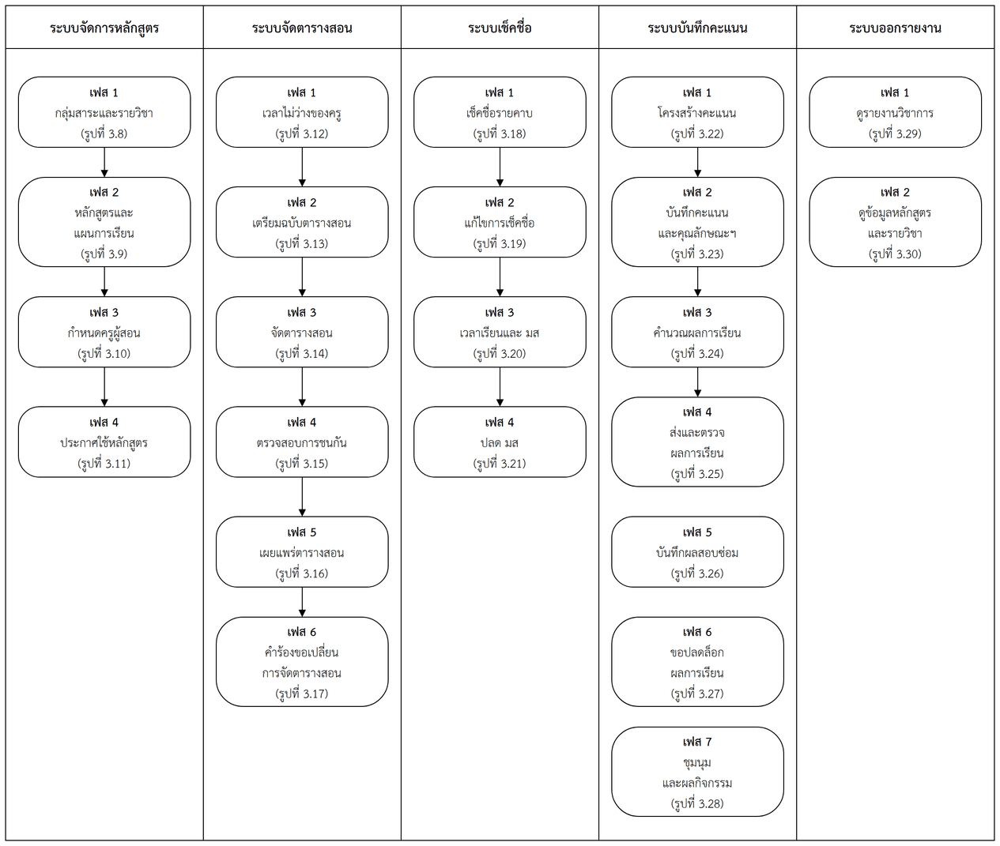 

***รูปที่** 3**.**7 ภาพรวม Activity Diagram แยกตามระบบย่อยและเฟส*

*ตารางที่ 3.3 สรุปเฟสของแต่ละระบบย่อย use case ที่เกี่ยวข้อง และเลขรูปของแต่ละเฟส*

***ตารางที่** 3**.**3 ตารางเฟสของแต่ละระบบย่อยและรูป Activity Diagram*

| ระบบย่อย | เฟส | Use case | รูปที่ |
| --- | --- | --- | --- |
| ระบบจัดการหลักสูตร | 1. จัดการกลุ่มสาระและรายวิชา | UC-2 | 3.8 |
| ระบบจัดการหลักสูตร | 2. สร้างหลักสูตรและแผนการเรียน | UC-3 | 3.9 |
| ระบบจัดการหลักสูตร | 3. กำหนดครูผู้สอน | UC-3 | 3.10 |
| ระบบจัดการหลักสูตร | 4. ประกาศใช้หลักสูตร | UC-3 | 3.11 |
| ระบบจัดตารางสอน | 1. กรอกและพิจารณาเวลาไม่ว่างของครู | UC-22 | 3.12 |
| ระบบจัดตารางสอน | 2. เตรียมฉบับตารางสอน | UC-4 | 3.13 |
| ระบบจัดตารางสอน | 3. จัดตารางสอน | UC-5, 6, 7 | 3.14 |
| ระบบจัดตารางสอน | 4. ตรวจสอบการชนกัน | UC-8 | 3.15 |
| ระบบจัดตารางสอน | 5. เผยแพร่ตารางสอน | UC-9, 10 | 3.16 |
| ระบบจัดตารางสอน | 6. คำร้องขอเปลี่ยนการจัดตารางสอน | UC-21 | 3.17 |
| ระบบเช็คชื่อ | 1. เช็คชื่อนักเรียนรายคาบ | UC-23 | 3.18 |

***ตารางที่ 3.3 (ต่อ)** ตารางเฟสของแต่ละระบบย่อยและรูป Activity Diagram*

| ระบบย่อย | เฟส | Use case | รูปที่ |
| --- | --- | --- | --- |
| ระบบเช็คชื่อ | 2. แก้ไขการเช็คชื่อที่บันทึกแล้ว | UC-23 | 3.19 |
| ระบบเช็คชื่อ | 3. ตรวจสอบเวลาเรียนและผู้ไม่มีสิทธิ์สอบ | UC-24 | 3.20 |
| ระบบเช็คชื่อ | 4. ปลด มส | UC-24 | 3.21 |
| ระบบบันทึกคะแนน | 1. กำหนดโครงสร้างคะแนน | UC-11 | 3.22 |
| ระบบบันทึกคะแนน | 2. บันทึกคะแนนและคุณลักษณะฯ | UC-12, 25 | 3.23 |
| ระบบบันทึกคะแนน | 3. คำนวณผลการเรียน | UC-13, 14, 15 | 3.24 |
| ระบบบันทึกคะแนน | 4. ส่งและตรวจผลการเรียน | UC-17, 18 | 3.25 |
| ระบบบันทึกคะแนน | 5. บันทึกผลสอบซ่อม | UC-20 | 3.26 |
| ระบบบันทึกคะแนน | 6. ขอปลดล็อกผลการเรียน | UC-19 | 3.27 |
| ระบบบันทึกคะแนน | 7. จัดการชุมนุมและบันทึกผลกิจกรรม | UC-26 | 3.28 |
| ระบบออกรายงาน | 1. ดูรายงานวิชาการ | UC-16 | 3.29 |
| ระบบออกรายงาน | 2. ดูข้อมูลหลักสูตรและรายวิชา | UC-1 | 3.30 |

*รูปที่ 3.8 ถึงรูปที่ 3.30 แสดง Activity Diagram ของแต่ละเฟส เรียงตามระบบย่อยในตารางที่ 3.3*

#### ระบบจัดการหลักสูตร

รูปที่ 3.8 แสดงระบบจัดการหลักสูตร เฟส 1 จัดการกลุ่มสาระและรายวิชา (UC-2) ครูฝ่ายวิชาการเลือกเมนูจัดการกลุ่มสาระและรายวิชา (1.1) ระบบแสดงรายการ (1.2) ครูฝ่ายวิชาการเพิ่ม แก้ไข หรือลบรายวิชา (1.3) และกำหนดโครงสร้างคะแนนตั้งต้นกับตัวชี้วัด (1.4) แล้วกดบันทึก (1.5) ระบบตรวจความครบถ้วนและความซ้ำ (1.6) ถ้าข้อมูลไม่ครบหรือซ้ำ ระบบแจ้งให้แก้ไขที่ขั้นตอน 1.3 (1.7) ถ้าถูกต้อง ระบบบันทึกรายวิชา (1.8) แล้วไปเฟส 2

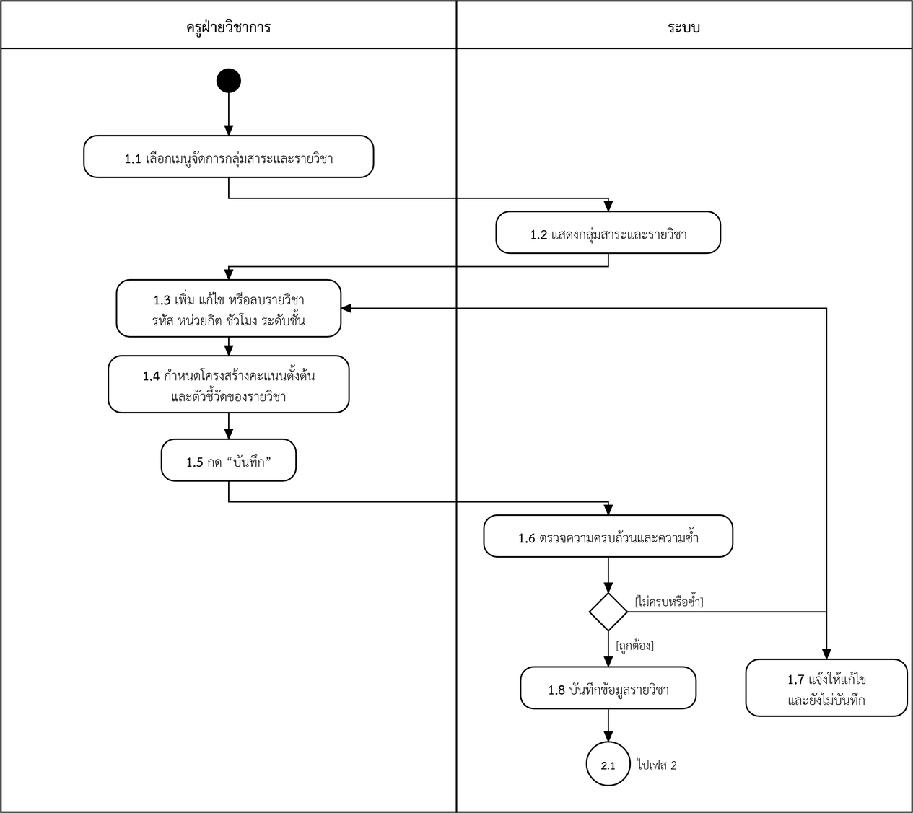 

***รูปที่** 3**.**8 Activity Diagram ระบบจัดการหลักสูตร เฟส 1 จัดการกลุ่มสาระและรายวิชา*

รูปที่ 3.9 แสดงระบบจัดการหลักสูตร เฟส 2 สร้างหลักสูตรและแผนการเรียน (UC-3) ครูฝ่ายวิชาการสร้างหลักสูตรใหม่หรือคัดลอกจากหลักสูตรเดิม (2.1) กรอกชื่อ ปีที่เริ่มใช้ และระดับ (2.2) แล้วเพิ่มแผนการเรียนกับห้องเรียนของแผน (2.3) ระบบแสดงรายวิชาที่เพิ่มได้ (2.4) ครูฝ่ายวิชาการเพิ่มรายวิชาเข้าแผนตามภาคเรียน (2.5) ระบบตรวจความครบถ้วนและความซ้ำ (2.6) ถ้าไม่ถูกต้อง ระบบแจ้งเตือนและให้แก้ที่ขั้นตอน 2.5 (2.7) ถ้าถูกต้อง ระบบบันทึกหลักสูตรเป็นฉบับร่าง (2.8) แล้วไปเฟส 3

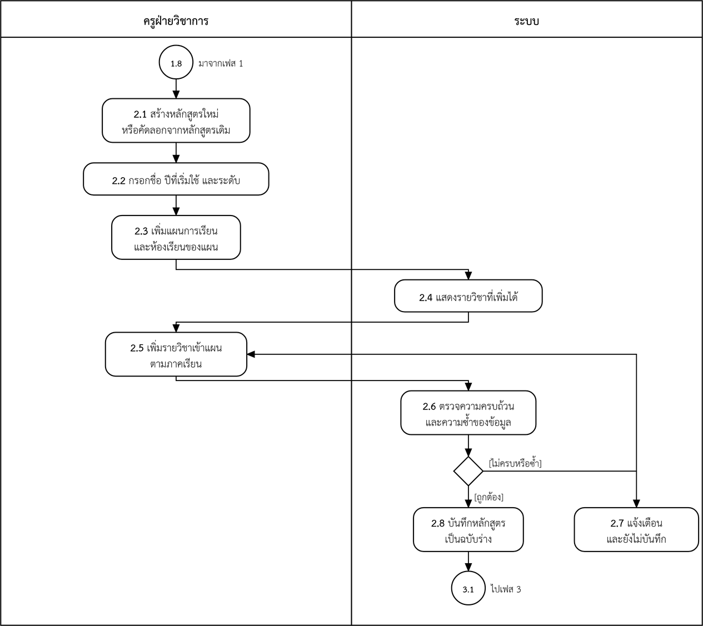 

***รูปที่** 3**.**9 Activity Diagram ระบบจัดการหลักสูตร เฟส 2 สร้างหลักสูตรและแผนการเรียน*

รูปที่ 3.10 แสดงระบบจัดการหลักสูตร เฟส 3 กำหนดครูผู้สอน (UC-3) ครูฝ่ายวิชาการเลือกแผนการเรียนและรายวิชา (3.1) ระบบแสดงห้องเรียนที่ยังไม่มีครูผู้สอน (3.2) ครูฝ่ายวิชาการเลือกครูและห้องที่สอนเอง โดยหนึ่งรายวิชามีครูร่วมสอนได้ (3.3) หรือให้ระบบเลือกครูในกลุ่มสาระที่มีภาระสอนน้อย (3.4) จากนั้นระบบบันทึกครูผู้สอนของรายวิชา (3.5) แล้วไปเฟส 4

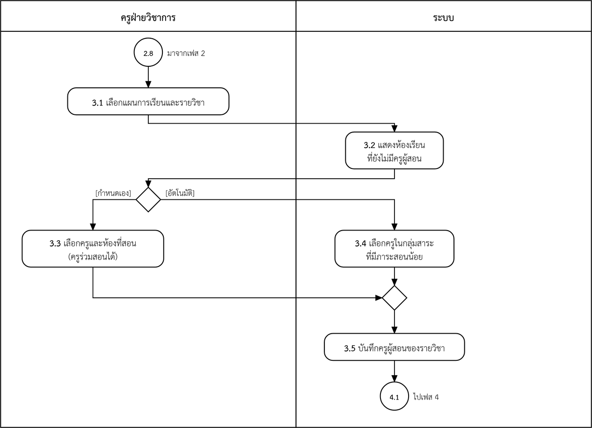 

***รูปที่** 3**.**10 Activity Diagram ระบบจัดการหลักสูตร เฟส 3 กำหนดครูผู้สอน*

รูปที่ 3.11 แสดงระบบจัดการหลักสูตร เฟส 4 ประกาศใช้หลักสูตร (UC-3) ครูฝ่ายวิชาการกดประกาศใช้หลักสูตรที่เป็นฉบับร่าง (4.1) ระบบตรวจว่าทุกแผนมีรายวิชาและทุกรายวิชามีครูผู้สอน (4.2) ถ้ายังไม่ครบ ระบบแสดงรายการที่ขาด (4.3) ครูฝ่ายวิชาการเลือกกลับไปแก้ที่เฟส 3 หรือประกาศใช้ต่อได้ เมื่อประกาศใช้ ระบบเปลี่ยนสถานะหลักสูตรเป็นใช้งานอยู่ (4.4) และเปลี่ยนหลักสูตรเดิมของระดับเดียวกันเป็นปิดใช้งาน (4.5)

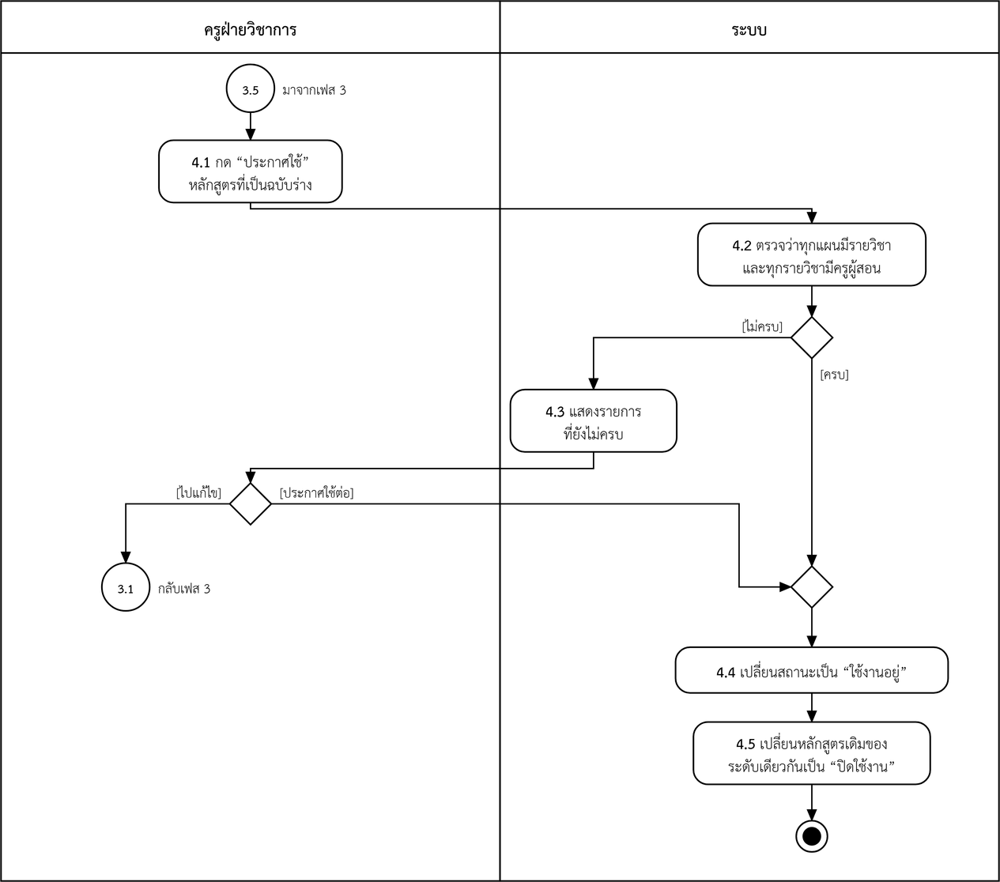 

***รูปที่** 3**.**11 Activity Diagram ระบบจัดการหลักสูตร เฟส 4 ประกาศใช้หลักสูตร*

#### ระบบจัดตารางสอน

รูปที่ 3.12 แสดงระบบจัดตารางสอน เฟส 1 กรอกและพิจารณาเวลาไม่ว่างของครู (UC-22) ครูผู้สอนเลือกเมนูโปรไฟล์และเวลาไม่ว่าง (1.1) แล้วเพิ่มวัน เวลา เหตุผล และรายละเอียด (1.2) ระบบตรวจว่าเวลาเริ่มอยู่ก่อนเวลาสิ้นสุด และยังไม่เลยวันปิดรับ (1.3) ถ้าไม่ถูกต้อง ครูผู้สอนแก้ที่ขั้นตอน 1.2 ถ้าถูกต้อง ระบบบันทึกในสถานะรออนุมัติ (1.4) ครูฝ่ายวิชาการพิจารณารายการ (1.5) ถ้าอนุมัติ ระบบนำเวลาไม่ว่างไปใช้เป็นเงื่อนไขจัดตาราง (1.6) ถ้าไม่อนุมัติ ครูฝ่ายวิชาการกรอกหมายเหตุ (1.7) แล้วไปเฟส 2

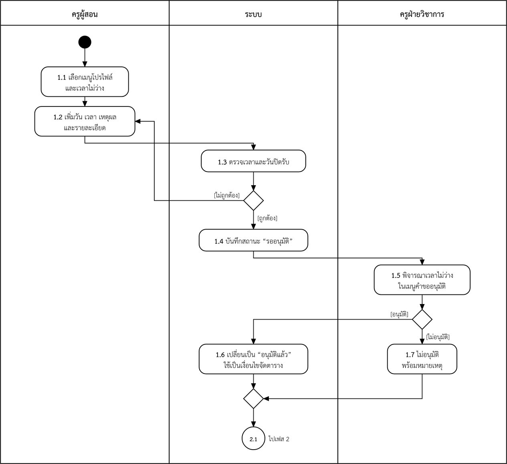 

***รูปที่** 3**.**12 Activity Diagram ระบบจัดตารางสอน เฟส 1 กรอกและพิจารณาเวลาไม่ว่างของครู*

รูปที่ 3.13 แสดงระบบจัดตารางสอน เฟส 2 เตรียมฉบับตารางสอน (UC-4) ครูฝ่ายวิชาการเลือกเมนูจัดการตารางสอน (2.1) ระบบแสดงฉบับตารางสอนที่มี (2.2) ครูฝ่ายวิชาการสร้างฉบับใหม่หรือคัดลอกจากฉบับเดิม (2.3) ระบบสร้างฉบับร่างและแสดงโครงสร้างเวลาตามช่วงชั้น (2.4) ครูฝ่ายวิชาการปรับวัน เวลา คาบ และกิจกรรมล็อกเวลา (2.5) ระบบตรวจความครบถ้วนของรายวิชา ครู ห้อง และจำนวนคาบ (2.6) ถ้าครบ ไปเฟส 3 ถ้าไม่ครบ ระบบแสดงรายการข้อมูลที่ขาด (2.7) และหยุดการทำงาน ผู้ใช้ต้องแก้ข้อมูลก่อนเริ่มใหม่

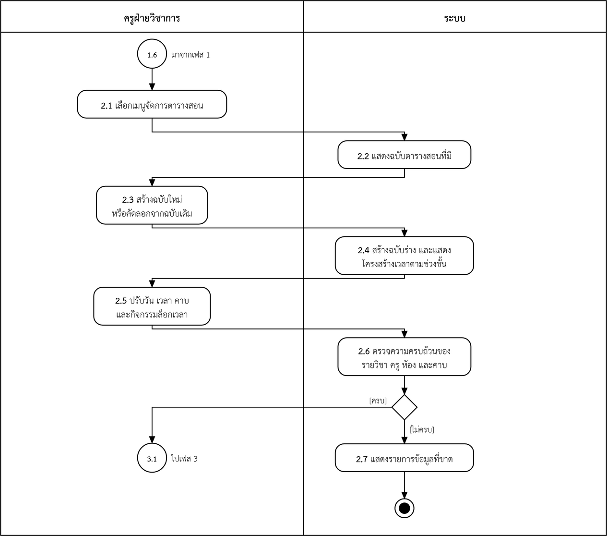 

***รูปที่** 3**.**13 Activity Diagram ระบบจัดตารางสอน เฟส 2 เตรียมฉบับตารางสอน*

รูปที่ 3.14 แสดงระบบจัดตารางสอน เฟส 3 จัดตารางสอน (UC-5, 6, 7) ครูฝ่ายวิชาการเลือกวิธีจัดตาราง (3.1) ได้ 3 วิธี คือ วางรายวิชาและครูลงคาบด้วยตนเอง (3.2) ใช้เงื่อนไขมาตรฐาน (3.3) หรือกำหนดเงื่อนไขเอง เช่น ช่วงเช้า คาบคู่ และห้องเฉพาะทาง (3.4) สองวิธีหลังระบบจัดตารางอัตโนมัติเป็นงานเบื้องหลัง โดยใช้เงื่อนไข Hard ก่อน Soft (3.5) ถ้าวางได้ไม่ครบ ระบบแสดงรายการที่วางไม่ได้พร้อมเหตุผล (3.6) ทุกวิธีจบที่ระบบแสดงตารางฉบับร่าง (3.7) แล้วไปเฟส 4 ขั้นตอนของการจัดอัตโนมัติอยู่ในหัวข้อ 3.5.1

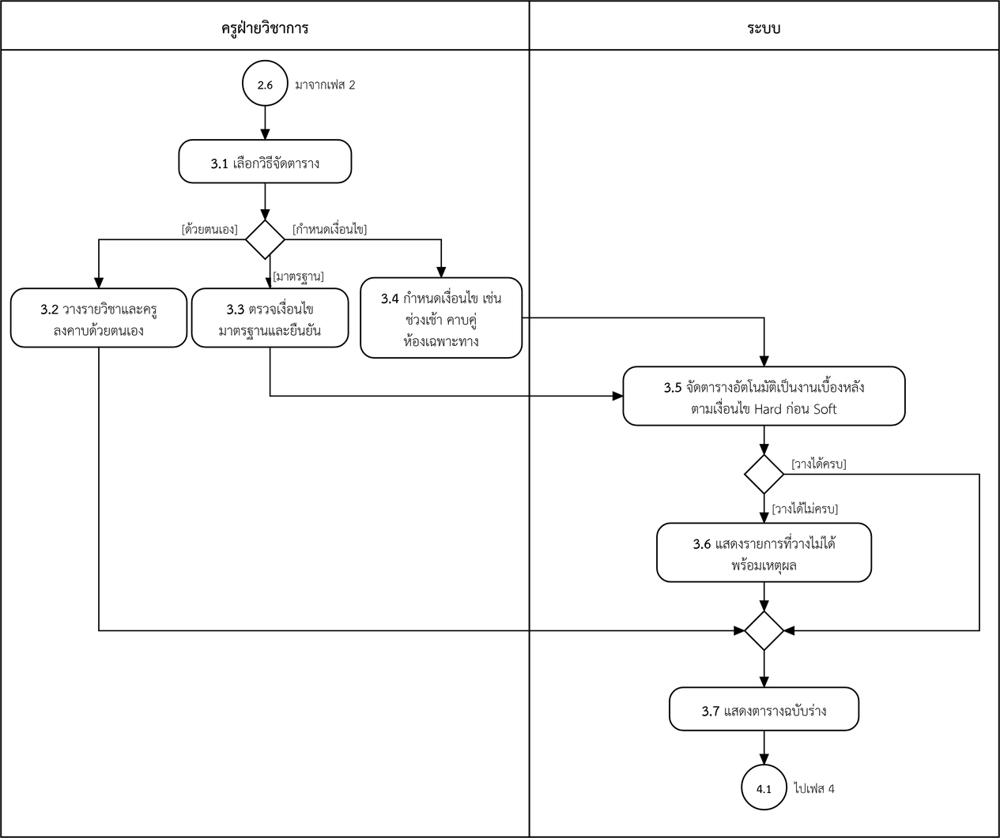 

***รูปที่** 3**.**14 Activity Diagram ระบบจัดตารางสอน เฟส 3 จัดตารางสอน*

รูปที่ 3.15 แสดงระบบจัดตารางสอน เฟส 4 ตรวจสอบการชนกัน (UC-8) ระบบดึงคาบของครู ห้องเรียน และห้องที่ใช้ในเวลาเดียวกัน (4.1) แล้วเปรียบเทียบด้วยเวลาจริงตามนาฬิกา (4.2) ถ้าพบ Conflict ระบบทำเครื่องหมายคาบที่ชนและแจ้งเตือน (4.3) ครูฝ่ายวิชาการย้าย สลับ หรือเปลี่ยนครูหรือห้องเรียน (4.4) แล้วระบบตรวจใหม่ตั้งแต่ขั้นตอน 4.1 ถ้าไม่พบ Conflict ระบบแสดงคำเตือนที่ยังบันทึกได้ (4.5) ครูฝ่ายวิชาการบันทึกตารางฉบับร่าง (4.6) แล้วไปเฟส 5

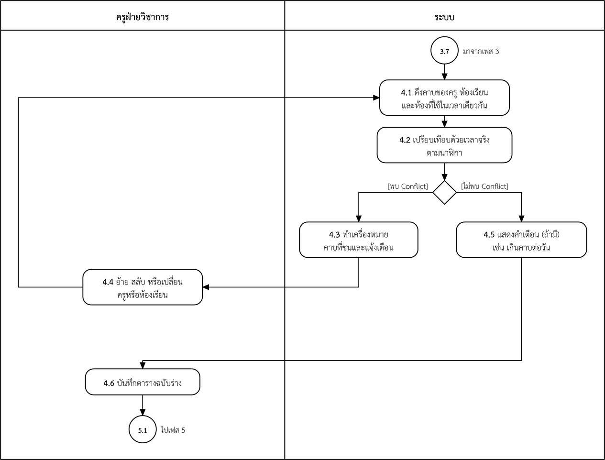 

***รูปที่** 3**.**15 Activity Diagram ระบบจัดตารางสอน เฟส 4 ตรวจสอบการชนกัน*

รูปที่ 3.16 แสดงระบบจัดตารางสอน เฟส 5 เผยแพร่ตารางสอน (UC-9, 10) ระบบแสดงตัวอย่างตาราง 3 มุมมอง คือ ห้อง ครู และนักเรียน (5.1) ครูฝ่ายวิชาการตรวจตารางและกดเผยแพร่ (5.2) ถ้ายังมี Conflict ต้องกลับไปแก้ที่เฟส 4 ถ้าไม่มี ระบบเปลี่ยนเป็นฉบับเผยแพร่ และเปลี่ยนฉบับเดิมเป็นฉบับเก่า (5.3) ระบบบันทึกประวัติและแจ้งเตือนครูผู้สอน (5.4) ครูผู้สอนดูตารางสอนของตนเองแบบรายวันหรือรายสัปดาห์ (5.5) ถ้าต้องการเปลี่ยนคาบ ไปเฟส 6

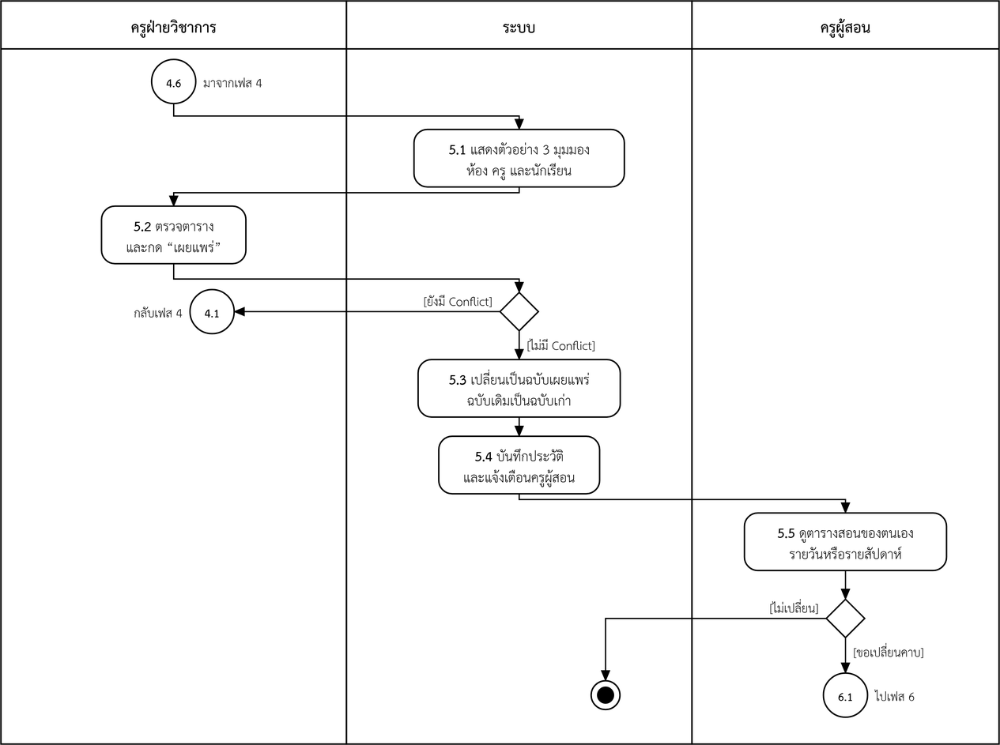 

***รูปที่** 3**.**16 Activity Diagram ระบบจัดตารางสอน เฟส 5 เผยแพร่ตารางสอน*

รูปที่ 3.17 แสดงระบบจัดตารางสอน เฟส 6 คำร้องขอเปลี่ยนการจัดตารางสอน (UC-21) ครูผู้สอนเลือกคาบและกดยื่นคำร้อง (6.1) ระบบแสดงประเภทคำร้องและเป้าหมายที่ไม่ชนกัน (6.2) ครูผู้สอนเลือกเป้าหมาย เหตุผล และหมายเหตุ (6.3) ระบบบันทึกคำร้องในสถานะรออนุมัติและแจ้งครูฝ่ายวิชาการ (6.4) ครูฝ่ายวิชาการดูตารางก่อนและหลังการเปลี่ยน (6.5) ถ้าอนุมัติ ระบบตรวจการชนของเป้าหมาย (6.6) ถ้าชนกัน ครูฝ่ายวิชาการต้องเลือกเป้าหมายใหม่ ถ้าไม่ชน ระบบสร้างฉบับเผยแพร่ใหม่ (6.8) ถ้าไม่อนุมัติ ครูฝ่ายวิชาการกรอกหมายเหตุ (6.7) จากนั้นระบบบันทึกประวัติและแจ้งเตือนครูผู้ยื่น (6.9) ครูผู้สอนยกเลิกคำร้องที่ยังรออนุมัติได้

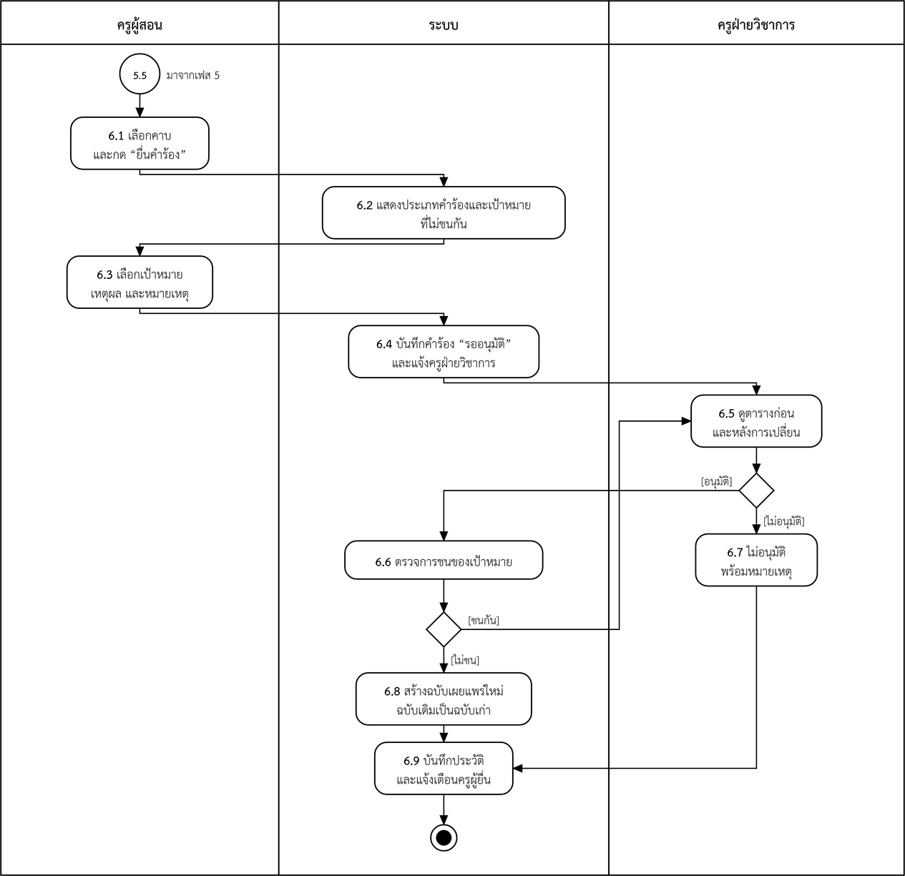 

***รูปที่** 3**.**17 Activity Diagram ระบบจัดตารางสอน เฟส 6 คำร้องขอเปลี่ยนการจัดตารางสอน*

#### ระบบเช็คชื่อ

รูปที่ 3.18 แสดงระบบเช็คชื่อ เฟส 1 เช็คชื่อนักเรียนรายคาบ (UC-23) ครูผู้สอนเลือกเมนูคาบวันนี้ (1.1) ระบบแสดงคาบวันนี้และคาบที่ยังไม่เช็ค โดยไม่รวมวันหยุดของโรงเรียน (1.2) ครูผู้สอนเลือกคาบ (1.3) ถ้าห้องนั้นส่งผลการเรียนแล้ว ระบบแจ้งว่าการเช็คชื่อถูกล็อก (1.4) ครูต้องขอปลดล็อกในระบบบันทึกคะแนน เฟส 6 ถ้ายังไม่ส่งผล คาบวันนี้ระบบตั้งค่าเริ่มต้นเป็นมาทุกคน (1.5) คาบย้อนหลังครูเลือกข้อมูลเริ่มต้นเอง (1.6) จากนั้นครูเปลี่ยนสถานะ สาย ลา ขาด แล้วกดบันทึก (1.7) ระบบบันทึกสถานะการเข้าเรียน (1.8) แล้วไปเฟส 3

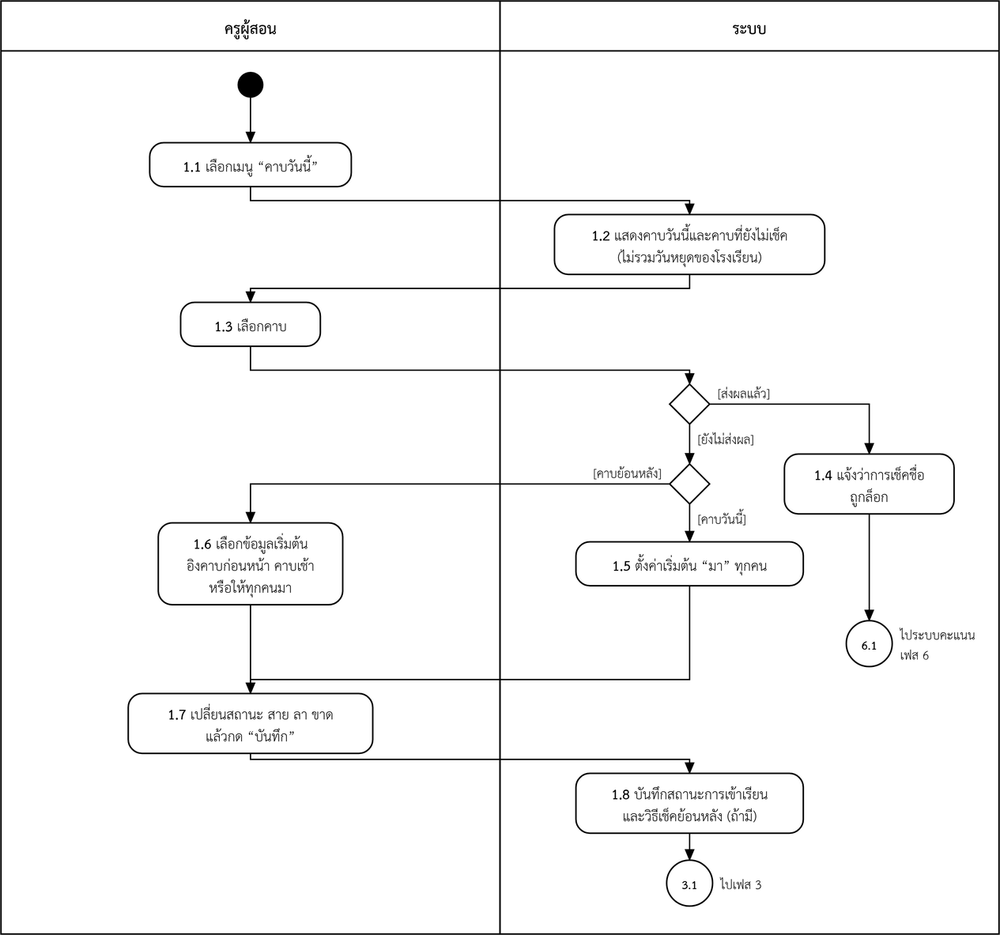 

***รูปที่** 3**.**18 Activity Diagram ระบบเช็คชื่อ เฟส 1 เช็คชื่อนักเรียนรายคาบ*

รูปที่ 3.19 แสดงระบบเช็คชื่อ เฟส 2 แก้ไขการเช็คชื่อที่บันทึกแล้ว (UC-23) ครูผู้สอนเลือกคาบที่เช็คชื่อแล้วและแก้สถานะ (2.1) ถ้าเปลี่ยนจากขาดเป็นมา ระบบขอการยืนยันและเหตุผลอย่างน้อย 10 ตัวอักษร (2.2) ครูยืนยันและกรอกเหตุผล หรือยกเลิก (2.3) ถ้ายกเลิก สถานะยังเป็นขาด (2.4) จากนั้นครูกดบันทึก (2.5) ระบบบันทึกประวัติการแก้ไขพร้อมเหตุผล (2.6) แล้วไปเฟส 3

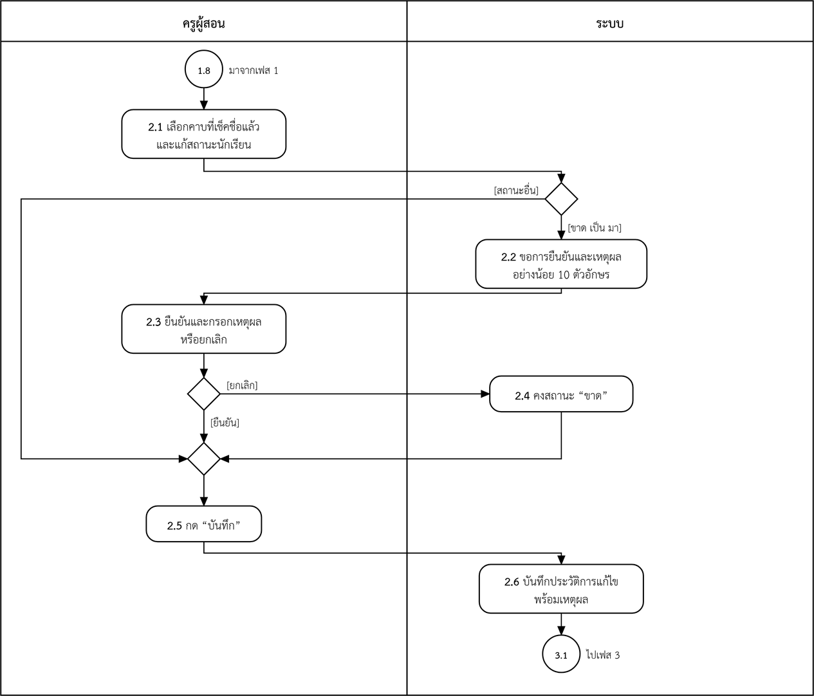 

***รูปที่** 3**.**19 Activity Diagram ระบบเช็คชื่อ เฟส 2 แก้ไขการเช็คชื่อที่บันทึกแล้ว*

รูปที่ 3.20 แสดงระบบเช็คชื่อ เฟส 3 ตรวจสอบเวลาเรียนและผู้ไม่มีสิทธิ์สอบ (UC-24) ระบบคำนวณเวลาเรียนจากจำนวนคาบที่มาและสาย หารด้วยจำนวนคาบที่เช็คแล้ว (3.1) แล้วจัดนักเรียนที่ต่ำกว่าร้อยละ 80 เป็น มส หรือจัดเป็นกลุ่มเสี่ยง (3.2) ครูผู้สอนดูเวลาเรียนและคาบที่ขาดได้อีกของห้องที่สอน (3.3) ครูประจำชั้นดูการเข้าเรียนของห้องประจำชั้นได้อย่างเดียว (3.4) สองขั้นตอนนี้ทำได้พร้อมกัน ถ้ามีนักเรียนเป็น มส ไปเฟส 4

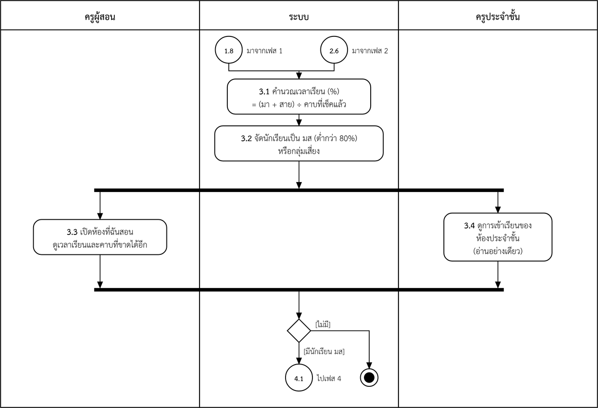 

***รูปที่** 3**.**20 Activity Diagram ระบบเช็คชื่อ เฟส 3 ตรวจสอบเวลาเรียนและผู้ไม่มีสิทธิ์สอบ*

รูปที่ 3.21 แสดงระบบเช็คชื่อ เฟส 4 ปลด มส (UC-24) ครูผู้สอนรับบันทึกอนุมัติจากผู้บริหารนอกระบบ แล้วเลือกนักเรียนที่เป็น มส (4.1) และกดปลด มส (4.2) ถ้าห้องส่งผลการเรียนแล้ว ระบบไม่ให้บันทึก (4.3) ครูต้องขอปลดล็อกก่อน ถ้ายังไม่ส่งผล ครูเลือกกรณี กรอกเลขที่บันทึกอนุมัติและเหตุผล (4.4) ระบบบันทึกการปลด มส โดยเวลาเรียนไม่เปลี่ยน (4.5) กรณีเหตุสุดวิสัย ระบบตัดสินผลตามปกติ (4.6) กรณีเรียนชดเชย ระดับผลการเรียนไม่เกิน 1 (4.7) จากนั้นระบบบันทึกประวัติการแก้ไข (4.8)

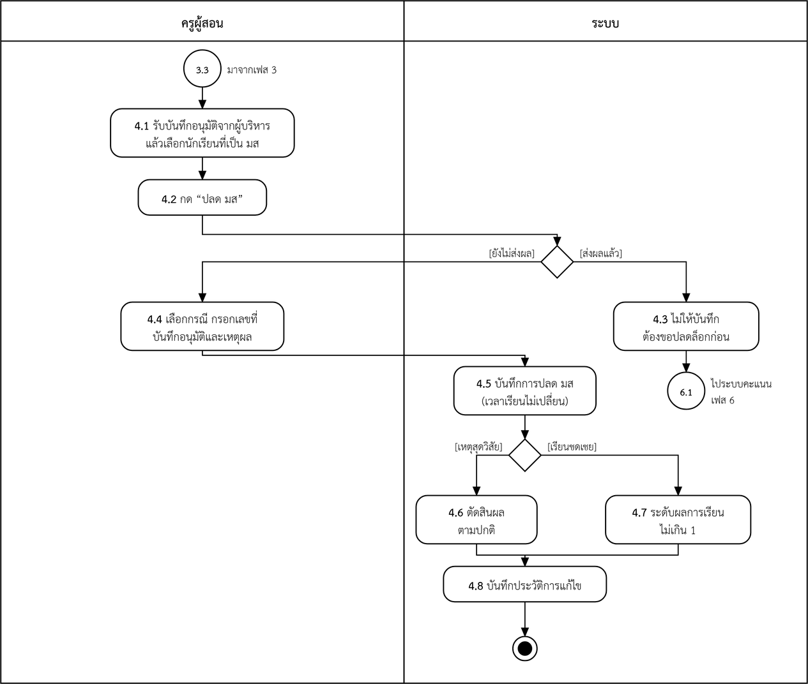 

***รูปที่** 3**.**21 Activity Diagram ระบบเช็คชื่อ เฟส 4 ปลด มส*

#### ระบบบันทึกคะแนน

รูปที่ 3.22 แสดงระบบบันทึกคะแนน เฟส 1 กำหนดโครงสร้างคะแนน (UC-11) ครูผู้สอนเลือกห้องเรียนที่สอน (1.1) ระบบแสดงโครงสร้างคะแนน ถ้ายังไม่ตั้ง ระบบใช้โครงสร้างตั้งต้นของรายวิชา (1.2) ครูกำหนดองค์ประกอบ คะแนนเต็ม สัดส่วน และตัวชี้วัด (1.3) แล้วกดบันทึก (1.4) ระบบตรวจว่าสัดส่วนรวมเท่ากับร้อยละ 100 (1.5) ถ้าไม่ครบ ระบบแจ้งเตือนและไม่บันทึก (1.6) ถ้าครบ ระบบบันทึกโครงสร้างคะแนนและเปลี่ยนสถานะเป็นกำลังบันทึก (1.7) แล้วไปเฟส 2

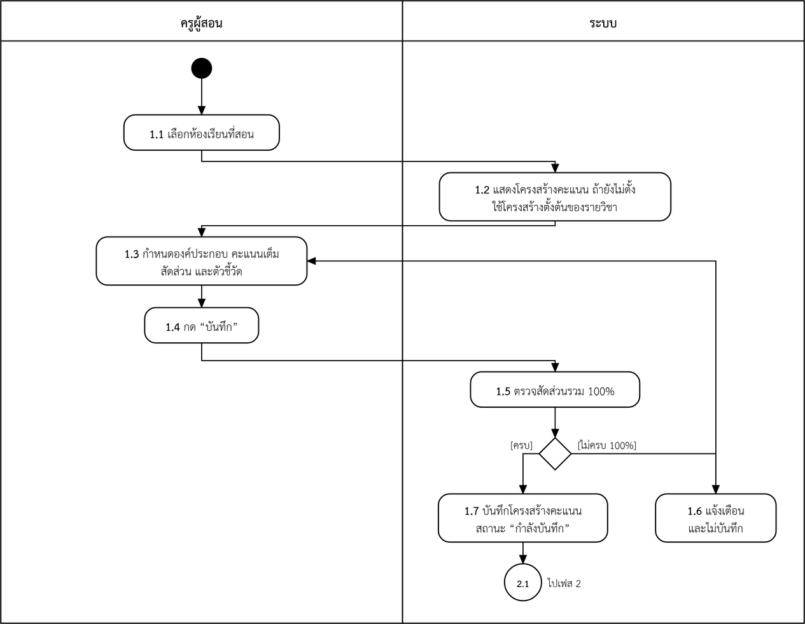 

***รูปที่** 3**.**22 Activity Diagram ระบบบันทึกคะแนน เฟส 1 กำหนดโครงสร้างคะแนน*

รูปที่ 3.23 แสดงระบบบันทึกคะแนน เฟส 2 บันทึกคะแนนและคุณลักษณะฯ (UC-12, 25) ครูผู้สอนเลือกองค์ประกอบคะแนน (2.1) ระบบแสดงรายชื่อนักเรียนและช่องคะแนน (2.2) ครูกรอกคะแนนเองหรือระบุ ร หรือ ข (2.3) หรือนำเข้าคะแนนจากไฟล์ Excel หรือ CSV (2.4) ระบบตรวจว่าคะแนนเป็นตัวเลขตั้งแต่ 0 ถึงคะแนนเต็ม (2.5) ถ้าไม่ถูกต้อง ครูแก้ที่ขั้นตอน 2.3 ถ้าถูกต้อง ระบบบันทึกคะแนนและประวัติการแก้ไข (2.6) ครูประเมินคุณลักษณะอันพึงประสงค์ และการอ่าน คิดวิเคราะห์ และเขียน (2.7) ระบบบันทึกผลประเมินและสรุประดับรายคน (2.8) แล้วไปเฟส 3

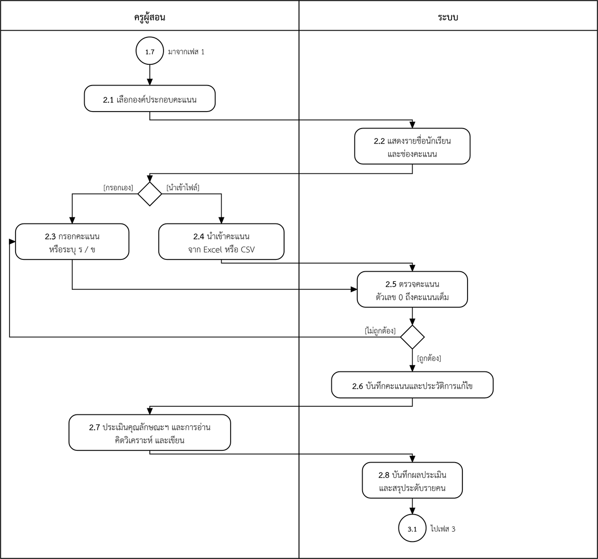 

***รูปที่** 3**.**23 Activity Diagram ระบบบันทึกคะแนน เฟส 2 บันทึกคะแนนและคุณลักษณะฯ*

รูปที่ 3.24 แสดงระบบบันทึกคะแนน เฟส 3 คำนวณผลการเรียน (UC-13, 14, 15) ระบบดึงคะแนนทุกองค์ประกอบ เวลาเรียน และผลสอบซ่อม (3.1) แล้วตัดสินผลตามลำดับในรูปที่ 3.42 (3.2) นักเรียนที่ได้ระดับ 0 มีสถานะมีสิทธิ์สอบซ่อม (3.3) นักเรียนคนอื่นมีสถานะผ่าน มส หรือ ร (3.4) ระบบบันทึกผลการเรียนและเวลาที่คำนวณ (3.5) ครูผู้สอนตรวจผลการเรียนของนักเรียนทุกคน (3.6) ถ้าต้องแก้คะแนน กลับไปเฟส 2 ถ้าถูกต้อง ไปเฟส 4

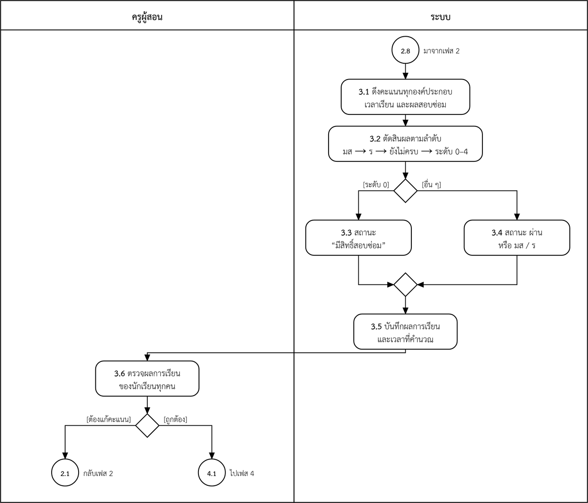 

***รูปที่** 3**.**24 Activity Diagram ระบบบันทึกคะแนน เฟส 3 คำนวณผลการเรียน*

รูปที่ 3.25 แสดงระบบบันทึกคะแนน เฟส 4 ส่งและตรวจผลการเรียน (UC-17, 18) ครูผู้สอนเลือกผลการเรียนและส่งผล (4.1) ระบบแสดงรายการตรวจก่อนส่ง (4.2) ถ้าคะแนนไม่ครบ ต้องกลับไปเฟส 2 ถ้าครบ ครูกดส่งผลการเรียนและยืนยัน (4.3) ระบบล็อกข้อมูล เปลี่ยนสถานะเป็นรอตรวจ และบันทึกรอบการส่ง (4.4) ครูฝ่ายวิชาการเปิดกล่องงานและตรวจผล (4.5) ถ้าอนุมัติ ระบบเปลี่ยนสถานะเป็นอนุมัติแล้ว (4.6) ถ้าตีกลับ ครูฝ่ายวิชาการปักหมุดข้อสังเกตและกรอกเหตุผล (4.7) ระบบปลดล็อกและเปลี่ยนสถานะเป็นกำลังบันทึก (4.8) ครูผู้สอนแก้ไขที่เฟส 2 แล้วส่งใหม่

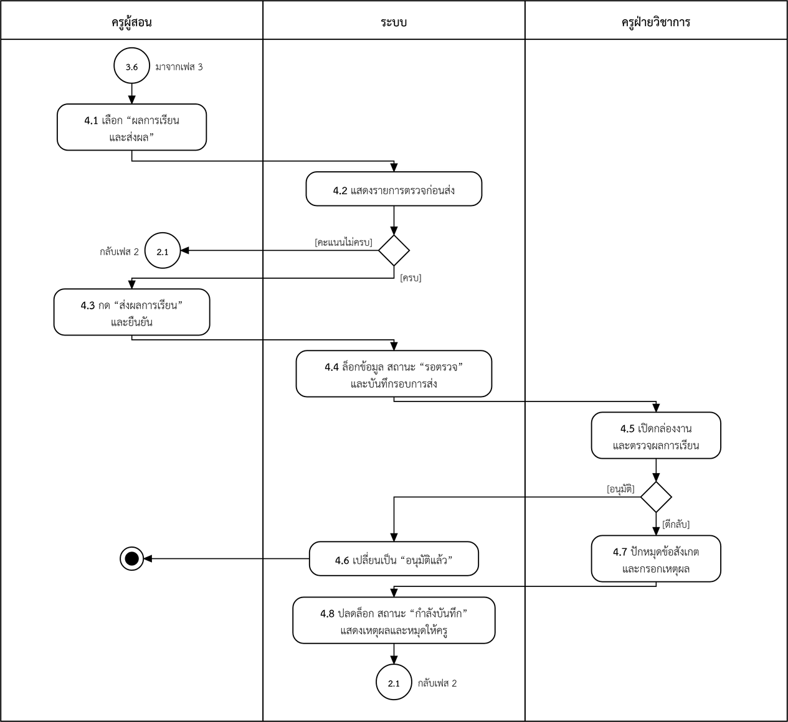 

***รูปที่** 3**.**25 Activity Diagram ระบบบันทึกคะแนน เฟส 4 ส่งและตรวจผลการเรียน*

รูปที่ 3.26 แสดงระบบบันทึกคะแนน เฟส 5 บันทึกผลสอบซ่อม (UC-20) ครูผู้สอนเลือกเมนูบันทึกผลสอบซ่อม (5.1) ถ้าห้องอยู่ระหว่างรอตรวจ ระบบแจ้งว่าบันทึกไม่ได้ (5.2) ถ้าบันทึกได้ ระบบแสดงนักเรียนที่ได้ระดับ 0 และผลสอบซ่อมครั้งก่อน (5.3) ครูเลือกนักเรียน กรอกวันที่สอบและคะแนนเป็นร้อยละ (5.4) ระบบบันทึกผลเป็นครั้งที่ 1 หรือ 2 (5.5) ถ้าได้ร้อยละ 50 ขึ้นไป ระบบกำหนดระดับผลการเรียนเป็น 1 (5.6) ถ้าครั้งที่ 1 ไม่ผ่าน ครูบันทึกครั้งที่ 2 ได้ ถ้าครั้งที่ 2 ไม่ผ่าน ระบบคงระดับ 0 และนักเรียนต้องเรียนซ้ำ (5.7) ทุกกรณีระบบบันทึกประวัติการแก้ไข (5.8)

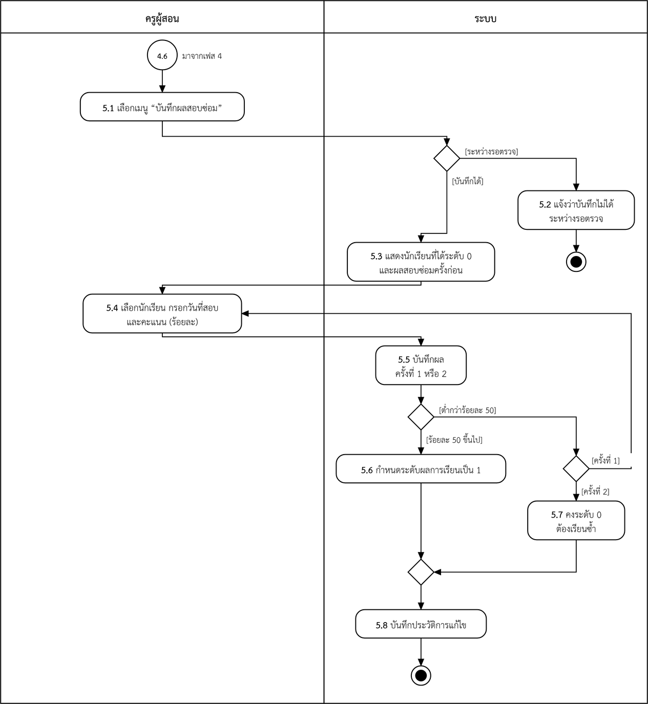 

***รูปที่** 3**.**26 Activity Diagram ระบบบันทึกคะแนน เฟส 5 บันทึกผลสอบซ่อม*

รูปที่ 3.27 แสดงระบบบันทึกคะแนน เฟส 6 ขอปลดล็อกผลการเรียน (UC-19) ครูผู้สอนเปิดห้องเรียนที่สอนที่ถูกล็อก (6.1) กดขอปลดล็อกและกรอกเหตุผล (6.2) ระบบสร้างคำขอและติดป้าย โดยสถานะเดิมยังคงอยู่ (6.3) ครูฝ่ายวิชาการเปิดคำขอในกล่องงาน (6.4) ถ้าอนุมัติ ระบบปลดล็อกและเปลี่ยนสถานะเป็นกำลังบันทึก (6.5) ครูผู้สอนแก้ไขได้ที่เฟส 2 ถ้าไม่อนุมัติ ครูฝ่ายวิชาการกรอกเหตุผล (6.6) ระบบคงสถานะเดิมและแสดงเหตุผลให้ครูผู้สอนเห็น (6.7)

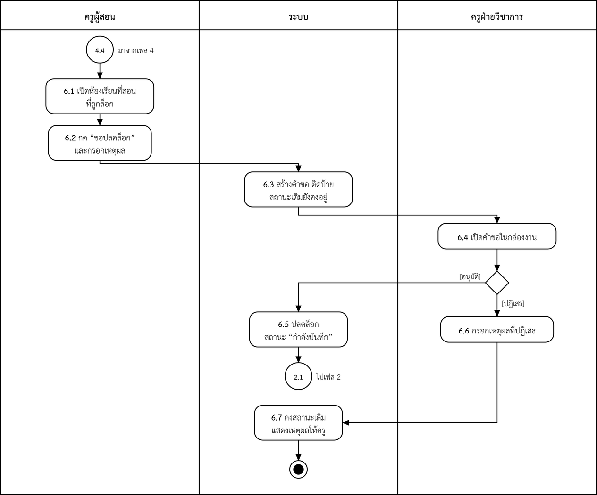 

***รูปที่** 3**.**27 Activity Diagram ระบบบันทึกคะแนน เฟส 6 ขอปลดล็อกผลการเรียน*

รูปที่ 3.28 แสดงระบบบันทึกคะแนน เฟส 7 จัดการชุมนุมและบันทึกผลกิจกรรม (UC-26) ครูฝ่ายวิชาการสร้างชุมนุม และกำหนดประเภท รายวิชากิจกรรม ครูที่ปรึกษา และจำนวนรับ (7.1) ระบบบันทึกชุมนุม (7.2) ครูผู้สอนที่เป็นครูที่ปรึกษาเพิ่มนักเรียนเป็นสมาชิก (7.3) ระบบตรวจจำนวนรับและประเภทชุมนุมซ้ำ (7.4) ถ้าเกินหรือซ้ำ ระบบไม่เพิ่มสมาชิก ถ้าผ่าน ระบบบันทึกสมาชิก (7.5) เมื่อสิ้นภาคเรียน ครูที่ปรึกษากรอกเวลาเข้าร่วมและผล ผ หรือ มผ (7.6) ระบบบันทึกผลกิจกรรม (7.7) แล้วส่งผลตามเฟส 4

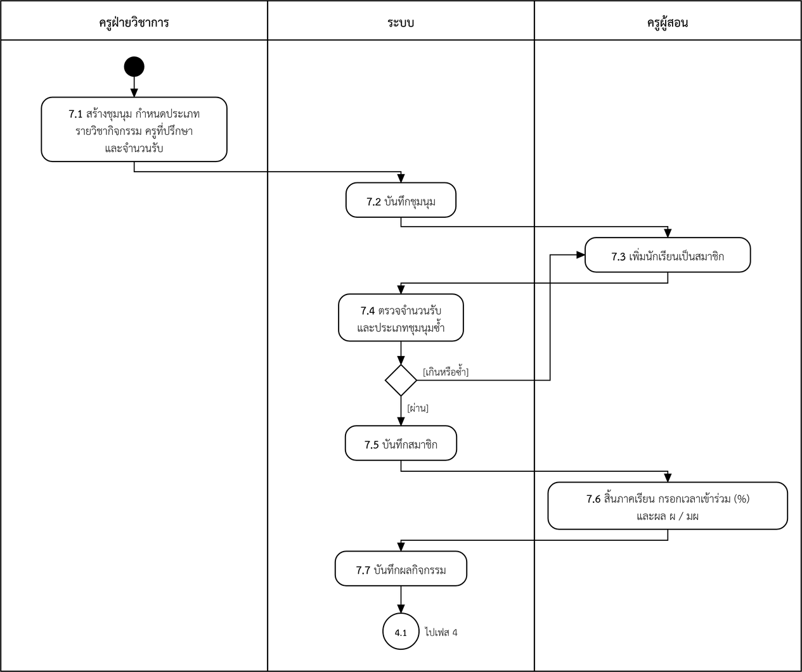 

***รูปที่** 3**.**28 Activity Diagram ระบบบันทึกคะแนน เฟส 7 จัดการชุมนุมและบันทึกผลกิจกรรม*

#### ระบบออกรายงาน

รูปที่ 3.29 แสดงระบบออกรายงาน เฟส 1 ดูรายงานวิชาการ (UC-16) ครูผู้สอนหรือครูฝ่ายวิชาการเลือกเมนูรายงานวิชาการ (1.1) ระบบตรวจบทบาทและแสดงประเภทรายงานที่มีสิทธิ์ (1.2) ผู้ใช้เลือกประเภทรายงานและเงื่อนไข (1.3) ระบบรวบรวมข้อมูลตามเงื่อนไข โดยครูผู้สอนเห็นเฉพาะห้องที่สอน (1.4) ถ้าไม่พบข้อมูล ผู้ใช้เปลี่ยนเงื่อนไขที่ขั้นตอน 1.3 ถ้าพบ ระบบแสดงรายงานเป็นตารางหรือสรุปข้อมูล (1.5) ผู้ใช้ค้นหา กรอง หรือดูรายละเอียดรายคนได้ (1.6)

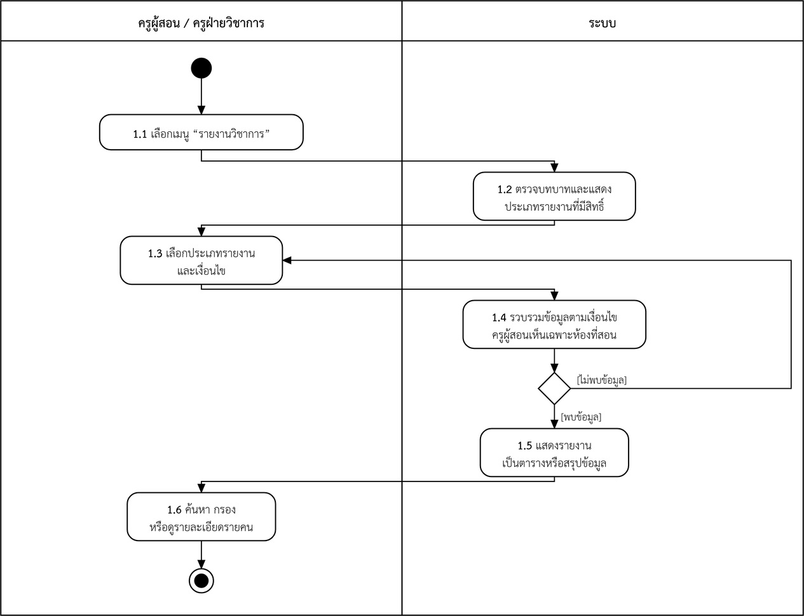 

***รูปที่** 3**.**29 Activity Diagram ระบบออกรายงาน เฟส 1 ดูรายงานวิชาการ*

รูปที่ 3.30 แสดงระบบออกรายงาน เฟส 2 ดูข้อมูลหลักสูตรและรายวิชา (UC-1) ครูผู้สอนหรือครูฝ่ายวิชาการเลือกเมนูหลักสูตรและรายวิชา (2.1) ระบบแสดงหลักสูตรและรายวิชาของปีการศึกษาล่าสุด (2.2) ผู้ใช้เลือกปีการศึกษา ระดับชั้น และกลุ่มสาระ (2.3) ระบบค้นหาตามเงื่อนไข ถ้าไม่เลือกเงื่อนไข ระบบแสดงทั้งหมดที่ผู้ใช้มีสิทธิ์ (2.4) ถ้าไม่พบข้อมูล ผู้ใช้เปลี่ยนเงื่อนไขที่ขั้นตอน 2.3 ถ้าพบ ระบบแสดงรายการที่ตรงเงื่อนไข (2.5) ผู้ใช้เลือกรายการที่ต้องการดู (2.6) ระบบแสดงรหัสวิชา ชื่อวิชา กลุ่มสาระ หน่วยกิต และจำนวนคาบ (2.7)

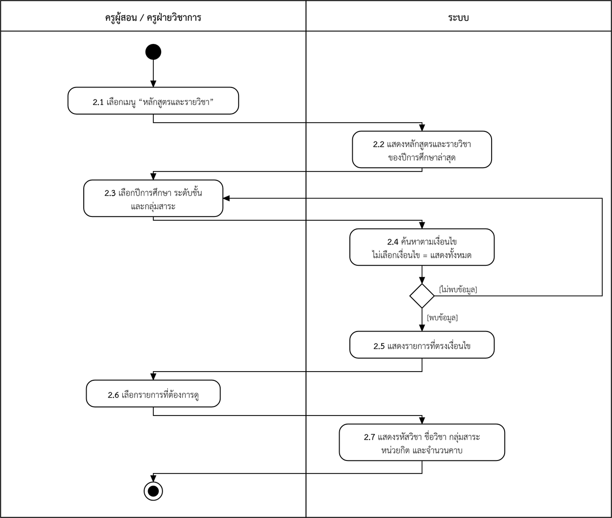 

***รูปที่** 3**.**30 Activity Diagram ระบบออกรายงาน เฟส 2 ดูข้อมูลหลักสูตรและรายวิชา*

### State Diagram

*รูปที่ 3.31 ถึงรูปที่ 3.34 แสดง State Diagram ของข้อมูล 4 ชนิดที่มีวงจรสถานะ ได้แก่ ผลการเรียนของห้องเรียนที่สอน ฉบับตารางสอน คำร้องขอเปลี่ยนการจัดตารางสอน และหลักสูตร กล่องสถานะแต่ละกล่องแสดงชื่อสถานะ*

รูปที่ 3.31 แสดงสถานะผลการเรียนของห้องเรียนที่สอน ห้องเรียนที่สอนเริ่มที่สถานะยังไม่ตั้งโครงสร้างคะแนน และเปลี่ยนเป็นกำลังบันทึกเมื่อครูผู้สอนกำหนดองค์ประกอบคะแนนครบร้อยละ 100 ส่วนชุมนุมไม่มีโครงสร้างคะแนนจึงเริ่มที่สถานะกำลังบันทึก เมื่อครูผู้สอนส่งผลการเรียน ระบบล็อกคะแนน ข้อมูลการเช็คชื่อ และการปลด มส ของห้องนั้น จนกว่าครูฝ่ายวิชาการจะตีกลับหรืออนุมัติคำขอปลดล็อก การตีกลับไม่ได้เป็นสถานะแยก แต่เป็นการกลับไปสถานะกำลังบันทึกพร้อมเหตุผลและหมุดข้อสังเกต หากครูฝ่ายวิชาการไม่อนุมัติคำขอปลดล็อก สถานะเดิมยังคงอยู่ และการเปลี่ยนสถานะทุกครั้งถูกบันทึกเป็นประวัติการส่งผลการเรียน

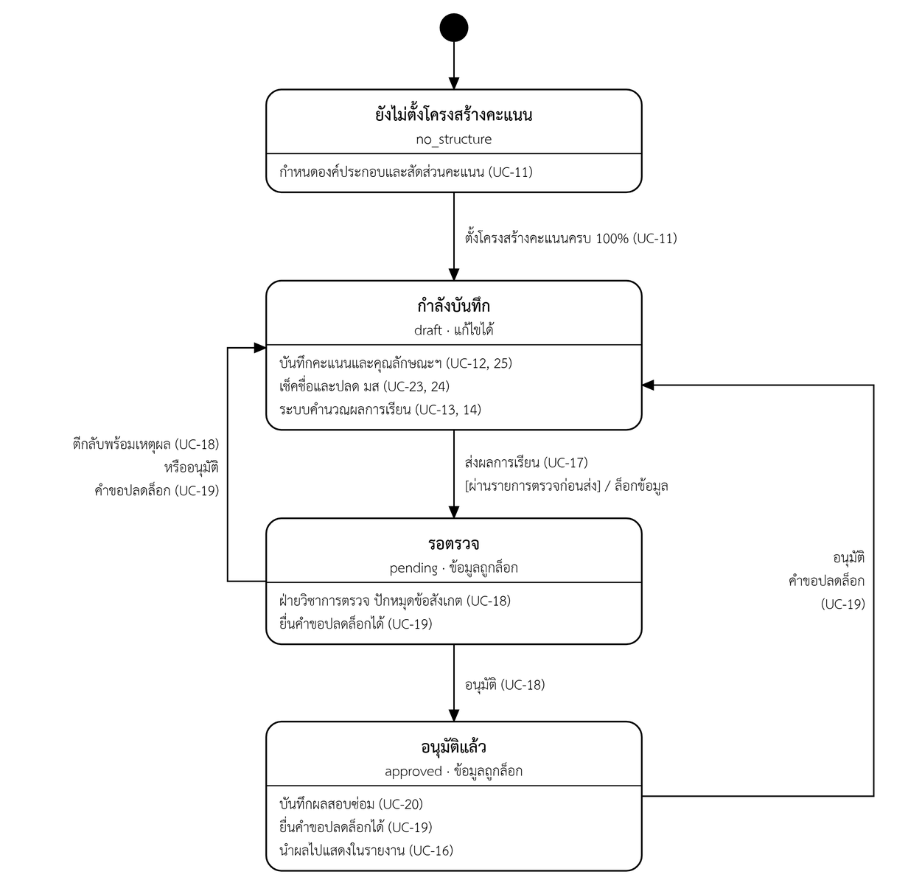 

***รูปที่** 3**.**31 State Diagram สถานะผลการเรียนของห้องเรียนที่สอน*

รูปที่ 3.32 แสดงสถานะของฉบับตารางสอน ครูฝ่ายวิชาการจัดตารางและตรวจสอบการชนกันได้เฉพาะในฉบับร่าง และเผยแพร่ได้เมื่อไม่มี Conflict ระดับ error ฉบับเผยแพร่แก้ไขไม่ได้ การเปลี่ยนแปลงทำได้ 2 ทาง คือ คัดลอกเป็นฉบับร่างใหม่แล้วเผยแพร่แทน หรืออนุมัติคำร้องของครูซึ่งระบบสร้างฉบับเผยแพร่ใหม่ให้ทันที ทั้งสองทางทำให้ฉบับเดิมเปลี่ยนเป็นฉบับเก่า เพราะหนึ่งภาคเรียนมีฉบับเผยแพร่ได้ทีละหนึ่งฉบับ

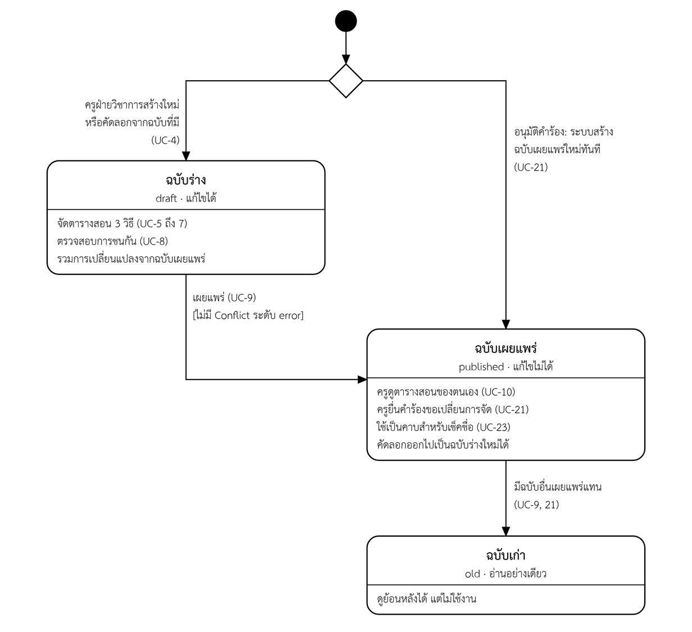 

***รูปที่** 3**.**32 State Diagram สถานะฉบับตารางสอน*

รูปที่ 3.33 แสดงสถานะคำร้องขอเปลี่ยนการจัดตารางสอน คำร้องที่ครูผู้สอนยื่นอยู่ในสถานะรออนุมัติ ครูฝ่ายวิชาการเลือกอนุมัติ อนุมัติพร้อมแก้ไขโดยเลือกวัน คาบ หรือห้องอื่นแทน หรือไม่อนุมัติ โดยสองกรณีหลังต้องกรอกหมายเหตุ ครูผู้สอนยกเลิกคำร้องได้เฉพาะขณะที่ยังรออนุมัติ เมื่อคำร้องออกจากสถานะรออนุมัติแล้วจะไม่เปลี่ยนสถานะอีก ส่วนคำขอปลดล็อกผลการเรียน และเวลาไม่ว่างของครู ใช้วงจรสถานะแบบย่อของรูปนี้ คือ รออนุมัติ แล้วเปลี่ยนเป็นอนุมัติหรือไม่อนุมัติ

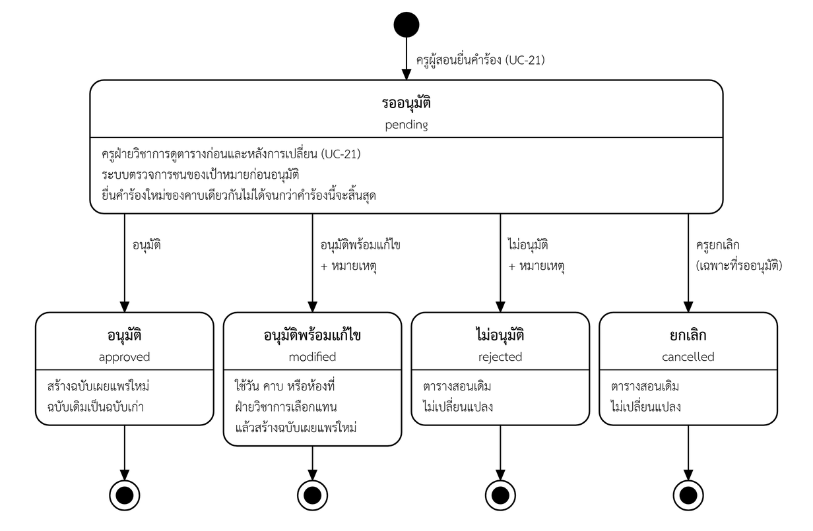 

***รูปที่** 3**.**33 State Diagram สถานะคำร้องขอเปลี่ยนการจัดตารางสอน*

รูปที่ 3.34 แสดงสถานะของหลักสูตรสถานศึกษา ครูฝ่ายวิชาการสร้างหลักสูตรใหม่หรือคัดลอกจากหลักสูตรเดิม หลักสูตรเริ่มที่สถานะฉบับร่าง ในสถานะนี้ครูฝ่ายวิชาการกำหนดแผนการเรียน รายวิชา และครูผู้สอน และลบหลักสูตรได้ เมื่อประกาศใช้ หลักสูตรเปลี่ยนเป็นสถานะใช้งานอยู่ และระบบปิดหลักสูตรเดิมของระดับเดียวกันให้อัตโนมัติ เพราะมัธยมศึกษาตอนต้นและมัธยมศึกษาตอนปลายใช้งานได้ระดับละหนึ่งหลักสูตร หลักสูตรที่ปิดใช้งานแล้วอ่านได้อย่างเดียว

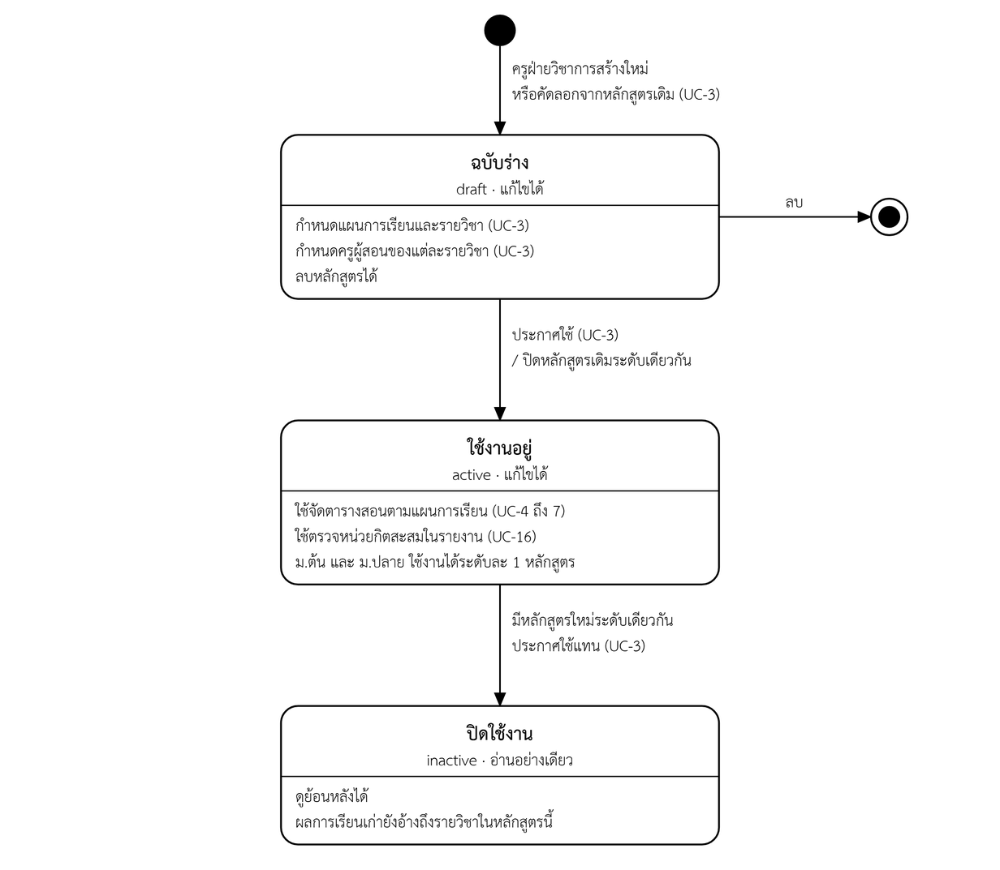 

***รูปที่** 3**.**34 State Diagram สถานะหลักสูตร*

## การออกแบบฐานข้อมูล

### Entity Relationship Diagram

ฐานข้อมูลของระบบออกแบบสำหรับ PostgreSQL ตารางทั้งหมดอยู่ใน schema academic และแบ่งเป็น 5 กลุ่มตาราง ได้แก่ กลุ่มข้อมูลหลักที่ใช้ร่วมกัน 1 กลุ่ม และกลุ่มของระบบย่อย 4 กลุ่ม ดังแสดงในรูปที่ 3.35 ระบบออกรายงานอ่านข้อมูลจากกลุ่มอื่นจึงไม่มีตารางของตนเอง ส่วนการจัดการบัญชีผู้ใช้ รหัสผ่าน และสิทธิ์การเข้าถึง อยู่ในระบบงานทะเบียนและ IAM (Service B) จึงมีเพียงตาราง app_user แบบย่อไว้เป็นปลายทางของ Foreign Key ตารางออกแบบตามหลัก 3NF ที่อธิบายในข้อ 2.2.7

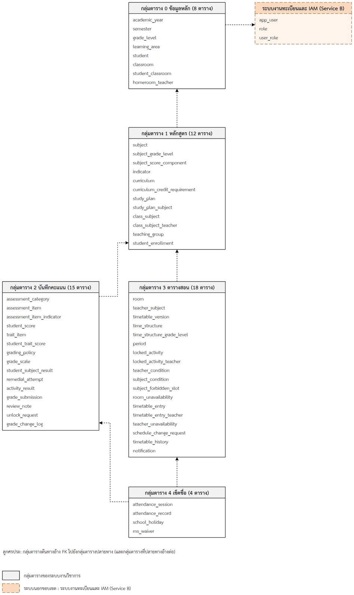 

***รูปที่ 3.35** ภาพรวมฐานข้อมูลแยกตามกลุ่มตาราง*

*รูปที่ 3.36 ถึงรูปที่ 3.40 แสดง Entity Relationship Diagram ของแต่ละกลุ่มตาราง ตารางสีขาวเป็นตารางในกลุ่มตารางนั้น ตารางสีเทาเส้นประเป็นตารางจากกลุ่มตารางอื่นที่นำมาแสดงความสัมพันธ์ และตารางสีส้มเป็นตารางของระบบงานทะเบียนและ IAM (Service B) ซึ่งอยู่นอกขอบเขตของโครงงาน*

กลุ่มตาราง 0 ข้อมูลหลักที่ใช้ร่วมกัน : ข้อมูลหลักที่ทุกระบบย่อยใช้ร่วมกัน ได้แก่ ปีการศึกษา ภาคเรียน ระดับชั้น กลุ่มสาระการเรียนรู้ ผู้ใช้ (แบบย่อ) นักเรียน ห้องเรียน และครูประจำชั้น

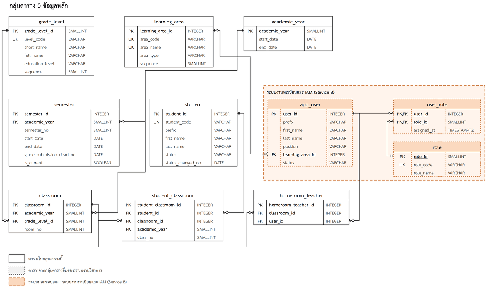 

***รูปที่ 3.36** Entity Relationship Diagram กลุ่มตาราง 0 ข้อมูลหลักที่ใช้ร่วมกัน*

กลุ่มตาราง 1 หลักสูตร : ข้อมูลรายวิชา โครงสร้างคะแนนตั้งต้น ตัวชี้วัด หลักสูตร แผนการเรียน ห้องเรียนที่สอนและครูผู้สอน ชุมนุม และหน่วยกิตขั้นต่ำตามหลักสูตร

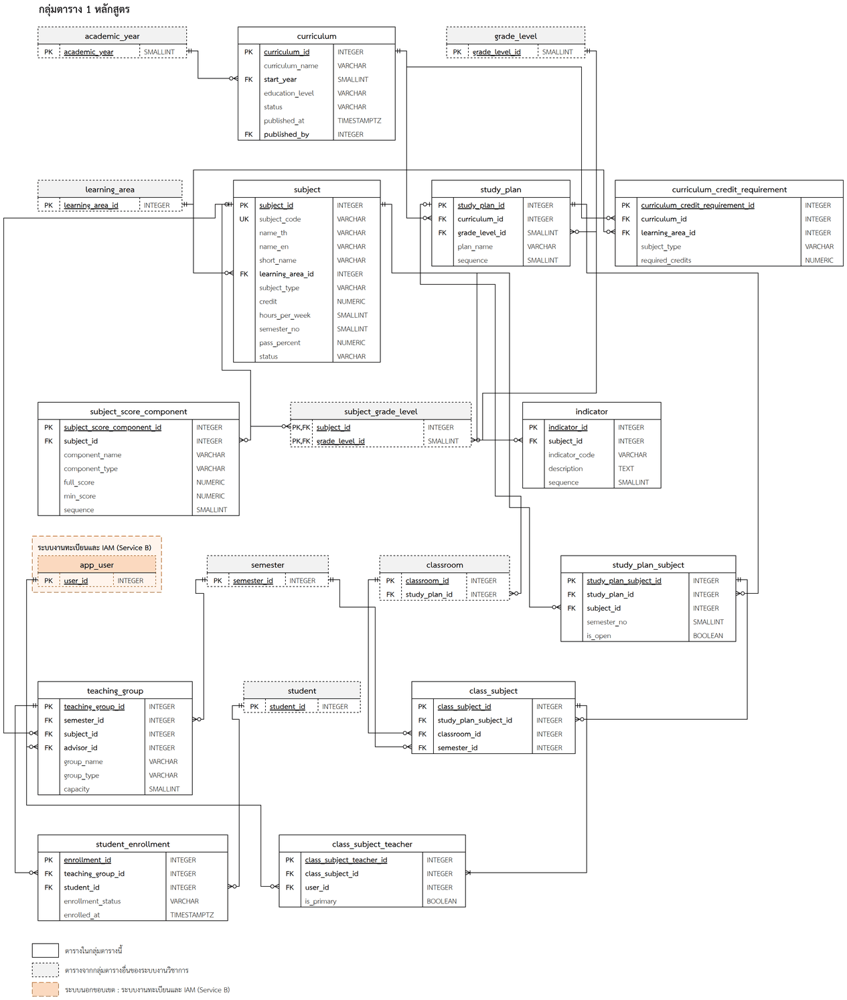 

***รูปที่ 3.37** Entity Relationship Diagram กลุ่มตาราง 1 หลักสูตร*

กลุ่มตาราง 2 บันทึกคะแนน : ข้อมูลโครงสร้างคะแนน คะแนนรายช่อง ผลประเมินคุณลักษณะอันพึงประสงค์ เกณฑ์การตัดสินผล ผลการเรียน การสอบซ่อม และการตรวจและอนุมัติผลการเรียน

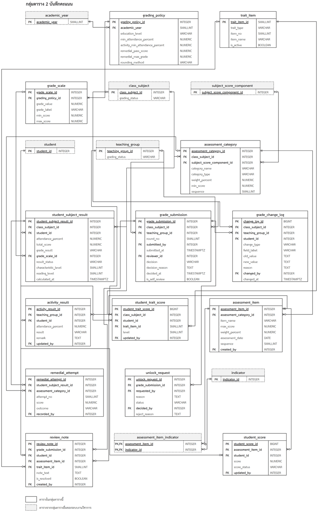 

***รูปที่ 3.38** Entity Relationship Diagram กลุ่มตาราง 2 บันทึกคะแนน*

กลุ่มตาราง 3 ตารางสอน : ข้อมูลห้อง วิชาที่ครูสอนได้ ฉบับตารางสอน โครงสร้างเวลา กิจกรรมล็อกเวลา เงื่อนไขการจัดตาราง คาบที่จัด เวลาไม่ว่างของครู คำร้องขอเปลี่ยน ประวัติ และการแจ้งเตือน

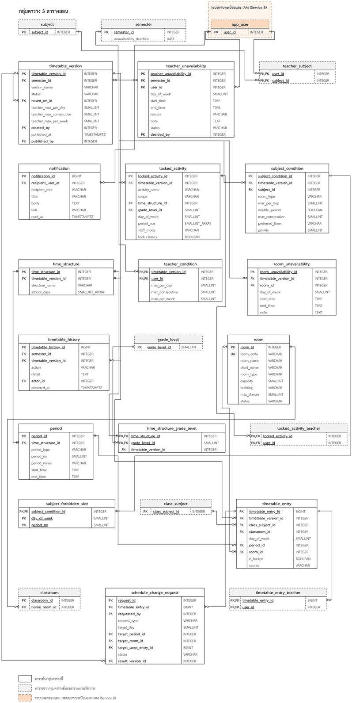 

***รูปที่ 3.39** Entity Relationship Diagram กลุ่มตาราง 3 ตารางสอน*

กลุ่มตาราง 4 เช็คชื่อ : ข้อมูลคาบที่เช็คชื่อแล้ว สถานะการเข้าเรียนของนักเรียน และวันหยุดของโรงเรียน และการปลด มส

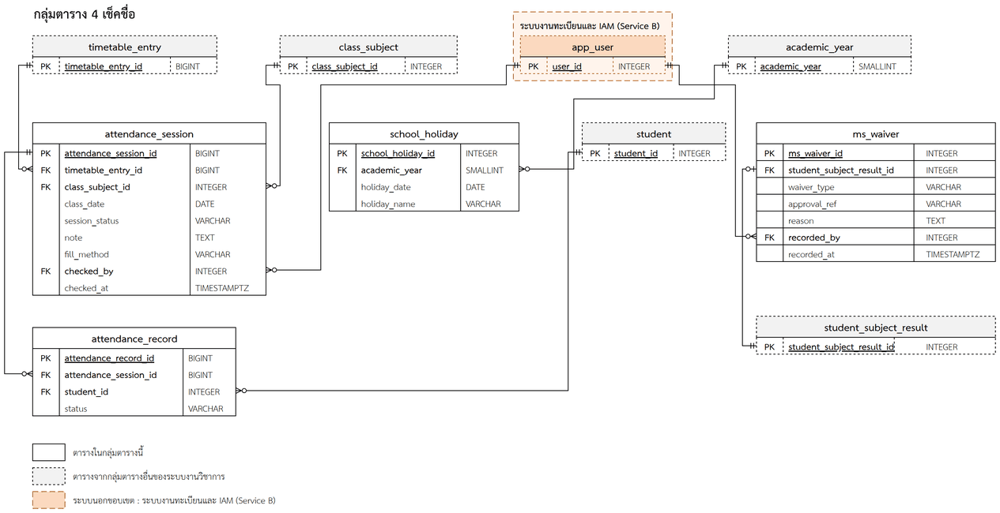 

***รูปที่ 3.40** Entity Relationship Diagram กลุ่มตาราง 4 เช็คชื่อ*

### Data Dictionary

พจนานุกรมข้อมูลของทั้ง 58 ตารางแสดงไว้ในภาคผนวก ข แยกตามกลุ่มตารางเหมือนกับ Entity Relationship Diagram ได้แก่ กลุ่มตาราง 0 ข้อมูลหลักที่ใช้ร่วมกัน ตารางที่ ข.1 ถึงตารางที่ ข.9 กลุ่มตาราง 1 หลักสูตร ตารางที่ ข.10 ถึงตารางที่ ข.21 กลุ่มตาราง 2 บันทึกคะแนน ตารางที่ ข.22 ถึงตารางที่ ข.36 กลุ่มตาราง 3 ตารางสอน ตารางที่ ข.37 ถึงตารางที่ ข.54 และกลุ่มตาราง 4 เช็คชื่อ ตารางที่ ข.55 ถึงตารางที่ ข.58

## การออกแบบการประมวลผลและกฎทางธุรกิจ

หัวข้อนี้อธิบายการประมวลผลหลักที่ระบบทำแทนผู้ใช้ 3 เรื่อง ได้แก่ การจัดตารางสอนอัตโนมัติ การตรวจสอบการชนกัน และการคำนวณผลการเรียน ซึ่งใน use case และ Activity Diagram ระบุเพียงว่าระบบเป็นผู้ดำเนินการ แต่ยังไม่ได้อธิบายวิธีการและเกณฑ์ที่ใช้

### การจัดตารางสอนอัตโนมัติ

การจัดตารางสอนเป็นปัญหาการจัดสรรครู ห้อง และช่วงเวลาให้แต่ละคาบเรียน เงื่อนไขแบ่งเป็น 2 ประเภท คือ เงื่อนไขบังคับ (Hard Constraint) ที่ตารางต้องไม่ละเมิด และเงื่อนไขที่ควรทำตาม (Soft Constraint) ที่ใช้วัดคุณภาพของตาราง ตารางที่ 3.4 สรุปเงื่อนไขที่ระบบใช้ การจัดตารางสอนอัตโนมัติ ใช้เฉพาะเงื่อนไขมาตรฐาน ส่วนการจัดตารางสอนอัตโนมัติแบบกำหนดเงื่อนไข เพิ่มเงื่อนไขที่ครูฝ่ายวิชาการกำหนดให้ครู รายวิชา และห้องเรียนแต่ละรายการ

***ตารางที่ 3.4** เงื่อนไขในการจัดตารางสอนอัตโนมัติ*

| เงื่อนไข | ประเภท | จัดอัตโนมัติ | แบบกำหนดเงื่อนไข |
| --- | --- | --- | --- |
| ครูคนเดียวกันไม่สอนซ้อนเวลากัน | Hard | ใช้ | ใช้ |
| ห้องเรียนเดียวกันไม่เรียนสองวิชาในเวลาเดียวกัน | Hard | ใช้ | ใช้ |
| ไม่ทับกิจกรรมล็อกเวลาของครูหรือของห้องเรียน | Hard | ใช้ | ใช้ |
| ห้องไม่ถูกใช้เกินจำนวนที่รองรับในเวลาเดียวกัน | Hard | ใช้ | ใช้ |
| ไม่ตรงกับเวลาไม่ว่างของครูที่อนุมัติแล้ว | Hard | ใช้ | ใช้ |
| วิชาเดียวกันไม่เกิน 2 คาบต่อวัน | Hard | ใช้ | ใช้ |
| อยู่ในโครงสร้างเวลาของช่วงชั้น และอยู่ในแผนการเรียนของห้อง | Hard | ใช้ | ใช้ |
| จำนวนคาบไม่เกินคาบต่อสัปดาห์ตามหลักสูตร | Hard | ใช้ | ใช้ |
| ครูสอนไม่เกินจำนวนคาบต่อวันที่กำหนด (ค่าเริ่มต้น 5 คาบ) | Hard | – | ใช้ |
| ครูสอนติดกันไม่เกินที่กำหนด (ค่าเริ่มต้น 3 คาบ) | Hard | – | ใช้ |
| ใช้ห้องตรงกับประเภทที่วิชาต้องการ เช่น ห้องปฏิบัติการ | Hard | – | ใช้ |
| ไม่ใช้ห้องในช่วงเวลาที่ห้องไม่พร้อมใช้ | Hard | – | ใช้ |
| วิชาไม่เกินจำนวนคาบต่อวันที่กำหนด และไม่อยู่ในช่วงเวลาที่ห้ามจัด | Hard | – | ใช้ |
| กระจายวิชาเดียวกันไม่ให้อยู่ในวันเดียวกันหลายคาบ | Soft | ใช้ | ใช้ |
| จัดวิชาที่กำหนดให้เรียนติดกันเป็นคาบคู่ | Soft | – | ใช้ |
| จัดวิชาตามช่วงเวลาที่ต้องการ (เช้าหรือบ่าย) และให้วิชาที่สำคัญได้ช่วงเช้าก่อน | Soft | – | ใช้ |
| กระจายจำนวนคาบของแต่ละวันให้ใกล้เคียงกัน | Soft | – | ใช้ |

เริ่มจากตรวจความพร้อมของข้อมูล ได้แก่ ทุกห้องมีแผนการเรียน ทุกรายวิชามีครูผู้สอน และจำนวนคาบไม่เกินช่องเวลาที่มี จากนั้นแตกภาระสอนของแต่ละห้องเป็นงานทีละคาบ และเรียงงานจากยากไปง่าย โดยคาบคู่ วิชาที่ต้องใช้ห้องเฉพาะทาง วิชาที่มีครูหลายคน และวิชาที่มีลำดับความสำคัญสูง ถูกจัดก่อน เพราะมีช่องเวลาที่เป็นไปได้น้อยกว่า สำหรับแต่ละงาน ระบบหาช่องเวลาและห้องที่ไม่ละเมิดเงื่อนไขบังคับ แล้วให้คะแนนแต่ละช่องตามเงื่อนไขที่ควรทำตาม เช่น วิชาที่กำหนดให้เรียนช่วงเช้าได้คะแนนเพิ่มเมื่ออยู่ก่อน 12.00 น. และถูกหักคะแนนเมื่อมีวิชาเดียวกันในวันนั้นแล้ว เพื่อกระจายวิชาตลอดสัปดาห์ จากนั้นวางคาบลงในช่องที่ได้คะแนนสูงสุด คาบคู่ที่หาช่องติดกันไม่ได้จะถูกแตกเป็นคาบเดี่ยวแล้วจัดใหม่ ส่วนงานที่วางไม่ได้จะถูกรายงานพร้อมเหตุผลที่พบมากที่สุด เช่น ครูผู้สอนติดสอนห้องอื่นในทุกช่องที่เหลือ เพื่อให้ครูฝ่ายวิชาการปรับเงื่อนไขหรือจัดต่อด้วยตนเอง

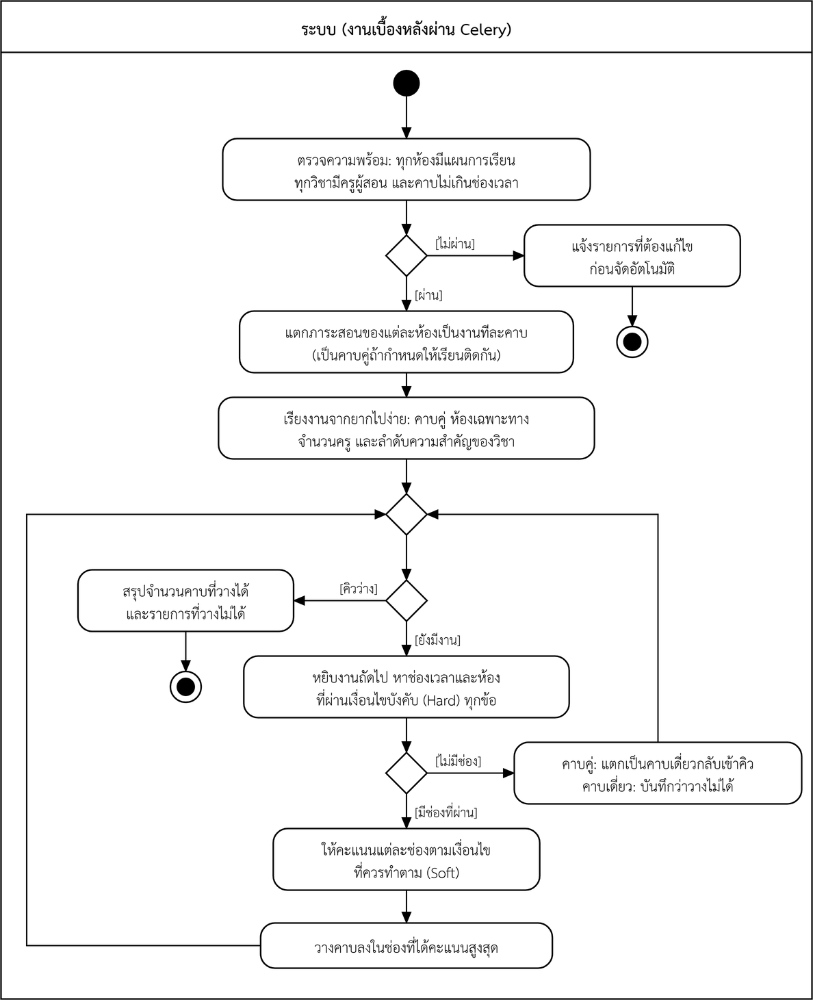 

***รูปที่** 3**.**41 ขั้นตอนการจัดตารางสอนอัตโนมัติ*

### การตรวจสอบการชนกัน

ระบบตรวจสอบการชนกันทุกครั้งที่มีการวางหรือย้ายคาบ ทั้งการจัดด้วยตนเองและการจัดอัตโนมัติ ผลการตรวจแบ่งเป็น 2 ระดับดังตารางที่ 3.5 คือ Conflict ซึ่งต้องแก้ไขก่อนจึงจะเผยแพร่ตารางได้ และคำเตือน ซึ่งเผยแพร่ได้แต่ระบบแสดงให้ครูฝ่ายวิชาการทราบ

***ตารางที่ 3.5** ประเภทการชนกันที่ระบบตรวจสอบ*

| การตรวจสอบ | ระดับ |
| --- | --- |
| ครูคนเดียวกันสอนซ้อนเวลากัน | Conflict |
| ห้องเรียนเดียวกันมีสองวิชาในเวลาเดียวกัน | Conflict |
| ครูหรือห้องเรียนทับกิจกรรมล็อกเวลา | Conflict |
| ตรงกับเวลาไม่ว่างของครูที่อนุมัติแล้ว | Conflict |
| ห้องถูกใช้เกินจำนวนที่รองรับในเวลาเดียวกัน | Conflict |
| วิชาเดียวกันเกิน 2 คาบต่อวัน | Conflict |
| จัดเกินจำนวนคาบต่อสัปดาห์ตามหลักสูตร | Conflict |
| อยู่นอกโครงสร้างเวลาของช่วงชั้น | Conflict |
| วิชาไม่อยู่ในแผนการเรียนของห้อง หรือยังไม่มีครูผู้สอน | Conflict |
| ครูสอนเกินจำนวนคาบต่อวันหรือสอนติดกันเกินที่กำหนด | คำเตือน |
| ครูมีภาระสอนเกินคาบต่อสัปดาห์ (ค่าเริ่มต้น 24 คาบ) | คำเตือน |
| ห้องไม่ตรงประเภทที่วิชาต้องการ หรือห้องไม่พร้อมใช้ | คำเตือน |
| วิชาเกินจำนวนคาบต่อวันที่กำหนด หรืออยู่ในช่วงเวลาที่ห้ามจัด | คำเตือน |

เงื่อนไขที่ครูฝ่ายวิชาการกำหนดเพิ่ม ได้แก่ จำนวนคาบสอนต่อวัน การสอนติดกัน ประเภทห้อง ห้องที่ไม่พร้อมใช้ และช่วงเวลาห้ามจัด เป็นเงื่อนไขบังคับเฉพาะขณะจัดตารางอัตโนมัติแบบกำหนดเงื่อนไข เมื่อครูฝ่ายวิชาการวางหรือย้ายคาบเอง ระบบแสดงเงื่อนไขเหล่านี้เป็นคำเตือนตามตารางที่ 3.5

### การคำนวณผลการเรียน

ระบบคำนวณผลการเรียนของนักเรียนแต่ละคนในแต่ละรายวิชาใหม่ทุกครั้งที่คะแนน เวลาเรียน หรือผลการสอบซ่อมเปลี่ยน ตามลำดับการตรวจในรูปที่ 3.42 ระบบตรวจเวลาเรียนเป็นลำดับแรก โดยเวลาเรียนคิดจากจำนวนคาบที่มาเรียนและมาสายหารด้วยจำนวนคาบที่เช็คชื่อแล้ว นักเรียนที่มีเวลาเรียนต่ำกว่าเกณฑ์ขั้นต่ำซึ่งตั้งต้นที่ร้อยละ 80 ได้ มส คือไม่มีสิทธิ์สอบ เว้นแต่มีการปลด มส ที่ผู้บริหารอนุมัติ ต่อมาหากมีองค์ประกอบคะแนนใดเป็น ร (รอส่งงาน) หรือ ข (ขาดสอบ) ผลการเรียนเป็น ร และหากคะแนนยังกรอกไม่ครบ ระบบจะยังไม่ตัดสินผล

เมื่อข้อมูลครบ ระบบคำนวณคะแนนรวมจากผลรวมของทุกองค์ประกอบ ซึ่งสัดส่วนรวมกันได้ 100 แล้วปัดเป็นจำนวนเต็มและแปลงเป็นระดับผลการเรียน 8 ระดับตามเกณฑ์ในข้อ 2.1.3  นักเรียนที่ได้ระดับผลการเรียน 0 มีสิทธิ์สอบซ่อมไม่เกิน 2 ครั้ง ถ้าได้ร้อยละ 50 ขึ้นไป ระดับผลการเรียนเป็น 1 ส่วนนักเรียนที่ปลด มส กรณีเรียนชดเชยได้ระดับผลการเรียนไม่เกิน 1

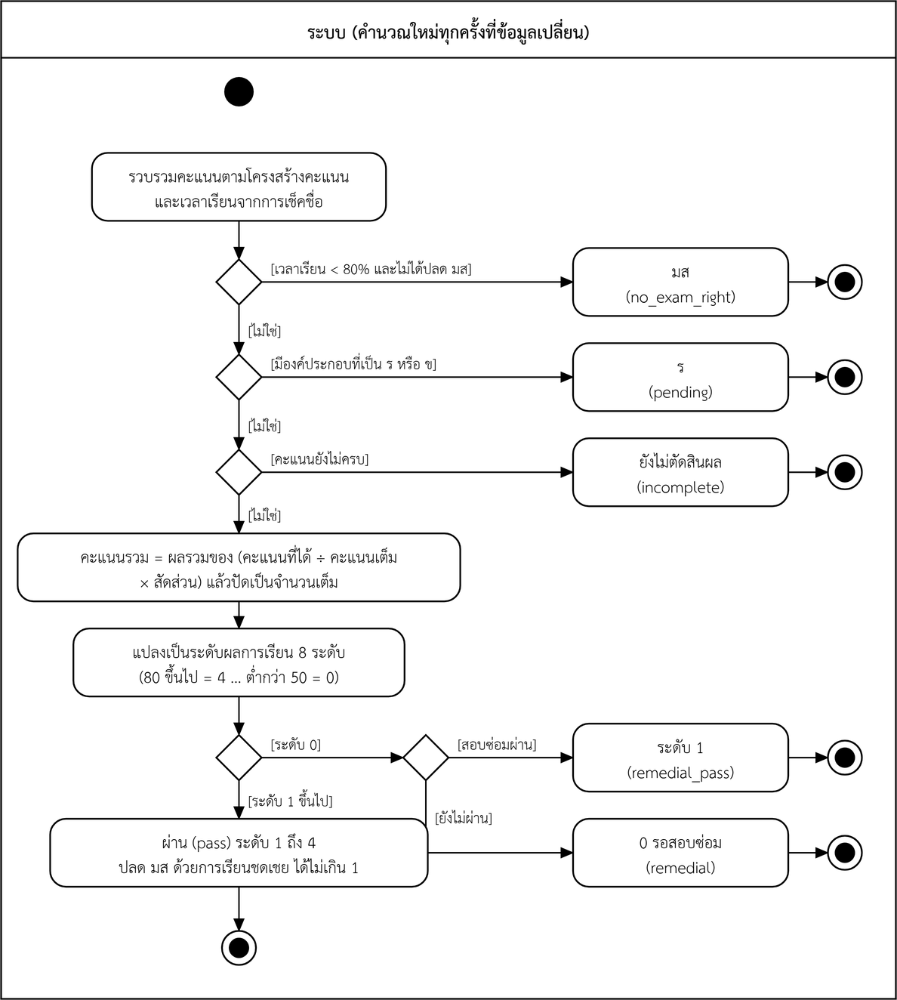 

***รูปที่** 3**.**42 ขั้นตอนการคำนวณผลการเรียนของนักเรียน*

## การใช้ AI ในการพัฒนา

โครงงานนี้ใช้ AI ช่วยในขั้นวิเคราะห์และออกแบบ ตามแนวคิด AI-native SDLC ผู้จัดทำเป็นผู้ตัดสินใจและตรวจผลงานทุกขั้นตอน ส่วน AI ร่างเอกสาร ซักถาม และแก้ไขงานตามที่ได้รับมอบหมาย

### เครื่องมือและโมเดลที่ใช้

ผู้จัดทำใช้ Claude Code เป็นเครื่องมือหลัก และใช้โมเดล Claude Opus เพราะงานของโครงงานต้องอ่านเอกสารหลายไฟล์พร้อมกัน เช่น use case ฐานข้อมูล และเล่มรายงาน และต้องคิดหลายขั้น เช่น การออกแบบสถานะของข้อมูล Claude Code ยังอ่านและแก้ไฟล์ในโครงงานได้โดยตรง และรองรับ skill กับ memory ตารางที่ 3.6 สรุปเครื่องมือที่ใช้

***ตารางที่ 3.6** เครื่องมือที่ใช้ในการพัฒนาด้วย AI*

| เครื่องมือ | ใช้ทำอะไร |
| --- | --- |
| Claude Code กับโมเดล Claude Opus | วิเคราะห์ความต้องการ ออกแบบระบบ เขียนเอกสาร สร้างระบบต้นแบบหน้าจอ และแก้ไขเล่มรายงาน |
| Skill grill-with-docs | ซักถามทวนแบบการออกแบบทีละประเด็นจนได้ข้อสรุป และสร้างบันทึกการตัดสินใจด้านการออกแบบกับอภิธานศัพท์ระหว่างการซักถาม |
| ไฟล์ Markdown (.md) | วางแผน flow การทำงานของระบบและของงาน เช่น ขอบเขตและระบบย่อย ผู้ใช้ ปัญหาของระบบเดิม และแผนงานของเล่ม เก็บในโครงงานให้ AI อ่านก่อนเริ่มงานทุกครั้ง |
| Memory ของ Claude Code | เก็บข้อตกลงที่ใช้ข้ามรอบการทำงาน เช่น ขอบเขตที่ตัดสินแล้ว และรูปแบบการเขียน |
| สคริปต์ที่ AI เขียน | สร้างรูปใน draw.io แก้ไขไฟล์ Word และส่งออก PDF เพื่อตรวจการจัดหน้า |

### การเขียน prompt

prompt ที่ใช้แบ่งเป็น 3 ส่วน ได้แก่ เป้าหมาย เนื้อหา และข้อจำกัด ดังตารางที่ 3.7 การแยกข้อจำกัดออกมาชัดเจนช่วยให้ AI ไม่แก้งานเกินขอบเขตที่ต้องการ

***ตารางที่ 3.7** โครงสร้างของ prompt*

| ส่วนของ prompt | ความหมาย | ตัวอย่าง |
| --- | --- | --- |
| เป้าหมาย | สิ่งที่ต้องการให้ AI ทำและผลลัพธ์ที่ต้องได้ | ตรวจการจัดหน้าของเล่มหลังเพิ่มบทที่ 5 |

***ตารางที่ 3.7 (ต่อ)** โครงสร้างของ prompt*

| เนื้อหา | ข้อมูลและไฟล์ที่ AI ต้องใช้ประกอบ | ไฟล์เล่มรายงาน และแผนงานใน report-plan.md |
| --- | --- | --- |
| ข้อจำกัด | กฎที่ AI ต้องทำตาม และสิ่งที่ห้ามทำ | จุดที่แก้ต้องเป็นตัวอักษรสีแดง ห้ามลบ section break และใช้รูปแบบตามคู่มือของคณะ |

# ระบบต้นแบบ

## โครงสร้างหน้าจอและเมนูตามบทบาท

ระบบแยกเมนูตามบทบาทของผู้ใช้ และแสดงเฉพาะเมนูของบทบาทนั้น รูปที่ 4.1 แสดงแผนผังหน้าจอของระบบ ครูฝ่ายวิชาการมีเมนู 4 กลุ่ม ได้แก่ หลักสูตร ตารางเรียน รายงานวิชาการ และผลการเรียน ครูผู้สอนมีเมนู 3 กลุ่ม ได้แก่ งานของฉัน บันทึกคะแนน และเช็คชื่อ

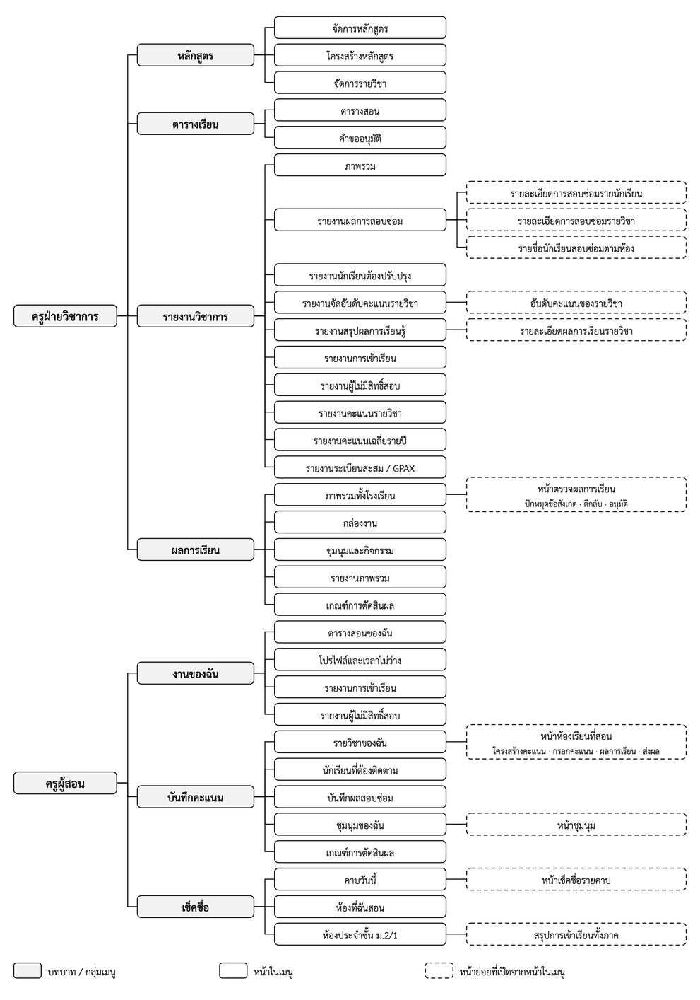 

***รูปที่ 4.**1 แผนผังหน้าจอของระบบแยกตามบทบาทผู้ใช้*

## หน้าจอของครูฝ่ายวิชาการ

ครูฝ่ายวิชาการใช้งานระบบผ่านเมนู 4 กลุ่มตามรูปที่ 4.1 ได้แก่ หลักสูตร ตารางเรียน รายงานวิชาการ และผลการเรียน หัวข้อย่อยต่อไปนี้นำเสนอหน้าจอของแต่ละเมนูตามลำดับ

### หลักสูตร

เมนูหลักสูตรใช้จัดการข้อมูลตั้งต้นของงานวิชาการ ได้แก่ หลักสูตรและแผนการเรียน โครงสร้างเวลาเรียนของหลักสูตร และรายวิชา ข้อมูลในเมนูนี้ใช้ต่อในการจัดตารางสอนและการบันทึกคะแนน

#### จัดการหลักสูตร

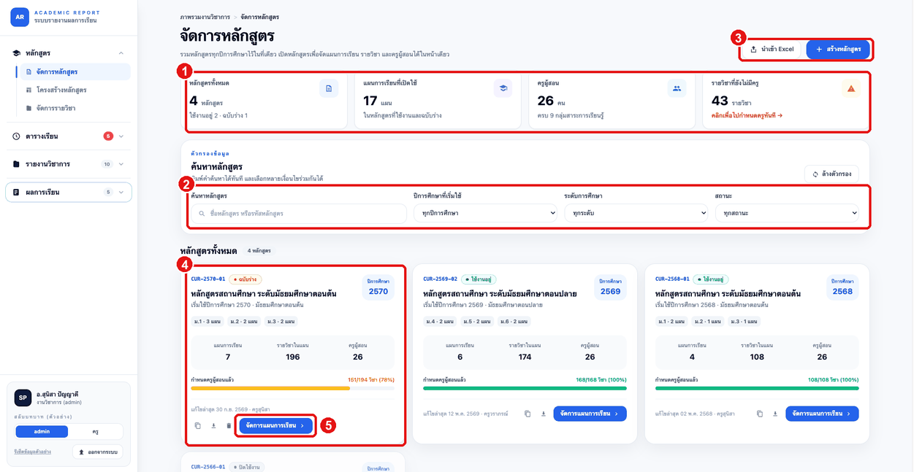 

***รูปที่ 4.**2 หน้ารายการหลักสูตร*

*รูปที่ 4.2 มีส่วนประกอบตามหมายเลขในรูป ดังนี้*

1.	สรุปจำนวนหลักสูตรทั้งหมด แผนการเรียนที่เปิดใช้ ครูผู้สอน และรายวิชาที่ยังไม่มีครู

2.	ค้นหาหลักสูตรจากชื่อหรือรหัส และกรองตามปีการศึกษา ระดับการศึกษา และสถานะ

3.	สร้างหลักสูตรใหม่ หรือนำเข้าจาก Excel

4.	การ์ดหลักสูตรแสดงสถานะ (ฉบับร่าง / ใช้งานอยู่ / ปิดใช้งาน) จำนวนแผน รายวิชา ครู และความคืบหน้าการกำหนดครูผู้สอน

5.	เปิดหน้าจัดการแผนการเรียนของหลักสูตรนั้น

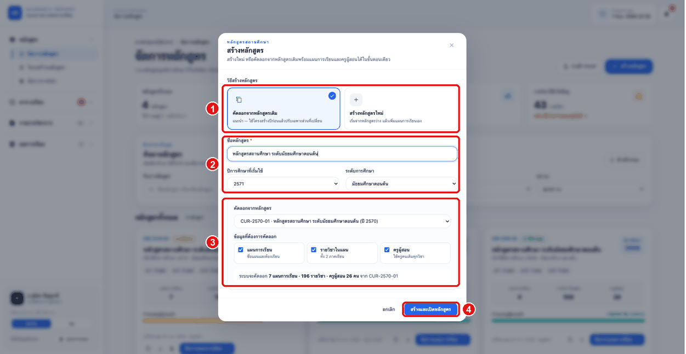 

***รูปที่ 4.**3 การสร้างหลักสูตร*

*รูปที่ 4.3 มีส่วนประกอบตามหมายเลขในรูป ดังนี้*

1.	เลือกวิธีสร้างหลักสูตร คัดลอกจากหลักสูตรเดิม หรือสร้างหลักสูตรใหม่

2.	กรอกชื่อหลักสูตร ปีการศึกษาที่เริ่มใช้ และระดับการศึกษา

3.	เลือกหลักสูตรต้นทาง และข้อมูลที่ต้องการคัดลอก (แผนการเรียน รายวิชาในแผน ครูผู้สอน)

4.	สร้างหลักสูตรและเปิดหน้าจัดการหลักสูตรทันที

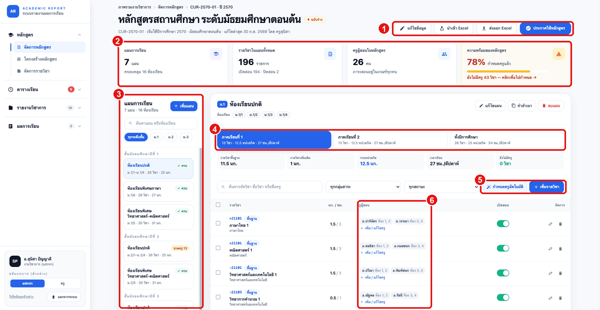 

***รูปที่ 4.**4 หน้าจัดการแผนการเรียนของหลักสูตร*

*รูปที่ 4.4 มีส่วนประกอบตามหมายเลขในรูป ดังนี้*

1.	แก้ไขข้อมูล นำเข้า/ส่งออก Excel และประกาศใช้หลักสูตร

2.	สรุปข้อมูลหลักสูตร ได้แก่ จำนวนแผนการเรียน รายวิชาในแผนทั้งหมด ครูผู้สอนในหลักสูตร และความพร้อมของหลักสูตร ซึ่งแสดงร้อยละการกำหนดครูและจำนวนวิชาที่ยังไม่มีครู

3.	รายการแผนการเรียนแยกตามระดับชั้น พร้อมปุ่มเพิ่มแผน

4.	เลือกภาคเรียนที่ 1 ภาคเรียนที่ 2 หรือทั้งปีการศึกษา

5.	กำหนดครูผู้สอนอัตโนมัติ และเพิ่มรายวิชาเข้าแผน

6.	ครูผู้สอนของแต่ละรายวิชาพร้อมห้องที่รับผิดชอบ สามารถเพิ่มหรือแก้ไขครูได้

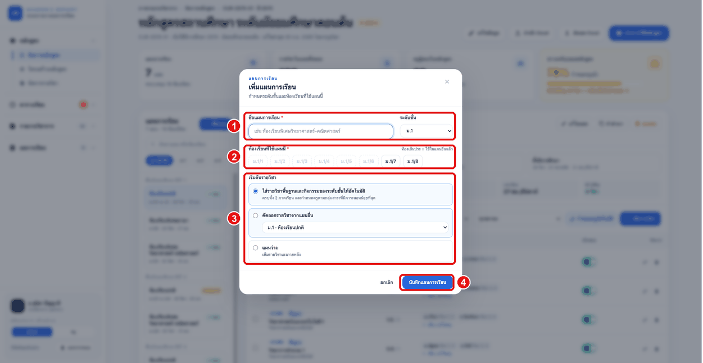 

***รูปที่ 4.**5 การเพิ่มแผนการเรียน*

*รูปที่ 4.5 มีส่วนประกอบตามหมายเลขในรูป ดังนี้*

1.	กรอกชื่อแผนการเรียนและเลือกระดับชั้น

2.	เลือกห้องเรียนที่ใช้แผนนี้ ห้องที่มีแผนอื่นแล้วจะเลือกไม่ได้

3.	เลือกวิธีเริ่มต้นรายวิชา ใส่วิชาพื้นฐานอัตโนมัติ คัดลอกจากแผนอื่น หรือแผนว่าง

4.	บันทึกแผนการเรียน

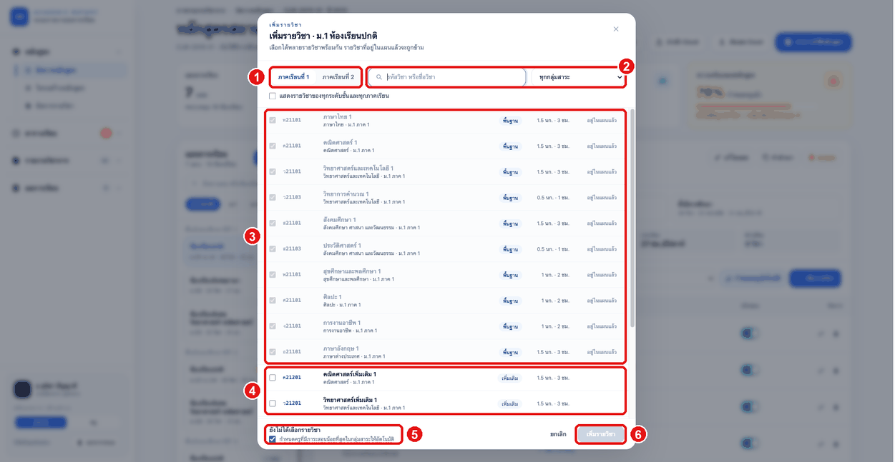 

***รูปที่ 4.**6 การเพิ่มรายวิชาเข้าแผนการเรียน*

*รูปที่ 4.6 มีส่วนประกอบตามหมายเลขในรูป ดังนี้*

1.	เลือกภาคเรียนที่ต้องการเพิ่มรายวิชา

2.	ค้นหารหัสวิชาหรือชื่อวิชา และกรองตามกลุ่มสาระ

3.	รายวิชาที่อยู่ในแผนแล้วจะแสดงเป็นสีจางและเลือกไม่ได้

4.	เลือกรายวิชาที่ต้องการเพิ่มได้หลายวิชาพร้อมกัน

5.	เลือกให้ระบบกำหนดครูที่มีภาระสอนน้อยที่สุดในกลุ่มสาระอัตโนมัติ

6.	เพิ่มรายวิชาที่เลือกเข้าแผนการเรียน

#### โครงสร้างหลักสูตร

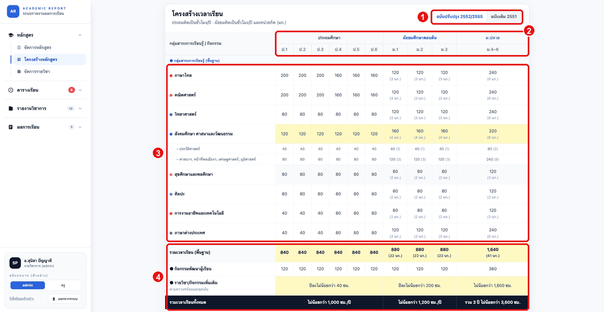 

***รูปที่ 4.**7 หน้าโครงสร้างเวลาเรียนตามหลักสูตรแกนกลาง*

*รูปที่ 4.7 มีส่วนประกอบตามหมายเลขในรูป ดังนี้*

1.	สลับดูฉบับปรับปรุง 2552/2555 หรือฉบับเดิม 2551

2.	ระดับชั้นประถมศึกษา มัธยมศึกษาตอนต้น และมัธยมศึกษาตอนปลาย

3.	เวลาเรียนรายปีของแต่ละกลุ่มสาระการเรียนรู้ พร้อมหน่วยกิตในวงเล็บ

4.	รวมเวลาเรียนพื้นฐาน กิจกรรมพัฒนาผู้เรียน รายวิชาเพิ่มเติม และเวลาเรียนทั้งหมด

#### จัดการรายวิชา

 

***รูปที่ 4.**8 หน้ารายการรายวิชา*

*รูปที่ 4.8 มีส่วนประกอบตามหมายเลขในรูป ดังนี้*

1.	นำเข้ารายวิชาจาก Excel หรือเพิ่มรายวิชาใหม่

2.	สรุปจำนวนรายวิชาทั้งหมด วิชาพื้นฐาน วิชาเลือก กิจกรรม และไม่มีผลการเรียน

3.	ค้นหารายวิชาและกรองตามกลุ่มสาระ ประเภทวิชา และระดับชั้น

4.	ตารางรายวิชาแสดงรหัส ชื่อวิชา กลุ่มสาระ ประเภท หน่วยกิต ชม./สัปดาห์ ระดับชั้น และการใช้งานในหลักสูตร

5.	แก้ไข คัดลอก หรือลบรายวิชา

 

***รูปที่ 4.**9 ฟอร์มเพิ่มรายวิชา*

*รูปที่ 4.9 มีส่วนประกอบตามหมายเลขในรูป ดังนี้*

1.	ขั้นตอนการเพิ่มรายวิชา 2 ขั้น ข้อมูลพื้นฐาน และโครงสร้างคะแนน

2.	คำอธิบายรูปแบบรหัสวิชาตามหลักสูตรแกนกลาง ระบบสร้างรหัสให้อัตโนมัติ

3.	กรอกชื่อวิชาไทย/อังกฤษ กลุ่มสาระ ประเภทวิชา หน่วยกิต และชม./สัปดาห์

4.	เลือกระดับชั้นที่จะสร้างรายวิชา

5.	ไปขั้นตอนถัดไป

### ตารางเรียน

เมนูตารางเรียนใช้จัดตารางสอนของทุกห้องเรียนในแต่ละภาคเรียน และพิจารณาคำขอจากครูผู้สอน ได้แก่ คำร้องขอเปลี่ยนการจัดตารางสอน และเวลาไม่ว่างของครู

#### ตารางสอน

 

***รูปที่ 4.**10 หน้าจัดการตารางสอน*

*รูปที่ 4.10 มีส่วนประกอบตามหมายเลขในรูป ดังนี้*

1.	เลือกภาคเรียน และสร้างตารางสอนใหม่

2.	ฉบับของตารางสอน แสดงสถานะ ความคืบหน้า คัดลอกฉบับร่าง เปลี่ยนชื่อฉบับตารางสอน ลบตาราง

3.	แถบเครื่องมือ โครงสร้างเวลา/กิจกรรม เงื่อนไขการจัด นำเข้า/ส่งออก จัดอัตโนมัติ และเผยแพร่

4.	สรุปความคืบหน้า รายการรอจัด Conflict คำเตือน และครูภาระเกิน

5.	ผลการตรวจความพร้อมก่อนจัดตารางอัตโนมัติ

6.	เลือกมุมมองจัดตารางสอนครู ตารางเรียนรายห้อง ตารางการใช้ห้อง ตารางรวมระดับชั้น และรายงาน

 

***รูปที่ 4.**11 การสร้างตารางสอนใหม่ ขั้นที่ 1 ข้อมูลฉบับ*

*รูปที่ 4.11 มีส่วนประกอบตามหมายเลขในรูป ดังนี้*

1.	ขั้นที่ 1 ข้อมูลฉบับ

2.	เลือกภาคเรียนของตารางสอน และตั้งชื่อฉบับร่าง

3.	เลือกวิธีสร้าง คัดลอกจากตารางที่มี หรือสร้างใหม่ทั้งหมด

4.	ถ้าเลือกคัดลอกจากตารางที่มีให้เลือกฉบับต้นทางที่จะคัดลอกด้วย

5.	ไปขั้นตอนถัดไป

 

***รูปที่ 4.**12 การสร้างตารางสอนใหม่ ขั้นที่ 2 โครงสร้างเวลา*

*รูปที่ 4.12 มีส่วนประกอบตามหมายเลขในรูป ดังนี้*

1.	ขั้นที่ 2 โครงสร้างเวลา

2.	แสดงสรุปคาบเรียนและช่วงพักตามเวลาจริงของแต่ละช่วงชั้น

3.	เลือกระดับชั้นและวันเรียนของช่วงชั้น

4.	กำหนดเวลาเริ่มคาบ 1 ความยาวคาบ จำนวนคาบต่อวัน และเวลาเข้าแถว/โฮมรูม

5.	กำหนดช่วงพัก และเพิ่มช่วงพักได้

6.	ไปขั้นตอนถัดไป

 

***รูปที่ 4.**13 การสร้างตารางสอนใหม่ ขั้นที่ 3 กิจกรรมล็อกเวลา*

*รูปที่ 4.13 มีส่วนประกอบตามหมายเลขในรูป ดังนี้*

1.	ขั้นที่ 3 กิจกรรมล็อกเวลา

2.	กรอกชื่อกิจกรรม ขอบเขต และวันที่จัด

3.	เลือกคาบที่ใช้จัดกิจกรรม

4.	ล็อกห้องเรียน ห้ามจัดคาบอื่นทับ

5.	เลือกผู้ดูแลกิจกรรม เช่น ครูประจำชั้น ครูทุกคน หรือครูกลุ่มสาระ

6.	ไปขั้นตอนถัดไป

 

***รูปที่ 4.**14 การสร้างตารางสอนใหม่ ขั้นที่ 4 วันปิดรับเวลาไม่ว่าง*

*รูปที่ 4.14 มีส่วนประกอบตามหมายเลขในรูป ดังนี้*

1.	ขั้นที่ 4 วันปิดรับเวลาไม่ว่าง

2.	กำหนดวันปิดรับเวลาไม่ว่างของครู

3.	คำอธิบายการส่งเวลาไม่ว่างและการแจ้งเตือนครู

4.	สรุปจำนวนเวลาไม่ว่างที่อนุมัติ รออนุมัติ และไม่อนุมัติ

5.	ไปขั้นตอนถัดไป

 

***รูปที่ 4.**15 การสร้างตารางสอนใหม่ ขั้นที่ 5 ตรวจความพร้อม*

*รูปที่ 4.15 มีส่วนประกอบตามหมายเลขในรูป ดังนี้*

1.	ขั้นที่ 5 ตรวจความพร้อม

2.	สรุปจำนวนรายการที่ไม่ผ่าน

3.	ตรวจความพร้อมใหม่อีกครั้ง

4.	ผลตรวจแต่ละรายการ (ผ่าน / ไม่ผ่าน / คำเตือน) พร้อมลิงก์ไปหน้าที่ต้องแก้ไข

5.	สรุปข้อมูลฉบับร่างที่จะสร้าง

6.	สร้างฉบับร่างตารางสอน

 

***รูปที่ 4.**16 การจัดตารางสอนรายครูแบบลากวาง*

*รูปที่ 4.16 มีส่วนประกอบตามหมายเลขในรูป ดังนี้*

1.	ค้นหาและเลือกครู รายชื่อครูแสดงร้อยละในการจัดตารางสอนและจำนวนคาบที่รอจัด

2.	นำเข้า Excel ของครูคนนี้ และจัดอัตโนมัติเฉพาะครูคนนี้ สามารถเลือกล้างข้อมูลที่จะจัดได้

3.	ตารางสอนรายสัปดาห์ ลากวางคาบเรียนลงช่องเวลา ช่องลายคือเวลาไม่ว่างหรือคาบที่ล็อก ระบบตรวจการชนกันทุกครั้ง

4.	รายการรอจัด ลากรายวิชาจากรายการนี้ไปวางในตาราง

5.	สัญลักษณ์สีกลุ่มสาระ Conflict คำเตือน และคาบที่ล็อก

#### คำขออนุมัติ

 

***รูปที่ 4.**17 การพิจารณาคำร้องขอเปลี่ยนการจัดตารางสอน*

*รูปที่ 4.17 มีส่วนประกอบตามหมายเลขในรูป ดังนี้*

1.	ไปหน้าจัดตาราง เปิดหน้าตารางสอนเพื่อดูหรือปรับตารางที่เกี่ยวข้องกับคำร้อง

2.	เพิ่มเวลาไม่ว่างแทนครู บันทึกเวลาไม่ว่างให้ครูที่ไม่ได้ยื่นผ่านระบบด้วยตนเอง

3.	สรุปคำร้องรออนุมัติ เวลาไม่ว่างรออนุมัติ อนุมัติแล้ว และไม่อนุมัติ

4.	สลับแท็บคำร้องขอเปลี่ยนการจัด หรือเวลาไม่ว่างของครู

5.	กรองตามภาคเรียน สถานะ และค้นหาครู

6.	ชื่อครูผู้ยื่นคำร้อง ประเภทคำร้อง และสถานะ

7.	รายละเอียดการเปลี่ยนแปลง จากเดิมเป็นอันที่ต้องการเปลี่ยน

8.	พิจารณาคำร้อง

 

***รูปที่ 4.**18 การพิจารณาเวลาไม่ว่างของครู*

*รูปที่ 4.18 มีส่วนประกอบตามหมายเลขในรูป ดังนี้*

1.	กดเปลี่ยนเป็นแท็บเวลาไม่ว่างของครู

2.	กรองตามภาคเรียน สถานะ และค้นหาชื่อครูเฉพาะได้

3.	วันปิดรับเวลาไม่ว่างของแต่ละภาคเรียน และสถานะการปิดรับ

4.	รายการเวลาไม่ว่างของครูแต่ละคน แสดงวัน เวลา เหตุผล และสถานะ

5.	อนุมัติ หรือไม่อนุมัติเวลาไม่ว่าง

### รายงานวิชาการ

เมนูรายงานวิชาการรวมรายงานสรุปข้อมูลของทั้งโรงเรียน เริ่มจากหน้าภาพรวม แล้วแยกเป็นรายงานตามเรื่อง ได้แก่ ผลการสอบซ่อม นักเรียนที่ต้องปรับปรุง การจัดอันดับคะแนน ผลการเรียนรู้ การเข้าเรียน ผู้ไม่มีสิทธิ์สอบ คะแนนรายวิชา คะแนนเฉลี่ยรายปี และระเบียนสะสม เกณฑ์ที่ใช้ในรายงาน เช่น ระดับผลการเรียน 3 ขึ้นไป ร้อยละ 60 และเกรดเฉลี่ย 2.00 เป็นเกณฑ์เฝ้าระวังสำหรับติดตามนักเรียน ไม่ใช่เกณฑ์ตัดสินผลการเรียน

#### ภาพรวม

 

***รูปที่ 4.**19 หน้าภาพรวมงานวิชาการ*

*รูปที่ 4.19 มีส่วนประกอบตามหมายเลขในรูป ดังนี้*

1.	การ์ดสรุปงานคะแนนค้าง นักเรียนติด 0 / ร / มส สอบซ่อมค้าง และห้องเสี่ยง พร้อมลิงก์ไปยังรายการที่เกี่ยวข้อง

2.	รายการงานที่ต้องดำเนินการ เรียงตามระดับความเร่งด่วนและกำหนดเวลา

3.	ปุ่มดำเนินการของแต่ละงาน เช่น อนุมัติผล หรือจัดการสอบซ่อม

4.	ความคืบหน้างานวิชาการ ได้แก่ การส่งคะแนน การตรวจสอบคะแนน การอนุมัติผลการเรียน และการดำเนินการสอบซ่อม

#### รายงานผลการสอบซ่อม

 

***รูปที่ 4.**20 รายงานผลการสอบซ่อม ส่วนเงื่อนไขและสรุปผล*

*รูปที่ 4.20 มีส่วนประกอบตามหมายเลขในรูป ดังนี้*

1.	เลือกมุมมองรายงานแบบรายห้องเรียนหรือรายวิชา

2.	เลือกเงื่อนไขปีการศึกษา ภาคเรียน ระดับชั้น ห้องเรียน และตัวกรองเพิ่มเติม

3.	ล้างค่าเงื่อนไข หรือกดค้นหาเพื่อแสดงผลลัพธ์

4.	แสดงเงื่อนไขที่เลือกอยู่ สามารถลบทีละรายการหรือล้างทั้งหมด

5.	สรุปจำนวนนักเรียนที่ต้องสอบซ่อม รายการวิชาที่ต้องสอบซ่อม นักเรียนที่ติดหลายวิชา และรอสอบซ่อม

6.	ส่งออกรายงานรายห้องเรียน

 

***รูปที่ 4.**21 รายงานผลการสอบซ่อม รายชื่อนักเรียนในห้อง*

*รูปที่ 4.21 มีส่วนประกอบตามหมายเลขในรูป ดังนี้*

1.	ค้นหาในตารางและเลือกการเรียงข้อมูล

2.	กรองตามสถานะ เช่น รอสอบซ่อม สอบซ่อมแล้ว ติดตามงาน ซ่อมหลายวิชา คะแนน 0 ผล ร

3.	ตารางนักเรียนที่ต้องสอบซ่อม แสดงจำนวนวิชา รอสอบซ่อม สอบซ่อมแล้ว ความเร่งด่วน และสถานะ

4.	เปิดดูรายละเอียดการสอบซ่อมของนักเรียนคนนั้น

5.	ส่งออกข้อมูลการสอบซ่อมของนักเรียน

6.	ส่งออกรายงานรายห้องเรียนทั้งหมด

 

***รูปที่ 4.**22 รายละเอียดการสอบซ่อมของนักเรียน*

*รูปที่ 4.22 มีส่วนประกอบตามหมายเลขในรูป ดังนี้*

1.	ข้อมูลนักเรียน ได้แก่ ชื่อ รหัสนักเรียน ห้อง ระดับชั้น และสถานะ

2.	สรุปจำนวนวิชาที่ต้องสอบซ่อม รอสอบซ่อม สอบซ่อมแล้ว และติดตามงาน

3.	ตารางรายวิชาที่ต้องสอบซ่อม แสดงปีการศึกษา ภาคเรียน ช่วงการประเมิน คะแนน และหมายเหตุ

4.	สถานะการสอบซ่อมของแต่ละวิชา (รอสอบซ่อม / สอบซ่อมแล้ว)

#### รายงานนักเรียนต้องปรับปรุง

 

***รูปที่ 4.**23 รายงานนักเรียนต้องปรับปรุง ส่วนเงื่อนไขและสรุปผล*

*รูปที่ 4.23 มีส่วนประกอบตามหมายเลขในรูป ดังนี้*

1.	เลือกเงื่อนไขปีการศึกษา ภาคเรียน ระดับชั้น ห้องเรียน และตัวกรองเพิ่มเติม

2.	ล้างทั้งหมด หรือกดแสดงผลลัพธ์ตามเงื่อนไข

3.	แสดงเงื่อนไขที่เลือกอยู่ คลิกเพื่อลบทีละรายการ

4.	สรุปนักเรียนต้องปรับปรุงทั้งหมด สัดส่วนคะแนนต่ำกว่าเกณฑ์ วิชาเสี่ยงสูง และห้องที่มีนักเรียนต้องปรับปรุงสูงสุด

5.	ค้นหาในตาราง เลือกการเรียง และส่งออกรายงาน

6.	กรองด่วน เช่น เสี่ยงสูง นักเรียน ≥ 4 คน คะแนนเฉลี่ยต่ำกว่า 30

 

***รูปที่ 4.**24 รายชื่อนักเรียนที่ต้องปรับปรุงแยกตามรายวิชา*

*รูปที่ 4.24 มีส่วนประกอบตามหมายเลขในรูป ดังนี้*

1.	ค้นหาในตาราง เลือกการเรียงข้อมูล และส่งออกรายงาน

2.	กรองด่วนรายการรายวิชา

3.	แถวรายวิชา แสดงห้อง ครูผู้สอน จำนวนนักเรียนต้องปรับปรุง คะแนนเฉลี่ย และระดับความเสี่ยง กดลูกศรเพื่อขยายรายชื่อ

4.	ดูรายละเอียดของรายวิชา ทำงานเหมือน กดลูกศร

5.	รายชื่อนักเรียนที่ต้องปรับปรุงในวิชานั้น แสดงคะแนนรวม ร้อยละ เกรด สาเหตุหลัก และหมายเหตุ

6.	ส่งออกรายชื่อนักเรียนของวิชานี้

#### รายงานจัดอันดับคะแนนรายวิชา

 

***รูปที่ 4.**25 รายงานจัดอันดับคะแนน ส่วนเงื่อนไขและสรุปผล*

*รูปที่ 4.25 มีส่วนประกอบตามหมายเลขในรูป ดังนี้*

1.	เลือกเงื่อนไขปีการศึกษา ภาคเรียน ระดับชั้น ห้องเรียน และตัวกรองเพิ่มเติม

2.	ล้างค่า หรือกดค้นหาข้อมูล

3.	แสดงเงื่อนไขที่เลือกอยู่ สามารถลบทีละรายการหรือล้างทั้งหมด

4.	สรุปจำนวนรายวิชาทั้งหมด พร้อมดูอันดับ ยังไม่มีคะแนน และวิชาเสี่ยงสูง

5.	ค้นหารหัสวิชา ชื่อวิชา หรือครูผู้สอน เลือกการเรียง และส่งออก

6.	กรองตามสถานะ เช่น พร้อมจัดอันดับ ยังไม่มีคะแนน และระดับความเสี่ยง

 

***รูปที่ 4.**26 รายวิชาที่พร้อมดูอันดับคะแนน*

*รูปที่ 4.26 มีส่วนประกอบตามหมายเลขในรูป ดังนี้*

1.	ค้นหารายวิชา เลือกการเรียง และส่งออก

2.	กรองตามสถานะและระดับความเสี่ยง

3.	ตารางรายวิชา แสดงห้อง ครูผู้สอน จำนวนนักเรียน และสัดส่วนความเสี่ยง

4.	สถานะของรายวิชา (พร้อมดูอันดับ / ยังไม่มีคะแนน)

5.	เปิดดูอันดับคะแนนของรายวิชานั้น

 

***รูปที่ 4.**27 อันดับคะแนนของรายวิชา*

*รูปที่ 4.27 มีส่วนประกอบตามหมายเลขในรูป ดังนี้*

1.	สรุปรายวิชา จำนวนนักเรียนทั้งหมด คะแนนสูงสุด / เฉลี่ย และจำนวนนักเรียนต่ำกว่าเกณฑ์

2.	กรองตามสถานะ และเลือกเฉพาะห้อง

3.	ค้นหาชื่อ รหัสนักเรียน หรือห้อง เลือกการเรียง และส่งออก

4.	ตารางอันดับคะแนน แสดงคะแนนเก็บก่อน เก็บหลัง กลางภาค ปลายภาค และ ทั้งหมด

5.	คะแนนรวมและสถานะผ่านเกณฑ์ของนักเรียนแต่ละคน

#### รายงานสรุปผลการเรียนรู้

 

***รูปที่ 4.**28 รายงานสรุปผลการเรียนรู้ ส่วนเงื่อนไขและสรุปผล*

*รูปที่ 4.28 มีส่วนประกอบตามหมายเลขในรูป ดังนี้*

1.	เลือกเงื่อนไขปีการศึกษา ภาคเรียน ระดับชั้น รายวิชา และตัวกรองเพิ่มเติม

2.	ล้างค่า หรือกดค้นหา

3.	แสดงเงื่อนไขที่เลือกอยู่ สามารถลบทีละรายการหรือล้างทั้งหมด

4.	สรุปรายวิชาทั้งหมด ผ่านเกณฑ์ (≥3) เสี่ยง (ต่ำกว่า 3) และค่าเฉลี่ยผลการเรียน

5.	ค้นหารหัสวิชาหรือชื่อวิชา เลือกการเรียง และส่งออก

6.	กรองตามระดับผลการเรียน เช่น ผ่านเกณฑ์ เฝ้าระวัง และเสี่ยงสูง

 

***รูปที่ 4.**29 สรุปผลการเรียนรายวิชา*

*รูปที่ 4.29 มีส่วนประกอบตามหมายเลขในรูป ดังนี้*

1.	ค้นหารายวิชา เลือกการเรียง และส่งออก

2.	กรองตามระดับผลการเรียน

3.	จำนวนนักเรียนและการกระจายของเกรด 4 ถึง 0 ของแต่ละรายวิชา

4.	อัตราผ่านเกณฑ์ (≥3) แสดงเป็นร้อยละและแถบสี

5.	แนวโน้มเทียบกับภาคเรียนก่อน

6.	เปิดดูรายละเอียดผลการเรียนของรายวิชา

 

***รูปที่ 4.**30 รายละเอียดผลการเรียนของรายวิชา แท็บภาพรวม*

*รูปที่ 4.30 มีส่วนประกอบตามหมายเลขในรูป ดังนี้*

1.	ข้อมูลรายวิชา ได้แก่ ครูผู้สอน ระดับชั้น ภาคเรียน ปีการศึกษา ขอบเขตข้อมูล และแนวโน้มจากภาคเรียนก่อน

2.	สรุปนักเรียนทั้งหมด ค่าเฉลี่ยผลการเรียน อัตราผ่านเกณฑ์ และนักเรียนต่ำกว่าเกณฑ์

3.	แท็บสลับมุมมอง ภาพรวม / รายห้องเรียน / อันดับนักเรียน

4.	สลับการแสดงผลแบบกราฟหรือตาราง

5.	กราฟการกระจายระดับผลการเรียน แสดงจำนวนและร้อยละของแต่ละเกรด

 

***รูปที่ 4.**31 รายละเอียดผลการเรียนของรายวิชา แท็บรายห้องเรียน*

*รูปที่ 4.31 มีส่วนประกอบตามหมายเลขในรูป ดังนี้*

1.	แท็บรายห้องเรียน

2.	ตารางสรุปผลรายห้อง แสดงจำนวนนักเรียน เกรดเฉลี่ย อัตราผ่านเกณฑ์ ต่ำกว่าเกณฑ์ และแนวโน้ม

3.	เปิดดูรายชื่อนักเรียนของห้องนั้น

4.	เลือกห้องเรียนที่ต้องการดูรายชื่อ

5.	รายชื่อนักเรียนรายห้อง แสดงคะแนน เกรด และสถานะ

 

***รูปที่ 4.**32 รายละเอียดผลการเรียนของรายวิชา แท็บอันดับนักเรียน*

*รูปที่ 4.32 มีส่วนประกอบตามหมายเลขในรูป ดังนี้*

1.	แท็บอันดับนักเรียน

2.	ค้นหานักเรียนและเลือกการเรียงลำดับ

3.	กรองด่วน เช่น ผ่านเกณฑ์ ต่ำกว่าเกณฑ์ 10 อันดับแรก 10 อันดับสุดท้าย

4.	ตารางอันดับนักเรียนในรายวิชา แสดงห้องเรียน คะแนน เกรด และสถานะ

#### รายงานการเข้าเรียน

 

***รูปที่ 4.**33 รายงานการเข้าเรียน สรุปและแนวโน้ม*

*รูปที่ 4.33 มีส่วนประกอบตามหมายเลขในรูป ดังนี้*

1.	สรุปจำนวนนักเรียนทั้งหมด ร้อยละขาดเรียน จำนวนครั้งที่ขาดเรียน และมาสาย

2.	กราฟแนวโน้มการเข้าเรียน ขาดเรียน และมาสายรายเดือนตลอดภาคเรียน

3.	กลุ่มเสี่ยง มส แสดงนักเรียนที่ขาดเรียนใกล้หรือเกินเกณฑ์ พร้อมจำนวนคาบที่ขาด

4.	ตั้งค่าเกณฑ์แจ้งเตือนร้อยละการขาดเรียน

5.	ดูในตาราง เพื่อเปิดรายละเอียดการเข้าเรียนรายคาบของนักเรียนคนนั้น

 

***รูปที่ 4.**34 รายละเอียดการเข้าเรียนรายคาบ*

*รูปที่ 4.34 มีส่วนประกอบตามหมายเลขในรูป ดังนี้*

1.	กรองตามสถานะการเข้าเรียน และแสดงเกณฑ์แจ้งเตือนเพดานขาดเรียน

2.	สัญลักษณ์สถานะ มา สาย ขาด ลา และไม่มีคาบ

3.	ตารางสถานะการเข้าเรียนของนักเรียนแต่ละคนในแต่ละคาบ แยกตามวันที่และรายวิชา

4.	สรุปจำนวนครั้งที่มา สาย ขาด ลา และร้อยละการขาดเรียนของนักเรียนแต่ละคน

5.	ส่งออกเป็น Excel หรือ PDF ได้

#### รายงานผู้ไม่มีสิทธิ์สอบ

 

***รูปที่ 4.**35 รายงานผู้ไม่มีสิทธิ์สอบ ส่วนภาพรวม*

*รูปที่ 4.35 มีส่วนประกอบตามหมายเลขในรูป ดังนี้*

1.	สรุปจำนวนนักเรียนที่ไม่มีสิทธิ์สอบ จำนวนรายการตรวจสอบ และค่าเฉลี่ยการเข้าเรียน

2.	แถบสถานะสิทธิ์สอบ เปรียบเทียบจำนวนรายการที่ไม่มีสิทธิ์สอบกับยังมีสิทธิ์สอบ

3.	สรุปจำนวนผู้ไม่มีสิทธิ์สอบแยกตามชั้นและห้องเรียน

4.	สลับมุมมองสรุปแยกตามชั้น/ห้อง หรือรายวิชา

 

***รูปที่ 4.**36 รายชื่อนักเรียนตามสถานะสิทธิ์สอบ*

*รูปที่ 4.36 มีส่วนประกอบตามหมายเลขในรูป ดังนี้*

1.	ตารางรายชื่อนักเรียน รายวิชา ร้อยละการเข้าเรียน จำนวนขาด สาย สถานะสิทธิ์สอบ และหมายเหตุ

2.	เลือกจำนวนแถวที่แสดงต่อหน้า

3.	ดูตัวอย่างเอกสาร PDF และส่งออกรายงาน

4.	เปลี่ยนหน้าด้วยปุ่มก่อนหน้าและถัดไป

#### รายงานคะแนนรายวิชา

 

***รูปที่ 4.**37 รายงานคะแนนรายวิชา ส่วนสรุปรายห้อง*

*รูปที่ 4.37 มีส่วนประกอบตามหมายเลขในรูป ดังนี้*

1.	สรุปจำนวนนักเรียน ห้องเรียน รายวิชา นักเรียนต่ำกว่าเกณฑ์ และครูที่ยังไม่กรอกคะแนน

2.	สรุปรายห้อง แสดงจำนวนนักเรียน นักเรียนต่ำกว่าเกณฑ์ และรายการที่ยังไม่กรอกคะแนน

3.	ดูรายละเอียดคะแนนของห้องเรียนนั้น

 

***รูปที่ 4.**38 คะแนนแต่ละวิชาและนักเรียนต่ำกว่าเกณฑ์*

*รูปที่ 4.38 มีส่วนประกอบตามหมายเลขในรูป ดังนี้*

1.	สรุปจำนวนนักเรียนและรายวิชาที่ต่ำกว่าเกณฑ์ และความครบถ้วนของการกรอกคะแนน

2.	กราฟคะแนนเฉลี่ยแต่ละวิชาเทียบกับเส้นเกณฑ์ร้อยละ 60

3.	รายชื่อนักเรียนต่ำกว่าเกณฑ์ พร้อมวิชาที่ได้คะแนนต่ำกว่าร้อยละ 60

4.	ดูรายละเอียดคะแนนของนักเรียนคนนั้น

 

***รูปที่ 4.**39 เงื่อนไขการค้นหาและตารางคะแนนรายวิชา*

*รูปที่ 4.39 มีส่วนประกอบตามหมายเลขในรูป ดังนี้*

1.	เลือกปีการศึกษา ภาคเรียน ระดับชั้น ชั้นเรียน และรายวิชาที่ต้องการดู

2.	ล้างเงื่อนไข หรือกดค้นหาข้อมูล

3.	ตารางคะแนนรายวิชาของนักเรียนแต่ละคน คะแนนที่ต่ำกว่าเกณฑ์แสดงเป็นสีแดง

4.	เลือกวิชาที่แสดง แสดงทั้งหมด ส่งออก และพิมพ์รายงาน

#### รายงานคะแนนเฉลี่ยรายปี

 

***รูปที่ 4.**40 รายงานคะแนนเฉลี่ยรายปี ส่วนภาพรวม*

*รูปที่ 4.40 มีส่วนประกอบตามหมายเลขในรูป ดังนี้*

1.	สรุปจำนวนนักเรียน เกรดเฉลี่ยรวม นักเรียนต่ำกว่าเกณฑ์ และครูที่กรอกคะแนนแล้ว

2.	กราฟเกรดเฉลี่ยแยกตามห้องเรียน เทียบกับเกณฑ์ GPA 2

3.	กราฟการกระจายช่วงคะแนนเฉลี่ยของนักเรียน

 

***รูปที่ 4.**41 เงื่อนไขการค้นหาและรายละเอียดคะแนนรายนักเรียน*

*รูปที่ 4.41 มีส่วนประกอบตามหมายเลขในรูป ดังนี้*

1.	เลือกปีการศึกษา ภาคเรียน ระดับชั้น แผนการเรียน ห้องเรียน สถานะนักเรียน และค้นหาจากรหัสหรือชื่อ

2.	ล้างเงื่อนไข หรือกดค้นหาข้อมูล

3.	ตารางคะแนนรายนักเรียนแยกตามรายวิชา แสดงคะแนนภาคเรียนที่ 1 ภาคเรียนที่ 2 รวมทั้งปี เฉลี่ย และระดับผลการเรียน

4.	เกรดเฉลี่ยและอันดับของนักเรียนแต่ละคน

5.	เลือกวิชาที่แสดง ส่งออก และพิมพ์รายงาน

#### รายงานระเบียนสะสมและ GPAX

 

***รูปที่ 4.**42 รายงานระเบียนสะสม แท็บระเบียนสะสม*

*รูปที่ 4.42 มีส่วนประกอบตามหมายเลขในรูป ดังนี้*

1.	แท็บสลับระหว่างระเบียนสะสม และ GPAX และหน่วยกิต

2.	สรุปจำนวนนักเรียน ผลการเรียนสะสมเฉลี่ย GPA ล่าสุด หน่วยกิตผ่านเฉลี่ย และจำนวนวิชาไม่ผ่าน

3.	กราฟแนวโน้ม GPA เฉลี่ยรายภาคเรียน

4.	กราฟการกระจายผลการเรียนสะสมตามช่วงเกรด

 

***รูปที่ 4.**43 รายงานระเบียนสะสม แท็บ GPAX และหน่วยกิต*

*รูปที่ 4.43 มีส่วนประกอบตามหมายเลขในรูป ดังนี้*

1.	แท็บ GPAX และหน่วยกิตที่เลือกอยู่

2.	สรุป GPAX เฉลี่ย สูงสุด ต่ำสุด จำนวนต่ำกว่า 2.00 วิชาไม่ผ่าน และหน่วยกิตไม่ครบ

3.	กราฟการกระจาย GPAX ของนักเรียนตามช่วงเกรด

4.	หน่วยกิตที่ได้เทียบกับที่ต้องได้ แยกตามกลุ่มสาระ

 

***รูปที่ 4.**44 ขอบเขตข้อมูลและสรุปผลรายห้อง*

*รูปที่ 4.44 มีส่วนประกอบตามหมายเลขในรูป ดังนี้*

1.	ขอบเขตข้อมูล เลือกปีการศึกษา ระดับชั้น แผนการเรียน ห้องเรียน สถานะนักเรียน และค้นหานักเรียน

2.	ล้างเงื่อนไข หรือกดค้นหาข้อมูล

3.	สรุปผลรายห้อง แสดงผลสะสมเฉลี่ย GPA ล่าสุด หน่วยกิตผ่านเฉลี่ย และจำนวนนักเรียนที่มีปัญหา

4.	ดูรายละเอียดระเบียนสะสมของห้องเรียนนั้น

5.	ส่งออก และพิมพ์รายงาน

 

***รูปที่ 4.**45 ระเบียนสะสมรายนักเรียน*

*รูปที่ 4.45 มีส่วนประกอบตามหมายเลขในรูป ดังนี้*

1.	ตารางระเบียนสะสมรายนักเรียน แสดง GPA และหน่วยกิตของภาคเรียน 1 ภาคเรียน 2 และผลสะสมทั้งปี

2.	สถานะและหมายเหตุของนักเรียน เช่น ปกติ มีรายวิชาไม่ผ่าน หรือข้อมูลไม่ครบ

3.	ดูรายละเอียดระเบียนสะสมของนักเรียนคนนั้น

4.	ส่งออก และพิมพ์รายงาน

 

***รูปที่ 4.**46 GPAX และหน่วยกิตรายนักเรียน*

*รูปที่ 4.46 มีส่วนประกอบตามหมายเลขในรูป ดังนี้*

1.	GPAX GPA ล่าสุด หน่วยกิตลงทะเบียนและผ่านสะสม วิชาไม่ผ่าน และหน่วยกิตที่ยังขาด

2.	หน่วยกิตตามกลุ่มสาระ แสดงหน่วยกิตที่ได้เทียบกับที่ต้องได้ กลุ่มที่ยังไม่ครบแสดงเป็นสีส้ม

3.	สถานะการศึกษาของนักเรียน

4.	ดูรายละเอียด GPAX และหน่วยกิตของนักเรียนคนนั้น

5.	ส่งออก และพิมพ์รายงาน

### ผลการเรียน

เมนูผลการเรียนใช้ติดตามการบันทึกคะแนนของทั้งโรงเรียน ตรวจและอนุมัติผลการเรียนที่ครูผู้สอนส่งมาในกล่องงาน จัดการชุมนุมและกิจกรรม ดูรายงานภาพรวมผลการเรียน และกำหนดเกณฑ์การตัดสินผลการเรียน ห้องที่ถูกตีกลับยังอยู่ในสถานะกำลังบันทึก หน้าจอแสดงป้าย “ตีกลับ” บนสถานะนี้พร้อมเหตุผล

#### ภาพรวมทั้งโรงเรียน

 

***รูปที่ 4.**47 หน้าภาพรวมการบันทึกคะแนนทั้งโรงเรียน*

*รูปที่ 4.47 มีส่วนประกอบตามหมายเลขในรูป ดังนี้*

1.	เลือกปีการศึกษาและภาคเรียนที่ต้องการดูภาพรวม

2.	สรุปจำนวนห้องที่ส่งผลการเรียนแล้ว รอตรวจ อนุมัติแล้ว คำขอปลดล็อก ยังไม่เริ่ม และวันที่เหลือถึงกำหนดส่ง

3.	สลับมุมมองระหว่างห้องเรียนกับรายวิชา และรายครู และกรองตามระดับชั้น รายวิชา และสถานะ

4.	ตารางห้องเรียนกับรายวิชา แสดงสถานะแต่ละช่องด้วยสี (รอตรวจ / อนุมัติ / ตีกลับ / ยังไม่เริ่ม) หรือร้อยละการกรอกคะแนน และคลิกเพื่อเปิดตรวจ

#### กล่องงาน

 

***รูปที่ 4.**48 หน้ากล่องงาน*

*รูปที่ 4.48 มีส่วนประกอบตามหมายเลขในรูป ดังนี้*

1.	เลือกปีการศึกษาและภาคเรียน

2.	จำนวนห้องที่รอตรวจ เรียงจากรายการที่ส่งนานที่สุด

3.	เลือกห้องที่ต้องการอนุมัติพร้อมกันหลายรายการ

4.	เลือกทั้งหมดที่อนุมัติได้ แล้วกดอนุมัติที่เลือกทั้งหมดในครั้งเดียว

5.	ป้ายแสดงสถานะพิเศษของรายการ เช่น ขอปลดล็อก

6.	เปิดหน้าตรวจผลการเรียนของห้องนั้น

 

***รูปที่ 4.**49 หน้าตรวจผลการเรียนของห้องเรียน*

*รูปที่ 4.49 มีส่วนประกอบตามหมายเลขในรูป ดังนี้*

1.	ข้อมูลห้องเรียนและรายวิชา ครูผู้สอน คะแนนเฉลี่ย และสถานะ รอฝ่ายวิชาการตรวจ

2.	แท็บขั้นตอน โครงสร้างคะแนน / กรอกคะแนน / คุณลักษณะอันพึงประสงค์ / อ่าน คิดวิเคราะห์ และเขียน / ผลการเรียนและส่งผล / ประวัติการแก้ไข

3.	แจ้งว่าฝ่ายวิชาการดูได้อย่างเดียว และให้เปิดโหมดปักหมุดเพื่อชี้จุดที่ต้องแก้

4.	ตารางคะแนนของนักเรียนแบบอ่านอย่างเดียว พร้อมคะแนนรวม เกรด เวลาเรียน และสถานะ

5.	เปิด/ปิดโหมดปักหมุด และแสดงจำนวนหมุดที่ปักไว้

6.	ตีกลับให้ครูแก้ไข หรืออนุมัติผลการเรียน

#### ชุมนุมและกิจกรรม

 

***รูปที่ 4.**50 หน้าจัดการชุมนุมและกิจกรรม*

*รูปที่ 4.50 มีส่วนประกอบตามหมายเลขในรูป ดังนี้*

1.	สรุปจำนวนชุมนุมที่เปิด นักเรียนที่เป็นสมาชิก ชุมนุมที่รอตรวจ และอนุมัติแล้ว

2.	กรองรายการตามสถานะ ทั้งหมด / ยังไม่ส่ง / รอตรวจ / อนุมัติแล้ว

3.	แสดงสถานะของแต่ละชุมนุม เช่น กำลังบันทึก รอตรวจ อนุมัติแล้ว ตีกลับให้แก้ไข

4.	ตรวจผลชุมนุมที่ส่งเข้ามา หรือดูผลการประเมิน ผ / มผ

5.	สร้างชุมนุมใหม่ กำหนดครูที่ปรึกษาและจำนวนที่เปิดรับ

#### รายงานภาพรวม

 

***รูปที่ 4.**51 หน้ารายงานภาพรวมผลการเรียน*

*รูปที่ 4.51 มีส่วนประกอบตามหมายเลขในรูป ดังนี้*

1.	เลือกปีการศึกษาและภาคเรียน

2.	ตารางสถานะการส่งผลการเรียนทุกห้อง พร้อมความคืบหน้า วันที่ส่ง และผู้อนุมัติ

3.	ส่งออกสถานะการส่งผลการเรียนเป็นไฟล์ CSV

4.	ตารางนักเรียนที่ต้องติดตามทั้งโรงเรียน (ร / มส / 0) พร้อมรายละเอียดสาเหตุ

5.	ส่งออกรายชื่อนักเรียนที่ต้องติดตามเป็นไฟล์ CSV

#### เกณฑ์การตัดสินผล

 

***รูปที่ 4.**52 หน้าเกณฑ์การตัดสินผลการเรียน*

*รูปที่ 4.52 มีส่วนประกอบตามหมายเลขในรูป ดังนี้*

1.	ตารางช่วงคะแนน ระดับผลการเรียน (0–4) และความหมาย

2.	ผลการเรียนพิเศษ ร (รอการตัดสิน) / มส (ไม่มีสิทธิ์สอบ) / 0 (ต่ำกว่าเกณฑ์)

3.	ระดับการประเมินคุณลักษณะอันพึงประสงค์ และอ่าน คิดวิเคราะห์ และเขียน (3 / 2 / 1 / 0)

## หน้าจอของครูผู้สอน

ครูผู้สอนใช้งานระบบผ่านเมนู 3 กลุ่มตามรูปที่ 4.1 ได้แก่ งานของฉัน บันทึกคะแนน และเช็คชื่อ โดยข้อมูลในทุกหน้าจำกัดเฉพาะห้องเรียนและรายวิชาที่ครูคนนั้นสอน หัวข้อย่อยต่อไปนี้นำเสนอหน้าจอของแต่ละเมนูตามลำดับ โดยอธิบายส่วนประกอบของหน้าจอตามหมายเลขในรูป

### งานของฉัน

เมนูงานของฉันรวมหน้าที่ครูผู้สอนใช้บ่อย ได้แก่ ตารางสอนของตนเอง โปรไฟล์และเวลาไม่ว่าง และรายงานการเข้าเรียนและผู้ไม่มีสิทธิ์สอบของห้องที่ตนสอน

#### ตารางสอนของฉัน

 

***รูปที่ 4.**53 หน้าตารางสอนของฉัน*

*รูปที่ 4.53 มีส่วนประกอบตามหมายเลขในรูป ดังนี้*

1.	เลือกภาคเรียนและฉบับตารางสอนที่ต้องการดู

2.	แถบแจ้งฉบับตารางสอนที่เผยแพร่ วันที่เผยแพร่ และจำนวนคำร้องที่อนุมัติแล้ว

3.	สลับมุมมอง ตารางสอนของฉัน / ตารางเรียนรายห้อง / ตารางการใช้ห้อง / คำร้องของฉัน

4.	สรุปคาบสอน/สัปดาห์ ห้องที่สอน คาบว่าง เวลาไม่ว่างที่อนุมัติ และคำร้องรออนุมัติ

5.	ตารางสอนรายสัปดาห์ แยกสีตามรายวิชา พร้อมแสดงเวลาไม่ว่างและกิจกรรม คลิกคาบเพื่อดูรายละเอียดหรือยื่นคำร้องขอเปลี่ยนการจัด

6.	ส่งออกตารางสอนเป็นไฟล์ PDF หรือ Excel

#### โปรไฟล์และเวลาไม่ว่าง

 

***รูปที่ 4.**54 โปรไฟล์ครูและเวลาไม่ว่างประจำสัปดาห์*

*รูปที่ 4.54 มีส่วนประกอบตามหมายเลขในรูป ดังนี้*

1.	ข้อมูลครูจากระบบงานบุคคล รหัสครู ตำแหน่ง กลุ่มสาระ ช่วงชั้นที่สอน และภาระสอนปัจจุบันต่อสัปดาห์

2.	เลือกภาคเรียนที่ต้องการแจ้งเวลาไม่ว่าง

3.	แจ้งวันปิดรับเวลาไม่ว่าง และประเภทกิจกรรมในโรงเรียนที่แจ้งได้

4.	ภาพรวมเวลาไม่ว่างรายสัปดาห์ แยกสีตามสถานะ อนุมัติแล้ว / รออนุมัติ เทียบกับคาบสอนของฉัน

 

***รูปที่ 4.**55 การแจ้งเวลาไม่ว่างเพิ่มและรายการในภาคเรียน*

*รูปที่ 4.55 มีส่วนประกอบตามหมายเลขในรูป ดังนี้*

1.	เลือกวันที่ไม่ว่าง

2.	กำหนดเวลาเริ่มและสิ้นสุด หรือคลิกเลือกคาบของ ม.ต้น / ม.ปลาย

3.	เลือกประเภทภารกิจ กรอกรายละเอียด และยืนยันว่าเป็นภารกิจในโรงเรียน

4.	ส่งเวลาไม่ว่างให้ครูฝ่ายวิชาการอนุมัติ

5.	รายการเวลาไม่ว่างในภาคเรียน พร้อมสถานะ อนุมัติแล้ว / รออนุมัติ

6.	แก้ไขหรือลบรายการที่ยังรออนุมัติ

#### รายงานการเข้าเรียน

รายงานการเข้าเรียนของครูผู้สอนแสดงเฉพาะห้องเรียนและรายวิชาที่ครูสอน ต่างจากรายงานของฝ่ายวิชาการในรูปที่ 4.33–4.34 ที่แสดงทั้งโรงเรียน

 

***รูปที่ 4.**56 รายงานการเข้าเรียนของครูผู้สอน ส่วนสรุปและกลุ่มเสี่ยง*

*รูปที่ 4.56 มีส่วนประกอบตามหมายเลขในรูป ดังนี้*

1.	ข้อมูลล่าสุด และรายวิชา ห้อง ภาคเรียนของครูผู้สอน

2.	สรุปผลการเข้าเรียน จำนวนนักเรียนทั้งหมด ร้อยละการขาดเรียน ขาดเรียน และมาสาย พร้อมเกณฑ์เวลาเรียนขั้นต่ำ

3.	กลุ่มเสี่ยง มส แสดงนักเรียนที่ขาดเรียนใกล้เกินเกณฑ์

 

***รูปที่ 4.**57 ขอบเขตรายงานและรายละเอียดการเข้าเรียนรายคาบ*

*รูปที่ 4.57 มีส่วนประกอบตามหมายเลขในรูป ดังนี้*

1.	ขอบเขตรายงาน เลือกห้องเรียนและรายวิชา และปรับช่วงเวลา

2.	กรองรายชื่อตามสถานะ

3.	ตารางการเข้าเรียนรายคาบ (ม / ส / ข / ล) พร้อมสรุปจำนวนขาด สาย ลา และร้อยละการขาด

4.	ตั้งค่าเกณฑ์ หรือแก้ไขแบบกลุ่ม

5.	บันทึกการแก้ไข

#### รายงานผู้ไม่มีสิทธิ์สอบ

หน้านี้เป็นหน้าเดียวกับรายงานของฝ่ายวิชาการในรูปที่ 4.35–4.36 แต่ระบบกรองข้อมูลให้เห็นเฉพาะนักเรียนในห้องและรายวิชาที่ครูสอน

 

***รูปที่ 4.**58 รายงานผู้ไม่มีสิทธิ์สอบของครูผู้สอน ส่วนภาพรวม*

*รูปที่ 4.58 มีส่วนประกอบตามหมายเลขในรูป ดังนี้*

1.	ภาพรวมสิทธิ์สอบ จำนวนไม่มีสิทธิ์สอบ รายการตรวจสอบ และค่าเฉลี่ยการเข้าเรียน

2.	สถานะสิทธิ์สอบ เปรียบเทียบไม่มีสิทธิ์สอบกับยังมีสิทธิ์สอบ

3.	สรุปแยกตามชั้น/ห้อง หรือรายวิชา

 

***รูปที่ 4.**59 เงื่อนไขการค้นหาและรายชื่อนักเรียนตามสถานะสิทธิ์สอบ*

*รูปที่ 4.59 มีส่วนประกอบตามหมายเลขในรูป ดังนี้*

1.	กำหนดเงื่อนไขการค้นหา ปีการศึกษา ภาคเรียน ระดับชั้น ห้องเรียน และรายวิชา

2.	แสดงตัวกรองเพิ่มเติม

3.	รายชื่อนักเรียนพร้อมร้อยละการเข้าเรียน จำนวนขาด สาย สถานะสิทธิ์สอบ และหมายเหตุครู

4.	ดูตัวอย่าง PDF หรือส่งออกรายชื่อ

### บันทึกคะแนน

เมนูบันทึกคะแนนใช้บันทึกคะแนนของรายวิชาที่ครูสอน ติดตามนักเรียนที่ได้ ร มส หรือต้องสอบซ่อม บันทึกผลการสอบซ่อม บันทึกผลกิจกรรมชุมนุม และดูเกณฑ์การตัดสินผลการเรียน ห้องที่ถูกตีกลับแสดงป้าย “ตีกลับ” บนสถานะกำลังบันทึก พร้อมเหตุผลจากครูฝ่ายวิชาการ

#### รายวิชาของฉัน

 

***รูปที่ 4.**60 หน้ารายวิชาของฉัน*

*รูปที่ 4.60 มีส่วนประกอบตามหมายเลขในรูป ดังนี้*

1.	เลือกปีการศึกษาและภาคเรียน

2.	สรุปจำนวนรายวิชา/ห้องที่สอน ส่งผลการเรียนแล้ว นักเรียนที่ต้องติดตาม และวันที่ใกล้ครบกำหนดส่ง

3.	การ์ดห้องเรียนแสดงรายวิชา จำนวนนักเรียน กำหนดส่ง และความคืบหน้าแต่ละขั้น คลิกเพื่อเปิดหน้ากรอกคะแนน

4.	สถานะของห้อง เช่น กำลังบันทึกคะแนน ถูกตีกลับ รอฝ่ายวิชาการตรวจ

 

***รูปที่ 4.**61 หน้าห้องเรียนที่สอน แท็บกรอกคะแนน*

*รูปที่ 4.61 มีส่วนประกอบตามหมายเลขในรูป ดังนี้*

1.	ข้อมูลห้องเรียนและรายวิชา กำหนดส่ง และความคืบหน้าการกรอกคะแนน

2.	แท็บขั้นตอน โครงสร้างคะแนน / กรอกคะแนน / คุณลักษณะอันพึงประสงค์ / อ่าน คิดวิเคราะห์ และเขียน / ผลการเรียนและส่งผล / ประวัติการแก้ไข

3.	นำเข้าคะแนนจาก Excel / CSV

4.	ตารางกรอกคะแนนเก็บ สอบกลางภาค สอบปลายภาค พร้อมคำนวณคะแนนรวม เกรด เวลาเรียน และสถานะ

5.	แถบความคืบหน้าการกรอก และเวลาบันทึกอัตโนมัติล่าสุด

6.	กดบันทึกคะแนน

#### นักเรียนที่ต้องติดตาม

 

***รูปที่ 4.**62 หน้านักเรียนที่ต้องติดตาม*

*รูปที่ 4.62 มีส่วนประกอบตามหมายเลขในรูป ดังนี้*

1.	เลือกปีการศึกษาและภาคเรียน

2.	กรองรายชื่อ ทั้งหมด / สอบซ่อม (0) / ร / มส

3.	สถานะของนักเรียน เช่น ร คือรอการตัดสิน มส คือเวลาเรียนไม่ถึง และมีสิทธิ์สอบซ่อม พร้อมรายละเอียดสาเหตุ

4.	เปิดหน้ารายวิชาเพื่อแก้ไขผลของนักเรียน

#### บันทึกผลสอบซ่อม

 

***รูปที่ 4.**63 หน้าบันทึกผลการสอบซ่อม*

*รูปที่ 4.63 มีส่วนประกอบตามหมายเลขในรูป ดังนี้*

1.	สรุปจำนวนผู้มีสิทธิ์สอบซ่อม รอสอบซ่อม สอบซ่อมผ่าน และต้องเรียนซ้ำรายวิชา

2.	กรองรายการ ทั้งหมด / รอสอบซ่อม / สอบซ่อมได้อีก / ผ่าน / ต้องเรียนซ้ำ

3.	คะแนนเดิมและจำนวนครั้งที่สอบซ่อม (สูงสุด 2 ครั้ง)

4.	บันทึกผลสอบซ่อม หรือแสดงรอตรวจเมื่อผลการเรียนอยู่ระหว่างรอฝ่ายวิชาการตรวจ

 

***รูปที่ 4.**64 หน้าต่างบันทึกผลการสอบซ่อม*

*รูปที่ 4.64 มีส่วนประกอบตามหมายเลขในรูป ดังนี้*

1.	ข้อมูลนักเรียน รายวิชา ห้อง และคะแนนเดิมของผู้ที่สอบซ่อม

2.	เลือกวันที่สอบซ่อม

3.	กรอกคะแนนที่ได้ (ร้อยละ) ในช่วง 0–100

4.	ระบุวิธีซ่อมหรือหมายเหตุ เช่น สอบข้อเขียน ส่งงานเพิ่ม

5.	แสดงเกณฑ์การสอบซ่อม ครั้งที่ 1 จาก 2 ได้ร้อยละ 50 ขึ้นไปจะปรับระดับผลการเรียนเป็น 1

6.	กดบันทึกผลสอบซ่อม

#### ชุมนุมของฉัน

 

***รูปที่ 4.**65 หน้าชุมนุมของฉัน*

*รูปที่ 4.65 มีส่วนประกอบตามหมายเลขในรูป ดังนี้*

1.	เลือกปีการศึกษาและภาคเรียน

2.	การ์ดชุมนุมที่เป็นครูที่ปรึกษา แสดงประเภท ชื่อชุมนุม และจำนวนสมาชิก

3.	สถานะการบันทึกผลของชุมนุม เช่น กำลังบันทึก

4.	ความคืบหน้าการประเมิน และจำนวนนักเรียนที่ได้ ผ / มผ

 

***รูปที่ 4.**66 หน้าบันทึกผลกิจกรรมของชุมนุม*

*รูปที่ 4.66 มีส่วนประกอบตามหมายเลขในรูป ดังนี้*

1.	สรุปจำนวนสมาชิก ประเมินแล้ว ผ่าน (ผ) และไม่ผ่าน (มผ)

2.	เพิ่มนักเรียนเข้าเป็นสมาชิกชุมนุม

3.	ให้ผล ผ / มผ อัตโนมัติตามเวลาเข้าร่วม

4.	กรอกเวลาเข้าร่วมกิจกรรมเป็นร้อยละ

5.	เลือกผลการประเมิน ผ หรือ มผ ของนักเรียนแต่ละคน

6.	ส่งผลชุมนุมให้ฝ่ายวิชาการตรวจ

#### เกณฑ์การตัดสินผล

ครูผู้สอนเปิดหน้าเกณฑ์การตัดสินผลได้เช่นเดียวกับฝ่ายวิชาการ (รูปที่ 4.52) เพื่อใช้อ้างอิงขณะกรอกคะแนนและตรวจผลการเรียน

 

***รูปที่ 4.**67 หน้าเกณฑ์การตัดสินผลการเรียนในมุมมองครูผู้สอน*

ส่วนประกอบของรูปที่ 4.67 เหมือนกับรูปที่ 4.52

### เช็คชื่อ

เมนูเช็คชื่อใช้เช็คชื่อนักเรียนรายคาบจากคาบที่สอนในแต่ละวัน ดูสรุปการเข้าเรียนของห้องที่ตนสอน และดูการเข้าเรียนของห้องประจำชั้นสำหรับครูประจำชั้น

#### คาบวันนี้

 

***รูปที่ 4.**68 หน้าคาบวันนี้*

*รูปที่ 4.68 มีส่วนประกอบตามหมายเลขในรูป ดังนี้*

1.	เลื่อนหรือเลือกวันที่ต้องการดูคาบสอน

2.	สรุปคาบวันนี้ คาบที่ยังไม่เช็ค (ย้อนหลัง) นักเรียนใกล้ มส และเวลาเรียนไม่ถึงร้อยละ 80 (มส)

3.	รายการคาบสอนของวันนี้ พร้อมเวลา ห้อง และสถานะ เช็คแล้ว / ยังไม่เช็ค

4.	เปิดหน้าเช็คชื่อของคาบ หรือแก้ไขการเช็คชื่อที่บันทึกแล้ว

5.	ตารางคาบที่ยังไม่เช็คชื่อของวันก่อนหน้า

6.	เช็คชื่อย้อนหลังสำหรับคาบที่ค้างอยู่

 

***รูปที่ 4.**69 หน้าเช็คชื่อนักเรียนรายคาบ*

*รูปที่ 4.69 มีส่วนประกอบตามหมายเลขในรูป ดังนี้*

1.	ข้อมูลรายวิชา ห้อง วันที่ คาบ และจำนวนนักเรียนที่มา สาย ลา ขาด

2.	แจ้งว่าคาบนี้ยังไม่ได้เช็คชื่อ และเลือกข้อมูลเริ่มต้น เช่น ใช้คาบก่อนหน้า ใช้คาบเช้า หรือให้ทุกคนมา

3.	คีย์ลัด 1–4 สำหรับเลือก มา / สาย / ลา / ขาด แล้วเลื่อนไปคนถัดไป

4.	เลือกสถานะ มา / สาย / ลา / ขาด ของนักเรียนแต่ละคน

5.	เวลาเรียนสะสมเป็นร้อยละ และจำนวนครั้งที่ขาดได้อีกก่อนติด มส

6.	กดบันทึกการเช็คชื่อ

#### ห้องที่ฉันสอน

 

***รูปที่ 4.**70 หน้าห้องที่ฉันสอน*

*รูปที่ 4.70 มีส่วนประกอบตามหมายเลขในรูป ดังนี้*

1.	การ์ดห้องเรียนที่สอน แสดงรหัสวิชา ชื่อวิชา จำนวนนักเรียน และคาบต่อสัปดาห์

2.	ห้องเรียนของรายวิชานั้น

3.	ความคืบหน้าการเช็คชื่อเทียบกับคาบตามหลักสูตร

4.	สถานะการเช็คชื่อและจำนวนนักเรียน มส / ใกล้ มส

 

***รูปที่ 4.**71 สรุปเวลาเรียนของห้องเรียน*

*รูปที่ 4.71 มีส่วนประกอบตามหมายเลขในรูป ดังนี้*

1.	ข้อมูลรายวิชาและห้อง จำนวนนักเรียน เกณฑ์ขาดหรือลาได้ และจำนวนคาบที่เช็คแล้ว

2.	กรองนักเรียนตาม ทั้งหมด / ใกล้ มส / มส

3.	ตารางจำนวนครั้งที่มา สาย ลา ขาด เวลาเรียนร้อยละ และจำนวนที่ขาดได้อีกก่อนติด มส

4.	ปลด มส ให้นักเรียนที่ติด มส

#### ห้องประจำชั้น

 

***รูปที่ 4.**72 ห้องประจำชั้น มุมมองรายวัน*

*รูปที่ 4.72 มีส่วนประกอบตามหมายเลขในรูป ดังนี้*

1.	สลับมุมมอง รายวัน / รายวิชา / สรุปทั้งภาค

2.	เลื่อนหรือเลือกวันที่ต้องการดู

3.	แจ้งรายชื่อนักเรียนที่ขาดเรียนในวันนี้

4.	สัญลักษณ์สถานะ มา / สาย / ลา / ขาด และครูผู้สอนยังไม่เช็ค

5.	ตารางสถานะการเข้าเรียนของนักเรียนทุกคนในแต่ละคาบของวัน

 

***รูปที่ 4.**73 ห้องประจำชั้น มุมมองรายวิชา*

*รูปที่ 4.73 มีส่วนประกอบตามหมายเลขในรูป ดังนี้*

1.	เลือกมุมมองรายวิชา

2.	เลือกรายวิชาที่ต้องการดู

3.	สัญลักษณ์สถานะ มา / สาย / ลา / ขาด และยังไม่เช็ค

4.	ตารางสถานะการเข้าเรียนของนักเรียนแต่ละคนตามวันที่มีคาบของรายวิชา

 

***รูปที่ 4.**74 ห้องประจำชั้น สรุปทั้งภาค*

*รูปที่ 4.74 มีส่วนประกอบตามหมายเลขในรูป ดังนี้*

1.	เลือกมุมมองสรุปทั้งภาค

2.	สรุปเวลาเรียนเฉลี่ยของห้อง จำนวนนักเรียน มส นักเรียนกลุ่มเสี่ยง และการขาดเรียนสัปดาห์นี้

3.	รายชื่อนักเรียนที่ติด มส พร้อมรายวิชาและร้อยละเวลาเรียน

4.	รายชื่อนักเรียนกลุ่มเสี่ยงที่ขาดได้อีกไม่เกิน 2 คาบ

5.	กราฟแนวโน้มเวลาเรียนรายสัปดาห์เทียบกับเกณฑ์ร้อยละ 80

6.	เวลาเรียนเฉลี่ยแยกตามรายวิชา พร้อมจำนวน มส / ใกล้ มส

## สรุป

ระบบต้นแบบมีหน้าจอสำหรับผู้ใช้ 2 บทบาท ครูฝ่ายวิชาการมีเมนู 4 กลุ่ม ได้แก่ หลักสูตร ตารางเรียน รายงานวิชาการ และผลการเรียน ครูผู้สอนมีเมนู 3 กลุ่ม ได้แก่ งานของฉัน บันทึกคะแนน และเช็คชื่อ หน้าจอครอบคลุมระบบย่อยทั้ง 5 ระบบตามการออกแบบในบทที่ 3 ต้นแบบใช้ข้อมูลจำลองในเบราว์เซอร์ และใช้เป็นข้อกำหนดของหน้าจอในการพัฒนาระบบจริงในภาคเรียนที่ 2

# วิเคราะห์และสรุปผล

## ภาพรวมทั้งโครงงาน

*ตารางที่ 5.1 แสดงน้ำหนักและความคืบหน้าของงานแต่ละส่วน ความคืบหน้ารวมของโครงงานเมื่อสิ้นภาคเรียนที่ 1 คิดเป็นร้อยละ 47.5 ความคืบหน้าของแต่ละงานประเมินจากผลงานที่เสร็จแล้วเทียบกับผลงานทั้งหมดที่วางแผนไว้ของงานนั้น และคอลัมน์คิดเป็นร้อยละได้จากน้ำหนักคูณความคืบหน้า*

***ตารางที่ 5.1** ความคืบหน้าของงานในภาคเรียนที่ 1*

| งาน | น้ำหนัก | ความคืบหน้า | คิดเป็นร้อยละ |
| --- | --- | --- | --- |
| วิเคราะห์และออกแบบ | 25% | 98% | 24.5% |
| ออกแบบ UX/UI | 20% | 90% | 18% |
| พัฒนา Back-end และฐานข้อมูล | 30% | 0% | 0% |
| ทดสอบและเชื่อมต่อข้อมูล | 15% | 0% | 0% |
| เล่มรายงานและการนำเสนอ | 10% | 50% | 5% |
| รวม | 100% |  | 47.5% |

## สรุปผลการดำเนินงานภาคเรียนที่ 1

### สิ่งที่ทำ

- ศึกษาระบบที่มีอยู่ในท้องตลาดหาปัญหาของระบบเดิม วิเคราะห์ระบบเดิม แล้วนำมาสรุปผลหาจุดแข็ง จุดอ่อน เพื่อเป็นแนวทางในการพัฒนาระบบ
- กำหนดขอบเขตทั้งของระบบ 5 ระบบย่อย และผู้ใช้ 2 บทบาทหลัก (ครูฝ่ายวิชาการ และครูผู้สอน)
- ออกแบบระบบ ได้แก่ Functional Requirements, Use case Diagram, Use case description, Activity Diagram, State Diagram, ER และ Data Dictionary
- พัฒนาระบบต้นแบบหน้าจอที่ครอบคลุมทุก use case และใช้ข้อมูลจำลองเพื่อแสดงขั้นตอนการทำงานและการโต้ตอบของผู้ใช้
- บันทึกการตัดสินใจด้านการออกแบบ เช่น ตารางที่เผยแพร่แล้วแก้ไม่ได้, ตรวจการชนจากเวลาจริง, และการสอบซ่อมหลังอนุมัติ
### ปัญหาและอุปสรรค

- ระหว่างศึกษาระบบและวิเคราะห์ความต้องการ ขอบเขตมีการเปลี่ยนบ่อยทำให้ต้องมีการกลับไปแก้ขั้นตอนการทำงาน use case หรือ ER Diagram อยู่บ่อย ๆ แนวทางแก้ไขคือบันทึกการตัดสินใจด้านการออกแบบทุกครั้งที่ขอบเขตเปลี่ยน แล้วแก้ use case, Activity Diagram และ ER Diagram ไปพร้อมกัน ในภาคเรียนที่ 2 จะล็อกขอบเขตหลังเดือนที่ 1
- ข้อมูลจำลองยังละเอียดไม่พอเนื่องจากยังไม่ใช่ข้อมูลจริง แนวทางแก้ไขคือจัดทำข้อมูลทดสอบชุดเดียวกันสำหรับทุกระบบย่อย ให้จำนวนห้องเรียน ครู และรายวิชาใกล้เคียงโรงเรียนจริง และอิงกฎจากหลักสูตรแกนกลางและแนวปฏิบัติการวัดผล
- การเก็บข้อมูลจากผู้ใช้จริงยากเนื่องจากในแต่ละโรงเรียนก็มีการดำเนินการต่างกัน แนวทางแก้ไขคือยึดหลักสูตรแกนกลางและแนวปฏิบัติการวัดผลที่ทุกโรงเรียนใช้ร่วมกัน ส่วนที่แต่ละโรงเรียนต่างกัน เช่น สัดส่วนคะแนน และโครงสร้างเวลาเรียน ให้โรงเรียนกำหนดเองในระบบ
### งานที่ยังไม่เสร็จในภาคเรียนที่ 1

งานที่ยังไม่เสร็จและจะทำต่อในภาคเรียนที่ 2 มีดังนี้

- ตารางในฐานข้อมูลที่เล่มอ้างถึงแต่ยังไม่ได้ออกแบบ 4 ตาราง ได้แก่ สถานะของงานเบื้องหลัง ประวัติการนำเข้าไฟล์ ประวัติการแก้ไขหลักสูตรและรายวิชา และประวัติการส่งออกเอกสาร จะออกแบบเพิ่มในเดือนที่ 1 พร้อมกับการล็อกขอบเขต
- ข้อตกลง API กับระบบงานทะเบียนและ IAM (Service B) ยังไม่ได้กำหนดรายละเอียดของแต่ละ endpoint จะกำหนดร่วมกับอีกทีมในเดือนที่ 1 ตามตารางที่ 5.3
- ระบบต้นแบบเป็นหน้าจออย่างเดียวและใช้ข้อมูลจำลอง ยังไม่มีส่วน Backend ฐานข้อมูล และงานเบื้องหลังจริง จะพัฒนาตามแผนในข้อ 5.3.1
## แผนการดำเนินงานภาคเรียนที่ 2

### แผนการพัฒนา

- ทำการล็อกขอบเขตข้อมูลไม่ให้เปลี่ยนแปลงหลังผ่านเดือนที่ 1
- พัฒนาทีละระบบย่อยตามลำดับที่ข้อมูลส่งต่อกัน ได้แก่ ระบบจัดการหลักสูตร ระบบจัดตารางสอน ระบบเช็คชื่อ ระบบบันทึกคะแนน และระบบออกรายงาน
- ใช้ระบบต้นแบบเป็นข้อกำหนดของหน้าจอ และใช้ Activity Diagram กับกฎในข้อ 3.5 เป็นข้อกำหนดของการประมวลผล
- ให้ผู้ใช้ทดลองใช้ระบบต้นแบบหน้าจอในเดือนที่ 1 แล้วเก็บข้อเสนอแนะมาปรับแก้ต้นแบบก่อนพัฒนาระบบจริง เมื่อพัฒนาแต่ละระบบย่อยเสร็จ ให้ผู้ใช้ทดลองอีกครั้งและนำผลมาแก้ไข
- ออกแบบกรณีทดสอบให้ครอบคลุมทุก use case และกฎในข้อ 3.5 ใช้ข้อมูลทดสอบชุดเดียวกันทุกระบบย่อย
- ทำ Unit Test ไปพร้อมกับการพัฒนา
### แผนการทดสอบ

การทดสอบแบ่งเป็น 5 ประเภท ดังตารางที่ 5.2 ทุกประเภทใช้ข้อมูลทดสอบชุดเดียวกัน Unit Test ทำไปพร้อมกับการพัฒนา ส่วนประเภทอื่นทำตามช่วงเวลาในตารางที่ 5.3 ก่อนเริ่มพัฒนาจะให้ผู้ใช้ทดลองระบบต้นแบบหน้าจอตามแผนการพัฒนาข้อ 4

***ตารางที่ 5.2** แผนการทดสอบ*

| ประเภทการทดสอบ | สิ่งที่ทดสอบ | เกณฑ์ผ่าน |
| --- | --- | --- |
| Unit Test | การคำนวณคะแนนรวมและระดับผลการเรียน การจำกัดผลการสอบซ่อม การคำนวณเวลาเรียนและ มส และการตรวจการชนของตารางสอน | ทุกกรณีทดสอบผ่าน และผลคำนวณตรงกับผลที่คำนวณด้วยมือร้อยละ 100 |
| Integration Test | การเรียก API ระหว่างระบบย่อย การยืนยันสิทธิ์และการซิงก์ข้อมูลหลักกับระบบงานทะเบียนและ IAM (Service B) และงานเบื้องหลังผ่าน Redis และ Celery | ข้อมูลที่ซิงก์ตรงกับต้นทาง ผู้ใช้เข้าถึงได้เฉพาะสิทธิ์ตามบทบาท และงานเบื้องหลังแจ้งสถานะสำเร็จหรือล้มเหลวได้ |
| System Test | ขั้นตอนของทั้ง 26 use case ตั้งแต่ต้นจนจบ ตาม Activity Diagram ในข้อ 3.3.3 | ทุก use case ทำงานตาม Basic Flow และแสดงข้อความตาม Alternative Flow และ Exception Flow ในภาคผนวก ก |
| Load Test | ครูหลายคนบันทึกคะแนนและเช็คชื่อพร้อมกัน การจัดตารางสอนอัตโนมัติ และการคำนวณผลการเรียนทั้งระดับชั้น | ไม่เกิด Data Conflict การจัดตารางสอนอัตโนมัติ 40 ห้องเรียนเสร็จภายใน 5 นาที และการคำนวณผลการเรียนทั้งระดับชั้นเสร็จภายใน 1 นาที |

***ตารางที่ 5.2 (ต่อ)** แผนการทดสอบ*

| User Acceptance Test | ครูผู้สอนและครูฝ่ายวิชาการทำงานตามขั้นตอนของ Persona ทั้ง 2 คนในข้อ 3.1.1 | ผู้ใช้ทำงานตามขั้นตอนได้ครบด้วยตนเอง ข้อเสนอแนะถูกบันทึกเพื่อปรับปรุงระบบ |
| --- | --- | --- |

### ตารางแผนการดำเนินงาน

*ตารางที่ 5.3 แสดงกิจกรรมและช่วงเวลาของแผนการดำเนินงานในภาคเรียนที่ 2 แบ่งเป็น 4 เดือน*

***ตารางที่ 5.3** แผนการดำเนินงานภาคเรียนที่ 2*

| กิจกรรม | เดือน 1 | เดือน 2 | เดือน 3 | เดือน 4 |
| --- | --- | --- | --- | --- |
| กำหนดและยืนยันขอบเขตของระบบ |  |  |  |  |
| ให้ผู้ใช้ทดลองระบบต้นแบบ เก็บข้อเสนอแนะ และปรับแก้ต้นแบบ |  |  |  |  |
| ออกแบบและกำหนดข้อตกลง API ร่วมกับระบบที่เกี่ยวข้อง |  |  |  |  |
| ติดตั้งสภาพแวดล้อมการพัฒนาและสร้างฐานข้อมูล |  |  |  |  |
| พัฒนาระบบจัดการหลักสูตร และรับข้อมูลหลักกับบทบาทผู้ใช้จาก Service B |  |  |  |  |
| พัฒนาระบบจัดตารางสอน ระบบเช็คชื่อ และระบบบันทึกคะแนน |  |  |  |  |
| พัฒนาระบบออกรายงาน |  |  |  |  |
| ทดสอบหน่วยย่อย (Unit Test) |  |  |  |  |
| บูรณาการระบบร่วมกับระบบของกลุ่มอื่นทุก 2 สัปดาห์ |  |  |  |  |
| ทดสอบการทำงานร่วมกัน (Integration Test) |  |  |  |  |
| ทดสอบทั้งระบบ (System Test) และทดสอบภาระงาน (Load Test) พร้อมแก้ไขข้อผิดพลาด |  |  |  |  |
| ทดสอบการยอมรับของผู้ใช้ (User Acceptance Test) และปรับปรุงระบบตามผลการทดสอบ |  |  |  |  |

***ตารางที่ 5.3 (ต่อ)** แผนการดำเนินงานภาคเรียนที่ 2*

| ปรับปรุงเล่มรายงานให้สอดคล้องกับระบบที่พัฒนาจริง และเตรียมการนำเสนอ |  |  |  |  |
| --- | --- | --- | --- | --- |
| นำเสนอความก้าวหน้าต่ออาจารย์ที่ปรึกษาทุก 2 สัปดาห์ |  |  |  |  |

### ความเสี่ยงและแผนรองรับ

*ตารางที่ 5.4 แสดงความเสี่ยงที่อาจเกิดขึ้นในภาคเรียนที่ 2 และแผนรองรับ*

***ตารางที่ 5.4** ความเสี่ยงและแผนรองรับ*

| ความเสี่ยง | แผนรองรับ |
| --- | --- |
| ระบบของกลุ่มอื่นเสร็จไม่ทัน | ใช้ระบบจำลองที่ตอบตามข้อตกลง API ไปก่อน แล้วเชื่อมต่อจริงเมื่อระบบของกลุ่มอื่นพร้อม |
| พัฒนาไม่ทันตามแผน | พัฒนาระบบหลักให้เสร็จก่อน เช่น ตารางสอน บันทึกคะแนน และเช็คชื่อ ส่วนการจัดตารางอัตโนมัติแบบกำหนดเงื่อนไขและรายงานบางประเภทเลื่อนไปเป็นงานเสริม |
| หาผู้ใช้จริงมาทำ UAT ไม่ได้ | ให้อาจารย์หรือเพื่อนสวมบทครูตาม Persona แทน |
| ระบบงานทะเบียนและ IAM เปลี่ยนวิธีตรวจสิทธิ์หรือรูปแบบข้อมูลหลัก | ตกลงข้อกำหนด API ร่วมกันตั้งแต่เดือนที่ 1 และแยกส่วนที่เชื่อมต่อกับระบบอื่นไว้ที่เดียว เพื่อแก้ได้ในจุดเดียว |
| การจัดตารางสอนอัตโนมัติใช้เวลานานกับข้อมูลจริง | ทดสอบกับข้อมูลขนาดใกล้เคียงโรงเรียนจริงตั้งแต่ต้น และให้ผู้ใช้เลือกจัดเฉพาะครูหรือห้องเรียนที่ต้องการได้ |

**บรรณานุกรม**

[1]	กระทรวงศึกษาธิการ.  **หลักสูตรแกนกลางการศึกษาขั้นพื้นฐาน พุทธศักราช 2551.**  กรุงเทพฯ : โรงพิมพ์ชุมนุมสหกรณ์การเกษตรแห่งประเทศไทย.  2551

[2]	สำนักวิชาการและมาตรฐานการศึกษา สำนักงานคณะกรรมการการศึกษาขั้นพื้นฐาน.  **แนวปฏิบัติการวัดและประเมินผลการเรียนรู้ ตามหลักสูตรแกนกลางการศึกษาขั้นพื้นฐาน พุทธศักราช 2551.**  พิมพ์ครั้งที่ 4.  กรุงเทพฯ : โรงพิมพ์ชุมนุมสหกรณ์การเกษตรแห่งประเทศไทย.  2557

[3]	กระทรวงศึกษาธิการ.  **มาตรฐานการเรียนรู้และตัวชี้วัด กลุ่มสาระการเรียนรู้คณิตศาสตร์ วิทยาศาสตร์ และสาระภูมิศาสตร์ ในกลุ่มสาระการเรียนรู้สังคมศึกษา ศาสนา และวัฒนธรรม (ฉบับปรับปรุง พ.ศ. 2560) ตามหลักสูตรแกนกลางการศึกษาขั้นพื้นฐาน พุทธศักราช 2551.**  กรุงเทพฯ : สำนักงานคณะกรรมการการศึกษาขั้นพื้นฐาน.  2560

[4]	L. Claxton.  “The AI-native SDLC playbook.”  [Online].  เข้าถึงได้จาก : https://claude.com/resources/articles/the-ai-native-sdlc-playbook  2569

[5]	M. Fowler and J. Lewis.  “Microservices.”  [Online].  เข้าถึงได้จาก : https://martinfowler.com/articles/microservices.html  2557

[6]	R. T. Fielding.  “Architectural Styles and the Design of Network-based Software Architectures”  Doctor of Philosophy in Information and Computer Science, University of California, Irvine.  2543

[7]	Meta Open Source.  “React.”  [Online].  เข้าถึงได้จาก : https://react.dev  2569

[8]	Vercel.  “Next.js Documentation.”  [Online].  เข้าถึงได้จาก : https://nextjs.org/docs  2569

[9]	S. Ramírez.  “FastAPI.”  [Online].  เข้าถึงได้จาก : https://fastapi.tiangolo.com  2569

[10]	SQLAlchemy.  “SQLAlchemy Documentation.”  [Online].  เข้าถึงได้จาก : https://docs.sqlalchemy.org  2569

[11]	The PostgreSQL Global Development Group.  “PostgreSQL Documentation.”  [Online].  เข้าถึงได้จาก : https://www.postgresql.org/docs/  2569

[12]	E. F. Codd.  “A Relational Model of Data for Large Shared Data Banks”  Communications of the ACM.  13, 6. June 2513.  หน้า 377-387.

[13]	Redis.  “Redis Documentation.”  [Online].  เข้าถึงได้จาก : https://redis.io/docs/  2569

[14]	Celery Project.  “Celery - Distributed Task Queue.”  [Online].  เข้าถึงได้จาก : https://docs.celeryq.dev  2569

[15]	Docker.  “Docker Docs.”  [Online].  เข้าถึงได้จาก : https://docs.docker.com  2569

[16]	F5 NGINX.  “nginx documentation.”  [Online].  เข้าถึงได้จาก : https://nginx.org/en/docs/  2569

[17]	สำนักงบประมาณ.  “บัญชีนวัตกรรมไทย: ซอฟต์แวร์บริหารสถานศึกษาดิจิตอล 4.0 (สคูล ไบร์ท).”  [Online].  เข้าถึงได้จาก : https://innovation.bb.go.th/PDF/04020001.pdf  2569

[18]	School Bright.  “School Bright School Management System.”  [Online].  เข้าถึงได้จาก : https://www.schoolbright.co/en/post/school-bright-school-management-system-the-innovation-helping-32-432-thai-teachers-work-more-effect  2569

[19]	School Bright.  “Product.”  [Online].  เข้าถึงได้จาก : https://www.schoolbright.co/en/product  2569

[20]	School Bright.  “Online timetable system : Elevating class schedule management with digital technology.”  [Online].  เข้าถึงได้จาก : https://www.schoolbright.co/en/post/online-timetable-system-elevating-class-schedule-management-with-digital-technology  2566

[21]	School Bright.  “A Beginner’s Guide to Using School Bright’s Academic System for Teachers.”  [Online].  เข้าถึงได้จาก : https://www.schoolbright.co/en/post/a-beginner-s-guide-to-using-school-bright-s-academic-system-for-teachers  2569

[22]	โรงเรียนจอมสุรางค์อุปถัมภ์.  “ขั้นตอนการกรอกคะแนนในระบบ SGS.”  [Online].  เข้าถึงได้จาก : https://www.chomsurang.ac.th/eoffice/pdf/1.pdf  2569

[23]	kruwandee.com.  “SGS คืออะไร? คู่มือเริ่มต้นใช้งานระบบผลการเรียน สพฐ. ฉบับสมบูรณ์.”  [Online].  เข้าถึงได้จาก : https://www.kruwandee.com/news-id57600.html  2569

[24]	aSc TimeTables.  “aSc TimeTables.”  [Online].  เข้าถึงได้จาก : https://www.asctimetables.com/  2569

[25]	SourceForge.  “aSc TimeTables.”  [Online].  เข้าถึงได้จาก : https://sourceforge.net/app/asc-timetables/  2569

[26]	aSc TimeTables.  “Constraints relaxation.”  [Online].  เข้าถึงได้จาก : https://help.asctimetables.com/text.php?id=113  2569

**ภาคผนวก**

**ภาคผนวก ก**

**คำอธิบาย Use case (Use-case description)**

*ตารางที่ ก.1 ถึงตารางที่ ก.26 แสดงคำอธิบาย use case ทั้ง 26 รายการของระบบ เรียงตามลำดับในตารางที่ 3.2*

***ตารางที่ ก.1** ตารางดูข้อมูลหลักสูตรและรายวิชา*

| Use case Name : | ดูข้อมูลหลักสูตรและรายวิชา | ID : 1 |
| --- | --- | --- |
| Scenario : | ครูผู้สอนหรือฝ่ายวิชาการต้องการดูข้อมูลโครงสร้างหลักสูตรและรายวิชาในระบบ | ครูผู้สอนหรือฝ่ายวิชาการต้องการดูข้อมูลโครงสร้างหลักสูตรและรายวิชาในระบบ |
| Brief Description : | ระบบทำการแสดงข้อมูลรายละเอียดโครงสร้างหลักสูตร และรายวิชา ที่มีในระบบตามเงื่อนไขที่ผู้ใช้กำหนดเช่น ปีการศึกษา ระดับชั้น | ระบบทำการแสดงข้อมูลรายละเอียดโครงสร้างหลักสูตร และรายวิชา ที่มีในระบบตามเงื่อนไขที่ผู้ใช้กำหนดเช่น ปีการศึกษา ระดับชั้น |
| Actor(s) : | ครูผู้สอน, ครูฝ่ายวิชาการ | ครูผู้สอน, ครูฝ่ายวิชาการ |
| Stakeholders : | ครูผู้สอน, ครูฝ่ายวิชาการ | ครูผู้สอน, ครูฝ่ายวิชาการ |
| Pre-Conditions : | ผู้ใช้งานเข้าสู่ระบบเรียบร้อยแล้ว  ผู้ใช้งานมีสิทธิ์เข้าถึงข้อมูลหลักสูตรและรายวิชา  ระบบจะต้องมีการเพิ่มข้อมูลรายวิชาแล้ว | ผู้ใช้งานเข้าสู่ระบบเรียบร้อยแล้ว  ผู้ใช้งานมีสิทธิ์เข้าถึงข้อมูลหลักสูตรและรายวิชา  ระบบจะต้องมีการเพิ่มข้อมูลรายวิชาแล้ว |
| Post-Conditions : | ระบบแสดงข้อมูลหลักสูตรและรายวิชาตามเงื่อนไขที่ผู้ใช้เลือก | ระบบแสดงข้อมูลหลักสูตรและรายวิชาตามเงื่อนไขที่ผู้ใช้เลือก |
| Basic Flow of Events : | ผู้ใช้งานเลือก “หลักสูตรและรายวิชา”  ระบบแสดงรายการหลักสูตรและรายวิชา(ของปีล่าสุด)  ผู้ใช้งานเลือกปีการศึกษา ระดับชั้น กลุ่มสาระ ตามเงื่อนไขที่ต้องการ  ระบบค้นหาและแสดงข้อมูลตามเงื่อนไข  ผู้ใช้งานเลือกรายการที่ต้องการดู  ระบบแสดงรายละเอียด เช่น รหัสวิชา ชื่อวิชา กลุ่มสาระ ระดับชั้น จำนวนหน่วยกิต และจำนวนคาบเรียน | ผู้ใช้งานเลือก “หลักสูตรและรายวิชา”  ระบบแสดงรายการหลักสูตรและรายวิชา(ของปีล่าสุด)  ผู้ใช้งานเลือกปีการศึกษา ระดับชั้น กลุ่มสาระ ตามเงื่อนไขที่ต้องการ  ระบบค้นหาและแสดงข้อมูลตามเงื่อนไข  ผู้ใช้งานเลือกรายการที่ต้องการดู  ระบบแสดงรายละเอียด เช่น รหัสวิชา ชื่อวิชา กลุ่มสาระ ระดับชั้น จำนวนหน่วยกิต และจำนวนคาบเรียน |

***ตารางที่ ก.1 (ต่อ)** ตารางดูข้อมูลหลักสูตรและรายวิชา*

| Alternate/Exception Flows : | A-1 : หากผู้ใช้งานไม่กำหนดเงื่อนไข ระบบแสดงรายการทั้งหมดที่ผู้ใช้งานมีสิทธิ์เข้าถึง  A-2: หากระบบไม่พบข้อมูลตามเงื่อนไขที่เลือก ระบบจะแสดงข้อความ “ไม่พบข้อมูลหลักสูตรหรือรายวิชา” |
| --- | --- |

***ตารางที่ ก.2** ตารางจัดการกลุ่มสาระและรายวิชา*

| Use case Name : | จัดการกลุ่มสาระและรายวิชา | ID : 2 |
| --- | --- | --- |
| Scenario : | ฝ่ายวิชาการเพิ่ม แก้ไข หรือลบข้อมูลกลุ่มสาระและรายวิชาในระบบ และจำนวนหน่วยกิตหรือคาบเรียนตามหลักสูตรแกนกลาง   | ฝ่ายวิชาการเพิ่ม แก้ไข หรือลบข้อมูลกลุ่มสาระและรายวิชาในระบบ และจำนวนหน่วยกิตหรือคาบเรียนตามหลักสูตรแกนกลาง   |
| Brief Description : | ระบบรองรับการจัดการข้อมูลกลุ่มสาระและรายวิชาครบทั้ง CRUD  รวมถึงตรวจสอบความครบถ้วนและความซ้ำซ้อนของข้อมูล และกำหนดโครงสร้างคะแนนตั้งต้นของรายวิชา เพื่อใช้เป็นจุดเริ่มต้นใน UC-11 และกำหนดตัวชี้วัดหรือผลการเรียนรู้ของรายวิชา | ระบบรองรับการจัดการข้อมูลกลุ่มสาระและรายวิชาครบทั้ง CRUD  รวมถึงตรวจสอบความครบถ้วนและความซ้ำซ้อนของข้อมูล และกำหนดโครงสร้างคะแนนตั้งต้นของรายวิชา เพื่อใช้เป็นจุดเริ่มต้นใน UC-11 และกำหนดตัวชี้วัดหรือผลการเรียนรู้ของรายวิชา |
| Actor(s) : | ครูฝ่ายวิชาการ | ครูฝ่ายวิชาการ |
| Stakeholders : | ครูผู้สอน, ครูฝ่ายวิชาการ | ครูผู้สอน, ครูฝ่ายวิชาการ |
| Pre-Conditions : | ผู้ใช้งานเข้าสู่ระบบที่ได้รับบทบาทครูฝ่ายวิชาการ | ผู้ใช้งานเข้าสู่ระบบที่ได้รับบทบาทครูฝ่ายวิชาการ |
| Post-Conditions : | ข้อมูลกลุ่มสาระหรือรายวิชาถูกเพิ่มหรือแก้ไขตามรายการที่กำหนด  ระบบบันทึกวัน เวลา และผู้ดำเนินการ | ข้อมูลกลุ่มสาระหรือรายวิชาถูกเพิ่มหรือแก้ไขตามรายการที่กำหนด  ระบบบันทึกวัน เวลา และผู้ดำเนินการ |
| Basic Flow of Events : | ผู้ใช้งานเลือกเมนู “จัดการกลุ่มสาระและรายวิชา” ระบบแสดงรายการกลุ่มสาระและรายวิชาของชั้นเรียนที่น้อยที่สุด ผู้ใช้ทำการเลือกรายการกลุ่มสาระและรายวิชาตามเงื่อนไขที่ต้องการ ระบบแสดงข้อมูลที่ผู้ใช้เลือก ผู้ใช้ทำการ เพิ่ม แก้ไข หรือลบข้อมูล ผู้ใช้ทำการกดบันทึก ระบบทำการตรวจสอบความถูกต้องของข้อมูล ระบบบันทึกข้อมูลและแสดงผลการดำเนินการสำเร็จ | ผู้ใช้งานเลือกเมนู “จัดการกลุ่มสาระและรายวิชา” ระบบแสดงรายการกลุ่มสาระและรายวิชาของชั้นเรียนที่น้อยที่สุด ผู้ใช้ทำการเลือกรายการกลุ่มสาระและรายวิชาตามเงื่อนไขที่ต้องการ ระบบแสดงข้อมูลที่ผู้ใช้เลือก ผู้ใช้ทำการ เพิ่ม แก้ไข หรือลบข้อมูล ผู้ใช้ทำการกดบันทึก ระบบทำการตรวจสอบความถูกต้องของข้อมูล ระบบบันทึกข้อมูลและแสดงผลการดำเนินการสำเร็จ |

***ตารางที่ ก.2 (ต่อ)** ตารางจัดการกลุ่มสาระและรายวิชา*

| Alternate/Exception Flows : | A-1 : หากระบบไม่พบข้อมูลตามเงื่อนไขที่เลือก ระบบจะแสดงข้อความ “ไม่พบข้อมูลกลุ่มสาระและรายวิชา” A-2 : หากผู้ใช้ทำการลบวิชาระบบจะขึ้นให้ยืนยันก่อนที่จะทำการลบและเปลี่ยนสถานะของข้อมูล E-1 : หากผู้ใช้ทำการเพิ่มหรือแก้ไขข้อมูลแล้วกรอกข้อมูลไม่ครบ หรือ ข้อมูลซ้ำกับข้อมูลที่มีแล้ว ระบบจะแจ้งให้ผู้ใช้แก้ไขและยังไม่ทำการบันทึกข้อมูล |
| --- | --- |

***ตารางที่ ก.3** ตารางจัดการหลักสูตรและโครงสร้างหลักสูตร*

| Use case Name : | จัดการหลักสูตรและโครงสร้างหลักสูตร | ID : 3 |
| --- | --- | --- |
| Scenario : | ครูฝ่ายวิชาการสร้าง แก้ไข หรือลบรายละเอียดหลักสูตร รายวิชาภายในหลักสูตร รวมถึงครูผู้สอนและสถานที่เรียน และประกาศใช้หลักสูตร | ครูฝ่ายวิชาการสร้าง แก้ไข หรือลบรายละเอียดหลักสูตร รายวิชาภายในหลักสูตร รวมถึงครูผู้สอนและสถานที่เรียน และประกาศใช้หลักสูตร |
| Brief Description : | ระบบรองรับการจัดการหลักสูตรและรายวิชาภายในครบทั้ง CRUD และปรับปรุงโครงสร้างหลักสูตรตามปีการศึกษาและระดับชั้น โดยเชื่อมโยงรายวิชาเข้ากับหลักสูตรที่ผู้ใช้ต้องการ | ระบบรองรับการจัดการหลักสูตรและรายวิชาภายในครบทั้ง CRUD และปรับปรุงโครงสร้างหลักสูตรตามปีการศึกษาและระดับชั้น โดยเชื่อมโยงรายวิชาเข้ากับหลักสูตรที่ผู้ใช้ต้องการ |
| Actor(s) : | ครูฝ่ายวิชาการ | ครูฝ่ายวิชาการ |
| Stakeholders : | ครูผู้สอน, ครูฝ่ายวิชาการ | ครูผู้สอน, ครูฝ่ายวิชาการ |
| Pre-Conditions : | ผู้ใช้งานเข้าสู่ระบบที่ได้รับบทบาทครูฝ่ายวิชาการ | ผู้ใช้งานเข้าสู่ระบบที่ได้รับบทบาทครูฝ่ายวิชาการ |
| Post-Conditions : | หลักสูตรและโครงสร้างหลักสูตรได้รับการบันทึก รายวิชาถูกเชื่อมโยงกับหลักสูตรและระดับชั้นที่กำหนด ข้อมูลพร้อมใช้งานในระบบจัดตารางสอนและบันทึกคะแนน หลักสูตรที่ประกาศใช้มีสถานะใช้งานอยู่ และหลักสูตรเดิมของระดับเดียวกันเปลี่ยนเป็นปิดใช้งาน | หลักสูตรและโครงสร้างหลักสูตรได้รับการบันทึก รายวิชาถูกเชื่อมโยงกับหลักสูตรและระดับชั้นที่กำหนด ข้อมูลพร้อมใช้งานในระบบจัดตารางสอนและบันทึกคะแนน หลักสูตรที่ประกาศใช้มีสถานะใช้งานอยู่ และหลักสูตรเดิมของระดับเดียวกันเปลี่ยนเป็นปิดใช้งาน |

***ตารางที่ ก.3 (ต่อ)** ตารางจัดการหลักสูตรและโครงสร้างหลักสูตร*

| Basic Flow of Events : | ผู้ใช้เลือกเมนู "จัดการหลักสูตร" ระบบทำการแสดงรายละเอียดหลักสูตรปัจจุบันที่มีทั้งหมดให้ผู้ใช้เลือกตามเงื่อนไข ระบบแสดงข้อมูลหลักสูตรและรายวิชาที่มีในหลักสูตรที่ผู้ใช้เลือก ผู้ใช้แก้ไขหรือลบข้อมูลหลักสูตรและรายวิชาที่มีในระบบ ผู้ใช้ทำการเลือกสร้างหลักสูตรใหม่ ผู้ใช้ทำการเพิ่มข้อมูลรายละเอียดหลักสูตรเช่น ชื่อหลักสูตร ปีการศึกษาที่เริ่มใช้ และระดับชั้น ระบบแสดงรายการรายวิชาที่สามารถเพิ่มเข้าไปในหลักสูตร ผู้ใช้ทำการเพิ่มรายวิชาเข้าไปในหลักสูตร ผู้ใช้เพิ่มแผนการเรียนและห้องเรียนของแต่ละแผน ผู้ใช้กำหนดครูผู้สอนของแต่ละรายวิชา ผู้ใช้ทำการบันทึก ระบบทำการตรวจสอบความครบถ้วนและความซ้ำซ้อนของข้อมูล ระบบบันทึกข้อมูลโครงสร้างหลักสูตรเป็นฉบับร่าง ผู้ใช้เลือก “ประกาศใช้” หลักสูตรที่เป็นฉบับร่าง ระบบตรวจว่าทุกแผนการเรียนมีรายวิชา และทุกรายวิชามีครูผู้สอน ระบบเปลี่ยนสถานะหลักสูตรเป็น “ใช้งานอยู่” และเปลี่ยนหลักสูตรเดิมของระดับเดียวกันเป็น “ปิดใช้งาน” |
| --- | --- |

***ตารางที่ ก.3 (ต่อ)** ตารางจัดการหลักสูตรและโครงสร้างหลักสูตร*

| Alternate/Exception Flows : | A-1:หากระบบไม่พบข้อมูลตามเงื่อนไขที่เลือก ระบบจะแสดงข้อความ “ไม่พบข้อมูลหลักสูตร” A-2:หากทำการแก้ไขข้อมูลระบบจะทำการแจ้งเตือนว่ามีนักเรียนที่อยู่ในหลักสูตรนี้ และขอการยืนยันก่อนบันทึก A-3:หากผู้ใช้ทำการลบข้อมูลหลักสูตรที่ใช้งานอยู่หรือปิดใช้งานแล้ว ระบบแจ้งเตือนและไม่ลบข้อมูล A-4:หากหลักสูตรยังไม่ครบตามข้อ 10 ระบบแสดงรายการที่ยังไม่ครบ ผู้ใช้เลือกไปแก้ไข หรือประกาศใช้ต่อได้ A-5:หลักสูตรที่ปิดใช้งานแล้วอ่านได้อย่างเดียว ระบบไม่ให้แก้ไขแผนการเรียน รายวิชา และครูผู้สอน E-1:หากผู้ใช้ทำการเพิ่มหรือแก้ไขข้อมูลแล้วกรอกข้อมูลไม่ครบหรือข้อมูลซ้ำระบบจะทำการแจ้งเตือนและยังไม่ทำการบันทึกข้อมูล |
| --- | --- |

***ตารางที่ ก.4** ตารางจัดการตารางสอน*

| Use case Name : | จัดการตารางสอน | ID : 4 |
| --- | --- | --- |
| Scenario : | ครูฝ่ายวิชาการทำการกำหนดครูผู้สอน รายวิชา ห้องเรียน วัน เวลา และคาบเรียน หรือเลือกเงื่อนไขในการจัดตารางสอน | ครูฝ่ายวิชาการทำการกำหนดครูผู้สอน รายวิชา ห้องเรียน วัน เวลา และคาบเรียน หรือเลือกเงื่อนไขในการจัดตารางสอน |
| Brief Description : | ระบบรองรับการสร้าง แก้ไข และลบตารางสอนโดยการสร้างตารางสอนสามารถเลือกได้ทั้งแบบกำหนดเอง สร้างตามเงื่อนไขที่กำหนด หรือสร้างอัตโนมัติ พร้อมทำการตรวจสอบการชนกันของข้อมูลของครู วิชาเรียน และห้องที่ใช้สอนแบบอัตโนมัติ | ระบบรองรับการสร้าง แก้ไข และลบตารางสอนโดยการสร้างตารางสอนสามารถเลือกได้ทั้งแบบกำหนดเอง สร้างตามเงื่อนไขที่กำหนด หรือสร้างอัตโนมัติ พร้อมทำการตรวจสอบการชนกันของข้อมูลของครู วิชาเรียน และห้องที่ใช้สอนแบบอัตโนมัติ |
| Actor(s) : | ครูฝ่ายวิชาการ | ครูฝ่ายวิชาการ |
| Stakeholders : | ครูฝ่ายวิชาการ, ครูผู้สอน, นักเรียน | ครูฝ่ายวิชาการ, ครูผู้สอน, นักเรียน |
| Pre-Conditions : | ผู้ใช้งานเข้าสู่ระบบที่ได้รับบทบาทครูฝ่ายวิชาการ  ระบบจะต้องมีการเพิ่มข้อมูลปีการศึกษา ภาคเรียน ครู ห้องเรียน รายวิชา และโครงสร้างหลักสูตร ในระบบแล้ว  มีการกำหนดวัน เวลา และคาบเรียนเบื้องต้นแล้ว  มีการมอบหมายรายวิชาให้กับครูผู้สอนแล้ว | ผู้ใช้งานเข้าสู่ระบบที่ได้รับบทบาทครูฝ่ายวิชาการ  ระบบจะต้องมีการเพิ่มข้อมูลปีการศึกษา ภาคเรียน ครู ห้องเรียน รายวิชา และโครงสร้างหลักสูตร ในระบบแล้ว  มีการกำหนดวัน เวลา และคาบเรียนเบื้องต้นแล้ว  มีการมอบหมายรายวิชาให้กับครูผู้สอนแล้ว |
| Post-Conditions : | ตารางสอนถูกสร้างหรือแก้ไขและจัดเก็บในระบบ  ตารางที่เผยแพร่สามารถแสดงในมุมมองครู นักเรียน และห้องเรียนได้ | ตารางสอนถูกสร้างหรือแก้ไขและจัดเก็บในระบบ  ตารางที่เผยแพร่สามารถแสดงในมุมมองครู นักเรียน และห้องเรียนได้ |

***ตารางที่ ก.4 (ต่อ)** ตารางจัดการตารางสอน*

| Basic Flow of Events : | ผู้ใช้เลือกเมนู “จัดการตารางสอน”  ระบบแสดงรายการตารางสอนที่มีอยู่ในระบบ  ผู้ใช้งานเลือกสร้างตารางสอนใหม่ หรือเลือกแก้ไขตารางสอนเดิม  ระบบให้เลือกปีการศึกษาและภาคเรียน หรือเงื่อนไขอื่น ๆ  ระบบแสดงข้อมูลวัน เวลาเรียน เวลาพัก และจำนวนคาบเรียนที่กำหนดไว้ แยกตามช่วงชั้น รวมถึงกิจกรรมล็อกเวลา เช่น เข้าแถว โฮมรูม และประชุมครู  ผู้ใช้งานตรวจสอบและปรับข้อมูลวัน เวลาเรียน เวลาพัก และจำนวนคาบเรียนตามความเหมาะสม และกำหนดกิจกรรมล็อกเวลาพร้อมครูที่ต้องเข้าร่วม ระบบแสดงข้อมูลที่เกี่ยวข้องกับการจัดตารางเช่น จำนวนคาบ ครูผู้สอน และห้องเรียน  ผู้ใช้งานตรวจสอบความครบถ้วนของข้อมูลก่อนจัดตาราง  ผู้ใช้งานเลือกวิธีสร้างตารางสอนได้แก่  จัดตารางสอนด้วยตนเอง ตาม UC-5   จัดตารางสอนอัตโนมัติแบบกำหนดเงื่อนไข ตาม UC-6   จัดตารางสอนอัตโนมัติ ตาม UC-7  ระบบสร้างหรือแสดงพื้นที่สำหรับจัดตารางตามวิธีที่ผู้ใช้งานเลือก  ระบบตรวจการชนกันของตาราง เช่น ห้องเรียนมีรายวิชาซ้อนกัน  ระบบแสดงผลตารางและรายการการชนกันที่ตรวจพบ  ผู้ใช้แก้ไขตารางตามความเหมาะสม  ระบบตรวจการชนกันอีกครั้งหลังจากแก้ไข  ผู้ใช้บันทึกตารางสอน  ผู้ใช้ทำการอนุมัติการเผยแพร่ตารางสอน |
| --- | --- |

***ตารางที่ ก.4 (ต่อ)** ตารางจัดการตารางสอน*

| Alternate/Exception Flows : | A-1:ผู้ใช้แก้ไขตารางที่เผยแพร่แล้ว  ผู้ใช้งานเลือกตารางที่มีสถานะ “เผยแพร่แล้ว”  ผู้ใช้งานเลือก “คัดลอกเป็นฉบับร่าง”  ระบบสร้างฉบับร่างใหม่ ฉบับที่เผยแพร่อยู่ยังใช้งานต่อ  ผู้ใช้งานแก้ไขและตรวจการชนกัน  ผู้ใช้งานยืนยันการเผยแพร่ฉบับแก้ไข  ระบบเปลี่ยนฉบับเดิมเป็น “ฉบับเก่า” และใช้ฉบับใหม่เป็นตารางปัจจุบัน ตาม UC-9  ระบบบันทึกประวัติการเปลี่ยนแปลง  E-1:ข้อมูลสำหรับจัดตารางไม่ครบถ้วน  ระบบทำการตรวจพบว่าข้อมูลรายวิชา ครูผู้สอน ห้องเรียน หรือจำนวนคาบไม่ครบ  ระบบแสดงรายการข้อมูลที่ยังขาด  ระบบแจ้งให้ผู้ใช้งานกลับไปแก้ไขข้อมูลก่อนดำเนินการใหม่ |
| --- | --- |

***ตารางที่ ก.5** ตารางจัดตารางสอนด้วยตนเอง*

| Use case Name : | จัดตารางสอนด้วยตนเอง | ID : 5 |
| --- | --- | --- |
| Scenario : | ครูฝ่ายวิชาการต้องการจัดตารางสอนด้วยตนเอง | ครูฝ่ายวิชาการต้องการจัดตารางสอนด้วยตนเอง |
| Brief Description : | ระบบจะแสดงตารางเปล่า ให้ครูฝ่ายวิชาการเลือกรายวิชา ครูผู้สอน และห้องเรียน แล้ววางลงในช่องเวลาที่ต้องการ ระบบแจ้งเตือนการชนกันทุกครั้งที่แก้ไข | ระบบจะแสดงตารางเปล่า ให้ครูฝ่ายวิชาการเลือกรายวิชา ครูผู้สอน และห้องเรียน แล้ววางลงในช่องเวลาที่ต้องการ ระบบแจ้งเตือนการชนกันทุกครั้งที่แก้ไข |
| Actor(s) : | ครูฝ่ายวิชาการ | ครูฝ่ายวิชาการ |
| Stakeholders : | ครูฝ่ายวิชาการ, ครูผู้สอน, นักเรียน | ครูฝ่ายวิชาการ, ครูผู้สอน, นักเรียน |
| Pre-Conditions : | ผู้ใช้งานดำเนินการถึง UC-4 ข้อ 9 แล้วทำการเลือกวิธีจัดตารางสอนด้วยตนเอง | ผู้ใช้งานดำเนินการถึง UC-4 ข้อ 9 แล้วทำการเลือกวิธีจัดตารางสอนด้วยตนเอง |
| Post-Conditions : | รายวิชาและครูผู้สอนถูกจัดลงตารางสอนตามที่ต้องการและ กลับไปดำเนินการ UC-4 ข้อ 11 ต่อ | รายวิชาและครูผู้สอนถูกจัดลงตารางสอนตามที่ต้องการและ กลับไปดำเนินการ UC-4 ข้อ 11 ต่อ |
| Basic Flow of Events : | ผู้ใช้เลือก “จัดตารางสอนด้วยตนเอง”  ระบบทำการแสดงตารางเปล่า พร้อมข้อมูลรายวิชา ห้องเรียนและครูผู้สอน  ระบบแสดงจำนวนคาบที่ต้องจัดและจำนวนคาบที่จัดแล้วของครูผู้สอน  ผู้ใช้ทำการเลือกวางครูผู้สอนใน วันและคาบที่ต้องการ โดยหนึ่งคาบกำหนดครูผู้สอนได้มากกว่า 1 คนในกรณีครูร่วมสอน  UC-8 จะทำการตรวจสอบการชนกันของข้อมูลทุกครั้งที่มีการเลือกวาง  ผู้ใช้ทำการยืนยันว่าจัดตารางด้วยตนเองเรียบร้อยแล้ว  ระบบจะดำเนินการต่อที่ UC-4 ข้อที่ 10 | ผู้ใช้เลือก “จัดตารางสอนด้วยตนเอง”  ระบบทำการแสดงตารางเปล่า พร้อมข้อมูลรายวิชา ห้องเรียนและครูผู้สอน  ระบบแสดงจำนวนคาบที่ต้องจัดและจำนวนคาบที่จัดแล้วของครูผู้สอน  ผู้ใช้ทำการเลือกวางครูผู้สอนใน วันและคาบที่ต้องการ โดยหนึ่งคาบกำหนดครูผู้สอนได้มากกว่า 1 คนในกรณีครูร่วมสอน  UC-8 จะทำการตรวจสอบการชนกันของข้อมูลทุกครั้งที่มีการเลือกวาง  ผู้ใช้ทำการยืนยันว่าจัดตารางด้วยตนเองเรียบร้อยแล้ว  ระบบจะดำเนินการต่อที่ UC-4 ข้อที่ 10 |

***ตารางที่ ก.5 (ต่อ)** ตารางจัดตารางสอนด้วยตนเอง*

| Alternate/Exception Flows : | A-1: ย้ายรายวิชาที่วางแล้ว  ครูฝ่ายวิชาการลากรายวิชาที่วางแล้วไปยังช่องใหม่  ระบบลบรายวิชาออกจากช่องเดิมและวางในช่องใหม่  UC-8 ตรวจสอบทั้งช่องเดิมและช่องใหม่  A-2: ลบรายวิชาที่วางแล้ว  ผู้ใช้ทำการลบข้อมูลที่วางแล้ว  ระบบทำการขอการยืนยันจากผู้ใช้อีกครั้ง  ระบบทำการลบรายคาบนั้น และนำไปอยู่ในรายการที่ ยังไม่ได้จัด E-1: จำนวนคาบเกินกว่าที่กำหนด  ระบบพบว่าผู้ใช้จัดตารางเกินจำนวนคาบต่อสัปดาห์   ระบบแสดงจำนวนคาบที่กำหนดและจำนวนคาบที่จัดแล้ว   ระบบไม่อนุญาตให้เพิ่มคาบเกิน |
| --- | --- |

***ตารางที่ ก.6** ตารางจัดตารางสอนอัตโนมัติแบบกำหนดเงื่อนไข*

| Use case Name : | จัดตารางสอนอัตโนมัติแบบกำหนดเงื่อนไข | ID : 6 |
| --- | --- | --- |
| Scenario : | ครูฝ่ายวิชาการต้องการจัดตารางสอนอัตโนมัติแบบกำหนดเงื่อนไขซึ่งจะต้องกำหนดเงื่อนไขเพิ่มเติมสำหรับครู รายวิชา ห้องเรียน และห้องที่ใช้สอน จากนั้นสั่งให้ระบบประมวลผลและสร้างตารางสอนอัตโนมัติ | ครูฝ่ายวิชาการต้องการจัดตารางสอนอัตโนมัติแบบกำหนดเงื่อนไขซึ่งจะต้องกำหนดเงื่อนไขเพิ่มเติมสำหรับครู รายวิชา ห้องเรียน และห้องที่ใช้สอน จากนั้นสั่งให้ระบบประมวลผลและสร้างตารางสอนอัตโนมัติ |
| Brief Description : | ครูฝ่ายวิชาการจะต้องทำการกำหนดเงื่อนไข Hard Constraint และ Soft Constraint เช่น รายวิชาที่ต้องจัดช่วงเช้า คาบต่อเนื่อง หรือห้องเฉพาะ จากนั้นระบบจะทำการประมวลผลและสร้างตารางแบบอัตโนมัติ | ครูฝ่ายวิชาการจะต้องทำการกำหนดเงื่อนไข Hard Constraint และ Soft Constraint เช่น รายวิชาที่ต้องจัดช่วงเช้า คาบต่อเนื่อง หรือห้องเฉพาะ จากนั้นระบบจะทำการประมวลผลและสร้างตารางแบบอัตโนมัติ |
| Actor(s) : | ครูฝ่ายวิชาการ | ครูฝ่ายวิชาการ |
| Stakeholders : | ครูฝ่ายวิชาการ, ครูผู้สอน, นักเรียน | ครูฝ่ายวิชาการ, ครูผู้สอน, นักเรียน |
| Pre-Conditions : | ผู้ใช้งานดำเนินการถึง UC-4 ข้อ 9 แล้วทำการเลือกวิธีจัดตารางสอนอัตโนมัติแบบกำหนดเงื่อนไข | ผู้ใช้งานดำเนินการถึง UC-4 ข้อ 9 แล้วทำการเลือกวิธีจัดตารางสอนอัตโนมัติแบบกำหนดเงื่อนไข |
| Post-Conditions : | รายวิชาและครูผู้สอนถูกจัดลงตารางสอนตามที่ต้องการและ กลับไปดำเนินการ UC-4 ข้อ 11 ต่อ | รายวิชาและครูผู้สอนถูกจัดลงตารางสอนตามที่ต้องการและ กลับไปดำเนินการ UC-4 ข้อ 11 ต่อ |
| Basic Flow of Events : | ผู้ใช้เลือก “จัดตารางอัตโนมัติแบบกำหนดเงื่อนไข”  ครูฝ่ายวิชาการทำการกำหนดเงื่อนไขที่ต้องการเช่น   วิชาบางวิชาต้องจัดในช่วงเช้าเท่านั้น    วิชาบางวิชาต้องจัดเป็นคาบต่อเนื่อง 2 คาบ   วิชาที่ต้องใช้ห้องเฉพาะ เช่น วิทยาศาสตร์ต้องใช้ห้องแล็บ และช่วงเวลาที่ห้องไม่พร้อมใช้  ผู้ใช้ทำการตรวจสอบเงื่อนไขและยืนยันการสร้างตารางสอน  ระบบทำการประมวลผลจากเงื่อนไขที่กำหนดโดยจะให้ความสำคัญกับเงื่อนไขที่เป็น Hard Constraint ก่อน  ระบบทำการแจ้งเตือน “สร้างตารางสำเร็จ”  ระบบแสดงตารางสอนที่กำหนดครู คาบ และวิชาที่สอนครบทุกช่อง  ระบบจะดำเนินการต่อที่ UC-4 ข้อที่ 10 | ผู้ใช้เลือก “จัดตารางอัตโนมัติแบบกำหนดเงื่อนไข”  ครูฝ่ายวิชาการทำการกำหนดเงื่อนไขที่ต้องการเช่น   วิชาบางวิชาต้องจัดในช่วงเช้าเท่านั้น    วิชาบางวิชาต้องจัดเป็นคาบต่อเนื่อง 2 คาบ   วิชาที่ต้องใช้ห้องเฉพาะ เช่น วิทยาศาสตร์ต้องใช้ห้องแล็บ และช่วงเวลาที่ห้องไม่พร้อมใช้  ผู้ใช้ทำการตรวจสอบเงื่อนไขและยืนยันการสร้างตารางสอน  ระบบทำการประมวลผลจากเงื่อนไขที่กำหนดโดยจะให้ความสำคัญกับเงื่อนไขที่เป็น Hard Constraint ก่อน  ระบบทำการแจ้งเตือน “สร้างตารางสำเร็จ”  ระบบแสดงตารางสอนที่กำหนดครู คาบ และวิชาที่สอนครบทุกช่อง  ระบบจะดำเนินการต่อที่ UC-4 ข้อที่ 10 |

***ตารางที่ ก.6 (ต่อ)** ตารางจัดตารางสอนอัตโนมัติแบบกำหนดเงื่อนไข*

| Alternate/Exception Flows : | A-1: ปรับเงื่อนไขและสร้างใหม่  ผู้ใช้ไม่พอใจกับผลลัพธ์ที่ได้  ผู้ใช้เลือก “แก้ไขเงื่อนไข”   ระบบแสดงเงื่อนไขเดิมให้ผู้ใช้ปรับเงื่อนไขหรือระดับความสำคัญ   ระบบสร้างตารางใหม่  A-2: แก้ไขตารางที่สร้างมาใหม่  ผู้ใช้ต้องการปรับแก้คาบที่ออกมาในตาราง  ผู้ใช้เลือกแก้ไข ตารางสอนอัตโนมัติแบบกำหนดเงื่อนไข ระบบจะดำเนินการให้ผู้ใช้สามารถแก้ไขตารางได้เหมือนตอนจัดตารางด้วยตนเอง E-1: เงื่อนไขขัดแย้งกัน  ระบบพบว่าเงื่อนไขที่กำหนดไม่สามารถเกิดขึ้นพร้อมกันได้   ระบบแจ้งเตือนเงื่อนไขที่ขัดแย้งกัน ระบบจะยังไม่เริ่มสร้างตารางและแจ้งให้ผู้ใช้ปรับหรือลดระดับความสำคัญของเงื่อนไข E-2: ระบบไม่สามารถสร้างตารางที่สมบูรณ์ได้ ระบบไม่สามารถจัดรายการทั้งหมดลงตารางได้ ระบบแสดงรายการที่จัดได้และจัดไม่ได้ ระบบระบุสาเหตุหรือข้อจำกัดที่เกี่ยวข้อง ผู้ใช้เลือกปรับเงื่อนไข จัดรายการที่เหลือด้วยตนเอง หรือยกเลิกการสร้างตาราง |
| --- | --- |

***ตารางที่ ก.7** ตารางจัดตารางสอนอัตโนมัติ*

| Use case Name : | จัดตารางสอนอัตโนมัติ | ID : 7 |
| --- | --- | --- |
| Scenario : | ครูฝ่ายวิชาการต้องการจัดตารางสอนอัตโนมัติโดยไม่ต้องกำหนดเงื่อนไขเพิ่มเติม ระบบใช้ข้อมูลที่มีอยู่แล้วในระบบ | ครูฝ่ายวิชาการต้องการจัดตารางสอนอัตโนมัติโดยไม่ต้องกำหนดเงื่อนไขเพิ่มเติม ระบบใช้ข้อมูลที่มีอยู่แล้วในระบบ |
| Brief Description : | ระบบนำข้อมูลรายวิชา ครูผู้สอน ห้องเรียน ห้องที่ใช้สอน จำนวนคาบ และเวลาที่สามารถจัดการเรียนการสอน รวมถึงรายวิชาที่ครูแต่ละคนสอนได้ และเวลาไม่ว่างของครูที่อนุมัติแล้ว มาประมวลผลอัตโนมัติ โดยผู้ใช้ไม่ต้องกำหนดเงื่อนไขเพิ่มเติม | ระบบนำข้อมูลรายวิชา ครูผู้สอน ห้องเรียน ห้องที่ใช้สอน จำนวนคาบ และเวลาที่สามารถจัดการเรียนการสอน รวมถึงรายวิชาที่ครูแต่ละคนสอนได้ และเวลาไม่ว่างของครูที่อนุมัติแล้ว มาประมวลผลอัตโนมัติ โดยผู้ใช้ไม่ต้องกำหนดเงื่อนไขเพิ่มเติม |
| Actor(s) : | ครูฝ่ายวิชาการ | ครูฝ่ายวิชาการ |
| Stakeholders : | ครูฝ่ายวิชาการ, ครูผู้สอน, นักเรียน | ครูฝ่ายวิชาการ, ครูผู้สอน, นักเรียน |
| Pre-Conditions : | ผู้ใช้งานดำเนินการถึง UC-4 ข้อ 9 แล้วทำการเลือกวิธีจัดตารางสอนอัตโนมัติ | ผู้ใช้งานดำเนินการถึง UC-4 ข้อ 9 แล้วทำการเลือกวิธีจัดตารางสอนอัตโนมัติ |
| Post-Conditions : | รายวิชาและครูผู้สอนถูกจัดลงตารางสอนตามที่ต้องการและ กลับไปดำเนินการ UC-4 ข้อ 11 ต่อ | รายวิชาและครูผู้สอนถูกจัดลงตารางสอนตามที่ต้องการและ กลับไปดำเนินการ UC-4 ข้อ 11 ต่อ |
| Basic Flow of Events : | ผู้ใช้เลือก “จัดตารางสอนอัตโนมัติ”   ระบบแสดงข้อมูลสรุปที่ใช้ในการสร้างตาราง   ระบบแสดงเงื่อนไขมาตรฐานที่จะนำมาใช้ เช่น   ครูผู้สอนต้องไม่มีตารางสอนซ้อนกัน   ห้องเรียนต้องไม่มีรายวิชาซ้อนกัน   ห้องที่ใช้สอนต้องไม่ถูกใช้งานพร้อมกัน  ผู้ใช้ตรวจสอบข้อมูลและยืนยันการจัดตาราง  ระบบทำการแจ้งเตือน “สร้างตารางสำเร็จ”  ระบบแสดงตารางสอนที่กำหนดครู คาบ และวิชาที่สอนครบทุกช่อง ระบบจะดำเนินการต่อที่ UC-4 ข้อที่ 10 | ผู้ใช้เลือก “จัดตารางสอนอัตโนมัติ”   ระบบแสดงข้อมูลสรุปที่ใช้ในการสร้างตาราง   ระบบแสดงเงื่อนไขมาตรฐานที่จะนำมาใช้ เช่น   ครูผู้สอนต้องไม่มีตารางสอนซ้อนกัน   ห้องเรียนต้องไม่มีรายวิชาซ้อนกัน   ห้องที่ใช้สอนต้องไม่ถูกใช้งานพร้อมกัน  ผู้ใช้ตรวจสอบข้อมูลและยืนยันการจัดตาราง  ระบบทำการแจ้งเตือน “สร้างตารางสำเร็จ”  ระบบแสดงตารางสอนที่กำหนดครู คาบ และวิชาที่สอนครบทุกช่อง ระบบจะดำเนินการต่อที่ UC-4 ข้อที่ 10 |

***ตารางที่ ก.7 (ต่อ)** ตารางจัดตารางสอนอัตโนมัติ*

| Alternate/Exception Flows : | A-1: แก้ไขตารางที่สร้างมาใหม่  ผู้ใช้ต้องการปรับแก้คาบที่ออกมาในตาราง  ผู้ใช้เลือกแก้ไข ตารางสอนอัตโนมัติแบบกำหนดเงื่อนไข  ระบบจะดำเนินการให้ผู้ใช้สามารถแก้ไขตารางได้เหมือนตอนจัดตารางด้วยตนเอง  E-1: ข้อมูลไม่เพียงพอสำหรับสร้างตาราง  ระบบพบว่าข้อมูลที่จำเป็นไม่ครบถ้วน   ระบบแสดงรายการข้อมูลที่ขาด   ระบบไม่เริ่มประมวลผล   ผู้ใช้กลับไปแก้ไขข้อมูลก่อนสั่งสร้างใหม่ |
| --- | --- |

***ตารางที่ ก.8** ตารางตรวจสอบการชนกันของข้อมูล*

| Use case Name : | ตรวจสอบการชนกันของข้อมูล | ID : 8 |
| --- | --- | --- |
| Scenario : | ระบบทำการตรวจสอบการชนกันของข้อมูลตารางสอน โดยอัตโนมัติทุกครั้งที่มีการสร้าง แก้ไข หรือวางรายวิชาลงในตาราง เพื่อป้องกันไม่ให้เกิดการจัดสอนที่ขัดกัน | ระบบทำการตรวจสอบการชนกันของข้อมูลตารางสอน โดยอัตโนมัติทุกครั้งที่มีการสร้าง แก้ไข หรือวางรายวิชาลงในตาราง เพื่อป้องกันไม่ให้เกิดการจัดสอนที่ขัดกัน |
| Brief Description : | ระบบตรวจสอบว่าครูผู้สอน ห้องเรียน หรือกลุ่มการสอนมีการจัดสอนซ้อนกันในช่วงเวลาที่ทับกันตามเวลาจริงหรือไม่ หากพบการชนกัน ระบบแสดงรายการที่ชนกันให้ผู้ใช้งานทราบทันที | ระบบตรวจสอบว่าครูผู้สอน ห้องเรียน หรือกลุ่มการสอนมีการจัดสอนซ้อนกันในช่วงเวลาที่ทับกันตามเวลาจริงหรือไม่ หากพบการชนกัน ระบบแสดงรายการที่ชนกันให้ผู้ใช้งานทราบทันที |
| Actor(s) : | ระบบ | ระบบ |
| Stakeholders : | ครูฝ่ายวิชาการ, ครูผู้สอน | ครูฝ่ายวิชาการ, ครูผู้สอน |
| Pre-Conditions : | มีการวางหรือแก้ไขรายวิชาลงในตารางสอนแล้ว  ระบบมีข้อมูลครูผู้สอน ห้องเรียน และกลุ่มการสอนที่เกี่ยวข้องครบถ้วน | มีการวางหรือแก้ไขรายวิชาลงในตารางสอนแล้ว  ระบบมีข้อมูลครูผู้สอน ห้องเรียน และกลุ่มการสอนที่เกี่ยวข้องครบถ้วน |
| Post-Conditions : | ระบบแสดงผลว่าตารางสอนที่ตรวจสอบไม่มีการชนกันของข้อมูล | ระบบแสดงผลว่าตารางสอนที่ตรวจสอบไม่มีการชนกันของข้อมูล |
| Basic Flow of Events : | ผู้ใช้งานวางหรือแก้ไขรายวิชาลงในคาบเรียน  ระบบดึงข้อมูลคาบเรียนที่มีอยู่เดิมของครูผู้สอน ห้องเรียน และกลุ่มการสอนที่เกี่ยวข้องในช่วงเวลาเดียวกัน  ระบบเปรียบเทียบว่ามีครู ห้องเรียน หรือกลุ่มการสอนซ้ำกันในช่วงเวลาที่ทับกันตามเวลาจริงหรือไม่  หากไม่พบ ระบบยืนยันให้บันทึกรายการคาบสอนนั้น  หากพบ ระบบทำเครื่องหมายคาบที่ชนกันและแจ้งเตือนผู้ใช้งาน | ผู้ใช้งานวางหรือแก้ไขรายวิชาลงในคาบเรียน  ระบบดึงข้อมูลคาบเรียนที่มีอยู่เดิมของครูผู้สอน ห้องเรียน และกลุ่มการสอนที่เกี่ยวข้องในช่วงเวลาเดียวกัน  ระบบเปรียบเทียบว่ามีครู ห้องเรียน หรือกลุ่มการสอนซ้ำกันในช่วงเวลาที่ทับกันตามเวลาจริงหรือไม่  หากไม่พบ ระบบยืนยันให้บันทึกรายการคาบสอนนั้น  หากพบ ระบบทำเครื่องหมายคาบที่ชนกันและแจ้งเตือนผู้ใช้งาน |
| Alternate/Exception Flows : | E-1: หากเป็น Conflict เช่น ครูคนเดียวกันสอนสองห้องพร้อมกัน ระบบทำเครื่องหมาย Conflict และไม่อนุญาตให้เผยแพร่ตารางจนกว่าผู้ใช้งานจะแก้ไข ส่วนคำเตือนยังบันทึกและเผยแพร่ได้ | E-1: หากเป็น Conflict เช่น ครูคนเดียวกันสอนสองห้องพร้อมกัน ระบบทำเครื่องหมาย Conflict และไม่อนุญาตให้เผยแพร่ตารางจนกว่าผู้ใช้งานจะแก้ไข ส่วนคำเตือนยังบันทึกและเผยแพร่ได้ |

***ตารางที่ ก.9** ตารางบันทึกตารางสอนและเผยแพร่ตาราง*

| Use case Name : | บันทึกตารางสอนและเผยแพร่ตาราง | ID : 9 |
| --- | --- | --- |
| Scenario : | เมื่อจัดตารางเสร็จสิ้นแล้วครูฝ่ายวิชาการทำการบันทึกข้อมูล เป็นฉบับร่าง หรือยืนยันเผยแพร่ตารางที่ผ่านการตรวจสอบแล้ว เพื่อให้ครูผู้สอนและนักเรียนสามารถดูตารางได้ | เมื่อจัดตารางเสร็จสิ้นแล้วครูฝ่ายวิชาการทำการบันทึกข้อมูล เป็นฉบับร่าง หรือยืนยันเผยแพร่ตารางที่ผ่านการตรวจสอบแล้ว เพื่อให้ครูผู้สอนและนักเรียนสามารถดูตารางได้ |
| Brief Description : | เมื่อกดบันทึกและเผยแพร่ตารางสอนระบบทำการสร้างตารางในมุมมองของครู นักเรียนและห้องเรียน | เมื่อกดบันทึกและเผยแพร่ตารางสอนระบบทำการสร้างตารางในมุมมองของครู นักเรียนและห้องเรียน |
| Actor(s) : | ครูฝ่ายวิชาการ | ครูฝ่ายวิชาการ |
| Stakeholders : | ครูฝ่ายวิชาการ, ครูผู้สอน, นักเรียน | ครูฝ่ายวิชาการ, ครูผู้สอน, นักเรียน |
| Pre-Conditions : | ดำเนินการจัดตารางสอนจนครบขบวนการ UC-4 และ UC-8 จะไม่มีการชนกันของข้อมูลเกิดขึ้น | ดำเนินการจัดตารางสอนจนครบขบวนการ UC-4 และ UC-8 จะไม่มีการชนกันของข้อมูลเกิดขึ้น |
| Post-Conditions : | ตารางสอนถูกบันทึกในระบบ และเมื่อเผยแพร่แล้วครูผู้สอนสามารถดูตารางสอนของตนเองได้ รวมถึงสร้างตารางสอนในมุมมองของนักเรียนและห้องเรียน | ตารางสอนถูกบันทึกในระบบ และเมื่อเผยแพร่แล้วครูผู้สอนสามารถดูตารางสอนของตนเองได้ รวมถึงสร้างตารางสอนในมุมมองของนักเรียนและห้องเรียน |
| Basic Flow of Events : | ผู้ใช้เลือก “บันทึกตาราง”  ระบบจะทำการบันทึกตารางที่จัดแล้วในรูปแบบฉบับร่าง  ระบบแสดงตัวอย่างตารางในทั้ง 3 มุมมอง ได้แก่ มุมมองห้อง ครู และ นักเรียน  ผู้ใช้ทำการตรวจสอบตารางทั้ง 3 มุมมองและกดเผยแพร่ตาราง  ระบบจะเปลี่ยนสถานะเป็น "เผยแพร่แล้ว" บันทึกประวัติการเปลี่ยนแปลง และแจ้งเตือนครูผู้สอน | ผู้ใช้เลือก “บันทึกตาราง”  ระบบจะทำการบันทึกตารางที่จัดแล้วในรูปแบบฉบับร่าง  ระบบแสดงตัวอย่างตารางในทั้ง 3 มุมมอง ได้แก่ มุมมองห้อง ครู และ นักเรียน  ผู้ใช้ทำการตรวจสอบตารางทั้ง 3 มุมมองและกดเผยแพร่ตาราง  ระบบจะเปลี่ยนสถานะเป็น "เผยแพร่แล้ว" บันทึกประวัติการเปลี่ยนแปลง และแจ้งเตือนครูผู้สอน |

***ตารางที่ ก.9 (ต่อ)** ตารางบันทึกตารางสอนและเผยแพร่ตาราง*

| Alternate/Exception Flows : | A-1: แก้ไขตารางที่เผยแพร่แล้ว ผู้ใช้เลือกตารางที่มีสถานะ “เผยแพร่แล้ว” และเลือก “คัดลอกเป็นฉบับร่าง” ผู้ใช้ตั้งชื่อฉบับร่างและยืนยัน ระบบสร้างฉบับร่างใหม่จากฉบับเผยแพร่ และบันทึกประวัติการเปลี่ยนแปลง ฉบับเผยแพร่เดิมยังใช้งานต่อจนกว่าผู้ใช้จะเผยแพร่ฉบับร่างใหม่ตาม A-2 A-2: เผยแพร่ตารางฉบับแก้ไข  ระบบตรวจสอบตารางฉบับแก้ไข   ผู้ใช้ยืนยันการเผยแพร่   ระบบเปลี่ยนฉบับเดิมเป็น “ฉบับเก่า” ระบบกำหนดให้ฉบับใหม่เป็นตารางที่ใช้งานปัจจุบัน   ระบบแจ้งผู้เกี่ยวข้องว่ามีการเปลี่ยนแปลงตาราง |
| --- | --- |

***ตารางที่ ก.10** ตารางดูตารางสอนของตนเอง*

| Use case Name : | ดูตารางสอนของตนเอง | ID : 10 |
| --- | --- | --- |
| Scenario : | ครูผู้สอนทำการตรวจสอบตารางสอนของตนเอง | ครูผู้สอนทำการตรวจสอบตารางสอนของตนเอง |
| Brief Description : | ระบบแสดงตารางสอนของครูตามปีการศึกษาและภาคเรียน พร้อมรายละเอียดรายวิชา ห้องเรียน และเวลาเรียน | ระบบแสดงตารางสอนของครูตามปีการศึกษาและภาคเรียน พร้อมรายละเอียดรายวิชา ห้องเรียน และเวลาเรียน |
| Actor(s) : | ครูผู้สอน | ครูผู้สอน |
| Stakeholders : | ครูผู้สอน, ครูฝ่ายวิชาการ | ครูผู้สอน, ครูฝ่ายวิชาการ |
| Pre-Conditions : | ครูผู้สอนเข้าสู่ระบบเรียบร้อยแล้ว  ครูฝ่ายวิชาการเผยแพร่ตารางสอนแล้ว | ครูผู้สอนเข้าสู่ระบบเรียบร้อยแล้ว  ครูฝ่ายวิชาการเผยแพร่ตารางสอนแล้ว |
| Post-Conditions : | ครูผู้สอนรับรู้ตารางสอนของตนเองหรือส่งคำร้องขอแก้ไขตารางสอน | ครูผู้สอนรับรู้ตารางสอนของตนเองหรือส่งคำร้องขอแก้ไขตารางสอน |
| Basic Flow of Events : | ผู้ใช้เลือกเมนู “ตารางสอนของฉัน”  ระบบแสดงตารางสอนของปีการศึกษาและภาคเรียนปัจจุบันของผู้ใช้รายบุคคล  ครูเลือกมุมมองรายวันหรือรายสัปดาห์  ระบบแสดงรายละเอียดรายวิชา ระดับชั้น ห้องเรียน วัน เวลา และสถานที่สอน  ผู้ใช้สามารถเลือกดูตามภาคเรียนย้อนหลังได้ | ผู้ใช้เลือกเมนู “ตารางสอนของฉัน”  ระบบแสดงตารางสอนของปีการศึกษาและภาคเรียนปัจจุบันของผู้ใช้รายบุคคล  ครูเลือกมุมมองรายวันหรือรายสัปดาห์  ระบบแสดงรายละเอียดรายวิชา ระดับชั้น ห้องเรียน วัน เวลา และสถานที่สอน  ผู้ใช้สามารถเลือกดูตามภาคเรียนย้อนหลังได้ |
| Alternate/Exception Flows : | A-1:หากยังไม่มีตารางสอนระบบจะแสดงข้อความ "ยังไม่มีตารางสอนในภาคเรียนนี้ กรุณาติดต่อฝ่ายวิชาการ" | A-1:หากยังไม่มีตารางสอนระบบจะแสดงข้อความ "ยังไม่มีตารางสอนในภาคเรียนนี้ กรุณาติดต่อฝ่ายวิชาการ" |

***ตารางที่ ก.11** ตารางจัดการโครงสร้างคะแนน*

| Use case Name : | จัดการโครงสร้างคะแนน | ID : 11 |
| --- | --- | --- |
| Scenario : | ครูผู้สอนต้องการกำหนดสัดส่วนของคะแนนของรายวิชา เช่นคะแนนเก็บ คะแนนสอบ พร้อมกำหนดสัดส่วนให้ได้ 100% | ครูผู้สอนต้องการกำหนดสัดส่วนของคะแนนของรายวิชา เช่นคะแนนเก็บ คะแนนสอบ พร้อมกำหนดสัดส่วนให้ได้ 100% |
| Brief Description : | ระบบรองรับการสร้าง แก้ไข และลบโครงสร้างคะแนน โดยครูผู้สอนกำหนดชื่อ คะแนนเต็ม และสัดส่วนน้ำหนัก ระบบจะตรวจสอบว่าสัดส่วนรวมครบ 100% ก่อนบันทึก โครงสร้างคะแนนที่กำหนดจะถูกใช้เป็นแม่แบบสำหรับการบันทึกคะแนนนักเรียนใน UC-12 | ระบบรองรับการสร้าง แก้ไข และลบโครงสร้างคะแนน โดยครูผู้สอนกำหนดชื่อ คะแนนเต็ม และสัดส่วนน้ำหนัก ระบบจะตรวจสอบว่าสัดส่วนรวมครบ 100% ก่อนบันทึก โครงสร้างคะแนนที่กำหนดจะถูกใช้เป็นแม่แบบสำหรับการบันทึกคะแนนนักเรียนใน UC-12 |
| Actor(s) : | ครูผู้สอน | ครูผู้สอน |
| Stakeholders : | ครูผู้สอน, นักเรียน, ครูฝ่ายวิชาการ | ครูผู้สอน, นักเรียน, ครูฝ่ายวิชาการ |
| Pre-Conditions : | ครูผู้สอนมีรายวิชาที่ตนสอนในระบบ พร้อมรายชื่อนักเรียนในรายวิชานั้น | ครูผู้สอนมีรายวิชาที่ตนสอนในระบบ พร้อมรายชื่อนักเรียนในรายวิชานั้น |
| Post-Conditions : | โครงสร้างคะแนนถูกบันทึกในระบบ พร้อมใช้งานสำหรับการบันทึกคะแนนใน UC-12 | โครงสร้างคะแนนถูกบันทึกในระบบ พร้อมใช้งานสำหรับการบันทึกคะแนนใน UC-12 |
| Basic Flow of Events : | ครูผู้สอนเลือกเมนู "จัดการโครงสร้างคะแนน"  ระบบแสดงรายวิชาที่ครูผู้สอนรับผิดชอบ  ครูเลือกรายวิชาที่ต้องการจัดการคะแนน  ระบบแสดงโครงสร้างคะแนนและรายการองค์ประกอบคะแนนของรายวิชา หากยังไม่เคยตั้งค่า ระบบใช้โครงสร้างคะแนนตั้งต้นของรายวิชาจาก UC-2 เป็นค่าเริ่มต้น  ครูเลือก ตั้งค่าองค์ประกอบคะแนน  ครูกำหนดชื่อองค์ประกอบ คะแนนเต็ม และสัดส่วนคะแนน และเลือกตัวชี้วัดที่องค์ประกอบนั้นวัด  ระบบตรวจสอบว่าผลรวมของสัดส่วนคะแนนครบ 100%  ครูยืนยันการบันทึกโครงสร้างคะแนน  ระบบบันทึกโครงสร้างคะแนน  ระบบบันทึกโครงสร้างคะแนน | ครูผู้สอนเลือกเมนู "จัดการโครงสร้างคะแนน"  ระบบแสดงรายวิชาที่ครูผู้สอนรับผิดชอบ  ครูเลือกรายวิชาที่ต้องการจัดการคะแนน  ระบบแสดงโครงสร้างคะแนนและรายการองค์ประกอบคะแนนของรายวิชา หากยังไม่เคยตั้งค่า ระบบใช้โครงสร้างคะแนนตั้งต้นของรายวิชาจาก UC-2 เป็นค่าเริ่มต้น  ครูเลือก ตั้งค่าองค์ประกอบคะแนน  ครูกำหนดชื่อองค์ประกอบ คะแนนเต็ม และสัดส่วนคะแนน และเลือกตัวชี้วัดที่องค์ประกอบนั้นวัด  ระบบตรวจสอบว่าผลรวมของสัดส่วนคะแนนครบ 100%  ครูยืนยันการบันทึกโครงสร้างคะแนน  ระบบบันทึกโครงสร้างคะแนน  ระบบบันทึกโครงสร้างคะแนน |

***ตารางที่ ก.11 (ต่อ)** ตารางจัดการโครงสร้างคะแนน*

| Alternate/Exception Flows : | A-1: แก้ไขโครงสร้างคะแนนที่มีอยู่แล้ว  ระบบแสดงโครงสร้างคะแนนเดิมที่บันทึกไว้  ครูแก้ไขชื่อ คะแนนเต็ม หรือสัดส่วนคะแนน  ระบบตรวจสอบสัดส่วนรวมครบ 100%   ครูยืนยันการบันทึก  ระบบอัปเดตโครงสร้างคะแนนและคำนวณคะแนนรวมของนักเรียนที่บันทึกไปแล้วใหม่ทั้งหมด  A-2: ลบองค์ประกอบคะแนน  ครูเลือกองค์ประกอบที่ต้องการลบ  ระบบแจ้งเตือนว่าหากลบแล้วคะแนนที่บันทึกในองค์ประกอบนี้จะถูกลบด้วย และขอการยืนยัน  ครูยืนยัน ระบบลบองค์ประกอบและคำนวณคะแนนรวมใหม่  E-1: สัดส่วนคะแนนรวมไม่ครบ 100%  ระบบแจ้งว่าสัดส่วนคะแนนรวมต้องเท่ากับ 100%  ระบบไม่อนุญาตให้บันทึก  ครูแก้ไขสัดส่วนคะแนน |
| --- | --- |

***ตารางที่ ก.12** ตารางบันทึกคะแนน*

| Use case Name : | บันทึกคะแนน | ID : 12 |
| --- | --- | --- |
| Scenario : | ครูผู้สอนบันทึกหรือแก้ไขคะแนนของนักเรียนในรายวิชาที่รับผิดชอบ โดยสามารถกรอกคะแนนในระบบโดยตรงหรือนำเข้าคะแนนจากไฟล์ Excel | ครูผู้สอนบันทึกหรือแก้ไขคะแนนของนักเรียนในรายวิชาที่รับผิดชอบ โดยสามารถกรอกคะแนนในระบบโดยตรงหรือนำเข้าคะแนนจากไฟล์ Excel |
| Brief Description : | ระบบแสดงรายวิชาทั้งหมดที่ครูผู้สอนรับผิดชอบ รวมถึงแสดงรายชื่อนักเรียน พร้อมกับช่องกรอกคะแนนที่มีโครงสร้างมาจาก UC-11 โดยที่ ครูสามารถกรอก แก้ไข หรือนำเข้าคะแนน ระบบตรวจสอบความถูกต้อง คำนวณคะแนนตามน้ำหนัก คำนวณคะแนนรวม และแสดงสถานะความครบถ้วนของคะแนนโดยอัตโนมัติ | ระบบแสดงรายวิชาทั้งหมดที่ครูผู้สอนรับผิดชอบ รวมถึงแสดงรายชื่อนักเรียน พร้อมกับช่องกรอกคะแนนที่มีโครงสร้างมาจาก UC-11 โดยที่ ครูสามารถกรอก แก้ไข หรือนำเข้าคะแนน ระบบตรวจสอบความถูกต้อง คำนวณคะแนนตามน้ำหนัก คำนวณคะแนนรวม และแสดงสถานะความครบถ้วนของคะแนนโดยอัตโนมัติ |
| Actor(s) : | ครูผู้สอน | ครูผู้สอน |
| Stakeholders : | ครูผู้สอน, นักเรียน, ครูฝ่ายวิชาการ | ครูผู้สอน, นักเรียน, ครูฝ่ายวิชาการ |
| Pre-Conditions : | รายวิชาที่ต้องการบันทึกคะแนนมีโครงสร้างคะแนนที่กำหนดแล้วใน UC-11  มีรายชื่อนักเรียนในรายวิชานั้นในระบบแล้ว | รายวิชาที่ต้องการบันทึกคะแนนมีโครงสร้างคะแนนที่กำหนดแล้วใน UC-11  มีรายชื่อนักเรียนในรายวิชานั้นในระบบแล้ว |
| Post-Conditions : | คะแนนของนักเรียนถูกบันทึกในระบบตามโครงสร้างที่กำหนด  ระบบคำนวณคะแนนรวมและเกรดของนักเรียนแต่ละคนโดยอัตโนมัติ  สถานะผลการเรียนของนักเรียนถูกอัปเดต เช่น ผ่าน / ไม่ผ่าน / มีสิทธิ์สอบซ่อม | คะแนนของนักเรียนถูกบันทึกในระบบตามโครงสร้างที่กำหนด  ระบบคำนวณคะแนนรวมและเกรดของนักเรียนแต่ละคนโดยอัตโนมัติ  สถานะผลการเรียนของนักเรียนถูกอัปเดต เช่น ผ่าน / ไม่ผ่าน / มีสิทธิ์สอบซ่อม |

***ตารางที่ ก.12 (ต่อ)** ตารางบันทึกคะแนน*

| Basic Flow of Events : | ผู้ใช้เลือกเมนู “บันทึกคะแนน”   ระบบแสดงรายวิชาและห้องเรียนที่ครูรับผิดชอบ   ผู้ใช้เลือกปีการศึกษา ภาคเรียน รายวิชา และห้องเรียน   ระบบแสดงโครงสร้างคะแนนของรายวิชา   ผู้ใช้เลือกองค์ประกอบคะแนนที่ต้องการบันทึก เช่น งาน แบบฝึกหัด กลางภาค หรือปลายภาค   ระบบแสดงรายละเอียดโครงสร้างคะแนน ที่กำหนดไว้  ระบบแสดงรายชื่อนักเรียน เลขประจำตัว และช่องสำหรับกรอกคะแนน   ผู้ใช้กรอกหรือแก้ไขคะแนนของนักเรียน   ระบบตรวจสอบคะแนนขณะกรอก ได้แก่   คะแนนต้องเป็นตัวเลข   คะแนนต้องไม่ต่ำกว่าศูนย์   คะแนนต้องไม่เกินคะแนนเต็ม   นักเรียนต้องอยู่ในรายวิชาหรือห้องเรียนที่เลือก   ระบบคำนวณคะแนนตามน้ำหนักของโครงสร้าง   ระบบคำนวณคะแนนรวมของนักเรียนแต่ละคน   ระบบแสดงสถานะของคะแนน เช่น “ครบถ้วน” “ยังไม่บันทึก” หรือ “ข้อมูลไม่ถูกต้อง”   ผู้ใช้ตรวจสอบคะแนนที่กรอก   ผู้ใช้กด “บันทึกคะแนน”   ระบบบันทึกคะแนนและประวัติการแก้ไข |
| --- | --- |

***ตารางที่ ก.12 (ต่อ)** ตารางบันทึกคะแนน*

| Alternate/Exception Flows : | A-1: แก้ไขคะแนนที่บันทึกไปแล้ว  ครูเลือกรายวิชาและองค์ประกอบคะแนนที่ต้องการแก้ไข  ระบบแสดงคะแนนที่บันทึกไว้แล้วในตารางรายชื่อนักเรียน  ครูแก้ไขคะแนนของนักเรียนที่ต้องการ  ระบบตรวจสอบว่าคะแนนไม่เกินคะแนนเต็ม   ครูกด "บันทึกคะแนน" ระบบอัปเดตและคำนวณคะแนนรวมและเกรดใหม่อัตโนมัติ  A-2: บันทึกคะแนนบางส่วน  ครูกรอกคะแนนเฉพาะบางคนแล้วกด "บันทึก"  ระบบบันทึกเฉพาะรายการที่กรอก และแสดงสถานะว่ายังกรอกไม่ครบ  ครูสามารถกลับมากรอกต่อในภายหลังได้  A-3: ระบุสถานะพิเศษแทนคะแนน  ครูเลือกนักเรียนที่ยังไม่มีคะแนน   ครูระบุสถานะ เช่น “ขาดสอบ” “รอส่งงาน”  ระบบบันทึกสถานะดังกล่าวแทนค่าคะแนน    ระบบแสดงว่านักเรียนคนนี้ต้องได้รับการติดตาม  A-4: นำเข้าคะแนนจากไฟล์ ครูเลือก “นำเข้าคะแนน” และเลือกไฟล์ Excel หรือ CSV ตามแบบฟอร์มของระบบ ระบบตรวจรูปแบบไฟล์ เลขประจำตัวนักเรียน และค่าคะแนนทุกแถว ถ้ามีแถวที่ผิด ระบบแสดงแถวที่ผิดและไม่นำเข้าแถวนั้น ระบบแสดงตัวอย่างคะแนนก่อนนำเข้า ครูยืนยัน แล้วระบบบันทึกคะแนนและประวัติการแก้ไข E-1: คะแนนที่กรอกเกินคะแนนเต็ม   ระบบแจ้งเตือนในช่องที่มีคะแนนเกินทันทีพร้อมแสดง "คะแนนเกินกว่าคะแนนเต็ม”  ระบบไม่อนุญาตให้บันทึกจนกว่าครูจะแก้ไขคะแนนที่เกินให้ถูกต้อง E-2: คะแนนต่ำกว่าศูนย์หรือไม่ใช่ตัวเลข  ระบบพบค่าคะแนนติดลบหรือไม่ใช่ตัวเลข   ระบบทำการแจ้งเตือนและแจ้งรูปแบบค่าที่สามารถกรอกได้   ครูแก้ไขข้อมูลก่อนบันทึก |
| --- | --- |

***ตารางที่ ก.13** ตารางคำนวณผลการเรียนอัตโนมัติ*

| Use case Name : | คำนวณผลการเรียนอัตโนมัติ | ID : 13 |
| --- | --- | --- |
| Scenario : | หลังจากครูผู้สอนบันทึกคะแนนของนักเรียนครบตามองค์ประกอบคะแนนที่กำหนด ระบบจะคำนวณคะแนนรวมและระดับผลการเรียนของนักเรียนแต่ละคนโดยอัตโนมัติ | หลังจากครูผู้สอนบันทึกคะแนนของนักเรียนครบตามองค์ประกอบคะแนนที่กำหนด ระบบจะคำนวณคะแนนรวมและระดับผลการเรียนของนักเรียนแต่ละคนโดยอัตโนมัติ |
| Brief Description : | ระบบนำคะแนนจากแต่ละองค์ประกอบ มาคำนวณตามสัดส่วนน้ำหนักที่กำหนดไว้ในโครงสร้างคะแนนของรายวิชา แล้วแปลงคะแนนรวมเป็นระดับผลการเรียนตามเกณฑ์ | ระบบนำคะแนนจากแต่ละองค์ประกอบ มาคำนวณตามสัดส่วนน้ำหนักที่กำหนดไว้ในโครงสร้างคะแนนของรายวิชา แล้วแปลงคะแนนรวมเป็นระดับผลการเรียนตามเกณฑ์ |
| Actor(s) : | ระบบ | ระบบ |
| Stakeholders : | ครูผู้สอน, ครูฝ่ายวิชาการ, นักเรียน | ครูผู้สอน, ครูฝ่ายวิชาการ, นักเรียน |
| Pre-Conditions : | มีการกำหนดโครงสร้างและสัดส่วนคะแนนของรายวิชาแล้ว  มีการบันทึกคะแนนของนักเรียนในองค์ประกอบคะแนนที่เกี่ยวข้องแล้ว  มีการกำหนดเกณฑ์ระดับผลการเรียนในระบบแล้ว | มีการกำหนดโครงสร้างและสัดส่วนคะแนนของรายวิชาแล้ว  มีการบันทึกคะแนนของนักเรียนในองค์ประกอบคะแนนที่เกี่ยวข้องแล้ว  มีการกำหนดเกณฑ์ระดับผลการเรียนในระบบแล้ว |
| Post-Conditions : | คะแนนรวมและระดับผลการเรียนของนักเรียนถูกบันทึกในระบบ พร้อมวันเวลาที่คำนวณล่าสุด | คะแนนรวมและระดับผลการเรียนของนักเรียนถูกบันทึกในระบบ พร้อมวันเวลาที่คำนวณล่าสุด |
| Basic Flow of Events : | ครูผู้สอนกดยืนยันบันทึกคะแนนในองค์ประกอบคะแนนสุดท้ายที่ต้องใช้ในการคำนวณ  ระบบดึงคะแนนของนักเรียนจากทุกองค์ประกอบคะแนนที่เกี่ยวข้องในรายวิชานั้น  ระบบคำนวณคะแนนรวมตามสัดส่วนน้ำหนักที่กำหนดไว้ในโครงสร้างคะแนน  ระบบเทียบคะแนนรวมกับเกณฑ์ระดับผลการเรียน  ระบบบันทึกคะแนนรวม ระดับผลการเรียน และวันเวลาที่คำนวณลงในข้อมูลผลการเรียนของนักเรียน  ระบบแสดงผลลัพธ์ให้ครูผู้สอนตรวจสอบ | ครูผู้สอนกดยืนยันบันทึกคะแนนในองค์ประกอบคะแนนสุดท้ายที่ต้องใช้ในการคำนวณ  ระบบดึงคะแนนของนักเรียนจากทุกองค์ประกอบคะแนนที่เกี่ยวข้องในรายวิชานั้น  ระบบคำนวณคะแนนรวมตามสัดส่วนน้ำหนักที่กำหนดไว้ในโครงสร้างคะแนน  ระบบเทียบคะแนนรวมกับเกณฑ์ระดับผลการเรียน  ระบบบันทึกคะแนนรวม ระดับผลการเรียน และวันเวลาที่คำนวณลงในข้อมูลผลการเรียนของนักเรียน  ระบบแสดงผลลัพธ์ให้ครูผู้สอนตรวจสอบ |

***ตารางที่ ก.13 (ต่อ)** ตารางคำนวณผลการเรียนอัตโนมัติ*

| Alternate/Exception Flows : | A-1: หากมีการแก้ไขคะแนนภายหลังจากคำนวณผลแล้ว ระบบจะคำนวณผลใหม่โดยอัตโนมัติและปรับปรุงวันเวลาที่คำนวณล่าสุด  E-1: หากคะแนนจากบางองค์ประกอบยังบันทึกไม่ครบ ระบบจะไม่คำนวณผลและแจ้งเตือนว่า "ยังบันทึกคะแนนไม่ครบทุกองค์ประกอบ"  E-2: หากคะแนนรวมที่คำนวณได้เกินคะแนนเต็มของรายวิชา ระบบแจ้งข้อผิดพลาดและไม่บันทึกผล |
| --- | --- |

***ตารางที่ ก.14** ตารางตรวจสอบสถานะผ่าน/ไม่ผ่านเกณฑ์*

| Use case Name : | ตรวจสอบสถานะผ่าน/ไม่ผ่านเกณฑ์ | ID : 14 |
| --- | --- | --- |
| Scenario : | หลังจากระบบคำนวณผลการเรียนของนักเรียนแล้ว ระบบจะตรวจสอบว่านักเรียนแต่ละคนผ่านเกณฑ์ของรายวิชานั้นหรือไม่ เพื่อระบุสถานะและแจ้งรายชื่อผู้ที่มีสิทธิ์สอบซ่อม | หลังจากระบบคำนวณผลการเรียนของนักเรียนแล้ว ระบบจะตรวจสอบว่านักเรียนแต่ละคนผ่านเกณฑ์ของรายวิชานั้นหรือไม่ เพื่อระบุสถานะและแจ้งรายชื่อผู้ที่มีสิทธิ์สอบซ่อม |
| Brief Description : | ระบบเปรียบเทียบผลการเรียนของนักเรียนกับเกณฑ์ขั้นต่ำ แล้วกำหนดสถานะให้นักเรียนแต่ละคนเป็นผ่าน ไม่ผ่าน มีสิทธิ์สอบซ่อม มส หรือ ร | ระบบเปรียบเทียบผลการเรียนของนักเรียนกับเกณฑ์ขั้นต่ำ แล้วกำหนดสถานะให้นักเรียนแต่ละคนเป็นผ่าน ไม่ผ่าน มีสิทธิ์สอบซ่อม มส หรือ ร |
| Actor(s) : | ระบบ | ระบบ |
| Stakeholders : | ครูผู้สอน, ครูฝ่ายวิชาการ, นักเรียน | ครูผู้สอน, ครูฝ่ายวิชาการ, นักเรียน |
| Pre-Conditions : | ระบบคำนวณคะแนนรวมและระดับผลการเรียนของนักเรียนแล้ว UC-13 | ระบบคำนวณคะแนนรวมและระดับผลการเรียนของนักเรียนแล้ว UC-13 |
| Post-Conditions : | สถานะผลการเรียนของนักเรียนแต่ละคน (ผ่าน / ไม่ผ่าน / มีสิทธิ์สอบซ่อม / มส / ร) ถูกบันทึกและพร้อมให้ตรวจสอบ | สถานะผลการเรียนของนักเรียนแต่ละคน (ผ่าน / ไม่ผ่าน / มีสิทธิ์สอบซ่อม / มส / ร) ถูกบันทึกและพร้อมให้ตรวจสอบ |
| Basic Flow of Events : | ระบบดึงคะแนนรวมและระดับผลการเรียนที่คำนวณไว้ของนักเรียนในรายวิชา  หากเวลาเรียนต่ำกว่าเกณฑ์และไม่ได้ปลด มส ระบบกำหนดสถานะเป็น "มส" หากมีองค์ประกอบคะแนนเป็น ร หรือ ข ระบบกำหนดสถานะเป็น "ร" ระบบเปรียบเทียบคะแนนรวมกับเกณฑ์ขั้นต่ำ  หากคะแนนถึงเกณฑ์ขั้นต่ำ ระบบกำหนดสถานะเป็น "ผ่าน"  หากคะแนนต่ำกว่าเกณฑ์ขั้นต่ำแต่อยู่ในช่วงที่มีสิทธิ์สอบซ่อม ระบบกำหนดสถานะเป็น "มีสิทธิ์สอบซ่อม"  หากคะแนนต่ำกว่าเกณฑ์ขั้นต่ำและไม่เข้าเงื่อนไขสอบซ่อม ระบบกำหนดสถานะเป็น "ไม่ผ่าน"  ระบบบันทึกสถานะลงในข้อมูลผลการเรียนของนักเรียน | ระบบดึงคะแนนรวมและระดับผลการเรียนที่คำนวณไว้ของนักเรียนในรายวิชา  หากเวลาเรียนต่ำกว่าเกณฑ์และไม่ได้ปลด มส ระบบกำหนดสถานะเป็น "มส" หากมีองค์ประกอบคะแนนเป็น ร หรือ ข ระบบกำหนดสถานะเป็น "ร" ระบบเปรียบเทียบคะแนนรวมกับเกณฑ์ขั้นต่ำ  หากคะแนนถึงเกณฑ์ขั้นต่ำ ระบบกำหนดสถานะเป็น "ผ่าน"  หากคะแนนต่ำกว่าเกณฑ์ขั้นต่ำแต่อยู่ในช่วงที่มีสิทธิ์สอบซ่อม ระบบกำหนดสถานะเป็น "มีสิทธิ์สอบซ่อม"  หากคะแนนต่ำกว่าเกณฑ์ขั้นต่ำและไม่เข้าเงื่อนไขสอบซ่อม ระบบกำหนดสถานะเป็น "ไม่ผ่าน"  ระบบบันทึกสถานะลงในข้อมูลผลการเรียนของนักเรียน |
| Alternate/Exception Flows : | E-1: หากยังไม่มีการคำนวณผลการเรียน UC-13 ระบบจะไม่สามารถตรวจสอบสถานะได้ และแจ้งข้อความ "ยังไม่มีข้อมูลผลการเรียนสำหรับตรวจสอบ" | E-1: หากยังไม่มีการคำนวณผลการเรียน UC-13 ระบบจะไม่สามารถตรวจสอบสถานะได้ และแจ้งข้อความ "ยังไม่มีข้อมูลผลการเรียนสำหรับตรวจสอบ" |

***ตารางที่ ก.15** ตารางตรวจสอบผลการเรียน*

| Use case Name : | ตรวจสอบผลการเรียน | ID : 15 |
| --- | --- | --- |
| Scenario : | ครูผู้สอนหรือครูฝ่ายวิชาการต้องการตรวจสอบผลการเรียนของนักเรียนในรายวิชาที่ตนรับผิดชอบ | ครูผู้สอนหรือครูฝ่ายวิชาการต้องการตรวจสอบผลการเรียนของนักเรียนในรายวิชาที่ตนรับผิดชอบ |
| Brief Description : | ระบบแสดงผลการเรียนของนักเรียนแต่ละคน ได้แก่ คะแนนรวม เกรด และ GPA พร้อมระบุสถานะ เช่น ผ่าน / ไม่ผ่าน / มีสิทธิ์สอบซ่อม | ระบบแสดงผลการเรียนของนักเรียนแต่ละคน ได้แก่ คะแนนรวม เกรด และ GPA พร้อมระบุสถานะ เช่น ผ่าน / ไม่ผ่าน / มีสิทธิ์สอบซ่อม |
| Actor(s) : | ครูผู้สอน, ครูฝ่ายวิชาการ | ครูผู้สอน, ครูฝ่ายวิชาการ |
| Stakeholders : | ครูผู้สอน, ครูฝ่ายวิชาการ, นักเรียน | ครูผู้สอน, ครูฝ่ายวิชาการ, นักเรียน |
| Pre-Conditions : | มีข้อมูลรายวิชาและนักเรียนในภาคเรียนที่เลือก  มีการบันทึกคะแนนในรายวิชาแล้วจาก UC-12 | มีข้อมูลรายวิชาและนักเรียนในภาคเรียนที่เลือก  มีการบันทึกคะแนนในรายวิชาแล้วจาก UC-12 |
| Post-Conditions : | ผู้ใช้งานสามารถตรวจสอบผลการเรียนของนักเรียนได้ | ผู้ใช้งานสามารถตรวจสอบผลการเรียนของนักเรียนได้ |
| Basic Flow of Events : | ผู้ใช้งานเลือกเมนู "ผลการเรียน"  เลือกภาคเรียนและรายวิชาที่ต้องการตรวจสอบ  ระบบดึงข้อมูลคะแนนและผลการเรียนจากฐานข้อมูล  ระบบแสดงตารางผลการเรียนของนักเรียนทุกคนในรายวิชา ประกอบด้วย: ชื่อ-นามสกุล, คะแนนแต่ละองค์ประกอบ, คะแนนรวม, เกรด, สถานะ  ผู้ใช้งานเลือกกรองข้อมูลตามต้องการ เช่น ทั้งหมด / ผ่าน / ไม่ผ่าน / มีสิทธิ์สอบซ่อม  ระบบแสดงข้อมูลตามเงื่อนไขที่เลือก | ผู้ใช้งานเลือกเมนู "ผลการเรียน"  เลือกภาคเรียนและรายวิชาที่ต้องการตรวจสอบ  ระบบดึงข้อมูลคะแนนและผลการเรียนจากฐานข้อมูล  ระบบแสดงตารางผลการเรียนของนักเรียนทุกคนในรายวิชา ประกอบด้วย: ชื่อ-นามสกุล, คะแนนแต่ละองค์ประกอบ, คะแนนรวม, เกรด, สถานะ  ผู้ใช้งานเลือกกรองข้อมูลตามต้องการ เช่น ทั้งหมด / ผ่าน / ไม่ผ่าน / มีสิทธิ์สอบซ่อม  ระบบแสดงข้อมูลตามเงื่อนไขที่เลือก |
| Alternate/Exception Flows : | A1: ไม่มีการเลือกตัวกรอง  เริ่มต้นจาก Basic Flow ขั้นตอนที่ 5  หากผู้ใช้งานไม่เลือกตัวกรอง ระบบแสดงนักเรียนทั้งหมดในรายวิชา   E1: ยังไม่มีข้อมูลคะแนน  ระบบตรวจสอบแล้วพบว่ายังไม่มีการบันทึกคะแนนในรายวิชา  ระบบแสดงข้อความ “ยังไม่มีข้อมูลคะแนนในรายวิชานี้”  ระบบไม่แสดงผลการเรียนและข้อมูลสรุป | A1: ไม่มีการเลือกตัวกรอง  เริ่มต้นจาก Basic Flow ขั้นตอนที่ 5  หากผู้ใช้งานไม่เลือกตัวกรอง ระบบแสดงนักเรียนทั้งหมดในรายวิชา   E1: ยังไม่มีข้อมูลคะแนน  ระบบตรวจสอบแล้วพบว่ายังไม่มีการบันทึกคะแนนในรายวิชา  ระบบแสดงข้อความ “ยังไม่มีข้อมูลคะแนนในรายวิชานี้”  ระบบไม่แสดงผลการเรียนและข้อมูลสรุป |

***ตารางที่ ก.16** ตารางดูรายงานวิชาการ*

| Use case Name : | ดูรายงานวิชาการ | ID : 16 |
| --- | --- | --- |
| Scenario : | ครูผู้สอนหรือครูฝ่ายวิชาการต้องการดูรายงานสรุปผลการเรียนของนักเรียน โดยเลือกประเภทรายงานและกำหนดเงื่อนไขที่ต้องการ | ครูผู้สอนหรือครูฝ่ายวิชาการต้องการดูรายงานสรุปผลการเรียนของนักเรียน โดยเลือกประเภทรายงานและกำหนดเงื่อนไขที่ต้องการ |
| Brief Description : | ระบบจะนำข้อมูลที่มีอยู่มาประมวลผลและสร้างรายงานวิชาการ เช่น รายงานผลการเรียน รายงานนักเรียนสอบซ่อม โดยถ้ามีข้อมูลในระบบ ระบบก็จะทำการสร้างรายงานโดยอัตโนมัติ | ระบบจะนำข้อมูลที่มีอยู่มาประมวลผลและสร้างรายงานวิชาการ เช่น รายงานผลการเรียน รายงานนักเรียนสอบซ่อม โดยถ้ามีข้อมูลในระบบ ระบบก็จะทำการสร้างรายงานโดยอัตโนมัติ |
| Actor(s) : | ครูฝ่ายวิชาการ, ครูผู้สอน | ครูฝ่ายวิชาการ, ครูผู้สอน |
| Stakeholders : | ครูฝ่ายวิชาการ, ครูผู้สอน | ครูฝ่ายวิชาการ, ครูผู้สอน |
| Pre-Conditions : | ระบบมีข้อมูลทางวิชาการที่ใช้ในการสร้างรายงาน   ระบบมีข้อมูลปีการศึกษา ภาคเรียน ระดับชั้น ห้องเรียน และรายวิชา   หากเป็นรายงานคะแนนหรือผลการเรียน ระบบต้องมีข้อมูลคะแนนหรือผลการเรียนแล้ว   ครูผู้สอนสามารถดูข้อมูลได้เฉพาะรายวิชาและห้องเรียนที่ตนรับผิดชอบ เว้นแต่ได้รับสิทธิ์เพิ่มเติม | ระบบมีข้อมูลทางวิชาการที่ใช้ในการสร้างรายงาน   ระบบมีข้อมูลปีการศึกษา ภาคเรียน ระดับชั้น ห้องเรียน และรายวิชา   หากเป็นรายงานคะแนนหรือผลการเรียน ระบบต้องมีข้อมูลคะแนนหรือผลการเรียนแล้ว   ครูผู้สอนสามารถดูข้อมูลได้เฉพาะรายวิชาและห้องเรียนที่ตนรับผิดชอบ เว้นแต่ได้รับสิทธิ์เพิ่มเติม |
| Post-Conditions : | ระบบแสดงรายงานตามประเภทและเงื่อนไขที่ผู้ใช้กำหนด | ระบบแสดงรายงานตามประเภทและเงื่อนไขที่ผู้ใช้กำหนด |

***ตารางที่ ก.16 (ต่อ)** ตารางดูรายงานวิชาการ*

| Basic Flow of Events : | ผู้ใช้งานเลือกเมนู “รายงานวิชาการ”  ระบบตรวจสอบบทบาทและสิทธิ์ของผู้ใช้งาน  ระบบแสดงประเภทรายงานที่ผู้ใช้งานมีสิทธิ์เข้าถึง เช่น  รายงานผลการเรียน  รายงานการเข้าเรียน และรายงานผู้ไม่มีสิทธิ์สอบ (มส) ซึ่งครูผู้สอนเห็นเฉพาะห้องเรียนที่ตนสอน รายงานนักเรียนที่ไม่ผ่านเกณฑ์ และรายงานหน่วยกิตสะสมเทียบกับหน่วยกิตขั้นต่ำของหลักสูตร  ผู้ใช้เลือกประเภทรายงาน  ระบบแสดงเงื่อนไขที่เกี่ยวข้องกับรายงานประเภทนั้น โดยใช้เกณฑ์ที่กำหนดไว้ในระบบ ระบบตรวจสอบความครบถ้วนและความถูกต้องของเงื่อนไข  ระบบแสดงรายงานในรูปแบบตารางหรือสรุปข้อมูล  ผู้ใช้ตรวจสอบรายละเอียดของรายงาน  ผู้ใช้สามารถค้นหา กรอง หรือเรียงลำดับข้อมูลเพิ่มเติม  ผู้ใช้สามารถเลือกดูรายละเอียดของรายการหรือนักเรียนแต่ละคน  ระบบจะแสดงรายละเอียดตามรายการที่เลือก |
| --- | --- |
| Alternate/Exception Flows : | E-1: ไม่พบข้อมูลตามเงื่อนไข  ระบบไม่พบข้อมูลที่ตรงกับเงื่อนไข   ระบบแสดงข้อความ “ไม่พบข้อมูล”   ระบบเสนอให้ผู้ใช้เปลี่ยนหรือล้างเงื่อนไข   ผู้ใช้กำหนดเงื่อนไขใหม่หรือยกเลิกการค้นหา  E-2: ข้อมูลมีการเปลี่ยนแปลงระหว่างสร้างรายงาน  ระบบตรวจพบว่าข้อมูลต้นฉบับมีการเปลี่ยนแปลง   ระบบแจ้งให้ผู้ใช้โหลดข้อมูลล่าสุด   ระบบประมวลผลรายงานจากข้อมูลล่าสุด |

***ตารางที่ ก.17** ตารางส่งผลการเรียน*

| Use case Name : | ส่งผลการเรียน | ID : 17 |
| --- | --- | --- |
| Scenario : | ครูผู้สอนบันทึกคะแนนครบแล้ว และต้องการส่งผลการเรียนของห้องเรียนที่สอนให้ครูฝ่ายวิชาการตรวจสอบ | ครูผู้สอนบันทึกคะแนนครบแล้ว และต้องการส่งผลการเรียนของห้องเรียนที่สอนให้ครูฝ่ายวิชาการตรวจสอบ |
| Brief Description : | ระบบแสดงผลการเรียนและรายการตรวจสอบก่อนส่ง เมื่อครูผู้สอนส่งผลแล้ว ระบบล็อกคะแนนของห้องเรียนที่สอนนั้นและเปลี่ยนสถานะเป็น “รอตรวจ” | ระบบแสดงผลการเรียนและรายการตรวจสอบก่อนส่ง เมื่อครูผู้สอนส่งผลแล้ว ระบบล็อกคะแนนของห้องเรียนที่สอนนั้นและเปลี่ยนสถานะเป็น “รอตรวจ” |
| Actor(s) : | ครูผู้สอน | ครูผู้สอน |
| Stakeholders : | ครูผู้สอน, ครูฝ่ายวิชาการ | ครูผู้สอน, ครูฝ่ายวิชาการ |
| Pre-Conditions : | ห้องเรียนที่สอนมีโครงสร้างคะแนนครบ 100% ระบบคำนวณผลการเรียนแล้ว ห้องเรียนที่สอนอยู่ในสถานะ “กำลังบันทึก” | ห้องเรียนที่สอนมีโครงสร้างคะแนนครบ 100% ระบบคำนวณผลการเรียนแล้ว ห้องเรียนที่สอนอยู่ในสถานะ “กำลังบันทึก” |
| Post-Conditions : | สถานะของห้องเรียนที่สอนเปลี่ยนเป็น “รอตรวจ” และคะแนนถูกล็อก ระบบบันทึกรอบการส่ง ผู้ส่ง และวันเวลาที่ส่ง | สถานะของห้องเรียนที่สอนเปลี่ยนเป็น “รอตรวจ” และคะแนนถูกล็อก ระบบบันทึกรอบการส่ง ผู้ส่ง และวันเวลาที่ส่ง |
| Basic Flow of Events : | ครูผู้สอนเปิดห้องเรียนที่สอนและเลือก “ผลการเรียนและส่งผล” ระบบแสดงผลการเรียนของนักเรียนทุกคน และรายการตรวจสอบก่อนส่ง ครูผู้สอนตรวจสอบรายการ ครูผู้สอนกด “ส่งผลการเรียน” ระบบขอการยืนยัน ครูผู้สอนยืนยัน ระบบล็อกคะแนน เปลี่ยนสถานะเป็น “รอตรวจ” และบันทึกรอบการส่ง ระบบแสดงห้องเรียนที่สอนนี้ในกล่องงานของครูฝ่ายวิชาการ | ครูผู้สอนเปิดห้องเรียนที่สอนและเลือก “ผลการเรียนและส่งผล” ระบบแสดงผลการเรียนของนักเรียนทุกคน และรายการตรวจสอบก่อนส่ง ครูผู้สอนตรวจสอบรายการ ครูผู้สอนกด “ส่งผลการเรียน” ระบบขอการยืนยัน ครูผู้สอนยืนยัน ระบบล็อกคะแนน เปลี่ยนสถานะเป็น “รอตรวจ” และบันทึกรอบการส่ง ระบบแสดงห้องเรียนที่สอนนี้ในกล่องงานของครูฝ่ายวิชาการ |

***ตารางที่ ก.17 (ต่อ)** ตารางส่งผลการเรียน*

| Alternate/Exception Flows : | A-1: ส่งผลใหม่หลังถูกตีกลับ ครูผู้สอนเห็นเหตุผลและหมุดข้อสังเกตที่ครูฝ่ายวิชาการปักไว้ ครูผู้สอนเลือกหมุดเพื่อไปยังช่องคะแนนนั้น แก้ไขคะแนน และกด “แก้แล้ว” ทีละหมุด ครูผู้สอนส่งผลใหม่ ระบบบันทึกเป็นรอบการส่งถัดไป และเก็บหมุดของรอบก่อนไว้ในประวัติ E-1: คะแนนยังไม่ครบ ระบบพบว่ายังมีช่องคะแนนที่ยังไม่บันทึก ระบบแสดงรายการที่ยังไม่ครบ ระบบไม่อนุญาตให้ส่งผลจนกว่าจะบันทึกคะแนนครบ |
| --- | --- |

***ตารางที่ ก.18** ตารางตรวจและอนุมัติผลการเรียน*

| Use case Name : | ตรวจและอนุมัติผลการเรียน | ID : 18 |
| --- | --- | --- |
| Scenario : | ครูฝ่ายวิชาการตรวจผลการเรียนที่ครูผู้สอนส่งมา แล้วอนุมัติ หรือตีกลับให้ครูผู้สอนแก้ไข | ครูฝ่ายวิชาการตรวจผลการเรียนที่ครูผู้สอนส่งมา แล้วอนุมัติ หรือตีกลับให้ครูผู้สอนแก้ไข |
| Brief Description : | ระบบรวมห้องเรียนที่สอนที่อยู่ในสถานะ “รอตรวจ” ไว้ในกล่องงาน ครูฝ่ายวิชาการเปิดดูคะแนนแบบอ่านอย่างเดียว ปักหมุดข้อสังเกตรายช่องหรือรายคนได้ แล้วอนุมัติ หรือตีกลับพร้อมเหตุผล | ระบบรวมห้องเรียนที่สอนที่อยู่ในสถานะ “รอตรวจ” ไว้ในกล่องงาน ครูฝ่ายวิชาการเปิดดูคะแนนแบบอ่านอย่างเดียว ปักหมุดข้อสังเกตรายช่องหรือรายคนได้ แล้วอนุมัติ หรือตีกลับพร้อมเหตุผล |
| Actor(s) : | ครูฝ่ายวิชาการ | ครูฝ่ายวิชาการ |
| Stakeholders : | ครูฝ่ายวิชาการ, ครูผู้สอน, นักเรียน | ครูฝ่ายวิชาการ, ครูผู้สอน, นักเรียน |
| Pre-Conditions : | ผู้ใช้งานเข้าสู่ระบบที่ได้รับบทบาทครูฝ่ายวิชาการ มีห้องเรียนที่สอนอยู่ในสถานะ “รอตรวจ” | ผู้ใช้งานเข้าสู่ระบบที่ได้รับบทบาทครูฝ่ายวิชาการ มีห้องเรียนที่สอนอยู่ในสถานะ “รอตรวจ” |
| Post-Conditions : | สถานะของห้องเรียนที่สอนเปลี่ยนเป็น “อนุมัติแล้ว” และคะแนนถูกล็อก หรือกลับเป็น “กำลังบันทึก” เมื่อถูกตีกลับ ระบบบันทึกผู้ตรวจ ผลการตรวจ เหตุผล และวันเวลาที่ตรวจ | สถานะของห้องเรียนที่สอนเปลี่ยนเป็น “อนุมัติแล้ว” และคะแนนถูกล็อก หรือกลับเป็น “กำลังบันทึก” เมื่อถูกตีกลับ ระบบบันทึกผู้ตรวจ ผลการตรวจ เหตุผล และวันเวลาที่ตรวจ |
| Basic Flow of Events : | ครูฝ่ายวิชาการเลือกเมนู “กล่องงาน” ระบบแสดงรายการห้องเรียนที่สอนที่รอตรวจ ครูฝ่ายวิชาการเลือกห้องเรียนที่สอนที่ต้องการตรวจ ระบบแสดงคะแนนและผลการเรียนแบบอ่านอย่างเดียว ครูฝ่ายวิชาการตรวจสอบความถูกต้อง ครูฝ่ายวิชาการกด “อนุมัติ” ระบบขอการยืนยัน ครูฝ่ายวิชาการยืนยัน ระบบเปลี่ยนสถานะเป็น “อนุมัติแล้ว” และบันทึกผลการตรวจ | ครูฝ่ายวิชาการเลือกเมนู “กล่องงาน” ระบบแสดงรายการห้องเรียนที่สอนที่รอตรวจ ครูฝ่ายวิชาการเลือกห้องเรียนที่สอนที่ต้องการตรวจ ระบบแสดงคะแนนและผลการเรียนแบบอ่านอย่างเดียว ครูฝ่ายวิชาการตรวจสอบความถูกต้อง ครูฝ่ายวิชาการกด “อนุมัติ” ระบบขอการยืนยัน ครูฝ่ายวิชาการยืนยัน ระบบเปลี่ยนสถานะเป็น “อนุมัติแล้ว” และบันทึกผลการตรวจ |

***ตารางที่ ก.18 (ต่อ)** ตารางตรวจและอนุมัติผลการเรียน*

| Alternate/Exception Flows : | A-1: ตีกลับให้แก้ไข ครูฝ่ายวิชาการเปิด “โหมดปักหมุด” ครูฝ่ายวิชาการคลิกช่องคะแนนหรือชื่อนักเรียนเพื่อปักหมุดพร้อมข้อความ ครูฝ่ายวิชาการกด “ตีกลับให้แก้ไข” และกรอกเหตุผลรวม ระบบเปลี่ยนสถานะเป็น “กำลังบันทึก” ปลดล็อกคะแนน และแสดงเหตุผลกับหมุดให้ครูผู้สอนเห็น A-2: อนุมัติหลายห้องพร้อมกัน ครูฝ่ายวิชาการเลือก “เลือกทั้งหมดที่อนุมัติได้” ในกล่องงาน ระบบไม่ให้เลือกห้องที่เป็นการตรวจงานตนเองหรือมีคำขอปลดล็อก ครูฝ่ายวิชาการกด “อนุมัติที่เลือก” ระบบอนุมัติทุกห้องที่เลือกและบันทึกผลการตรวจ A-3: ตรวจงานตนเอง หากครูฝ่ายวิชาการเป็นครูผู้สอนของห้องนั้น ระบบอนุญาตให้อนุมัติหรือตีกลับได้ ระบบติดป้าย “ตรวจงานตนเอง” ในกล่องงาน หน้ายืนยัน และประวัติ E-1: ตีกลับโดยไม่กรอกเหตุผล ระบบแจ้งให้กรอกเหตุผลรวม ระบบไม่เปลี่ยนสถานะจนกว่าจะกรอกเหตุผล |
| --- | --- |

***ตารางที่ ก.19** ตารางขอปลดล็อกผลการเรียน*

| Use case Name : | ขอปลดล็อกผลการเรียน | ID : 19 |
| --- | --- | --- |
| Scenario : | ครูผู้สอนต้องแก้ไขคะแนนหลังส่งผลหรือหลังได้รับอนุมัติแล้ว เช่น นักเรียนมาส่งงานเพื่อแก้ ร | ครูผู้สอนต้องแก้ไขคะแนนหลังส่งผลหรือหลังได้รับอนุมัติแล้ว เช่น นักเรียนมาส่งงานเพื่อแก้ ร |
| Brief Description : | ครูผู้สอนยื่นคำขอปลดล็อกพร้อมเหตุผล ครูฝ่ายวิชาการพิจารณาอนุมัติหรือไม่อนุมัติ ครูผู้สอนไม่สามารถปลดล็อกได้เอง | ครูผู้สอนยื่นคำขอปลดล็อกพร้อมเหตุผล ครูฝ่ายวิชาการพิจารณาอนุมัติหรือไม่อนุมัติ ครูผู้สอนไม่สามารถปลดล็อกได้เอง |
| Actor(s) : | ครูผู้สอน, ครูฝ่ายวิชาการ | ครูผู้สอน, ครูฝ่ายวิชาการ |
| Stakeholders : | ครูผู้สอน, ครูฝ่ายวิชาการ | ครูผู้สอน, ครูฝ่ายวิชาการ |
| Pre-Conditions : | ห้องเรียนที่สอนอยู่ในสถานะ “รอตรวจ” หรือ “อนุมัติแล้ว” | ห้องเรียนที่สอนอยู่ในสถานะ “รอตรวจ” หรือ “อนุมัติแล้ว” |
| Post-Conditions : | หากอนุมัติ สถานะกลับเป็น “กำลังบันทึก” และครูผู้สอนต้องส่งผลใหม่ตาม UC-17 หากไม่อนุมัติ สถานะเดิมยังคงอยู่ ระบบบันทึกคำขอ ผลการพิจารณา และเหตุผลในประวัติ | หากอนุมัติ สถานะกลับเป็น “กำลังบันทึก” และครูผู้สอนต้องส่งผลใหม่ตาม UC-17 หากไม่อนุมัติ สถานะเดิมยังคงอยู่ ระบบบันทึกคำขอ ผลการพิจารณา และเหตุผลในประวัติ |
| Basic Flow of Events : | ครูผู้สอนเปิดห้องเรียนที่สอนที่ถูกล็อก ครูผู้สอนกด “ขอปลดล็อก” ระบบให้กรอกเหตุผล ครูผู้สอนกรอกเหตุผลและยืนยัน ระบบสร้างคำขอและติดป้าย “มีคำขอปลดล็อก” โดยสถานะเดิมยังคงอยู่ ระบบแสดงคำขอในกล่องงานของครูฝ่ายวิชาการ ครูฝ่ายวิชาการเปิดคำขอและกด “อนุมัติ” ระบบปลดล็อกคะแนนและเปลี่ยนสถานะเป็น “กำลังบันทึก” | ครูผู้สอนเปิดห้องเรียนที่สอนที่ถูกล็อก ครูผู้สอนกด “ขอปลดล็อก” ระบบให้กรอกเหตุผล ครูผู้สอนกรอกเหตุผลและยืนยัน ระบบสร้างคำขอและติดป้าย “มีคำขอปลดล็อก” โดยสถานะเดิมยังคงอยู่ ระบบแสดงคำขอในกล่องงานของครูฝ่ายวิชาการ ครูฝ่ายวิชาการเปิดคำขอและกด “อนุมัติ” ระบบปลดล็อกคะแนนและเปลี่ยนสถานะเป็น “กำลังบันทึก” |
| Alternate/Exception Flows : | A-1: ไม่อนุมัติคำขอ ครูฝ่ายวิชาการกด “ไม่อนุมัติ” และกรอกเหตุผล ระบบคงสถานะเดิมไว้ ครูผู้สอนเห็นเหตุผลที่ไม่อนุมัติ E-1: ไม่กรอกเหตุผล ระบบแจ้งให้กรอกเหตุผล ระบบไม่สร้างคำขอจนกว่าจะกรอกเหตุผล | A-1: ไม่อนุมัติคำขอ ครูฝ่ายวิชาการกด “ไม่อนุมัติ” และกรอกเหตุผล ระบบคงสถานะเดิมไว้ ครูผู้สอนเห็นเหตุผลที่ไม่อนุมัติ E-1: ไม่กรอกเหตุผล ระบบแจ้งให้กรอกเหตุผล ระบบไม่สร้างคำขอจนกว่าจะกรอกเหตุผล |

***ตารางที่ ก.20** ตารางบันทึกผลการสอบซ่อม*

| Use case Name : | บันทึกผลการสอบซ่อม | ID : 20 |
| --- | --- | --- |
| Scenario : | นักเรียนที่ได้ระดับผลการเรียน 0 เข้าสอบซ่อม แล้วครูผู้สอนบันทึกคะแนนสอบซ่อม | นักเรียนที่ได้ระดับผลการเรียน 0 เข้าสอบซ่อม แล้วครูผู้สอนบันทึกคะแนนสอบซ่อม |
| Brief Description : | ระบบรวมรายชื่อนักเรียนที่ได้ระดับผลการเรียน 0 จากทุกห้องเรียนที่ครูผู้สอนสอนไว้ในหน้าเดียว ครูผู้สอนบันทึกคะแนนสอบซ่อมได้ไม่เกิน 2 ครั้ง ถ้าได้ร้อยละ 50 ขึ้นไปจะได้ระดับผลการเรียน 1 และบันทึกได้ทั้งก่อนส่งผลและหลังฝ่ายวิชาการอนุมัติผลแล้ว โดยไม่ต้องขอปลดล็อก | ระบบรวมรายชื่อนักเรียนที่ได้ระดับผลการเรียน 0 จากทุกห้องเรียนที่ครูผู้สอนสอนไว้ในหน้าเดียว ครูผู้สอนบันทึกคะแนนสอบซ่อมได้ไม่เกิน 2 ครั้ง ถ้าได้ร้อยละ 50 ขึ้นไปจะได้ระดับผลการเรียน 1 และบันทึกได้ทั้งก่อนส่งผลและหลังฝ่ายวิชาการอนุมัติผลแล้ว โดยไม่ต้องขอปลดล็อก |
| Actor(s) : | ครูผู้สอน | ครูผู้สอน |
| Stakeholders : | ครูผู้สอน, ครูฝ่ายวิชาการ, นักเรียน | ครูผู้สอน, ครูฝ่ายวิชาการ, นักเรียน |
| Pre-Conditions : | นักเรียนได้ระดับผลการเรียน 0 ในรายวิชาที่ครูผู้สอนสอน ห้องเรียนที่สอนอยู่ในสถานะกำลังบันทึกหรืออนุมัติแล้ว ไม่อยู่ระหว่างรอตรวจ | นักเรียนได้ระดับผลการเรียน 0 ในรายวิชาที่ครูผู้สอนสอน ห้องเรียนที่สอนอยู่ในสถานะกำลังบันทึกหรืออนุมัติแล้ว ไม่อยู่ระหว่างรอตรวจ |
| Post-Conditions : | ระบบบันทึกคะแนนสอบซ่อม ครั้งที่สอบ วันที่สอบ ผู้บันทึก และวันเวลาที่บันทึก หากได้ร้อยละ 50 ขึ้นไป ระดับผลการเรียนเปลี่ยนจาก 0 เป็น 1 และสถานะเป็น “ผ่าน” ระบบเพิ่มรายการในประวัติการแก้ไขของห้องเรียนที่สอน และฝ่ายวิชาการเห็นผลทันที | ระบบบันทึกคะแนนสอบซ่อม ครั้งที่สอบ วันที่สอบ ผู้บันทึก และวันเวลาที่บันทึก หากได้ร้อยละ 50 ขึ้นไป ระดับผลการเรียนเปลี่ยนจาก 0 เป็น 1 และสถานะเป็น “ผ่าน” ระบบเพิ่มรายการในประวัติการแก้ไขของห้องเรียนที่สอน และฝ่ายวิชาการเห็นผลทันที |
| Basic Flow of Events : | ครูผู้สอนเลือกเมนู “บันทึกผลสอบซ่อม” ระบบแสดงนักเรียนที่ได้ระดับ 0 จากทุกห้องเรียนที่ครูสอน พร้อมรายวิชา ห้องเรียน คะแนนเดิม และผลสอบซ่อมครั้งก่อน ครูผู้สอนเลือกนักเรียน แล้วกรอกวันที่สอบและคะแนนสอบซ่อม ระบบตรวจสอบว่าคะแนนเป็นตัวเลขระหว่าง 0–100 ครูผู้สอนกด “บันทึก” ระบบบันทึกผลเป็นครั้งที่ 1 หรือ 2 และตัดสินผล หากได้ร้อยละ 50 ขึ้นไปกำหนดระดับผลการเรียนเป็น 1 ระบบบันทึกประวัติการแก้ไข | ครูผู้สอนเลือกเมนู “บันทึกผลสอบซ่อม” ระบบแสดงนักเรียนที่ได้ระดับ 0 จากทุกห้องเรียนที่ครูสอน พร้อมรายวิชา ห้องเรียน คะแนนเดิม และผลสอบซ่อมครั้งก่อน ครูผู้สอนเลือกนักเรียน แล้วกรอกวันที่สอบและคะแนนสอบซ่อม ระบบตรวจสอบว่าคะแนนเป็นตัวเลขระหว่าง 0–100 ครูผู้สอนกด “บันทึก” ระบบบันทึกผลเป็นครั้งที่ 1 หรือ 2 และตัดสินผล หากได้ร้อยละ 50 ขึ้นไปกำหนดระดับผลการเรียนเป็น 1 ระบบบันทึกประวัติการแก้ไข |

***ตารางที่ ก.20 (ต่อ)** ตารางบันทึกผลการสอบซ่อม*

| Alternate/Exception Flows : | A-1: สอบซ่อมครั้งที่ 1 ไม่ผ่าน ระบบบันทึกผลครั้งที่ 1 เป็น “ไม่ผ่าน” และคงระดับผลการเรียน 0 ครูผู้สอนบันทึกการสอบซ่อมครั้งที่ 2 ได้ A-2: สอบซ่อมไม่ผ่านครบ 2 ครั้ง ระบบคงระดับผลการเรียน 0 และแสดงว่านักเรียนต้องเรียนซ้ำรายวิชา ระบบไม่เปิดให้บันทึกครั้งที่ 3 A-3: บันทึกหลังฝ่ายวิชาการอนุมัติผลแล้ว ระบบบันทึกผลได้โดยไม่ต้องยื่นคำขอปลดล็อกและไม่เปลี่ยนสถานะของห้องเรียนที่สอน ฝ่ายวิชาการดูการเปลี่ยนแปลงได้จากประวัติการแก้ไข E-1: ห้องเรียนที่สอนอยู่ระหว่างรอตรวจ ระบบแจ้งว่าบันทึกผลสอบซ่อมไม่ได้ระหว่างที่ฝ่ายวิชาการตรวจผล E-2: คะแนนไม่ถูกต้อง ระบบแจ้งเตือนเมื่อคะแนนไม่ใช่ตัวเลขหรืออยู่นอกช่วง 0–100 และไม่บันทึก |
| --- | --- |

***ตารางที่ ก.21** ตารางยื่นและพิจารณาคำร้องขอเปลี่ยนการจัดตารางสอน*

| Use case Name : | ยื่นและพิจารณาคำร้องขอเปลี่ยนการจัดตารางสอน | ID : 21 |
| --- | --- | --- |
| Scenario : | ครูผู้สอนต้องการย้ายคาบ สลับคาบของตนเอง หรือเปลี่ยนห้องเรียน ในตารางสอนที่เผยแพร่แล้ว | ครูผู้สอนต้องการย้ายคาบ สลับคาบของตนเอง หรือเปลี่ยนห้องเรียน ในตารางสอนที่เผยแพร่แล้ว |
| Brief Description : | ครูผู้สอนยื่นคำร้องจากตารางสอนของตนเองพร้อมเหตุผลและหมายเหตุ ครูฝ่ายวิชาการพิจารณาโดยดูตารางก่อนและหลังการเปลี่ยน แล้วอนุมัติ อนุมัติพร้อมแก้ไข หรือไม่อนุมัติ การอนุมัติจะสร้างตารางสอนฉบับเผยแพร่ใหม่ทันทีโดยไม่แก้ฉบับเดิม | ครูผู้สอนยื่นคำร้องจากตารางสอนของตนเองพร้อมเหตุผลและหมายเหตุ ครูฝ่ายวิชาการพิจารณาโดยดูตารางก่อนและหลังการเปลี่ยน แล้วอนุมัติ อนุมัติพร้อมแก้ไข หรือไม่อนุมัติ การอนุมัติจะสร้างตารางสอนฉบับเผยแพร่ใหม่ทันทีโดยไม่แก้ฉบับเดิม |
| Actor(s) : | ครูผู้สอน, ครูฝ่ายวิชาการ | ครูผู้สอน, ครูฝ่ายวิชาการ |
| Stakeholders : | ครูผู้สอน, ครูฝ่ายวิชาการ, นักเรียน | ครูผู้สอน, ครูฝ่ายวิชาการ, นักเรียน |
| Pre-Conditions : | มีตารางสอนฉบับเผยแพร่ของภาคเรียน คาบที่ขอเปลี่ยนเป็นคาบที่ครูผู้ยื่นเป็นผู้สอน | มีตารางสอนฉบับเผยแพร่ของภาคเรียน คาบที่ขอเปลี่ยนเป็นคาบที่ครูผู้ยื่นเป็นผู้สอน |
| Post-Conditions : | หากอนุมัติ ระบบสร้างฉบับเผยแพร่ใหม่ และเปลี่ยนฉบับเดิมเป็นฉบับเก่า หากไม่อนุมัติหรือครูยกเลิก ตารางสอนเดิมไม่เปลี่ยนแปลง ระบบบันทึกคำร้อง ผลการพิจารณา ผู้พิจารณา และหมายเหตุลงในประวัติ และแจ้งเตือนครูผู้ยื่น | หากอนุมัติ ระบบสร้างฉบับเผยแพร่ใหม่ และเปลี่ยนฉบับเดิมเป็นฉบับเก่า หากไม่อนุมัติหรือครูยกเลิก ตารางสอนเดิมไม่เปลี่ยนแปลง ระบบบันทึกคำร้อง ผลการพิจารณา ผู้พิจารณา และหมายเหตุลงในประวัติ และแจ้งเตือนครูผู้ยื่น |

***ตารางที่ ก.21 (ต่อ)** ตารางยื่นและพิจารณาคำร้องขอเปลี่ยนการจัดตารางสอน*

| Basic Flow of Events : | ครูผู้สอนเปิด “ตารางสอนของฉัน” ครูผู้สอนเลือกคาบที่ต้องการเปลี่ยนและกด “ยื่นคำร้อง” ระบบให้เลือกประเภทคำร้อง ได้แก่ ย้ายคาบ สลับคาบของตนเอง หรือเปลี่ยนห้องเรียน ระบบแสดงช่องเวลาหรือห้องที่เปลี่ยนไปได้โดยไม่เกิดการชนกัน ครูผู้สอนเลือกเป้าหมาย ครูผู้สอนเลือกเหตุผลและกรอกหมายเหตุ ครูผู้สอนยืนยันการยื่นคำร้อง ระบบบันทึกคำร้องสถานะ “รออนุมัติ” และแจ้งเตือนครูฝ่ายวิชาการ ครูฝ่ายวิชาการเปิดเมนู “คำขออนุมัติ” และเลือกคำร้อง ระบบแสดงตารางก่อนและหลังการเปลี่ยน ครูฝ่ายวิชาการกด “อนุมัติ” ระบบสร้างฉบับเผยแพร่ใหม่ เปลี่ยนฉบับเดิมเป็นฉบับเก่า บันทึกประวัติ และแจ้งเตือนครูผู้ยื่น |
| --- | --- |

***ตารางที่ ก.21 (ต่อ)** ตารางยื่นและพิจารณาคำร้องขอเปลี่ยนการจัดตารางสอน*

| Alternate/Exception Flows : | A-1: อนุมัติพร้อมแก้ไข ครูฝ่ายวิชาการเลือกวัน คาบ หรือห้องอื่นแทนเป้าหมายที่ครูขอ และกรอกหมายเหตุ ระบบตรวจสอบการชนกันของเป้าหมายใหม่ ระบบสร้างฉบับเผยแพร่ใหม่ตามที่แก้ไข และแจ้งเตือนครูผู้ยื่น A-2: ไม่อนุมัติ ครูฝ่ายวิชาการกด “ไม่อนุมัติ” และกรอกหมายเหตุ ระบบคงตารางเดิมไว้และแจ้งเตือนครูผู้ยื่นพร้อมหมายเหตุ A-3: ครูยกเลิกคำร้อง ครูผู้สอนเลือกคำร้องที่ยังรออนุมัติและกด “ยกเลิก” ระบบเปลี่ยนสถานะคำร้องเป็น “ยกเลิก” E-1: เป้าหมายเกิดการชนกันตอนอนุมัติ ระบบพบว่าตารางหลังเปลี่ยนมีการชนกัน ระบบแจ้งให้เลือกช่องอื่นก่อนอนุมัติ และไม่สร้างฉบับใหม่ E-2: ไม่กรอกหมายเหตุ ระบบแจ้งให้กรอกหมายเหตุ ระบบไม่บันทึกคำร้องจนกว่าจะกรอกหมายเหตุ |
| --- | --- |

***ตารางที่ ก.22** ตารางกรอกและพิจารณาเวลาไม่ว่างของครู*

| Use case Name : | กรอกและพิจารณาเวลาไม่ว่างของครู | ID : 22 |
| --- | --- | --- |
| Scenario : | ครูผู้สอนมีภารกิจในโรงเรียนประจำสัปดาห์ เช่น ประชุม งานฝ่าย หรือคุมกิจกรรม จึงต้องแจ้งช่วงเวลาที่สอนไม่ได้ก่อนจัดตารางสอน | ครูผู้สอนมีภารกิจในโรงเรียนประจำสัปดาห์ เช่น ประชุม งานฝ่าย หรือคุมกิจกรรม จึงต้องแจ้งช่วงเวลาที่สอนไม่ได้ก่อนจัดตารางสอน |
| Brief Description : | ครูผู้สอนกรอกเวลาไม่ว่างรายสัปดาห์ของภาคเรียนได้จนถึงวันปิดรับ ครูฝ่ายวิชาการอนุมัติหรือไม่อนุมัติ เวลาไม่ว่างที่อนุมัติแล้วจะถูกใช้เป็นเงื่อนไขบังคับในการจัดตารางสอนและการตรวจสอบการชนกันตาม UC-8 | ครูผู้สอนกรอกเวลาไม่ว่างรายสัปดาห์ของภาคเรียนได้จนถึงวันปิดรับ ครูฝ่ายวิชาการอนุมัติหรือไม่อนุมัติ เวลาไม่ว่างที่อนุมัติแล้วจะถูกใช้เป็นเงื่อนไขบังคับในการจัดตารางสอนและการตรวจสอบการชนกันตาม UC-8 |
| Actor(s) : | ครูผู้สอน, ครูฝ่ายวิชาการ | ครูผู้สอน, ครูฝ่ายวิชาการ |
| Stakeholders : | ครูผู้สอน, ครูฝ่ายวิชาการ | ครูผู้สอน, ครูฝ่ายวิชาการ |
| Pre-Conditions : | ผู้ใช้งานเข้าสู่ระบบแล้ว ครูฝ่ายวิชาการกำหนดวันปิดรับเวลาไม่ว่างของภาคเรียนแล้ว และยังไม่เกินวันปิดรับ | ผู้ใช้งานเข้าสู่ระบบแล้ว ครูฝ่ายวิชาการกำหนดวันปิดรับเวลาไม่ว่างของภาคเรียนแล้ว และยังไม่เกินวันปิดรับ |
| Post-Conditions : | เวลาไม่ว่างถูกบันทึกในสถานะ “รออนุมัติ” เมื่ออนุมัติแล้ว ระบบถือว่าคาบที่ตรงกับเวลาไม่ว่างนั้นเป็นการชนกันของข้อมูล | เวลาไม่ว่างถูกบันทึกในสถานะ “รออนุมัติ” เมื่ออนุมัติแล้ว ระบบถือว่าคาบที่ตรงกับเวลาไม่ว่างนั้นเป็นการชนกันของข้อมูล |
| Basic Flow of Events : | ครูผู้สอนเลือกเมนู “โปรไฟล์และเวลาไม่ว่าง” ระบบแสดงรายวิชาที่สอนได้และเวลาไม่ว่างของภาคเรียน ครูผู้สอนกด “เพิ่มเวลาไม่ว่าง” ครูผู้สอนเลือกวัน เวลาเริ่ม เวลาสิ้นสุด เหตุผล และกรอกรายละเอียด ระบบตรวจสอบว่าเวลาเริ่มอยู่ก่อนเวลาสิ้นสุด ครูผู้สอนกดบันทึก ระบบบันทึกในสถานะ “รออนุมัติ” ครูฝ่ายวิชาการเปิดเมนู “คำขออนุมัติ” และเลือกรายการเวลาไม่ว่าง ครูฝ่ายวิชาการกด “อนุมัติ” ระบบเปลี่ยนสถานะเป็น “อนุมัติแล้ว” และนำไปใช้ในการจัดตารางและตรวจสอบการชนกัน | ครูผู้สอนเลือกเมนู “โปรไฟล์และเวลาไม่ว่าง” ระบบแสดงรายวิชาที่สอนได้และเวลาไม่ว่างของภาคเรียน ครูผู้สอนกด “เพิ่มเวลาไม่ว่าง” ครูผู้สอนเลือกวัน เวลาเริ่ม เวลาสิ้นสุด เหตุผล และกรอกรายละเอียด ระบบตรวจสอบว่าเวลาเริ่มอยู่ก่อนเวลาสิ้นสุด ครูผู้สอนกดบันทึก ระบบบันทึกในสถานะ “รออนุมัติ” ครูฝ่ายวิชาการเปิดเมนู “คำขออนุมัติ” และเลือกรายการเวลาไม่ว่าง ครูฝ่ายวิชาการกด “อนุมัติ” ระบบเปลี่ยนสถานะเป็น “อนุมัติแล้ว” และนำไปใช้ในการจัดตารางและตรวจสอบการชนกัน |

***ตารางที่ ก.22 (ต่อ)** ตารางกรอกและพิจารณาเวลาไม่ว่างของครู*

| Alternate/Exception Flows : | A-1: คัดลอกจากภาคเรียนก่อน ครูผู้สอนเลือก “คัดลอกจากภาคก่อน” ระบบคัดลอกเวลาไม่ว่างของภาคก่อนมาเป็นรายการรออนุมัติ A-2: แก้ไขหรือลบ ครูผู้สอนแก้ไขหรือลบรายการได้จนถึงวันปิดรับ A-3: ไม่อนุมัติ ครูฝ่ายวิชาการกด “ไม่อนุมัติ” และกรอกหมายเหตุ ระบบไม่นำรายการนั้นไปใช้ในการจัดตาราง E-1: เกินวันปิดรับ ระบบแจ้งว่าเลยวันปิดรับเวลาไม่ว่างแล้ว ระบบไม่อนุญาตให้เพิ่ม แก้ไข หรือลบรายการ |
| --- | --- |

***ตารางที่ ก.23** ตารางเช็คชื่อนักเรียนรายคาบ*

| Use case Name : | เช็คชื่อนักเรียนรายคาบ | ID : 23 |
| --- | --- | --- |
| Scenario : | ครูผู้สอนเช็คชื่อนักเรียนในคาบที่ตนสอนตามตารางสอนที่เผยแพร่แล้ว เพื่อใช้คำนวณเวลาเรียนและตัดสิน มส | ครูผู้สอนเช็คชื่อนักเรียนในคาบที่ตนสอนตามตารางสอนที่เผยแพร่แล้ว เพื่อใช้คำนวณเวลาเรียนและตัดสิน มส |
| Brief Description : | ระบบแสดงคาบที่ครูผู้สอนต้องสอนในวันนั้นจากตารางสอนฉบับเผยแพร่ โดยไม่รวมวันหยุดของโรงเรียน ครูผู้สอนบันทึกสถานะ มา สาย ลา หรือขาด ของนักเรียนแต่ละคน และแก้ไขย้อนหลังได้จนกว่าจะส่งผลการเรียน คาบที่ลืมเช็คชื่อ ครูผู้สอนเลือกข้อมูลเริ่มต้นจากคาบอื่นในวันเดียวกันแล้วตรวจแก้ก่อนบันทึกได้ และการแก้สถานะจาก ขาด เป็น มา ต้องระบุเหตุผล | ระบบแสดงคาบที่ครูผู้สอนต้องสอนในวันนั้นจากตารางสอนฉบับเผยแพร่ โดยไม่รวมวันหยุดของโรงเรียน ครูผู้สอนบันทึกสถานะ มา สาย ลา หรือขาด ของนักเรียนแต่ละคน และแก้ไขย้อนหลังได้จนกว่าจะส่งผลการเรียน คาบที่ลืมเช็คชื่อ ครูผู้สอนเลือกข้อมูลเริ่มต้นจากคาบอื่นในวันเดียวกันแล้วตรวจแก้ก่อนบันทึกได้ และการแก้สถานะจาก ขาด เป็น มา ต้องระบุเหตุผล |
| Actor(s) : | ครูผู้สอน | ครูผู้สอน |
| Stakeholders : | ครูผู้สอนรวมถึงครูประจำชั้น, ครูฝ่ายวิชาการ, นักเรียน | ครูผู้สอนรวมถึงครูประจำชั้น, ครูฝ่ายวิชาการ, นักเรียน |
| Pre-Conditions : | มีตารางสอนฉบับเผยแพร่ของภาคเรียน ครูผู้สอนเป็นผู้สอนของคาบนั้น ห้องเรียนที่สอนยังไม่ได้ส่งผลการเรียน | มีตารางสอนฉบับเผยแพร่ของภาคเรียน ครูผู้สอนเป็นผู้สอนของคาบนั้น ห้องเรียนที่สอนยังไม่ได้ส่งผลการเรียน |
| Post-Conditions : | ระบบบันทึกสถานะการเข้าเรียนของนักเรียนทุกคนในคาบนั้น ผู้เช็ค และวันเวลา ระบบคำนวณเวลาเรียน (%) ใหม่ของนักเรียนในห้องเรียนที่สอนนั้น หากเป็นการเช็คชื่อย้อนหลัง ระบบบันทึกวิธีที่ใช้เติมข้อมูลเริ่มต้นไว้ การแก้ไขคาบที่บันทึกแล้วถูกเก็บในประวัติการแก้ไข พร้อมผู้แก้ วันเวลา ค่าเดิม ค่าใหม่ และเหตุผล | ระบบบันทึกสถานะการเข้าเรียนของนักเรียนทุกคนในคาบนั้น ผู้เช็ค และวันเวลา ระบบคำนวณเวลาเรียน (%) ใหม่ของนักเรียนในห้องเรียนที่สอนนั้น หากเป็นการเช็คชื่อย้อนหลัง ระบบบันทึกวิธีที่ใช้เติมข้อมูลเริ่มต้นไว้ การแก้ไขคาบที่บันทึกแล้วถูกเก็บในประวัติการแก้ไข พร้อมผู้แก้ วันเวลา ค่าเดิม ค่าใหม่ และเหตุผล |

***ตารางที่ ก.23 (ต่อ)** ตารางเช็คชื่อนักเรียนรายคาบ*

| Basic Flow of Events : | ครูผู้สอนเลือกเมนู “คาบวันนี้” ระบบแสดงคาบที่ครูต้องสอนในวันนี้ และคาบที่ผ่านมาแล้วแต่ยังไม่เช็คชื่อ ครูผู้สอนเลือกคาบที่ต้องการเช็คชื่อ ระบบแสดงรายชื่อนักเรียนโดยตั้งค่าเริ่มต้นเป็น “มา” ทุกคน ครูผู้สอนเปลี่ยนสถานะของนักเรียนที่ สาย ลา หรือขาด ครูผู้สอนกด “บันทึก” ระบบบันทึกสถานะของนักเรียนทุกคนในคาบนั้น และคำนวณเวลาเรียน |
| --- | --- |

***ตารางที่ ก.23 (ต่อ)** ตารางเช็คชื่อนักเรียนรายคาบ*

| Alternate/Exception Flows : | A-1: เช็คชื่อย้อนหลังคาบที่ลืมเช็ค ครูผู้สอนเลือกคาบที่เลยวันสอนแล้วแต่ยังไม่เช็คชื่อ ระบบให้เลือกข้อมูลเริ่มต้น ได้แก่ อิงคาบก่อนหน้า อิงคาบเช้า หรือให้ทุกคนมา โดยคัดลอกเฉพาะสถานะ ลา และ ขาด ครูผู้สอนตรวจและแก้ไขสถานะรายคนแล้วกด “บันทึก” ระบบบันทึกวิธีที่ใช้ และแสดงป้าย “เช็คย้อนหลัง” ที่คาบนั้น A-2: แก้ไขการเช็คชื่อที่บันทึกแล้ว ครูผู้สอนเลือกคาบที่เช็คชื่อแล้ว และแก้ไขสถานะของนักเรียน เมื่อเปลี่ยนนักเรียนจาก ขาด เป็น มา ระบบขอการยืนยันทันทีและให้กรอกเหตุผลอย่างน้อย 10 ตัวอักษร ปุ่ม “ทุกคนมา” ไม่เปลี่ยนสถานะของนักเรียนที่บันทึกไว้ว่า ขาด ครูผู้สอนกด “บันทึก” ระบบบันทึกประวัติการแก้ไขพร้อมเหตุผล และคำนวณเวลาเรียนใหม่ E-1: ห้องเรียนที่สอนส่งผลการเรียนแล้ว ระบบแจ้งว่าการเช็คชื่อถูกล็อกพร้อมคะแนน ครูผู้สอนต้องยื่นคำขอปลดล็อก ก่อนแก้ไข E-2: วันหยุดของโรงเรียน ระบบไม่แสดงคาบในวันหยุดของโรงเรียนที่มีอยู่ในระบบ และไม่นับเป็นคาบที่ต้องเช็คชื่อ |
| --- | --- |

***ตารางที่ ก.24** ตารางตรวจสอบเวลาเรียนและผู้ไม่มีสิทธิ์สอบ*

| Use case Name : | ตรวจสอบเวลาเรียนและผู้ไม่มีสิทธิ์สอบ | ID : 24 |
| --- | --- | --- |
| Scenario : | ครูผู้สอนหรือครูประจำชั้นต้องการติดตามเวลาเรียนของนักเรียน และดูรายชื่อนักเรียนที่ใกล้ มส หรือ มส | ครูผู้สอนหรือครูประจำชั้นต้องการติดตามเวลาเรียนของนักเรียน และดูรายชื่อนักเรียนที่ใกล้ มส หรือ มส |
| Brief Description : | ระบบสรุปเวลาเรียน (%) ของนักเรียนรายห้องเรียนที่สอนจากการเช็คชื่อรายคาบ เทียบกับเกณฑ์เวลาเรียนขั้นต่ำ แสดงจำนวนคาบที่ขาดได้อีก รายชื่อ มส และกลุ่มเสี่ยง ครูประจำชั้นดูการเข้าเรียนของห้องประจำชั้นได้ทุกวิชาแต่แก้ไขไม่ได้ กลุ่มเสี่ยงคือนักเรียนที่ขาดถึงครึ่งหนึ่งของจำนวนคาบที่ขาดได้ และครูผู้สอนบันทึกการปลด มส ของนักเรียนที่ผู้บริหารอนุมัติแล้วได้ | ระบบสรุปเวลาเรียน (%) ของนักเรียนรายห้องเรียนที่สอนจากการเช็คชื่อรายคาบ เทียบกับเกณฑ์เวลาเรียนขั้นต่ำ แสดงจำนวนคาบที่ขาดได้อีก รายชื่อ มส และกลุ่มเสี่ยง ครูประจำชั้นดูการเข้าเรียนของห้องประจำชั้นได้ทุกวิชาแต่แก้ไขไม่ได้ กลุ่มเสี่ยงคือนักเรียนที่ขาดถึงครึ่งหนึ่งของจำนวนคาบที่ขาดได้ และครูผู้สอนบันทึกการปลด มส ของนักเรียนที่ผู้บริหารอนุมัติแล้วได้ |
| Actor(s) : | ครูผู้สอนรวมถึงครูประจำชั้น | ครูผู้สอนรวมถึงครูประจำชั้น |
| Stakeholders : | ครูผู้สอนรวมถึงครูประจำชั้น, ครูฝ่ายวิชาการ, นักเรียน | ครูผู้สอนรวมถึงครูประจำชั้น, ครูฝ่ายวิชาการ, นักเรียน |
| Pre-Conditions : | มีการเช็คชื่อ แล้วอย่างน้อยหนึ่งคาบ มีการกำหนดเกณฑ์เวลาเรียนขั้นต่ำในเกณฑ์การตัดสินผลแล้ว | มีการเช็คชื่อ แล้วอย่างน้อยหนึ่งคาบ มีการกำหนดเกณฑ์เวลาเรียนขั้นต่ำในเกณฑ์การตัดสินผลแล้ว |
| Post-Conditions : | ผู้ใช้งานทราบเวลาเรียนของนักเรียน และรายชื่อนักเรียนที่ใกล้ มส หรือ มส หากบันทึกการปลด มส นักเรียนไม่มีสถานะ มส และระบบตัดสินผลการเรียนตามกรณีที่เลือก | ผู้ใช้งานทราบเวลาเรียนของนักเรียน และรายชื่อนักเรียนที่ใกล้ มส หรือ มส หากบันทึกการปลด มส นักเรียนไม่มีสถานะ มส และระบบตัดสินผลการเรียนตามกรณีที่เลือก |
| Basic Flow of Events : | ครูผู้สอนเลือกเมนู “ห้องที่ฉันสอน” ระบบแสดงห้องเรียนที่สอนพร้อมจำนวนคาบที่ยังไม่เช็คชื่อ ครูผู้สอนเลือกห้องเรียนที่สอน ระบบแสดงเวลาเรียน (%) และจำนวนคาบที่ขาดได้อีกของนักเรียนแต่ละคน ครูผู้สอนเลือกดูรายชื่อ มส หรือกลุ่มเสี่ยง ระบบแสดงรายชื่อตามที่เลือก | ครูผู้สอนเลือกเมนู “ห้องที่ฉันสอน” ระบบแสดงห้องเรียนที่สอนพร้อมจำนวนคาบที่ยังไม่เช็คชื่อ ครูผู้สอนเลือกห้องเรียนที่สอน ระบบแสดงเวลาเรียน (%) และจำนวนคาบที่ขาดได้อีกของนักเรียนแต่ละคน ครูผู้สอนเลือกดูรายชื่อ มส หรือกลุ่มเสี่ยง ระบบแสดงรายชื่อตามที่เลือก |

***ตารางที่ ก.24 (ต่อ)** ตารางตรวจสอบเวลาเรียนและผู้ไม่มีสิทธิ์สอบ*

| Alternate/Exception Flows : | A-1: ครูประจำชั้นดูการเข้าเรียนของห้องประจำชั้น ครูประจำชั้นเลือกเมนู “ห้องประจำชั้น” ระบบแสดงตารางนักเรียนกับคาบของทุกวิชาในวันที่เลือก และแจ้งเตือนนักเรียนที่ขาดทั้งวัน ครูประจำชั้นเลือกแท็บ “รายวิชา” เพื่อดูนักเรียนกับทุกคาบของวิชาที่เลือกตั้งแต่ต้นภาคเรียน หรือดูสรุปทั้งภาคเรียน ครูประจำชั้นดูได้อย่างเดียว แก้ไขการเช็คชื่อไม่ได้ A-2: ปลด มส หลังผู้บริหารอนุมัติแล้ว ครูผู้สอนเลือกนักเรียนที่เป็น มส และกด “ปลด มส” ครูผู้สอนเลือกกรณี กรอกเลขที่บันทึกอนุมัติ และเหตุผล ระบบบันทึกการปลด มส โดยเวลาเรียน (%) ไม่เปลี่ยน กรณีมีเหตุสุดวิสัยตัดสินผลการเรียนตามปกติ กรณีเรียนหรือทำงานชดเชยจนครบเวลาได้ระดับผลการเรียนไม่เกิน 1 ครูผู้สอนยกเลิกการปลด มส ได้ก่อนส่งผลการเรียน E-1: ยังไม่มีการเช็คชื่อ ระบบแสดงข้อความว่ายังไม่มีข้อมูลการเช็คชื่อของห้องเรียนที่สอนนี้ E-2: ห้องเรียนที่สอนส่งผลการเรียนแล้ว ระบบไม่ให้บันทึกหรือยกเลิกการปลด มส ครูผู้สอนต้องยื่นคำขอปลดล็อกก่อน |
| --- | --- |

***ตารางที่ ก.25** ตารางประเมินคุณลักษณะอันพึงประสงค์และการอ่าน คิดวิเคราะห์ และเขียน*

| Use case Name : | ประเมินคุณลักษณะอันพึงประสงค์และการอ่าน คิดวิเคราะห์ และเขียน | ID : 25 |
| --- | --- | --- |
| Scenario : | ครูผู้สอนประเมินคุณลักษณะอันพึงประสงค์ 8 ข้อ และการอ่าน คิดวิเคราะห์ และเขียน 5 ด้าน ของนักเรียนในรายวิชาที่ตนสอน | ครูผู้สอนประเมินคุณลักษณะอันพึงประสงค์ 8 ข้อ และการอ่าน คิดวิเคราะห์ และเขียน 5 ด้าน ของนักเรียนในรายวิชาที่ตนสอน |
| Brief Description : | ระบบแสดงรายการประเมินตามหลักสูตรแกนกลาง ครูผู้สอนเลือกระดับผลการประเมินของนักเรียนรายข้อ (ดีเยี่ยม ดี ผ่าน ไม่ผ่าน) ระบบสรุปเป็นระดับผลการประเมินของนักเรียนแต่ละคนในรายวิชา | ระบบแสดงรายการประเมินตามหลักสูตรแกนกลาง ครูผู้สอนเลือกระดับผลการประเมินของนักเรียนรายข้อ (ดีเยี่ยม ดี ผ่าน ไม่ผ่าน) ระบบสรุปเป็นระดับผลการประเมินของนักเรียนแต่ละคนในรายวิชา |
| Actor(s) : | ครูผู้สอน | ครูผู้สอน |
| Stakeholders : | ครูผู้สอน, ครูฝ่ายวิชาการ, นักเรียน | ครูผู้สอน, ครูฝ่ายวิชาการ, นักเรียน |
| Pre-Conditions : | ครูผู้สอนมีห้องเรียนที่สอนพร้อมรายชื่อนักเรียนในระบบ ห้องเรียนที่สอนยังไม่ได้ส่งผลการเรียน | ครูผู้สอนมีห้องเรียนที่สอนพร้อมรายชื่อนักเรียนในระบบ ห้องเรียนที่สอนยังไม่ได้ส่งผลการเรียน |
| Post-Conditions : | ผลประเมินรายข้อและระดับสรุปของนักเรียนถูกบันทึก และนำไปแสดงในผลการเรียนและรายงาน | ผลประเมินรายข้อและระดับสรุปของนักเรียนถูกบันทึก และนำไปแสดงในผลการเรียนและรายงาน |
| Basic Flow of Events : | ครูผู้สอนเปิดห้องเรียนที่สอนและเลือก “คุณลักษณะฯ / อ่าน คิดวิเคราะห์ และเขียน” ระบบแสดงรายชื่อนักเรียนและรายการประเมินแต่ละข้อ ครูผู้สอนเลือกระดับผลการประเมินของนักเรียนรายข้อ ครูผู้สอนใช้ปุ่มช่วยกรอกเพื่อให้ระดับเดียวกันทั้งห้องได้ แล้วปรับเฉพาะรายคน ครูผู้สอนกด “บันทึก” ระบบบันทึกผลประเมินและสรุประดับผลการประเมินของนักเรียนแต่ละคน | ครูผู้สอนเปิดห้องเรียนที่สอนและเลือก “คุณลักษณะฯ / อ่าน คิดวิเคราะห์ และเขียน” ระบบแสดงรายชื่อนักเรียนและรายการประเมินแต่ละข้อ ครูผู้สอนเลือกระดับผลการประเมินของนักเรียนรายข้อ ครูผู้สอนใช้ปุ่มช่วยกรอกเพื่อให้ระดับเดียวกันทั้งห้องได้ แล้วปรับเฉพาะรายคน ครูผู้สอนกด “บันทึก” ระบบบันทึกผลประเมินและสรุประดับผลการประเมินของนักเรียนแต่ละคน |
| Alternate/Exception Flows : | A-1: แก้ไขผลประเมิน ครูผู้สอนแก้ไขระดับของข้อที่ต้องการแล้วบันทึก ระบบบันทึกประวัติการแก้ไข E-1: ประเมินไม่ครบทุกข้อ ระบบแสดงนักเรียนที่ยังประเมินไม่ครบในรายการตรวจสอบก่อนส่งผล | A-1: แก้ไขผลประเมิน ครูผู้สอนแก้ไขระดับของข้อที่ต้องการแล้วบันทึก ระบบบันทึกประวัติการแก้ไข E-1: ประเมินไม่ครบทุกข้อ ระบบแสดงนักเรียนที่ยังประเมินไม่ครบในรายการตรวจสอบก่อนส่งผล |

***ตารางที่ ก.26** ตารางจัดการชุมนุมและบันทึกผลกิจกรรม*

| Use case Name : | จัดการชุมนุมและบันทึกผลกิจกรรม | ID : 26 |
| --- | --- | --- |
| Scenario : | ครูฝ่ายวิชาการเปิดชุมนุมในแต่ละภาคเรียน และครูที่ปรึกษาชุมนุมบันทึกผลการเข้าร่วมกิจกรรมของสมาชิก | ครูฝ่ายวิชาการเปิดชุมนุมในแต่ละภาคเรียน และครูที่ปรึกษาชุมนุมบันทึกผลการเข้าร่วมกิจกรรมของสมาชิก |
| Brief Description : | ครูฝ่ายวิชาการสร้างชุมนุม ลูกเสือ-เนตรนารี หรือกิจกรรมเพื่อสังคมและสาธารณประโยชน์ กำหนดครูที่ปรึกษาและจำนวนรับ ครูที่ปรึกษาจัดสมาชิก กรอกเวลาเข้าร่วม (%) และตัดสินผล ผ หรือ มผ แล้วส่งผล | ครูฝ่ายวิชาการสร้างชุมนุม ลูกเสือ-เนตรนารี หรือกิจกรรมเพื่อสังคมและสาธารณประโยชน์ กำหนดครูที่ปรึกษาและจำนวนรับ ครูที่ปรึกษาจัดสมาชิก กรอกเวลาเข้าร่วม (%) และตัดสินผล ผ หรือ มผ แล้วส่งผล |
| Actor(s) : | ครูฝ่ายวิชาการ, ครูผู้สอน (ครูที่ปรึกษาชุมนุม) | ครูฝ่ายวิชาการ, ครูผู้สอน (ครูที่ปรึกษาชุมนุม) |
| Stakeholders : | ครูฝ่ายวิชาการ, ครูที่ปรึกษาชุมนุม, นักเรียน | ครูฝ่ายวิชาการ, ครูที่ปรึกษาชุมนุม, นักเรียน |
| Pre-Conditions : | มีข้อมูลภาคเรียน ครู และนักเรียนในระบบแล้ว มีรายวิชากิจกรรมพัฒนาผู้เรียนในโครงสร้างหลักสูตร | มีข้อมูลภาคเรียน ครู และนักเรียนในระบบแล้ว มีรายวิชากิจกรรมพัฒนาผู้เรียนในโครงสร้างหลักสูตร |
| Post-Conditions : | ชุมนุมและสมาชิกถูกบันทึกในภาคเรียนที่เลือก ผลกิจกรรม ผ หรือ มผ ของสมาชิกถูกบันทึกและนำไปใช้ในผลการเรียนและรายงาน | ชุมนุมและสมาชิกถูกบันทึกในภาคเรียนที่เลือก ผลกิจกรรม ผ หรือ มผ ของสมาชิกถูกบันทึกและนำไปใช้ในผลการเรียนและรายงาน |
| Basic Flow of Events : | ครูฝ่ายวิชาการเลือกเมนู “ชุมนุม” ครูฝ่ายวิชาการสร้างชุมนุม โดยกำหนดชื่อ ประเภท รายวิชากิจกรรม ครูที่ปรึกษา และจำนวนรับ ระบบบันทึกชุมนุม ครูที่ปรึกษาเพิ่มนักเรียนเป็นสมาชิกของชุมนุม ระบบตรวจสอบว่าไม่เกินจำนวนรับ และนักเรียนไม่อยู่ในชุมนุมประเภทเดียวกันซ้ำ เมื่อสิ้นภาคเรียน ครูที่ปรึกษากรอกเวลาเข้าร่วม (%) ของสมาชิก ครูที่ปรึกษาเลือกผล ผ หรือ มผ ของสมาชิกแต่ละคน ระบบบันทึกผลกิจกรรม ครูที่ปรึกษาส่งผล ครูฝ่ายวิชาการตรวจผลชุมนุม แล้วอนุมัติหรือตีกลับพร้อมเหตุผล | ครูฝ่ายวิชาการเลือกเมนู “ชุมนุม” ครูฝ่ายวิชาการสร้างชุมนุม โดยกำหนดชื่อ ประเภท รายวิชากิจกรรม ครูที่ปรึกษา และจำนวนรับ ระบบบันทึกชุมนุม ครูที่ปรึกษาเพิ่มนักเรียนเป็นสมาชิกของชุมนุม ระบบตรวจสอบว่าไม่เกินจำนวนรับ และนักเรียนไม่อยู่ในชุมนุมประเภทเดียวกันซ้ำ เมื่อสิ้นภาคเรียน ครูที่ปรึกษากรอกเวลาเข้าร่วม (%) ของสมาชิก ครูที่ปรึกษาเลือกผล ผ หรือ มผ ของสมาชิกแต่ละคน ระบบบันทึกผลกิจกรรม ครูที่ปรึกษาส่งผล ครูฝ่ายวิชาการตรวจผลชุมนุม แล้วอนุมัติหรือตีกลับพร้อมเหตุผล |

***ตารางที่ ก.26 (ต่อ)** ตารางจัดการชุมนุมและบันทึกผลกิจกรรม*

| Alternate/Exception Flows : | A-1: นักเรียนถอนตัว ครูที่ปรึกษาเปลี่ยนสถานะสมาชิกเป็น “ถอนตัว” ระบบไม่นำนักเรียนคนนั้นไปประเมินผล A-2: ให้ มผ ทั้งที่เวลาเข้าร่วมครบ ครูที่ปรึกษาเลือก มผ และกรอกหมายเหตุเหตุผล E-1: เกินจำนวนรับ ระบบแจ้งว่าชุมนุมเต็มแล้ว และไม่เพิ่มสมาชิก |
| --- | --- |

**ภาคผนวก ข**

**พจนานุกรมข้อมูล (Data Dictionary)**

*ตารางที่ ข.1 ถึงตารางที่ ข.58 แสดงพจนานุกรมข้อมูลของทุกตารางในฐานข้อมูล แยกตามกลุ่มตารางเหมือนกับ Entity Relationship Diagram ในข้อ 3.4.1*

**กลุ่มตาราง 0 ข้อมูลหลักที่ใช้ร่วมกัน**

***ตารางที่ ข.1** ตาราง academic_year (ปีการศึกษา)*

| ฟิลด์ | ชนิดข้อมูล | คีย์ | Null | คำอธิบาย |
| --- | --- | --- | --- | --- |
| academic_year | SMALLINT | PK | N | ปีการศึกษา พ.ศ. เช่น 2569 |
| start_date | DATE |  | N | วันเริ่มปีการศึกษา |
| end_date | DATE |  | N | วันสิ้นปีการศึกษา |

***ตารางที่ ข.2** ตาราง semester (ภาคเรียน)*

| ฟิลด์ | ชนิดข้อมูล | คีย์ | Null | คำอธิบาย |
| --- | --- | --- | --- | --- |
| semester_id | INTEGER | PK | N | รหัส |
| academic_year | SMALLINT | FK อ้างอิง academic_year | N | ปีการศึกษา |
| semester_no | SMALLINT |  | N | 1, 2 |
| start_date | DATE |  | N | วันเปิดภาค |
| end_date | DATE |  | N | วันปิดภาค |
| grade_submission_deadline | DATE |  | Y | กำหนดส่งผลการเรียน |
| is_current | BOOLEAN |  | N | ภาคเรียนปัจจุบันของระบบ |
| unavailability_deadline | DATE |  | Y | วันปิดรับเวลาไม่ว่างของภาคเรียนนี้ |
| remedial_deadline | DATE |  | Y | กำหนดสอบซ่อมของภาค หน้าภาพรวมใช้นับ "สอบซ่อมเกินกำหนด" |

***ตารางที่ ข.3** ตาราง grade_level (ระดับชั้น)*

| ฟิลด์ | ชนิดข้อมูล | คีย์ | Null | คำอธิบาย |
| --- | --- | --- | --- | --- |
| grade_level_id | SMALLINT | PK | N | รหัส |

***ตารางที่ ข.3 (ต่อ)** ตาราง grade_level (ระดับชั้น)*

| ฟิลด์ | ชนิดข้อมูล | คีย์ | Null | คำอธิบาย |
| --- | --- | --- | --- | --- |
| level_code | VARCHAR(10) | UK | N | M1–M6 |
| short_name | VARCHAR(10) | UK | N | ม.1 |
| full_name | VARCHAR(50) |  | N | มัธยมศึกษาปีที่ 1 |
| education_level | VARCHAR(20) |  | N | lower_secondary ม.ต้น · upper_secondary ม.ปลาย |
| sequence | SMALLINT | UK | N | ลำดับการเรียง |

***ตารางที่ ข.4** ตาราง learning_area (กลุ่มสาระการเรียนรู้)*

| ฟิลด์ | ชนิดข้อมูล | คีย์ | Null | คำอธิบาย |
| --- | --- | --- | --- | --- |
| learning_area_id | INTEGER | PK | N | รหัส |
| area_code | VARCHAR(10) | UK | N | รหัสย่อ เช่น TH, MA, SC |
| area_name | VARCHAR(100) | UK | N | ภาษาไทย, คณิตศาสตร์, วิทยาศาสตร์และเทคโนโลยี, … |
| area_type | VARCHAR(20) |  | N | learning_area 8 กลุ่มสาระ · activity กิจกรรมพัฒนาผู้เรียน |
| sequence | SMALLINT |  | N | ลำดับการแสดงผล |

***ตารางที่ ข.5** ตาราง app_user (ผู้ใช้ (แบบย่อ))*

| ฟิลด์ | ชนิดข้อมูล | คีย์ | Null | คำอธิบาย |
| --- | --- | --- | --- | --- |
| user_id | INTEGER | PK | N | รหัส |
| prefix | VARCHAR(30) |  | Y | คำนำหน้า เช่น นาย, นางสาว, ว่าที่ร้อยตรี |
| first_name | VARCHAR(100) |  | N | ชื่อ |
| last_name | VARCHAR(100) |  | N | นามสกุล |
| position | VARCHAR(100) |  | Y | ตำแหน่ง เช่น ครูชำนาญการ |
| learning_area_id | INTEGER | FK อ้างอิง learning_area | Y | กลุ่มสาระที่สังกัด |

***ตารางที่ ข.5 (ต่อ)** ตาราง app_user (ผู้ใช้ (แบบย่อ))*

| ฟิลด์ | ชนิดข้อมูล | คีย์ | Null | คำอธิบาย |
| --- | --- | --- | --- | --- |
| status | VARCHAR(20) |  | N | active · inactive (ย้าย / เกษียณ) |

***ตารางที่ ข.6** ตาราง student (นักเรียน)*

| ฟิลด์ | ชนิดข้อมูล | คีย์ | Null | คำอธิบาย |
| --- | --- | --- | --- | --- |
| student_id | INTEGER | PK | N | รหัสภายในระบบ |
| student_code | VARCHAR(20) | UK | N | เลขประจำตัวนักเรียน |
| prefix | VARCHAR(20) |  | N | เด็กชาย, เด็กหญิง, นาย, นางสาว |
| first_name | VARCHAR(100) |  | N | ชื่อ |
| last_name | VARCHAR(100) |  | N | นามสกุล |
| status | VARCHAR(20) |  | N | studying กำลังศึกษา · transferred ย้ายสถานศึกษา · graduated สำเร็จการศึกษา |
| status_changed_on | DATE |  | Y | วันที่สถานะเปลี่ยนครั้งล่าสุด (ย้ายออก / จบ) |

***ตารางที่ ข.7** ตาราง classroom (ห้องเรียน (ห้องประจำชั้นของแต่ละปี))*

| ฟิลด์ | ชนิดข้อมูล | คีย์ | Null | คำอธิบาย |
| --- | --- | --- | --- | --- |
| classroom_id | INTEGER | PK | N | รหัส |
| academic_year | SMALLINT | FK อ้างอิง academic_year | N | ปีการศึกษา |
| grade_level_id | SMALLINT | FK อ้างอิง grade_level | N | ระดับชั้น |
| room_no | SMALLINT |  | N | ห้องที่ เช่น 1 ใน ม.2/1 |
| study_plan_id | INTEGER | FK อ้างอิง study_plan | Y | แผนที่ห้องนี้เรียนในปีการศึกษานั้น · NULL = ยังไม่กำหนด |

***ตารางที่ ข.7 (ต่อ)** ตาราง classroom (ห้องเรียน (ห้องประจำชั้นของแต่ละปี))*

| ฟิลด์ | ชนิดข้อมูล | คีย์ | Null | คำอธิบาย |
| --- | --- | --- | --- | --- |
| home_room_id | INTEGER | FK อ้างอิง room | Y | ห้องประจำของห้องเรียน ใช้เป็นห้องเรียนเริ่มต้นตอนจัดตาราง |

***ตารางที่ ข.8** ตาราง student_classroom (นักเรียนในห้อง)*

| ฟิลด์ | ชนิดข้อมูล | คีย์ | Null | คำอธิบาย |
| --- | --- | --- | --- | --- |
| student_classroom_id | INTEGER | PK | N | รหัส |
| student_id | INTEGER | FK อ้างอิง student | N | นักเรียน |
| classroom_id | INTEGER | FK (classroom_id, academic_year) อ้างอิง classroom | N | ห้อง |
| academic_year | SMALLINT | (ส่วนหนึ่งของ FK ข้างบน) | N | ปีการศึกษาของห้อง ซ้ำจาก classroom เพื่อบังคับ UK ข้างล่าง |
| class_no | SMALLINT |  | N | เลขที่ในห้อง |

***ตารางที่ ข.9** ตาราง homeroom_teacher (ครูประจำชั้น)*

| ฟิลด์ | ชนิดข้อมูล | คีย์ | Null | คำอธิบาย |
| --- | --- | --- | --- | --- |
| homeroom_teacher_id | INTEGER | PK | N | รหัส |
| classroom_id | INTEGER | FK อ้างอิง classroom | N | ห้อง |
| user_id | INTEGER | FK อ้างอิง app_user | N | ครูประจำชั้น |

**กลุ่มตาราง 1 หลักสูตร**

***ตารางที่ ข.10** ตาราง subject (รายวิชา)*

| ฟิลด์ | ชนิดข้อมูล | คีย์ | Null | คำอธิบาย |
| --- | --- | --- | --- | --- |
| subject_id | INTEGER | PK | N | รหัส |
| subject_code | VARCHAR(10) | UK | N | รหัสวิชาตามหลักการกำหนดรหัส เช่น ค22101 |
| name_th | VARCHAR(150) |  | N | ชื่อวิชาภาษาไทย เช่น คณิตศาสตร์พื้นฐาน 3 |
| name_en | VARCHAR(150) |  | Y | ชื่อวิชาภาษาอังกฤษ |
| short_name | VARCHAR(50) |  | Y | ชื่อย่อที่แสดงในช่องตารางสอนและรายงาน |
| learning_area_id | INTEGER | FK อ้างอิง learning_area | N | กลุ่มสาระ |
| subject_type | VARCHAR(20) |  | N | basic พื้นฐาน · additional เพิ่มเติม · activity กิจกรรมพัฒนาผู้เรียน (ผ / มผ) · no_result ไม่มีผลการเรียน |
| credit | NUMERIC(3,1) |  | N | หน่วยกิต 0 สำหรับกิจกรรม |
| hours_per_week | SMALLINT |  | N | ชั่วโมงต่อสัปดาห์ |
| semester_no | SMALLINT |  | Y | ภาคเรียนที่ออกแบบให้เรียน 1 / 2 · NULL = เรียนได้ทั้งสองภาค เช่น กิจกรรม |
| pass_percent | NUMERIC(5,2) |  | Y | เกณฑ์ผ่านรายวิชา (%) · NULL สำหรับวิชาที่ไม่มีคะแนน |
| status | VARCHAR(20) |  | N | active · inactive |

***ตารางที่ ข.11** ตาราง subject_grade_level (ระดับชั้นที่เปิดรายวิชา)*

| ฟิลด์ | ชนิดข้อมูล | คีย์ | Null | คำอธิบาย |
| --- | --- | --- | --- | --- |
| subject_id | INTEGER | PK, FK อ้างอิง subject | N | รายวิชา |
| grade_level_id | SMALLINT | PK, FK อ้างอิง grade_level | N | ระดับชั้น |

***ตารางที่ ข.12** ตาราง subject_score_component (โครงสร้างคะแนนตั้งต้นของรายวิชา)*

| ฟิลด์ | ชนิดข้อมูล | คีย์ | Null | คำอธิบาย |
| --- | --- | --- | --- | --- |
| subject_score_component_id | INTEGER | PK | N | รหัส |
| subject_id | INTEGER | FK อ้างอิง subject | N | รายวิชา |
| component_name | VARCHAR(100) |  | N | เช่น เก็บระหว่างเรียน, สอบกลางภาค |
| component_type | VARCHAR(20) |  | N | collect คะแนนเก็บ · midterm กลางภาค · final ปลายภาค |
| full_score | NUMERIC(5,2) |  | N | คะแนนเต็ม = สัดส่วนในคะแนนรวม 100 |
| min_score | NUMERIC(5,2) |  | Y | คะแนนขั้นต่ำขององค์ประกอบนี้ |
| sequence | SMALLINT |  | N | ลำดับ |

***ตารางที่ ข.13** ตาราง indicator (ตัวชี้วัด / ผลการเรียนรู้)*

| ฟิลด์ | ชนิดข้อมูล | คีย์ | Null | คำอธิบาย |
| --- | --- | --- | --- | --- |
| indicator_id | INTEGER | PK | N | รหัส |
| subject_id | INTEGER | FK อ้างอิง subject | N | รายวิชา |
| indicator_code | VARCHAR(30) |  | N | เช่น ค 1.1 ม.2/1 หรือ ผลการเรียนรู้ข้อ 1 |

***ตารางที่ ข.13 (ต่อ)** ตาราง indicator (ตัวชี้วัด / ผลการเรียนรู้)*

| ฟิลด์ | ชนิดข้อมูล | คีย์ | Null | คำอธิบาย |
| --- | --- | --- | --- | --- |
| description | TEXT |  | N | รายละเอียด |
| sequence | SMALLINT |  | N | ลำดับ |

***ตารางที่ ข.14** ตาราง curriculum (หลักสูตรสถานศึกษา)*

| ฟิลด์ | ชนิดข้อมูล | คีย์ | Null | คำอธิบาย |
| --- | --- | --- | --- | --- |
| curriculum_id | INTEGER | PK | N | รหัส |
| curriculum_name | VARCHAR(200) |  | N | เช่น หลักสูตรสถานศึกษา ระดับมัธยมศึกษาตอนต้น |
| start_year | SMALLINT | FK อ้างอิง academic_year | N | ปีการศึกษาที่เริ่มใช้ |
| education_level | VARCHAR(20) |  | N | lower_secondary · upper_secondary |
| status | VARCHAR(20) |  | N | draft ฉบับร่าง · active ใช้งานอยู่ · inactive ปิดใช้งาน |
| published_at | TIMESTAMPTZ |  | Y | เวลาที่ประกาศใช้ |
| published_by | INTEGER | FK อ้างอิง app_user | Y | ผู้ประกาศใช้ |
| updated_by | INTEGER | FK อ้างอิง app_user | Y | ผู้แก้ไขล่าสุด |

***ตารางที่ ข.15** ตาราง study_plan (แผนการเรียน)*

| ฟิลด์ | ชนิดข้อมูล | คีย์ | Null | คำอธิบาย |
| --- | --- | --- | --- | --- |
| study_plan_id | INTEGER | PK | N | รหัส |
| curriculum_id | INTEGER | FK อ้างอิง curriculum | N | หลักสูตร |
| grade_level_id | SMALLINT | FK อ้างอิง grade_level | N | ระดับชั้น |
| plan_name | VARCHAR(150) |  | N | เช่น ห้องเรียนปกติ, แผนการเรียนวิทยาศาสตร์-คณิตศาสตร์ |

***ตารางที่ ข.15 (ต่อ)** ตาราง study_plan (แผนการเรียน)*

| ฟิลด์ | ชนิดข้อมูล | คีย์ | Null | คำอธิบาย |
| --- | --- | --- | --- | --- |
| sequence | SMALLINT |  | N | ลำดับในระดับชั้น |

***ตารางที่ ข.16** ตาราง study_plan_subject (รายวิชาในแผน)*

| ฟิลด์ | ชนิดข้อมูล | คีย์ | Null | คำอธิบาย |
| --- | --- | --- | --- | --- |
| study_plan_subject_id | INTEGER | PK | N | รหัส |
| study_plan_id | INTEGER | FK อ้างอิง study_plan | N | แผน |
| subject_id | INTEGER | FK อ้างอิง subject | N | รายวิชา |
| semester_no | SMALLINT |  | N | ภาคที่เรียนในแผนนี้ 1 / 2 |
| is_open | BOOLEAN |  | N | เปิดสอน · false = อยู่ในแผนแต่ภาคนี้ไม่เปิด |

***ตารางที่ ข.17** ตาราง class_subject (ห้องเรียนที่สอน (รายวิชา × ห้อง × ภาคเรียน))*

| ฟิลด์ | ชนิดข้อมูล | คีย์ | Null | คำอธิบาย |
| --- | --- | --- | --- | --- |
| class_subject_id | INTEGER | PK | N | รหัส |
| study_plan_subject_id | INTEGER | FK อ้างอิง study_plan_subject | N | รายวิชาในแผน (ได้ทั้งรายวิชาและแผน) |
| classroom_id | INTEGER | FK อ้างอิง classroom | N | ห้อง |
| semester_id | INTEGER | FK อ้างอิง semester | N | ภาคเรียน |
| grading_status | VARCHAR(20) |  | N | no_structure ยังไม่ตั้งโครงสร้างคะแนน · draft ร่าง (กำลังบันทึก) · pending รอตรวจ · approved อนุมัติแล้ว |
| status_updated_at | TIMESTAMPTZ |  | N | เวลาที่สถานะเปลี่ยนล่าสุด |

***ตารางที่ ข.18** ตาราง class_subject_teacher (ครูผู้สอนของห้องเรียนที่สอน)*

| ฟิลด์ | ชนิดข้อมูล | คีย์ | Null | คำอธิบาย |
| --- | --- | --- | --- | --- |
| class_subject_teacher_id | INTEGER | PK | N | รหัส |
| class_subject_id | INTEGER | FK อ้างอิง class_subject | N | ห้องเรียนที่สอน |
| user_id | INTEGER | FK อ้างอิง app_user | N | ครู |
| is_primary | BOOLEAN |  | N | ครูหลัก (ผู้ส่งผลการเรียนและขอปลดล็อก) · ครูคนอื่นในห้องเดียวกัน = ครูร่วมสอน (กรอกคะแนนได้) |

***ตารางที่ ข.19** ตาราง teaching_group (ชุมนุม)*

| ฟิลด์ | ชนิดข้อมูล | คีย์ | Null | คำอธิบาย |
| --- | --- | --- | --- | --- |
| teaching_group_id | INTEGER | PK | N | รหัส |
| semester_id | INTEGER | FK อ้างอิง semester | N | ภาคเรียน |
| subject_id | INTEGER | FK อ้างอิง subject | Y | รายวิชากิจกรรมที่ชุมนุมนี้นับเป็น เช่น ก22903 ชุมนุม |
| advisor_id | INTEGER | FK อ้างอิง app_user | N | ครูที่ปรึกษา |
| group_name | VARCHAR(100) |  | N | ชื่อชุมนุม |
| group_type | VARCHAR(20) |  | N | club ชุมนุม · scout ลูกเสือ-เนตรนารี · social_service เพื่อสังคมและสาธารณประโยชน์ |
| capacity | SMALLINT |  | Y | จำนวนรับ |
| grading_status | VARCHAR(20) |  | N | no_structure ยังไม่ตั้งโครงสร้างคะแนน · draft ร่าง (กำลังบันทึก) · pending รอตรวจ · approved อนุมัติแล้ว |

***ตารางที่ ข.19 (ต่อ)** ตาราง teaching_group (ชุมนุม)*

| ฟิลด์ | ชนิดข้อมูล | คีย์ | Null | คำอธิบาย |
| --- | --- | --- | --- | --- |
| status_updated_at | TIMESTAMPTZ |  | N | เวลาที่สถานะเปลี่ยนล่าสุด |

***ตารางที่ ข.20** ตาราง student_enrollment (สมาชิกชุมนุม)*

| ฟิลด์ | ชนิดข้อมูล | คีย์ | Null | คำอธิบาย |
| --- | --- | --- | --- | --- |
| enrollment_id | INTEGER | PK | N | รหัส |
| teaching_group_id | INTEGER | FK อ้างอิง teaching_group | N | ชุมนุม |
| student_id | INTEGER | FK อ้างอิง student | N | นักเรียน |
| enrollment_status | VARCHAR(20) |  | N | enrolled · withdrawn |
| enrolled_at | TIMESTAMPTZ |  | N | เวลาสมัคร |

***ตารางที่ ข.21** ตาราง curriculum_credit_requirement (หน่วยกิตขั้นต่ำตามหลักสูตร)*

| ฟิลด์ | ชนิดข้อมูล | คีย์ | Null | คำอธิบาย |
| --- | --- | --- | --- | --- |
| curriculum_credit_requirement_id | INTEGER | PK | N | รหัส |
| curriculum_id | INTEGER | FK อ้างอิง curriculum | N | หลักสูตร |
| learning_area_id | INTEGER | FK อ้างอิง learning_area | N | กลุ่มสาระ |
| subject_type | VARCHAR(20) |  | N | basic · additional |
| required_credits | NUMERIC(4,1) |  | N | หน่วยกิตขั้นต่ำตลอดหลักสูตร |

**กลุ่มตาราง 2 บันทึกคะแนน**

***ตารางที่ ข.22** ตาราง assessment_category (หมวดคะแนนของห้องเรียนที่สอน)*

| ฟิลด์ | ชนิดข้อมูล | คีย์ | Null | คำอธิบาย |
| --- | --- | --- | --- | --- |
| assessment_category_id | INTEGER | PK | N | รหัส |
| class_subject_id | INTEGER | FK อ้างอิง class_subject | N | ห้องเรียนที่สอน |
| subject_score_component_id | INTEGER | FK อ้างอิง subject_score_component | Y | คัดลอกมาจากโครงสร้างตั้งต้นของรายวิชาข้อใด · NULL = ครูเพิ่มเอง |
| category_name | VARCHAR(100) |  | N | ชื่อหมวด |
| category_type | VARCHAR(20) |  | N | collect คะแนนเก็บ · midterm กลางภาค · final ปลายภาค |
| weight_percent | NUMERIC(5,2) |  | N | สัดส่วนของหมวด ทุกหมวดรวมกันต้องเท่ากับ 100 |
| min_score | NUMERIC(5,2) |  | Y | คะแนนขั้นต่ำของหมวด |
| sequence | SMALLINT |  | N | ลำดับ |

***ตารางที่ ข.23** ตาราง assessment_item (องค์ประกอบคะแนน (คอลัมน์ในตารางกรอกคะแนน))*

| ฟิลด์ | ชนิดข้อมูล | คีย์ | Null | คำอธิบาย |
| --- | --- | --- | --- | --- |
| assessment_item_id | INTEGER | PK | N | รหัส |
| assessment_category_id | INTEGER | FK อ้างอิง assessment_category | N | หมวด |
| item_name | VARCHAR(100) |  | N | เช่น ทดสอบย่อย 1 |
| max_score | NUMERIC(5,2) |  | N | คะแนนดิบเต็ม |
| weight_percent | NUMERIC(5,2) |  | N | สัดส่วนในคะแนนรวม 100 · ผลรวมในหมวดต้องเท่ากับ weight ของหมวด |
| assessment_date | DATE |  | Y | วันที่ประเมิน |
| sequence | SMALLINT |  | N | ลำดับคอลัมน์ |

***ตารางที่ ข.23 (ต่อ)** ตาราง assessment_item (องค์ประกอบคะแนน (คอลัมน์ในตารางกรอกคะแนน))*

| ฟิลด์ | ชนิดข้อมูล | คีย์ | Null | คำอธิบาย |
| --- | --- | --- | --- | --- |
| created_by | INTEGER | FK อ้างอิง app_user | N | ผู้สร้าง |

***ตารางที่ ข.24** ตาราง assessment_item_indicator (องค์ประกอบคะแนน × ตัวชี้วัด)*

| ฟิลด์ | ชนิดข้อมูล | คีย์ | Null | คำอธิบาย |
| --- | --- | --- | --- | --- |
| assessment_item_id | INTEGER | PK, FK อ้างอิง assessment_item | N | องค์ประกอบ |
| indicator_id | INTEGER | PK, FK อ้างอิง indicator | N | ตัวชี้วัด |

***ตารางที่ ข.25** ตาราง student_score (คะแนนรายช่อง)*

| ฟิลด์ | ชนิดข้อมูล | คีย์ | Null | คำอธิบาย |
| --- | --- | --- | --- | --- |
| student_score_id | BIGINT | PK | N | รหัส |
| assessment_item_id | INTEGER | FK อ้างอิง assessment_item | N | องค์ประกอบ |
| student_id | INTEGER | FK อ้างอิง student | N | นักเรียน |
| score | NUMERIC(5,2) |  | Y | 0 ถึง max_score · NULL เมื่อสถานะไม่ใช่ scored |
| score_status | VARCHAR(20) |  | N | scored · pending_work ร รอส่งงาน · absent ข ขาดสอบ |
| updated_by | INTEGER | FK อ้างอิง app_user | N | ผู้บันทึกล่าสุด |
| updated_at | TIMESTAMPTZ |  | N | บันทึกล่าสุด |

***ตารางที่ ข.26** ตาราง trait_item (รายการประเมินคุณลักษณะฯ / อ่าน คิดวิเคราะห์ และเขียน)*

| ฟิลด์ | ชนิดข้อมูล | คีย์ | Null | คำอธิบาย |
| --- | --- | --- | --- | --- |
| trait_item_id | SMALLINT | PK | N | รหัส (ข้อมูลตั้งต้น) |
| trait_type | VARCHAR(30) |  | N | characteristic คุณลักษณะอันพึงประสงค์ (8 ข้อ) · reading_thinking อ่าน คิดวิเคราะห์ และเขียน (5 ด้าน) |
| item_no | SMALLINT |  | N | ข้อที่ |
| item_name | VARCHAR(200) |  | N | เช่น มีวินัย |
| is_active | BOOLEAN |  | N | ใช้งานอยู่ |
| เงื่อนไข: UK (trait_type, item_no) | เงื่อนไข: UK (trait_type, item_no) | เงื่อนไข: UK (trait_type, item_no) | เงื่อนไข: UK (trait_type, item_no) | เงื่อนไข: UK (trait_type, item_no) |

***ตารางที่ ข.27** ตาราง student_trait_score (ผลประเมินรายข้อ)*

| ฟิลด์ | ชนิดข้อมูล | คีย์ | Null | คำอธิบาย |
| --- | --- | --- | --- | --- |
| student_trait_score_id | BIGINT | PK | N | รหัส |
| class_subject_id | INTEGER | FK อ้างอิง class_subject | N | ห้องเรียนที่สอน |
| student_id | INTEGER | FK อ้างอิง student | N | นักเรียน |
| trait_item_id | SMALLINT | FK อ้างอิง trait_item | N | ข้อที่ประเมิน |
| level | SMALLINT |  | N | 3 ดีเยี่ยม · 2 ดี · 1 ผ่าน · 0 ไม่ผ่าน |
| updated_by | INTEGER | FK อ้างอิง app_user | N | ผู้บันทึก |
| updated_at | TIMESTAMPTZ |  | N | บันทึกล่าสุด |

***ตารางที่ ข.28** ตาราง grading_policy (ชุดเกณฑ์การตัดสินผล)*

| ฟิลด์ | ชนิดข้อมูล | คีย์ | Null | คำอธิบาย |
| --- | --- | --- | --- | --- |
| grading_policy_id | INTEGER | PK | N | รหัส |

***ตารางที่ ข.28 (ต่อ)** ตาราง grading_policy (ชุดเกณฑ์การตัดสินผล)*

| ฟิลด์ | ชนิดข้อมูล | คีย์ | Null | คำอธิบาย |
| --- | --- | --- | --- | --- |
| academic_year | SMALLINT | FK อ้างอิง academic_year | N | ปีการศึกษาที่เริ่มใช้ |
| education_level | VARCHAR(20) |  | N | lower_secondary · upper_secondary |
| min_attendance_percent | NUMERIC(5,2) |  | N | เวลาเรียนขั้นต่ำของวิชาหลัก ค่าเริ่มต้น 80 |
| activity_min_attendance_percent | NUMERIC(5,2) |  | N | เวลาเข้าร่วมขั้นต่ำของชุมนุม ค่าเริ่มต้น 80 |
| remedial_pass_score | NUMERIC(5,2) |  | N | คะแนนผ่านสอบซ่อม (%) ค่าเริ่มต้น 50 |
| remedial_max_grade | NUMERIC(2,1) |  | N | ระดับสูงสุดหลังสอบซ่อม ค่าเริ่มต้น 1.0 |
| rounding_method | VARCHAR(20) |  | N | round_half_up · floor วิธีปัดคะแนนรวมก่อนเทียบช่วง |
| created_by | INTEGER | FK อ้างอิง app_user | N | ผู้กำหนด |

***ตารางที่ ข.29** ตาราง grade_scale (ช่วงคะแนนของแต่ละระดับผลการเรียน)*

| ฟิลด์ | ชนิดข้อมูล | คีย์ | Null | คำอธิบาย |
| --- | --- | --- | --- | --- |
| grade_scale_id | INTEGER | PK | N | รหัส |
| grading_policy_id | INTEGER | FK อ้างอิง grading_policy | N | ชุดเกณฑ์ |
| grade_value | NUMERIC(2,1) |  | N | 4, 3.5, … 0 |
| grade_label | VARCHAR(50) |  | N | เช่น ผลการเรียนดีเยี่ยม |
| min_score | NUMERIC(5,2) |  | N | คะแนนต่ำสุดของช่วง |
| max_score | NUMERIC(5,2) |  | N | คะแนนสูงสุดของช่วง |

***ตารางที่ ข.30** ตาราง student_subject_result (ผลการเรียนรายวิชา)*

| ฟิลด์ | ชนิดข้อมูล | คีย์ | Null | คำอธิบาย |
| --- | --- | --- | --- | --- |
| student_subject_result_id | INTEGER | PK | N | รหัส |

***ตารางที่ ข.30 (ต่อ)** ตาราง student_subject_result (ผลการเรียนรายวิชา)*

| ฟิลด์ | ชนิดข้อมูล | คีย์ | Null | คำอธิบาย |
| --- | --- | --- | --- | --- |
| class_subject_id | INTEGER | FK อ้างอิง class_subject | N | ห้องเรียนที่สอน |
| student_id | INTEGER | FK อ้างอิง student | N | นักเรียน |
| attendance_percent | NUMERIC(5,2) |  | Y | เวลาเรียน (%) คำนวณจากการเช็คชื่อ (กลุ่มตาราง 4) เก็บเป็น snapshot ตอนส่งผล |
| total_score | NUMERIC(5,2) |  | Y | คะแนนรวม 0–100 |
| grade_result | VARCHAR(5) |  | Y | 4 … 0, ร, มส · NULL = ยังคำนวณไม่ได้ |
| grade_scale_id | INTEGER | FK อ้างอิง grade_scale | Y | ระดับที่ตรงกับคะแนน · NULL เมื่อได้ ร / มส |
| result_status | VARCHAR(20) |  | N | incomplete คะแนนยังไม่ครบ · pass ผ่าน · remedial ได้ 0 รอสอบซ่อม · remedial_pass ผ่านหลังสอบซ่อม · pending ร · no_exam_right มส |
| characteristic_level | SMALLINT |  | Y | สรุปคุณลักษณะฯ 0–3 |
| reading_level | SMALLINT |  | Y | สรุปอ่าน คิดวิเคราะห์ และเขียน 0–3 |
| calculated_at | TIMESTAMPTZ |  | N | เวลาคำนวณล่าสุด |

***ตารางที่ ข.31** ตาราง remedial_attempt (การสอบซ่อม)*

| ฟิลด์ | ชนิดข้อมูล | คีย์ | Null | คำอธิบาย |
| --- | --- | --- | --- | --- |
| remedial_attempt_id | INTEGER | PK | N | รหัส |

***ตารางที่ ข.31 (ต่อ)** ตาราง remedial_attempt (การสอบซ่อม)*

| ฟิลด์ | ชนิดข้อมูล | คีย์ | Null | คำอธิบาย |
| --- | --- | --- | --- | --- |
| student_subject_result_id | INTEGER | FK อ้างอิง student_subject_result | N | ผลการเรียนที่สอบซ่อม |
| assessment_category_id | INTEGER | FK อ้างอิง assessment_category | Y | ซ่อมเฉพาะหมวด เช่น สอบกลางภาคที่ขาดสอบ · NULL = สอบซ่อมทั้งรายวิชา (ได้ 0) |
| attempt_no | SMALLINT |  | N | ครั้งที่ |
| score | NUMERIC(5,2) |  | Y | คะแนนที่ได้ (%) · NULL = ยังไม่ได้สอบ |
| outcome | VARCHAR(20) |  | N | scheduled รอสอบซ่อม · passed ผ่าน · failed ไม่ผ่าน · follow_up ติดตามงาน |
| recorded_by | INTEGER | FK อ้างอิง app_user | Y | ผู้บันทึกผล |
| recorded_at | TIMESTAMPTZ |  | Y | เวลาบันทึกผล |

***ตารางที่ ข.32** ตาราง activity_result (ผลชุมนุม (ผ / มผ))*

| ฟิลด์ | ชนิดข้อมูล | คีย์ | Null | คำอธิบาย |
| --- | --- | --- | --- | --- |
| activity_result_id | INTEGER | PK | N | รหัส |
| teaching_group_id | INTEGER | FK อ้างอิง teaching_group | N | ชุมนุม |
| student_id | INTEGER | FK อ้างอิง student | N | นักเรียน |
| attendance_percent | NUMERIC(5,2) |  | Y | เวลาเข้าร่วม (%) ครูที่ปรึกษากรอกเอง |
| result | VARCHAR(10) |  | Y | pass ผ · fail มผ · NULL = ยังไม่ประเมิน |

***ตารางที่ ข.32 (ต่อ)** ตาราง activity_result (ผลชุมนุม (ผ / มผ))*

| ฟิลด์ | ชนิดข้อมูล | คีย์ | Null | คำอธิบาย |
| --- | --- | --- | --- | --- |
| remark | TEXT |  | Y | เช่น เหตุผลที่ให้ มผ ทั้งที่เวลาเข้าร่วมครบ |
| updated_by | INTEGER | FK อ้างอิง app_user | N | ผู้บันทึก |
| updated_at | TIMESTAMPTZ |  | N | บันทึกล่าสุด |

***ตารางที่ ข.33** ตาราง grade_submission (รอบการตรวจ)*

| ฟิลด์ | ชนิดข้อมูล | คีย์ | Null | คำอธิบาย |
| --- | --- | --- | --- | --- |
| grade_submission_id | INTEGER | PK | N | รหัส |
| class_subject_id | INTEGER | FK อ้างอิง class_subject | Y | หน่วยส่งผล: ห้องเรียนที่สอน |
| teaching_group_id | INTEGER | FK อ้างอิง teaching_group | Y | หน่วยส่งผล: ชุมนุม |
| round_no | SMALLINT |  | N | รอบที่ 1, 2, 3 … ของหน่วยนั้น |
| submitted_by | INTEGER | FK อ้างอิง app_user | N | ผู้ส่ง |
| submitted_at | TIMESTAMPTZ |  | N | เวลาส่ง |
| reviewer_id | INTEGER | FK อ้างอิง app_user | Y | ผู้ตรวจ |
| decision | VARCHAR(20) |  | Y | NULL รอตรวจ · approved · returned ตีกลับ · unlocked ปลดล็อกหลังอนุมัติ |
| decision_reason | TEXT |  | Y | บังคับเมื่อ returned |
| decided_at | TIMESTAMPTZ |  | Y | เวลาตัดสิน |
| is_self_review | BOOLEAN |  | N | ผู้ตรวจเป็นครูของหน่วยนั้นเอง ค่าเริ่มต้น false |

***ตารางที่ ข.34** ตาราง review_note (หมุดข้อสังเกต)*

| ฟิลด์ | ชนิดข้อมูล | คีย์ | Null | คำอธิบาย |
| --- | --- | --- | --- | --- |
| review_note_id | INTEGER | PK | N | รหัส |
| grade_submission_id | INTEGER | FK อ้างอิง grade_submission | N | รอบการตรวจ |
| student_id | INTEGER | FK อ้างอิง student | N | นักเรียน |
| assessment_item_id | INTEGER | FK อ้างอิง assessment_item | Y | ปักที่ช่องคะแนน |
| trait_item_id | SMALLINT | FK อ้างอิง trait_item | Y | ปักที่ช่องประเมิน |
| note_text | TEXT |  | N | ข้อความ |
| is_resolved | BOOLEAN |  | N | ครูกด "แก้แล้ว" |
| resolved_at | TIMESTAMPTZ |  | Y | เวลาที่กดแก้แล้ว |
| created_by | INTEGER | FK อ้างอิง app_user | N | ผู้ปักหมุด |
| created_at | TIMESTAMPTZ |  | N | เวลาปักหมุด |

***ตารางที่ ข.35** ตาราง unlock_request (คำขอปลดล็อก)*

| ฟิลด์ | ชนิดข้อมูล | คีย์ | Null | คำอธิบาย |
| --- | --- | --- | --- | --- |
| unlock_request_id | INTEGER | PK | N | รหัส |
| grade_submission_id | INTEGER | FK อ้างอิง grade_submission | N | รอบที่ได้รับอนุมัติและขอปลดล็อก (หน่วยส่งผลหาได้จากรอบนี้) |
| requested_by | INTEGER | FK อ้างอิง app_user | N | ผู้ขอ (ครูหลัก) |
| reason | TEXT |  | N | เหตุผล |
| requested_at | TIMESTAMPTZ |  | N | เวลายื่น |
| status | VARCHAR(20) |  | N | pending · approved · rejected |

***ตารางที่ ข.35 (ต่อ)** ตาราง unlock_request (คำขอปลดล็อก)*

| ฟิลด์ | ชนิดข้อมูล | คีย์ | Null | คำอธิบาย |
| --- | --- | --- | --- | --- |
| decided_by | INTEGER | FK อ้างอิง app_user | Y | ผู้พิจารณา |
| decided_at | TIMESTAMPTZ |  | Y | เวลาพิจารณา |
| reject_reason | TEXT |  | Y | บังคับเมื่อ rejected |

***ตารางที่ ข.36** ตาราง grade_change_log (ประวัติการแก้ไข)*

| ฟิลด์ | ชนิดข้อมูล | คีย์ | Null | คำอธิบาย |
| --- | --- | --- | --- | --- |
| change_log_id | BIGINT | PK | N | รหัส |
| class_subject_id | INTEGER | FK อ้างอิง class_subject | Y | หน่วยส่งผล |
| teaching_group_id | INTEGER | FK อ้างอิง teaching_group | Y | หน่วยส่งผล |
| student_id | INTEGER | FK อ้างอิง student | Y | NULL ถ้าเป็นการแก้โครงสร้าง |
| change_type | VARCHAR(20) |  | N | score · trait · structure · remedial · activity · attendance  · ms_waiver บันทึกหรือยกเลิกการปลด มส |
| field_label | VARCHAR(150) |  | N | สิ่งที่แก้ เช่น ทดสอบย่อย 1 |
| old_value | TEXT |  | Y | ค่าเดิม |
| new_value | TEXT |  | Y | ค่าใหม่ |
| reason | TEXT |  | Y | เหตุผล · บังคับเมื่อแก้การเช็คชื่อจาก ขาด เป็น มา  และเมื่อบันทึกหรือยกเลิกการปลด มส |
| changed_by | INTEGER | FK อ้างอิง app_user | N | ผู้แก้ไข |
| changed_at | TIMESTAMPTZ |  | N | เวลา |

**กลุ่มตาราง 3 ตารางสอน**

***ตารางที่ ข.37** ตาราง room (ห้อง (งานอาคารสถานที่))*

| ฟิลด์ | ชนิดข้อมูล | คีย์ | Null | คำอธิบาย |
| --- | --- | --- | --- | --- |
| room_id | INTEGER | PK | N | รหัส |
| room_code | VARCHAR(20) | UK | N | เช่น R201, LAB1, GYM |
| room_name | VARCHAR(100) |  | N | เช่น ห้องปฏิบัติการวิทยาศาสตร์ 1 |
| short_name | VARCHAR(30) |  | N | ชื่อที่แสดงในช่องตาราง เช่น Lab วิทย์ 1 |
| room_type | VARCHAR(20) |  | N | regular ห้องเรียนปกติ · lab ห้องปฏิบัติการวิทยาศาสตร์ · computer ห้องคอมพิวเตอร์ · sport โรงยิม / สนาม · art ห้องศิลปะ · music ห้องดนตรี |
| capacity | SMALLINT |  | Y | ความจุ (คน) |
| building | VARCHAR(100) |  | Y | อาคาร |
| max_classes | SMALLINT |  | N | จำนวนห้องเรียนที่ใช้พร้อมกันได้ ค่าเริ่มต้น 1 |
| status | VARCHAR(20) |  | N | active · inactive |

***ตารางที่ ข.38** ตาราง teacher_subject (วิชาที่ครูสอนได้ (งานบุคคล))*

| ฟิลด์ | ชนิดข้อมูล | คีย์ | Null | คำอธิบาย |
| --- | --- | --- | --- | --- |
| user_id | INTEGER | PK, FK อ้างอิง app_user | N | ครู |
| subject_id | INTEGER | PK, FK อ้างอิง subject | N | รายวิชาที่สอนได้ |

***ตารางที่ ข.39** ตาราง timetable_version (ฉบับตารางสอน)*

| ฟิลด์ | ชนิดข้อมูล | คีย์ | Null | คำอธิบาย |
| --- | --- | --- | --- | --- |
| timetable_version_id | INTEGER | PK | N | รหัส |

***ตารางที่ ข.39 (ต่อ)** ตาราง timetable_version (ฉบับตารางสอน)*

| ฟิลด์ | ชนิดข้อมูล | คีย์ | Null | คำอธิบาย |
| --- | --- | --- | --- | --- |
| semester_id | INTEGER | FK อ้างอิง semester | N | ภาคเรียน |
| version_name | VARCHAR(150) |  | N | เช่น ตารางสอน 2/2569, ร่าง ปรับห้อง Lab |
| status | VARCHAR(20) |  | N | draft ฉบับร่าง · published ฉบับเผยแพร่ · old ฉบับเก่า |
| based_on_id | INTEGER | FK อ้างอิง timetable_version | Y | คัดลอกมาจากฉบับใด |
| teacher_max_per_day | SMALLINT |  | N | เงื่อนไขมาตรฐาน: ครูสอนไม่เกินกี่คาบต่อวัน ค่าเริ่มต้น 5 |
| teacher_max_consecutive | SMALLINT |  | N | ครูสอนติดกันไม่เกินกี่คาบ ค่าเริ่มต้น 3 |
| teacher_max_per_week | SMALLINT |  | N | ครูสอนไม่เกินกี่คาบต่อสัปดาห์ ค่าเริ่มต้น 24 |
| created_by | INTEGER | FK อ้างอิง app_user | N | ผู้สร้าง |
| published_at | TIMESTAMPTZ |  | Y | เวลาเผยแพร่ |
| published_by | INTEGER | FK อ้างอิง app_user | Y | ผู้เผยแพร่ |

***ตารางที่ ข.40** ตาราง time_structure (โครงสร้างเวลาของช่วงชั้น)*

| ฟิลด์ | ชนิดข้อมูล | คีย์ | Null | คำอธิบาย |
| --- | --- | --- | --- | --- |
| time_structure_id | INTEGER | PK | N | รหัส |
| timetable_version_id | INTEGER | FK อ้างอิง timetable_version | N | ฉบับ |
| structure_name | VARCHAR(50) |  | N | ชื่อช่วงชั้น เช่น ม.ต้น |
| school_days | SMALLINT[] |  | N | วันที่มีเรียน เช่น {1,2,3,4,5} |

***ตารางที่ ข.41** ตาราง time_structure_grade_level (ระดับชั้นในช่วงชั้น)*

| ฟิลด์ | ชนิดข้อมูล | คีย์ | Null | คำอธิบาย |
| --- | --- | --- | --- | --- |
| time_structure_id | INTEGER | FK (time_structure_id, timetable_version_id) อ้างอิง time_structure | N | ช่วงชั้น |
| timetable_version_id | INTEGER | (ส่วนหนึ่งของ FK ข้างบน) | N | ซ้ำจาก time_structure เพื่อบังคับ UK ข้างล่าง |
| grade_level_id | SMALLINT | FK อ้างอิง grade_level | N | ระดับชั้น |

***ตารางที่ ข.42** ตาราง period (คาบและช่วงพัก)*

| ฟิลด์ | ชนิดข้อมูล | คีย์ | Null | คำอธิบาย |
| --- | --- | --- | --- | --- |
| period_id | INTEGER | PK | N | รหัส |
| time_structure_id | INTEGER | FK อ้างอิง time_structure | N | ช่วงชั้น |
| period_type | VARCHAR(20) |  | N | class คาบเรียน · break พัก · homeroom โฮมรูม |
| period_no | SMALLINT |  | Y | คาบที่ 1, 2, … · NULL สำหรับพักและโฮมรูม |
| period_name | VARCHAR(50) |  | Y | เช่น พักกลางวัน |
| start_time | TIME |  | N | เวลาเริ่ม |
| end_time | TIME |  | N | เวลาจบ |

***ตารางที่ ข.43** ตาราง locked_activity (กิจกรรมล็อกเวลา)*

| ฟิลด์ | ชนิดข้อมูล | คีย์ | Null | คำอธิบาย |
| --- | --- | --- | --- | --- |
| locked_activity_id | INTEGER | PK | N | รหัส |

***ตารางที่ ข.43 (ต่อ)** ตาราง locked_activity (กิจกรรมล็อกเวลา)*

| ฟิลด์ | ชนิดข้อมูล | คีย์ | Null | คำอธิบาย |
| --- | --- | --- | --- | --- |
| timetable_version_id | INTEGER | FK อ้างอิง timetable_version | N | ฉบับ |
| activity_name | VARCHAR(100) |  | N | เช่น ชุมนุม, ประชุมระดับ |
| scope | VARCHAR(10) |  | N | school ทั้งโรงเรียน · stage ช่วงชั้น · level ระดับชั้น |
| time_structure_id | INTEGER | FK อ้างอิง time_structure | Y | ช่วงชั้น เมื่อ scope = 'stage' |
| grade_level_id | SMALLINT | FK อ้างอิง grade_level | Y | ระดับชั้น เมื่อ scope = 'level' |
| day_of_week | SMALLINT |  | N | วัน |
| period_nos | SMALLINT[] |  | N | คาบที่ล็อก เช่น {7} |
| staff_mode | VARCHAR(10) |  | N | ครูที่ต้องเข้าร่วม: advisor ครูประจำชั้น · all ครูทุกคน · teachers ระบุรายคน · none ไม่มี |
| lock_classes | BOOLEAN |  | N | ห้องเรียนในขอบเขตห้ามมีคาบเรียนช่วงนี้ |

***ตารางที่ ข.44** ตาราง locked_activity_teacher (ครูที่ต้องเข้าร่วมกิจกรรม)*

| ฟิลด์ | ชนิดข้อมูล | คีย์ | Null | คำอธิบาย |
| --- | --- | --- | --- | --- |
| locked_activity_id | INTEGER | PK, FK อ้างอิง locked_activity | N | กิจกรรม |
| user_id | INTEGER | PK, FK อ้างอิง app_user | N | ครู |

***ตารางที่ ข.45** ตาราง teacher_condition (เงื่อนไขรายครู)*

| ฟิลด์ | ชนิดข้อมูล | คีย์ | Null | คำอธิบาย |
| --- | --- | --- | --- | --- |
| timetable_version_id | INTEGER | PK, FK อ้างอิง timetable_version | N | ฉบับ |
| user_id | INTEGER | PK, FK อ้างอิง app_user | N | ครู |
| max_per_day | SMALLINT |  | Y | NULL = ใช้ค่ามาตรฐานของฉบับ |
| max_consecutive | SMALLINT |  | Y |  |
| max_per_week | SMALLINT |  | Y |  |

***ตารางที่ ข.46** ตาราง subject_condition (เงื่อนไขรายวิชา)*

| ฟิลด์ | ชนิดข้อมูล | คีย์ | Null | คำอธิบาย |
| --- | --- | --- | --- | --- |
| subject_condition_id | INTEGER | PK | N | รหัส |
| timetable_version_id | INTEGER | FK อ้างอิง timetable_version | N | ฉบับ |
| subject_id | INTEGER | FK อ้างอิง subject | N | รายวิชา |
| room_type | VARCHAR(20) |  | Y | ประเภทห้องที่ต้องใช้ |
| max_per_day | SMALLINT |  | Y | คาบต่อวันสูงสุด |
| double_period | BOOLEAN |  | N | ต้องเรียนคาบคู่ |
| max_consecutive | SMALLINT |  | Y | คาบติดกันสูงสุด |
| preferred_time | VARCHAR(10) |  | Y | ข้อพึงประสงค์ morning · afternoon |
| priority | SMALLINT |  | Y | ระดับความสำคัญตอนจัดอัตโนมัติ (มากจัดก่อน) |

***ตารางที่ ข.47** ตาราง subject_forbidden_slot (เวลาที่ห้ามจัดวิชา)*

| ฟิลด์ | ชนิดข้อมูล | คีย์ | Null | คำอธิบาย |
| --- | --- | --- | --- | --- |
| subject_condition_id | INTEGER | PK, FK อ้างอิง subject_condition | N | เงื่อนไขวิชา |
| day_of_week | SMALLINT | PK | N | วัน |
| period_no | SMALLINT | PK | N | คาบที่ |

***ตารางที่ ข.48** ตาราง room_unavailability (ช่วงที่ห้องไม่พร้อมใช้)*

| ฟิลด์ | ชนิดข้อมูล | คีย์ | Null | คำอธิบาย |
| --- | --- | --- | --- | --- |
| room_unavailability_id | INTEGER | PK | N | รหัส |
| timetable_version_id | INTEGER | FK อ้างอิง timetable_version | N | ฉบับ |
| room_id | INTEGER | FK อ้างอิง room | N | ห้อง |
| day_of_week | SMALLINT |  | N | วัน |
| start_time | TIME |  | N | เวลาเริ่ม |
| end_time | TIME |  | N | เวลาจบ |
| note | TEXT |  | Y | เช่น ปิดปรับปรุงระบบเครือข่าย |

***ตารางที่ ข.49** ตาราง timetable_entry (คาบในตารางสอน)*

| ฟิลด์ | ชนิดข้อมูล | คีย์ | Null | คำอธิบาย |
| --- | --- | --- | --- | --- |
| timetable_entry_id | BIGINT | PK | N | รหัส |
| timetable_version_id | INTEGER | FK อ้างอิง timetable_version | N | ฉบับ |

***ตารางที่ ข.49 (ต่อ)** ตาราง timetable_entry (คาบในตารางสอน)*

| ฟิลด์ | ชนิดข้อมูล | คีย์ | Null | คำอธิบาย |
| --- | --- | --- | --- | --- |
| class_subject_id | INTEGER | FK (class_subject_id, classroom_id) อ้างอิง class_subject | N | ห้องเรียนที่สอน |
| classroom_id | INTEGER | (ส่วนหนึ่งของ FK ข้างบน) | N | ซ้ำจาก class_subject เพื่อบังคับ UK ข้างล่าง |
| day_of_week | SMALLINT |  | N | วัน |
| period_id | INTEGER | FK อ้างอิง period | N | คาบ |
| room_id | INTEGER | FK อ้างอิง room | Y | ห้องที่เรียน · NULL = ยังไม่กำหนด |
| is_locked | BOOLEAN |  | N | admin ล็อกไว้ การจัดอัตโนมัติจะไม่ย้าย |
| source | VARCHAR(10) |  | N | ที่มา manual จัดเอง · auto จัดอัตโนมัติ · import นำเข้า Excel · copy คัดลอกจากฉบับอื่น · request จากคำร้อง |

***ตารางที่ ข.50** ตาราง timetable_entry_teacher (ครูของคาบ)*

| ฟิลด์ | ชนิดข้อมูล | คีย์ | Null | คำอธิบาย |
| --- | --- | --- | --- | --- |
| timetable_entry_id | BIGINT | PK, FK อ้างอิง timetable_entry | N | คาบ |
| user_id | INTEGER | PK, FK อ้างอิง app_user | N | ครู |

***ตารางที่ ข.51** ตาราง teacher_unavailability (เวลาไม่ว่างของครู)*

| ฟิลด์ | ชนิดข้อมูล | คีย์ | Null | คำอธิบาย |
| --- | --- | --- | --- | --- |
| teacher_unavailability_id | INTEGER | PK | N | รหัส |
| semester_id | INTEGER | FK อ้างอิง semester | N | ภาคเรียน |
| user_id | INTEGER | FK อ้างอิง app_user | N | ครู |
| day_of_week | SMALLINT |  | N | วัน |
| start_time | TIME |  | N | เวลาเริ่ม |
| end_time | TIME |  | N | เวลาจบ |
| reason | VARCHAR(30) |  | N | meeting ประชุม · administration งานบริหาร / งานฝ่าย · supervision คุมกิจกรรม / นักกีฬา · other_school อื่น ๆ ในโรงเรียน |
| note | TEXT |  | Y | รายละเอียด |
| status | VARCHAR(20) |  | N | pending · approved · rejected |
| entered_by | INTEGER | FK อ้างอิง app_user | N | ผู้กรอก (ครูเอง หรือ admin กรอกแทน) |
| decided_by | INTEGER | FK อ้างอิง app_user | Y | ผู้พิจารณา |
| decided_at | TIMESTAMPTZ |  | Y | เวลาพิจารณา |
| admin_note | TEXT |  | Y | หมายเหตุจาก admin |

***ตารางที่ ข.52** ตาราง schedule_change_request (คำร้องขอเปลี่ยนการจัด)*

| ฟิลด์ | ชนิดข้อมูล | คีย์ | Null | คำอธิบาย |
| --- | --- | --- | --- | --- |
| request_id | INTEGER | PK | N | รหัส |
| timetable_entry_id | BIGINT | FK อ้างอิง timetable_entry | N | คาบที่ขอเปลี่ยน |
| requested_by | INTEGER | FK อ้างอิง app_user | N | ครูผู้ยื่น |

***ตารางที่ ข.52 (ต่อ)** ตาราง schedule_change_request (คำร้องขอเปลี่ยนการจัด)*

| ฟิลด์ | ชนิดข้อมูล | คีย์ | Null | คำอธิบาย |
| --- | --- | --- | --- | --- |
| request_type | VARCHAR(10) |  | N | move ย้ายคาบ · swap สลับคาบของตนเอง · room เปลี่ยนห้องเรียน |
| target_day | SMALLINT |  | Y | move: วันที่ขอย้ายไป |
| target_period_id | INTEGER | FK อ้างอิง period | Y | move: คาบที่ขอย้ายไป |
| target_room_id | INTEGER | FK อ้างอิง room | Y | room: ห้องที่ขอใช้ |
| target_swap_entry_id | BIGINT | FK อ้างอิง timetable_entry | Y | swap: คาบที่ขอสลับด้วย |
| reason | VARCHAR(100) |  | N | เหตุผลที่เลือกจากรายการ เช่น สอนติดกันเกินไป |
| note | TEXT |  | N | หมายเหตุ |
| status | VARCHAR(20) |  | N | pending รออนุมัติ · approved อนุมัติ · modified อนุมัติพร้อมแก้ไข · rejected ไม่อนุมัติ · cancelled ครูยกเลิก |
| final_day | SMALLINT |  | Y | modified: วันที่ admin เลือกแทน |
| final_period_id | INTEGER | FK อ้างอิง period | Y | modified: คาบที่ admin เลือกแทน |
| final_room_id | INTEGER | FK อ้างอิง room | Y | modified: ห้องที่ admin เลือกแทน |
| final_swap_entry_id | BIGINT | FK อ้างอิง timetable_entry | Y | modified: คาบที่ admin ให้สลับแทน |
| admin_note | TEXT |  | Y | หมายเหตุจาก admin (บังคับเมื่อ rejected หรือ modified) |
| decided_by | INTEGER | FK อ้างอิง app_user | Y | ผู้พิจารณา |
| decided_at | TIMESTAMPTZ |  | Y | เวลาพิจารณา |

***ตารางที่ ข.52 (ต่อ)** ตาราง schedule_change_request (คำร้องขอเปลี่ยนการจัด)*

| ฟิลด์ | ชนิดข้อมูล | คีย์ | Null | คำอธิบาย |
| --- | --- | --- | --- | --- |
| result_version_id | INTEGER | FK อ้างอิง timetable_version | Y | ฉบับเผยแพร่ใหม่ที่สร้างจากการอนุมัติ |

***ตารางที่ ข.53** ตาราง timetable_history (ประวัติการเปลี่ยนแปลง)*

| ฟิลด์ | ชนิดข้อมูล | คีย์ | Null | คำอธิบาย |
| --- | --- | --- | --- | --- |
| timetable_history_id | BIGINT | PK | N | รหัส |
| semester_id | INTEGER | FK อ้างอิง semester | N | ภาคเรียน |
| timetable_version_id | INTEGER | FK อ้างอิง timetable_version | Y | ฉบับที่เกี่ยวข้อง |
| action | VARCHAR(50) |  | N | เช่น สร้างฉบับร่าง, เผยแพร่, ยื่นคำร้อง, อนุมัติคำร้อง |
| detail | TEXT |  | Y | รายละเอียดที่แสดงในหน้าประวัติ |
| actor_id | INTEGER | FK อ้างอิง app_user | Y | ผู้ทำ · NULL = ระบบ |
| occurred_at | TIMESTAMPTZ |  | N | เวลา |

***ตารางที่ ข.54** ตาราง notification (การแจ้งเตือน)*

| ฟิลด์ | ชนิดข้อมูล | คีย์ | Null | คำอธิบาย |
| --- | --- | --- | --- | --- |
| notification_id | BIGINT | PK | N | รหัส |
| recipient_user_id | INTEGER | FK อ้างอิง app_user | Y | ผู้รับรายคน |
| recipient_role | VARCHAR(20) |  | Y | ผู้รับเป็นบทบาทงานวิชาการ |
| title | VARCHAR(150) |  | N | หัวข้อ |
| body | TEXT |  | Y | ข้อความ |
| link | VARCHAR(255) |  | Y | หน้าที่เปิดเมื่อกด |

***ตารางที่ ข.54 (ต่อ)** ตาราง notification (การแจ้งเตือน)*

| ฟิลด์ | ชนิดข้อมูล | คีย์ | Null | คำอธิบาย |
| --- | --- | --- | --- | --- |
| read_at | TIMESTAMPTZ |  | Y | เวลาที่อ่าน · NULL = ยังไม่อ่าน |

**กลุ่มตาราง 4 เช็คชื่อ**

***ตารางที่ ข.55** ตาราง attendance_session (คาบที่เช็คชื่อแล้ว)*

| ฟิลด์ | ชนิดข้อมูล | คีย์ | Null | คำอธิบาย |
| --- | --- | --- | --- | --- |
| attendance_session_id | BIGINT | PK | N | รหัส |
| timetable_entry_id | BIGINT | FK (timetable_entry_id, class_subject_id) อ้างอิง timetable_entry | N | คาบในตารางสอนฉบับเผยแพร่ ณ วันนั้น |
| class_subject_id | INTEGER | (ส่วนหนึ่งของ FK ข้างบน) | N | ห้องเรียนที่สอน ซ้ำจาก timetable_entry เพราะคำนวณเวลาเรียนรายห้องเรียนที่สอนบ่อยที่สุด และ timetable_entry ของแต่ละฉบับเป็นคนละแถว |
| class_date | DATE |  | N | วันที่สอน |
| session_status | VARCHAR(20) |  | N | checked เช็คชื่อแล้ว · no_class คาบนี้ไม่มีการเรียน (เช่น ไปทัศนศึกษา สอบกลางภาค) |
| note | TEXT |  | Y | เหตุผล บังคับเมื่อ no_class |

***ตารางที่ ข.55 (ต่อ)** ตาราง attendance_session (คาบที่เช็คชื่อแล้ว)*

| ฟิลด์ | ชนิดข้อมูล | คีย์ | Null | คำอธิบาย |
| --- | --- | --- | --- | --- |
| fill_method | VARCHAR(20) |  | Y | วิธีเติมข้อมูลเมื่อเช็คชื่อย้อนหลัง: previous อิงคาบก่อนหน้า · morning อิงคาบเช้า · all_present ให้ทุกคนมา · NULL = เช็คตามปกติ |
| checked_by | INTEGER | FK อ้างอิง app_user | N | ผู้เช็คชื่อ |
| checked_at | TIMESTAMPTZ |  | N | เวลาที่บันทึกล่าสุด |

***ตารางที่ ข.56** ตาราง attendance_record (สถานะการเข้าเรียนของนักเรียนในคาบ)*

| ฟิลด์ | ชนิดข้อมูล | คีย์ | Null | คำอธิบาย |
| --- | --- | --- | --- | --- |
| attendance_record_id | BIGINT | PK | N | รหัส |
| attendance_session_id | BIGINT | FK อ้างอิง attendance_session | N | คาบ |
| student_id | INTEGER | FK อ้างอิง student | N | นักเรียน |
| status | VARCHAR(10) |  | N | present มา · late สาย · leave ลา · absent ขาด |

***ตารางที่ ข.57** ตาราง school_holiday (วันหยุดของโรงเรียน)*

| ฟิลด์ | ชนิดข้อมูล | คีย์ | Null | คำอธิบาย |
| --- | --- | --- | --- | --- |
| school_holiday_id | INTEGER | PK | N | รหัส |
| academic_year | SMALLINT | FK อ้างอิง academic_year | N | ปีการศึกษา |
| holiday_date | DATE | UK | N | วันที่ |
| holiday_name | VARCHAR(100) |  | N | เช่น วันจักรี, กีฬาสี |

***ตารางที่ ข.58** ตาราง ms_waiver (การปลด มส)*

| ฟิลด์ | ชนิดข้อมูล | คีย์ | Null | คำอธิบาย |
| --- | --- | --- | --- | --- |
| ms_waiver_id | INTEGER | PK | N | รหัส |
| student_subject_result_id | INTEGER | FK อ้างอิง student_subject_result | N | ผลการเรียนของนักเรียนที่ได้รับการปลด มส |
| waiver_type | VARCHAR(20) |  | N | force_majeure มีเหตุสุดวิสัย ได้รับอนุมัติให้มีสิทธิ์สอบ (ตัดสินผลตามปกติ) · makeup เรียนหรือทำงานชดเชยจนครบเวลา (ระดับผลการเรียนไม่เกิน 1) |
| approval_ref | VARCHAR(50) |  | N | เลขที่บันทึกอนุมัติของผู้บริหาร |
| reason | TEXT |  | N | เหตุผล |
| recorded_by | INTEGER | FK อ้างอิง app_user | N | ครูผู้สอนที่บันทึก |
| recorded_at | TIMESTAMPTZ |  | N | เวลาที่บันทึก |

**ประวัติผู้เขียน**

| ชื่อ – นามสกุล	นายปณวัฒน์  ธรรมเจริญ รหัสนักศึกษา	66070113 วัน เดือน ปีเกิด	08/06/2547 ประวัติการศึกษา วุฒิ ม.6 ชื่อและที่อยู่สถาบัน	โรงเรียนเบญจมราชรังสฤษฎิ์ ภูมิลำเนา	112/1 ม.7 ต.เปร็ง อ.บางบ่อ จ.สมุทรปราการ 10560 เบอร์โทร	062-738-9625 E-mail	66070113@kmitl.ac.th สาขาที่จบ	เทคโนโลยีสารสนเทศ  รุ่นที่ 21 ปีการศึกษาที่จบ	2569  |   |
| --- | --- |

| ชื่อ – นามสกุล	นางสาวอิสรีย์  แม้นถาวรสิริ รหัสนักศึกษา	66070323 วัน เดือน ปีเกิด	02/12/2547 ประวัติการศึกษา วุฒิ ม.6 ชื่อและที่อยู่สถาบัน	โรงเรียนสตรีสมุทรปราการ ภูมิลำเนา	23/2 ถ.ท้ายบ้าน ต.ปากน้ำ อ.เมือง จ.สมุทรปราการ 10270 เบอร์โทร	063-569-3951 E-mail	66070323@kmitl.ac.th สาขาที่จบ	เทคโนโลยีสารสนเทศ  รุ่นที่ 21 ปีการศึกษาที่จบ	2569  |   |
| --- | --- |
