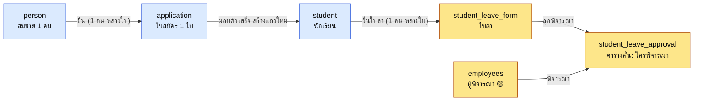

# คู่มืออ่าน ERD ทีม B (สำหรับเนยสด)

> เลขาเขียน 2026-10-13 (plan 92) ให้คนที่ไม่ได้ลงมือทำเองอ่านรู้เรื่อง · คู่มือนี้ช่วยให้อ่านง่ายขึ้น แต่ไม่รับประกันว่าอ่านจบแล้วจะเข้าใจครบ ข้อ 7 ให้นายลงมือเช็คเอง
> ทั้งชุดเป็น**ฉบับเร่งส่งอาจารย์** นายจะออกแบบทับใหม่ทีหลัง

## 1. เปิดอะไรก่อน

เปิดตามลำดับนี้
- **ไฟล์นี้** ก่อน (5 นาที)
- **`erd-by-claude.drawio`** ตัวแผนภาพ แก้ได้ใน draw.io มี 4 หน้า
	- **Chen ภาพรวม** เปิดหน้านี้ก่อน เห็นว่าอะไรต่อกับอะไร
	- **ER เนยสด** ตารางรับสมัคร + ทะเบียน 13 ตาราง
	- **ER แคลร์** ตารางบุคลากร + ลา/บัตรขออนุญาต
	- **จุดเชื่อมสองฝั่ง** ตารางที่สองฝั่งต้องแตะกัน
- **`erd-by-claude.md`** คำอธิบายยาว อ่านแค่หัวข้อ 2.4 กับ 6 ก็พอ โค้ดในหัวข้อ 4 ข้ามได้ มีไว้ให้สร้าง drawio

## 2. เกิดอะไรขึ้นบ้าง

1. ต้นทางมี 3 อย่าง คือ `erd.drawio` (ของเนยสด เพื่อนเจนด้วย AI ยังไม่ตรวจ) · `er-employee.drawio` (ของแคลร์) · รูป Figma ของทั้งโครงการ
2. เลขาเช็คว่าสามอย่างนี้เชื่อมกันยังไง ผลที่เจอ
	- ฝั่งแคลร์ตรงกับ Figma ทุกตารางเท่าที่อ่านได้ (13 ตารางเรื่องบุคลากรกับที่อยู่)
	- Figma มีตารางลาและบัตรขออนุญาตของ**นักเรียน**เพิ่มอีก 6 ตาราง
	- Figma **ไม่มีฝั่งรับสมัครเลย** แต่มีตารางนักเรียน ผู้ปกครอง ห้องเรียน ครู ที่ทับซ้อนกับของเนยสด
3. เลขา**ไม่ได้ออกแบบใหม่** แค่ยกของทั้งสามมารวมเป็นภาพเดียว แล้วแปลงชื่อเป็น snake_case
4. รอบแรกเลขาเข้าใจผิดว่านายอยากได้ md ทำเป็น mermaid ก่อน แล้วทำใหม่เป็น drawio

## 3. ศัพท์ 7 คำ

- **entity** = ตาราง 1 ตาราง เช่น `student` คือตารางนักเรียน
- **PK / FK**
	- PK (คีย์หลัก) = เลขประจำแถว ซ้ำกันไม่ได้ เช่น `student_id`
	- FK (คีย์อ้างอิง) = ช่องที่เก็บเลขของอีกตาราง เช่น `student.person_id` ชี้ไปหา `person`
- **1:N** = ฝั่งหนึ่งมี 1 อีกฝั่งมีหลาย เช่น คน 1 คนยื่นได้หลายใบสมัคร ช่อง FK อยู่ฝั่ง N (`application.person_id`) ไม่ต้องมีตารางใหม่
- **M:N** = ทั้งสองฝั่งมีหลาย เช่น เด็ก 1 คนมีหลายผู้ปกครอง และผู้ปกครอง 1 คนมีหลายเด็ก (พี่น้อง) ต้องมี**ตารางคั่นกลาง** `student_guardians` เก็บคู่ (เด็ก, ผู้ปกครอง)
- **ตารางคั่นกลาง (associative entity)** = ตารางที่เกิดจาก M:N ใน Chen วาดเป็นกรอบครอบข้าวหลามตัด ในหน้า Chen มี 4 ตัว
- **Chen กับ crow's foot**
	- Chen = กล่องกับข้าวหลามตัด ไว้ดูภาพรวมว่าอะไรต่อกับอะไร
	- crow's foot = ตารางพร้อมคอลัมน์ ไว้ใช้ตอนสร้างฐานข้อมูลจริง
- **🟡 สมมติ** = เลขาเดาเอง ยังไม่มีใครในทีมยืนยัน

## 4. เดินเรื่องนักเรียนหนึ่งคน

สมชายสมัครเรียน มอบตัว แล้วเทอมต่อมายื่นใบลา ข้อมูลของเขาวิ่งผ่านตารางพวกนี้

ฟ้า = ฝั่งเนยสด (หน้า ER เนยสด) · เหลือง = ฝั่งแคลร์ (หน้า ER แคลร์)
- `person` ตัวคนจริง ค้นซ้ำด้วยเลขบัตร · `application` ใบสมัครเป็นหลักฐานวันที่ยื่น ไม่แก้ย้อนหลัง
- `student` ถูก**สร้างใหม่**ตอนมอบตัวเสร็จ ไม่ได้ย้ายแถวจากใบสมัคร (มีช่อง `from_application_id` ชี้กลับ)
- ใบลาของแคลร์ชี้มาที่ `student` ของเนยสด จุดนี้เป็นการเชื่อมสองฝั่ง และเป็นเรื่องที่เลขาสมมติ (ข้อ 5 ข้อแรก)

## 5. เลขาตัดสินใจแทนทีม 5 เรื่อง

ทุกเรื่องต้องให้คนในทีมยืนยันก่อนถือเป็นของจริง
1. **`student` ของเนยสดกับ `students` ใน Figma คือตารางเดียวกัน**
	- ทำไม: ถ้าเก็บสองตาราง ต้องมีคนเลือกว่าตัวไหนเป็นตัวหลัก เลขาเลือกของเนยสดเพราะมีตาราง `person` กับ `application` รองรับ
	- ยืนยัน: เนยสด + แคลร์ + ทีม A
2. **`classes` ใน Figma คือ `classroom` ของเนยสด** ยืนยัน: เนยสด + ทีม A
3. **`teachers` กับ `employees` เป็นคนเดียวกัน (1:1)**
	- เส้นใน Figma ยาวข้ามภาพ ปลายเส้นไล่ไม่ถึง เลขาอนุมานเอง
	- ยืนยัน: แคลร์ + ทีม A
4. **ที่อยู่ของสองฝั่งไม่ผูกกัน** ของเนยสดเก็บเป็นข้อความ ของแคลร์ชี้ตารางจังหวัด/อำเภอ/ตำบล แคลร์เขียนโน้ตใน Figma ว่าจะเหลือแค่ตำบล + postcode ยืนยัน: เนยสด + แคลร์
5. **ชื่อตารางเป็น snake_case** นายเลือกเอง แต่แคลร์ยังไม่ตกลง (เล่มตอนนี้ ER บุคลากรเป็น camelCase)

## 6. คำถามที่อาจารย์น่าจะถาม

1. **ทำไมแยก person / application / student สามตาราง**
	- คนเดียวยื่นได้หลายใบ (ปีนี้ไม่ติด ปีหน้าสมัครใหม่) ใบสมัครเป็นหลักฐานห้ามแก้ย้อนหลัง ส่วนนักเรียนย้ายห้องเปลี่ยนสถานะได้
	- ตอบตรง ๆ ได้ว่าแนวคิดนี้มาจากร่างของ AI ที่ทีมยังไม่ได้ตรวจ
2. **M:N คืออะไร ในรูปอยู่ตรงไหน** ตอบด้วยตัวอย่างผู้ปกครอง แล้วชี้กรอบเส้นคู่ `student_guardians` ในหน้า Chen
3. **ทำไมที่อยู่สองฝั่งไม่เหมือนกัน** ต่างคนออกแบบ ทีมยังไม่ได้ตกลงว่าจะใช้ตารางจังหวัด/อำเภอ/ตำบลร่วมกันไหม (เป็นข้อค้างใน `team-b-todo.md`)
4. **ทำไมไม่มีตารางลาของครู หรือตั้งค่าระบบ** ไฟล์ของแคลร์ยังไม่มี และใน Figma ก็ไม่เจอ เลขาไม่ได้ออกแบบแทน
5. **ER นี้ตรวจกับ use case แล้วหรือยัง** **ยังไม่ได้ตรวจ** เป็นฉบับเร่ง ขั้นตรวจ (CRUD matrix) ยังไม่ได้ทำ ดูข้อถัดไปเป็นตัวอย่างที่ไม่ตรงจริง
6. **สถานะนักเรียน 3 ค่า ตรงกับ use case ลาออกไหม** **ไม่ตรง**
	- use case UC-REG-05 (เล่มตารางที่ 3.10) ต้องแยก 4 ประเภท คือ ย้ายสถานศึกษา ลาออก พักการเรียน พ้นสภาพ และเก็บสถานศึกษาปลายทางกับเหตุผล
	- แต่ `student.status` มี 3 ค่า (กำลังศึกษา ย้าย จบ) และไม่มีช่องปลายทาง/เหตุผล ยังเก็บไม่ได้
7. **PK กับ FK คืออะไร** ดูหัวข้อ 3
8. **ทำไมใช้ snake_case** เพื่อให้สองฝั่งเขียนเหมือนกัน (นายเลือก ยังไม่ได้ตกลงกับแคลร์) ฐานข้อมูลที่ทีมใช้อยู่ (PostgreSQL) นิยมแบบนี้

## 7. ให้นายลงมือเช็คเอง 5 อย่างก่อนส่ง

เลขาไม่ทำแทน ลองด้วยตัวเองจะรู้ว่าเข้าใจจริงไหม
1. เปิดหน้า Chen นับกรอบเส้นคู่ ได้กี่ตัว ชื่ออะไรบ้าง
2. เปิดหน้า ER เนยสด หา `application` นับช่อง FK
3. เปิดเล่มตารางที่ 3.10 (UC-REG-05) เทียบกับตาราง `student` ว่ามีที่เก็บครบไหม
4. ถามแคลร์ว่า address จะเหลือแค่ตำบลไหม ถ้าใช่ ER ฝั่งแคลร์ต้องแก้
5. อ่านหัวข้อ 6 ของ `erd-by-claude.md` (จุดสมมติ) แล้วจดข้อที่ไม่เห็นด้วย

## ทดสอบตัวเอง (ตอบก่อนค่อยดูเฉลย)

1. ช่อง FK ของความสัมพันธ์ 1:N อยู่ตารางฝั่งไหน
2. M:N ใน Chen วาดยังไง ยกตัวอย่าง 1 อัน
3. ทำไม `student` ไม่ใช่แถวเดิมของ `application`
4. เรื่องไหนใน ER นี้ที่เลขาเดา ยกมา 2 เรื่อง
5. ER นี้พร้อมส่งเป็นฉบับสุดท้ายไหม

**เฉลย**
1. ฝั่ง N (ตารางลูก)
2. กรอบครอบข้าวหลามตัด เช่น `student_guardians` · อีก 3 ตัวคือ `student_class_histories` `student_leave_setting_type` `student_leave_approval`
3. ใบสมัครเป็นหลักฐาน ณ วันยื่น ห้ามแก้ย้อนหลัง นักเรียนต้องเปลี่ยนห้องเปลี่ยนสถานะได้ จึงสร้างแถวใหม่
4. เช่น `teachers` 1:1 `employees` · `student` ของเนยสดคือตารางเดียวกับ `students` ใน Figma · ผู้พิจารณาใบลาชี้ `employees`
5. ไม่ ยังไม่ผ่านการตรวจกับ use case (CRUD matrix) ยังมีจุดที่ไม่ตรง เช่นสถานะลาออก และยังไม่ได้เรนเดอร์ดูจริงด้วย draw.io
