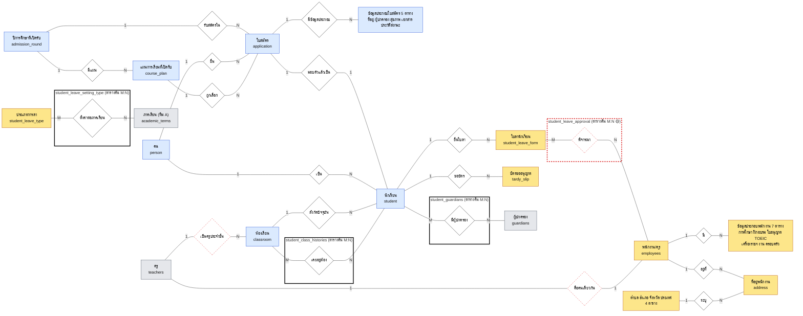
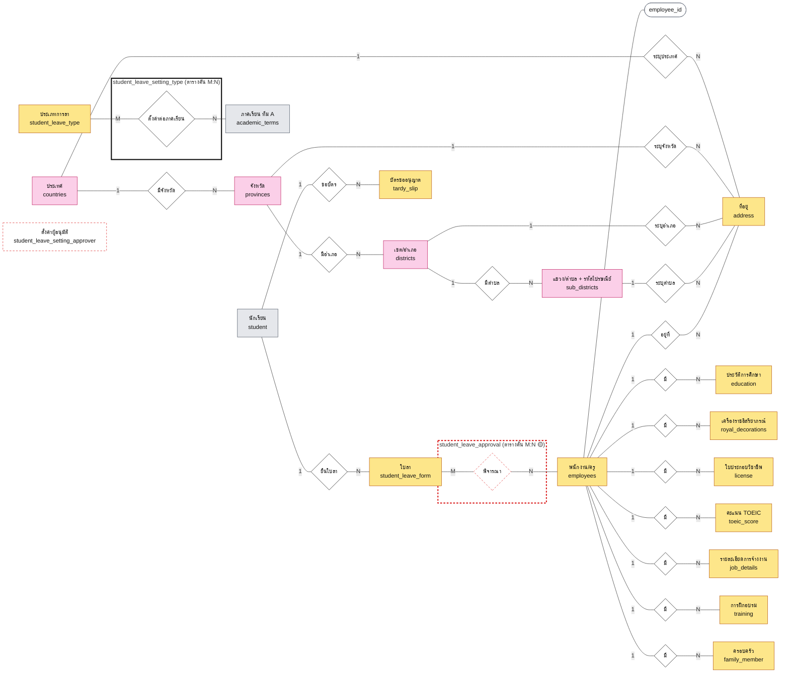
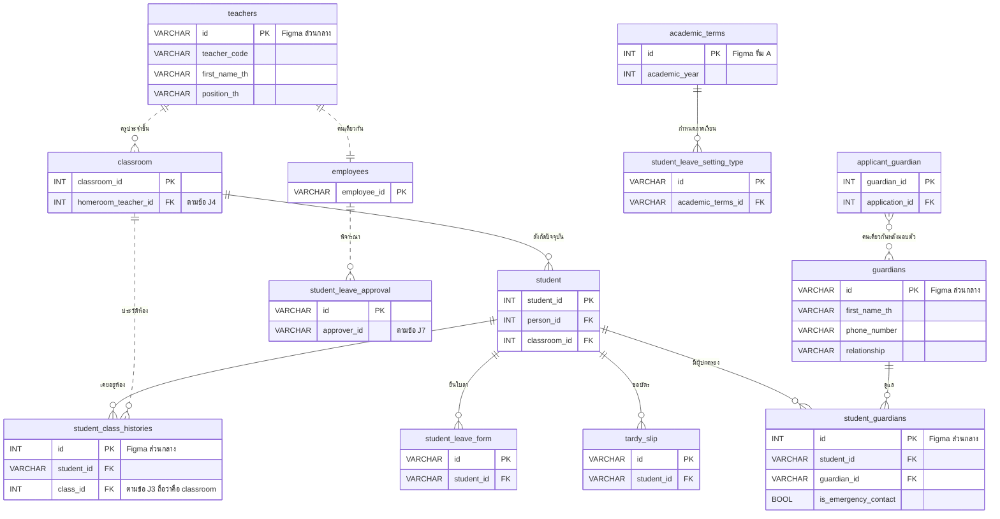

# ERD ทีม B (เนยสด + แคลร์) — ฉบับเร่งส่งอาจารย์

> 👉 **ยังไม่เคยอ่านชุดนี้ เริ่มที่ [`erd-by-claude-guide.md`](erd-by-claude-guide.md) ก่อน** (คู่มืออ่าน 2 หน้า) ไฟล์นี้ยาวและเป็นรายละเอียด

> 📌 **ไฟล์นี้คือคำอธิบายคู่กับ [`erd-by-claude.drawio`](erd-by-claude.drawio)** (ตัวแผนภาพที่แก้ได้ใน draw.io 4 หน้า: Chen ภาพรวม · ER เนยสด · ER แคลร์ · จุดเชื่อม)
> ตารางในหัวข้อ 4 ของไฟล์นี้เป็นแหล่งข้อมูลเดียวที่ใช้สร้าง drawio ถ้าแก้ตาราง ต้องแก้ทั้งสองไฟล์ให้ตรงกัน · ไฟล์นี้มีรายละเอียดแบบ Chen ของแต่ละฝั่ง (3.2 และ 3.3) ที่ drawio ไม่ได้วาด
> เดิมเลขาเข้าใจผิดว่านายต้องการเป็น md ล้วน จึงทำเป็น mermaid ก่อน (แก้ 2026-10-13)

> ⚠️ **ฉบับเร่ง จะออกแบบใหม่ทีหลัง** เนยสดบอกเมื่อ 2026-10-13 ว่าจะออกแบบทับ ไฟล์นี้ไม่ใช่ตัวหลัก
> เลขาเจนให้เมื่อ 2026-10-13 ตาม `plan/90` ในโปรเจกต์เลขา · **ทุกจุดที่เลขาสมมติเองติดป้าย 🟡 สมมติ** และรวมไว้ที่หัวข้อ 6
> ยังไม่มีใครตรวจ · ห้ามเอาลงเล่ม §3.4 จนกว่าทีมจะตัดสินคำถามที่ค้าง

<!-- er-md:head -->
> ⚠️ **แก้ไข 2026-10-14 (plan 102):** ฝั่งเนยสดสร้างใหม่จากโค้ด prototype และผลตัดสิน 8 ข้อของเนยสด ส่วนที่เปลี่ยนคือ §3.2 · §4.1 และหน้า "ER เนยสด" ใน `erd-by-claude.drawio` (18 ตาราง 170 คอลัมน์ กล่อง 3 คอลัมน์) · ส่วนฝั่งแคลร์ (§3.3 §4.2 §5) **ไม่เปลี่ยน**
> ที่ยังเป็นฉบับก่อนเขียนใหม่และรอรอบถัดไป: §3.1 · §2.4 · §6 (ด้านล่างมีป้ายแก้ไขกำกับ) · หน้า "Chen ภาพรวม" และ "จุดเชื่อมสองฝั่ง" ใน drawio · สำเนาของฉบับก่อนเขียนใหม่อยู่ที่ `(delete this)/erd-by-claude.before-prototype-2026-10-14.*` ในโปรเจกต์เลขา

## 0. อ่านก่อน

ไฟล์นี้รวม ER ของสองคนเป็นภาพเดียว ต้นทางมี 3 ไฟล์
- **ฝั่งเนยสด (รับสมัคร + ทะเบียน):** `SchoolDark/erd.drawio` 13 ตาราง ซึ่งเป็นร่างที่เพื่อนเจนด้วย AI ยังไม่ตรวจ
	- > ⚠️ แก้ไข 2026-10-14 (plan 102): ฉบับปัจจุบันของฝั่งเนยสดคือ 18 ตาราง สร้างใหม่จากโค้ด prototype (ดูหัวข้อ 4.1) ข้อความ "13 ตาราง" ข้างบนบอกต้นทางเดิม
- **ฝั่งแคลร์ (บุคลากร):** `materials/doc/er-employee.drawio` 13 ตาราง
- **รูป Figma:** `report-drafts/school-dark/figma-erd-draft.png` (ในโปรเจกต์เลขา) ภาพใหญ่ 26,960 × 12,475 px ใช้เป็นตัวเทียบ และเป็นต้นทางของตารางลา/บัตรขออนุญาตของฝั่งแคลร์

ข้อจำกัดที่ต้องรู้
- Figma เป็น ER ของ**ทั้งโครงการ** (ราว 40 ตาราง) มีตารางทีม A (วิชาการ) และทีม C (ความประพฤติ) ปนอยู่ด้วย เลขาอ่านเฉพาะตารางที่เกี่ยวกับทีม B กับตารางส่วนกลางที่ทีม B ต้องเชื่อมถึง ตารางทีม A/C ที่เหลืออ่านแค่ชื่อ
- ในรูป Figma **ไม่มีตารางฝั่งรับสมัครเลย** ฝั่งเนยสดจึงเทียบได้แค่กับ `erd.drawio` ส่วนตารางส่วนกลางของ Figma (`students` `guardians` `classes` `teachers`) ออกแบบคนละแบบกับ `erd.drawio` ดูหัวข้อ 2.4
- เส้นเชื่อมบางเส้นใน Figma วิ่งไกลข้ามภาพ เลขาไล่ปลายเส้นไม่ได้ครบ เส้นที่อนุมานเอาจะบอกไว้ว่าอนุมาน
- ยังไม่พบตารางลาของครู และตารางตั้งค่าระบบ (ข้อมูลโรงเรียน วันเวลา สิทธิ์ ผู้ลงนาม) ทั้งใน `er-employee.drawio` และใน Figma ทั้งที่ `team-b-todo.md` ระบุว่าเป็นงานของแคลร์

## 1. วิธีอ่านแผนภาพ

### 1.1 แบบ Chen (ใช้ดูภาพรวม)

อ่านเหมือนอ่านประโยค "ใคร ทำอะไร กับอะไร"
- **สี่เหลี่ยม** = สิ่งของที่ระบบเก็บ (entity) เช่น คน ใบสมัคร ห้องเรียน แต่ละอันคือ 1 ตารางในฐานข้อมูล (บางอันรวมหลายตารางไว้ในกล่องเดียว บอกในชื่อกล่อง)
- **ข้าวหลามตัด** = ความสัมพันธ์ ตั้งชื่อเป็นกริยา เช่น "ยื่น" "สังกัด"
- **ตัวเลขบนเส้น** บอกจำนวน
	- `1` = ฝั่งนี้มีได้ 1
	- `N` หรือ `M` = ฝั่งนี้มีได้หลาย
	- ตัวอย่าง: คน `1` — ยื่น — `N` ใบสมัคร อ่านว่า "คน 1 คนยื่นได้หลายใบ"
- **ข้าวหลามตัดเส้นประ** = ความสัมพันธ์ที่เลขาอนุมานเอง ยังไม่มีใครยืนยัน 🟡
- **วงรี** = คุณสมบัติ ใส่เฉพาะตัวระบุหลัก (key) ไม่ใส่ทุกคอลัมน์
- **ความสัมพันธ์ 1:N** ไม่เกิดตารางใหม่ ฝั่ง N เก็บ FK ไว้ในตารางของตัวเอง (เช่น `application.person_id`) วาดเป็นข้าวหลามตัดธรรมดา
- **ความสัมพันธ์ M:N** (หลายต่อหลาย) ในฐานข้อมูลจริงต้องมีตารางคั่นกลาง ในรูป Chen วาดเป็น **associative entity** คือกรอบสี่เหลี่ยมครอบข้าวหลามตัด ชื่อตารางคั่นกลางเขียนอยู่ที่กรอบ
	- drawio ใช้กรอบเส้นคู่ · mermaid ไม่มีเส้นคู่ ใช้ `subgraph` เส้นหนาแทน
	- ตัวเลขบนเส้นของ M:N เป็น `M` กับ `N`
	- `application` ไม่ได้วาดเป็น associative entity เพราะมีตารางลูกของตัวเองและสร้างนักเรียนต่อ จึงเป็น entity ธรรมดา (ในตาราง M:N หัวข้อ 3.1 บอกไว้)

### 1.2 แบบ crow's foot (ใช้ดูตารางจริง)

ตารางพร้อมคอลัมน์ เส้นปลายตีนกา = ฝั่งหลาย
- `||` = ต้องมี 1 · `o|` = มี 0 หรือ 1 · `o{` = มี 0 ถึงหลาย
- `PK` = คีย์หลัก · `FK` = คีย์อ้างอิงตารางอื่น · `UK` = ค่าห้ามซ้ำ
- **เส้นประ** = ความสัมพันธ์ที่เลขาอนุมาน 🟡
- ชื่อตารางกับคอลัมน์ใช้ `snake_case` ทั้งสองฝั่ง (นายเลือกเมื่อ 2026-10-13) ของแคลร์เดิมเป็น camelCase เลขาแปลงชื่อเท่านั้น ไม่เปลี่ยนโครง ตารางเทียบอยู่หัวข้อ 5
- เขียนไว้เฉพาะคอลัมน์ที่ต้นทางมี ไม่เติมคอลัมน์เอง

## 2. ผลเช็ค: Figma กับไฟล์ของแคลร์ เชื่อมกันยังไง

### 2.1 ฝั่งแคลร์: Figma กับ `er-employee.drawio` ตรงกันไหม

ตรงกัน ทั้ง 13 ตาราง เท่าที่อ่านได้จากรูป ชื่อตาราง คอลัมน์ และเส้นเหมือนกัน
- **ที่อ่านจากรูปไม่ครบ 🟡:** `training` อ่านได้ 4 คอลัมน์แรก (training_id, employee_id, training_name, training_type) ส่วน `countries` เห็นแค่หัวตารางในภาพรวม ที่เหลือเลขาถือว่าเหมือนไฟล์ drawio
- **ตารางที่ตรงกัน:** employees · education · royal_decorations · license · toeic_score · job_details · training · family_member · address · countries · provinces · districts · sub_districts
- **เส้นที่ตรงกัน:** employees 1—N ตารางลูกทั้ง 8 ตาราง · countries→provinces→districts→sub_districts เป็นลูกโซ่ 1—N · ทั้ง 4 ระดับต่อเข้า address ด้วยเส้น 1—N
- **ความต่างเดียว:** Figma มีแถวคำอธิบาย `TABLE_INFO` กับตัวอย่างค่าในแต่ละตาราง ไฟล์ drawio ไม่มี (เลขาใช้คำอธิบายนี้เขียนหัวข้อ 3.3)
- **ปัญหาที่ซ้ำกันทั้งสองไฟล์ (เลขาไม่แก้ แค่แจ้ง 🟡)**
	- `royal_decorations` กับ `license` ตั้งชื่อ PK เหมือนกันว่า `licenseNO_PK` (Figma เขียนกำกับว่า "ตั้งตามภาพว่า licenseNO" ดูเหมือนก๊อปมา)
	- `job_details.dapartment` สะกดผิด เลขาเขียนเป็น `department`
	- `provinces.countryID` ไม่มีคำต่อท้าย `_FK` ทั้งที่เป็นคีย์อ้างอิง

### 2.2 สิ่งที่ Figma มีเพิ่มจากไฟล์ของแคลร์

Figma มีตารางสีชมพูเข้มของฝั่งแคลร์เพิ่ม 6 ตาราง เป็นเรื่องลาและบัตรขออนุญาตของ**นักเรียน** (ไม่ใช่ของครู)

| ตาราง | คืออะไร | เส้นที่เห็น |
|---|---|---|
| student_leave_type | ประเภทการลา (ลาป่วย ลากิจ) พร้อมสี วันสูงสุด ต้องมีเอกสารไหม | 1 ประเภท มีได้หลายแถวตั้งค่าต่อภาคเรียน |
| student_leave_setting_type | ตั้งค่าประเภทการลาต่อภาคเรียน (วันสูงสุด ต้องมีเอกสารไหม) | ต่อกับ student_leave_type และกับ `academic_terms` ของทีม A |
| student_leave_setting_approver | ตั้งค่าผู้อนุมัติ | **ไม่เห็นเส้นเชื่อม** และคอลัมน์เหมือน setting_type ทุกตัว ดูเหมือนก๊อปมาแล้วยังไม่แก้ 🟡 |
| student_leave_form | ใบลา 1 ใบของนักเรียน 1 คน | นักเรียน 1—N ใบลา |
| student_leave_approval | บันทึกการพิจารณาใบลาแต่ละครั้ง (สถานะ หมายเหตุ เวลา) | ใบลา 1—N การพิจารณา · มี `approver_id` ("id ของผู้อนุมัติ") |
| tardy_slip | บัตรขออนุญาต (เข้า/ออกห้อง ออกโรงเรียน ออกก่อนเวลา ไปทำหน้าที่ ฯลฯ) | นักเรียน 1—N บัตร |

### 2.3 Figma ทั้งภาพ: สีบอกอะไร

| สีหัวตาราง | ความหมาย | ตัวอย่าง |
|---|---|---|
| ส้ม | ตารางหลัก (entity ต้นทาง) | subjects · curriculums · rooms · teachers · classes · students · employees |
| ฟ้า | ตารางลูก/ตารางเชื่อม/รายการ | academic_terms · teaching_assignments · assignments · attendances · student_scores · student_class_histories · ตารางลูกของ employees · ตารางความประพฤติ |
| เทา | ผู้ปกครอง | guardians · student_guardians |
| ชมพูเข้ม | ลา/บัตรขออนุญาต (ฝั่งแคลร์) | 6 ตารางในหัวข้อ 2.2 |
| ชมพูอ่อน | ข้อมูลอ้างอิงที่อยู่ | countries · provinces · districts · sub_districts |

โน้ตที่เขียนไว้มุมล่างขวาของรูป (ของแคลร์ อ่านได้ตามนี้): "เดี๋ยวไปเพิ่ม postcode แล้วเอา fk อื่นออกจาก address"
- แปลว่า address ตอนนี้ชี้ไปหา 4 ตาราง (ตำบล อำเภอ จังหวัด ประเทศ) แต่แคลร์จะเก็บแค่ตำบล เพราะตำบลรู้ว่าอยู่อำเภอไหน จังหวัดไหน
- ถ้าแคลร์ทำตามนี้ ER ฉบับนี้ต้องแก้ ตอนนี้เลขาวาดตามที่ไฟล์ปัจจุบันเป็น 🟡

### 2.4 จุดเชื่อมระหว่างฝั่งเนยสดกับฝั่งแคลร์/ตารางส่วนกลาง

เป็นหัวใจของงานข้อ 1 ที่นายสั่ง แต่ละจุดบอกว่าสองฝั่งเก็บเรื่องเดียวกันคนละแบบตรงไหน ร่างนี้เลือกอะไร และใครต้องตัดสิน

| # | เรื่อง | ฝั่งเนยสด (`erd.drawio`) | ฝั่งแคลร์ / Figma | ร่างนี้เลือก 🟡 | ใครตัดสิน |
|---|---|---|---|---|---|
| J1 | **นักเรียน** | `person` (ตัวคน เลขบัตร ชื่อ) → `student` (หลังมอบตัว) | Figma `students` ตารางเดียว มีชื่อ วันเกิด เพศ ไม่มี person · ตารางลา/บัตรขออนุญาตของแคลร์ชี้มาที่ตารางนี้ | ให้ `student_leave_form.student_id` และ `tardy_slip.student_id` ชี้ไป `student` ของเนยสด ถือว่า `students` ใน Figma คือ `student` ตัวเดียวกัน | เนยสด + แคลร์ (+ ทีม A เพราะ `students` เป็นตารางส่วนกลาง) |
| J2 | **ผู้ปกครอง** | `applicant_guardian` ผูกกับใบสมัคร (บิดา/มารดา/ผู้ปกครองรวมตารางเดียว) | Figma `guardians` + `student_guardians` ผูกกับนักเรียน (1 เด็กมีได้หลายผู้ปกครอง M:N) | เก็บทั้งสองไว้ ใบสมัครเก็บตอนสมัคร ส่วนนักเรียนที่มอบตัวแล้วใช้ `student_guardians` ยังไม่ได้ลากเส้นระหว่าง `applicant_guardian` กับ `guardians` | เนยสด |
| J3 | **ห้องเรียน** | `classroom` (ปีการศึกษา ระดับ เลขห้อง) กับ `student.classroom_id` (ห้องปัจจุบัน) | Figma `classes` (ชื่อกลุ่ม ครูประจำชั้น ห้อง) กับ `student_class_histories` (นักเรียนกับห้องเป็น M:N เก็บประวัติเลื่อนชั้น) | ถือว่า `classes` = `classroom` · เก็บ `student_class_histories` ไว้เป็นตารางประวัติ ให้ `student.classroom_id` เป็นห้องปัจจุบัน | เนยสด + ทีม A |
| J4 | **ครูประจำชั้น** | `classroom.homeroom_teacher_id` ชี้ไป "SchoolDark" (ระบบบุคลากร) ไม่ได้ระบุตาราง | Figma `classes.homeroom_teacher_FK` ชี้ `teachers` (id, รหัส, ชื่อ, ตำแหน่ง) · เส้นยาวจาก `teachers` ไปเข้า `employees` เป็น `‖—‖` (1 ต่อ 1) | `classroom.homeroom_teacher_id` ชี้ `teachers` · `teachers` 1:1 `employees` **อนุมานจากเส้น ปลายเส้นไม่ได้ไล่ถึงตัวสุดท้าย** | แคลร์ + ทีม A |
| J5 | **ครูซ้ำสองตาราง** | — | `teachers` กับ `employees` เก็บชื่อ/ตำแหน่งซ้ำกัน (teachers มี first_name_th, position_th · employees + job_details มีชื่อ ตำแหน่งครบกว่า) | ไม่ตัด เก็บทั้งคู่ตาม Figma | แคลร์ + ทีม A |
| J6 | **ที่อยู่** | `applicant_address` เก็บ ตำบล/อำเภอ/จังหวัด เป็นข้อความ + zip_code | `address` ชี้ตาราง `sub_districts` `districts` `provinces` `countries` · แคลร์จะเหลือแค่ตำบล + postcode | ไม่ลากเส้นระหว่างสองฝั่ง ใช้ตามต้นทางของใครของมัน | เนยสด + แคลร์ (ข้อ "ตารางที่อยู่ ใช้ร่วมกันไหม" ใน `team-b-todo.md`) |
| J7 | **ผู้อนุมัติใบลา** | — | `student_leave_approval.approver_id` มีคำอธิบายว่า "id ของผู้อนุมัติ" ปลายเส้นวิ่งไกล | ชี้ `employees` (อนุมานจากชื่อคอลัมน์ ไม่ใช่จากปลายเส้น) | แคลร์ |
| J8 | **ผู้ทำรายการ** | `application_status_history.changed_by` · `application.last_edited_by` · `application_document.verified_by` เป็นข้อความ | `employees` | ไม่ผูก FK คงเป็นข้อความตามต้นทาง | เนยสด |
| J9 | **ปีการศึกษา** | `admission_round.academic_year` และ `classroom.academic_year` เป็นตัวเลข | Figma `academic_terms` (ทีม A) เก็บปีการศึกษา/ภาคเรียน · `student_leave_setting_type` ชี้มาที่ตารางนี้ | ไม่ผูก 3 ที่ (ปีเป็นตัวเลขสองที่ กับ academic_terms) | ทุกฝ่าย |
| J10 | **แผนการเรียน/ห้องสอบ** | `course_plan` (แผนที่เปิดรับต่อรอบ) · `exam_room` (ชื่อห้องเป็นข้อความ) | Figma `curriculums` (แผนการเรียนหลักของโรงเรียน) · `rooms` (ห้องกายภาพ ความจุ) | ไม่ผูก คงตามต้นทาง | เนยสด + ทีม A |
| J11 | **ผู้ใช้/บทบาท (login)** | ไม่มีตาราง | `employees.role` เป็นข้อความ ไม่มีตาราง user/role | ไม่เติม ตรงกับข้อ "ใครถือ login/token" ใน `team-b-todo.md` | ทั้งคู่ |

<!-- er-md:s24 -->
> ⚠️ แก้ไข 2026-10-14: คอลัมน์ "ฝั่งเนยสด (`erd.drawio`)" ของตารางด้านบนอ้างฉบับเดิม ผลตัดสินใหม่ที่กระทบแถวในตาราง · J1 คง `person`→`application`→`student` 3 ตาราง · J2 ผู้ปกครองที่ฟอร์มตั้งค่าได้ไปอยู่ `application.extra_fields` · J10 `exam_room` ผูก FK ไป `school_room` (ห้องกายภาพ ไม่เก็บชื่อห้องเป็นข้อความแล้ว) · J9 ปีการศึกษาหนึ่งมีได้หลายรอบ คงตาราง `admission_round` · รายละเอียดดู `er-nuesod-new-vs-old.md` หัวข้อ 7

## 3. Chen: ภาพรวมก่อน แล้วค่อยลงรายละเอียด

### 3.1 ภาพรวมทีม B

รวมทั้งสองฝั่ง กล่องหนึ่งอาจรวมหลายตาราง ตารางคั่นกลางของ M:N วาดเป็นกรอบหนาครอบข้าวหลามตัด (associative entity) ชื่อตารางอยู่บนกรอบ

**สีกล่อง:** ฟ้า = ฝั่งเนยสด · เหลือง = ฝั่งแคลร์ · เทา = ตารางส่วนกลาง (Figma ทีม A) · ข้าวหลามตัดเส้นประแดง = อนุมาน 🟡 · **กรอบหนา = ตารางคั่นกลางของ M:N**

**ความสัมพันธ์แต่ละอัน แปลเป็นภาษางาน**

| ข้าวหลามตัด | อ่านว่า | ตัวอย่าง |
|---|---|---|
| มีแผน | 1 รอบรับสมัครเปิดได้หลายแผนการเรียน | รอบปี 2569 เปิด ม.1 วิทย์-คณิต กับ Gifted |
| รับสมัครใน | 1 รอบมีใบสมัครได้หลายใบ | รอบปี 2569 มี 300 ใบ |
| ยื่น | 1 คนยื่นได้หลายใบ (ต่างรอบ) | ปีนี้ไม่ติด ปีหน้าสมัครใหม่ |
| ถูกเลือก | 1 แผนถูกเลือกได้หลายใบ (ใบสมัครเลือกอันดับ 1 และ 2) | แผนวิทย์-คณิตถูกเลือกอันดับ 1 โดย 120 ใบ |
| มีข้อมูลประกอบ | 1 ใบสมัครมีที่อยู่ ผู้ปกครอง เอกสาร ฯลฯ ได้หลายแถว (สุขภาพมีได้ 1 แถว) | ใบสมัครมีที่อยู่ 2 ชุด (ทะเบียนบ้าน/ปัจจุบัน) |
| มอบตัวแล้วเป็น | ใบสมัครที่มอบตัวเสร็จสร้างนักเรียนขึ้นมา 1 คน | ใบ APP-2569-0001 กลายเป็น STD-2569-0001 |
| เป็น | 1 คนเป็นนักเรียนได้หลายแถว (เช่น ม.3 แล้วต่อ ม.4) | — |
| สังกัดปัจจุบัน | 1 ห้องมีนักเรียนได้หลายคน (ห้องที่นักเรียนอยู่ตอนนี้) | ม.1/1 มีนักเรียน 40 คน |
| เคยอยู่ห้อง (กรอบ `student_class_histories`) | **M:N** นักเรียน 1 คนเคยอยู่หลายห้องตามปี และ 1 ห้องมีนักเรียนหลายคน เก็บประวัติเลื่อนชั้น | ม.1/1 ปี 2569 แล้วย้ายไป ม.2/3 ปี 2570 |
| มีผู้ปกครอง (กรอบ `student_guardians`) | **M:N** 1 เด็กมีหลายผู้ปกครอง และ 1 ผู้ปกครองมีหลายเด็ก | พี่น้องที่มีผู้ปกครองคนเดียวกัน |
| ยื่นใบลา · ขอบัตร | 1 นักเรียนมีใบลา/บัตรได้หลายใบ | — |
| พิจารณา 🟡 (กรอบ `student_leave_approval`) | **M:N** 1 ใบลาถูกพิจารณาได้หลายครั้ง/หลายคน และ 1 พนักงานพิจารณาได้หลายใบลา (ปลายฝั่งพนักงานเป็นการอนุมาน) | รอผอ. แล้วอนุมัติ |
| ตั้งค่าต่อภาคเรียน (กรอบ `student_leave_setting_type`) | **M:N** ประเภทการลาแต่ละแบบตั้งค่าได้ต่างกันในแต่ละภาคเรียน | ลาป่วยเทอม 1 ไม่เกิน 5 วัน |
| มี · อยู่ที่ · ระบุ | พนักงาน 1 คนมีข้อมูลประกอบ/ที่อยู่ได้หลายแถว · ที่อยู่ระบุตำบล อำเภอ จังหวัด ประเทศ | — |
| เป็นครูประจำชั้น 🟡 | 1 ครูเป็นครูประจำชั้นได้หลายห้อง | — |
| คือคนเดียวกัน 🟡 | `teachers` 1 แถวตรงกับ `employees` 1 แถว | — |

**M:N ทั้งหมดที่เจอ และตารางคั่นกลาง**

| ฝั่งหนึ่ง | อีกฝั่ง | ตารางคั่นกลาง | วาดเป็น associative entity | ที่มา |
|---|---|---|---|---|
| คน (person) | รอบรับสมัคร / แผนการเรียน | `application` | ไม่ วาดเป็น entity ธรรมดา เพราะเป็นตารางหลักที่มีตารางลูกของตัวเอง (ที่อยู่ เอกสาร ฯลฯ) และสร้างนักเรียนต่อ | erd.drawio |
| นักเรียน | ผู้ปกครอง | `student_guardians` | ใช่ | Figma |
| นักเรียน | ห้องเรียน (ประวัติ) | `student_class_histories` | ใช่ | Figma |
| ประเภทการลา | ภาคเรียน | `student_leave_setting_type` | ใช่ | Figma |
| ใบลา | พนักงานผู้พิจารณา | `student_leave_approval` 🟡 | ใช่ (เส้นประแดง) | Figma + อนุมาน |

### 3.2 รายละเอียดฝั่งเนยสด (รับสมัคร + ทะเบียน)

สร้างใหม่ 2026-10-14 (plan 102) จากสเปกเดียวกับหัวข้อ 4.1 (18 ตาราง) แสดงเป็นตารางความสัมพันธ์ ไม่ใช้แผนภาพ mermaid

**ความสัมพันธ์ระหว่างตาราง**

| ตารางแม่ | ความสัมพันธ์ | ตารางลูก | ความถี่ |
|---|---|---|---|
| `admission_round` | มีแผน | `course_plan` | 1 ต่อ หลาย (ลูกต้องมีแม่) |
| `admission_round` | รับสมัครใน | `application` | 1 ต่อ หลาย (ลูกต้องมีแม่) |
| `course_plan` | มีห้องสอบ | `exam_room` | 1 ต่อ หลาย (ลูกต้องมีแม่) |
| `school_room` | ใช้เป็นห้องสอบ | `exam_room` | 1 ต่อ หลาย (ลูกอาจไม่มีแม่) |
| `course_plan` | เลือกอันดับ 1 / 2 | `application` | 1 ต่อ หลาย (ลูกต้องมีแม่) |
| `exam_room` | จัดที่นั่ง | `application` | 1 ต่อ หลาย (ลูกอาจไม่มีแม่) |
| `person` | ยื่นได้หลายใบ | `application` | 1 ต่อ หลาย (ลูกต้องมีแม่) |
| `person` | เป็นนักเรียน | `student` | 1 ต่อ หลาย (ลูกต้องมีแม่) |
| `application` | มอบตัวแล้วสร้างใหม่ | `student` | 0 หรือ 1 ต่อ 0 หรือ 1 |
| `classroom` | สังกัด | `student` | 1 ต่อ หลาย (ลูกต้องมีแม่) |
| `application` | มีที่อยู่ | `applicant_address` | 1 ต่อ หลาย (ลูกต้องมีแม่) |
| `application` | มีผู้ปกครอง | `applicant_guardian` | 1 ต่อ หลาย (ลูกต้องมีแม่) |
| `application` | มีสุขภาพ | `applicant_health` | 1 ต่อ 0 หรือ 1 |
| `application` | แนบเอกสาร | `application_document` | 1 ต่อ หลาย (ลูกต้องมีแม่) |
| `application` | บันทึกสถานะ | `application_status_history` | 1 ต่อ หลาย (ลูกต้องมีแม่) |

ตารางที่ไม่มีเส้นเชื่อม (ตั้งค่า/อ้างอิง): `field_definition` · `student_column_setting` · `email_template` · `system_setting` · `activity_log`

**แต่ละตารางคืออะไร**

| ตาราง | สรุปสั้น (ตรงกับแถบในกล่อง drawio) | เก็บอะไร | ที่มาของหลักฐาน |
|---|---|---|---|
| `admission_round` | รอบรับสมัครของแต่ละปีการศึกษา ปีหนึ่งมีได้หลายรอบ | เก็บรอบการรับสมัครนักเรียน ปีการศึกษาหนึ่งมีได้หลายรอบ ใช้เป็นตัวยึดให้แผนการเรียนและใบสมัครอยู่ในรอบเดียวกัน | E |
| `course_plan` | แผนการเรียนที่เปิดรับต่อรอบ พร้อมกำหนดการ 6 วัน | เก็บแผนการเรียนที่เปิดรับสมัครในแต่ละรอบ พร้อมกำหนดการสำคัญ 6 วันของแผนนั้น (เปิด-ปิดรับสมัคร วันสอบ วันประกาศผล วันรายงานตัว วันมอบตัว) ซึ่ง UC-SET-ADM-03 กำหนดว่าต้องระบุครบทุกช่วงและเรียงลำดับก่อนหลังถูกต้องจึงจะบันทึกได้ | P |
| `exam_room` | ห้องสอบของแต่ละแผน ชี้ไปห้องกายภาพที่ใช้สอบ | เก็บห้องสอบคัดเลือกของแต่ละแผนการเรียน โดยชี้ไปห้องกายภาพ (school_room) ที่ใช้สอบ ผู้สมัครแต่ละคนถูกจัดที่นั่งเข้าห้องสอบห้องใดห้องหนึ่ง ผังโต๊ะรายรอบยังไม่อยู่ในขอบเขต | P |
| `school_room` | ห้องกายภาพของโรงเรียน ชื่อ อาคาร ชั้น ความจุ | เก็บห้องกายภาพของโรงเรียน ได้แก่ ชื่อห้อง อาคาร ชั้น และความจุที่นั่ง ตารางห้องสอบอ้างถึงเพื่อรู้ว่าสอบได้ห้องละกี่คน ฝ่ายวิชาการนำไปใช้ต่อกับตารางสอบ | P+U |
| `field_definition` | ช่องในฟอร์มสมัคร/นักเรียนที่โรงเรียนตั้งค่าได้ | เก็บนิยามช่องข้อมูลของแบบฟอร์มรับสมัครและแบบฟอร์มนักเรียน ว่ามีช่องอะไร อยู่หมวดไหน ชื่อที่แสดงคืออะไร และบังคับกรอกหรือไม่ ตั้งค่าได้ชุดเดียวใช้ทุกรอบ โรงเรียนจึงปรับแบบฟอร์มได้โดยไม่ต้องแก้โปรแกรม | P |
| `student_column_setting` | คอลัมน์ที่แสดงในตารางรายชื่อนักเรียน | เก็บการตั้งค่าคอลัมน์ของตารางรายชื่อนักเรียน ว่าแสดงคอลัมน์ไหน เรียงอย่างไร และคอลัมน์ไหนเป็นคอลัมน์หลัก | P+U |
| `email_template` | แบบร่างอีเมลสำเร็จรูปสำหรับแจ้งผลผู้ปกครอง | เก็บแบบร่างอีเมลสำเร็จรูปที่เจ้าหน้าที่เลือกใช้ตอนส่งอีเมลแจ้งผลหรือแจ้งเตือนไปยังผู้ปกครองของผู้สมัคร | P+U |
| `system_setting` | ค่าตั้งค่าระบบ เช่น รูปแบบรหัสนักเรียน | เก็บค่าตั้งค่าระบบเป็นคู่ชื่อกับค่า ตอนนี้ใช้กำหนดรูปแบบรหัสนักเรียน เพื่อให้โรงเรียนปลายทางเลือกได้เองว่าจะใช้แบบ 68001 หรือ STD-2568-0001 | นายตัดสิน |
| `activity_log` | ประวัติการทำรายการของเจ้าหน้าที่ | เก็บประวัติการทำรายการของเจ้าหน้าที่ เช่น เปลี่ยนสถานะ แก้ไขข้อมูล ส่งอีเมล ส่งออกเอกสาร ใช้แทนตารางประวัติแยกของแต่ละ Use Case | P |
| `person` | ตัวบุคคลจริง 1 คนต่อ 1 แถว ค้นซ้ำด้วยเลขบัตร | เก็บข้อมูลตัวบุคคลจริง 1 คนต่อ 1 แถว ค้นซ้ำได้ด้วยเลขประจำตัวประชาชน คนเดียวกันยื่นใบสมัครได้หลายใบ และเมื่อมอบตัวแล้วถูกอ้างถึงจากตารางนักเรียน | P+E |
| `application` | ใบสมัครแต่ละใบ ติดตามสถานะจากสมัครถึงมอบตัว | เก็บใบสมัครแต่ละใบ เป็นหลักฐานของการยื่นสมัคร ณ วันที่ยื่น คนเดียวกันยื่นได้หลายใบ (หลายรอบหรือหลายปี) จึงแยกจากตารางบุคคล ใบสมัครเป็นข้อมูลที่ใช้ติดตามสถานะตลอดการคัดเลือกจนถึงมอบตัว | P |
| `applicant_address` | ที่อยู่ผู้สมัคร ตามทะเบียนบ้านและปัจจุบัน | เก็บที่อยู่ของผู้สมัครในใบสมัครแต่ละใบ แยกเป็นที่อยู่ตามทะเบียนบ้านกับที่อยู่ปัจจุบัน เก็บเป็นข้อความ ไม่ผูกกับตารางจังหวัด อำเภอ ตำบล | P |
| `applicant_guardian` | บิดา มารดา ผู้ปกครองของผู้สมัคร ช่องทางติดต่อ | เก็บข้อมูลบิดา มารดา และผู้ปกครองของผู้สมัครในใบสมัครแต่ละใบ ใบสมัครหนึ่งใบมีได้หลายแถว ใช้เป็นช่องทางติดต่อและเป็นปลายทางของอีเมลแจ้งผล | P |
| `applicant_health` | ข้อมูลสุขภาพของผู้สมัคร 1 แถวต่อใบสมัคร | เก็บข้อมูลสุขภาพของผู้สมัคร 1 แถวต่อใบสมัคร 1 ใบ | P |
| `application_document` | เอกสารแนบใบสมัคร และผลตรวจของเจ้าหน้าที่ | เก็บเอกสารหลักฐานที่ผู้สมัครอัปโหลดแนบใบสมัคร และผลการตรวจเอกสารแต่ละฉบับของเจ้าหน้าที่ | U+E |
| `application_status_history` | ประวัติการเปลี่ยนสถานะ ใช้ย้อนกลับรายการ | เก็บประวัติการเปลี่ยนสถานะของใบสมัครทุกครั้ง ว่าเปลี่ยนจากสถานะใด เป็นสถานะใด โดยใคร เมื่อใด ใช้รองรับการย้อนกลับรายการ | U+E |
| `classroom` | ห้องเรียนต่อปีการศึกษา ระดับชั้น เลขห้อง | เก็บห้องเรียนของแต่ละปีการศึกษา ระบุระดับชั้นและเลขห้อง เช่น ม.1 ห้อง 1 นักเรียนแต่ละคนอยู่ในห้องเรียนหนึ่งห้อง (ห้องเรียนในที่นี้ไม่ใช่ห้องกายภาพ ดูภาค C) | P+E |
| `student` | นักเรียนที่มอบตัวแล้ว สถานะ ห้อง การจำหน่ายออก | เก็บนักเรียนที่มอบตัวแล้วหรือบันทึกเข้าทะเบียนโดยตรง ถูกสร้างเป็นแถวใหม่ตอนมอบตัวเสร็จ (ไม่ได้ย้ายแถวจากใบสมัคร) จึงมีช่องชี้กลับไปยังใบสมัครต้นทาง นักเรียนอยู่ในห้องเรียนหนึ่งห้องและมีสถานะของตนเอง | P |

ที่มาของหลักฐาน: P = โค้ด prototype · U = Use Case ในเล่ม §3.3.5 · E = ER เดิมอย่างเดียว · นายตัดสิน = ผลตัดสินของเนยสด 2026-10-14

### 3.3 รายละเอียดฝั่งแคลร์ (บุคลากร + ลา/บัตรขออนุญาต)

`student_leave_setting_approver` อยู่ในกรอบเส้นประเพราะไม่เห็นเส้นเชื่อมและคอลัมน์เหมือน `student_leave_setting_type` 🟡 จึงไม่ได้ลากเส้นให้ (ไม่มีข้อมูลว่าเชื่อมกับอะไร)

**แต่ละกล่องคืออะไร (คำอธิบายจากแถว `TABLE_INFO` ใน Figma ถ้ามี)**

| ตาราง | คืออะไร | ที่มาของคำอธิบาย |
|---|---|---|
| employees | ข้อมูลหลักของพนักงาน/ครู (ชื่อไทย-อังกฤษ เลขบัตร วันเกิด เพศ หมู่เลือด สัญชาติ ศาสนา เบอร์ อีเมล บทบาท) | Figma |
| education | ประวัติการศึกษา (วุฒิ สาขา สถาบัน ปีที่จบ เกรด) | Figma |
| royal_decorations | ประวัติเครื่องราชอิสริยาภรณ์ (ชั้น วันที่ได้รับ ราชกิจจานุเบกษา) | Figma |
| license | ใบประกอบวิชาชีพ (ประเภท วันออก วันหมดอายุ) | Figma |
| toeic_score | ผลคะแนนภาษาอังกฤษ (คะแนน วันหมดอายุ ลิงก์เอกสาร) | Figma |
| job_details | รายละเอียดการจ้างงาน (ตำแหน่ง แผนก วันเริ่ม เงินเดือน สถานะการทำงาน) | Figma |
| training | การฝึกอบรม (ชื่อ ประเภท ผู้จัด วันที่ ชั่วโมง สถานที่ ค่าใช้จ่าย) | ชื่อคอลัมน์ในไฟล์ |
| family_member | ข้อมูลครอบครัวพนักงาน (ความสัมพันธ์ สถานะสมรส สถานะการมีชีวิต อาชีพ) | Figma |
| address | ที่อยู่ของพนักงาน (บ้านเลขที่ หมู่ ซอย ถนน + ตำบล อำเภอ จังหวัด ประเทศ + ประเภท) | Figma |
| countries · provinces · districts · sub_districts | ข้อมูลอ้างอิงที่อยู่ 4 ระดับ ตำบลเก็บรหัสไปรษณีย์ | Figma |
| student_leave_type · student_leave_setting_type · student_leave_setting_approver | ประเภทการลา และการตั้งค่าต่อภาคเรียน | Figma (ไม่มีคำอธิบาย) |
| student_leave_form · student_leave_approval | ใบลา และบันทึกการพิจารณา | Figma (ไม่มีคำอธิบาย) |
| tardy_slip | บัตรขออนุญาต 6 ประเภท (เข้าห้อง ออกห้อง ออกโรงเรียน ออกก่อนเวลา ไปทำหน้าที่ อื่น ๆ) พร้อมช่วงวัน/เวลา และสถานะ 3 ค่า | Figma |

## 4. Crow's foot: ตารางพร้อมคอลัมน์

### 4.1 ฝั่งเนยสด (รับสมัคร + ทะเบียน)

**สร้างใหม่ 2026-10-14 (plan 102)** จากสเปก `report-drafts/school-dark/er-tools/er_nuesod_spec.py` ในโปรเจกต์เลขา ด้วยสคริปต์ `er_md.py` ห้ามแก้บล็อกนี้ด้วยมือ ให้แก้ที่สเปกแล้วรันสคริปต์ใหม่
สเปกอ่านโค้ด prototype (`uxui-merged/`) แล้วเทียบกับ Use Case ในเล่ม §3.3.5 และ `erd.drawio` เดิม **18 ตาราง 170 คอลัมน์** · ที่มาของแต่ละคอลัมน์ ผลตัดสินของเนยสด 8 ข้อ และรายการที่เปลี่ยนจากฉบับเดิม อยู่ใน `report-drafts/school-dark/er-nuesod-new-vs-old.md`
- ชนิดข้อมูลของ `..._id` ที่เป็น INT และ `created_at` `updated_at` เป็นการเดา 🟡 เพราะ prototype เก็บใน localStorage ไม่มีชนิดข้อมูลให้ยืนยัน
- ฟอร์มรับสมัครมี 166 ช่อง ช่องที่ไม่มีคอลัมน์ของตัวเองเก็บใน `application.extra_fields` (JSONB)
- กล่องใน drawio หน้า "ER เนยสด" แสดง 3 คอลัมน์ (คีย์ | ชื่อคอลัมน์ | คำอธิบายสั้น) ความหมายเต็มดู `data-dictionary.md`

```mermaid
erDiagram
    admission_round {
        INT round_id PK
        INT academic_year "เช่น 2568"
        VARCHAR name
        BOOL is_open
        TIMESTAMPTZ created_at
    }
    course_plan {
        INT plan_id PK
        INT round_id FK
        VARCHAR level "ม.1 / ม.4"
        VARCHAR name "Gifted / ทั่วไป / วิทย์-คณิต / ศิลป์-คำนวณ / ศิลป์-ภาษา / คอมพิวเตอร์และเทคโนโลยี"
        INT capacity "จำนวนรับ"
        TEXT regulations
        DATE apply_start
        DATE apply_end
        DATE exam_date
        DATE announce_date
        DATE report_date
        DATE enroll_date
    }
    exam_room {
        INT exam_room_id PK
        INT plan_id FK
        INT school_room_id FK "ห้องกายภาพที่ใช้สอบ ชื่อห้องอ่านจาก school_room.name"
        VARCHAR name "ห้องสอบที่ 1"
        INT capacity
    }
    school_room {
        INT room_id PK
        VARCHAR name "ห้อง 321 ห้ามซ้ำในอาคารเดียวกัน"
        VARCHAR building "อาคาร 3"
        INT floor "ชั้น"
        INT capacity "ความจุตอนสอบ ฝ่ายวิชาการใช้ต่อ"
    }
    field_definition {
        INT field_id PK
        ENUM form_type "admission / student"
        VARCHAR section_key "personal / registered_address / current_address / father / mother / guardian / education / health / documents (9 หมวด)"
        VARCHAR group_name "ข้อมูลทั่วไป / ชื่อและคำนำหน้า ฯลฯ"
        VARCHAR field_key "เช่น citizen_id first_name_th"
        VARCHAR label_th
        VARCHAR label_en
        VARCHAR field_no "เลขกำกับในฟอร์ม เช่น 12."
        BOOL is_required
        BOOL is_header "หัวข้อกลุ่มเอกสาร ไม่ใช่ช่องกรอก"
        INT display_order
        BOOL is_active
    }
    student_column_setting {
        VARCHAR column_id PK "seq studentId firstName ฯลฯ"
        VARCHAR label_th
        VARCHAR field_key "ชื่อฟิลด์ในระเบียนนักเรียน รองรับ path เช่น examScore.gpa"
        BOOL is_visible
        BOOL is_primary "คอลัมน์หลัก มีได้ 1 คอลัมน์ ซ่อนไม่ได้"
        BOOL is_locked "คอลัมน์ระบบ ลบไม่ได้ แก้ได้เฉพาะชื่อแสดง"
        VARCHAR align "left / center"
        INT display_order
    }
    email_template {
        VARCHAR template_key PK "passed / failed / missing_docs / fee_reminder"
        VARCHAR label
        VARCHAR subject "มีตัวแปรเช่น [ชื่อนักเรียน]"
        TEXT body
    }
    system_setting {
        VARCHAR setting_key PK "เช่น student_code_format"
        VARCHAR value "เช่น {YY}{SEQ3} (68001) หรือ STD-{YYYY}-{SEQ4}"
        VARCHAR description
        TIMESTAMPTZ updated_at
    }
    activity_log {
        INT log_id PK
        TIMESTAMPTZ occurred_at
        TEXT action "ข้อความอธิบายรายการ"
        VARCHAR status "info / success"
        VARCHAR user_name
    }
    person {
        INT person_id PK
        CHAR citizen_id UK "13 หลัก"
        VARCHAR prefix "เด็กชาย / เด็กหญิง / นาย / นางสาว"
        VARCHAR first_name_th
        VARCHAR last_name_th
        VARCHAR full_name_en
        DATE dob
        ENUM gender "male / female"
        VARCHAR nationality
        VARCHAR religion
        TIMESTAMPTZ created_at
        TIMESTAMPTZ updated_at
    }
    application {
        INT application_id PK
        VARCHAR applicant_code UK "APP-2568-0001"
        INT person_id FK
        INT round_id FK
        INT plan_choice_1 FK
        INT plan_choice_2 FK "NULL ได้"
        INT exam_room_id FK "NULL ได้"
        VARCHAR grade_level "ม.1 ถึง ม.6"
        VARCHAR seat_number "เลขที่นั่งสอบ"
        VARCHAR prev_school_name
        VARCHAR prev_school_province
        VARCHAR prev_degree
        DECIMAL gpax "คะแนนเฉลี่ยสะสม"
        DECIMAL score_raw "คะแนนสอบดิบ"
        ENUM status "unpaid_exam_fee / paid_exam_fee / awaiting_results / passed / reserve / failed / not_reported / reported / enrolled"
        BOOL fee_paid
        TIMESTAMPTZ fee_paid_at "NULL ได้"
        VARCHAR payment_slip_url "NULL ได้"
        INT reserve_rank "NULL ได้ ลำดับตัวสำรอง"
        BOOL documents_complete
        JSONB extra_fields "ช่องจากฟอร์มตั้งค่าที่ไม่มีคอลัมน์ เช่น father.company mother.monthly_income"
        TIMESTAMPTZ applied_at
        TIMESTAMPTZ status_changed_at
        VARCHAR last_edited_by
        TIMESTAMPTZ last_edited_at
    }
    applicant_address {
        INT address_id PK
        INT application_id FK
        ENUM address_type "registered / current"
        VARCHAR house_code "NULL ได้ รหัสประจำบ้าน"
        VARCHAR house_no
        VARCHAR moo
        VARCHAR soi
        VARCHAR road
        VARCHAR sub_district
        VARCHAR district
        VARCHAR province
        CHAR zip_code
    }
    applicant_guardian {
        INT guardian_id PK
        INT application_id FK
        ENUM role "father / mother / guardian"
        VARCHAR relationship "เฉพาะ guardian"
        VARCHAR full_name
        VARCHAR phone
        VARCHAR email "NULL ได้"
        VARCHAR occupation
        ENUM address_same_as "NULL ได้"
        BOOL is_primary_contact
    }
    applicant_health {
        INT health_id PK
        INT application_id FK "1:1"
        VARCHAR blood_type
        DECIMAL weight "กก."
        DECIMAL height "ซม."
        TEXT chronic_disease
        TEXT drug_allergy
        TEXT food_allergy
    }
    application_document {
        INT document_id PK
        INT application_id FK
        VARCHAR doc_type "เช่น birth_cert student_house_reg transcript_front payment_slip"
        VARCHAR file_path
        VARCHAR file_name
        VARCHAR mime_type
        BIGINT file_size
        TIMESTAMPTZ uploaded_at
        ENUM verify_status "pending / ok / reject"
        VARCHAR verified_by
        TIMESTAMPTZ verified_at
        TEXT reject_reason
    }
    application_status_history {
        INT history_id PK
        INT application_id FK
        ENUM from_status "ค่าชุดเดียวกับ application.status"
        ENUM to_status "ค่าชุดเดียวกับ application.status"
        VARCHAR changed_by
        TIMESTAMPTZ changed_at
        TEXT note
    }
    classroom {
        INT classroom_id PK
        INT academic_year
        VARCHAR level "ม.1 ถึง ม.6"
        INT room_no "1 ถึง 5"
        VARCHAR major "แผนการเรียนของห้อง เช่น วิทย์-คณิต"
        INT capacity
        INT homeroom_teacher_id "ชี้ระบบบุคลากร ไม่ระบุตาราง"
    }
    student {
        INT student_id PK
        VARCHAR student_code UK "VARCHAR(20) รูปแบบตาม system_setting เช่น 68001 หรือ STD-2568-0001"
        INT person_id FK
        INT from_application_id FK "NULL ได้ ว่างเมื่อเพิ่มนักเรียนตรง ๆ"
        INT classroom_id FK
        INT class_no "เลขที่ในห้อง จัดใหม่อัตโนมัติ ชายก่อนหญิง"
        INT entry_year "ปี พ.ศ. ที่เข้าเรียน"
        DATE enrolled_at
        ENUM status "enrolled / graduated / resigned / transferred / dismissed / on_leave"
        TIMESTAMPTZ status_changed_at
        DATE status_effective_date "NULL ได้"
        VARCHAR destination_school "NULL ได้ สถานศึกษาปลายทาง"
        TEXT status_note "NULL ได้ เหตุผลการจำหน่ายออก"
        VARCHAR former_school "NULL ได้ รับย้ายเข้า"
        TEXT transfer_in_note "NULL ได้"
        VARCHAR last_edited_by
        TIMESTAMPTZ last_edited_at
    }

    admission_round ||--o{ course_plan : "มีแผน"
    admission_round ||--o{ application : "รับสมัครใน"
    course_plan ||--o{ exam_room : "มีห้องสอบ"
    school_room |o--o{ exam_room : "ใช้เป็นห้องสอบ"
    course_plan ||--o{ application : "เลือกอันดับ 1 / 2"
    exam_room |o--o{ application : "จัดที่นั่ง"
    person ||--o{ application : "ยื่นได้หลายใบ"
    person ||--o{ student : "เป็นนักเรียน"
    application |o--o| student : "มอบตัวแล้วสร้างใหม่"
    classroom ||--o{ student : "สังกัด"
    application ||--o{ applicant_address : "มีที่อยู่"
    application ||--o{ applicant_guardian : "มีผู้ปกครอง"
    application ||--o| applicant_health : "มีสุขภาพ"
    application ||--o{ application_document : "แนบเอกสาร"
    application ||--o{ application_status_history : "บันทึกสถานะ"
```

### 4.2 ฝั่งแคลร์ (บุคลากร + ลา/บัตรขออนุญาต)

13 ตารางแรกยกจาก `er-employee.drawio` (ตรงกับ Figma) 6 ตารางสุดท้ายยกจาก Figma ล้วน ๆ ชื่อเปลี่ยนเป็น snake_case เท่านั้น

```mermaid
erDiagram
    employees {
        VARCHAR employee_id PK
        VARCHAR th_title
        VARCHAR en_title
        VARCHAR th_first_name
        VARCHAR th_last_name
        VARCHAR en_first_name
        VARCHAR en_last_name
        VARCHAR id_number "เลขบัตรประชาชน"
        DATE dob
        VARCHAR gender
        VARCHAR blood_group
        VARCHAR nationality
        VARCHAR religious
        VARCHAR phone_number
        VARCHAR email
        VARCHAR role "ข้อความ ไม่มีตารางบทบาท"
    }
    education {
        VARCHAR education_id PK
        VARCHAR employee_id FK
        VARCHAR degree
        VARCHAR major
        VARCHAR institution
        VARCHAR graduate_year
        DECIMAL gpa
    }
    royal_decorations {
        VARCHAR license_no PK "ต้นทางตั้งซ้ำกับ license"
        VARCHAR employee_id FK
        VARCHAR decoration_class
        DATE date_received
        VARCHAR year_received
        VARCHAR gazette_reference
    }
    license {
        VARCHAR license_no PK
        VARCHAR employee_id FK
        VARCHAR license_type
        DATE issue_date
        DATE expiry_date
    }
    toeic_score {
        VARCHAR toeic_id PK
        VARCHAR employee_id FK
        DECIMAL score
        DATE expiry_date
        VARCHAR document
    }
    job_details {
        VARCHAR job_id PK
        VARCHAR employee_id FK
        VARCHAR job_title
        VARCHAR department "ต้นทางสะกด dapartment"
        DATE start_date
        DECIMAL salary
        VARCHAR work_status
    }
    training {
        VARCHAR training_id PK
        VARCHAR employee_id FK
        VARCHAR training_name
        VARCHAR training_type
        VARCHAR organizer
        DATE start_date
        DATE end_date
        INT hour
        VARCHAR location
        VARCHAR country
        VARCHAR province
        DECIMAL cost
    }
    family_member {
        VARCHAR family_id PK
        VARCHAR employee_id FK
        VARCHAR th_title
        VARCHAR en_title
        VARCHAR th_first_name
        VARCHAR th_last_name
        VARCHAR en_first_name
        VARCHAR en_last_name
        VARCHAR phone_number
        VARCHAR relationship
        DATE dob
        VARCHAR marital_status
        VARCHAR life_status
        VARCHAR career
        VARCHAR education_level
    }
    address {
        VARCHAR address_id PK
        VARCHAR employee_id FK
        VARCHAR house_no
        VARCHAR moo
        VARCHAR soi
        VARCHAR street
        VARCHAR sub_district_id FK
        VARCHAR district_id FK
        VARCHAR province_id FK
        VARCHAR country_id FK
        VARCHAR address_type
    }
    countries {
        VARCHAR country_id PK
        VARCHAR th_country_name
        VARCHAR en_country_name
    }
    provinces {
        VARCHAR province_id PK
        VARCHAR country_id FK "ต้นทางไม่ติด _FK"
        VARCHAR th_province_name
        VARCHAR en_province_name
    }
    districts {
        VARCHAR district_id PK
        VARCHAR province_id FK
        VARCHAR th_district_name
        VARCHAR en_district_name
    }
    sub_districts {
        VARCHAR sub_district_id PK
        VARCHAR district_id FK
        VARCHAR th_sub_district_name
        VARCHAR en_sub_district_name
        VARCHAR zip_code
    }
    student_leave_type {
        VARCHAR id PK
        VARCHAR type
        VARCHAR description
        VARCHAR color
        INT max_days
        BOOL require_doc
    }
    student_leave_setting_type {
        VARCHAR id PK
        VARCHAR academic_terms_id FK "ชี้ academic_terms ของทีม A"
        VARCHAR student_leave_type_id FK
        INT max_days
        BOOL require_doc
    }
    student_leave_setting_approver {
        VARCHAR id PK
        VARCHAR student_leave_setting_id "คอลัมน์ตามต้นทาง ดูเหมือนก๊อปมา"
        VARCHAR student_leave_type_id
        INT max_days
        BOOL require_doc
    }
    student_leave_form {
        VARCHAR id PK
        VARCHAR student_id FK
        ENUM type "SICK_LEAVE / PERSONAL_LEAVE"
        DATE start_date
        DATE end_date
        BOOL is_half_day
        VARCHAR note
        VARCHAR attachment
    }
    student_leave_approval {
        VARCHAR id PK
        VARCHAR student_leave_form_id FK
        VARCHAR approver_id "id ของผู้อนุมัติ"
        ENUM status "PENDING / APPROVED / REJECTED"
        VARCHAR note
        DATETIME action_datetime
    }
    tardy_slip {
        VARCHAR id PK
        VARCHAR student_id FK
        ENUM type "ENTER_CLASSROOM / LEAVE_CLASSROOM / LEAVE_SCHOOL / EARLY_DISMISSAL / ASSIGNED_DUTY / OTHERS"
        DATE start_date
        DATE end_date
        TIME start_time
        TIME end_time
        VARCHAR note
        ENUM status "PENDING / APPROVED / REJECTED"
    }

    employees ||--o{ education : "มี"
    employees ||--o{ royal_decorations : "มี"
    employees ||--o{ license : "มี"
    employees ||--o{ toeic_score : "มี"
    employees ||--o{ job_details : "มี"
    employees ||--o{ training : "มี"
    employees ||--o{ family_member : "มี"
    employees ||--o{ address : "อยู่ที่"
    countries ||--o{ provinces : "มีจังหวัด"
    provinces ||--o{ districts : "มีอำเภอ"
    districts ||--o{ sub_districts : "มีตำบล"
    sub_districts ||--o{ address : "ระบุตำบล"
    districts ||--o{ address : "ระบุอำเภอ"
    provinces ||--o{ address : "ระบุจังหวัด"
    countries ||--o{ address : "ระบุประเทศ"
    student_leave_type ||--o{ student_leave_setting_type : "ถูกตั้งค่า"
    student_leave_form ||--o{ student_leave_approval : "ถูกพิจารณา"
```

### 4.3 จุดเชื่อมระหว่างสองฝั่ง

วาดเฉพาะตารางที่ต้องมีเส้นข้ามฝั่ง คอลัมน์ในกล่องมีแค่ที่เกี่ยวกับเส้น (ตัวเต็มอยู่หัวข้อ 4.1 และ 4.2) เส้นประ = อนุมาน 🟡 · เส้นทึบ = ตามต้นทาง ตารางที่มีหมายเหตุ "Figma" คือตารางส่วนกลางที่ไม่ได้อยู่ในฝั่งเนยสดหรือแคลร์

## 5. ตารางเทียบชื่อเดิม → ชื่อใหม่ (ฝั่งแคลร์)

### 5.1 ตาราง

| ชื่อเดิม | ชื่อใหม่ |
|---|---|
| Employees | employees |
| Education | education |
| RoyalDecorations | royal_decorations |
| License | license |
| ToeicScore | toeic_score |
| JobDetails | job_details |
| Training | training |
| FamilyMember | family_member |
| Address | address |
| Countries · Provinces · Districts · SubDistricts | countries · provinces · districts · sub_districts |
| studentLeaveType · studentLeaveSettingType · studentLeaveSettingApprover · studentLeaveForm · studentLeaveApproval · tardySlip | student_leave_type · student_leave_setting_type · student_leave_setting_approver · student_leave_form · student_leave_approval · tardy_slip |

### 5.2 คอลัมน์ (กฎ: ตัดคำต่อท้าย `_PK` `_FK` แล้วแปลง camelCase เป็น snake_case)

| ชื่อเดิม | ชื่อใหม่ | หมายเหตุ |
|---|---|---|
| `employeeID` · `employeeID_FK` | `employee_id` | |
| `thTitle` · `enTitle` · `thFirstName` ฯลฯ | `th_title` · `en_title` · `th_first_name` ฯลฯ | |
| `idNumber` · `bloodGroup` · `phoneNumber` | `id_number` · `blood_group` · `phone_number` | |
| `educationID_PK` · `toeicID_PK` · `jobID_PK` · `trainingID_PK` · `familyID_PK` · `addressID_PK` | `education_id` · `toeic_id` · `job_id` · `training_id` · `family_id` · `address_id` | |
| `licenseNO_PK` (ทั้ง License และ RoyalDecorations) | `license_no` | 🟡 ต้นทางตั้งซ้ำกัน ไม่เปลี่ยนชื่อ |
| `dapartment` | `department` | 🟡 ต้นทางสะกดผิด |
| `subDistrictID_FK` · `districtID_FK` · `provinceID_FK` · `countryID_FK` · `countryID` | `sub_district_id` · `district_id` · `province_id` · `country_id` · `country_id` | `provinces.countryID` เป็น FK ทั้งที่ไม่ติด `_FK` |
| `id_PK` · `student_id_FK` (ตารางลา/บัตร) | `id` · `student_id` | ชื่อเดิมของ Figma เป็น snake_case อยู่แล้วบางส่วน (`student_id_FK`) |
| `academic_termsID` | `academic_terms_id` | |
| `studentLeaveTypeID` · `studentLeaveSettingID` · `studentLeaveFormIdFK` · `approverId` | `student_leave_type_id` · `student_leave_setting_id` · `student_leave_form_id` · `approver_id` | |
| `startDate` `endDate` `isHalfDay` `maxDays` `requireDoc` | `start_date` `end_date` `is_half_day` `max_days` `require_doc` | |
| `startTime` `endTime` | `start_time` `end_time` | |

ฝั่งเนยสดใช้ snake_case อยู่แล้ว ไม่ต้องแปลง

## 6. จุดสมมติและคำถามให้ทีม

เลขาไม่ตัดสินแทนทีม ข้อไหนที่ต้องเลือกทางเพื่อให้วาดได้ เลขาบอกไว้ว่าเลือกอะไร ข้อที่โยงกับคำถามใน `team-b-todo.md` ติ๊กในไฟล์นั้นไม่ได้จนกว่าเจ้าของข้อจะตัดสิน

| # | จุดสมมติ | เลขาเลือกอะไร | โยงกับข้อไหนใน team-b-todo.md |
|---|---|---|---|
| A1 | `students` ใน Figma คือ `student` ตัวเดียวกับของเนยสด (J1) | ให้ตารางลา/บัตรของแคลร์ชี้ `student` | "ER รับสมัคร: ผู้สมัครกับนักเรียนเก็บแบบไหน" |
| A2 | `classes` ใน Figma คือ `classroom` (J3) | ถือเป็นตารางเดียว | — |
| A3 | `teachers` 1:1 `employees` (J4) | เส้นยาวใน Figma ปลายเส้นไล่ไม่ถึง อนุมานจากเส้น `‖—‖` | "ER ของแคลร์ยังไม่ครบ" |
| A4 | `student_leave_approval.approver_id` ชี้ `employees` (J7) | อนุมานจากชื่อคอลัมน์ | — |
| A5 | `student_leave_setting_approver` ไม่ลากเส้น | ต้นทางไม่มีเส้น คอลัมน์ดูเหมือนก๊อป | — |
| A6 | `address` ของแคลร์ชี้ 4 ตาราง | วาดตามไฟล์ปัจจุบัน ทั้งที่แคลร์เขียนโน้ตว่าจะเก็บแค่ตำบล + postcode | "ตารางที่อยู่ ใช้ร่วมกันไหม" |
| A7 | `applicant_address` ไม่ผูกกับตารางที่อยู่ของแคลร์ | คงเป็นข้อความตามต้นทาง | "ตารางที่อยู่ ใช้ร่วมกันไหม" |
| A8 | `applicant_guardian` กับ `guardians` คนเดียวกันหลังมอบตัว | เส้นประอนุมาน ยังไม่ระบุวิธีย้ายข้อมูล | — |
| A9 | สถานะนักเรียน 3 ค่า | ตาม `erd.drawio` ทั้งที่เล่มมี use case "จัดการนักเรียนลาออก" ที่ต้องมีสถานะเพิ่ม | "สถานะนักเรียนหลังมอบตัวมี 3 หรือ 6 ค่า" |
| A10 | `person` → `application` → `student` แยก 3 ตาราง | ตาม `erd.drawio` | "ผู้สมัครกับนักเรียนเก็บแบบไหน" |
| A11 | สไตล์ชื่อ snake_case | นายเลือก แต่แคลร์ยังไม่ได้ตกลง เล่มตอนนี้แสดง ER บุคลากรเป็น camelCase (§3.4.1) | "สไตล์ตั้งชื่อตารางและคอลัมน์" |
| A12 | ไม่มีตารางผู้ใช้/บทบาท | ไม่เติม | "ใครถือ login/token" |
| A13 | ไม่มีตารางลาของครู และตั้งค่าระบบ | ไม่เติม ไม่ได้ออกแบบแทนแคลร์ | "ER ของแคลร์ยังไม่ครบ" |

<!-- er-md:s6 -->
> ⚠️ แก้ไข 2026-10-14: ข้อที่โค้ด prototype และเนยสดตอบแล้ว · A9 สถานะนักเรียนเป็น 6 ค่า (`enrolled` `graduated` `resigned` `transferred` `dismissed` `on_leave`) ตามโค้ดและ UC-REG-05 · A10 คงแยก 3 ตาราง ตามที่เนยสดเลือก · `application.status` มี 9 ค่า (ลิสต์ครบใน `data-dictionary.md`) · ข้อค้างใน `team-b-todo.md` ยังไม่ติ๊ก รอเนยสดยืนยัน

## 7. ขั้นต่อไป

- ถ้าจะออกแบบทับ ใช้ไฟล์นี้เป็นตัวตั้งต้นเทียบ: หัวข้อ 2.4 กับ 6 คือรายการเรื่องที่ต้องตัดสิน
- หลังตัดสิน ตรวจ ER กับ use case ด้วย CRUD matrix ก่อนเขียน Data Dictionary (ตามหัวข้อ 5 ของ `knowledge/doc-master/analysis-n-design.md` ในโปรเจกต์เลขา)
- ถ้าจะวาดต่อ เปิด `erd-by-claude.drawio` ใน draw.io ได้เลย (ตารางเป็นกล่อง swimlane แก้คอลัมน์ได้ เส้นเชื่อมติดกับกล่อง) · ลำดับตารางใน drawio จัดตามคอลัมน์ ไม่ได้จัดเลย์เอาต์ละเอียด เส้นอาจพาดผ่านกล่องอื่น ลากย้ายเองได้
